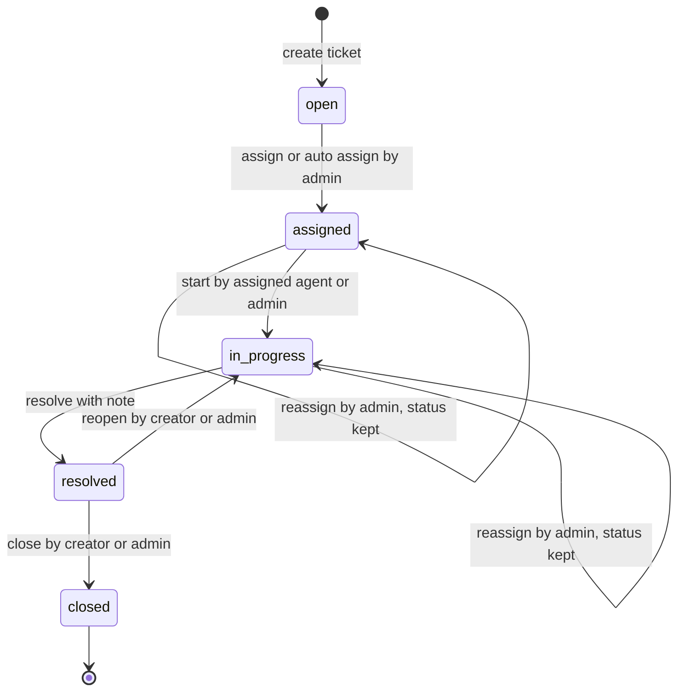
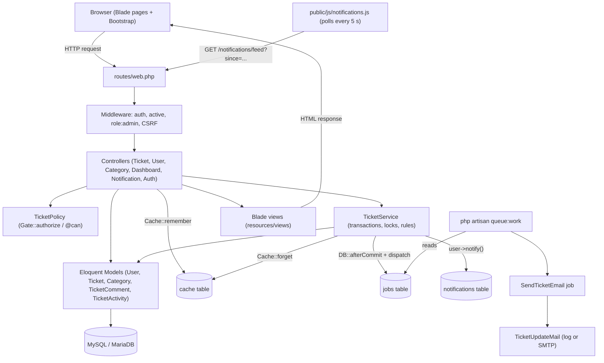

# 01 — Project Overview

This document explains **what ResolveDesk is, why it exists, who uses it and how it is built**.
Read it first. Every class, route and table named here exists in this codebase.

Related documents:
[Setup guide](02-SETUP-GUIDE.md) · [Database guide](03-DATABASE-GUIDE.md) ·
[Laravel MVC guide](04-LARAVEL-MVC-GUIDE.md) · [Business logic](06-BUSINESS-LOGIC-GUIDE.md) ·
[Notifications](13-NOTIFICATION-SYSTEM-GUIDE.md) · [Queue and email](14-QUEUE-AND-EMAIL-GUIDE.md) ·
[Caching](15-CACHING-GUIDE.md)

---

## 1. Business problem

A software company supports many customers. Customers report technical issues, software bugs,
account problems, billing problems and feature requests by **phone, email and chat apps**.

Without one central system:

- Customer issues are forgotten.
- Two support engineers may work on the same issue.
- Customers cannot see the progress of their issue.
- Managers cannot see who is overloaded.
- Critical issues may wait too long.
- Some agents get much more work than others.
- Deadlines (SLAs) are missed and nobody notices.
- Nobody is clearly accountable.
- The conversation history is scattered across many tools.

> **বাংলায়:** একটি সফটওয়্যার কোম্পানির অনেক কাস্টমার ফোন, ইমেইল, মেসেজে সমস্যা জানায়। সব আলাদা আলাদা জায়গায় থাকলে
> কোন সমস্যা কে দেখছে, কবে শেষ হবে, কোনটা জরুরি — কিছুই ঠিকমতো ট্র্যাক করা যায় না। ResolveDesk এই সব
> অনুরোধকে এক জায়গায় "টিকিট" হিসেবে রাখে, যাতে দায়িত্ব, সময়সীমা আর ইতিহাস পরিষ্কার থাকে।

## 2. Proposed solution

ResolveDesk is a **ticket system**. Every customer request becomes one row in the `tickets` table.
The system then provides:

| Need | How ResolveDesk solves it |
|---|---|
| One place for all requests | `tickets` table + ticket list page (`tickets.index`) |
| Who may see/do what | `role` column on `users` + `RoleMiddleware` + `TicketPolicy` |
| Fair distribution of work | Manual assign + **auto-assign to the least-busy agent** (`TicketService::findLeastBusyAgent()`) |
| Controlled workflow | `Ticket::TRANSITIONS` — only valid status changes are allowed |
| Deadlines | SLA hours per priority (`Ticket::SLA_HOURS`) → `due_at`; overdue is calculated live |
| Communication history | `ticket_comments` table |
| Accountability / audit | `ticket_activities` table (who changed what, old → new) |
| People know about changes | In-app notifications (`notifications` table + AJAX polling) |
| Email updates | Queued job `SendTicketEmail` (does not slow down the web request) |
| Management overview | Role-specific dashboards; admin statistics are cached for 60 seconds |

## 3. User roles

There are exactly three fixed roles, stored as a string in `users.role`. The allowed values are the
keys of `User::ROLES` in `app/Models/User.php`:

```php
public const ROLES = [
    self::ROLE_ADMIN => 'Administrator',
    self::ROLE_AGENT => 'Support Agent',
    self::ROLE_CUSTOMER => 'Customer',
];
```

There is no roles table and no dynamic permission system (this was a deliberate simplicity choice).
`users.is_active` decides whether a user can log in at all.

| Role | What they can do (summary) |
|---|---|
| **Administrator** (`admin`) | Admin dashboard with statistics and agent workload; create/edit users; activate/deactivate users; manage categories; see **all** tickets; create and edit tickets (any ticket that is not closed); assign, auto-assign and reassign; start/resolve/close/reopen; comment. |
| **Support Agent** (`agent`) | Personal dashboard (assigned, pending, in progress, resolved, overdue); see tickets **assigned to them or created by them**; start work and resolve assigned tickets (resolution note required); comment; receive assignment notifications and emails. |
| **Customer** (`customer`) | Personal dashboard; create tickets; see **only their own** tickets; edit own tickets while they are Open and unassigned; comment; see status, SLA deadline and resolution note; close (confirm) or reopen resolved tickets. |

An agent who **created** a ticket gets the creator-level actions (close/reopen) on that ticket, because
`TicketPolicy` checks "is this user the creator?" (`created_by`), not "is this user a customer?".

Authorization happens in three layers (all on the backend):

1. Route middleware in `routes/web.php`: `auth`, `active` (`ActiveUserMiddleware`) and `role:admin` (`RoleMiddleware`).
2. Ticket-level rules in `app/Policies/TicketPolicy.php` (`view`, `create`, `update`, `assign`, `start`,
   `resolve`, `close`, `reopen`, `comment`), called with `Gate::authorize(...)` in controllers and `@can` in Blade.
3. Business-state checks inside `app/Services/TicketService.php` (re-checked on a locked row).

> **বাংলায়:** Middleware দরজার দারোয়ানের মতো — লগইন করা আছে কি না, অ্যাকাউন্ট active কি না, admin কি না দেখে।
> Policy দেখে "এই নির্দিষ্ট ইউজার এই নির্দিষ্ট টিকিটে এই কাজটা করতে পারবে কি না"। আর Service শেষবারের মতো
> ডাটাবেসের সর্বশেষ অবস্থা দেখে নিয়ম যাচাই করে। তিনটাই সার্ভারে চলে, তাই ব্রাউজারে বাটন লুকালেও নিরাপত্তা ভাঙে না।

## 4. Functional requirements (modules)

| # | Module | Main code |
|---|---|---|
| 1 | Authentication (login, logout, rate limiting, inactive users blocked, no public registration) | `app/Http/Controllers/AuthController.php`, `app/Http/Middleware/ActiveUserMiddleware.php` |
| 2 | User management (admin only; users are deactivated, never deleted) | `app/Http/Controllers/UserController.php` |
| 3 | Category management (admin only; in-use categories cannot be deleted) | `app/Http/Controllers/CategoryController.php`, `app/Models/Category.php` |
| 4 | Ticket management (list with search/filters, create, show, edit) | `app/Http/Controllers/TicketController.php` |
| 5 | Ticket comments | `app/Http/Controllers/TicketCommentController.php`, `TicketService::addComment()` |
| 6 | Ticket activity history (audit trail) | `app/Models/TicketActivity.php`, `TicketService::recordActivity()` |
| 7 | Dashboards and reporting | `app/Http/Controllers/DashboardController.php` |
| 8 | In-app notifications (near-real-time polling) | `app/Notifications/TicketNotification.php`, `app/Http/Controllers/NotificationController.php`, `public/js/notifications.js` |
| 9 | Email through the queue | `app/Jobs/SendTicketEmail.php`, `app/Mail/TicketUpdateMail.php`, `resources/views/emails/ticket-update.blade.php` |
| 10 | Caching | `Category::activeForDropdown()`, `DashboardController::adminDashboard()` |

## 5. Business workflows

### 5.1 Ticket lifecycle

Statuses are defined in `Ticket::STATUSES`. The allowed button actions are defined in **one place**,
`Ticket::TRANSITIONS` in `app/Models/Ticket.php`:

```php
public const TRANSITIONS = [
    'start' => ['from' => self::STATUS_ASSIGNED, 'to' => self::STATUS_IN_PROGRESS],
    'resolve' => ['from' => self::STATUS_IN_PROGRESS, 'to' => self::STATUS_RESOLVED],
    'close' => ['from' => self::STATUS_RESOLVED, 'to' => self::STATUS_CLOSED],
    'reopen' => ['from' => self::STATUS_RESOLVED, 'to' => self::STATUS_IN_PROGRESS],
];
```

`Open → Assigned` is **not** in this array: it happens only through assignment
(`TicketService::performAssignment()`). Reassignment keeps the current status (Assigned stays Assigned,
In Progress stays In Progress). Closed tickets have no transitions — they are read-only.



Notes on the diagram:

- `start`, `resolve`, `close`, `reopen` are the exact keys of `Ticket::TRANSITIONS`.
- `Ticket::canPerform($action)` returns `true` only when `$this->status === self::TRANSITIONS[$action]['from']`.
- A **Resolved** ticket cannot be reassigned (`TicketPolicy::assign()` only allows `Ticket::ACTIVE_STATUSES`
  = open, assigned, in_progress).
- Reopen keeps the **original** `due_at` (simplified rule), so a reopened ticket may be overdue immediately.
- Reopen is refused if the assigned agent is no longer active.

### 5.2 Main workflows step by step

1. **Create** — any active user opens `GET /tickets/create` (`tickets.create`) and submits to
   `POST /tickets` (`tickets.store`). `TicketService::createTicket()` saves status `open`,
   `due_at = created_at + SLA hours`, then sets `ticket_number = TK-000123` from the new id, and writes a
   `created` activity, then notifies every active admin (in-app + queued email; an admin who created the
   ticket is not notified about it). All inside one transaction.
2. **Assign (manual)** — admin chooses an agent on the ticket page → `POST /tickets/{ticket}/assign`
   (`tickets.assign`) → `TicketService::assignAgent()`. Same agent again = nothing changes ("already assigned").
3. **Auto assign** — admin clicks *Auto Assign* → `POST /tickets/{ticket}/auto-assign` (`tickets.auto-assign`)
   → `TicketService::autoAssign()` picks the **active agent with the fewest Assigned + In Progress tickets**
   (tie → lowest id). If no active agent exists, the ticket stays Open.
4. **Start work** — assigned agent (or admin) → `tickets.start` → `TicketService::startWork()`.
5. **Resolve** — assigned agent (or admin) enters a resolution note → `tickets.resolve` →
   `TicketService::resolve()` sets `resolved_at` and `resolution_note`, notifies the creator (in-app + email).
6. **Close or reopen** — creator (or admin) confirms → `tickets.close`, or is not satisfied → `tickets.reopen`
   (clears `resolved_at` and `resolution_note`, keeps the old note in the activity history, notifies the agent).
7. **Comment** — anyone who can view a non-closed ticket → `tickets.comments.store` →
   `TicketService::addComment()` notifies the creator and the assigned agent, except the author.

Every workflow method in `TicketService` follows the same pattern: **transaction → row lock
(`lockForUpdate`) → re-check the rule → save → activity → in-app notification → email queued after
commit → clear dashboard cache**. Details: [Business logic guide](06-BUSINESS-LOGIC-GUIDE.md).

### 5.3 Notification matrix (implemented)

| Event | Who is notified | In-app | Email |
|---|---|---|---|
| Ticket created | every active admin (except the creator) | yes | yes |
| Assigned | the agent | yes | yes |
| Reassigned | the new agent | yes | yes |
| Resolved | the ticket creator | yes | yes |
| Reopened | the assigned agent | yes | yes |
| Closed | the assigned agent | yes | no |
| Comment | creator and assigned agent (not the author) | yes | no |

Inactive users and the person who performed the action are never notified (`TicketService::notifyUser()`).
The "Ticket created → admins" row was added at the project owner's request, beyond the original
MASTER_PROMPT §9.2 matrix.

## 6. Technology choices

| Technology | Why it was chosen |
|---|---|
| **PHP 8.4.28** | Required by the project; `composer.json` requires `"php": "~8.4.0"`. |
| **Laravel 13** (13.44.1 installed) | Standard MVC framework with routing, Eloquent ORM, validation, policies, queues, mail, cache and notifications built in — no extra packages needed. |
| **MySQL 8 / MariaDB** | Relational data with foreign keys and transactions. On this PC, **MariaDB 10.4 (XAMPP)** is used because MySQL 8 is not installed. All code uses Eloquent/standard SQL; the only DB-specific SQL (`TIMESTAMPDIFF`, `DATE()`) works on both. |
| **Blade + Bootstrap 5.3** | Server-rendered HTML; simple to explain. Bootstrap, Bootstrap Icons and Chart.js are served from `public/vendor/` (no npm build step needed). |
| **Vanilla JavaScript** | `public/js/notifications.js` polls the notification feed with `fetch()`; no frontend framework. |
| **Database queue** (`QUEUE_CONNECTION=database`) | No Redis needed; jobs are rows in the `jobs` table, easy to inspect with SQL. |
| **Database cache** (`CACHE_STORE=database`) | No Redis needed; cached values are rows in the `cache` table. |
| **Database session** (`SESSION_DRIVER=database`) | Sessions in the `sessions` table. |
| **Database notifications** | Laravel's built-in `notifications` table + `Notifiable` trait. |

Only `laravel/framework` and `laravel/tinker` are required packages (see `composer.json`).

## 7. Architecture

ResolveDesk is a **traditional Laravel MVC monolith** with one small service class:

- **Routes** (`routes/web.php`) map URLs to controller methods and attach middleware.
- **Controllers** (`app/Http/Controllers`) validate input, call `Gate::authorize()`, and return views or redirects.
  Plain CRUD (users, categories) is done directly in the controller.
- **Service** (`app/Services/TicketService.php`) holds ticket rules that touch several tables at once.
- **Models** (`app/Models`) describe tables, relationships, constants, scopes and small helpers.
- **Policy** (`app/Policies/TicketPolicy.php`) answers "may this user do this action on this ticket?".
- **Views** (`resources/views`) are Blade templates with Bootstrap.
- **Job + Mailable** send emails in the background.



### Request flow for one workflow button (example: Resolve)

```text
POST /tickets/{ticket}/resolve  (form with @csrf)
  -> middleware: web (session, CSRF), auth, active
  -> TicketController::resolve()
       Gate::authorize('resolve', $ticket)      -> TicketPolicy::resolve()  (403 if false)
       $request->validate(['resolution_note' => [...]])
       $this->ticketService->resolve(...)
            DB::transaction -> lockTicket() -> ensureActionAllowed('resolve')
            save -> recordActivity -> notifyUser (database row + queued email after commit)
       -> clearDashboardCache()
  -> back()->with('success', 'Ticket marked as Resolved.')
```

> **বাংলায়:** MVC মানে Model–View–Controller। Route ঠিক করে কোন URL কোন Controller method-এ যাবে।
> Controller ইনপুট যাচাই করে আর অনুমতি চেক করে; জটিল টিকিট-নিয়মগুলো TicketService-এ থাকে। Model ডাটাবেস টেবিলের
> প্রতিনিধি, আর View (Blade) ব্যবহারকারীকে HTML দেখায়। ইমেইল পাঠানোর মতো ধীর কাজ queue-তে যায়, যাতে পেজ দ্রুত লোড হয়।

## 8. Implemented features

- Session login/logout with rate limiting (5 failed attempts per email + IP, 60-second lockout), no public registration.
- Inactive users cannot log in, and are logged out on their next request (`ActiveUserMiddleware`).
- Admin user management: create, edit, activate/deactivate (no delete). Rules: an admin cannot deactivate or
  demote themselves; the last active admin is protected; an agent with Assigned/In Progress/Resolved tickets
  cannot be deactivated or demoted.
- Category management with unique names, active/inactive flag, and delete only when no ticket uses it.
- Ticket list with search (ticket number / subject), filters (status, priority, category, agent for admins,
  date range, overdue) and pagination that keeps the filters.
- Ticket create/show/edit; human ticket numbers `TK-000001`; SLA deadline from priority.
- Priority change recalculates `due_at` from the **original** `created_at` and logs `priority_changed` + `due_date_changed`.
- Manual assignment, reassignment, least-workload auto assignment with duplicate prevention.
- Controlled lifecycle (start, resolve with note, close, reopen) with row locking.
- Comments (blocked on closed tickets) and a full activity timeline.
- Live overdue indicator (`Ticket::isOverdue()`, `Ticket::scopeOverdue()`), never stored.
- In-app notifications: navbar bell with unread count, dropdown, toasts, history page with read/unread filter,
  mark one / mark all as read — refreshed by polling every 5 seconds (30 seconds while the tab is hidden).
- Queued emails (`SendTicketEmail`, 3 tries, 10-second backoff, `failed()` logs the error).
- Role-specific dashboards; admin statistics (status/priority/category counts, 14-day trend, average
  resolution hours) cached under `dashboard:admin:stats` for 60 seconds and cleared after ticket changes.
- Active category dropdown cached under `ticket:active-categories` for 3600 seconds and cleared on category changes.
- N+1 protection: `Model::preventLazyLoading(! production)` in `app/Providers/AppServiceProvider.php`.
- Demo seeder (`database/seeders/DatabaseSeeder.php`) with 10 users, 7 categories and 32 tickets with history.
- Feature test suite in `tests/Feature` (9 files) using the separate `resolvedesk_testing` database.

## 9. Limitations (honest list)

- **Tested on MariaDB 10.4, not MySQL 8.** MySQL 8 is the target but was not installed on the development PC.
- **Polling, not push.** Notifications appear within about 5 seconds, not instantly. Each open tab sends one
  request every 5 seconds.
- **SLA uses continuous calendar hours** — no business hours, weekends or holidays.
- **Reopen keeps the original deadline**, so reopened tickets can be immediately overdue.
- **Resolved tickets cannot be reassigned.** To deactivate an agent who still has Resolved tickets, those tickets
  must be closed first.
- **No ticket deletion, no user deletion** through the UI (by design, to protect history).
- No file attachments, no password reset, no email verification, no self-registration.
- If pushing an email job fails after the commit, the error is only written to the log (the ticket change is kept).
- In-app notifications are written synchronously inside the transaction (fast, but not queued).
- Admin dashboard statistics can be up to 60 seconds old in rare cases (changes made outside `TicketService`/
  `CategoryController`, e.g. directly in the database).
- **Not verified:** visual rendering in a real browser, the JavaScript toast in a browser, and real Gmail SMTP
  delivery (only the `log` mailer was used). See `DEVELOPMENT_PROGRESS.md`.
- The project was built with AI assistance; the verification facts are those recorded in `DEVELOPMENT_PROGRESS.md`.

## 10. Future improvements (NOT implemented)

These are ideas for discussion only. None of them exist in the code.

- Real-time push with WebSockets (Laravel Reverb) or Server-Sent Events instead of polling.
- Redis for cache and queue (faster than database tables at high load), with Supervisor to keep workers running.
- A scheduled command (Laravel Scheduler) to escalate or warn about tickets close to their SLA deadline.
- Business-hours SLA calendar and SLA pause while waiting for the customer.
- Transactional outbox table so email jobs can never be lost between commit and dispatch.
- File attachments on tickets and comments.
- Password reset and email verification.
- Queued notifications and email digests.
- Full-text search on subject and description.
- Customer satisfaction rating after closing a ticket.
- API endpoints (e.g. Laravel Sanctum) for a mobile app.
