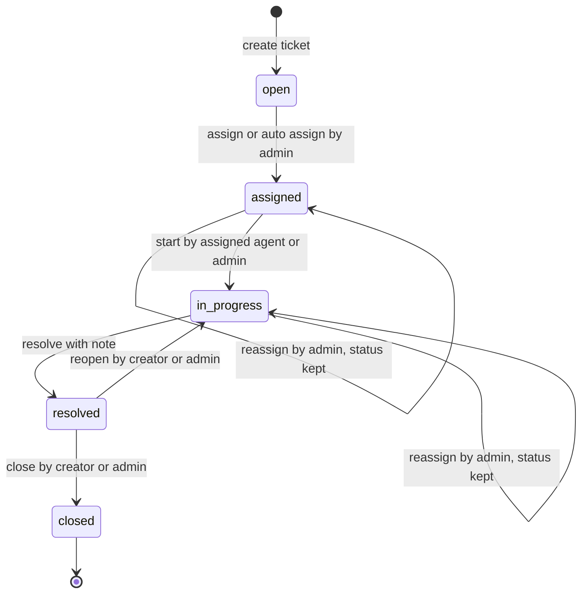
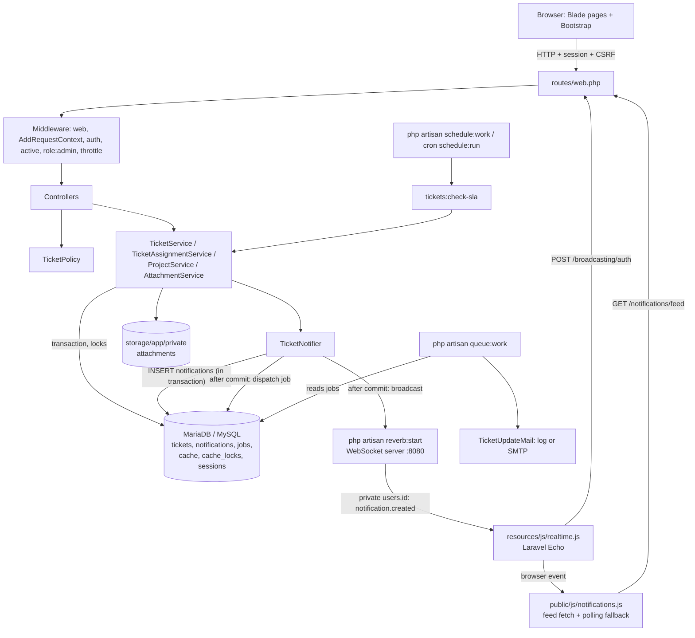

# 01 — Project Overview

This document explains **what ResolveDesk is, why it exists, who uses it and how it is built**.
Read it first. Every class, route and table named here exists in this codebase (V2).

Related documents:
[Setup guide](02-SETUP-GUIDE.md) · [Database guide](03-DATABASE-GUIDE.md) ·
[Laravel MVC guide](04-LARAVEL-MVC-GUIDE.md) · [Business logic](06-BUSINESS-LOGIC-GUIDE.md) ·
[System design](10-SYSTEM-DESIGN-GUIDE.md) · [V2 business features](22-V2-BUSINESS-FEATURES.md) ·
[Concurrency](20-CONCURRENCY-AND-DATA-INTEGRITY.md) · [Real-time (Reverb)](21-REALTIME-REVERB-ECHO.md)

---

## 0. V1 and V2 in one table

ResolveDesk was built in two steps. **V1** was a single-product helpdesk. **V2** (specification:
`V2_MASTER_PROMPT.md`) turned it into a **multi-project customer support system** and hardened it for
production-style concurrency, real-time delivery and operations. All V1 rules still apply unless V2 changed them.

| Area | V1 | V2 (current code) |
|---|---|---|
| Business scope | One product, customers only | Many **projects** (HRMS, ERP, …) used by many **client organizations** |
| New tables | users, categories, tickets, ticket_comments, ticket_activities, notifications | + `projects`, `clients`, `client_project`, `project_user`, `ticket_attachments` |
| Ticket grouping | none | `tickets.project_id` and `tickets.client_id` (both nullable → 4 kinds of tickets) |
| Assignment | any active agent | only agents **associated with the ticket's project** (global tickets: any active agent) |
| Ticket services | one `TicketService` | `TicketService`, `TicketAssignmentService`, `TicketNotifier`, `AttachmentService`, `ProjectService` |
| Concurrency | transaction + `lockForUpdate` on transitions | + `version` column (optimistic locking, 409), `Cache::lock('ticket-assignment')`, deadlock retry `DB::transaction(..., 3)`, shared lock on the project row |
| Duplicate submit | two clicks = two tickets | `request_token` + unique index `(created_by, request_token)` = idempotent creation |
| Notifications | database + AJAX polling every 5 s | database (source of truth) + **Laravel Reverb WebSocket** push on private channel `users.{id}`, polling as fallback |
| Email | queued after commit | + previous agent / customer-reply rules, `$timeout = 60`, duplicate-send guard in the cache |
| Comments | public only | public replies + staff-only **internal notes** |
| Files | none | private **attachments** (max 5 files, 5 MB each, type-checked, authorized download) |
| SLA | live overdue flag only | + `php artisan tickets:check-sla` every minute through the **scheduler**, one reminder per breach (`sla_notified_at`) |
| Reports | dashboards | + project/client/SLA-compliance stats, `/reports` page, streamed CSV export |
| Operations | login rate limit | + named rate limiters, `X-Request-Id` log context, `/health/ready` readiness endpoint, 429 page |
| Tests | 88 tests / 389 assertions (9 files) | **164 tests / 661 assertions** (16 files in `tests/Feature`), incl. two-connection MySQL lock tests |

> **বাংলায়:** V1 ছিল একটা প্রোডাক্টের সাধারণ হেল্পডেস্ক। V2-তে একই অ্যাপকে অনেক প্রোডাক্ট (project) আর অনেক
> ক্লায়েন্ট কোম্পানির জন্য বানানো হয়েছে, আর একসাথে অনেক ইউজার কাজ করলে ডাটা যেন নষ্ট না হয় (concurrency),
> নোটিফিকেশন যেন সাথে সাথে আসে (WebSocket), আর ফাইল যেন নিরাপদে থাকে — এসব যোগ করা হয়েছে।

## 1. Business problem

A software company sells several products — for example **HRMS, ERP, Payroll, Accounting and Inventory** —
to many client companies. Customers report bugs, account problems and feature requests by **phone, email and
chat apps**.

Without one central system:

- Customer issues are forgotten, and two support engineers may work on the same issue.
- Customers cannot see the progress of their issue.
- Managers cannot see who is overloaded, or which product creates the most problems.
- Critical issues may wait too long; SLA deadlines are missed and nobody notices.
- An engineer who does not know the ERP product may be given an ERP issue.
- One client's data could be shown to another client.
- The conversation history is scattered across many tools.

> **বাংলায়:** একটি সফটওয়্যার কোম্পানির অনেক প্রোডাক্ট আর অনেক ক্লায়েন্ট কোম্পানি আছে। সমস্যাগুলো আলাদা আলাদা
> জায়গায় থাকলে কোনটা কোন প্রোডাক্টের, কে দেখছে, কবে শেষ হবে — কিছুই ট্র্যাক করা যায় না। ResolveDesk সব অনুরোধকে
> project আর client অনুযায়ী "টিকিট" হিসেবে এক জায়গায় রাখে।

## 2. Multi-project business domain (V2)

- A **project** (`projects` table) is a software product, e.g. `HRMS`, `ERP`. It can be deactivated, never deleted.
- A **client organization** (`clients` table) is a customer company, e.g. `ACME`, `GLOBEX`.
- One project serves many clients and one client uses many projects → pivot table **`client_project`**.
- One agent supports many projects and one project has many agents → pivot table **`project_user`**.
- A customer user may belong to one client organization (`users.client_id`, nullable = *standalone customer*).

Every ticket has a nullable `project_id` and a nullable `client_id`, so there are **four kinds of tickets**:

| `project_id` | `client_id` | Meaning | Example |
|---|---|---|---|
| set | set | Client issue in a product | ACME reports a payroll calculation bug in PAYROLL |
| set | NULL | Internal product issue | An agent records an ERP server problem |
| NULL | set | General client support | ACME asks about their contract |
| NULL | NULL | Global internal support | Any request not tied to a product or client |

**"Global" means "not tied to a project", never "public".** A global ticket is still visible only to its creator,
its assigned agent and admins.

Who may choose what is decided on the server by `TicketService::resolveScope()` (inside the create transaction):

| Creator | `client_id` | `project_id` |
|---|---|---|
| Customer | always their own organization (form input ignored); standalone customers → NULL | must be active **and** used by their organization; standalone → global only |
| Agent | always NULL (internal tickets only) | must be a project the agent supports |
| Admin | any active client or none | any active project; if both chosen, the client must use the project |

The **dependent dropdown** on the create form calls `GET /tickets/project-options?client_id=…`
(`TicketController::projectOptions()`), but this only fills the list — the backend re-validates everything.

Existing V1 tickets were not changed: after the additive migrations they became global tickets
(`project_id = NULL`, `client_id = NULL`). No client or project was invented for historical data.

Details: [V2 business features](22-V2-BUSINESS-FEATURES.md).

## 3. User roles

There are exactly three fixed roles, stored as a string in `users.role`. The allowed values are the keys of
`User::ROLES` in `app/Models/User.php`:

```php
public const ROLES = [
    self::ROLE_ADMIN => 'Administrator',
    self::ROLE_AGENT => 'Support Agent',
    self::ROLE_CUSTOMER => 'Customer',
];
```

There is no roles table and no dynamic permission system (a deliberate simplicity choice). V2 did **not** add a
"customer manager" role. `users.is_active` decides whether a user can log in at all.

| Role | What they can do (V2) |
|---|---|
| **Administrator** (`admin`) | Manage projects, clients, users, categories and the project↔client / project↔agent associations (on the project details page); see **all** tickets; create internal and client tickets; assign / auto-assign / reassign to eligible agents; all transitions; public replies and internal notes; dashboard with project/client/SLA statistics; `/reports` and CSV export. |
| **Support Agent** (`agent`) | See tickets **assigned to them or created by them**; create internal tickets (global or for projects they support); start and resolve assigned tickets; public replies, internal notes, attachments; personal dashboard. **Project membership controls assignment eligibility only — it does not show all tickets of the project.** |
| **Customer** (`customer`) | Create global tickets or tickets for projects of their own organization; see **only their own** tickets; public replies and attachments (never internal notes or internal files); close or reopen resolved tickets; own notifications only. |

An agent who **created** a ticket gets creator-level actions (close/reopen), because `TicketPolicy` checks
`created_by`, not the role.

Authorization happens in layers, all on the backend:

1. Route middleware in `routes/web.php`: `auth`, `active` (`ActiveUserMiddleware`), `role:admin`
   (`RoleMiddleware`) and `throttle:*` rate limiters.
2. Ticket rules in `app/Policies/TicketPolicy.php` (`view`, `create`, `update`, `assign`, `start`, `resolve`,
   `close`, `reopen`, `comment`, `addInternalNote`, `downloadAttachment`), called with `Gate::authorize(...)`
   and `@can` in Blade.
3. Scope and state checks inside the services, re-checked on a **locked row** (`resolveScope()`,
   `ensureActionAllowed()`, `ensureVersion()`, `Ticket::canBeAssignedTo()`).
4. Query-level filtering: `Ticket::scopeVisibleTo()`, `TicketComment::scopeVisibleTo()` and
   `TicketActivity::scopeVisibleTo()` remove other people's tickets and internal content in SQL.
5. Private broadcast channel rule in `routes/channels.php`: only user 5 may join `users.5`.

> **বাংলায়:** Middleware দরজার দারোয়ানের মতো (লগইন, active, admin, কতবার রিকোয়েস্ট)। Policy দেখে "এই ইউজার এই
> টিকিটে এই কাজটা করতে পারবে কি না"। Service ডাটাবেসের লক করা সর্বশেষ row দেখে শেষবার নিয়ম যাচাই করে। আর
> query scope নিশ্চিত করে যে অন্য ক্লায়েন্টের টিকিট বা internal note SQL থেকেই বাদ পড়ে — একেই বলে logical client data isolation।

## 4. Functional modules

| # | Module | Main code |
|---|---|---|
| 1 | Authentication (login, logout, login rate limit, inactive users blocked) | `AuthController`, `ActiveUserMiddleware` |
| 2 | User management (deactivate, never delete; customer ↔ client) | `UserController` |
| 3 | Category management | `CategoryController`, `Category` |
| 4 | **Project management** (V2) + association checklists | `ProjectController`, `ProjectService::syncClients()` / `syncAgents()` |
| 5 | **Client organization management** (V2) | `ClientController` |
| 6 | Tickets: list (search + filters), create (Form Request, idempotent), show, edit (optimistic locking) | `TicketController`, `StoreTicketRequest`, `TicketService` |
| 7 | Assignment: manual, reassign, automatic least-workload among eligible agents | `TicketAssignmentService` |
| 8 | Lifecycle: start, resolve, reopen, close | `TicketService` + `Ticket::TRANSITIONS` |
| 9 | Public replies and **internal notes** | `TicketCommentController`, `TicketService::addComment()` |
| 10 | **Attachments** (private disk, authorized download) | `AttachmentService`, `TicketAttachmentController` |
| 11 | Activity history (audit trail, system activities with `user_id = NULL`) | `TicketActivity::record()` |
| 12 | In-app + **real-time** notifications | `TicketNotifier`, `UserNotificationCreated`, `NotificationController`, `resources/js/realtime.js`, `public/js/notifications.js` |
| 13 | Email through the queue | `SendTicketEmail`, `TicketUpdateMail` |
| 14 | **SLA breach reminders** (scheduler) | `CheckSlaBreaches` (`tickets:check-sla`), `TicketService::processSlaBreach()`, `routes/console.php` |
| 15 | Dashboards, **reports and CSV export** | `DashboardController`, `ReportController` |
| 16 | Caching and atomic locks | `Cache::remember` in `DashboardController` and `Category`, `Cache::lock` in `TicketAssignmentService` |
| 17 | Operations: rate limits, request id, readiness | `AppServiceProvider::configureRateLimiting()`, `AddRequestContext`, `/health/ready` |

## 5. Business workflows

### 5.1 Ticket lifecycle (unchanged in V2)

Statuses are defined in `Ticket::STATUSES`. The allowed button actions are defined in **one place**,
`Ticket::TRANSITIONS` in `app/Models/Ticket.php`:

```php
public const TRANSITIONS = [
    'start' => ['from' => self::STATUS_ASSIGNED, 'to' => self::STATUS_IN_PROGRESS],
    'resolve' => ['from' => self::STATUS_IN_PROGRESS, 'to' => self::STATUS_RESOLVED],
    'close' => ['from' => self::STATUS_RESOLVED, 'to' => self::STATUS_CLOSED],
    'reopen' => ['from' => self::STATUS_RESOLVED, 'to' => self::STATUS_IN_PROGRESS],
];
```

`Open → Assigned` happens only through assignment (`TicketAssignmentService::performAssignment()`).
Reassignment keeps the current status. Closed tickets are read-only.



- A **Resolved** ticket cannot be reassigned (`TicketPolicy::assign()` allows only `Ticket::ACTIVE_STATUSES`).
- Reopen keeps the **original** `due_at`, so a reopened ticket may be overdue immediately.
- Every mutation increases `tickets.version` by 1 (V2).

### 5.2 Main workflows step by step

1. **Create** — `GET /tickets/create` renders the form with a fresh hidden `request_token` (UUID).
   `POST /tickets` (`throttle:ticket-create`) → `StoreTicketRequest` (format + policy) →
   `TicketService::createTicket()`: replay check by token → files stored → transaction (`resolveScope()`,
   insert, `TK-000123` number, `created` activity, attachments, notify admins) → dashboard cache cleared.
   Double submit with the same token returns the **same** ticket ("This form was already submitted").
2. **Assign / reassign** — `POST /tickets/{ticket}/assign` → `TicketAssignmentService::assignAgent()`:
   `Cache::lock('ticket-assignment')` → transaction → shared lock on project row → `FOR UPDATE` on ticket →
   version check → eligibility (`Ticket::canBeAssignedTo()`) → save. Same agent again = no change.
   Reassignment also notifies the **previous** agent (in-app only, ticket number only).
3. **Auto assign** — `POST /tickets/{ticket}/auto-assign` → `TicketAssignmentService::autoAssign()` picks the
   eligible active agent with the fewest Assigned + In Progress tickets (counted across all projects;
   tie → lowest id). No eligible agent → ticket stays Open.
4. **Start / resolve / reopen / close** — `TicketService` methods with row lock, optional `version` check and
   `ensureActionAllowed()`.
5. **Reply or internal note** — `POST /tickets/{ticket}/comments` (`throttle:comments`) with
   `visibility = public|internal` and optional `attachments[]`. Internal notes need
   `TicketPolicy::addInternalNote()` (staff only).
6. **SLA breach** — every minute the scheduler runs `tickets:check-sla`; each overdue ticket with
   `sla_notified_at IS NULL` is locked, marked and notified **once**.

### 5.3 Notification matrix (implemented, V2)

| Event (`event_type`) | Who is notified | In-app | Email |
|---|---|---|---|
| `created` | every active admin (except an admin who created it) | yes | yes |
| `assigned` | the agent | yes | yes |
| `reassigned` | the new agent | yes | yes |
| `unassigned` | the previous agent (V2) | yes | no |
| `resolved` | the ticket creator | yes | yes |
| `reopened` | the assigned agent | yes | yes |
| `closed` | the assigned agent | yes | no |
| `comment` | creator and assigned agent, except the author | yes | only a **customer's** reply → the assigned agent (V2) |
| `internal_note` | assigned agent and a staff creator (never a customer) | yes | no |
| `sla_breached` | assigned active agent, otherwise every active admin (V2, actor = system) | yes | yes |

Rules in `TicketNotifier::notify()`: skip missing or inactive users and the person who performed the action.
Every in-app notification is also signalled in real time (after commit) to `users.{id}`.

## 6. Technology choices

| Technology | Why it was chosen |
|---|---|
| **PHP 8.4.28** | Required (`composer.json`: `"php": "~8.4.0"`). |
| **Laravel 13** (13.44.1) | Routing, Eloquent, validation, policies, queues, mail, cache, notifications, broadcasting and scheduler built in. |
| **MariaDB 10.4 (XAMPP)** | The target is MySQL 8, but MySQL 8 is not installed on the development PC. InnoDB row locks (`FOR UPDATE`, `LOCK IN SHARE MODE`) behave the same for this project. **Nothing was tested on MySQL 8.** |
| **Blade + Bootstrap 5.3 + Vanilla JS** | Server-rendered pages; Bootstrap, icons and Chart.js are files in `public/vendor/`. |
| **Laravel Reverb 1.14** (V2) | First-party WebSocket server speaking the Pusher protocol; only extra Composer package. |
| **Laravel Echo + pusher-js** (V2) | Browser WebSocket client, bundled by **Vite** into one file (`resources/js/realtime.js`). The app still works without the bundle (polling). |
| **Database queue, cache, session** | No Redis needed; jobs, cache rows, atomic locks (`cache_locks`) and sessions are visible with SQL. |
| **Laravel Scheduler** (V2) | `routes/console.php` runs `tickets:check-sla` every minute with `withoutOverlapping()`. |
| **Pint** (V2, dev) | Code style; run `vendor/bin/pint --dirty`. |

Composer packages: `laravel/framework`, `laravel/reverb`, `laravel/tinker` (+ dev tools). npm packages:
`laravel-echo`, `pusher-js`, `vite`, `laravel-vite-plugin` only.

## 7. Architecture

ResolveDesk is a **Laravel modular monolith with traditional MVC**: one application, one database, a few focused
service classes. No microservices, no repository layer, no event-sourcing.

- **Routes** (`routes/web.php`, `routes/channels.php`, `routes/console.php`) map URLs, broadcast channels and
  scheduled commands.
- **Controllers** validate, authorize (`Gate::authorize`) and return views, redirects or JSON. Simple CRUD
  (users, categories, clients) lives in the controller.
- **Services** hold rules that touch several tables or need locks: `TicketService`,
  `TicketAssignmentService`, `TicketNotifier`, `AttachmentService`, `ProjectService`.
- **Models** describe tables, relationships, constants, scopes and small helpers.
- **Policy** `TicketPolicy` answers "may this user do this action on this ticket?".
- **Event** `UserNotificationCreated` (`ShouldBroadcastNow`) carries only a notification id to Reverb.
- **Job + Mailable** send emails in the queue worker. **Command** `CheckSlaBreaches` runs from the scheduler.



### Request flow for one button (example: Resolve)

```text
POST /tickets/{ticket}/resolve  (form with @csrf and hidden version)
  -> middleware: web (session, CSRF, AddRequestContext), auth, active
  -> TicketController::resolve()
       Gate::authorize('resolve', $ticket)                 -> TicketPolicy::resolve() (403 if false)
       $request->validate(['resolution_note' => ..., 'version' => ...])
       TicketService::resolve($ticket, $note, $user, $expectedVersion)
            DB::transaction(..., 3)
              lockTicket()            SELECT ... FOR UPDATE
              ensureVersion()         stale version -> TicketConflictException (409 / redirect back)
              ensureActionAllowed('resolve')
              save (version + 1) -> TicketActivity::record() -> TicketNotifier::notify()
            after COMMIT: broadcast to Reverb + SendTicketEmail job
            clearDashboardCache()
  -> back()->with('success', 'Ticket marked as Resolved.')
```

> **বাংলায়:** Route ঠিক করে কোন URL কোন Controller method-এ যাবে। Controller অনুমতি আর ইনপুট যাচাই করে, জটিল
> নিয়ম Service-এ থাকে। ডাটাবেসে commit হওয়ার **পরে** WebSocket সিগন্যাল আর ইমেইল job পাঠানো হয় — যাতে rollback হলে
> ভুল নোটিফিকেশন বা ইমেইল না যায়।

## 8. Implemented features (V2 list)

- Session login/logout, login rate limit (5 failed attempts per email + IP, 60 s lockout), no self-registration.
- Inactive users cannot log in and are logged out on their next request; inactive users cannot join a broadcast channel.
- Projects and clients: CRUD with unique `code`, activate/deactivate, never deleted; association checklists on the
  project page with removal guards (`ProjectService`, row lock on the project).
- Ticket scope rules per role (`resolveScope()`), dependent project dropdown, project/client/global filters.
- Idempotent ticket creation (`request_token`), optimistic locking on edit and transitions (`version`),
  pessimistic row locks, global assignment `Cache::lock`, deadlock retry.
- Least-workload auto-assignment among **eligible** agents, duplicate assignment prevention.
- Public replies, staff-only internal notes and internal activities hidden from customers in SQL.
- Private attachments: max 5 files × 5 MB, extensions `pdf, png, jpg, jpeg, txt, docx, xlsx`, checked by
  extension **and** detected MIME type, UUID file names, download only through `TicketAttachmentController`.
- Database notifications + real-time Reverb push + polling fallback; toasts, bell, history page.
- Queued email after commit with 3 tries, 10 s backoff, 60 s timeout, cache-based duplicate guard.
- SLA: `due_at` per priority, live overdue, scheduled one-time breach reminder.
- Admin dashboard (status, priority, category, project, client, SLA compliance, 14-day trend) cached 60 s;
  agent and customer dashboards live.
- `/reports` with filters and streamed CSV export (formula-injection safe, `throttle:exports`).
- Rate limiters `ticket-create` (10/min), `comments` (30/min), `notifications` (120/min), `exports` (5/min).
- `X-Request-Id` header + `request_id`/`user_id` in every log line; `/up` liveness, `/health/ready` readiness.
- `V2DemoDataSeeder` (additive) with 5 projects, 3 clients and their associations.
- 164 feature tests / 661 assertions on the separate `resolvedesk_testing` database.

## 9. Limitations (honest list)

- **Tested on MariaDB 10.4, not MySQL 8.**
- **Not verified:** visual rendering in a real browser, the WebSocket toast inside a browser (the real-time path was
  verified with a Node + pusher-js client: 255 ms delivery), real Gmail SMTP, a Linux/Nginx deployment and a backup
  restore drill.
- Timestamps are stored in `Asia/Dhaka`, not UTC (V1 data was stored that way).
- Single Reverb server, no Redis scaling; every open tab has its own WebSocket and shows its own toast.
- The assignment lock is global (one assignment at a time) and expires after 10 s; it coordinates workload — the
  ticket row lock and status/version checks remain the real guarantee.
- Email de-duplication is best effort (2-day cache key); a crash between SMTP accept and cache write can duplicate.
- SLA uses calendar hours (no business hours/holidays); reopen keeps the original deadline.
- Resolved tickets cannot be reassigned, so an agent with Resolved project tickets can only be removed from the
  project / deactivated after those tickets are closed.
- A customer's organization cannot change after they created client tickets. Associations are edited only on the
  project page.
- No antivirus scanning, no attachment deletion UI, no password reset, no email verification, no ticket deletion.
- The project was built with AI assistance; verification facts are those recorded in `DEVELOPMENT_PROGRESS.md`.

## 10. Future improvements (NOT implemented)

Ideas for discussion only — none of them exist in the code:

- Redis for cache, queue, locks and sessions; Supervisor/systemd for workers; Reverb horizontal scaling with Redis.
- Multiple app servers behind a load balancer, shared object storage (S3) for attachments, read replicas for reports.
- Transactional outbox so a queued email can never be lost between commit and dispatch.
- Business-hours SLA calendar, SLA pause while waiting for the customer, pre-breach warnings.
- A customer-manager role that sees all tickets of their organization (would need a new policy rule and a
  `visibleTo()` branch on `client_id`).
- Agent availability flag, antivirus scanning, attachment deletion, full-text search, API with Sanctum.

## 11. Documentation index

| # | Guide |
|---|---|
| 01 | Project overview (this file) |
| 02 | [Setup guide](02-SETUP-GUIDE.md) |
| 03 | [Database guide](03-DATABASE-GUIDE.md) |
| 04 | [Laravel MVC guide](04-LARAVEL-MVC-GUIDE.md) |
| 05 | [Module-wise code explanation](05-MODULE-WISE-CODE-EXPLANATION.md) |
| 06 | [Business logic guide](06-BUSINESS-LOGIC-GUIDE.md) |
| 07 | [UI-to-backend mapping](07-UI-TO-BACKEND-MAPPING.md) |
| 08 | [Live coding practice](08-LIVE-CODING-PRACTICE.md) |
| 09 | [Interview questions and answers](09-INTERVIEW-QUESTIONS-AND-ANSWERS.md) |
| 10 | [System design guide](10-SYSTEM-DESIGN-GUIDE.md) |
| 11 | [Debugging guide](11-DEBUGGING-GUIDE.md) |
| 12 | [Quick reference](12-QUICK-REFERENCE.md) |
| 13 | [Notification system](13-NOTIFICATION-SYSTEM-GUIDE.md) |
| 14 | [Queue and email](14-QUEUE-AND-EMAIL-GUIDE.md) |
| 15 | [Caching](15-CACHING-GUIDE.md) |
| 16 | [Codebase learning map](16-CODEBASE-LEARNING-MAP.md) |
| 17 | [Demo and interview guide](17-DEMO-AND-INTERVIEW-GUIDE.md) |
| 18 | [Production deployment](18-PRODUCTION-DEPLOYMENT.md) |
| 19 | [Backup and recovery](19-BACKUP-AND-RECOVERY.md) |
| 20 | [Concurrency and data integrity](20-CONCURRENCY-AND-DATA-INTEGRITY.md) |
| 21 | [Real-time: Reverb and Echo](21-REALTIME-REVERB-ECHO.md) |
| 22 | [V2 business features](22-V2-BUSINESS-FEATURES.md) |
| 23 | [Security, errors, logging, operations](23-SECURITY-ERRORS-LOGGING-OPERATIONS.md) |
