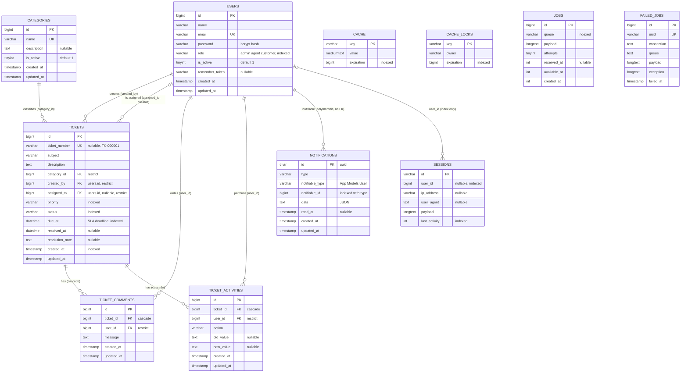

# 03 — Database Guide

This guide explains every table, column, key and index in ResolveDesk, the Eloquent models that use them,
and the SQL that Laravel actually runs. All facts come from `database/migrations/*.php`,
`app/Models/*.php` and the real `SHOW CREATE TABLE` output of the development database (MariaDB 10.4).

Related: [Project overview](01-PROJECT-OVERVIEW.md) · [Setup guide](02-SETUP-GUIDE.md) ·
[Business logic](06-BUSINESS-LOGIC-GUIDE.md) · [Notifications](13-NOTIFICATION-SYSTEM-GUIDE.md) ·
[Queue and email](14-QUEUE-AND-EMAIL-GUIDE.md) · [Caching](15-CACHING-GUIDE.md)

---

## 1. Overview

### 1.1 Migration files (run in filename order)

| File | Creates |
|---|---|
| `0001_01_01_000000_create_users_table.php` | `users`, `sessions` |
| `0001_01_01_000001_create_cache_table.php` | `cache`, `cache_locks` |
| `0001_01_01_000002_create_jobs_table.php` | `jobs`, `failed_jobs` |
| `2026_11_25_000001_create_categories_table.php` | `categories` |
| `2026_11_25_000002_create_tickets_table.php` | `tickets` |
| `2026_11_25_000003_create_ticket_comments_table.php` | `ticket_comments` |
| `2026_11_25_000004_create_ticket_activities_table.php` | `ticket_activities` |
| `2026_11_25_140742_create_notifications_table.php` | `notifications` |

Laravel also creates the `migrations` table itself; it records which migration files have run (column
`migration`) and in which `batch`.

The order matters: `tickets` references `categories` and `users`, so those tables must exist first.
The `2026_11_25_...` prefix guarantees that order.

Removed on purpose (unused): the default `email_verified_at` column, and the `password_reset_tokens` and
`job_batches` tables.

### 1.2 Business tables vs infrastructure tables

| Business tables (our data) | Laravel infrastructure tables |
|---|---|
| `users`, `categories`, `tickets`, `ticket_comments`, `ticket_activities` | `notifications`, `sessions`, `cache`, `cache_locks`, `jobs`, `failed_jobs`, `migrations` |

### 1.3 Migration syntax you will see

| Blueprint method | SQL result (MariaDB/MySQL) |
|---|---|
| `$table->id()` | `id BIGINT UNSIGNED AUTO_INCREMENT PRIMARY KEY` |
| `$table->string('name', 100)` | `VARCHAR(100) NOT NULL` (default length 255) |
| `$table->text('description')` | `TEXT` (up to 64 KB) |
| `$table->boolean('is_active')->default(true)` | `TINYINT(1) NOT NULL DEFAULT 1` |
| `->nullable()` | the column allows `NULL` |
| `->unique()` | a UNIQUE index |
| `->index()` / `$table->index([...])` | a normal (non-unique) index |
| `$table->foreignId('category_id')` | `BIGINT UNSIGNED` column (same type as `id`) |
| `->constrained('categories')` | `FOREIGN KEY (category_id) REFERENCES categories(id)` |
| `->restrictOnDelete()` / `->cascadeOnDelete()` | `ON DELETE RESTRICT` / `ON DELETE CASCADE` |
| `$table->timestamps()` | `created_at` and `updated_at`, both `TIMESTAMP NULL` |
| `$table->dateTime('due_at')` | `DATETIME NOT NULL` |
| `$table->morphs('notifiable')` | `notifiable_type VARCHAR(255)`, `notifiable_id BIGINT UNSIGNED`, plus one composite index on both |
| `$table->uuid('id')->primary()` | `CHAR(36)` primary key |

Every migration has `up()` (apply) and `down()` (undo, used by `migrate:rollback`).

---

## 2. Business tables

### 2.1 `users`

One table for **all three roles**.

| Column | Type | Null | Notes |
|---|---|---|---|
| `id` | BIGINT UNSIGNED | no | **Primary key**, auto-increment. |
| `name` | VARCHAR(255) | no | Display name. |
| `email` | VARCHAR(255) | no | **UNIQUE** — the login identifier; no two accounts can share it. |
| `password` | VARCHAR(255) | no | bcrypt hash (the model cast `'password' => 'hashed'` hashes it automatically). Never plain text. |
| `role` | VARCHAR(20) | no | `admin` / `agent` / `customer` (`User::ROLES`). **Indexed** — queries like "all active agents" filter on it. |
| `is_active` | TINYINT(1) | no | Default `1`. Inactive users cannot log in. |
| `remember_token` | VARCHAR(100) | yes | Used by "Remember me". |
| `created_at`, `updated_at` | TIMESTAMP | yes | Set automatically by Eloquent. |

Why `role` is a **string, not a database ENUM** and not a separate `roles` table: the allowed values live in one
PHP constant (`User::ROLES`), validation uses `Rule::in(array_keys(User::ROLES))`, and a new role needs no schema
change. The project has exactly three fixed roles, so a roles table would be an unnecessary abstraction.

Users are **never deleted** (no `destroy` route) — they are deactivated. Tickets, comments and activities
reference them.

### 2.2 `categories`

| Column | Type | Null | Notes |
|---|---|---|---|
| `id` | BIGINT UNSIGNED | no | Primary key. |
| `name` | VARCHAR(100) | no | **UNIQUE** — "Billing" cannot exist twice. Validated with `unique:categories,name` too. |
| `description` | TEXT | **yes** | Optional. |
| `is_active` | TINYINT(1) | no | Default `1`. Only active categories appear in the new-ticket dropdown. |
| `created_at`, `updated_at` | TIMESTAMP | yes | |

A category used by any ticket cannot be deleted (`CategoryController::destroy()` checks
`$category->tickets()->exists()`, and the foreign key would also refuse). Admins deactivate it instead.

### 2.3 `tickets` (the central table)

| Column | Type | Null | Notes |
|---|---|---|---|
| `id` | BIGINT UNSIGNED | no | Primary key. |
| `ticket_number` | VARCHAR(20) | **yes** | **UNIQUE**. Human number `TK-000007` built from `id` (see below). |
| `subject` | VARCHAR(255) | no | |
| `description` | TEXT | no | |
| `category_id` | BIGINT UNSIGNED | no | **FK → `categories.id`**, `ON DELETE RESTRICT`. |
| `created_by` | BIGINT UNSIGNED | no | **FK → `users.id`**, `ON DELETE RESTRICT`. Who reported the ticket. |
| `assigned_to` | BIGINT UNSIGNED | **yes** | **FK → `users.id`**, `ON DELETE RESTRICT`. The agent; `NULL` while unassigned. |
| `priority` | VARCHAR(20) | no | `low` / `medium` / `high` / `critical` (`Ticket::PRIORITIES`). Indexed. |
| `status` | VARCHAR(20) | no | `open` / `assigned` / `in_progress` / `resolved` / `closed` (`Ticket::STATUSES`). Indexed. |
| `due_at` | **DATETIME** | no | SLA deadline = `created_at` + `Ticket::SLA_HOURS[priority]`. Indexed. |
| `resolved_at` | **DATETIME** | **yes** | Set on resolve, cleared on reopen, kept on close. |
| `resolution_note` | TEXT | **yes** | Required when resolving; cleared on reopen. |
| `created_at`, `updated_at` | TIMESTAMP | yes | `created_at` is indexed. |

**Why `ticket_number` is nullable:** `TicketService::createTicket()` first INSERTs the row (the database
generates `id`), then sets `ticket_number = Ticket::makeTicketNumber($ticket->id)` and saves again — both
inside one transaction. For that short moment the value is `NULL`. A UNIQUE index allows many `NULL`s in
MySQL/MariaDB, so this is safe. Building the number from the auto-increment id is always unique; calculating
`MAX(id) + 1` in PHP could give two requests the same number.

```php
public static function makeTicketNumber(int $id): string
{
    return 'TK-' . str_pad((string) $id, 6, '0', STR_PAD_LEFT);
}
```

`overdue` is **not a column**. It is calculated live by `Ticket::isOverdue()` and `Ticket::scopeOverdue()`
(status still active AND `due_at` in the past), so it can never be out of date.

### 2.4 `ticket_comments`

| Column | Type | Null | Notes |
|---|---|---|---|
| `id` | BIGINT UNSIGNED | no | Primary key. |
| `ticket_id` | BIGINT UNSIGNED | no | **FK → `tickets.id`**, `ON DELETE CASCADE`. |
| `user_id` | BIGINT UNSIGNED | no | **FK → `users.id`**, `ON DELETE RESTRICT`. The author. |
| `message` | TEXT | no | |
| `created_at`, `updated_at` | TIMESTAMP | yes | Comments are shown ordered by `created_at`, then `id`. |

### 2.5 `ticket_activities` (audit trail)

| Column | Type | Null | Notes |
|---|---|---|---|
| `id` | BIGINT UNSIGNED | no | Primary key. |
| `ticket_id` | BIGINT UNSIGNED | no | **FK → `tickets.id`**, `ON DELETE CASCADE`. |
| `user_id` | BIGINT UNSIGNED | no | **FK → `users.id`**, `ON DELETE RESTRICT`. Who did it. |
| `action` | VARCHAR(50) | no | One of the keys in `TicketActivity::ACTION_LABELS`: `created`, `updated`, `assigned`, `reassigned`, `priority_changed`, `due_date_changed`, `status_changed`, `resolved`, `reopened`, `closed`. |
| `old_value` | TEXT | **yes** | Readable text, e.g. `Open`, `Medium`, or the previous resolution note. `NULL` when there was no previous value (e.g. `created`). |
| `new_value` | TEXT | **yes** | Readable text, e.g. `Assigned`, `Sarah Ahmed`. |
| `created_at`, `updated_at` | TIMESTAMP | yes | |

Activities are written only by `TicketService::recordActivity()` (and the seeder). They are never edited.

---

## 3. Laravel infrastructure tables

### 3.1 `notifications` (Laravel database notifications)

| Column | Type | Null | Notes |
|---|---|---|---|
| `id` | CHAR(36) | no | **UUID primary key** (not auto-increment). |
| `type` | VARCHAR(255) | no | Notification class, here always `App\Notifications\TicketNotification`. |
| `notifiable_type` | VARCHAR(255) | no | Class of the receiver, here `App\Models\User`. |
| `notifiable_id` | BIGINT UNSIGNED | no | Id of the receiver (a `users.id`). |
| `data` | TEXT | no | JSON string from `TicketNotification::toArray()`. |
| `read_at` | TIMESTAMP | **yes** | `NULL` = unread. Set by `markAsRead()` / "mark all as read". |
| `created_at`, `updated_at` | TIMESTAMP | yes | Used for ordering and the `?since=` polling filter. |

Index: one composite index `(notifiable_type, notifiable_id)` created by `morphs()` — every query starts with
"notifications of this user". There is **no foreign key** to `users` (see section 7).

Example `data` value (real row from the seeded database):

```json
{"ticket_id":25,"ticket_number":"TK-000025","title":"New comment from Sarah Ahmed","message":"New comment on ticket TK-000025: Hi John Carter, I am looking into this now...","event_type":"comment"}
```

### 3.2 `sessions`

Used because `SESSION_DRIVER=database`.

| Column | Notes |
|---|---|
| `id` (VARCHAR, **PK**) | Session id stored in the encrypted session cookie. |
| `user_id` (nullable, **indexed**) | Logged-in user, `NULL` for guests. `foreignId()` **without** `constrained()`, so it is an index only, not a foreign key. |
| `ip_address` (nullable), `user_agent` (nullable) | Request info. |
| `payload` (LONGTEXT) | Serialized session data (login id, CSRF token, flash messages, old input). |
| `last_activity` (INT, **indexed**) | Unix time; used to remove expired sessions. |

### 3.3 `cache` and `cache_locks`

Used because `CACHE_STORE=database`.

- `cache`: `key` (**PK**), `value` (MEDIUMTEXT, serialized PHP value), `expiration` (BIGINT Unix time, **indexed**).
  `Cache::remember('dashboard:admin:stats', 60, ...)` stores one row whose key has the prefix
  `resolvedesk-cache-`.
- `cache_locks`: `key` (**PK**), `owner`, `expiration` (**indexed**). Used only by `Cache::lock()`, which this
  project does not call; the table is part of Laravel's standard cache setup.

### 3.4 `jobs` and `failed_jobs`

Used because `QUEUE_CONNECTION=database`.

- `jobs`: `id` (**PK**), `queue` (**indexed**, here `default`), `payload` (LONGTEXT JSON with the serialized
  `SendTicketEmail` object), `attempts`, `reserved_at` (**nullable** — set while a worker is processing it),
  `available_at` (Unix time; used for the 10-second retry backoff), `created_at` (Unix time INT, not TIMESTAMP).
- `failed_jobs`: `id` (**PK**), `uuid` (**UNIQUE** — used by `queue:retry <uuid>`), `connection`, `queue`,
  `payload`, `exception` (full error text), `failed_at` (TIMESTAMP, default current time).

---

## 4. Keys, constraints and indexes

### 4.1 Primary keys

Every table has a single-column primary key: `id` (BIGINT auto-increment) everywhere except
`notifications.id` (UUID), `sessions.id` (string), and `cache.key` / `cache_locks.key` (string).

### 4.2 Foreign keys

| Table.column | References | On delete | Why |
|---|---|---|---|
| `tickets.category_id` | `categories.id` | **RESTRICT** | A category in use must not disappear; old tickets keep their category. |
| `tickets.created_by` | `users.id` | **RESTRICT** | Never lose who reported a ticket. |
| `tickets.assigned_to` | `users.id` | **RESTRICT** | Never lose who worked on a ticket. Nullable. |
| `ticket_comments.ticket_id` | `tickets.id` | **CASCADE** | A comment has no meaning without its ticket. |
| `ticket_comments.user_id` | `users.id` | **RESTRICT** | Keep the comment author. |
| `ticket_activities.ticket_id` | `tickets.id` | **CASCADE** | History belongs to the ticket. |
| `ticket_activities.user_id` | `users.id` | **RESTRICT** | Keep who made the change. |

**`restrictOnDelete()` vs `cascadeOnDelete()`**

- **RESTRICT**: the database **refuses** `DELETE FROM users WHERE id = 2` while any ticket, comment or
  activity still points to user 2 (error 1451 "Cannot delete or update a parent row: a foreign key constraint
  fails"). This protects history even if a developer makes a mistake in code or in phpMyAdmin.
- **CASCADE**: deleting the parent **automatically deletes the children**. If a ticket row were deleted, its
  comments and activities would be deleted with it. The UI has no ticket delete route, so this only matters if
  a developer deletes a ticket manually.

In `SHOW CREATE TABLE tickets` the RESTRICT keys appear without an `ON DELETE` clause; in InnoDB the default
(no action) behaves the same as RESTRICT.

> **বাংলায়:** Foreign key মানে এক টেবিলের কলাম অন্য টেবিলের নির্দিষ্ট সারিকে নির্দেশ করে। RESTRICT থাকলে, কোনো টিকিট যে
> ইউজারকে নির্দেশ করছে সেই ইউজারকে ডাটাবেস মুছতে দেবে না — তাই ইতিহাস হারায় না। CASCADE থাকলে মূল সারি (টিকিট)
> মুছলে তার কমেন্ট আর অ্যাক্টিভিটিও নিজে থেকেই মুছে যায়, কারণ টিকিট ছাড়া সেগুলোর কোনো অর্থ নেই।

### 4.3 Unique constraints

| Unique | Purpose |
|---|---|
| `users.email` | One account per email (login identifier). |
| `categories.name` | No duplicate category names. |
| `tickets.ticket_number` | No two tickets with the same `TK-` number. |
| `failed_jobs.uuid` | Identify a failed job for `queue:retry`. |

Validation also checks uniqueness (`unique:categories,name`, etc.) to show a friendly error. The database index
is the final guarantee, even if two requests arrive at the same time.

### 4.4 Indexes on `tickets` (and why each exists)

Real indexes from `SHOW INDEX FROM tickets`:

| Index name | Columns | Used by |
|---|---|---|
| `PRIMARY` | `id` | Lookups by id, route model binding, `lockForUpdate()`. |
| `tickets_ticket_number_unique` | `ticket_number` | Uniqueness; exact-match lookups. |
| `tickets_category_id_foreign` | `category_id` | Created for the foreign key; category filter; `Category::withCount('tickets')`. |
| `tickets_created_by_foreign` | `created_by` | Created for the foreign key; "my tickets" for customers (`visibleTo`, customer dashboard). |
| `tickets_status_index` | `status` | Status filter; `GROUP BY status`; `whereIn('status', ACTIVE_STATUSES)`. |
| `tickets_priority_index` | `priority` | Priority filter; `GROUP BY priority`. |
| `tickets_due_at_index` | `due_at` | Overdue queries `due_at < NOW()`; `orderBy('due_at')`. |
| `tickets_created_at_index` | `created_at` | Default sort `latest()`; date-range filter; 14-day trend chart. |
| `tickets_assigned_to_status_index` | `assigned_to`, `status` | Agent workload and agent dashboard (below). |

**The composite index `(assigned_to, status)`.** The most important workload query is
"how many Assigned/In Progress tickets does each agent have?":

```sql
SELECT COUNT(*) FROM tickets
WHERE tickets.assigned_to = ? AND tickets.status IN ('assigned', 'in_progress');
```

A composite index is sorted first by `assigned_to`, then by `status` inside each agent. The database jumps
directly to the rows of that agent **and** that status, without reading the agent's other tickets.
It is used by `TicketService::findLeastBusyAgent()`, `TicketController::agentList()`, the admin "agent workload"
table and the agent dashboard counts.

A composite index also works for queries on its **leftmost column alone** (`WHERE assigned_to = ?`). That is why
there is no separate `tickets_assigned_to_foreign` index: MySQL/MariaDB need an index on every foreign key
column, and they reuse this composite index for `assigned_to`. It does **not** help a query on `status` alone —
that is what `tickets_status_index` is for.

> **বাংলায়:** Index হলো বইয়ের সূচিপত্রের মতো — পুরো টেবিল না পড়ে দ্রুত দরকারি সারিতে পৌঁছানো যায়। Composite index
> `(assigned_to, status)` আগে এজেন্ট অনুযায়ী, তারপর প্রতিটি এজেন্টের ভেতরে স্ট্যাটাস অনুযায়ী সাজানো থাকে, তাই
> "এই এজেন্টের কয়টা Assigned/In Progress টিকিট" প্রশ্নের উত্তর খুব দ্রুত পাওয়া যায়। তবে index বেশি হলে INSERT/UPDATE
> একটু ধীর হয় আর জায়গা লাগে, তাই শুধু বারবার ব্যবহৃত কোয়েরির জন্য index রাখা হয়েছে।

Other indexes: `users.role`, `sessions.user_id`, `sessions.last_activity`, `cache.expiration`,
`cache_locks.expiration`, `jobs.queue`, `notifications(notifiable_type, notifiable_id)`, and the automatic
foreign key indexes on `ticket_comments` and `ticket_activities` (`ticket_id`, `user_id`).

### 4.5 Nullable columns and nullable relationships

| Column | Why it may be NULL |
|---|---|
| `tickets.assigned_to` | A new ticket is **Open and unassigned**. |
| `tickets.ticket_number` | Only during the creation transaction (before the id is known). |
| `tickets.resolved_at`, `tickets.resolution_note` | Only filled after resolving; cleared again on reopen. |
| `categories.description` | Optional field. |
| `ticket_activities.old_value`, `new_value` | Some actions have no old value (e.g. `created`, first `assigned`). |
| `notifications.read_at` | `NULL` means **unread**. |
| `sessions.user_id` | Guests have a session but no user. |
| `jobs.reserved_at` | `NULL` until a worker picks the job up. |
| `created_at`, `updated_at` | Laravel's `timestamps()` creates nullable columns; Eloquent always fills them. |

**Nullable relationship in code.** Because `assigned_to` can be `NULL`, `$ticket->assignedAgent` can return
`null`. The code always checks for it:

```php
// app/Services/TicketService.php — performAssignment()
$previousAgent = $ticket->assignedAgent; // null if the ticket was unassigned
...
if ($previousAgent === null) {
    $this->recordActivity($ticket, $admin, 'assigned', null, $agent->name);
```

In Blade you will see the null-safe operator, e.g. `$ticket->assignedAgent?->name`, so an unassigned ticket
does not cause "Attempt to read property on null". In SQL, use `LEFT JOIN` (not `INNER JOIN`) to keep
unassigned tickets, and `WHERE assigned_to IS NULL` (not `= NULL`) to find them — the admin
"Unassigned" filter does exactly `$query->whereNull('assigned_to')`.

> **বাংলায়:** Nullable relationship মানে সম্পর্কটা থাকতেও পারে, নাও থাকতে পারে — নতুন টিকিটে এখনো কোনো এজেন্ট নেই, তাই
> `assigned_to` খালি (NULL)। কোডে তাই `$ticket->assignedAgent` null হতে পারে ধরে নিয়ে চেক করতে হয়, নইলে error হবে।
> SQL-এ NULL খুঁজতে `= NULL` নয়, `IS NULL` লিখতে হয়।

### 4.6 Why `due_at` and `resolved_at` are DATETIME, not TIMESTAMP

During seeding a real bug appeared: **every UPDATE of a ticket changed its SLA deadline to "now"**.

Cause: on MariaDB 10.4 (and old MySQL versions where `explicit_defaults_for_timestamp` is OFF) the **first
`TIMESTAMP NOT NULL` column** of a table silently gets `DEFAULT CURRENT_TIMESTAMP ON UPDATE CURRENT_TIMESTAMP`.
`due_at` was that column (Laravel's `created_at`/`updated_at` are nullable), so the database overwrote it on
every update — e.g. when the ticket was assigned.

Fix (in `2026_11_25_000002_create_tickets_table.php`):

```php
// DATETIME (not TIMESTAMP) on purpose: on MariaDB / older MySQL, the first
// NOT NULL TIMESTAMP column silently gets "ON UPDATE CURRENT_TIMESTAMP",
// which would overwrite the SLA deadline on every UPDATE.
$table->dateTime('due_at');                  // SLA deadline = created_at + priority hours
$table->dateTime('resolved_at')->nullable(); // Set when resolved, cleared when reopened
```

DATETIME never gets automatic defaults. Other differences:

| | TIMESTAMP | DATETIME |
|---|---|---|
| Range | 1970 – 2038 | 1000 – 9999 |
| Time zone | Converted to UTC on save and back on read, using the DB session time zone | Stored exactly as given |
| Automatic `ON UPDATE` | Possible (the trap above) | Never |

Laravel writes dates in `APP_TIMEZONE` (`Asia/Dhaka`), and the model casts `'due_at' => 'datetime'` turn the
values into Carbon objects. Lesson for the interview: **business dates should not depend on hidden database
defaults**.

> **বাংলায়:** MariaDB-তে টেবিলের প্রথম NOT NULL TIMESTAMP কলামে লুকানো নিয়ম বসে যায় — প্রতিবার সারি আপডেট হলে সেটা
> বর্তমান সময় হয়ে যায়। ফলে টিকিট assign করলেই SLA deadline (`due_at`) বদলে যাচ্ছিল। DATETIME-এ এমন কোনো
> স্বয়ংক্রিয় নিয়ম নেই, তাই `due_at` আর `resolved_at` DATETIME করা হয়েছে।

---

## 5. Why `created_by` and `assigned_to` both reference `users`

A ticket has **two different people** with two different roles in the ticket:

- `created_by` — the **reporter** (a customer, or an agent/admin who logged a phone call). Always present.
- `assigned_to` — the **agent responsible** for fixing it. Empty until assigned; can change on reassignment.

Both are people who log in, so both live in the one `users` table (there is no separate `agents` or `customers`
table — roles are a column). Two foreign keys from one table to the same parent table is normal. They can even
point to the **same** user: an agent who created a ticket may later be assigned to it.

Because the column names are not the Laravel default (`user_id`), the models must name the foreign key
explicitly:

```php
// app/Models/Ticket.php
public function creator(): BelongsTo
{
    return $this->belongsTo(User::class, 'created_by');
}

/** Nullable relationship: returns null while the ticket is unassigned. */
public function assignedAgent(): BelongsTo
{
    return $this->belongsTo(User::class, 'assigned_to');
}

// app/Models/User.php
public function createdTickets(): HasMany
{
    return $this->hasMany(Ticket::class, 'created_by');
}

public function assignedTickets(): HasMany
{
    return $this->hasMany(Ticket::class, 'assigned_to');
}
```

- **What if the second argument is removed?** For `belongsTo`, Laravel guesses the foreign key from the
  **method name** + `_id`: `creator_id` and `assigned_agent_id` — columns that do not exist → SQL error
  "Unknown column". For `hasMany`, it guesses from the **parent model** name: `user_id` → also wrong.
- To find tickets a user can see, `Ticket::scopeVisibleTo()` checks **both** columns:
  `WHERE (created_by = ? OR assigned_to = ?)`.

> **বাংলায়:** একটা টিকিটের সাথে দুইজন আলাদা মানুষ জড়িত — যে সমস্যা জানিয়েছে (`created_by`) আর যে এজেন্ট সমাধান
> করছে (`assigned_to`)। দুজনই লগইন করা ইউজার, তাই দুটো কলামই `users` টেবিলকে নির্দেশ করে। কলামের নাম `user_id`
> না হওয়ায় relationship-এ foreign key-র নাম নিজে লিখে দিতে হয়, নইলে Laravel ভুল কলাম খুঁজবে।

---

## 6. Normalization

The schema is in **Third Normal Form (3NF)** for the business data:

- **1NF** — every column holds one value. Comments are rows in `ticket_comments`, not a list inside the ticket.
- **2NF** — every table has a single-column primary key, so no column depends on only part of a key.
- **3NF** — non-key columns depend only on the key. A ticket stores `category_id`, not the category name;
  `created_by`/`assigned_to`, not user names or emails. Renaming a category or a user changes one row only.

Deliberate, documented exceptions (each has a reason):

| Exception | Reason |
|---|---|
| `tickets.ticket_number` can be derived from `id` | Stored so it can be searched (`LIKE`), indexed and shown without computing. |
| `ticket_activities.old_value` / `new_value` store readable text (e.g. `Sarah Ahmed`, `Medium`) | An audit trail must show what was true **at that time**; it must not change if a user is later renamed. |
| `notifications.data` stores a JSON snapshot (ticket number, title, message) | Laravel's notification design; the message stays as it was sent. |
| `role`, `status`, `priority` are strings, not lookup tables | Small fixed sets defined in model constants; simpler queries and code. |

`overdue` and agent workload are **not stored** — they are calculated by queries, so they never become stale.

> **বাংলায়:** Normalization মানে একই তথ্য একাধিক জায়গায় না রাখা। টিকিটে ক্যাটাগরির নাম না রেখে শুধু `category_id`
> রাখা হয় — নাম বদলালে এক জায়গায় বদলালেই হয়। তবে activity history-তে পুরনো নাম লেখা টেক্সট হিসেবে রাখা হয়েছে,
> কারণ ইতিহাস সেই সময়ের সত্যটাই দেখাবে — এটা ইচ্ছাকৃত ব্যতিক্রম।

---

## 7. Laravel's notification polymorphic relationship

The `User` model uses the `Notifiable` trait:

```php
class User extends Authenticatable
{
    use HasFactory, Notifiable;
```

`Notifiable` adds `notify()`, `notifications()`, `readNotifications()` and `unreadNotifications()`.
`notifications()` is a **polymorphic one-to-many** relationship (`morphMany`) to
`Illuminate\Notifications\DatabaseNotification`, ordered newest first.

**Polymorphic** means one `notifications` table can belong to **any** model class. It uses **two** columns
instead of one foreign key:

- `notifiable_type` = which model/table (`App\Models\User`)
- `notifiable_id` = which row of that model (`6`)

So a notification row says "this belongs to `App\Models\User` number 6". If later a `Team` model also used
`Notifiable`, its rows would have `notifiable_type = 'App\Models\Team'` in the same table.

Because `notifiable_id` can point to different tables, the database **cannot have a real foreign key** on it.
That is why there is a composite index `(notifiable_type, notifiable_id)` but no FK constraint.

**How a row is created** — `TicketService::notifyUser()` calls:

```php
$recipient->notify(new TicketNotification($ticket, $eventType, $title, $message));
```

1. `TicketNotification::via()` returns `['database']` → use the database channel.
2. Laravel calls `TicketNotification::toArray()` and JSON-encodes the result into `data`.
3. It inserts: a new UUID `id`, `type` = `App\Notifications\TicketNotification`,
   `notifiable_type` = `App\Models\User`, `notifiable_id` = recipient id, `read_at` = NULL.

`TicketNotification` is **not queued**, so the row is inserted immediately, inside the ticket transaction.

**How it is read** — `DatabaseNotification` casts `data` to an array, so
`$notification->data['ticket_id']` works (used in `NotificationController::formatNotification()`).

> **বাংলায়:** Polymorphic relationship মানে একটা টেবিল একাধিক ধরনের মডেলের সাথে যুক্ত হতে পারে। সাধারণ foreign key-র
> বদলে দুটো কলাম থাকে: `notifiable_type` বলে কোন মডেল (যেমন User), আর `notifiable_id` বলে কোন সারি। যেহেতু id বিভিন্ন
> টেবিলের হতে পারে, তাই এখানে আসল foreign key দেওয়া যায় না — শুধু index থাকে। `data` কলামে JSON আকারে বার্তার তথ্য থাকে।

---

## 8. Eloquent models and relationships

| Model | Table | Key settings |
|---|---|---|
| `App\Models\User` | `users` | `$fillable`: name, email, password, role, is_active. `$hidden`: password, remember_token. Casts: `password` → `hashed`, `is_active` → boolean. Constants `ROLES`, `ROLE_ADMIN`, `ROLE_AGENT`, `ROLE_CUSTOMER`. Helpers `isAdmin()`, `isAgent()`, `isCustomer()`, `roleLabel()`. |
| `App\Models\Category` | `categories` | `$fillable`: name, description, is_active. Cast `is_active` → boolean. `activeForDropdown()` (cached), `clearActiveCache()`. |
| `App\Models\Ticket` | `tickets` | `$fillable`: **only** subject, description, category_id, priority. Casts: `category_id`, `created_by`, `assigned_to` → integer; `due_at`, `resolved_at` → datetime. Constants, helpers and scopes (below). |
| `App\Models\TicketComment` | `ticket_comments` | `$fillable`: only `message` (`ticket_id`, `user_id` are set by `TicketService`). |
| `App\Models\TicketActivity` | `ticket_activities` | `$fillable`: ticket_id, user_id, action, old_value, new_value. `ACTION_LABELS`, `actionLabel()`. |

Table names are not written in the models: Laravel converts the class name to snake_case plural
(`TicketComment` → `ticket_comments`).

**Why `Ticket::$fillable` is so short:** `created_by`, `assigned_to`, `status`, `due_at`, `ticket_number`,
`resolved_at` and `resolution_note` must never come from a form. Even if an attacker adds `status=closed` to the
POST data, `$ticket->fill($data)` ignores it (mass-assignment protection).

**Why integer casts on the foreign keys:** policies compare with `===`, e.g. `$ticket->created_by === $user->id`.
Without the cast, a value could arrive as the string `"6"` from some drivers and `"6" === 6` is `false`.

### 8.1 All relationships

| Model method | Type | Foreign key argument | Returns |
|---|---|---|---|
| `User::createdTickets()` | hasMany | `Ticket::class, 'created_by'` | Tickets the user reported |
| `User::assignedTickets()` | hasMany | `Ticket::class, 'assigned_to'` | Tickets assigned to the agent |
| `User::ticketComments()` | hasMany | default `user_id` | Comments written by the user |
| `User::ticketActivities()` | hasMany | default `user_id` | Activities performed by the user |
| `User::notifications()` | morphMany (from `Notifiable`) | `notifiable_type` + `notifiable_id` | The user's notifications, newest first |
| `Category::tickets()` | hasMany | default `category_id` | Tickets in the category |
| `Ticket::creator()` | belongsTo | `User::class, 'created_by'` | The reporter (never null) |
| `Ticket::assignedAgent()` | belongsTo | `User::class, 'assigned_to'` | The agent, or **null** |
| `Ticket::category()` | belongsTo | default `category_id` | The category |
| `Ticket::comments()` | hasMany | default `ticket_id` | Comments ordered by `created_at`, then `id` |
| `Ticket::activities()` | hasMany | default `ticket_id` | Activities ordered by `created_at`, then `id` |
| `TicketComment::ticket()` / `user()` | belongsTo | default `ticket_id` / `user_id` | Parent ticket / author |
| `TicketActivity::ticket()` / `user()` | belongsTo | default `ticket_id` / `user_id` | Parent ticket / actor |

- **hasMany** = "I am the parent; the child table has a column pointing to me." (`Category` → many `Ticket`s.)
- **belongsTo** = "I hold the foreign key column." (`Ticket` has `category_id`.)

### 8.2 Ticket constants, helpers and scopes

```php
public const SLA_HOURS = [
    self::PRIORITY_LOW => 48,
    self::PRIORITY_MEDIUM => 24,
    self::PRIORITY_HIGH => 8,
    self::PRIORITY_CRITICAL => 2,
];
```

- `Ticket::calculateDueAt($createdAt, $priority)` — `$createdAt->copy()->addHours(...)`. `copy()` prevents
  changing the original Carbon object.
- `Ticket::makeTicketNumber($id)`, `canPerform($action)`, `isOverdue()`, `isClosed()`, `statusLabel()`,
  `priorityLabel()`.
- Scopes (methods named `scopeXxx`, called as `Ticket::xxx()`): `scopeOverdue()` and `scopeVisibleTo()`.

### 8.3 Lazy loading is disabled outside production

`app/Providers/AppServiceProvider.php`:

```php
Model::preventLazyLoading(! $this->app->isProduction());
```

If a view loops over tickets and reads `$ticket->category` without `with('category')`, Laravel throws an
exception in development instead of silently running one query per row (the N+1 problem). The controllers
therefore always eager-load, e.g. `Ticket::with(['category', 'creator', 'assignedAgent'])`.

> **বাংলায়:** N+1 সমস্যা মানে ১টা কোয়েরিতে ১৫টা টিকিট আনার পর প্রতিটির ক্যাটাগরির জন্য আলাদা কোয়েরি — মোট ১৬টা।
> `with()` (eager loading) দিলে সব টিকিটের ক্যাটাগরি একটা `WHERE id IN (...)` কোয়েরিতে আসে। `preventLazyLoading`
> ডেভেলপমেন্টে ভুলটা সাথে সাথে error হিসেবে দেখিয়ে দেয়।

---

## 9. Sample records

Values from the seeded development database (`php artisan db:seed`). Timestamps and some ids change on every
seed run; the shape is what matters. All demo passwords are `password` (local only).

**users** (`id`, `name`, `role`): 1 Nadia Rahman `admin`; 2 Sarah Ahmed, 3 David Chen, 4 Fatima Khan,
5 Michael Brown `agent`; 6 John Carter, 7 Emily Watson, 8 Rahim Uddin, 9 Olivia Martin, 10 Tanvir Hasan
`customer` (Tanvir has `is_active = 0`).

**categories**: 1 Technical Issue, 2 Software Bug, 3 Account Access, 4 Billing, 5 Feature Request,
6 General Inquiry, 7 Legacy Desktop App (`is_active = 0`).

**tickets** (ticket 7, created by Emily, assigned to Sarah):

| id | ticket_number | category_id | created_by | assigned_to | priority | status | created_at | due_at |
|---|---|---|---|---|---|---|---|---|
| 7 | TK-000007 | 2 | 7 | 2 | medium | assigned | 2026-11-25 09:32:59 | 2026-11-26 09:32:59 |

`due_at` is exactly 24 hours after `created_at` because `SLA_HOURS['medium']` is 24.

**ticket_activities** for ticket 7:

| id | ticket_id | user_id | action | old_value | new_value |
|---|---|---|---|---|---|
| 7 | 7 | 7 | created | NULL | Open |
| 8 | 7 | 1 | assigned | NULL | Sarah Ahmed |
| 9 | 7 | 1 | status_changed | Open | Assigned |

**ticket_comments** (example shape created by the seeder for in-progress tickets):

| ticket_id | user_id | message |
|---|---|---|
| (ticket id) | (agent id) | Hi John Carter, I am looking into this now. I will update you shortly. |

**notifications**:

| id | type | notifiable_type | notifiable_id | data | read_at |
|---|---|---|---|---|---|
| 00e8d0d8-... | App\Notifications\TicketNotification | App\Models\User | 6 | `{"ticket_id":25,"ticket_number":"TK-000025",...,"event_type":"comment"}` | 2026-11-13 04:09:00 |

The seeder marks notifications older than 24 hours as read and leaves newer ones unread. For every ticket not
created by the admin, `createTicketWithHistory()` also stores a "New ticket created" notification
(`event_type` `created`) for the admin, matching what `TicketService::createTicket()` does at runtime.

---

## 10. Equivalent SQL for common Eloquent queries

Tip: to see the real SQL, run `php artisan tinker` and use `->toSql()` (shows `?` placeholders) or
`DB::enableQueryLog(); ...; DB::getQueryLog();`.

### 10.1 Ticket list for a non-admin (`TicketController::index()`)

```php
Ticket::with(['category', 'creator', 'assignedAgent'])
    ->visibleTo($user)
    ->latest()
    ->paginate(self::PER_PAGE);
```

```sql
SELECT COUNT(*) AS aggregate FROM tickets WHERE (created_by = 6 OR assigned_to = 6);   -- for pagination
SELECT * FROM tickets WHERE (created_by = 6 OR assigned_to = 6)
ORDER BY created_at DESC LIMIT 15 OFFSET 0;
SELECT * FROM categories WHERE id IN (4, 6, 3);          -- eager load: category
SELECT * FROM users WHERE id IN (6);                      -- eager load: creator
SELECT * FROM users WHERE id IN (3, 2);                   -- eager load: assignedAgent (NULLs skipped)
```

The brackets come from the closure in `scopeVisibleTo()`. Without them, adding `AND status = 'open'` would
become `created_by = 6 OR (assigned_to = 6 AND status = 'open')` — wrong results. For an admin, `visibleTo()`
adds nothing.

Search adds: `AND (ticket_number LIKE '%TK-00%' OR subject LIKE '%TK-00%')`.

### 10.2 Overdue tickets (`Ticket::overdue()->count()`)

```sql
SELECT COUNT(*) AS aggregate FROM tickets
WHERE status IN ('open', 'assigned', 'in_progress') AND due_at < '2026-11-25 14:00:00';
```

### 10.3 Least-busy agent (`TicketService::findLeastBusyAgent()`)

```php
User::where('role', User::ROLE_AGENT)
    ->where('is_active', true)
    ->withCount(['assignedTickets as workload_count' => function ($query) {
        $query->whereIn('status', Ticket::WORKLOAD_STATUSES);
    }])
    ->orderBy('workload_count')
    ->orderBy('id')
    ->first();
```

```sql
SELECT users.*,
       (SELECT COUNT(*) FROM tickets
        WHERE users.id = tickets.assigned_to
          AND status IN ('assigned', 'in_progress')) AS workload_count
FROM users
WHERE role = 'agent' AND is_active = 1
ORDER BY workload_count ASC, id ASC
LIMIT 1;
```

The sub-query uses the `(assigned_to, status)` index. `ORDER BY id` is the tie-breaker so the result is always
the same for equal workloads.

### 10.4 Row lock (`TicketService::lockTicket()`)

```php
Ticket::whereKey($ticket->id)->lockForUpdate()->firstOrFail();
```

```sql
SELECT * FROM tickets WHERE tickets.id = 7 LIMIT 1 FOR UPDATE;
```

Inside `DB::transaction()`, another request trying to lock the same row waits until this transaction commits
or rolls back.

### 10.5 Ticket creation (`TicketService::createTicket()`)

```sql
START TRANSACTION;
INSERT INTO tickets (subject, description, category_id, priority, created_by, assigned_to, status,
                     created_at, due_at, updated_at)
VALUES ('PDF export cuts off...', '...', 2, 'medium', 7, NULL, 'open',
        '2026-11-25 09:32:59', '2026-11-26 09:32:59', '2026-11-25 09:32:59');
UPDATE tickets SET ticket_number = 'TK-000007', updated_at = '...' WHERE id = 7;
INSERT INTO ticket_activities (ticket_id, user_id, action, old_value, new_value, created_at, updated_at)
VALUES (7, 7, 'created', NULL, 'Open', '...', '...');
SELECT * FROM users WHERE role = 'admin' AND is_active = 1;
-- one notification per active admin (not the creator): "New ticket created", event_type "created"
INSERT INTO notifications (id, type, notifiable_type, notifiable_id, data, read_at, created_at, updated_at)
VALUES ('<uuid>', 'App\\Notifications\\TicketNotification', 'App\\Models\\User', 1, '{...,"event_type":"created"}', NULL, '...', '...');
COMMIT;
-- after COMMIT (DB::afterCommit): one INSERT INTO jobs (SendTicketEmail) per notified admin
```

### 10.6 Dashboard statistics (`DashboardController::buildAdminStatistics()`)

```sql
SELECT status, COUNT(*) AS total FROM tickets GROUP BY status;
SELECT priority, COUNT(*) AS total FROM tickets GROUP BY priority;
SELECT categories.*, (SELECT COUNT(*) FROM tickets WHERE categories.id = tickets.category_id) AS tickets_count
FROM categories ORDER BY name ASC;
SELECT DATE(created_at) AS day, COUNT(*) AS total FROM tickets
WHERE created_at >= '2026-11-12 00:00:00' GROUP BY day;
SELECT AVG(TIMESTAMPDIFF(MINUTE, created_at, resolved_at)) FROM tickets
WHERE status IN ('resolved', 'closed') AND resolved_at IS NOT NULL LIMIT 1;
```

### 10.7 Ticket details page (`TicketController::show()`)

```php
$ticket->load(['category', 'creator', 'assignedAgent', 'comments.user', 'activities.user']);
```

```sql
SELECT * FROM categories WHERE id IN (2);
SELECT * FROM users WHERE id IN (7);
SELECT * FROM users WHERE id IN (2);
SELECT * FROM ticket_comments WHERE ticket_id IN (7) ORDER BY created_at ASC, id ASC;
SELECT * FROM users WHERE id IN (...);        -- authors of those comments
SELECT * FROM ticket_activities WHERE ticket_id IN (7) ORDER BY created_at ASC, id ASC;
SELECT * FROM users WHERE id IN (7, 1);       -- actors of those activities
```

### 10.8 Notifications (`NotificationController`)

```php
$user->notifications()->take(5)->get();
$user->unreadNotifications()->count();
$user->unreadNotifications()->where('created_at', '>=', $since)->take(20)->get(); // $since = ?since= minus 10 s overlap
$request->user()->unreadNotifications()->update(['read_at' => now()]);
```

```sql
SELECT * FROM notifications
WHERE notifiable_type = 'App\\Models\\User' AND notifiable_id = 6 AND notifiable_id IS NOT NULL
ORDER BY created_at DESC LIMIT 5;

SELECT COUNT(*) AS aggregate FROM notifications
WHERE notifiable_type = 'App\\Models\\User' AND notifiable_id = 6 AND notifiable_id IS NOT NULL
  AND read_at IS NULL;

SELECT * FROM notifications
WHERE notifiable_type = 'App\\Models\\User' AND notifiable_id = 6 AND notifiable_id IS NOT NULL
  AND read_at IS NULL AND created_at >= '2026-11-25 14:00:00'
ORDER BY created_at DESC LIMIT 20;

UPDATE notifications SET read_at = '2026-11-25 14:05:00'
WHERE notifiable_type = 'App\\Models\\User' AND notifiable_id = 6 AND notifiable_id IS NOT NULL
  AND read_at IS NULL;
```

`markAsRead()` uses `$request->user()->notifications()->findOrFail($id)`, which adds `AND id = ?` to the
user filter — so another user's notification id returns 404.

### 10.9 Category check on ticket creation (validation rule)

```php
Rule::exists('categories', 'id')->where('is_active', true)
```

```sql
SELECT COUNT(*) AS aggregate FROM categories WHERE id = 4 AND is_active = 1;
```

This runs against the database, **not** the cached dropdown list, so a category deactivated a second ago is
rejected.

### 10.10 Useful manual SQL for debugging

```sql
-- Workload per agent
SELECT u.id, u.name, COUNT(t.id) AS active_tickets
FROM users u
LEFT JOIN tickets t ON t.assigned_to = u.id AND t.status IN ('assigned', 'in_progress')
WHERE u.role = 'agent' AND u.is_active = 1
GROUP BY u.id, u.name
ORDER BY active_tickets, u.id;

-- Full history of one ticket
SELECT a.created_at, u.name, a.action, a.old_value, a.new_value
FROM ticket_activities a JOIN users u ON u.id = a.user_id
WHERE a.ticket_id = 7 ORDER BY a.created_at, a.id;

-- Unassigned tickets (LEFT JOIN keeps rows whose assigned_to is NULL)
SELECT t.ticket_number, t.subject, agent.name AS agent
FROM tickets t LEFT JOIN users agent ON agent.id = t.assigned_to
WHERE t.assigned_to IS NULL;

-- Waiting / failed email jobs
SELECT id, queue, attempts, reserved_at FROM jobs;
SELECT uuid, failed_at, LEFT(exception, 200) FROM failed_jobs;
```

---

## 11. Complete ER diagram



`CACHE`, `CACHE_LOCKS`, `JOBS` and `FAILED_JOBS` have no relationships to the business tables.

---

## 12. Debugging and modifying the database

**Debugging checklist**

1. `php artisan migrate:status` — are all migrations applied?
2. `SHOW CREATE TABLE tickets;` in the MariaDB client — real column types, indexes and foreign keys.
3. `EXPLAIN SELECT ...` — does the query use an index (`key` column of the result)?
4. Error 1451 when deleting → a RESTRICT foreign key is protecting history (expected).
5. Error 1062 "Duplicate entry" → a UNIQUE index was violated (email, category name, ticket number).
6. "Unknown column 'creator_id'" → a relationship lost its explicit foreign key argument.

**Adding a column (example: `tickets.source` = phone/email/web)**

1. `php artisan make:migration add_source_to_tickets_table` — never edit a migration that already ran on a
   shared database.
2. In `up()`: `Schema::table('tickets', fn (Blueprint $table) => $table->string('source', 20)->nullable());`
   and in `down()`: `$table->dropColumn('source');`
3. `php artisan migrate`.
4. Add `'source'` to `Ticket::$fillable` **only if** it comes from the form, add validation in
   `TicketController::store()`/`update()`, and add the field to `resources/views/tickets/_form.blade.php`.
5. Write a feature test, then run `php artisan test`.

> **বাংলায়:** নতুন কলাম লাগলে পুরনো migration ফাইল বদলাবে না — নতুন migration বানাবে, কারণ পুরনোটা ইতিমধ্যে চালানো
> হয়ে গেছে এবং আবার চলবে না। `up()`-এ কলাম যোগ, `down()`-এ মুছে ফেলার কোড লিখবে, তারপর `php artisan migrate` চালাবে।
