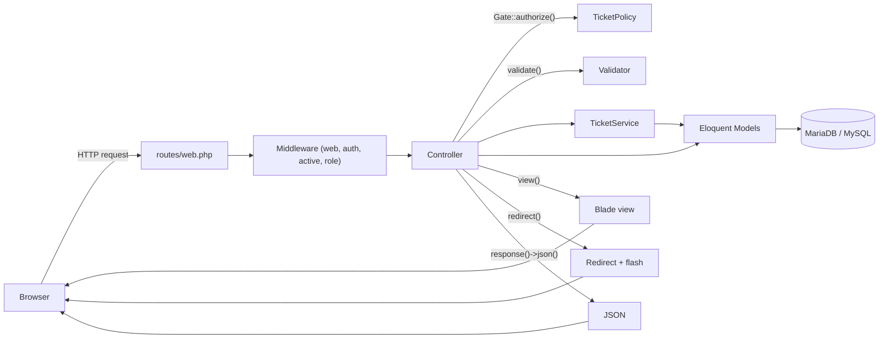
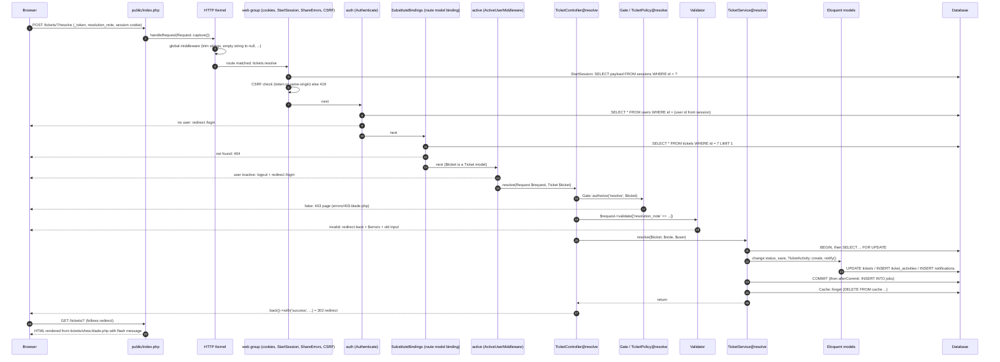
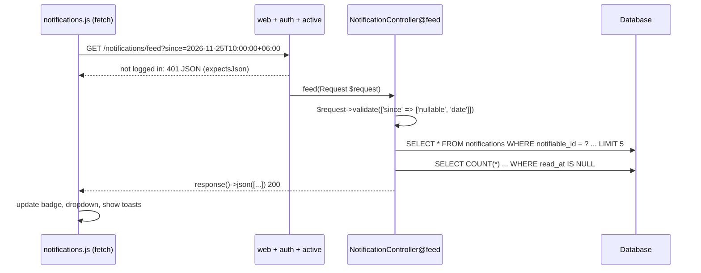
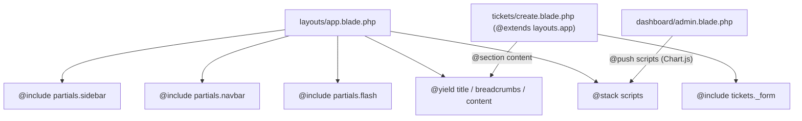
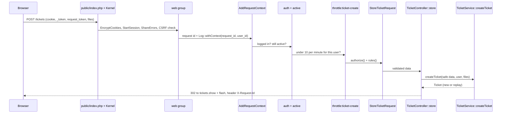

# 04 — Laravel MVC Guide (using the real ResolveDesk code)

This guide explains how Laravel works **inside this project**. Every file, class, method and route
name below exists in the code. When a snippet is shown, it is copied from the file.

**V2 note:** sections 1–22 explain the MVC basics (updated where V2 changed the code). Sections **23–27** add the V2
Laravel features: Form Requests, events and broadcasting, Artisan commands and the scheduler, the V2 request
lifecycle with `AddRequestContext` and `throttle`, and the service split.

Related guides:
[Database](03-DATABASE-GUIDE.md) ·
[Module-wise code](05-MODULE-WISE-CODE-EXPLANATION.md) ·
[Business logic](06-BUSINESS-LOGIC-GUIDE.md) ·
[UI to backend](07-UI-TO-BACKEND-MAPPING.md) ·
[Debugging](11-DEBUGGING-GUIDE.md) ·
[Notifications](13-NOTIFICATION-SYSTEM-GUIDE.md) ·
[Queue and email](14-QUEUE-AND-EMAIL-GUIDE.md) ·
[Caching](15-CACHING-GUIDE.md) ·
[Concurrency](20-CONCURRENCY-AND-DATA-INTEGRITY.md) ·
[Real-time](21-REALTIME-REVERB-ECHO.md) ·
[Security/logging](23-SECURITY-ERRORS-LOGGING-OPERATIONS.md)

---

## Table of contents

1. [MVC in one picture](#1-mvc-in-one-picture)
2. [public/index.php — the front door](#2-publicindexphp--the-front-door)
3. [bootstrap/app.php — configuring the application](#3-bootstrapappphp--configuring-the-application)
4. [Laravel application initialization](#4-laravel-application-initialization)
5. [The complete HTTP request lifecycle](#5-the-complete-http-request-lifecycle)
6. [routes/web.php](#6-routeswebphp)
7. [Middleware](#7-middleware)
8. [Controllers](#8-controllers)
9. [Request objects](#9-request-objects)
10. [Validation](#10-validation)
11. [Models and Eloquent ORM](#11-models-and-eloquent-orm)
12. [Blade and layout inheritance](#12-blade-and-layout-inheritance)
13. [HTTP responses, redirects and JSON](#13-http-responses-redirects-and-json)
14. [Flash messages](#14-flash-messages)
15. [Dependency injection and the service container](#15-dependency-injection-and-the-service-container)
16. [Facades](#16-facades)
17. [Route model binding](#17-route-model-binding)
18. [Sessions](#18-sessions)
19. [Authentication](#19-authentication)
20. [Authorization](#20-authorization)
21. [CSRF protection](#21-csrf-protection)
22. [Quick "where is it?" table](#22-quick-where-is-it-table)
23. [V2: Form Request (`StoreTicketRequest`)](#23-v2-form-request-storeticketrequest)
24. [V2: Events and broadcasting](#24-v2-events-and-broadcasting)
25. [V2: Artisan command and the scheduler](#25-v2-artisan-command-and-the-scheduler)
26. [V2: Request lifecycle with `AddRequestContext` and `throttle`](#26-v2-request-lifecycle-with-addrequestcontext-and-throttle)
27. [V2: Services, exceptions and config used by controllers](#27-v2-services-exceptions-and-config-used-by-controllers)

---

## 1. MVC in one picture

MVC means **Model – View – Controller**. Each part has one job.

| Part | Job | Where in ResolveDesk |
|---|---|---|
| **Model** | Represents a database table and its rules | `app/Models/User.php`, `Category.php`, `Ticket.php`, `TicketComment.php`, `TicketActivity.php` |
| **View** | Produces the HTML the user sees | `resources/views/**` (Blade templates) |
| **Controller** | Receives the request, checks it, calls models/services, returns a response | `app/Http/Controllers/*.php` |
| Route | Maps a URL + HTTP method to a controller method | `routes/web.php` |
| Middleware | Filters a request before it reaches the controller | `app/Http/Middleware/*.php` + Laravel's built-in ones |
| Policy | "Can this user do this action on this ticket?" | `app/Policies/TicketPolicy.php` |
| Service | Ticket business rules that touch several tables | `app/Services/TicketService.php` |

V1 added **one service class** (`TicketService`) to classic MVC. Reason: a ticket action such as
"resolve" changes the ticket, writes an activity row, creates a notification, queues an email and clears a
cache. Putting all of that in the controller would make the controller very long. Simple CRUD
(users, categories, clients) stays in the controllers.

**V2** split the rules into five small services, each with one reason to change: `TicketService` (create, edit,
transitions, comments, SLA), `TicketAssignmentService` (assignment + locks), `TicketNotifier` (database notification,
after-commit broadcast and email), `AttachmentService` (private files) and `ProjectService` (association changes).



> **বাংলায়:** MVC মানে কাজ ভাগ করে দেওয়া। Model ডাটাবেসের টেবিল আর তার নিয়ম জানে, View শুধু HTML দেখায়,
> আর Controller মাঝখানে বসে request নেয়, যাচাই করে, Model/Service কে কাজ দেয় এবং শেষে response ফেরত পাঠায়।
> ResolveDesk-এ টিকিটের জটিল নিয়মগুলো `TicketService`-এ রাখা হয়েছে যাতে controller ছোট আর পড়তে সহজ থাকে।

---

## 2. `public/index.php` — the front door

Every web request enters the application through this one file. The web server's document root is the
`public/` folder, so users can never open files like `.env` or `app/` directly.

```php
define('LARAVEL_START', microtime(true));

// Determine if the application is in maintenance mode...
if (file_exists($maintenance = __DIR__.'/../storage/framework/maintenance.php')) {
    require $maintenance;
}

// Register the Composer autoloader...
require __DIR__.'/../vendor/autoload.php';

// Bootstrap Laravel and handle the request...
/** @var Application $app */
$app = require_once __DIR__.'/../bootstrap/app.php';

$app->handleRequest(Request::capture());
```

Line by line:

| Line | Syntax meaning | What it does |
|---|---|---|
| `define('LARAVEL_START', microtime(true));` | Creates a global constant with the current time in seconds (float). | Lets Laravel measure how long the request took. |
| `if (file_exists($maintenance = ...))` | Assigns a value **inside** the condition, then tests it. `__DIR__` = folder of the current file. | If `php artisan down` was run, this file exists and shows the maintenance page. |
| `require __DIR__.'/../vendor/autoload.php';` | `.` is PHP's string concatenation operator. | Loads Composer's autoloader. After this, writing `new TicketService()` automatically loads `app/Services/TicketService.php` (PSR-4: namespace `App\` = folder `app/`). |
| `$app = require_once __DIR__.'/../bootstrap/app.php';` | `require_once` runs the file and gives back its `return` value. | Builds and returns the `Application` object (the service container). |
| `$app->handleRequest(Request::capture());` | `Request::capture()` is a static method. | Wraps PHP's `$_GET`, `$_POST`, `$_COOKIE`, `$_SERVER` into an `Illuminate\Http\Request` object and sends it through the HTTP kernel. The response is then sent to the browser. |

**If removed / broken:** nothing works — every URL returns a server error.
**Common problem:** `vendor/autoload.php` missing → you forgot `composer install`.
**Do not modify** this file for normal features.

---

## 3. `bootstrap/app.php` — configuring the application

```php
return Application::configure(basePath: dirname(__DIR__))
    ->withRouting(
        web: __DIR__ . '/../routes/web.php',
        commands: __DIR__ . '/../routes/console.php',
        channels: __DIR__ . '/../routes/channels.php',   // V2: private broadcast channels
        health: '/up',
    )
    ->withMiddleware(function (Middleware $middleware): void {
        // Short names so routes can write ->middleware('role:admin') and ->middleware('active').
        $middleware->alias([
            'role' => RoleMiddleware::class,
            'active' => ActiveUserMiddleware::class,
        ]);

        // Where the "auth" middleware sends guests, and where "guest" sends logged-in users.
        $middleware->redirectGuestsTo('/login');
        $middleware->redirectUsersTo('/dashboard');

        // V2: request id + user id in every log line (runs after the session has started).
        $middleware->web(append: [AddRequestContext::class]);
    })
    ->withExceptions(function (Exceptions $exceptions): void {
        //
    })->create();
```

### Syntax notes

- `Application::configure(basePath: dirname(__DIR__))` — **named argument** (`basePath:`). PHP 8 lets you pass
  arguments by name. `dirname(__DIR__)` is the project root (`e:\Projects\resolvedesk`).
- `->withRouting(...)->withMiddleware(...)->create()` — **method chaining** (fluent API). Each method returns
  the same builder object, so you can keep calling methods on it.
- `function (Middleware $middleware): void { ... }` — an **anonymous function (closure)** with a **type hint**
  (`Middleware`) and a **return type** (`void` = returns nothing). Laravel calls this closure and passes the
  middleware configuration object.
- `RoleMiddleware::class` — the `::class` constant gives the full class name as a string:
  `'App\Http\Middleware\RoleMiddleware'`.

### What each part does

| Part | Meaning in ResolveDesk |
|---|---|
| `web: .../routes/web.php` | Loads all browser routes and wraps them in the **`web` middleware group** (cookies, session, CSRF, route model binding). |
| `commands: .../routes/console.php` | Artisan console commands file. **V2:** also holds the schedule (`Schedule::command('tickets:check-sla')`). |
| `channels: .../routes/channels.php` | **V2:** registers the private channel rules and the `POST /broadcasting/auth` route. |
| `$middleware->web(append: [AddRequestContext::class])` | **V2:** adds our middleware to the **end** of the `web` group, so it runs after `StartSession` (the user is known) — see section 26. |
| `health: '/up'` | Laravel's built-in health check URL (returns 200 if the app boots). |
| `$middleware->alias([...])` | Gives short names to our two custom middleware so `routes/web.php` can write `'active'` and `'role:admin'`. |
| `redirectGuestsTo('/login')` | When the built-in `auth` middleware finds no logged-in user, it redirects to `/login` (for normal page requests). |
| `redirectUsersTo('/dashboard')` | When the built-in `guest` middleware finds a logged-in user (e.g. visiting `/login` again), it redirects to `/dashboard`. |
| `withExceptions(...)` | Empty: we use Laravel's default exception handling. It already converts `ValidationException` → redirect back / 422 JSON, `AuthorizationException` → 403, `ModelNotFoundException` → 404, `TokenMismatchException` → 419. |

**If you remove the `alias` call:** routes using `'active'` or `'role:admin'` fail with
"Target class [active] does not exist".

**How to modify:** to add a new middleware alias, create the class in `app/Http/Middleware`, then add
`'myname' => MyMiddleware::class` to the array.

### `bootstrap/providers.php` and `AppServiceProvider`

`bootstrap/providers.php` lists our service providers:

```php
return [
    AppServiceProvider::class,
];
```

`app/Providers/AppServiceProvider.php` runs once while the application boots:

```php
public function boot(): void
{
    // Pagination links use Bootstrap 5 HTML.
    Paginator::useBootstrapFive();

    // Outside production, throw an error when a relationship is lazy-loaded
    // inside a loop (the N+1 query problem). This forces us to use with().
    Model::preventLazyLoading(! $this->app->isProduction());
}
```

- `Paginator::useBootstrapFive()` → `{{ $tickets->links() }}` prints Bootstrap 5 pagination HTML.
- `Model::preventLazyLoading(! $this->app->isProduction())` → `!` means "not". In local/testing this is `true`,
  so Laravel throws a `LazyLoadingViolationException` if code lazy-loads a relationship on a model that was
  loaded **as part of a collection of several models** (the N+1 pattern). In production it is switched off so a
  missed `with()` only makes the page slower instead of crashing it.

> **বাংলায়:** N+1 সমস্যা মানে: ১টি query দিয়ে ১৫টি টিকিট আনলাম, তারপর loop-এর ভেতরে প্রতিটি টিকিটের category আনতে
> আরও ১৫টি আলাদা query চলল। `preventLazyLoading()` development-এ এই ভুল ধরলে সাথে সাথে error দেয়, তাই আমরা
> `Ticket::with(['category', ...])` দিয়ে আগেই (eager loading) সব একসাথে লোড করি।

---

## 4. Laravel application initialization

What happens before your controller runs (conceptual — you do not need to read vendor code):

1. `public/index.php` loads Composer and `bootstrap/app.php`.
2. `Application::configure()->...->create()` creates the **Application** object. This object is the
   **service container** (see [section 15](#15-dependency-injection-and-the-service-container)).
3. `handleRequest()` asks the container for the **HTTP Kernel**.
4. The kernel runs its **bootstrappers**:
   - load `.env` into environment variables (`DB_DATABASE`, `SESSION_DRIVER`, ...),
   - load `config/*.php` (for example `config/session.php` reads `SESSION_DRIVER`),
   - register the exception handler,
   - register facades,
   - register service providers (framework providers + `AppServiceProvider`),
   - boot the providers (`AppServiceProvider::boot()` runs here).
5. The kernel sends the `Request` through the **global middleware** and then to the **router**.

Project-specific settings that matter during initialization (from `.env`):

| Variable | Value in this project | Effect |
|---|---|---|
| `SESSION_DRIVER` | `database` | Sessions are stored in the `sessions` table. |
| `CACHE_STORE` | `database` | `Cache::remember()` stores values in the `cache` table. |
| `QUEUE_CONNECTION` | `database` | Dispatched jobs are stored in the `jobs` table. |
| `MAIL_MAILER` | `log` | Emails are written to `storage/logs/laravel.log` instead of being sent. |
| `APP_ENV` | `local` | `preventLazyLoading` is on; the login page shows demo accounts. |

Tests override these values in `phpunit.xml` (`CACHE_STORE=array`, `SESSION_DRIVER=array`,
`QUEUE_CONNECTION=sync`, `MAIL_MAILER=array`, `DB_DATABASE=resolvedesk_testing`).

---

## 5. The complete HTTP request lifecycle

### 5.1 Example: an agent clicks **Resolve Ticket**

The form in `resources/views/tickets/show.blade.php` sends `POST /tickets/7/resolve` with two fields:
`_token` (CSRF) and `resolution_note`.



> The order of middleware above is simplified. Laravel sorts a few framework middleware by a priority list, so
> `auth` runs before route model binding (`SubstituteBindings`). Our custom `active` and `role` middleware run
> after them. In practice this means: a guest who opens `/tickets/999` is sent to the login page instead of
> getting a 404.

### 5.2 Step by step (with the project files)

| # | Step | Code |
|---|---|---|
| 1 | Browser sends the request with the session cookie (`resolvedesk-session`, name built from `APP_NAME` in `config/session.php`) | — |
| 2 | Front controller | `public/index.php` |
| 3 | App configured, providers booted | `bootstrap/app.php`, `AppServiceProvider::boot()` |
| 4 | Router finds the route | `Route::post('/tickets/{ticket}/resolve', [TicketController::class, 'resolve'])->name('tickets.resolve');` |
| 5 | `web` group: cookies decrypted, session loaded from `sessions` table, `$errors` shared with views, CSRF checked | Laravel built-in |
| 6 | `auth`: is someone logged in? | `Route::middleware(['auth', 'active'])` |
| 7 | Route model binding: `{ticket}` → `Ticket` model, or 404 | `SubstituteBindings` |
| 8 | `active`: is the account still active? | `app/Http/Middleware/ActiveUserMiddleware.php` |
| 9 | (admin routes only) `role:admin` | `app/Http/Middleware/RoleMiddleware.php` |
| 10 | Controller method runs | `TicketController::resolve()` |
| 11 | Authorization | `Gate::authorize('resolve', $ticket)` → `TicketPolicy::resolve()` |
| 12 | Validation | `$request->validate(['resolution_note' => ['required', 'string', 'max:5000']])` |
| 13 | Business logic in a transaction | `TicketService::resolve()` |
| 14 | Eloquent → SQL → database | `$lockedTicket->save()`, `TicketActivity::create([...])`, `$recipient->notify(...)` |
| 15 | Response | `back()->with('success', 'Ticket marked as Resolved.')` |
| 16 | Session saved (flash message stored), cookie sent | `StartSession` (on the way out) |
| 17 | Browser follows the redirect, `TicketController::show()` renders `tickets/show.blade.php`, `partials/flash.blade.php` shows the green message | Blade |

### 5.3 Example: a JSON request (notification polling)

`public/js/notifications.js` calls `GET /notifications/feed?since=...` every 5 seconds with the header
`Accept: application/json`.



Because the request sends `Accept: application/json`, `$request->expectsJson()` is true. Laravel then answers
errors in JSON too: guest → 401, invalid `since` → 422 with an `errors` object, inactive user → 401
(from `ActiveUserMiddleware`).

> **বাংলায়:** একটি request-এর পুরো যাত্রা: browser → `public/index.php` → Laravel kernel → middleware-গুলো (session,
> CSRF, login check, active check, role check) → route model binding দিয়ে টিকিট খোঁজা → controller → policy দিয়ে
> অনুমতি যাচাই → validation → service → Eloquent → database → শেষে HTML, redirect অথবা JSON। কোনো ধাপে সমস্যা হলে
> request সেখানেই থেমে যায় (যেমন 403, 404, 419 বা validation error)।

---

## 6. `routes/web.php`

All routes are in one file. Read it top to bottom:

```php
Route::redirect('/', '/dashboard');

// ---- Guests only (not logged in) ---------------------------------------------
Route::middleware('guest')->group(function () {
    Route::get('/login', [AuthController::class, 'showLogin'])->name('login');
    Route::post('/login', [AuthController::class, 'login'])->name('login.attempt');
});

// ---- Logged-in AND active users ----------------------------------------------
Route::middleware(['auth', 'active'])->group(function () {
    Route::post('/logout', [AuthController::class, 'logout'])->name('logout');

    Route::get('/dashboard', [DashboardController::class, 'index'])->name('dashboard');

    Route::resource('tickets', TicketController::class)->except(['destroy']);

    Route::post('/tickets/{ticket}/start', [TicketController::class, 'start'])->name('tickets.start');
    Route::post('/tickets/{ticket}/resolve', [TicketController::class, 'resolve'])->name('tickets.resolve');
    Route::post('/tickets/{ticket}/reopen', [TicketController::class, 'reopen'])->name('tickets.reopen');
    Route::post('/tickets/{ticket}/close', [TicketController::class, 'close'])->name('tickets.close');
    Route::post('/tickets/{ticket}/comments', [TicketCommentController::class, 'store'])->name('tickets.comments.store');

    Route::get('/notifications', [NotificationController::class, 'index'])->name('notifications.index');
    Route::get('/notifications/feed', [NotificationController::class, 'feed'])->name('notifications.feed');
    Route::post('/notifications/read-all', [NotificationController::class, 'markAllAsRead'])->name('notifications.read-all');
    Route::post('/notifications/{id}/read', [NotificationController::class, 'markAsRead'])->name('notifications.read');

    // ---- Administrators only -------------------------------------------------
    Route::middleware('role:admin')->group(function () {
        Route::post('/tickets/{ticket}/assign', [TicketController::class, 'assign'])->name('tickets.assign');
        Route::post('/tickets/{ticket}/auto-assign', [TicketController::class, 'autoAssign'])->name('tickets.auto-assign');

        Route::resource('users', UserController::class)->except(['destroy']);
        Route::patch('/users/{user}/toggle-active', [UserController::class, 'toggleActive'])->name('users.toggle-active');

        Route::resource('categories', CategoryController::class)->except(['show']);
    });
});
```

### Syntax notes

- `[AuthController::class, 'login']` — an array of *class name* + *method name*. Laravel creates the controller
  through the container and calls the method.
- `->name('login')` — gives the route a **name**. Code uses `route('login')` instead of hard-coding `/login`.
  If the URL ever changes, only `web.php` changes.
- `Route::middleware([...])->group(function () { ... })` — all routes inside the closure get those middleware.
  Groups can be **nested**: the admin group is inside the `auth` + `active` group, so admin routes get
  `auth`, `active` **and** `role:admin`.
- `{ticket}` — a **route parameter**. Because the controller method has a `Ticket $ticket` parameter with the same
  name, Laravel loads the ticket from the database (route model binding, [section 17](#17-route-model-binding)).
- `Route::resource('tickets', TicketController::class)->except(['destroy'])` — one line creates the standard
  REST routes:

| Method | URL | Name | Controller method |
|---|---|---|---|
| GET | `/tickets` | `tickets.index` | `index` |
| GET | `/tickets/create` | `tickets.create` | `create` |
| POST | `/tickets` | `tickets.store` | `store` |
| GET | `/tickets/{ticket}` | `tickets.show` | `show` |
| GET | `/tickets/{ticket}/edit` | `tickets.edit` | `edit` |
| PUT/PATCH | `/tickets/{ticket}` | `tickets.update` | `update` |
| ~~DELETE~~ | — | — | excluded (tickets are never deleted) |

`users` also excludes `destroy` (users are deactivated, never deleted). `categories` excludes `show`
(there is no category details page) but **keeps** `destroy`.

### Important design rule

The comment at the top of the file says: *every data-changing action uses POST/PUT/PATCH/DELETE, never GET.*
That is why "Start Working", "Close" and even "Logout" are small `<form method="POST">` forms, not links.
GET requests are not CSRF-checked, so a GET link that changes data could be triggered by another website.

**See all routes:**

```bash
export PATH="/c/php-8.4.28:$PATH"
php artisan route:list --except-vendor
php artisan route:list --except-vendor -v   # also shows the middleware of each route
```

---

## 7. Middleware

Middleware is code that runs **before** (and sometimes after) the controller. Each middleware either passes the
request on with `$next($request)` or stops it by returning a response (redirect, 403, 401 JSON).

> **বাংলায়:** Middleware হলো দরজার পাহারাদারের মতো। প্রতিটি পাহারাদার একটি নির্দিষ্ট জিনিস দেখে — login করা আছে কিনা,
> account active কিনা, role admin কিনা। সব ঠিক থাকলে `$next($request)` দিয়ে পরের ধাপে যেতে দেয়, না হলে সেখানেই
> redirect বা 403 ফেরত দেয় এবং controller আর চলে না।

### 7.1 Middleware used by this project

| Name | Class | Where it is applied | What it does |
|---|---|---|---|
| `web` group | `EncryptCookies`, `AddQueuedCookiesToResponse`, `StartSession`, `ShareErrorsFromSession`, `PreventRequestForgery` (CSRF), `SubstituteBindings` | Every route in `routes/web.php` (automatically) | Cookies, session, `$errors` in views, CSRF check, route model binding |
| `guest` | `Illuminate\Auth\Middleware\RedirectIfAuthenticated` | `/login` routes | Logged-in user → redirect to `/dashboard` (`redirectUsersTo`) |
| `auth` | `Illuminate\Auth\Middleware\Authenticate` | All protected routes | Guest → redirect `/login` (`redirectGuestsTo`), or 401 JSON for AJAX |
| `active` | `App\Http\Middleware\ActiveUserMiddleware` | All protected routes | Logs out a user deactivated while logged in |
| `role:admin` | `App\Http\Middleware\RoleMiddleware` | Users, categories, projects, clients, reports, assign, auto-assign | 403 for non-admins |
| `AddRequestContext` (V2) | `App\Http\Middleware\AddRequestContext` | Appended to the `web` group (every web route) | Request id in logs + `X-Request-Id` header |
| `throttle:NAME` (V2) | `Illuminate\Routing\Middleware\ThrottleRequests` | `tickets.store`, `tickets.comments.store`, `notifications.feed`, `reports.export`, `health.ready` | 429 when a named rate limit is exceeded |

Note: in Laravel 13 the CSRF middleware class in the `web` group is
`Illuminate\Foundation\Http\Middleware\PreventRequestForgery` (older versions called it `VerifyCsrfToken`).

### 7.2 `ActiveUserMiddleware` line by line

```php
public function handle(Request $request, Closure $next): Response
{
    $user = $request->user();

    if ($user !== null && ! $user->is_active) {
        Auth::logout();
        $request->session()->invalidate();
        $request->session()->regenerateToken();

        $message = 'Your account has been deactivated. Please contact an administrator.';

        // AJAX/fetch requests (e.g. notification polling) get JSON instead of a redirect.
        if ($request->expectsJson()) {
            return response()->json(['message' => $message], 401);
        }

        return redirect()->route('login')->with('error', $message);
    }

    return $next($request);
}
```

- `Closure $next` — the "next step" in the pipeline. Calling `$next($request)` continues to the next middleware
  or the controller.
- `: Response` — return type: a Symfony `Response` (all Laravel responses extend it).
- `$request->user()` — the logged-in `User` (loaded from the database by the `auth` middleware on this request),
  so `is_active` is always the **current** database value.
- `Auth::logout(); invalidate(); regenerateToken();` — the same three steps as normal logout: forget the user,
  destroy the session data, create a fresh CSRF token.
- `$request->expectsJson()` — true for `fetch()` calls that send `Accept: application/json`. `notifications.js`
  checks for `401` and shows "Your session has expired. Sign in again".

**Why needed:** the login form blocks inactive users, but someone already logged in still has a valid session.
Without this middleware a deactivated agent could keep working until their session expired.
**Test it:** log in as an agent in one browser, deactivate them as admin in another, refresh the agent page.

### 7.3 `RoleMiddleware` line by line

```php
public function handle(Request $request, Closure $next, string ...$roles): Response
{
    $user = $request->user();

    if ($user === null || ! in_array($user->role, $roles, true)) {
        abort(403, 'You do not have permission to access this page.');
    }

    return $next($request);
}
```

- `string ...$roles` — the **spread / variadic** operator. All extra arguments are collected into an array.
  `'role:admin'` → `$roles = ['admin']`; `'role:admin,agent'` → `$roles = ['admin', 'agent']`.
- `in_array($user->role, $roles, true)` — the third argument `true` means **strict** comparison (`===`), so types
  must match too.
- `abort(403, '...')` — throws an `HttpException`. Laravel renders `resources/views/errors/403.blade.php`, which
  prints the message with `$exception->getMessage()`.

**How to modify:** to let agents see the category list, you could move the category routes into a new group with
`->middleware('role:admin,agent')`. (Then also check the controller — some actions should stay admin-only.)

### 7.4 Two layers of protection

Role middleware answers "may this **kind** of user open this **URL**?". The policy
(`TicketPolicy`) answers "may this **user** do this **action** on **this ticket** in its **current status**?".
Admin routes like `tickets.assign` use **both**: `role:admin` in the route and `Gate::authorize('assign', $ticket)`
in the controller.

---

## 8. Controllers

Controllers live in `app/Http/Controllers` and extend the empty base class `Controller`.

| Controller | Responsibility |
|---|---|
| `AuthController` | `showLogin`, `login`, `logout` |
| `DashboardController` | `index` → admin / agent / customer dashboard |
| `TicketController` | list, create/store, show, edit/update, assign, autoAssign, start, resolve, reopen, close |
| `TicketCommentController` | `store` (add a comment) |
| `NotificationController` | `index` (history page), `feed` (JSON), `markAsRead`, `markAllAsRead` |
| `UserController` | user CRUD + `toggleActive` (admin) |
| `CategoryController` | category CRUD (admin) |

### A typical controller method (`TicketController::resolve`)

```php
public function resolve(Request $request, Ticket $ticket)
{
    Gate::authorize('resolve', $ticket);

    $validated = $request->validate([
        'resolution_note' => ['required', 'string', 'max:5000'],
    ]);

    $this->ticketService->resolve($ticket, $validated['resolution_note'], $request->user());

    return back()->with('success', 'Ticket marked as Resolved.');
}
```

Every workflow action follows the same 4 steps (also written in the class comment):

1. **Authorize** — `Gate::authorize(...)`.
2. **Validate** — `$request->validate(...)`.
3. **Do the work** — call `TicketService`.
4. **Respond** — redirect with a flash message.

Controller rules used in this project:

- The controller never trusts IDs it can calculate itself: `created_by` comes from `$request->user()`, never
  from the form.
- Status changes only happen through `TicketService`, never through the edit form.
- Constants like `private const PER_PAGE = 15;` keep "magic numbers" in one place.

---

## 9. Request objects

`Illuminate\Http\Request $request` is the object that holds everything the browser sent. Laravel injects it when
a controller method has a `Request` parameter.

Methods used in this project:

| Method | Example in code | Meaning |
|---|---|---|
| `$request->user()` | `$this->ticketService->createTicket($validated, $request->user());` | The logged-in `User` model (or `null`). |
| `$request->input('x')` | `$request->input('search')` | A value from the query string or form body. |
| `$request->filled('x')` | `if ($request->filled('status'))` | True when the field is present **and not empty**. Used for optional filters. |
| `$request->boolean('x')` | `$request->boolean('is_active')`, `$request->boolean('remember')` | Converts `"1"`, `"true"`, `"on"`, `"yes"` to `true`; missing → `false`. Needed because an **unchecked checkbox is not sent at all**. |
| `$request->validate([...])` | see [section 10](#10-validation) | Validates and returns only the validated fields. |
| `$request->ip()` | `AuthController::login()` | Client IP, used in the login rate-limit key. |
| `$request->session()` | `$request->session()->regenerate();` | The session store. |
| `$request->expectsJson()` | `NotificationController::markAsRead()` | True for AJAX/fetch calls asking for JSON. |
| `request('search')` (helper) | `tickets/index.blade.php`: `value="{{ request('search') }}"` | Same as `request()->input('search')`, used in Blade to keep filter values. |

Global middleware also cleans input: `TrimStrings` removes spaces at both ends, and
`ConvertEmptyStringsToNull` turns `""` into `null`. That is why an empty password field on the user edit form
arrives as `null` and passes the `nullable` rule.

V1 used only inline validation. **V2 added one Form Request**, `App\Http\Requests\StoreTicketRequest`, for ticket
creation, because its rules grew (project, client, idempotency token, attachments). All other actions still validate
inline so each action can be read in one place. See section 23.

---

## 10. Validation

### 10.1 Inline `$request->validate()`

V1 `TicketController::store()` (in V2 these rules moved into `StoreTicketRequest::rules()`, section 23; the same
inline style is still used by `update()`, `assign()`, `resolve()`, `TicketCommentController::store()` and others):

```php
$validated = $request->validate([
    'subject' => ['required', 'string', 'max:255'],
    'description' => ['required', 'string', 'max:5000'],
    // Checked against the database (not the cache): the category must exist AND be active.
    'category_id' => ['required', 'integer', Rule::exists('categories', 'id')->where('is_active', true)],
    'priority' => ['required', Rule::in(array_keys(Ticket::PRIORITIES))],
], [
    'category_id.exists' => 'Please choose an active category.',
]);
```

- First array = **rules** per field. Each rule is a string (`'required'`, `'max:255'`) or a rule object
  (`Rule::exists(...)`, `Rule::in(...)`).
- Second array = **custom messages**, key format `field.rule`.
- `Rule::in(array_keys(Ticket::PRIORITIES))` → allowed values are `low, medium, high, critical`. The list comes
  from the model constant, so adding a priority in `Ticket::PRIORITIES` (and `SLA_HOURS`) updates validation
  automatically.
- `Rule::exists('categories', 'id')->where('is_active', true)` → runs
  `SELECT COUNT(*) FROM categories WHERE id = ? AND is_active = 1`.
- **Return value:** only the validated keys. Extra fields sent by a hacker (`status`, `assigned_to`) are not in
  `$validated`.

Other rules in the project:

| Rule | Where | Meaning |
|---|---|---|
| `'unique:users,email'` | `UserController::store` | Email not already in `users.email` |
| `Rule::unique('users', 'email')->ignore($user->id)` | `UserController::update` | Unique, except the user's own row |
| `'confirmed'` | password | Needs a matching `password_confirmation` field |
| `'nullable'` | `date_from`, edit password | The field may be empty |
| `'after_or_equal:date_from'` | `TicketController::index` | `date_to` must not be before `date_from` |
| `'date'` | `NotificationController::feed` (`since`) | Must be a parseable date; otherwise 422 |
| `'exists:users,id'` | `TicketController::assign` (`agent_id`) | The user id exists |

### 10.2 What happens when validation fails

`validate()` throws `Illuminate\Validation\ValidationException`. Laravel's exception handler then:

- **Normal form request:** redirects **back** (302), stores the error messages and the old input in the session
  (flash). On the next page, `$errors` contains the messages (shared by `ShareErrorsFromSession`) and `old('x')`
  returns what the user typed.
- **AJAX / `Accept: application/json`:** returns **422** JSON:
  `{"message": "...", "errors": {"since": ["The since field must be a valid date."]}}`.

### 10.3 Business-rule errors: `ValidationException::withMessages`

Some rules cannot be written as validation rules because they depend on the **current database state**.
`TicketService` throws the same exception type manually:

```php
private function ensureActionAllowed(Ticket $ticket, string $action): void
{
    if (! $ticket->canPerform($action)) {
        throw ValidationException::withMessages([
            'ticket' => "This action is not allowed while the ticket is {$ticket->statusLabel()}.",
        ]);
    }
}
```

Other examples: `autoAssign()` ("Auto assign is only available for Open tickets..."), `performAssignment()`
("Please select an active support agent."), `reopen()` (inactive agent), `addComment()` (closed ticket),
`AuthController::login()` (wrong password / rate limit / inactive), `UserController::ensureRoleOrStatusChangeIsAllowed()`.

Why this exception? Because Laravel already knows how to display it: redirect back + red error box from
`partials/flash.blade.php` (or 422 JSON). No extra error-handling code is needed. When it is thrown **inside**
`DB::transaction()`, the transaction is rolled back first.

`"...{$ticket->statusLabel()}."` — inside **double quotes**, PHP replaces `{$expression}` with its value
(string interpolation). Single quotes do not interpolate.

> **বাংলায়:** সাধারণ validation (field খালি কিনা, দৈর্ঘ্য কত) `$request->validate()` দিয়ে হয়। কিন্তু "টিকিট এখন
> Resolved, তাই Start করা যাবে না" — এমন নিয়ম database-এর বর্তমান অবস্থার উপর নির্ভর করে। তাই `TicketService`
> নিজে `ValidationException::withMessages()` throw করে। ফলাফল একই: ব্যবহারকারী আগের পেজে ফিরে যায় এবং লাল
> error message দেখে।

---

## 11. Models and Eloquent ORM

Eloquent is Laravel's **ORM** (Object-Relational Mapper): one class = one table, one object = one row.

| Model | Table | Notes |
|---|---|---|
| `User` (extends `Authenticatable`) | `users` | `Notifiable` trait for database notifications |
| `Category` | `categories` | Active-category cache helpers |
| `Ticket` | `tickets` | Constants, SLA, transitions, scopes |
| `TicketComment` | `ticket_comments` | |
| `TicketActivity` | `ticket_activities` | `ACTION_LABELS` |

Laravel guesses the table name from the class name (`TicketComment` → `ticket_comments`).

### 11.1 Mass assignment (`$fillable`)

```php
protected $fillable = [
    'subject',
    'description',
    'category_id',
    'priority',
];
```

`Ticket::create($data)` or `$ticket->fill($data)` only copies these keys. `status`, `assigned_to`, `created_by`,
`due_at` are **not** fillable, so a user cannot change them by adding fields to the form. `TicketService` sets
them explicitly: `$ticket->status = Ticket::STATUS_OPEN;`.

### 11.2 Casts

```php
protected function casts(): array
{
    return [
        // Integer casts make comparisons like $ticket->created_by === $user->id reliable.
        'category_id' => 'integer',
        'created_by' => 'integer',
        'assigned_to' => 'integer',
        'due_at' => 'datetime',
        'resolved_at' => 'datetime',
    ];
}
```

- `'datetime'` turns the column into a **Carbon** object, so Blade can call `$ticket->due_at->format('d M Y, h:i A')`
  and `diffForHumans()`.
- `'integer'` matters because the policy uses strict comparison: `$ticket->created_by === $user->id`.
  Without the cast, some database drivers return `"5"` (string) and `"5" === 5` is **false**.
- In `User`: `'password' => 'hashed'` bcrypt-hashes a plain password automatically when it is assigned;
  `'is_active' => 'boolean'`.

### 11.3 Relationships

```php
public function creator(): BelongsTo
{
    return $this->belongsTo(User::class, 'created_by');
}

/** Nullable relationship: returns null while the ticket is unassigned. */
public function assignedAgent(): BelongsTo
{
    return $this->belongsTo(User::class, 'assigned_to');
}
```

- `belongsTo(User::class, 'created_by')` — the second argument is the foreign key column, needed because it is not
  named `user_id`.
- Use as a property: `$ticket->creator->name` (Laravel runs the query the first time).
- Use as a method: `$ticket->comments()` returns a **query builder** you can extend.

`User` has the inverse: `createdTickets()` and `assignedTickets()` (`hasMany(Ticket::class, 'assigned_to')`).
Full list: [Database guide](03-DATABASE-GUIDE.md).

### 11.4 Eager loading (`with`, `load`, `withCount`)

```php
$query = Ticket::with(['category', 'creator', 'assignedAgent'])
    ->visibleTo($user);
```

One query for the tickets + one query per relationship (`WHERE id IN (...)`), instead of one query per row.
`TicketController::show()` uses `$ticket->load([...])` on an already-loaded model.
`withCount('tickets')` adds a `tickets_count` attribute with a sub-query (`CategoryController::index`).

### 11.5 Query scopes

```php
/** SQL: WHERE status IN ('open','assigned','in_progress') AND due_at < NOW() */
public function scopeOverdue(Builder $query): Builder
{
    return $query->whereIn('status', self::ACTIVE_STATUSES)->where('due_at', '<', now());
}
```

A method named `scopeXyz` becomes a chainable `xyz()` call: `Ticket::overdue()->count()`.
`scopeVisibleTo($query, User $user)` is called as `Ticket::...->visibleTo($user)`.

### 11.6 Constants as the single source of truth

`User::ROLES`, `Ticket::STATUSES`, `Ticket::PRIORITIES`, `Ticket::SLA_HOURS`, `Ticket::TRANSITIONS`,
`Ticket::ACTIVE_STATUSES`, `Ticket::WORKLOAD_STATUSES`, `TicketActivity::ACTION_LABELS`.
Validation, dropdowns, badges and policies all read these constants. `self::STATUS_OPEN` inside the class means
"the constant of this same class".

> **বাংলায়:** Eloquent মানে SQL না লিখে PHP object দিয়ে database-এর সাথে কাজ করা। `Ticket::where('status', 'open')->get()`
> নিজে থেকেই `SELECT * FROM tickets WHERE status = 'open'` চালায়। `$fillable` ঠিক করে দেয় form থেকে কোন column
> ভরা যাবে, আর `casts()` database-এর মানকে সঠিক PHP type-এ (integer, boolean, Carbon date) রূপান্তর করে।

---

## 12. Blade and layout inheritance

Blade files end with `.blade.php` and live in `resources/views`. `view('tickets.show')` means
`resources/views/tickets/show.blade.php` (dots = folders).

### 12.1 Layouts

There are two layouts:

- `layouts/app.blade.php` — every logged-in page (sidebar, navbar, flash messages, toast container, scripts).
- `layouts/guest.blade.php` — login page and error pages (`errors/403.blade.php`, `errors/419.blade.php`).

`layouts/app.blade.php` (shortened, real lines):

```blade
<meta name="csrf-token" content="{{ csrf_token() }}">
<title>@yield('title', 'Dashboard') · ResolveDesk</title>
...
<div class="app-shell">
    @include('partials.sidebar')
    <div class="app-main">
        @include('partials.navbar')
        <main class="app-content">
            @hasSection('breadcrumbs')
                <nav aria-label="breadcrumb">
                    <ol class="breadcrumb">
                        <li class="breadcrumb-item"><a href="{{ route('dashboard') }}">Home</a></li>
                        @yield('breadcrumbs')
                    </ol>
                </nav>
            @endif

            @include('partials.flash')

            @yield('content')
        </main>
    </div>
</div>
...
<script src="{{ asset('js/app.js') }}"></script>
<script src="{{ asset('js/notifications.js') }}"></script>
@stack('scripts')
```

A child page, `tickets/create.blade.php`:

```blade
@extends('layouts.app')

@section('title', 'Create Ticket')

@section('breadcrumbs')
    <li class="breadcrumb-item"><a href="{{ route('tickets.index') }}">Tickets</a></li>
    <li class="breadcrumb-item active" aria-current="page">Create</li>
@endsection

@section('content')
...
    <form method="POST" action="{{ route('tickets.store') }}">
        @csrf
        @include('tickets._form')
        ...
    </form>
...
@endsection
```

| Directive | Meaning |
|---|---|
| `@extends('layouts.app')` | "Render me inside this layout." |
| `@section('title', 'Create Ticket')` | Short form: fill the `title` slot with a string. |
| `@section('content') ... @endsection` | Long form: fill the `content` slot with HTML. |
| `@yield('title', 'Dashboard')` | In the layout: print the child's `title` section, or the default `'Dashboard'`. |
| `@hasSection('breadcrumbs')` | Only print the breadcrumb bar if the child defined it (the dashboards don't). |
| `@include('partials.flash')` | Insert another Blade file. It can see the parent's variables. |
| `@include('tickets._form', ['ticket' => $ticket])` | Include with extra variables. The edit page passes `$ticket`; the create page does not. |
| `@stack('scripts')` / `@push('scripts')` | The layout reserves a place at the end of `<body>`. `dashboard/admin.blade.php` pushes the Chart.js `<script>` tags there, so only the admin dashboard loads Chart.js. |
| `@php($ticket = $ticket ?? null)` | Run one PHP statement. In `tickets/_form.blade.php` it makes `$ticket` safe to use on the create page. |



### 12.2 Output and escaping

- `{{ $ticket->subject }}` — prints the value **HTML-escaped** (`<script>` becomes `&lt;script&gt;`). This
  protects against XSS. The project never uses `{!! !!}` for user text.
- `{{-- comment --}}` — Blade comment, not sent to the browser.
- `@json($stats['trend'])` — converts a PHP array to a safe JavaScript literal (admin dashboard charts).
- `@@json` — prints a literal `@json` (used inside a JS comment; see bug #2 in `DEVELOPMENT_PROGRESS.md`).

### 12.3 Forms: `@csrf`, `@method`, `old()`, `@error`

From `tickets/edit.blade.php` and `tickets/_form.blade.php`:

```blade
<form method="POST" action="{{ route('tickets.update', $ticket) }}">
    @csrf
    @method('PUT')
    @include('tickets._form', ['ticket' => $ticket])
```

```blade
<input type="text" id="subject" name="subject" maxlength="255"
       value="{{ old('subject', $ticket?->subject) }}"
       class="form-control @error('subject') is-invalid @enderror"
       placeholder="Short summary, e.g. Cannot export invoices to PDF" required>
@error('subject')
    <div class="invalid-feedback">{{ $message }}</div>
@enderror
```

| Code | Meaning |
|---|---|
| `@csrf` | Prints `<input type="hidden" name="_token" value="...">`. See [section 21](#21-csrf-protection). |
| `@method('PUT')` | HTML forms only support GET and POST. This prints `<input type="hidden" name="_method" value="PUT">` and Laravel treats the POST as PUT, so it matches the `tickets.update` route. Also used: `@method('PATCH')` (toggle user), `@method('DELETE')` (delete category). |
| `old('subject', $ticket?->subject)` | After a validation error, return what the user typed; otherwise the default (the current value). |
| `$ticket?->subject` | **Nullsafe operator**: if `$ticket` is `null` (create page), the result is `null` instead of an error. |
| `@error('subject') is-invalid @enderror` | Adds the Bootstrap red-border class only when this field has an error. |
| `{{ $message }}` inside `@error` | The error text for that field. |
| `@selected(...)`, `@checked(...)` | Print `selected` / `checked` when the condition is true. |

### 12.4 Authorization in Blade: `@can`

`tickets/show.blade.php`:

```blade
@can('resolve', $ticket)
    <form method="POST" action="{{ route('tickets.resolve', $ticket) }}" data-confirm="Mark this ticket as resolved?">
        @csrf
        ...
    </form>
@endcan
```

`@can('resolve', $ticket)` calls the **same** `TicketPolicy::resolve()` as the controller. If it returns false,
the button is not printed. The controller still checks again, because a user can send a POST request without
the button (e.g. with curl). `@can ... @else ... @endcan` is used for the comment form ("This ticket is closed
and read-only.").

### 12.5 Loops and conditions

`@foreach`, `@forelse ... @empty ... @endforelse` (shows "No tickets match your filters." when empty),
`@if/@elseif/@else/@endif`, `@unless`, `@isset`.

> **বাংলায়:** Layout inheritance মানে একটি মূল কাঠামো (`layouts/app.blade.php`) বারবার ব্যবহার করা। Child page শুধু
> `@section` দিয়ে নিজের অংশটুকু দেয়, আর layout `@yield` দিয়ে সেটি সঠিক জায়গায় বসায়। `@push`/`@stack` দিয়ে কোনো
> নির্দিষ্ট পেজ নিজের JavaScript layout-এর শেষে যোগ করতে পারে, যেমন admin dashboard-এর chart script।

---

## 13. HTTP responses, redirects and JSON

A controller method must return something Laravel can turn into an HTTP response.

| Return value | Example | HTTP result |
|---|---|---|
| `view('name', [...])` | `return view('tickets.index', ['tickets' => $tickets, ...]);` | 200 + HTML |
| `redirect()->route('name', $param)` | `return redirect()->route('tickets.show', $ticket)->with('success', ...);` | 302 to `/tickets/7` |
| `back()` | `return back()->with('success', 'Ticket is now In Progress.');` | 302 to the previous URL |
| `redirect()->to($url)` | `redirect()->to(route('tickets.show', $ticket) . '#conversation')` | 302 to a URL with an `#anchor` |
| `redirect()->intended($default)` | `AuthController::login()` | 302 to the page the guest originally wanted, or the dashboard |
| `response()->json([...], $status)` | `NotificationController::feed()` | 200 (or given status) + `application/json` |
| `abort(403, '...')` | `RoleMiddleware` | Throws → error page |

`redirect()->route('tickets.show', $ticket)` — when you pass a model, Laravel uses its primary key in the URL.

### 13.1 JSON response: `NotificationController::feed`

```php
return response()->json([
    'unread_count' => $user->unreadNotifications()->count(),
    'notifications' => $latest->map(fn ($notification) => $this->formatNotification($notification)),
    'new_notifications' => $newNotifications->map(fn ($notification) => $this->formatNotification($notification)),
    // The browser sends this back as ?since= on the next poll.
    'server_time' => $serverTime,
]);
```

- `$serverTime = now()->toIso8601String();` is taken at the start of `feed()`, **before** the queries, so a
  notification inserted while the request runs is still "new" on the next poll.
- `response()->json(array)` converts a PHP array (and collections) to JSON and sets `Content-Type: application/json`.
- `fn ($notification) => $this->formatNotification($notification)` — an **arrow function** (PHP 7.4+): a short
  closure with one expression; it automatically can use `$this` and outer variables.
- `->map(...)` — collection method that transforms each item.
- `formatNotification()` returns a small array so internal columns are not exposed.

Example output:

```json
{
  "unread_count": 2,
  "notifications": [
    {"id": "9b1c...", "title": "New ticket assigned", "message": "Ticket TK-000031 ...",
     "ticket_number": "TK-000031", "event_type": "assigned",
     "ticket_url": "http://127.0.0.1:8000/tickets/31", "is_read": false, "time_ago": "5 seconds ago"}
  ],
  "new_notifications": [],
  "server_time": "2026-11-25T14:05:10+06:00"
}
```

### 13.2 One method, two response types

`NotificationController::markAsRead()` serves both the JavaScript dropdown and the HTML history page:

```php
if ($request->expectsJson()) {
    return response()->json([
        'success' => true,
        'unread_count' => $request->user()->unreadNotifications()->count(),
    ]);
}

if ($request->boolean('open_ticket') && isset($notification->data['ticket_id'])) {
    return redirect()->route('tickets.show', $notification->data['ticket_id']);
}

return back()->with('success', 'Notification marked as read.');
```

### 13.3 Error responses (automatic)

| Cause | Status | View |
|---|---|---|
| Policy denies (`Gate::authorize`) or `abort(403)` | 403 | `resources/views/errors/403.blade.php` |
| Route model binding / `findOrFail` finds nothing | 404 | Laravel default 404 page |
| CSRF token missing/wrong, session expired | 419 | `resources/views/errors/419.blade.php` |
| Validation failure (form) | 302 back | errors shown by `partials/flash.blade.php` and `@error` |
| Validation failure (JSON) | 422 | JSON `errors` |
| Guest calling JSON endpoint | 401 | JSON |

---

## 14. Flash messages

A **flash** value is stored in the session for **exactly the next request** and then deleted.

Controller:

```php
return back()->with('success', 'Ticket marked as Resolved.');
```

`->with('success', '...')` = `session()->flash('success', '...')`. Keys used in the project: `success`, `info`
(e.g. "already assigned"), `error` (e.g. "No active support agent is available").

`resources/views/partials/flash.blade.php`:

```blade
@foreach (['success' => 'success', 'info' => 'info', 'error' => 'danger'] as $key => $color)
    @if (session($key))
        <div class="alert alert-{{ $color }} alert-dismissible fade show" role="alert">
            {{ session($key) }}
            <button type="button" class="btn-close" data-bs-dismiss="alert" aria-label="Close"></button>
        </div>
    @endif
@endforeach

@if ($errors->any())
    <div class="alert alert-danger alert-dismissible fade show" role="alert">
        <strong>Please fix the following:</strong>
        <ul class="mb-0 mt-1">
            @foreach ($errors->all() as $error)
                <li>{{ $error }}</li>
            @endforeach
        </ul>
        ...
    </div>
@endif
```

- The loop maps a session key to a Bootstrap colour (`error` → `alert-danger`).
- `$errors` is always available in views (a `MessageBag`), thanks to `ShareErrorsFromSession`. It contains
  validation errors **and** `ValidationException::withMessages()` errors (e.g. the `ticket` key from
  `TicketService`, which has no matching `@error('ticket')` field, so this box is where it appears).
- The login page (`auth/login.blade.php`) uses the guest layout, so it prints `session('success')` and
  `session('error')` itself.

**Why flash + redirect?** It is the **Post/Redirect/Get** pattern: after a POST the browser is redirected to a GET
page. Pressing F5 then reloads the GET page instead of re-submitting the form.

> **বাংলায়:** Flash message হলো session-এ রাখা এমন একটি বার্তা যা শুধু পরের একটি request পর্যন্ত বেঁচে থাকে।
> POST করার পর আমরা redirect করি (Post/Redirect/Get), তাই বার্তাটি session-এ রেখে দিই; নতুন পেজ খুললে
> `partials/flash.blade.php` সেটি দেখায় এবং তারপর Laravel নিজেই মুছে দেয়।

---

## 15. Dependency injection and the service container

### 15.1 Constructor injection in this project

```php
class TicketController extends Controller
{
    public function __construct(
        private TicketService $ticketService,
        private TicketAssignmentService $assignmentService,   // V2
    ) {}
```

- `private TicketService $ticketService` inside the constructor parameters is **constructor property promotion**
  (PHP 8.0). It is a short form of:

  ```php
  private TicketService $ticketService;

  public function __construct(TicketService $ticketService)
  {
      $this->ticketService = $ticketService;
  }
  ```

- We never write `new TicketService()`. When the router needs a `TicketController`, it asks the **service
  container**. The container reads the constructor's type hint (`TicketService`), creates that object (and its own
  dependencies, recursively — in V2 `TicketService` itself needs `TicketNotifier` and `AttachmentService`, and
  `TicketAssignmentService` needs `TicketNotifier`), and passes it in. This is called **auto-wiring**
  (it uses PHP reflection).
- `TicketCommentController` uses exactly the same constructor.

### 15.2 Method injection

Controller **methods** are resolved the same way:

```php
public function resolve(Request $request, Ticket $ticket)
```

The container injects the current `Request`. `Ticket $ticket` is filled by route model binding.

### 15.3 What is the service container?

It is the `$app` object from `bootstrap/app.php`: a big "factory + registry" that knows how to build objects.
Framework services are registered in it under names: `'db'`, `'cache'`, `'auth'`, `'session'`, `'log'`, ...
Facades and helpers (`app()`, `cache()`, `auth()`) all read from this container.

Why use it?

- **Loose coupling** — the controller only says "I need a TicketService".
- **Testing** — a test could replace the service in the container with a fake.
- **One place to configure** — e.g. `Paginator::useBootstrapFive()` in a service provider.

`AppServiceProvider::register()` is empty because `TicketService` needs no special setup: auto-wiring is enough.

> **বাংলায়:** Dependency Injection মানে class নিজে `new` দিয়ে তার দরকারি object বানায় না; বাইরে থেকে দিয়ে দেওয়া হয়।
> Laravel-এর service container constructor-এর type hint (`TicketService`) দেখে নিজেই object তৈরি করে controller-এ
> পাঠিয়ে দেয়। এতে কোড আলাদা আলাদা অংশে ভাগ থাকে এবং test করার সময় আসল service-এর বদলে fake দেওয়া সহজ হয়।

---

## 16. Facades

A **facade** is a class with static-looking methods that forwards the call to an object inside the service
container. `Cache::forget($key)` really calls `app('cache')->forget($key)`.

Facades used in ResolveDesk:

| Facade | Example (real code) | File |
|---|---|---|
| `Route` | `Route::middleware('guest')->group(...)` | `routes/web.php` |
| `Auth` | `Auth::attempt($credentials, $request->boolean('remember'))`, `Auth::logout()`, `Auth::user()` | `AuthController`, `ActiveUserMiddleware` |
| `Gate` | `Gate::authorize('resolve', $ticket)` | `TicketController`, `TicketCommentController` |
| `DB` | `DB::transaction(function () { ... })`, `DB::afterCommit(...)`, `DB::raw('COUNT(*) AS total')` | `TicketService`, `DashboardController` |
| `Cache` | `Cache::remember(...)`, `Cache::forget(self::DASHBOARD_CACHE_KEY)` | `Category`, `DashboardController`, `TicketService`, `CategoryController` |
| `Log` | `Log::error('Could not queue ticket email', [...])` | `TicketService`, `SendTicketEmail` |
| `RateLimiter` | `RateLimiter::tooManyAttempts($throttleKey, self::MAX_LOGIN_ATTEMPTS)` | `AuthController` |
| `Mail` | `Mail::to($this->recipientEmail)->send(...)` | `SendTicketEmail` |

The `use Illuminate\Support\Facades\Cache;` line at the top of the file is required; without it PHP looks for
`App\Services\Cache` and fails with "Class not found".

Helpers like `now()`, `view()`, `redirect()`, `back()`, `route()`, `session()`, `auth()`, `response()` do the
same thing in function form.

---

## 17. Route model binding

Route: `Route::get('/tickets/{ticket}', ...)` (from `Route::resource`).
Controller: `public function show(Request $request, Ticket $ticket)`.

Because the parameter name `{ticket}` matches the variable `$ticket` **and** the type is an Eloquent model,
the `SubstituteBindings` middleware runs:

```sql
SELECT * FROM tickets WHERE id = 7 LIMIT 1;
```

- Found → the controller receives a full `Ticket` object.
- Not found → `ModelNotFoundException` → **404**. The controller never runs.

Used in the project with `{ticket}` (`Ticket`), `{user}` (`User`), `{category}` (`Category`).

**Not** used for `/notifications/{id}/read`: that route takes a plain `string $id`, because the controller must
search **only the current user's** notifications:

```php
// findOrFail() on the user's own notifications => 404 for someone else's id.
$notification = $request->user()->notifications()->findOrFail($id);
```

Binding only finds the row; it does **not** check permission. That is why `show()` still calls
`Gate::authorize('view', $ticket)` — otherwise any customer could open `/tickets/1`.

> **বাংলায়:** Route model binding মানে URL-এর `{ticket}` অংশের id দেখে Laravel নিজেই database থেকে `Ticket` খুঁজে
> controller-এ দিয়ে দেয়; না পেলে সরাসরি 404। তবে এটি শুধু খুঁজে আনে, অনুমতি যাচাই করে না — সেজন্য controller-এ
> আলাদা করে `Gate::authorize()` লাগে।

---

## 18. Sessions

HTTP is **stateless**: each request is independent. A session lets the server remember a user between requests.

How it works here (`SESSION_DRIVER=database`, `SESSION_LIFETIME=120` minutes):

1. The browser stores only an encrypted **session ID cookie**.
2. The `StartSession` middleware reads the matching row from the **`sessions` table**
   (`id`, `user_id`, `ip_address`, `user_agent`, `payload`, `last_activity`).
3. `payload` holds the logged-in user ID, the CSRF token, flash messages, old input and validation errors.
4. At the end of the request the session is saved back to the table.

What the project stores in the session:

| Data | Put there by |
|---|---|
| Logged-in user ID | `Auth::attempt()` |
| CSRF token | Laravel (`csrf_token()`) |
| Flash messages | `->with('success', ...)` |
| Validation errors + old input | `ValidationException` handling |
| "Intended" URL | `auth` middleware (used by `redirect()->intended()`) |

Session security in `AuthController`:

```php
// 4. New session id after login prevents "session fixation" attacks.
$request->session()->regenerate();
```

```php
Auth::logout();

// Destroy the old session data and create a new CSRF token.
$request->session()->invalidate();
$request->session()->regenerateToken();
```

**Debug:** `SELECT id, user_id, last_activity FROM sessions;` — after login, your row has a `user_id`.

> **বাংলায়:** Session হলো server-এর একটি ছোট খাতা, যেখানে লেখা থাকে কোন browser কোন user। Browser শুধু একটি
> session id cookie রাখে; আসল তথ্য (login করা user, CSRF token, flash message) এই প্রজেক্টে `sessions` টেবিলে থাকে।
> Login-এর পর `regenerate()` নতুন id দেয়, যাতে কেউ আগে থেকে জানা session id দিয়ে ঢুকতে না পারে (session fixation)।

---

## 19. Authentication

**Authentication = who are you?** ResolveDesk uses Laravel's built-in **session guard** (`web`) with the
`users` table. No Breeze/Jetstream package; the login code is in `AuthController`.

```php
public function login(Request $request)
{
    $credentials = $request->validate([
        'email' => ['required', 'email'],
        'password' => ['required', 'string'],
    ]);

    // 1. Rate limiting: stop brute-force password guessing.
    $throttleKey = Str::lower($credentials['email']) . '|' . $request->ip();

    if (RateLimiter::tooManyAttempts($throttleKey, self::MAX_LOGIN_ATTEMPTS)) {
        $seconds = RateLimiter::availableIn($throttleKey);
        throw ValidationException::withMessages([
            'email' => "Too many login attempts. Please try again in {$seconds} seconds.",
        ]);
    }

    // 2. Check email + password. Auth::attempt() hashes the given password
    //    and compares it with the stored bcrypt hash.
    if (! Auth::attempt($credentials, $request->boolean('remember'))) {
        RateLimiter::hit($throttleKey, self::LOCKOUT_SECONDS);
        throw ValidationException::withMessages([
            'email' => 'These credentials do not match our records.',
        ]);
    }

    // 3. Correct password, but the account is deactivated: log out again.
    if (! Auth::user()->is_active) {
        Auth::logout();
        throw ValidationException::withMessages([
            'email' => 'Your account has been deactivated. Please contact an administrator.',
        ]);
    }

    RateLimiter::clear($throttleKey);

    // 4. New session id after login prevents "session fixation" attacks.
    $request->session()->regenerate();

    return redirect()->intended(route('dashboard'));
}
```

Key points:

- `Auth::attempt()` runs `SELECT * FROM users WHERE email = ? LIMIT 1`, then checks the password with
  Laravel's hasher (`Hash::check()`, bcrypt) against the stored hash. Passwords are never stored in plain text
  (`'password' => 'hashed'` cast).
- Second argument `$request->boolean('remember')` → "Remember me" cookie (`users.remember_token`).
- **Rate limiting**: 5 failed attempts per email + IP → locked for 60 seconds (`MAX_LOGIN_ATTEMPTS`,
  `LOCKOUT_SECONDS`). Counters are kept in the cache store.
- The same generic message for "wrong email" and "wrong password" does not reveal which emails exist.
- After login: `$request->user()`, `Auth::user()`, `auth()->user()` (Blade) all return the `User`.
- There is **no registration page**: admins create accounts (`UserController::store`).

Details and diagrams: [Module-wise code → Authentication](05-MODULE-WISE-CODE-EXPLANATION.md#1-authentication).

---

## 20. Authorization

**Authorization = what are you allowed to do?** Three layers:

| Layer | Tool | Example |
|---|---|---|
| 1. URL level, by role | `RoleMiddleware` (`role:admin`) | Only admins reach `/users`, `/categories`, `tickets.assign` |
| 2. Record level, by ownership + status | `TicketPolicy` via `Gate::authorize()` | Customer may close only **their own** **Resolved** ticket |
| 3. UI level (convenience only) | `@can` in Blade, `auth()->user()->isAdmin()` | Hide buttons the user cannot use |

Layer 3 never replaces 1 and 2.

### 20.1 The policy

Laravel finds `app/Policies/TicketPolicy.php` automatically by naming convention
(`App\Models\Ticket` → `App\Policies\TicketPolicy`). No registration code is needed.

```php
/** In Progress -> Resolved, by the assigned agent or an admin. */
public function resolve(User $user, Ticket $ticket): bool
{
    return ($user->isAdmin() || $this->isAssignedAgent($user, $ticket))
        && $ticket->canPerform('resolve');
}
```

Each method returns `true`/`false` and checks two things: **who** (admin / creator / assigned agent) and the
**status** (via `Ticket::TRANSITIONS` and `canPerform()`).

Policy methods: `view`, `create`, `update`, `assign`, `start`, `resolve`, `close`, `reopen`, `comment`.

### 20.2 `Gate::authorize` in controllers

```php
Gate::authorize('resolve', $ticket);
```

Laravel looks at `$ticket`'s class, finds `TicketPolicy`, calls `resolve($currentUser, $ticket)`. If `false`, it
throws `AuthorizationException` → **403** page. For `create` there is no ticket yet, so the class name is
passed: `Gate::authorize('create', Ticket::class);`.

### 20.3 `@can` in Blade

```blade
@can('update', $ticket)
    <a href="{{ route('tickets.edit', $ticket) }}" class="btn btn-sm btn-outline-secondary">Edit</a>
@endcan
```

`tickets/show.blade.php` also calls `auth()->user()->can('assign', $ticket)` etc. inside `@php(...)` to decide if
the whole "Actions" card should be shown.

### 20.4 Lists are filtered too

Policies check single records. For **lists**, the query itself is limited with the `visibleTo` scope, so a customer's
ticket list never contains other customers' tickets:

```php
public function scopeVisibleTo(Builder $query, User $user): Builder
{
    if ($user->isAdmin()) {
        return $query;
    }

    // The closure adds brackets: WHERE (created_by = ? OR assigned_to = ?)
    return $query->where(function (Builder $subQuery) use ($user) {
        $subQuery->where('created_by', $user->id)
            ->orWhere('assigned_to', $user->id);
    });
}
```

> **বাংলায়:** Authentication জিজ্ঞেস করে "তুমি কে?", আর Authorization জিজ্ঞেস করে "তুমি কি এটা করতে পারো?"।
> `RoleMiddleware` পুরো URL-কে role অনুযায়ী আটকায়, আর `TicketPolicy` একটি নির্দিষ্ট টিকিটের উপর নির্দিষ্ট কাজের অনুমতি
> দেখে (কে করছে + টিকিটের বর্তমান status)। Blade-এর `@can` শুধু বোতাম লুকায়; আসল নিরাপত্তা controller-এর
> `Gate::authorize()`।

---

## 21. CSRF protection

**CSRF (Cross-Site Request Forgery):** a malicious website makes the victim's browser send a POST to ResolveDesk.
The browser automatically attaches the victim's session cookie, so without protection the request would run as
the victim (e.g. close a ticket).

### 21.1 How Laravel protects (Laravel 13)

The `PreventRequestForgery` middleware in the `web` group checks every **non-reading** request
(POST, PUT, PATCH, DELETE; GET/HEAD/OPTIONS are skipped). The request is accepted if **one** of these is true:

1. The browser sent `Sec-Fetch-Site: same-origin` (modern browsers add this header automatically to requests
   from the same site), **or**
2. The CSRF token matches the token in the session. The token is read from the `_token` form field, the
   `X-CSRF-TOKEN` header, or the `X-XSRF-TOKEN` header.

Otherwise Laravel throws `TokenMismatchException` → **419** → `resources/views/errors/419.blade.php`
("Page expired"). In automated tests (`php artisan test`) the check is skipped by Laravel.

ResolveDesk always sends the token, so protection does not depend on the browser header.

### 21.2 Forms: `@csrf`

Every POST/PUT/PATCH/DELETE form contains `@csrf`, for example the logout form in `partials/navbar.blade.php`:

```blade
{{-- Logout is a POST form (with CSRF token), never a GET link. --}}
<form method="POST" action="{{ route('logout') }}">
    @csrf
    <button type="submit" class="dropdown-item"><i class="bi bi-box-arrow-right me-2"></i>Sign out</button>
</form>
```

### 21.3 AJAX: `X-CSRF-TOKEN` header

The layout puts the token in a meta tag:

```blade
<meta name="csrf-token" content="{{ csrf_token() }}">
```

`public/js/notifications.js` reads it once and sends it with every POST:

```js
const csrfToken = document.querySelector('meta[name="csrf-token"]').getAttribute('content');
...
async function postJson(url) {
    const response = await fetch(url, {
        method: 'POST',
        headers: {
            'Accept': 'application/json',
            'X-CSRF-TOKEN': csrfToken,
            'X-Requested-With': 'XMLHttpRequest',
        },
        credentials: 'same-origin',
    });

    if (response.status === 401 || response.status === 419) {
        handleExpiredSession();
        throw new Error('Session expired');
    }
```

If the session expired (token no longer valid) the server answers 419 and the script stops polling and shows
"Your session has expired. Sign in again".

### 21.4 Verified behaviour

`DEVELOPMENT_PROGRESS.md` records a real smoke test: AJAX mark-all-read **with** `X-CSRF-TOKEN` worked, and a
POST **without** a token (curl, which sends no `Sec-Fetch-Site` header) returned **419**.

### 21.5 Common 419 causes

- A form without `@csrf`.
- The page was open longer than `SESSION_LIFETIME` (120 minutes).
- After logout the token was regenerated, but an old tab still has the old token.
- The `sessions` table is missing (session cannot be stored).

> **বাংলায়:** CSRF আক্রমণে অন্য একটি ওয়েবসাইট গোপনে আপনার browser দিয়ে ResolveDesk-এ POST request পাঠায়, আর browser
> নিজে থেকেই আপনার login cookie জুড়ে দেয়। Laravel প্রতিটি form-এ একটি গোপন token (`@csrf`) রাখে, যা শুধু আমাদের
> নিজের পেজেই থাকে; অন্য সাইট এটি জানে না। Token না মিললে Laravel 419 error দেয়। JavaScript-এর `fetch()` এই
> token `X-CSRF-TOKEN` header-এ পাঠায়।

---

## 22. Quick "where is it?" table

| Question | Answer |
|---|---|
| Where does a request start? | `public/index.php` |
| Where are middleware aliases? | `bootstrap/app.php` → `$middleware->alias([...])` |
| Where do guests get redirected? | `bootstrap/app.php` → `redirectGuestsTo('/login')` |
| Where are all URLs? | `routes/web.php` (`php artisan route:list --except-vendor`) |
| Who may open admin pages? | `role:admin` → `app/Http/Middleware/RoleMiddleware.php` |
| Who may do X to a ticket? | `app/Policies/TicketPolicy.php` |
| Where are ticket business rules? | `app/Services/TicketService.php` (V2: assignment in `TicketAssignmentService`, delivery in `TicketNotifier`, files in `AttachmentService`, associations in `ProjectService`) |
| Where is create-ticket validation? (V2) | `app/Http/Requests/StoreTicketRequest.php` |
| Where are rate limits? (V2) | `AppServiceProvider::configureRateLimiting()` |
| Where are broadcast channel rules? (V2) | `routes/channels.php` |
| Where is the schedule? (V2) | `routes/console.php` |
| Where are business settings? (V2) | `config/resolvedesk.php` |
| Where are statuses/priorities/SLA? | `app/Models/Ticket.php` constants |
| Where is the main HTML layout? | `resources/views/layouts/app.blade.php` |
| Where are success/error messages shown? | `resources/views/partials/flash.blade.php` |
| Where is the JSON endpoint? | `NotificationController::feed()` → `GET /notifications/feed` |
| Where is pagination styled? | `AppServiceProvider::boot()` → `Paginator::useBootstrapFive()` |
| Where is N+1 protection? | `AppServiceProvider::boot()` → `Model::preventLazyLoading(...)` |

---

## 23. V2: Form Request (`StoreTicketRequest`)

A **Form Request** is a class that holds the authorization and validation for one request. Laravel resolves it
**before** the controller method runs.

```php
// app/Http/Controllers/TicketController.php
public function store(StoreTicketRequest $request)
{
    // StoreTicketRequest already authorized and validated the input.
    $ticket = $this->ticketService->createTicket(
        $request->safe()->except('attachments'),
        $request->user(),
        $request->file('attachments', [])
    );
    ...
}
```

```php
// app/Http/Requests/StoreTicketRequest.php (shortened)
class StoreTicketRequest extends FormRequest
{
    public function authorize(): bool
    {
        // Same as Gate::authorize('create', Ticket::class) -> TicketPolicy::create().
        return $this->user()->can('create', Ticket::class);
    }

    public function rules(): array
    {
        return array_merge([
            'subject' => ['required', 'string', 'max:255'],
            'description' => ['required', 'string', 'max:5000'],
            'category_id' => ['required', 'integer', Rule::exists('categories', 'id')->where('is_active', true)],
            'priority' => ['required', Rule::in(array_keys(Ticket::PRIORITIES))],
            'project_id' => ['nullable', 'integer', 'exists:projects,id'],
            'client_id' => ['nullable', 'integer', 'exists:clients,id'],
            'request_token' => ['required', 'string', 'uuid'],   // idempotency key (hidden field)
        ], AttachmentService::validationRules());
    }

    public function messages(): array { /* custom texts, e.g. 'The form expired. Please reload...' */ }
}
```

How Laravel processes it:

1. The router sees the type hint `StoreTicketRequest` and asks the container for it.
2. The container fills it with the current request data, then calls `authorize()`. `false` → **403**.
3. It runs `rules()` (+ `messages()`). Failure → `ValidationException` → redirect back with `$errors` and `old()`
   (or **422** JSON).
4. Only then is `store()` called. `$request->safe()` returns only the validated fields, so an injected `status` or
   `created_by` field can never reach the service.

Format vs business rules: the Form Request checks **format** ("is `project_id` an existing id?"). Whether **this
user** may use **this project/client** is decided by `TicketService::resolveScope()` inside the transaction, together
with a shared lock on the project row — that cannot be done safely in a Form Request.

> **বাংলায়:** Form Request হলো validation আর authorization-এর আলাদা একটা ক্লাস। Controller method চলার আগেই Laravel
> এটা চালায় — অনুমতি না থাকলে 403, ইনপুট ভুল হলে ফর্মে ফেরত। ফলে controller ছোট আর পরিষ্কার থাকে। কিন্তু "এই ইউজার কি
> এই প্রজেক্টে টিকিট খুলতে পারবে" — এমন ব্যবসায়িক নিয়ম service-এ থাকে, কারণ সেটা লক করা ডাটা দেখে যাচাই করতে হয়।

Create one with `php artisan make:request StoreSomethingRequest`.

## 24. V2: Events and broadcasting

An **event** is a class that says "something happened". It can have listeners, or — as here — be **broadcast** to a
WebSocket server.

```php
// app/Events/UserNotificationCreated.php
class UserNotificationCreated implements ShouldBroadcastNow
{
    use Dispatchable;

    public function __construct(public int $userId, public string $notificationId) {}

    public function broadcastOn(): array
    {
        return [new PrivateChannel('users.' . $this->userId)];   // channel "private-users.7"
    }

    public function broadcastAs(): string
    {
        return 'notification.created';                           // JS listens to ".notification.created"
    }

    public function broadcastWith(): array
    {
        return ['notification_id' => $this->notificationId];     // the ONLY data sent
    }
}
```

| Piece | Where | Meaning |
|---|---|---|
| `ShouldBroadcastNow` | the event | Send to Reverb during the request (not via the queue). `ShouldBroadcast` would push a queued job instead. |
| `event(new UserNotificationCreated(...))` | `TicketNotifier::broadcast()` | Fires the event; Laravel's broadcaster (`BROADCAST_CONNECTION=reverb`) sends an HTTP request to Reverb, which pushes it to subscribed sockets. |
| `DB::afterCommit(...)` | `TicketNotifier::afterCommit()` | The event is fired only **after** the transaction commits (never for a rolled-back change). |
| try/catch | `TicketNotifier::broadcast()` | Reverb down → warning in the log, request still succeeds. |
| `Broadcast::channel('users.{userId}', ...)` | `routes/channels.php` | Authorization for private channels; called by `POST /broadcasting/auth`. |
| Echo | `resources/js/realtime.js` | Browser client: `echo.private('users.' + id).listen('.notification.created', ...)`. |

Why a separate `TicketNotification` (database) **and** an event? The notification row is the durable record (history
page, unread count, polling). The event is only a fast "go fetch" signal. Tests use `Event::fake([UserNotificationCreated::class])`
and `BROADCAST_CONNECTION=null` (`phpunit.xml`).

Details: [21-REALTIME-REVERB-ECHO.md](21-REALTIME-REVERB-ECHO.md), [13-NOTIFICATION-SYSTEM-GUIDE.md](13-NOTIFICATION-SYSTEM-GUIDE.md).

> **বাংলায়:** Event মানে "একটা ঘটনা ঘটেছে" — যেমন "ইউজার ৭-এর নতুন নোটিফিকেশন এসেছে"। Broadcast করলে এই খবরটা
> WebSocket দিয়ে সরাসরি ঐ ইউজারের ব্রাউজারে চলে যায়। আমরা শুধু notification-এর id পাঠাই; আসল লেখা ব্রাউজার আলাদা
> অনুমোদিত রিকোয়েস্টে আনে।

## 25. V2: Artisan command and the scheduler

An **Artisan command** is a class you run from the terminal. The **scheduler** runs commands on a timetable.

```php
// app/Console/Commands/CheckSlaBreaches.php (shortened)
class CheckSlaBreaches extends Command
{
    protected $signature = 'tickets:check-sla';           // php artisan tickets:check-sla
    protected $description = 'Notify agents/admins about tickets that passed their SLA deadline (once per breach)';

    public function handle(TicketService $ticketService): int   // method injection by the container
    {
        Ticket::overdue()->whereNull('sla_notified_at')->select('id')
            ->chunkById(100, function ($tickets) use ($ticketService, ...) {
                foreach ($tickets as $ticket) {
                    try { $ticketService->processSlaBreach($ticket); } catch (Throwable $e) { report($e); }
                }
            });

        $this->info("SLA check finished: ...");
        return $failedCount === 0 ? self::SUCCESS : self::FAILURE;
    }
}
```

```php
// routes/console.php
Schedule::command('tickets:check-sla')
    ->everyMinute()
    ->withoutOverlapping();
```

| Concept | Meaning |
|---|---|
| Auto-discovery | Laravel 13 finds commands in `app/Console/Commands` automatically (no registration). |
| `$signature` | Command name (and arguments/options if any). |
| `handle()` | Runs the command; parameters are injected by the container. Return `self::SUCCESS` (0) or `self::FAILURE` (1). |
| `chunkById(100, ...)` | Reads 100 rows at a time ordered by id → constant memory even with many tickets. |
| `Schedule::command(...)->everyMinute()` | Defines **when**; the scheduler itself must be triggered. |
| `withoutOverlapping()` | Skips a run if the previous one is still busy (cache lock). |
| `php artisan schedule:work` | Local: runs the scheduler in the foreground, checks every minute. |
| `* * * * * php artisan schedule:run` | Server: one cron entry; Laravel decides which tasks are due. |
| `php artisan schedule:list` | Shows tasks and next run time. |

The command contains no business logic itself: `TicketService::processSlaBreach()` locks the row, re-checks
"overdue and not yet notified", sets `sla_notified_at`, records a **system** activity (`user_id = NULL`) and notifies.

> **বাংলায়:** Scheduler হলো অ্যাপের ভেতরের অ্যালার্ম ঘড়ি। সার্ভারে শুধু একটা cron লাইন প্রতি মিনিটে
> `schedule:run` চালায়; কোন কাজ কখন চলবে সেটা কোডে (`routes/console.php`) লেখা থাকে।

## 26. V2: Request lifecycle with `AddRequestContext` and `throttle`

Example: a customer submits **Create Ticket** (`POST /tickets`).



| # | Step | Code | Can stop the request with |
|---|---|---|---|
| 1 | Front controller, app boot, providers (`AppServiceProvider::boot()` registers rate limiters) | `public/index.php`, `bootstrap/app.php` | 500 |
| 2 | `web` group: cookies, session, `$errors`, CSRF | framework | 419 |
| 3 | `AddRequestContext` (appended to `web`) | `app/Http/Middleware/AddRequestContext.php` | — (adds header on the way out) |
| 4 | `auth`, `active` (route group) | `ActiveUserMiddleware` | redirect to login |
| 5 | `role:admin` (admin routes only) | `RoleMiddleware` | 403 |
| 6 | `throttle:ticket-create` (route) | `RateLimiter::for('ticket-create', ...)` | 429 |
| 7 | Route model binding (`{ticket}` routes) | `SubstituteBindings` | 404 |
| 8 | Form Request `authorize()` / `rules()` or `Gate::authorize()` + `$request->validate()` in the controller | `StoreTicketRequest`, `TicketPolicy` | 403 / 302 back / 422 |
| 9 | Service: transaction, locks, version check | `TicketService`, `TicketAssignmentService` | 302 back with error, 409 (JSON) via `TicketConflictException` |
| 10 | After commit: broadcast + email job; cache cleared | `TicketNotifier` | never fails the request |
| 11 | Response + `X-Request-Id` header; session saved | — | — |

`AddRequestContext` in short:

```php
$incomingId = (string) $request->headers->get('X-Request-Id', '');
$requestId = preg_match('/^[A-Za-z0-9\-]{8,64}$/', $incomingId) ? $incomingId : (string) Str::uuid();

Log::withContext(['request_id' => $requestId, 'user_id' => $request->user()?->id]);

$response = $next($request);
$response->headers->set('X-Request-Id', $requestId);
return $response;
```

Code **before** `$next()` runs on the way in, code **after** it on the way out — this middleware does both.

Rate limiters (`AppServiceProvider::configureRateLimiting()`):

```php
$byUserOrIp = fn (Request $request) => $request->user()?->id ?: $request->ip();
RateLimiter::for('ticket-create', fn (Request $request) => Limit::perMinute(10)->by('ticket-create:' . $byUserOrIp($request)));
```

`throttle:ticket-create` looks up this named limiter; the counter is stored in the cache store under the key built by
`by(...)`.

> **বাংলায়:** Request lifecycle মানে ব্রাউজার থেকে রিকোয়েস্ট এসে কোন কোন ধাপ পেরিয়ে controller-এ পৌঁছায় আর উত্তর
> ফেরত যায়। প্রতিটি ধাপ রিকোয়েস্ট থামাতে পারে (419, 403, 429, 422)। কোন status code এসেছে দেখে বোঝা যায় কোন ধাপে
> সমস্যা — এটা ডিবাগিংয়ের সবচেয়ে বড় সূত্র।

## 27. V2: Services, exceptions and config used by controllers

| Item | Purpose | Example |
|---|---|---|
| `TicketService` | create, edit, transitions, comments, SLA | `TicketController::resolve()` → `resolve($ticket, $note, $user, $expectedVersion)` |
| `TicketAssignmentService` | assign / auto-assign with cache lock + row locks | `TicketController::assign()` |
| `TicketNotifier` | database notification + after-commit broadcast/email | used by the two services above |
| `AttachmentService` | store / record / delete files; shared validation rules | `StoreTicketRequest::rules()`, `TicketCommentController::store()` |
| `ProjectService` | association changes with removal guards | `ProjectController::updateAgents()` |
| `TicketConflictException` | stale version / reused token | `render()` returns 409 JSON or redirect back with input |
| `ValidationException::withMessages()` | business-rule failure | "Only Open, Assigned or In Progress tickets can be assigned." |
| `config('resolvedesk.attachments.max_file_kb')` | business setting in `config/resolvedesk.php` | change limits without touching code |

A custom exception with a `render()` method is Laravel's simplest way to map a domain error to an HTTP response
without touching `bootstrap/app.php` (`withExceptions` stays empty).
