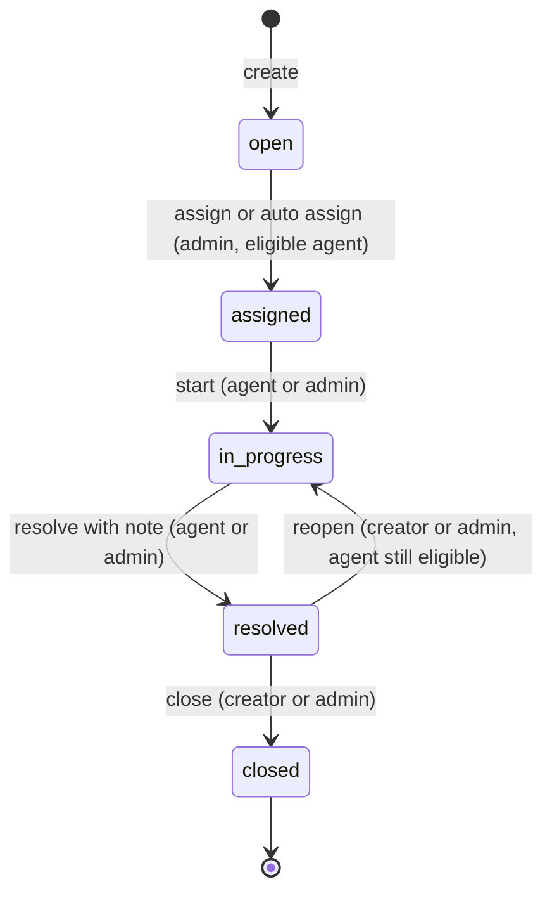

# 05 — Module-wise Code Explanation

This document walks through **every implemented module** of ResolveDesk. For every important operation it
follows the same 25-point structure required by `MASTER_PROMPT.md` §20, then explains the important code
block by block with snippets copied from the real files.

Read [04 — Laravel MVC Guide](04-LARAVEL-MVC-GUIDE.md) first if words like *middleware*, *policy*,
*route model binding* or *flash message* are new to you.

**Updated for V2** (multi-project upgrade, `V2_MASTER_PROMPT.md`). What changed in the code you will read here:

| V1 | V2 |
|---|---|
| `TicketService` did everything | `TicketService` (create, edit, comments, lifecycle, SLA), **`TicketAssignmentService`** (assign, auto-assign, eligibility, assignment lock), **`TicketNotifier`** (database notification + after-commit broadcast + after-commit email), **`AttachmentService`** (private files), **`ProjectService`** (project associations) |
| private `TicketService::recordActivity()` | static `TicketActivity::record()` (also for system actions, `user_id = NULL`) |
| private `notifyUser()` / `queueEmail()` | `TicketNotifier::notify()` / `notifyAdmins()` / private `queueEmail()` |
| `TicketController::agentList()` | `TicketAssignmentService::eligibleAgents($ticket)` (+ private `activeAgents()` for the list filter) |
| filters inside `index()` | `public static TicketController::applyFilters()` (shared with `ReportController`) |
| `store(Request)` | `store(StoreTicketRequest)` with `request_token` (idempotency) and attachments |
| no version | hidden `version` field on every ticket mutation form (optimistic locking) |
| no email for comments | a **customer's public reply emails the assigned agent** |
| — | projects, clients, internal notes, attachments, SLA command, reports/CSV, rate limiters, Reverb |

The detailed business explanation of the V2 features (with six operations in the 30-question format) is in
[22 — V2 business features](22-V2-BUSINESS-FEATURES.md).

Other related guides: [Database](03-DATABASE-GUIDE.md) · [Business logic](06-BUSINESS-LOGIC-GUIDE.md) ·
[UI to backend](07-UI-TO-BACKEND-MAPPING.md) · [Debugging](11-DEBUGGING-GUIDE.md) ·
[Notifications](13-NOTIFICATION-SYSTEM-GUIDE.md) · [Queue and email](14-QUEUE-AND-EMAIL-GUIDE.md) ·
[Caching](15-CACHING-GUIDE.md)

---

## Table of contents

0. [How to read this document + PHP syntax used in the project](#0-how-to-read-this-document)
1. [Authentication](#1-authentication)
2. [User Management](#2-user-management)
3. [Category Management](#3-category-management)
4. [Tickets: create, list/filter, show, edit](#4-tickets-create-listfilter-show-edit)
5. [Assignment: manual, automatic, reassignment](#5-assignment-manual-automatic-reassignment)
6. [Lifecycle: start, resolve, reopen, close](#6-lifecycle-start-resolve-reopen-close)
7. [Comments, internal notes and attachments](#7-comments-internal-notes-and-attachments)
8. [Activity history](#8-activity-history)
9. [Dashboards](#9-dashboards)
10. [Notifications](#10-notifications)
11. [Email and queue](#11-email-and-queue)
12. [Caching](#12-caching)
13. [Known issues and limitations found while writing this document](#13-known-issues-and-limitations-found-while-writing-this-document)
14. [Projects and client organizations (V2)](#14-projects-and-client-organizations-v2)
15. [SLA breach reminders (V2)](#15-sla-breach-reminders-v2)
16. [Reports and CSV export (V2)](#16-reports-and-csv-export-v2)

---

## 0. How to read this document

### 0.1 The 25-point table

Each operation has a table with these rows:

1 Business purpose · 2 User roles · 3 UI page · 4 Available UI actions · 5 Relevant Blade file ·
6 What happens on click · 7 Submitted form data · 8 HTTP method and URL · 9 Laravel route ·
10 Middleware · 11 Controller method · 12 Validation · 13 Authorization · 14 Business logic ·
15 Eloquent operations · 16 Equivalent SQL · 17 Database changes · 18 Notification operations ·
19 Queue operations · 20 Cache operations · 21 Response or redirect · 22 Blade rendering or JavaScript update ·
23 Error handling · 24 Relevant source files · 25 Common modifications

"SQL" is simplified to show the idea (Laravel uses `?` bindings and backtick-quoted names).
Every form also sends the hidden `_token` field (CSRF) — it is not repeated in each table.
The middleware `web` group (session, CSRF, route model binding) applies to all routes and is also not repeated.

### 0.2 The common shape of a ticket action

Almost every ticket action uses the same pipeline. Learn it once:

```mermaid
flowchart LR
    A["Button in tickets/show.blade.php (@can)"] --> B["POST route (auth, active, maybe role:admin)"]
    B --> C["TicketController method"]
    C --> D["Gate::authorize (TicketPolicy)"]
    D --> E["$request->validate"]
    E --> F["TicketService method"]
    F --> G["DB::transaction(..., 3) + lockTicket + ensureVersion"]
    G --> H["save (version+1) + TicketActivity::record + TicketNotifier::notify"]
    H --> I["COMMIT, afterCommit: broadcast + queue email"]
    I --> J["clearDashboardCache"]
    J --> K["back()->with('success')"]
```



`TicketService` class comment (copied from `app/Services/TicketService.php`):

```php
 * Every mutating method follows the same pattern:
 *   1. DB::transaction(..., 3): all changes succeed together or are rolled back;
 *      the "3" retries the transaction if MySQL reports a deadlock.
 *   2. lockTicket(): SELECT ... FOR UPDATE, so we validate the CURRENT row,
 *      not the possibly stale model from route model binding.
 *   3. ensureVersion(): optimistic check of the version the user saw (409 on mismatch).
 *   4. Change the ticket, version + 1, record activity, create notifications.
 *   5. After COMMIT: emails/broadcasts (TicketNotifier) and cache invalidation.
```

Assignment adds one more outer step (a `Cache::lock`, section 5).

### 0.3 PHP syntax used in this project (quick reference)

| Syntax | Real example | Meaning |
|---|---|---|
| Constructor property promotion | `public function __construct(private TicketService $ticketService) {}` (`TicketController`) | Declares a property **and** assigns the constructor argument in one step (PHP 8.0). |
| Typed properties | `public int $tries = 3;` (`SendTicketEmail`) | The property may only hold an `int`. |
| Return types | `public function canPerform(string $action): bool` | The method must return a `bool`. `: void` = returns nothing. `: ?User` = a `User` **or** `null`. |
| Nullable parameter types | `public function notify(?User $recipient, Ticket $ticket, ?User $actor, ...)` (`TicketNotifier`) | `?User` accepts a `User` or `null`. |
| Class constants | `public const STATUS_OPEN = 'open';`, `private const PER_PAGE = 15;` | Fixed values; read with `Ticket::STATUS_OPEN` or `self::PER_PAGE` inside the class. |
| `::class` | `TicketController::class` | The full class name as a string. |
| Named arguments | `new Envelope(subject: '...')`, `new Content(view: 'emails.ticket-update', with: [...])` (`TicketUpdateMail`) | Pass arguments by parameter name instead of position (PHP 8.0). |
| Nullsafe operator `?->` | `$ticket->assignedAgent?->name` (Blade), `$exception?->getMessage()` (`SendTicketEmail::failed`) | If the left side is `null`, the whole expression is `null` (no error). |
| Null coalescing `??` | `$data['title'] ?? 'Notification'` (`NotificationController`) | Use the right side if the left side is `null` or does not exist. |
| Closure with `use` | `DB::transaction(function () use ($data, $creator) { ... })` | An anonymous function. `use (...)` copies outer variables into it. |
| Arrow function | `fn ($notification) => $this->formatNotification($notification)` | Short one-expression closure; automatically sees outer variables. |
| Variadic / spread `...` | `string ...$roles` (`RoleMiddleware::handle`) | Collects any number of extra arguments into an array. |
| String interpolation | `"Ticket {$ticket->ticket_number} was created successfully."` | Inside double quotes, `{$expr}` is replaced by its value. |
| Concatenation `.` | `'TK-' . str_pad((string) $id, 6, '0', STR_PAD_LEFT)` | Joins strings. |
| Casting | `(int) $validated['category_id']`, `(string) $id` | Converts a value to another type. |
| Strict comparison | `$ticket->assigned_to === $agent->id` | Same value **and** same type. `!==` is the opposite. |
| `in_array(..., true)` | `in_array($ticket->status, Ticket::ACTIVE_STATUSES, true)` | Third argument `true` = strict comparison. |
| Static method | `Ticket::calculateDueAt($createdAt, $ticket->priority)` | Called on the class, not on an object. |
| `throw` | `throw ValidationException::withMessages([...]);` | Stops the method and hands an error to Laravel. |
| `try / catch` | `try { SendTicketEmail::dispatch(...); } catch (Throwable $exception) { ... }` | Catch an error instead of crashing. `Throwable` catches both exceptions and PHP errors. |

> **বাংলায়:** এই প্রজেক্টে আধুনিক PHP 8 syntax ব্যবহার করা হয়েছে। Constructor property promotion কোড ছোট করে,
> named arguments (`subject: ...`) পড়া সহজ করে, `?->` null হলে error না দিয়ে null দেয়, আর `??` না থাকলে একটি
> default মান দেয়। Closure-এর `use ($x)` বাইরের variable ভিতরে নিয়ে আসে, কারণ PHP closure নিজে থেকে বাইরের
> variable দেখতে পায় না (arrow function `fn` পারে)।

---

## 1. Authentication

Files: `app/Http/Controllers/AuthController.php`, `app/Http/Middleware/ActiveUserMiddleware.php`,
`resources/views/auth/login.blade.php`, `resources/views/layouts/guest.blade.php`,
`resources/views/partials/navbar.blade.php` (logout form), `bootstrap/app.php` (redirects).

### 1.1 Operation: Show the login page

| # | Item | Detail |
|---|---|---|
| 1 | Business purpose | Let staff and customers sign in. There is no public registration. |
| 2 | User roles | Guests (not logged in). |
| 3 | UI page | Sign-in page. |
| 4 | UI actions | Enter email + password, tick "Remember me", click **Sign in**. |
| 5 | Blade | `resources/views/auth/login.blade.php` (extends `layouts.guest`). |
| 6 | On click | Browser opens `/login` (or is redirected there by the `auth` middleware). |
| 7 | Form data | — (GET). |
| 8 | Method + URL | `GET /login` |
| 9 | Route | `login` |
| 10 | Middleware | `guest` (a logged-in user is redirected to `/dashboard` by `redirectUsersTo`). |
| 11 | Controller | `AuthController::showLogin()` → `return view('auth.login');` |
| 12 | Validation | — |
| 13 | Authorization | — |
| 14 | Business logic | Local demo accounts are shown only when `app()->environment('local')`. |
| 15 | Eloquent | — |
| 16 | SQL | Only the session read (`sessions` table). |
| 17 | DB changes | A session row may be created for the guest. |
| 18–20 | Notification / Queue / Cache | — |
| 21 | Response | 200 HTML. |
| 22 | Blade | `old('email')` refills the email after a failed login; `@error('email')` shows the message; `session('success')` / `session('error')` show logout / deactivation messages. |
| 23 | Errors | — |
| 24 | Files | `AuthController.php`, `auth/login.blade.php`, `layouts/guest.blade.php` |
| 25 | Modifications | Remove the demo-account card, change the page title (`@section('title', 'Sign in')`). |

### 1.2 Operation: Log in

| # | Item | Detail |
|---|---|---|
| 1 | Business purpose | Verify identity, block brute force, block inactive accounts, start a session. |
| 2 | User roles | Any active user (admin, agent, customer). |
| 3 | UI page | Sign-in page. |
| 4 | UI actions | **Sign in** button. |
| 5 | Blade | `auth/login.blade.php`: `<form method="POST" action="{{ route('login.attempt') }}" novalidate>` with `@csrf`. |
| 6 | On click | Browser POSTs the form. |
| 7 | Form data | `email`, `password`, `remember` (only sent if ticked, value `1`), `_token`. |
| 8 | Method + URL | `POST /login` |
| 9 | Route | `login.attempt` |
| 10 | Middleware | `guest` |
| 11 | Controller | `AuthController::login(Request $request)` |
| 12 | Validation | `'email' => ['required', 'email']`, `'password' => ['required', 'string']` |
| 13 | Authorization | Not needed (it *is* authentication). Inactive check after password check. |
| 14 | Business logic | Rate limit (5 attempts / email+IP, 60 s lock) → `Auth::attempt` → `is_active` check → clear limiter → regenerate session → redirect. |
| 15 | Eloquent | `Auth::attempt()` loads the `User` by email through the Eloquent user provider. |
| 16 | SQL | `SELECT * FROM users WHERE email = 'sarah.agent@resolvedesk.test' LIMIT 1;` (+ `UPDATE users SET remember_token = ? WHERE id = ?` when "Remember me" is ticked) |
| 17 | DB changes | `sessions` row gets the user id (new session id after `regenerate()`); rate-limit counters in the `cache` table (`CACHE_STORE=database`). |
| 18–19 | Notification / Queue | — |
| 20 | Cache | `RateLimiter::hit()` / `RateLimiter::clear()` use the cache store. |
| 21 | Response | `redirect()->intended(route('dashboard'))` → the page the user wanted before login, or `/dashboard`. |
| 22 | Blade | Dashboard renders. On failure, the login page shows the red `@error('email')` message. |
| 23 | Errors | Wrong credentials, too many attempts, inactive account → `ValidationException` → back to `/login` with an error under the email field. |
| 24 | Files | `AuthController.php`, `auth/login.blade.php`, `tests/Feature/AuthTest.php` |
| 25 | Modifications | Change `MAX_LOGIN_ATTEMPTS` / `LOCKOUT_SECONDS`; change the redirect after login. |

#### Code explained block by block

```php
/** Maximum failed login attempts per email + IP address before a lockout. */
private const MAX_LOGIN_ATTEMPTS = 5;

/** Lockout length in seconds. */
private const LOCKOUT_SECONDS = 60;
```

`private const` — a class constant visible only inside `AuthController`. Used as `self::MAX_LOGIN_ATTEMPTS`.

```php
$credentials = $request->validate([
    'email' => ['required', 'email'],
    'password' => ['required', 'string'],
]);
```

`$credentials` is now `['email' => '...', 'password' => '...']` — exactly the shape `Auth::attempt()` expects.

```php
$throttleKey = Str::lower($credentials['email']) . '|' . $request->ip();

if (RateLimiter::tooManyAttempts($throttleKey, self::MAX_LOGIN_ATTEMPTS)) {
    $seconds = RateLimiter::availableIn($throttleKey);
    throw ValidationException::withMessages([
        'email' => "Too many login attempts. Please try again in {$seconds} seconds.",
    ]);
}
```

- The key is e.g. `john.customer@example.com|127.0.0.1`. Lower-casing stops an attacker bypassing the limit with
  `JOHN.customer@...`.
- `tooManyAttempts(key, 5)` is true after 5 recorded failures. `availableIn()` returns the remaining lock seconds.
- **If removed:** unlimited password guessing (brute force).

```php
if (! Auth::attempt($credentials, $request->boolean('remember'))) {
    RateLimiter::hit($throttleKey, self::LOCKOUT_SECONDS);
    throw ValidationException::withMessages([
        'email' => 'These credentials do not match our records.',
    ]);
}
```

- `Auth::attempt()` finds the user by email, compares the password hash, and if it matches **logs the user in**
  (writes the user id into the session). It returns `true`/`false`.
- `RateLimiter::hit(key, 60)` adds one failure; the counter expires after 60 seconds.
- One generic message for wrong email *and* wrong password (does not reveal which emails exist).

```php
if (! Auth::user()->is_active) {
    Auth::logout();
    throw ValidationException::withMessages([
        'email' => 'Your account has been deactivated. Please contact an administrator.',
    ]);
}
```

The password was correct, so `Auth::attempt()` already logged the user in. We log them out immediately.
Test: log in as `tanvir.customer@example.com` (inactive seed user).

```php
RateLimiter::clear($throttleKey);

// 4. New session id after login prevents "session fixation" attacks.
$request->session()->regenerate();

return redirect()->intended(route('dashboard'));
```

- `regenerate()` gives the session a new id while keeping its data.
- `intended()` — if a guest opened `/tickets/7`, the `auth` middleware remembered that URL; after login the user
  lands there instead of the dashboard.

> **বাংলায়:** Login-এর ধাপগুলো: প্রথমে input যাচাই, তারপর rate limit দেখা (৫ বার ভুল হলে ৬০ সেকেন্ড বন্ধ), তারপর
> `Auth::attempt()` দিয়ে password hash মেলানো, তারপর account active কিনা দেখা, আর সব শেষে নতুন session id তৈরি।
> Session fixation মানে আক্রমণকারী আগে থেকে একটি session id ঠিক করে রাখে; login-এর পর id বদলে দিলে সেই পুরোনো id আর
> কাজ করে না।

### 1.3 Operation: Log out

| # | Item | Detail |
|---|---|---|
| 1 | Business purpose | End the session safely. |
| 2 | User roles | Any logged-in user. |
| 3 | UI page | Every page (profile dropdown in the navbar). |
| 4 | UI actions | **Sign out**. |
| 5 | Blade | `partials/navbar.blade.php`: `<form method="POST" action="{{ route('logout') }}">` + `@csrf`. |
| 6 | On click | POST form submitted. |
| 7 | Form data | `_token` only. |
| 8 | Method + URL | `POST /logout` |
| 9 | Route | `logout` |
| 10 | Middleware | `auth`, `active` |
| 11 | Controller | `AuthController::logout(Request $request)` |
| 12–13 | Validation / Authorization | — |
| 14 | Business logic | `Auth::logout()`; `invalidate()` destroys session data; `regenerateToken()` makes a new CSRF token. |
| 15 | Eloquent | — (remember token may be cycled by Laravel). |
| 16 | SQL | `DELETE FROM sessions WHERE id = 'old-id'` (invalidate) and a new session row on save. |
| 17 | DB changes | Session row replaced. |
| 18–20 | Notification / Queue / Cache | — |
| 21 | Response | `redirect()->route('login')->with('success', 'You have been logged out.')` |
| 22 | Blade | Login page prints `session('success')`. |
| 23 | Errors | Old tab still open after logout → its POST forms return 419 (token changed). |
| 24 | Files | `AuthController.php`, `partials/navbar.blade.php` |
| 25 | Modifications | Change the redirect target or the message. |

**Why POST and not a link?** A GET logout link could be triggered by any website (``).

### 1.4 Operation: Deactivated while logged in (middleware)

| # | Item | Detail |
|---|---|---|
| 1 | Business purpose | An admin deactivates someone who is currently logged in; they must lose access on the next request. |
| 2 | User roles | Any user whose `is_active` became `false`. |
| 3–7 | UI | Any page / any AJAX poll. No form. |
| 8 | Method + URL | Any protected URL, e.g. `GET /notifications/feed`. |
| 9 | Route | Any route in the `['auth', 'active']` group. |
| 10 | Middleware | `active` → `ActiveUserMiddleware::handle()` |
| 11 | Controller | Not reached. |
| 12–13 | Validation / Authorization | — |
| 14 | Business logic | `if ($user !== null && ! $user->is_active)` → logout + invalidate + regenerate token. |
| 15–16 | Eloquent / SQL | `$request->user()` was loaded by `auth`: `SELECT * FROM users WHERE id = ? LIMIT 1`. |
| 17 | DB changes | Session destroyed. |
| 18–20 | — | — |
| 21 | Response | HTML request: redirect to login with `error`. JSON request: `401` `{"message": "..."}`. |
| 22 | JS update | `notifications.js` sees 401 → `handleExpiredSession()` → stops polling, shows "Sign in again". |
| 23 | Errors | — |
| 24 | Files | `app/Http/Middleware/ActiveUserMiddleware.php`, `public/js/notifications.js`, `tests/Feature/AuthTest.php` |
| 25 | Modifications | Also check something else on every request (e.g. a "must change password" flag) in the same middleware. |

---

## 2. User Management

Files: `app/Http/Controllers/UserController.php`, `resources/views/users/index.blade.php`, `create.blade.php`,
`edit.blade.php`, `show.blade.php`, `_form.blade.php`, `app/Models/User.php`.
All routes are inside `Route::middleware('role:admin')`. Users are **never deleted** (the resource route excludes
`destroy`) because tickets, comments and activities reference them.

### 2.1 Operation: List, search and filter users

| # | Item | Detail |
|---|---|---|
| 1 | Business purpose | Admin finds users quickly. |
| 2 | User roles | Admin. |
| 3 | UI page | Users. |
| 4 | UI actions | Search, Role filter, Status filter, V2 Client filter, **Filter**, **Reset**, View, Edit, Activate/Deactivate. |
| 5 | Blade | `users/index.blade.php` |
| 6 | On click | GET form submits filters in the URL query string. |
| 7 | Form data | `search`, `role`, `status` (`active` / `inactive`), V2 `client_id`. |
| 8 | Method + URL | `GET /users?search=sarah&role=agent&status=active` |
| 9 | Route | `users.index` |
| 10 | Middleware | `auth`, `active`, `role:admin` |
| 11 | Controller | `UserController::index(Request $request)` |
| 12 | Validation | V2: `search` max 100, `role` in `User::ROLES`, `status` in active/inactive, `client_id` integer. |
| 13 | Authorization | `role:admin` |
| 14 | Business logic | Build query step by step only for filled filters. |
| 15 | Eloquent | `User::with('client')->where(function ($subQuery) use ($search) {...})->where('role', ...)->where('client_id', ...)->where('is_active', true)->orderBy('name')->paginate(15)->withQueryString()` |
| 16 | SQL | `SELECT COUNT(*) AS aggregate FROM users WHERE (name LIKE '%sarah%' OR email LIKE '%sarah%') AND role = 'agent' AND is_active = 1;` then `SELECT * FROM users WHERE (...) AND role = 'agent' AND is_active = 1 ORDER BY name ASC LIMIT 15 OFFSET 0;` |
| 17 | DB changes | — |
| 18–20 | — | — |
| 21 | Response | `view('users.index', ['users' => $users])` |
| 22 | Blade | `@forelse ($users as $user)` rows; `{{ $users->links() }}` Bootstrap pagination; toggle button hidden for yourself (`@if ($user->id !== auth()->id())`). |
| 23 | Errors | Non-admin → 403. |
| 24 | Files | `UserController.php`, `users/index.blade.php` |
| 25 | Modifications | Add a "created after" filter: add an input and `if ($request->filled('created_from')) { $query->whereDate('created_at', '>=', ...); }`. |

```php
if ($request->filled('search')) {
    $search = $request->input('search');
    $query->where(function ($subQuery) use ($search) {
        $subQuery->where('name', 'like', "%{$search}%")
            ->orWhere('email', 'like', "%{$search}%");
    });
}
```

The closure creates **brackets** in SQL: `WHERE (name LIKE ? OR email LIKE ?) AND role = ?`. Without it, the `OR`
would break the other filters: `WHERE name LIKE ? OR email LIKE ? AND role = ?` (AND binds stronger than OR).
`use ($search)` copies `$search` into the closure. `withQueryString()` keeps `?search=...` in pagination links.

### 2.2 Operation: Create a user

| # | Item | Detail |
|---|---|---|
| 1 | Business purpose | Admin creates accounts (no public registration). |
| 2 | User roles | Admin. |
| 3 | UI page | Create User. |
| 4 | UI actions | Fill form, **Create User**, Cancel. |
| 5 | Blade | `users/create.blade.php` + `users/_form.blade.php` |
| 6 | On click | POST form. |
| 7 | Form data | `name`, `email`, `password`, `password_confirmation`, `role`, `is_active` (checkbox, `1` or missing), V2 `client_id` ("customers only"). |
| 8 | Method + URL | `GET /users/create` (form), `POST /users` (save) |
| 9 | Route | `users.create`, `users.store` |
| 10 | Middleware | `auth`, `active`, `role:admin` |
| 11 | Controller | `UserController::create()`, `UserController::store(Request $request)` |
| 12 | Validation | `name` required max 255; `email` required, email, `unique:users,email`; `password` required min 8 `confirmed`; `role` `Rule::in(array_keys(User::ROLES))`; `is_active` boolean; V2 `client_id` nullable integer `Rule::exists('clients', 'id')->where('is_active', true)` ("Please choose an active client organization."). |
| 13 | Authorization | `role:admin` |
| 14 | Business logic | `$validated['is_active'] = $request->boolean('is_active');` (unchecked checkbox is not sent). V2: `client_id` is kept only for customers (`$validated['role'] === User::ROLE_CUSTOMER ? ... : null`) and set explicitly (not fillable). Dashboard cache cleared. |
| 15 | Eloquent | `$user = new User($validated); $user->client_id = $clientId; $user->save();` — mass assignment limited by `$fillable`; password hashed by the `'hashed'` cast. |
| 16 | SQL | `SELECT COUNT(*) AS aggregate FROM users WHERE email = ?;` then `INSERT INTO users (name, email, password, role, is_active, updated_at, created_at) VALUES (?, ?, '$2y$12$...', 'agent', 1, NOW(), NOW());` |
| 17 | DB changes | One `users` row. |
| 18–20 | — | — |
| 21 | Response | `redirect()->route('users.show', $user)->with('success', "User {$user->name} was created.")` |
| 22 | Blade | User details page with flash message. |
| 23 | Errors | Duplicate email / short password / mismatch → back with `@error` messages and `old()` values (password fields are not refilled). |
| 24 | Files | `UserController.php`, `users/_form.blade.php`, `User.php`, `tests/Feature/UserAndCategoryManagementTest.php` |
| 25 | Modifications | Add a phone column: migration + `$fillable` + rule + form input. |

`users/_form.blade.php` handles both create and edit:

```blade
@php($user = $user ?? null)
@php($isEdit = $user !== null)
...
<input class="form-check-input" type="checkbox" role="switch" id="is_active" name="is_active" value="1"
       @checked(old('is_active', $user?->is_active ?? true))>
```

`$user?->is_active ?? true` — on the create page `$user` is `null`, so `?->` returns `null` and `??` gives the
default `true` (new users are active by default).

### 2.3 Operation: View a user

| # | Item | Detail |
|---|---|---|
| 1 | Business purpose | See role, status, ticket counts and recent tickets of one user. |
| 2 | User roles | Admin. |
| 3 | UI page | User details. |
| 4 | UI actions | Edit, Activate/Deactivate, open a ticket. |
| 5 | Blade | `users/show.blade.php` |
| 6 | On click | Link from the list. |
| 7 | Form data | — |
| 8 | Method + URL | `GET /users/{user}` |
| 9 | Route | `users.show` |
| 10 | Middleware | `auth`, `active`, `role:admin` |
| 11 | Controller | `UserController::show(User $user)` (route model binding) |
| 12–13 | Validation / Authorization | — / `role:admin` |
| 14 | Business logic | V2 `$user->load(['client', 'projects'])` (client link for customers, "Supported projects" for agents); count created tickets, count current workload (`WORKLOAD_STATUSES`), last 10 related tickets. |
| 15 | Eloquent | `$user->createdTickets()->count()`, `$user->assignedTickets()->whereIn('status', Ticket::WORKLOAD_STATUSES)->count()`, `Ticket::with([...])->where(function ...)->latest()->take(10)->get()` |
| 16 | SQL | `SELECT COUNT(*) FROM tickets WHERE created_by = 5 AND created_by IS NOT NULL;` · `SELECT COUNT(*) FROM tickets WHERE assigned_to = 5 AND assigned_to IS NOT NULL AND status IN ('assigned','in_progress');` · `SELECT * FROM tickets WHERE (created_by = 5 OR assigned_to = 5) ORDER BY created_at DESC LIMIT 10;` + eager loads |
| 17–20 | — | — |
| 21 | Response | `view('users.show', [...])` |
| 22 | Blade | Stat cards + table with `@include('partials.ticket-badges', ['ticket' => $ticket])`. |
| 23 | Errors | Unknown id → 404. |
| 24 | Files | `UserController.php`, `users/show.blade.php` |
| 25 | Modifications | Show "resolved tickets" count: `$user->assignedTickets()->where('status', Ticket::STATUS_RESOLVED)->count()`. |

### 2.4 Operation: Edit a user

| # | Item | Detail |
|---|---|---|
| 1 | Business purpose | Change name, email, password, role, active flag — safely. |
| 2 | User roles | Admin. |
| 3 | UI page | Edit User. |
| 4 | UI actions | **Save Changes**, Cancel. |
| 5 | Blade | `users/edit.blade.php` (`@method('PUT')`) + `users/_form.blade.php` |
| 6 | On click | POST with `_method=PUT`. |
| 7 | Form data | `name`, `email`, `password` (optional), `password_confirmation`, `role`, `is_active`, V2 `client_id`, `_method`. |
| 8 | Method + URL | `PUT /users/{user}` |
| 9 | Route | `users.update` |
| 10 | Middleware | `auth`, `active`, `role:admin` |
| 11 | Controller | `UserController::update(Request $request, User $user)` |
| 12 | Validation | `Rule::unique('users', 'email')->ignore($user->id)`; `'password' => ['nullable', 'string', 'min:8', 'confirmed']` |
| 13 | Authorization | `role:admin` + business rules in `ensureRoleOrStatusChangeIsAllowed()` and V2 `ensureClientChangeIsAllowed()` |
| 14 | Business logic | 3 rules (below) + V2 client rule. Empty password → keep the current one. |
| 15 | Eloquent | `$user->update($validated)` |
| 16 | SQL | `UPDATE users SET name = ?, role = ?, updated_at = ? WHERE id = ?;` (only changed columns) |
| 17 | DB changes | One `users` row. |
| 18–20 | — | — |
| 21 | Response | `redirect()->route('users.show', $user)->with('success', 'User updated successfully.')` |
| 22 | Blade | Details page. Business-rule error appears in the red alert under the form (`@error('is_active')`) and in the flash box. |
| 23 | Errors | Rule violations → `ValidationException` on key `is_active`. |
| 24 | Files | `UserController.php`, `users/_form.blade.php` |
| 25 | Modifications | Add a rule "agents cannot become admins": another `if` inside `ensureRoleOrStatusChangeIsAllowed()`. |

```php
// Empty password field = keep the current password.
if (empty($validated['password'])) {
    unset($validated['password']);
}

$user->update($validated);
```

`unset()` removes the key, so `update()` does not overwrite the password with `null`.
(`ConvertEmptyStringsToNull` middleware already turned `""` into `null`, which `nullable` allows.)

**The three safety rules** (`ensureRoleOrStatusChangeIsAllowed`):

```php
$isDeactivating = $user->is_active && ! $newIsActive;
$isChangingRole = $user->role !== $newRole;

if (! $isDeactivating && ! $isChangingRole) {
    return;
}

// Rule 1: an administrator cannot deactivate or demote themselves.
if ($user->id === $currentAdmin->id) { throw ValidationException::withMessages([...]); }

// Rule 2: always keep at least one active administrator.
if ($user->isAdmin() && $user->is_active) {
    $otherActiveAdmins = User::where('role', User::ROLE_ADMIN)
        ->where('is_active', true)
        ->where('id', '!=', $user->id)
        ->count();
    ...
}

// Rule 3: an agent responsible for unfinished or reopenable tickets must hand them over first.
if ($user->isAgent()) {
    $responsibleTickets = Ticket::where('assigned_to', $user->id)
        ->whereIn('status', [Ticket::STATUS_ASSIGNED, Ticket::STATUS_IN_PROGRESS, Ticket::STATUS_RESOLVED])
        ->count();
    ...
}
```

(The `throw` bodies are shortened here; see the file for the exact messages.)

**V2 client rule** (`ensureClientChangeIsAllowed($user, $newClientId)`): a new client must be active, and a
customer who already created client tickets (`Ticket::where('created_by', $user->id)->whereNotNull('client_id')->count()`)
cannot change organization or stop being a customer — moving them would let them keep seeing the old
organization's tickets. Full code and reasoning: [22 — section 3](22-V2-BUSINESS-FEATURES.md#3-customer-to-client-mapping-rules).

- Rule 2 SQL: `SELECT COUNT(*) FROM users WHERE role = 'admin' AND is_active = 1 AND id != 1;`
- Rule 3 includes **Resolved** tickets because a customer can **reopen** them, and a reopened ticket goes back to
  its assigned agent, who must be active (see `TicketService::reopen`). Resolved tickets cannot be reassigned, so
  the admin must close them first.
- **If removed:** the system could be left with no admin (nobody can manage users) or with tickets stuck on an
  inactive agent.

### 2.5 Operation: Activate / deactivate a user

| # | Item | Detail |
|---|---|---|
| 1 | Business purpose | Block or restore access without deleting history. |
| 2 | User roles | Admin. |
| 3 | UI page | Users list and User details. |
| 4 | UI actions | **Deactivate** / **Activate** (with a JS confirm dialog). |
| 5 | Blade | `users/index.blade.php`, `users/show.blade.php`: `<form method="POST" action="{{ route('users.toggle-active', $user) }}" data-confirm="...">` + `@csrf` + `@method('PATCH')` |
| 6 | On click | `public/js/app.js` shows `window.confirm(message)`; Cancel → `event.preventDefault()`, OK → submit. |
| 7 | Form data | `_method=PATCH`, `_token`. |
| 8 | Method + URL | `PATCH /users/{user}/toggle-active` |
| 9 | Route | `users.toggle-active` |
| 10 | Middleware | `auth`, `active`, `role:admin` |
| 11 | Controller | `UserController::toggleActive(Request $request, User $user)` |
| 12 | Validation | — |
| 13 | Authorization | `role:admin` + `ensureRoleOrStatusChangeIsAllowed($user, $user->role, $newIsActive, $request->user())` |
| 14 | Business logic | `$newIsActive = ! $user->is_active;` — flip the flag, check the 3 rules. |
| 15 | Eloquent | `$user->is_active = $newIsActive; $user->save();` |
| 16 | SQL | `UPDATE users SET is_active = 0, updated_at = ? WHERE id = 7;` |
| 17 | DB changes | `users.is_active`. The user's next request is stopped by `ActiveUserMiddleware`. |
| 18–20 | — | — |
| 21 | Response | `back()->with('success', "User {$user->name} was {$word}.")` |
| 22 | Blade | Badge switches between Active / Inactive. |
| 23 | Errors | Rule violation → red flash error. |
| 24 | Files | `UserController.php`, `public/js/app.js`, `tests/Feature/UserAndCategoryManagementTest.php` |
| 25 | Modifications | Write an audit row when a user is deactivated (new table or log). |

`public/js/app.js` (used by every `data-confirm` / `data-disable-on-submit` form in the project):

```js
document.addEventListener('submit', function (event) {
    const form = event.target;
    const message = form.getAttribute('data-confirm');

    if (message && !window.confirm(message)) {
        event.preventDefault();
        return;
    }

    if (form.hasAttribute('data-disable-on-submit')) {
        if (form.dataset.submitting === '1') {
            event.preventDefault(); // second click while the first request is still running
            return;
        }
        form.dataset.submitting = '1';
        ...
    }
});
```

One listener on the whole document (**event delegation**) instead of one listener per form. V2 added the
double-submit part (buttons disabled + spinner, re-enabled on `pageshow` after the Back button). It is only a
convenience: the server-side protection against duplicate tickets is `request_token`.

---

## 3. Category Management

Files: `app/Http/Controllers/CategoryController.php`, `app/Models/Category.php`,
`resources/views/categories/index.blade.php`, `create.blade.php`, `edit.blade.php`, `_form.blade.php`.
Routes: `Route::resource('categories', CategoryController::class)->except(['show']);` inside `role:admin`.

### 3.1 Operation: List categories

| # | Item | Detail |
|---|---|---|
| 1 | Business purpose | See all categories, how many tickets use each, and their status. |
| 2 | User roles | Admin. |
| 3 | UI page | Ticket Categories. |
| 4 | UI actions | Create Category, Edit, Delete (only when unused). |
| 5 | Blade | `categories/index.blade.php` |
| 6–7 | Click / data | Sidebar link "Categories" / — |
| 8 | Method + URL | `GET /categories` |
| 9 | Route | `categories.index` |
| 10 | Middleware | `auth`, `active`, `role:admin` |
| 11 | Controller | `CategoryController::index()` |
| 12–13 | Validation / Authorization | — / `role:admin` |
| 14 | Business logic | Delete button only if `tickets_count === 0`. |
| 15 | Eloquent | `Category::withCount('tickets')->orderBy('name')->paginate(15)` |
| 16 | SQL | `SELECT categories.*, (SELECT COUNT(*) FROM tickets WHERE categories.id = tickets.category_id) AS tickets_count FROM categories ORDER BY name ASC LIMIT 15 OFFSET 0;` |
| 17–20 | — | — (this page reads the database, not the cache) |
| 21 | Response | `view('categories.index', [...])` |
| 22 | Blade | `@if ($category->tickets_count === 0)` → Delete form, else a disabled button "Used by tickets - deactivate it instead". |
| 23 | Errors | Non-admin → 403. |
| 24 | Files | `CategoryController.php`, `categories/index.blade.php` |
| 25 | Modifications | Sort by ticket count: `->orderByDesc('tickets_count')`. |

### 3.2 Operation: Create / update a category

| # | Item | Detail |
|---|---|---|
| 1 | Business purpose | Maintain the list customers choose from when creating tickets. |
| 2 | User roles | Admin. |
| 3 | UI page | Create Category / Edit Category. |
| 4 | UI actions | **Create Category** / **Save Changes**, Cancel. |
| 5 | Blade | `categories/create.blade.php`, `categories/edit.blade.php` (`@method('PUT')`), `categories/_form.blade.php` |
| 6 | On click | POST (create) or POST + `_method=PUT` (update). |
| 7 | Form data | `name`, `description`, `is_active` (checkbox). |
| 8 | Method + URL | `POST /categories`; `PUT /categories/{category}` |
| 9 | Route | `categories.store`, `categories.update` |
| 10 | Middleware | `auth`, `active`, `role:admin` |
| 11 | Controller | `CategoryController::store()`, `CategoryController::update(Request $request, Category $category)` |
| 12 | Validation | `name` required, max 100, `unique:categories,name` (update: `Rule::unique('categories', 'name')->ignore($category->id)`); `description` nullable max 1000; `is_active` boolean. |
| 13 | Authorization | `role:admin` |
| 14 | Business logic | `is_active` from `$request->boolean('is_active')`; then clear two caches. |
| 15 | Eloquent | `Category::create($validated)` / `$category->update($validated)` |
| 16 | SQL | `INSERT INTO categories (name, description, is_active, updated_at, created_at) VALUES (...);` / `UPDATE categories SET ... WHERE id = ?;` |
| 17 | DB changes | One `categories` row. |
| 18–19 | Notification / Queue | — |
| 20 | Cache | `clearCaches()` → `Category::clearActiveCache()` (key `ticket:active-categories`) and `Cache::forget(TicketService::DASHBOARD_CACHE_KEY)` (key `dashboard:admin:stats`). |
| 21 | Response | `redirect()->route('categories.index')->with('success', 'Category created.')` / `'Category updated.'` |
| 22 | Blade | List page with flash. |
| 23 | Errors | Duplicate name → back with `@error('name')`. |
| 24 | Files | `CategoryController.php`, `Category.php`, `categories/_form.blade.php`, `tests/Feature/CacheTest.php` |
| 25 | Modifications | Add a `sort_order` column and order the dropdown by it (change the query inside `activeForDropdown()`). |

```php
private function clearCaches(): void
{
    Category::clearActiveCache();
    Cache::forget(TicketService::DASHBOARD_CACHE_KEY);
}
```

Why both? The ticket form dropdown shows active category names (category cache), and the admin dashboard's
"tickets by category" chart shows category names (dashboard cache). **If removed:** a renamed/deactivated category
would still show in the dropdown for up to 1 hour.

### 3.3 Operation: Delete a category

| # | Item | Detail |
|---|---|---|
| 1 | Business purpose | Remove a category created by mistake. Used categories must be deactivated instead. |
| 2 | User roles | Admin. |
| 3 | UI page | Ticket Categories. |
| 4 | UI actions | **Delete** (only visible when unused; JS confirm). |
| 5 | Blade | `categories/index.blade.php`: form with `@csrf` + `@method('DELETE')` |
| 6 | On click | Confirm dialog → POST with `_method=DELETE`. |
| 7 | Form data | `_method`, `_token`. |
| 8 | Method + URL | `DELETE /categories/{category}` |
| 9 | Route | `categories.destroy` |
| 10 | Middleware | `auth`, `active`, `role:admin` |
| 11 | Controller | `CategoryController::destroy(Category $category)` |
| 12 | Validation | — |
| 13 | Authorization | `role:admin` |
| 14 | Business logic | `if ($category->tickets()->exists())` → refuse. |
| 15 | Eloquent | `$category->tickets()->exists()`, `$category->delete()` |
| 16 | SQL | `SELECT EXISTS(SELECT * FROM tickets WHERE tickets.category_id = 3 AND tickets.category_id IS NOT NULL) AS exists_flag;` then `DELETE FROM categories WHERE id = 3;` |
| 17 | DB changes | Row deleted. The FK `tickets.category_id ... restrictOnDelete()` would also block deletion at database level. |
| 18–19 | — | — |
| 20 | Cache | `clearCaches()` |
| 21 | Response | Success: `redirect()->route('categories.index')->with('success', 'Category deleted.')`. Used: `back()->with('error', '...Deactivate it instead.')` |
| 22 | Blade | Flash message. |
| 23 | Errors | Category in use → red error (button is also disabled in the UI). |
| 24 | Files | `CategoryController.php`, `categories/index.blade.php`, migration `2026_11_25_000002_create_tickets_table.php` |
| 25 | Modifications | Soft deletes (`SoftDeletes` trait + `deleted_at`) instead of hard delete. |

### 3.4 The active-category dropdown cache (`Category::activeForDropdown`)

```php
public const ACTIVE_CACHE_KEY = 'ticket:active-categories';

public const ACTIVE_CACHE_TTL_SECONDS = 3600;

public static function activeForDropdown(): Collection
{
    $rows = Cache::remember(self::ACTIVE_CACHE_KEY, self::ACTIVE_CACHE_TTL_SECONDS, function () {
        return Category::where('is_active', true)->orderBy('name')->get(['id', 'name'])->toArray();
    });

    return Category::hydrate($rows);
}

public static function clearActiveCache(): void
{
    Cache::forget(self::ACTIVE_CACHE_KEY);
}
```

Explained in [section 12](#12-caching). Important: this list is for **display only**. Saving a ticket always
validates against the real `categories` table (`Rule::exists('categories', 'id')->where('is_active', true)`).

> ✅ **Bug found and fixed:** the first version cached the Eloquent `Collection` itself. With
> `CACHE_STORE=database` and `config/cache.php` → `'serializable_classes' => false`, a **cache hit** returned
> `__PHP_Incomplete_Class`, so `activeForDropdown()` threw a `TypeError` (500 on the second visit to the ticket
> form). The method now caches a plain array (`->toArray()`) and rebuilds models with `Category::hydrate($rows)`.
> The full story is in [section 13](#13-known-issues-and-limitations-found-while-writing-this-document).

---

## 4. Tickets: create, list/filter, show, edit

Files: `app/Http/Controllers/TicketController.php`, `app/Http/Requests/StoreTicketRequest.php` (V2),
`app/Services/TicketService.php`, `app/Services/AttachmentService.php` (V2), `app/Models/Ticket.php`,
`app/Policies/TicketPolicy.php`, `resources/views/tickets/*.blade.php`, `public/js/ticket-form.js` (V2),
`resources/views/partials/ticket-badges.blade.php`.

### 4.1 Operation: Create a ticket

| # | Item | Detail |
|---|---|---|
| 1 | Business purpose | Report a problem, optionally for a project and (admin) a client organization. The system sets the number, status, SLA deadline and scope. |
| 2 | User roles | All active roles (`TicketPolicy::create`), except customers whose client organization is inactive. Scope rules differ per role (V2). |
| 3 | UI page | Create Ticket. |
| 4 | UI actions | (Admin) choose Client → project list reloads; choose Project (or "Global"); subject, description, category, priority, optional attachments → **Submit Ticket**; Cancel. |
| 5 | Blade | `tickets/create.blade.php` + `tickets/_scope-fields.blade.php` + `tickets/_form.blade.php` + `tickets/_attachment-input.blade.php` |
| 6 | On click | `multipart/form-data` POST; `public/js/app.js` disables the button (`data-disable-on-submit`). |
| 7 | Form data | `request_token` (hidden UUID), `client_id` (admin only), `project_id`, `subject`, `description`, `category_id`, `priority`, `attachments[]`. |
| 8 | Method + URL | `GET /tickets/create` (form) · `POST /tickets` (save) |
| 9 | Route | `tickets.create`, `tickets.store` |
| 10 | Middleware | `auth`, `active`; store also `throttle:ticket-create` (10/min) |
| 11 | Controller | `TicketController::create(Request $request)`, `TicketController::store(StoreTicketRequest $request)` |
| 12 | Validation | `StoreTicketRequest::rules()`: subject required max 255 · description required max 5000 · `category_id` `Rule::exists('categories', 'id')->where('is_active', true)` · priority in `Ticket::PRIORITIES` · `project_id` / `client_id` nullable integer exists · `request_token` required uuid · `AttachmentService::validationRules()`. |
| 13 | Authorization | `StoreTicketRequest::authorize()` → `$this->user()->can('create', Ticket::class)`; scope ownership in `TicketService::resolveScope()`. |
| 14 | Business logic | Idempotency check → store files → transaction: `resolveScope()` → INSERT (status open, version 1, `due_at`) → ticket number → activity → attachment rows → notify admins → after commit: clear dashboard cache. |
| 15 | Eloquent | `Ticket::where('created_by', ...)->where('request_token', ...)->first()`, `Project::whereKey()->sharedLock()->first()`, `$project->clients()->where(...)->exists()`, `new Ticket`, `fill()`, `save()` ×2, `TicketActivity::record()`, `TicketAttachment` saves, `$admin->notify()` |
| 16 | SQL | see below |
| 17 | DB changes | 1 `tickets` row, 1–2 `ticket_activities`, 0–5 `ticket_attachments`, 1 `notifications` per active admin (except the creator); after COMMIT 1 `jobs` row per notified admin. |
| 18 | Notification | "New ticket created" (`created`) to every active admin except an admin creator (`TicketNotifier::notifyAdmins()` → `notify()` skips the actor). |
| 19 | Queue | One `SendTicketEmail` per notified admin, after COMMIT (`TicketNotifier`). Broadcast `notification.created` after COMMIT. |
| 20 | Cache | Form: `Category::activeForDropdown()`. After save: `clearDashboardCache()`. |
| 21 | Response | `redirect()->route('tickets.show', $ticket)->with('success', $message)` — "Ticket TK-000041 was created successfully." or, for a replay, "This form was already submitted. Showing ticket TK-000041." |
| 22 | Blade | Ticket details page with flash. |
| 23 | Errors | Format errors → back with `@error` + `old()`; scope errors from `resolveScope()` on `project_id`/`client_id`; same token + different content → `TicketConflictException` (back with input / 409 JSON); 11th request per minute → 429; any exception → transaction rolled back **and** stored files deleted. |
| 24 | Files | `TicketController.php`, `StoreTicketRequest.php`, `TicketService.php`, `AttachmentService.php`, `TicketNotifier.php`, `tickets/_scope-fields.blade.php`, tests `TicketScopeTest`, `ConsistencyTest`, `InternalNotesAndAttachmentsTest` |
| 25 | Modifications | New priority (`PRIORITIES` **and** `SLA_HOURS`); admin alert in-app only (last `notifyAdmins()` argument `true` → `false`); allow agents to create client tickets (agent branch of `resolveScope()` + scope partial). |

`create()` prepares the form:

```php
return view('tickets.create', [
    'categories' => Category::activeForDropdown(),
    // Admin chooses a client; customers' client is fixed; agents create internal tickets.
    'clients' => $user->isAdmin() ? Client::active()->orderBy('name')->get(['id', 'code', 'name']) : collect(),
    'projects' => $this->selectableProjects($user, null),
    // Idempotency key: a new random UUID every time the form is opened.
    'requestToken' => old('request_token', (string) Str::uuid()),
]);
```

`store()` is short because the Form Request already authorized and validated:

```php
$ticket = $this->ticketService->createTicket(
    $request->safe()->except('attachments'),
    $request->user(),
    $request->file('attachments', [])
);

$message = $ticket->wasRecentlyCreated
    ? "Ticket {$ticket->ticket_number} was created successfully."
    : "This form was already submitted. Showing ticket {$ticket->ticket_number}.";
```

`wasRecentlyCreated` is an Eloquent property: `true` only on the model instance that performed the INSERT. A
replay returns a ticket loaded from the database → `false`.

#### `TicketService::createTicket()` block by block

```php
public function createTicket(array $data, User $creator, array $files = []): Ticket
{
    $requestToken = $data['request_token'];

    // Replay of a request that already succeeded (double click, browser retry)?
    $existingTicket = $this->findByRequestToken($creator, $requestToken);
    if ($existingTicket !== null) {
        return $this->replayOrReject($existingTicket, $data);
    }

    // Files are written BEFORE the transaction; on any failure they are deleted again.
    $storedFiles = $this->attachmentService->storeFiles($files);
```

- Idempotency step 1: a cheap lookup for the common "double click after success" case.
- Files first: a database rollback cannot delete a file, so the code writes files before and deletes them in the
  `catch` blocks.

```php
    try {
        $ticket = DB::transaction(function () use ($data, $creator, $requestToken, $storedFiles) {
            [$projectId, $clientId] = $this->resolveScope($creator, $data['project_id'] ?? null, $data['client_id'] ?? null);
            $createdAt = now();

            $ticket = new Ticket;
            $ticket->fill($data);                          // subject, description, category_id, priority
            $ticket->project_id = $projectId;              // validated scope, never raw input
            $ticket->client_id = $clientId;
            $ticket->created_by = $creator->id;            // From the logged-in user, never from the form.
            $ticket->assigned_to = null;
            $ticket->status = Ticket::STATUS_OPEN;
            $ticket->version = 1;
            $ticket->request_token = $requestToken;
            $ticket->created_at = $createdAt;
            $ticket->due_at = Ticket::calculateDueAt($createdAt, $ticket->priority);
            $ticket->save();                               // INSERT -> the database generates the id.

            // Ticket number from the database id: always unique (unlike MAX(id) + 1).
            $ticket->ticket_number = Ticket::makeTicketNumber($ticket->id);
            $ticket->save();

            TicketActivity::record($ticket, $creator, 'created', null, 'Open');

            if (count($storedFiles) > 0) {
                $this->attachmentService->createRecords($storedFiles, $ticket, null, $creator);
                TicketActivity::record($ticket, $creator, 'attachment_added', null, $this->fileList($storedFiles));
            }

            // Tell every active administrator (except an admin who created it) - in-app + email.
            $this->notifier->notifyAdmins($ticket, $creator, 'created',
                'New ticket created',
                "{$creator->name} created ticket {$ticket->ticket_number} \"{$ticket->subject}\".",
                true);

            return $ticket;
        }, 3);
```

| Line(s) | Explanation |
|---|---|
| `[$projectId, $clientId] = $this->resolveScope(...)` | Array destructuring. `resolveScope()` returns the **trusted** scope (customer: own client; agent: no client; project checks with a shared lock). See [22 — section 6](22-V2-BUSINESS-FEATURES.md#6-role-specific-creation-rules-resolvescope). |
| `$ticket->fill($data)` | Only `$fillable` keys are copied; `project_id`, `client_id`, `request_token` from `$data` are ignored by `fill()` and set explicitly. |
| `version = 1` | Start of the optimistic-locking counter. |
| `DB::transaction(..., 3)` | `BEGIN ... COMMIT`; the `3` retries the closure up to 3 times on a deadlock. |
| first / second `save()` | INSERT (id generated) / UPDATE of `ticket_number`. |
| `TicketActivity::record(...)` | V2 static helper on the model (replaced `TicketService::recordActivity()`). |
| `notifyAdmins(..., true)` | One notification per active admin; `true` = also queue an email after commit. |

```php
    } catch (UniqueConstraintViolationException $exception) {
        // A parallel request with the SAME token committed first.
        $this->attachmentService->deleteFiles($storedFiles);
        $existingTicket = $this->findByRequestToken($creator, $requestToken);
        if ($existingTicket === null) {
            throw $exception; // some other unique index failed
        }

        return $this->replayOrReject($existingTicket, $data);
    } catch (Throwable $exception) {
        $this->attachmentService->deleteFiles($storedFiles); // no orphaned files
        throw $exception;
    }

    $this->clearDashboardCache();

    return $ticket;
}
```

- Idempotency step 2: two requests with the same token can both pass the first lookup. The UNIQUE index
  `(created_by, request_token)` lets only one INSERT succeed; the loser lands in the first `catch` and returns the
  winner's ticket.
- `replayOrReject()`: same subject/description/category/priority → return the existing ticket; different content
  → `TicketConflictException`.

Equivalent SQL (customer John, id 6, client 1, project 1):

```sql
SELECT * FROM tickets WHERE created_by = 6 AND request_token = '6f1c...' LIMIT 1;
START TRANSACTION;
SELECT EXISTS(SELECT * FROM clients WHERE id = 1 AND is_active = 1) AS `exists`;
SELECT * FROM projects WHERE id = 1 LIMIT 1 LOCK IN SHARE MODE;
SELECT EXISTS(SELECT * FROM clients INNER JOIN client_project ON clients.id = client_project.client_id
              WHERE client_project.project_id = 1 AND clients.id = 1) AS `exists`;
INSERT INTO tickets (subject, description, category_id, priority, project_id, client_id, created_by, assigned_to,
                     status, version, request_token, created_at, due_at, updated_at)
VALUES ('Leave balance shows negative days', '...', 2, 'high', 1, 1, 6, NULL, 'open', 1, '6f1c...',
        '2026-11-26 10:00:00', '2026-11-26 18:00:00', '2026-11-26 10:00:00');
UPDATE tickets SET ticket_number = 'TK-000041' WHERE id = 41;
INSERT INTO ticket_activities (ticket_id, user_id, action, old_value, new_value, is_internal, ...)
VALUES (41, 6, 'created', NULL, 'Open', 0, ...);
SELECT * FROM users WHERE role = 'admin' AND is_active = 1;
INSERT INTO notifications (id, type, notifiable_type, notifiable_id, data, read_at, created_at, updated_at)
VALUES ('<uuid>', 'App\\Notifications\\TicketNotification', 'App\\Models\\User', 1, '{"ticket_id":41,...}', NULL, NOW(), NOW());
COMMIT;
-- after COMMIT: broadcast notification.created; INSERT INTO jobs (...); DELETE FROM cache WHERE key = '...dashboard:admin:stats'
```

**Why `ticket_number` is nullable:** between the INSERT and the UPDATE the number does not exist yet. Both happen
inside one transaction, so no other request ever sees a ticket without a number.

**Why `due_at` is DATETIME:** on MariaDB/older MySQL the first non-null `TIMESTAMP` column silently gets
`ON UPDATE CURRENT_TIMESTAMP`, which overwrote the SLA deadline on every update (see the database guide §4.6).

Full 30-question walkthrough of this operation: [22 — 15.1](22-V2-BUSINESS-FEATURES.md#151-create-a-project-ticket-as-a-customer).

> **বাংলায়:** Transaction মানে কয়েকটি database কাজকে একটি প্যাকেটে বাঁধা — হয় সব সফল (COMMIT), নয়তো একটিও না
> (ROLLBACK)। V2-তে আরও দুটো জিনিস: `request_token` (একই form দুইবার জমা দিলেও একটাই টিকিট) আর file আগে লেখা,
> ব্যর্থ হলে মুছে ফেলা — কারণ transaction file-কে rollback করতে পারে না।

### 4.2 Operation: List, search and filter tickets

| # | Item | Detail |
|---|---|---|
| 1 | Business purpose | Find tickets fast; each role sees only what it may see. |
| 2 | User roles | Admin (all tickets, "All Tickets"); agent and customer (created by or assigned to them, "My Tickets"). |
| 3 | UI page | Tickets list. |
| 4 | UI actions | Search, Status, Priority, Category, V2 Project (incl. "Global"), V2 Client (admin, incl. "Internal"), Assigned agent (admin, incl. "Unassigned"), Created from/to, Overdue only, **Filter**, **Reset**, View, Edit (if allowed), pagination. Dashboard tiles and the project/client "All tickets" buttons link here. |
| 5 | Blade | `tickets/index.blade.php`, `partials/ticket-badges.blade.php` |
| 6 | On click | GET form → filters go into the URL. |
| 7 | Form data | `search`, `status`, `priority`, `category_id`, `project_id`, `client_id`, `assigned_to`, `date_from`, `date_to`, `overdue`, `page`. |
| 8 | Method + URL | `GET /tickets?project_id=global&status=in_progress&overdue=1` |
| 9 | Route | `tickets.index` |
| 10 | Middleware | `auth`, `active` |
| 11 | Controller | `TicketController::index(Request $request)` → `TicketController::applyFilters($query, $request, $user)` (V2, `public static`, shared with `ReportController`) |
| 12 | Validation | `search` max 100 · `status` / `priority` in the constants · `category_id` integer · V2 `project_id` regex `^(global|\d+)$` · V2 `client_id` regex `^(internal|\d+)$` · V2 `assigned_to` regex `^(unassigned|\d+)$` (now validated) · dates, `date_to` `after_or_equal:date_from`. |
| 13 | Authorization | `visibleTo($user)` is applied **before** the filters; client/agent filters only for admins; Edit button `@can('update', $ticket)`. |
| 14 | Business logic | Add a `where` only for filled filters. |
| 15 | Eloquent | `Ticket::with(['category', 'project', 'client', 'creator', 'assignedAgent'])->visibleTo($user)`, `applyFilters()`, `latest()->paginate(self::PER_PAGE)->withQueryString()` |
| 16 | SQL | see below |
| 17–19 | DB / Notification / Queue | — |
| 20 | Cache | Not cached. Filter lists are read directly (categories incl. inactive; projects; admin: clients, active agents). |
| 21 | Response | `view('tickets.index', ['tickets', 'categories', 'projects', 'clients', 'agents'])` |
| 22 | Blade | `@forelse ($tickets as $ticket)`; overdue rows get `row-overdue`; project code or "Global"; `{{ $tickets->links() }}`. |
| 23 | Errors | Invalid filter → redirect back with errors. |
| 24 | Files | `TicketController.php`, `Ticket.php` (scopes), `tickets/index.blade.php`, tests `TicketManagementTest`, `TicketScopeTest::test_ticket_list_can_filter_global_and_project_tickets` |
| 25 | Modifications | Add a "created by" filter for admins inside `applyFilters()` (then the report and CSV get it too); sort by deadline: `orderBy('due_at')` instead of `latest()`. |

Key code (`applyFilters()`, V2 parts):

```php
if ($request->filled('project_id')) {
    if ($request->input('project_id') === 'global') {
        $query->whereNull('project_id');
    } else {
        $query->where('project_id', (int) $request->input('project_id'));
    }
}

// Client and agent filters are admin-only (others already see only their own tickets).
if ($user->isAdmin() && $request->filled('client_id')) {
    if ($request->input('client_id') === 'internal') {
        $query->whereNull('client_id');
    } else {
        $query->where('client_id', (int) $request->input('client_id'));
    }
}
```

- `$query` is a **query builder** passed by reference semantics (objects are handles in PHP), so
  `applyFilters()` can add conditions without returning anything (`: void`).
- `whereNull()` → `IS NULL` (never `= NULL`).

Equivalent SQL for a customer (id 6) with `project_id=global&status=in_progress&overdue=1`:

```sql
SELECT COUNT(*) AS aggregate FROM tickets
WHERE (created_by = 6 OR assigned_to = 6)
  AND status = 'in_progress' AND project_id IS NULL
  AND status IN ('open', 'assigned', 'in_progress') AND due_at < NOW();

SELECT * FROM tickets WHERE (...same...) ORDER BY created_at DESC LIMIT 15 OFFSET 0;
-- eager loading: one query per relationship for the whole page
SELECT * FROM categories WHERE id IN (...);
SELECT * FROM projects WHERE id IN (...);
SELECT * FROM clients WHERE id IN (...);
SELECT * FROM users WHERE id IN (6);           -- creator
SELECT * FROM users WHERE id IN (2, 5);        -- assignedAgent
```

> **বাংলায়:** `visibleTo()` আগে বসে, filter পরে — তাই filter যতই বদলানো হোক, কেউ নিজের অনুমতির বাইরের টিকিট দেখতে
> পায় না। `applyFilters()` static method, একই কোড report page আর CSV export-ও ব্যবহার করে।

### 4.3 Operation: Show ticket details

| # | Item | Detail |
|---|---|---|
| 1 | Business purpose | One page with everything about a ticket and its allowed actions. |
| 2 | User roles | Admin; creator; assigned agent. (Project membership alone does **not** give access.) |
| 3 | UI page | Ticket details. |
| 4 | UI actions | Edit Ticket, Assign/Reassign, Auto Assign, Start Working, Resolve, Confirm & Close, Reopen, Post (reply / internal note), download attachments (each only if allowed). |
| 5 | Blade | `tickets/show.blade.php`, `tickets/_attachments.blade.php`, `tickets/_attachment-input.blade.php`, `partials/ticket-badges.blade.php` |
| 6 | On click | Link from list, dashboard, notification or email. |
| 7 | Form data | — |
| 8 | Method + URL | `GET /tickets/{ticket}` |
| 9 | Route | `tickets.show` |
| 10 | Middleware | `auth`, `active` |
| 11 | Controller | `TicketController::show(Request $request, Ticket $ticket)` |
| 12 | Validation | — |
| 13 | Authorization | `Gate::authorize('view', $ticket)`; buttons with `@can(...)`; internal content filtered in SQL. |
| 14 | Business logic | Eager-load everything the page shows; customers never receive internal notes/activities; admins get eligible agents. |
| 15 | Eloquent | `$ticket->load([...])` with constrained eager loads (below); `TicketAssignmentService::eligibleAgents($ticket)` |
| 16 | SQL | see the database guide §10.7 (comments with `AND visibility = 'public'` and activities with `AND is_internal = 0` for customers). |
| 17–20 | — | — |
| 21 | Response | `view('tickets.show', ['ticket' => $ticket, 'agents' => ...])` |
| 22 | Blade | Header "TK-000041 · HRMS · ACME"; description + ticket files; resolution note; conversation (internal notes with a yellow badge); timeline ("System" for `user_id` NULL, "internal" badge); Actions card (hidden `version` in every form); details card (project, client, SLA remaining / overdue / within or after SLA, version). |
| 23 | Errors | Not allowed → 403; unknown id → 404. |
| 24 | Files | `TicketController.php`, `TicketPolicy.php`, `TicketAssignmentService.php`, `tickets/show.blade.php` |
| 25 | Modifications | Show the SLA hours next to the priority: `{{ \App\Models\Ticket::SLA_HOURS[$ticket->priority] }}`. |

```php
// Eager load what the page displays. Customers never receive internal notes
// or internal activities: they are filtered out in the SQL query itself.
$ticket->load([
    'category', 'project', 'client', 'creator', 'assignedAgent',
    'comments' => fn ($query) => $query->visibleTo($user)->with(['user', 'attachments']),
    'activities' => fn ($query) => $query->visibleTo($user)->with('user'),
    'attachments' => fn ($query) => $query->whereNull('ticket_comment_id'),
]);
```

- `'relation' => fn ($query) => ...` is a **constrained eager load**: the closure adds conditions to the eager
  query. `->with([...])` inside it is nested eager loading (comment authors, comment files).
- `visibleTo($user)` is a local scope on `TicketComment` / `TicketActivity`: no condition for staff,
  `visibility = 'public'` / `is_internal = 0` for customers.
- Ticket-level files are those with `ticket_comment_id IS NULL`; comment files come through `comments.attachments`.

`TicketPolicy::view()` is unchanged from V1 (admin, creator or assigned agent).

### 4.4 Operation: Edit a ticket

| # | Item | Detail |
|---|---|---|
| 1 | Business purpose | Correct subject, description, category or priority. **Status and scope (project/client) are never edited here.** |
| 2 | User roles | Admin: any non-closed ticket. Creator: only while **Open and unassigned**. |
| 3 | UI page | Edit Ticket. |
| 4 | UI actions | **Save Changes**, Cancel. |
| 5 | Blade | `tickets/edit.blade.php` (`@method('PUT')`, hidden `version`, scope shown read-only) + `tickets/_form.blade.php` |
| 6 | On click | POST with `_method=PUT`. |
| 7 | Form data | `subject`, `description`, `category_id`, `priority`, V2 `version`. |
| 8 | Method + URL | `GET /tickets/{ticket}/edit` · `PUT /tickets/{ticket}` |
| 9 | Route | `tickets.edit`, `tickets.update` |
| 10 | Middleware | `auth`, `active` |
| 11 | Controller | `TicketController::edit(Ticket $ticket)`, `TicketController::update(Request $request, Ticket $ticket)` |
| 12 | Validation | `category_id` `exists:categories,id` (current may be inactive) + a **new** category must be active; V2 `'version' => ['required', 'integer']`. |
| 13 | Authorization | `Gate::authorize('update', $ticket)` → `TicketPolicy::update()` |
| 14 | Business logic | `TicketService::updateTicket($ticket, $validated, $expectedVersion, $user)`: detect changes; priority change → recalculate `due_at` from the original `created_at` and reset `sla_notified_at`; one conditional UPDATE with the version check; activities. |
| 15 | Eloquent | `fill()`, `isDirty()`, `getOriginal()`, `getDirty()`, `Ticket::whereKey()->where('version', ...)->where('status', '!=', 'closed')->update(...)`, `syncOriginal()`, `TicketActivity::record()` |
| 16 | SQL | `UPDATE tickets SET priority = 'critical', due_at = '2026-11-26 12:00:00', sla_notified_at = NULL, version = version + 1, updated_at = NOW() WHERE id = 41 AND version = 3 AND status != 'closed';` + up to 3 activity INSERTs |
| 17 | DB changes | Ticket row (+ version) + activities `updated`, `priority_changed`, `due_date_changed`. |
| 18–19 | Notification / Queue | None. |
| 20 | Cache | `clearDashboardCache()` after a real change. |
| 21 | Response | `redirect()->route('tickets.show', $ticket)->with('success', $message)` — "Ticket updated successfully." or "No changes were made." |
| 22 | Blade | Details page; timeline shows the changes; version increased. |
| 23 | Errors | Inactive new category → `category_id` error. Stale version (someone else changed the ticket, or it was closed meanwhile) → `TicketConflictException`: back with input + "This ticket was changed by someone else after you opened the page. Please review the latest version and try again." Not allowed → 403. |
| 24 | Files | `TicketController.php`, `TicketService.php`, `Ticket.php` (`ensureVersion`), `TicketConflictException.php`, `tickets/edit.blade.php`, `tests/Feature/ConsistencyTest.php` |
| 25 | Modifications | Allow agents to change priority: change `TicketPolicy::update()`. |

`TicketService::updateTicket()` — the V2 optimistic-locking core:

```php
DB::transaction(function () use ($ticket, $expectedVersion, $editor, $changedFields, $priorityChanged, $oldPriority, $oldDueAt) {
    $changes = $ticket->getDirty();
    $changes['version'] = DB::raw('version + 1');
    $changes['updated_at'] = now();

    $updatedRows = Ticket::whereKey($ticket->id)
        ->where('version', $expectedVersion)
        ->where('status', '!=', Ticket::STATUS_CLOSED)
        ->update($changes);

    if ($updatedRows === 0) {
        throw TicketConflictException::staleVersion();
    }

    $ticket->version = $expectedVersion + 1;
    $ticket->syncOriginal(); // the model now matches the database row
    ...
}, 3);
```

- `getDirty()` returns only the changed attributes, e.g. `['priority' => 'critical', 'due_at' => ..., 'sla_notified_at' => null]`.
- `DB::raw('version + 1')` lets the database increment the value atomically.
- The `WHERE version = ?` makes check-and-write **one** statement: no lock is held while the user edits, and
  a concurrent change makes the UPDATE affect 0 rows → conflict instead of a lost update.
- `syncOriginal()` marks the model as clean so later `isDirty()` calls are correct.
- Example: created 10:00, High (8 h) → due 18:00. Changed to Critical (2 h) → due **12:00** (from 10:00, not "now").

> **বাংলায়:** Optimistic locking: form-এ যে version দেখানো হয়েছিল সেটা ফেরত আসে। UPDATE-এর WHERE-এ সেই version
> মেলানো হয়; এর মধ্যে অন্য কেউ বদলালে version মিলবে না, 0 row update হবে, আর ব্যবহারকারীকে "অন্য কেউ বদলেছে" বলা
> হবে — চুপচাপ অন্যের পরিবর্তন মুছে যাবে না (lost update)।

---

## 5. Assignment: manual, automatic, reassignment

Files: `TicketController::assign()` / `autoAssign()`, **V2** `app/Services/TicketAssignmentService.php`
(`assignAgent()`, `autoAssign()`, `findLeastBusyAgent()`, `eligibleAgents()`, private `performAssignment()`,
`lockProjectAndTicket()`, `withAssignmentLock()`), `Ticket::canBeAssignedTo()`, `TicketPolicy::assign()`,
`tickets/show.blade.php` (Actions card). In V1 these methods lived in `TicketService`.

### 5.1 Operation: Manual assign / reassign

| # | Item | Detail |
|---|---|---|
| 1 | Business purpose | Admin gives the ticket to a specific eligible agent, or moves it to another one. |
| 2 | User roles | Admin. |
| 3 | UI page | Ticket details → Actions card. |
| 4 | UI actions | Choose an agent (only eligible agents listed, "David Chen (1 active)") → **Assign** / **Reassign** (confirm). |
| 5 | Blade | `tickets/show.blade.php` inside `@can('assign', $ticket)`; help text "Only active agents of HRMS are listed." / "Global ticket: every active agent is eligible." |
| 6 | On click | Confirm → POST form. |
| 7 | Form data | `agent_id`, V2 `version`. |
| 8 | Method + URL | `POST /tickets/{ticket}/assign` |
| 9 | Route | `tickets.assign` |
| 10 | Middleware | `auth`, `active`, `role:admin` |
| 11 | Controller | `TicketController::assign(Request $request, Ticket $ticket)` |
| 12 | Validation | `agent_id` required integer `exists:users,id`; `version` nullable integer; service: `canBeAssignedTo()`. |
| 13 | Authorization | `role:admin` + `Gate::authorize('assign', $ticket)` (admin and status Open/Assigned/In Progress). |
| 14 | Business logic | Assignment cache lock → transaction → project shared lock + ticket `FOR UPDATE` → `ensureVersion()` → status re-check → agent re-read + eligibility → same agent? `false` → update (Open → Assigned; reassignment keeps the status), `version + 1` → activities → notify new agent (+ email) and, on reassignment, the previous agent (in-app). |
| 15 | Eloquent | `Cache::lock()->block()`, `Project::whereKey()->sharedLock()->first()`, `Ticket::whereKey()->lockForUpdate()->firstOrFail()`, `User::find()`, `DB::table('project_user')->exists()`, `save()`, `TicketActivity::record()`, `notify()` |
| 16 | SQL | see below |
| 17 | DB changes | `tickets.assigned_to`, maybe `status`, `version`; activity rows; 1–2 `notifications`; after commit 1 `jobs` row; temporary `cache_locks` row. |
| 18 | Notification | New agent: "New ticket assigned" / "Ticket reassigned to you". V2: previous agent: "Ticket reassigned to another agent" — "Ticket TK-000041 is no longer assigned to you." (no subject: they lose access). |
| 19 | Queue | `SendTicketEmail` to the new agent only, after commit and after the lock is released. |
| 20 | Cache | Assignment lock in the cache store; `Cache::forget(TicketService::DASHBOARD_CACHE_KEY)` only if something changed. |
| 21 | Response | `back()->with('success', "Ticket assigned to {$agent->name}.")` / `back()->with('info', "The ticket is already assigned to {$agent->name}. Nothing was changed.")` |
| 22 | Blade / JS | Agent name, status, version, timeline, flash. The agent's bell updates via WebSocket or polling. |
| 23 | Errors | Ineligible agent → "Please select an active support agent [who supports this ticket's project]."; Resolved/Closed → 403 or "Only Open, Assigned or In Progress tickets can be assigned."; stale version → conflict; lock wait > 5 s → "Another assignment is being processed right now. Please try again in a moment." |
| 24 | Files | `TicketController.php`, `TicketAssignmentService.php`, `TicketNotifier.php`, `Ticket.php`, `TicketPolicy.php`, tests `TicketWorkflowTest`, `TicketScopeTest`, `ConsistencyTest`, `MySqlConcurrencyTest` |
| 25 | Modifications | Allow admins as assignees: change `canBeAssignedTo()` and `eligibleAgents()`; change lock timing in `config/resolvedesk.php`. |

#### `assignAgent()`, the locks and the lock order

```php
public function assignAgent(Ticket $ticket, User $agent, User $admin, ?int $expectedVersion = null): bool
{
    $wasChanged = $this->withAssignmentLock(function () use ($ticket, $agent, $admin, $expectedVersion) {
        // DB::transaction(..., 3): retry up to 3 times if MySQL reports a deadlock.
        return DB::transaction(function () use ($ticket, $agent, $admin, $expectedVersion) {
            $lockedTicket = $this->lockProjectAndTicket($ticket);
            $lockedTicket->ensureVersion($expectedVersion);

            return $this->performAssignment($lockedTicket, $agent, $admin);
        }, 3);
    });

    if ($wasChanged) {
        Cache::forget(TicketService::DASHBOARD_CACHE_KEY);
    }

    return $wasChanged;
}

private function lockProjectAndTicket(Ticket $ticket): Ticket
{
    if ($ticket->project_id !== null) {
        Project::whereKey($ticket->project_id)->sharedLock()->first();
    }

    return Ticket::whereKey($ticket->id)->lockForUpdate()->firstOrFail();
}
```

```php
private function withAssignmentLock(Closure $operation): mixed
{
    $lock = Cache::lock(
        config('resolvedesk.assignment_lock.key'),
        config('resolvedesk.assignment_lock.seconds')
    );

    $this->notifier->holdSideEffects();

    try {
        return $lock->block(config('resolvedesk.assignment_lock.wait_seconds'), $operation);
    } catch (LockTimeoutException) {
        throw ValidationException::withMessages([
            'ticket' => 'Another assignment is being processed right now. Please try again in a moment.',
        ]);
    } finally {
        // Lock released (block() does that) -> now run the committed side effects.
        $this->notifier->releaseSideEffects();
    }
}
```

| Layer | Why |
|---|---|
| `Cache::lock('ticket-assignment', 10)` | Two auto-assigns of **different** tickets would both count the same workload and pick the same agent. Row locks on different tickets do not stop that; one global lock does. Expires after 10 s if PHP crashes. |
| Project `sharedLock()` | Blocks `ProjectService::syncAgents()` (which uses `FOR UPDATE`) until we commit, so "remove Sarah from HRMS" cannot interleave with "assign to Sarah". |
| Ticket `lockForUpdate()` | Re-read the **current** row; the route-bound `$ticket` was loaded before the transaction. |
| `ensureVersion()` | The admin decided based on version N; if the ticket changed, refuse. |
| `holdSideEffects()` | No network calls (Reverb) while holding the global lock; they run in `finally` after release. |

`catch (LockTimeoutException)` without a variable is PHP 8 syntax for "catch, but I do not need the object".
`finally` always runs — after success **and** after an exception.

#### `performAssignment()` block by block

```php
private function performAssignment(Ticket $ticket, User $agent, User $admin): bool
{
    if (! in_array($ticket->status, Ticket::ACTIVE_STATUSES, true)) {
        throw ValidationException::withMessages([
            'ticket' => 'Only Open, Assigned or In Progress tickets can be assigned.',
        ]);
    }

    // Re-read the agent WITH a row lock (audit fix A-2): UserController locks the same
    // row before deactivating/demoting, so "assign to X" and "deactivate X" cannot interleave.
    $agent = User::whereKey($agent->id)->lockForUpdate()->first();
    if ($agent === null || ! $ticket->canBeAssignedTo($agent)) {
        $message = $ticket->project_id === null
            ? 'Please select an active support agent.'
            : 'Please select an active support agent who supports this ticket\'s project.';
        throw ValidationException::withMessages(['agent_id' => $message]);
    }

    // Duplicate prevention: same agent => nothing to do, no version change.
    if ($ticket->assigned_to === $agent->id) {
        return false;
    }

    $previousAgent = $ticket->assigned_to ? User::find($ticket->assigned_to) : null;
    $previousStatusLabel = $ticket->statusLabel();

    $ticket->assigned_to = $agent->id;
    if ($ticket->status === Ticket::STATUS_OPEN) {
        $ticket->status = Ticket::STATUS_ASSIGNED; // Open -> Assigned happens through assignment.
    }
    // Reassignment keeps the current status (Assigned or In Progress).
    $ticket->version = $ticket->version + 1;
    $ticket->save();
```

- `canBeAssignedTo()` (V2) = active agent AND (global ticket OR `project_user` row exists). Always read from
  the database, never cached.
- The previous agent is read with `User::find()` **before** `assigned_to` changes.

```php
    if ($previousAgent === null) {
        TicketActivity::record($ticket, $admin, 'assigned', null, $agent->name);
        TicketActivity::record($ticket, $admin, 'status_changed', $previousStatusLabel, $ticket->statusLabel());

        $this->notifier->notify($agent, $ticket, $admin, 'assigned',
            'New ticket assigned',
            "Ticket {$ticket->ticket_number} \"{$ticket->subject}\" has been assigned to you.",
            true);
    } else {
        TicketActivity::record($ticket, $admin, 'reassigned', $previousAgent->name, $agent->name);

        $this->notifier->notify($agent, $ticket, $admin, 'reassigned',
            'Ticket reassigned to you',
            "Ticket {$ticket->ticket_number} \"{$ticket->subject}\" has been reassigned to you.",
            true);

        // The previous agent loses access, so the message contains only the ticket number.
        $this->notifier->notify($previousAgent, $ticket, $admin, 'unassigned',
            'Ticket reassigned to another agent',
            "Ticket {$ticket->ticket_number} is no longer assigned to you.",
            false);
    }

    return true;
}
```

Equivalent SQL (first assignment of ticket 41, HRMS, to Sarah id 2 by admin 1):

```sql
INSERT INTO cache_locks (`key`, owner, expiration) VALUES ('resolvedesk-cache-ticket-assignment', '<random>', <now+10>);
START TRANSACTION;
SELECT * FROM projects WHERE id = 1 LIMIT 1 LOCK IN SHARE MODE;
SELECT * FROM tickets WHERE id = 41 LIMIT 1 FOR UPDATE;
SELECT * FROM users WHERE id = 2 LIMIT 1;
SELECT EXISTS(SELECT * FROM project_user WHERE project_id = 1 AND user_id = 2) AS `exists`;
UPDATE tickets SET assigned_to = 2, status = 'assigned', version = 2, updated_at = NOW() WHERE id = 41;
INSERT INTO ticket_activities (...) VALUES (41, 1, 'assigned', NULL, 'Sarah Ahmed', 0, ...);
INSERT INTO ticket_activities (...) VALUES (41, 1, 'status_changed', 'Open', 'Assigned', 0, ...);
INSERT INTO notifications (... notifiable_id = 2 ...);
COMMIT;
DELETE FROM cache_locks WHERE `key` = 'resolvedesk-cache-ticket-assignment' AND owner = '<random>';
-- released side effects: broadcast + INSERT INTO jobs (...)
DELETE FROM cache WHERE `key` = 'resolvedesk-cache-dashboard:admin:stats';
```

> **বাংলায়:** তিন স্তরের সুরক্ষা: (১) cache lock — একসাথে একটাই assignment, (২) project row-এ shared lock —
> assignment চলাকালীন কেউ agent-কে project থেকে সরাতে পারবে না, (৩) ticket row-এ FOR UPDATE + version check।
> Lock-গুলো সবসময় একই ক্রমে নেওয়া হয় (cache lock → project → ticket), তাই deadlock হয় না।

### 5.2 Operation: Auto assign

| # | Item | Detail |
|---|---|---|
| 1 | Business purpose | Give an Open ticket to the **eligible** agent with the fewest Assigned + In Progress tickets (counted across all projects). |
| 2 | User roles | Admin. |
| 3 | UI page | Ticket details → Actions card (only while Open). |
| 4 | UI actions | **Auto Assign** (confirm). |
| 5 | Blade | `tickets/show.blade.php`: `@if ($ticket->status === \App\Models\Ticket::STATUS_OPEN)` form inside `@can('assign', $ticket)`. |
| 6 | On click | Confirm → POST. |
| 7 | Form data | `version`. |
| 8 | Method + URL | `POST /tickets/{ticket}/auto-assign` |
| 9 | Route | `tickets.auto-assign` |
| 10 | Middleware | `auth`, `active`, `role:admin` |
| 11 | Controller | `TicketController::autoAssign(Request $request, Ticket $ticket)` |
| 12 | Validation | `version` nullable integer; service: Open only ("Auto assign is only available for Open tickets. Use Reassign instead."). |
| 13 | Authorization | `Gate::authorize('assign', $ticket)` |
| 14 | Business logic | Same locks as manual → Open check → `findLeastBusyAgent($lockedTicket->project_id)` inside the lock → none? `null` (nothing written) → `performAssignment()`. |
| 15 | Eloquent | `User::where(...)->when(...)->whereHas('projects', ...)->withCount([...])->orderBy('workload_count')->orderBy('id')->first()` |
| 16 | SQL | see [22 — 8.2](22-V2-BUSINESS-FEATURES.md#82-least-workload-auto-assign--findleastbusyagent) |
| 17 | DB changes | Same as manual assignment; nothing if no agent is eligible. |
| 18 | Notification | "New ticket assigned" to the chosen agent. |
| 19 | Queue | Email job to the chosen agent. |
| 20 | Cache | Dashboard key cleared only if an agent was chosen. Workload is never cached. |
| 21 | Response | `back()->with('success', "Ticket automatically assigned to {$agent->name} (lowest current workload).")` or `back()->with('error', "No eligible {$scope} is available. The ticket remains Open.")` where `$scope` is "active support agent" or "active support agent for this project". |
| 22 | Blade | Details page refreshed; Auto Assign button disappears. |
| 23 | Errors | Not Open → validation error; stale version → conflict; lock timeout → message. |
| 24 | Files | `TicketAssignmentService.php`, tests `TicketWorkflowTest` (`test_auto_assign_picks_agent_with_lowest_workload`, `test_auto_assign_uses_lowest_user_id_as_tie_breaker`), `TicketScopeTest` (`test_auto_assign_considers_only_project_agents_but_counts_all_workload`, `test_auto_assign_with_no_project_agent_leaves_ticket_open`) |
| 25 | Modifications | Count only this project's tickets as workload: add `->where('project_id', $projectId)` in the `withCount` closure. |

```php
public function findLeastBusyAgent(?int $projectId = null): ?User
{
    return User::where('role', User::ROLE_AGENT)
        ->where('is_active', true)
        ->when($projectId !== null, function ($query) use ($projectId) {
            $query->whereHas('projects', function ($projectQuery) use ($projectId) {
                $projectQuery->where('projects.id', $projectId);
            });
        })
        ->withCount(['assignedTickets as workload_count' => function ($query) {
            $query->whereIn('status', Ticket::WORKLOAD_STATUSES);
        }])
        ->orderBy('workload_count')
        ->orderBy('id')
        ->first();
}
```

- `when($condition, $callback)` runs the callback only when the condition is true (here: project tickets).
- `whereHas('projects', ...)` → `EXISTS (SELECT ... FROM projects INNER JOIN project_user ...)`.
- `orderBy('id')` is the deterministic tie-breaker.
- This is workload-based task distribution, not server load balancing.

Full walkthrough: [22 — 15.4](22-V2-BUSINESS-FEATURES.md#154-auto-assign-a-project-ticket).

---

## 6. Lifecycle: start, resolve, reopen, close

The allowed transitions live in **one** constant in `app/Models/Ticket.php`:

```php
public const TRANSITIONS = [
    'start' => ['from' => self::STATUS_ASSIGNED, 'to' => self::STATUS_IN_PROGRESS],
    'resolve' => ['from' => self::STATUS_IN_PROGRESS, 'to' => self::STATUS_RESOLVED],
    'close' => ['from' => self::STATUS_RESOLVED, 'to' => self::STATUS_CLOSED],
    'reopen' => ['from' => self::STATUS_RESOLVED, 'to' => self::STATUS_IN_PROGRESS],
];

public function canPerform(string $action): bool
{
    return $this->status === self::TRANSITIONS[$action]['from'];
}
```



`canPerform()` is used **twice**: in `TicketPolicy` (hide button / 403) and in
`TicketService::ensureActionAllowed()` on the locked row.

V2 changes common to all four actions:

- Every form sends the hidden `version`; the controller passes `$this->expectedVersion($request)` (`null` if not
  sent → no check, used by tests/older callers) and the service calls `$lockedTicket->ensureVersion(...)`.
- `DB::transaction(..., 3)` (deadlock retry).
- `saveNewVersion()` increments `version` on every save.
- Activities via `TicketActivity::record()`, notifications via `$this->notifier->notify()` (`TicketNotifier`).

```php
/** Every ticket mutation increments the optimistic-locking version. */
private function saveNewVersion(Ticket $ticket): void
{
    $ticket->version = $ticket->version + 1;
    $ticket->save();
}
```

> **বাংলায়:** একটি টিকিট কোন অবস্থা থেকে কোন অবস্থায় যেতে পারবে তা `Ticket::TRANSITIONS`-এ এক জায়গায় লেখা আছে।
> Policy এটি দেখে বোতাম দেখায় বা লুকায়, আর service lock করা row-এ আবার যাচাই করে। V2-তে প্রতিটা পরিবর্তনে
> `version` এক বাড়ে, তাই পুরোনো page থেকে পাঠানো request ধরা পড়ে।

### 6.1 Operation: Start working

| # | Item | Detail |
|---|---|---|
| 1 | Business purpose | The agent signals that work has begun. |
| 2 | User roles | Assigned agent or admin. |
| 3 | UI page | Ticket details. |
| 4 | UI actions | **Start Working** (confirm). |
| 5 | Blade | `tickets/show.blade.php` `@can('start', $ticket)` |
| 6–7 | On click / data | Confirm → POST `version`. |
| 8 | Method + URL | `POST /tickets/{ticket}/start` |
| 9 | Route | `tickets.start` |
| 10 | Middleware | `auth`, `active` |
| 11 | Controller | `TicketController::start()` |
| 12 | Validation | `version` nullable integer; service `ensureVersion()` + `ensureActionAllowed($lockedTicket, 'start')` |
| 13 | Authorization | `TicketPolicy::start()`: (admin **or** assigned agent) **and** `canPerform('start')` |
| 14 | Business logic | Assigned → In Progress; version + 1; activity `status_changed` Assigned → In Progress. |
| 15–16 | Eloquent / SQL | `SELECT * FROM tickets WHERE id = 41 LIMIT 1 FOR UPDATE;` · `UPDATE tickets SET status = 'in_progress', version = 3, updated_at = NOW() WHERE id = 41;` · activity INSERT |
| 17 | DB changes | status, version + 1 activity. |
| 18–19 | Notification / Queue | None. |
| 20 | Cache | `clearDashboardCache()` |
| 21 | Response | `back()->with('success', 'Ticket is now In Progress.')` |
| 22 | Blade | Badge "In Progress"; the Resolve form appears. |
| 23 | Errors | Wrong status → 403 or "This action is not allowed while the ticket is ..."; stale version → conflict. |
| 24 | Files | `TicketController.php`, `TicketService.php` (`startWork`), `TicketPolicy.php` |
| 25 | Modifications | Notify the customer that work started: add `$this->notifier->notify($lockedTicket->creator, ...)`. |

```php
public function startWork(Ticket $ticket, User $user, ?int $expectedVersion = null): void
{
    DB::transaction(function () use ($ticket, $user, $expectedVersion) {
        $lockedTicket = $this->lockTicket($ticket);
        $lockedTicket->ensureVersion($expectedVersion);
        $this->ensureActionAllowed($lockedTicket, 'start');

        $lockedTicket->status = Ticket::STATUS_IN_PROGRESS;
        $this->saveNewVersion($lockedTicket);

        TicketActivity::record($lockedTicket, $user, 'status_changed', 'Assigned', 'In Progress');
    }, 3);

    $this->clearDashboardCache();
}
```

### 6.2 Operation: Resolve

| # | Item | Detail |
|---|---|---|
| 1 | Business purpose | The agent records the fix and asks the customer to confirm. |
| 2 | User roles | Assigned agent or admin. |
| 3–5 | UI | Ticket details; **Resolution note** + **Resolve Ticket**; `@can('resolve', $ticket)`. |
| 7 | Form data | `resolution_note`, `version`. |
| 8–9 | URL / route | `POST /tickets/{ticket}/resolve` · `tickets.resolve` |
| 10–11 | Middleware / controller | `auth`, `active` · `TicketController::resolve()` |
| 12 | Validation | `resolution_note` required string max 5000; service rejects whitespace-only notes; `ensureVersion()`. |
| 13 | Authorization | `TicketPolicy::resolve()` |
| 14 | Business logic | In Progress → Resolved; `resolved_at = now()`, `resolution_note`; version + 1; activity `resolved`; notify the creator (+ email). |
| 16 | SQL | `UPDATE tickets SET status = 'resolved', resolved_at = NOW(), resolution_note = '...', version = 4, updated_at = NOW() WHERE id = 41;` + activity + notification; after commit a job |
| 18 | Notification | Creator: "Ticket resolved" — "Ticket TK-000041 has been resolved. Please review the resolution note." |
| 19 | Queue | `SendTicketEmail` to the creator. |
| 20 | Cache | `clearDashboardCache()` |
| 21 | Response | `back()->with('success', 'Ticket marked as Resolved.')` |
| 22 | Blade | Resolution card; SLA panel shows "Resolved within SLA" / "Resolved after SLA"; customer sees Close and Reopen. |
| 24 | Files | `TicketService.php` (`resolve`), `tests/Feature/TicketWorkflowTest.php` |
| 25 | Modifications | Add a "resolution category" (column + validation + assignment). |

```php
DB::transaction(function () use ($ticket, $resolutionNote, $user, $expectedVersion) {
    $lockedTicket = $this->lockTicket($ticket);
    $lockedTicket->ensureVersion($expectedVersion);
    $this->ensureActionAllowed($lockedTicket, 'resolve');

    $lockedTicket->status = Ticket::STATUS_RESOLVED;
    $lockedTicket->resolved_at = now();
    $lockedTicket->resolution_note = $resolutionNote;
    $this->saveNewVersion($lockedTicket);

    TicketActivity::record($lockedTicket, $user, 'resolved', 'In Progress', 'Resolved');

    $this->notifier->notify($lockedTicket->creator, $lockedTicket, $user, 'resolved',
        'Ticket resolved',
        "Ticket {$lockedTicket->ticket_number} has been resolved. Please review the resolution note.",
        true);
}, 3);
```

### 6.3 Operation: Reopen

| # | Item | Detail |
|---|---|---|
| 1 | Business purpose | The customer is not satisfied: send the ticket back to the same agent. |
| 2 | User roles | Ticket creator or admin. |
| 3–5 | UI | Ticket details (Resolved); **Reopen Ticket**; `@can('reopen', $ticket)`. |
| 7 | Form data | `version`. |
| 8–9 | URL / route | `POST /tickets/{ticket}/reopen` · `tickets.reopen` |
| 11 | Controller | `TicketController::reopen()` |
| 12 | Validation | Transition allowed; V2: the assigned agent must still be **eligible** (`canBeAssignedTo()`: active and, for project tickets, still a member). |
| 13 | Authorization | `TicketPolicy::reopen()` |
| 14 | Business logic | Resolved → In Progress; clear `resolved_at`, `resolution_note`, V2 `sla_notified_at`; keep the old note in the activity; keep the original `due_at`. |
| 16 | SQL | `UPDATE tickets SET status = 'in_progress', resolved_at = NULL, resolution_note = NULL, sla_notified_at = NULL, version = 5, ... WHERE id = 41;` + activity + notification |
| 18 | Notification | Assigned agent: "Ticket reopened" — "... was reopened and needs more work." |
| 19 | Queue | Email to the agent. |
| 21 | Response | `back()->with('success', 'Ticket reopened and moved back to In Progress.')` |
| 23 | Errors | "This ticket cannot be reopened because its assigned agent is no longer active or no longer supports this project. Please contact an administrator." |
| 24 | Files | `TicketService.php` (`reopen`), tests `TicketWorkflowTest`, `SlaReportsAndHardeningTest::test_reopening_resets_the_reminder_so_a_new_breach_is_reported` |
| 25 | Modifications | Fresh SLA on reopen: set `due_at = Ticket::calculateDueAt(now(), ...)` and record `due_date_changed` (the spec asks NOT to silently reset an overdue SLA, so document it). |

```php
// The assigned agent must STILL be eligible (active, and still in the project).
$agent = $lockedTicket->assigned_to ? User::find($lockedTicket->assigned_to) : null;
if ($agent === null || ! $lockedTicket->canBeAssignedTo($agent)) {
    throw ValidationException::withMessages([...]);
}

$previousNote = $lockedTicket->resolution_note; // kept in the activity history

$lockedTicket->status = Ticket::STATUS_IN_PROGRESS;
$lockedTicket->resolved_at = null;
$lockedTicket->resolution_note = null;
$lockedTicket->sla_notified_at = null;
$this->saveNewVersion($lockedTicket);

TicketActivity::record($lockedTicket, $user, 'reopened', 'Previous resolution: ' . $previousNote, 'In Progress');
```

`sla_notified_at = null`: if the original deadline has already passed, the reopened ticket is overdue at once, and
the scheduler sends **one** fresh reminder for this new overdue period.

### 6.4 Operation: Close

| # | Item | Detail |
|---|---|---|
| 1 | Business purpose | The customer confirms the fix; the ticket becomes read-only. |
| 2 | User roles | Ticket creator or admin. |
| 3–5 | UI | Ticket details (Resolved); **Confirm & Close Ticket**; `@can('close', $ticket)`. |
| 7 | Form data | `version`. |
| 8–9 | URL / route | `POST /tickets/{ticket}/close` · `tickets.close` |
| 11 | Controller | `TicketController::close()` |
| 14 | Business logic | Resolved → Closed; `resolved_at` kept; version + 1; activity `closed`; notify the agent (in-app only). |
| 18 | Notification | Assigned agent: "Ticket closed" — "... was confirmed and closed." |
| 19 | Queue | **None** (`$sendEmail = false`). |
| 21 | Response | `back()->with('success', 'Ticket closed. Thank you for confirming the resolution.')` |
| 22 | Blade | No Actions card; comment form replaced by "This ticket is closed and read-only."; Edit hidden. |
| 25 | Modifications | Auto-close Resolved tickets after N days: a second scheduled command like `tickets:check-sla` (not implemented). |

"Closed tickets are read-only" is enforced in: `TicketPolicy::update()`, `comment()`, `addInternalNote()`,
`assign()`, `TRANSITIONS` (nothing starts from `closed`), `TicketService::addComment()` (locked re-check) and the
`status <> 'closed'` condition of the optimistic UPDATE in `updateTicket()`.

---

## 7. Comments, internal notes and attachments

Files: `app/Http/Controllers/TicketCommentController.php`, `TicketService::addComment()` /
`notifyCommentRecipients()`, `app/Models/TicketComment.php`, V2 `app/Services/AttachmentService.php`,
`app/Models/TicketAttachment.php`, `app/Http/Controllers/TicketAttachmentController.php`,
`TicketPolicy::comment()` / `addInternalNote()` / `downloadAttachment()`, `tickets/show.blade.php`.

### 7.1 Operation: Add a public reply or an internal note (with files)

| # | Item | Detail |
|---|---|---|
| 1 | Business purpose | Conversation between customer, agent and admin; V2: staff-only internal notes and file attachments. |
| 2 | User roles | Anyone who can view the ticket (admin, creator, assigned agent). Internal notes: staff only. |
| 3 | UI page | Ticket details → Conversation. |
| 4 | UI actions | Message → (staff) Visibility "Public reply (customer can see)" / "Internal note (staff only)" → optional files → **Post**. |
| 5 | Blade | `tickets/show.blade.php`: `@can('comment', $ticket)` form (`enctype="multipart/form-data"`), `@can('addInternalNote', $ticket)` select, `tickets/_attachment-input.blade.php`; `@else` "This ticket is closed and read-only." |
| 6 | On click | POST form (`data-disable-on-submit`). |
| 7 | Form data | `message`, `visibility`, `attachments[]`. |
| 8 | Method + URL | `POST /tickets/{ticket}/comments` |
| 9 | Route | `tickets.comments.store` |
| 10 | Middleware | `auth`, `active`, `throttle:comments` (30/min) |
| 11 | Controller | `TicketCommentController::store(Request $request, Ticket $ticket)` |
| 12 | Validation | `message` required string max 5000; `visibility` nullable `Rule::in(array_keys(TicketComment::VISIBILITIES))`; `AttachmentService::validationRules()`; service: ticket not Closed. |
| 13 | Authorization | `Gate::authorize('comment', $ticket)`; for `internal` also `Gate::authorize('addInternalNote', $ticket)`; service re-checks `isStaff()`. |
| 14 | Business logic | Store files → transaction: lock ticket, closed check, INSERT comment (with visibility), activity (`comment_added` / `internal_note_added`), attachment rows + `attachment_added`, notify recipients. Failure → files deleted. |
| 15 | Eloquent | `new TicketComment` + `save()`, `TicketActivity::record(..., $isInternal)`, `AttachmentService::createRecords()`, `$ticket->creator`, `$ticket->assignedAgent`, `notify()` |
| 16 | SQL | see [22 — 15.2](22-V2-BUSINESS-FEATURES.md#152-add-an-internal-note-with-an-attachment) |
| 17 | DB changes | 1 comment, 1–2 activities (V2: comments are now in the timeline), 0–5 attachment rows, 0–2 notifications. |
| 18 | Notification | Public: creator + assigned agent except the author ("New comment from {name}"). Internal: assigned agent + creator only if staff ("Internal note from {name}"). |
| 19 | Queue | V2: **customer's public reply → email to the assigned agent**. Everything else: no email. (V1 sent no email for comments.) |
| 20 | Cache | None. |
| 21 | Response | `redirect()->to(route('tickets.show', $ticket) . '#conversation')->with('success', "{$word} added.")` — "Comment added." / "Internal note added." |
| 22 | Blade | New message with author, role badge, date; internal notes highlighted (`comment-internal`, "Internal note" badge); file buttons via `tickets/_attachments.blade.php`. |
| 23 | Errors | Empty message / bad file → `@error`; customer `visibility=internal` → 403; closed → 403 (policy) or "Closed tickets are read-only. Comments are not allowed."; 31st per minute → 429. |
| 24 | Files | `TicketCommentController.php`, `TicketService.php`, `AttachmentService.php`, `TicketComment.php`, tests `NotificationTest`, `InternalNotesAndAttachmentsTest` |
| 25 | Modifications | Email for agent replies too: change the `$sendEmail` condition in `notifyCommentRecipients()`; new file type: `config/resolvedesk.php`. |

```php
// app/Http/Controllers/TicketCommentController.php
$visibility = $validated['visibility'] ?? TicketComment::VISIBILITY_PUBLIC;

// Internal notes need the extra staff-only permission (a customer gets 403,
// even if they edit the HTML form to send visibility=internal).
if ($visibility === TicketComment::VISIBILITY_INTERNAL) {
    Gate::authorize('addInternalNote', $ticket);
}

$this->ticketService->addComment(
    $ticket,
    $validated['message'],
    $visibility,
    $request->user(),
    $request->file('attachments', [])
);
```

`addComment()` inside the transaction:

```php
$isInternal = $visibility === TicketComment::VISIBILITY_INTERNAL;

$comment = new TicketComment;
$comment->message = $message;
$comment->visibility = $visibility;
$comment->ticket_id = $lockedTicket->id;
$comment->user_id = $author->id;
$comment->save();

TicketActivity::record($lockedTicket, $author, $isInternal ? 'internal_note_added' : 'comment_added',
    null, null, $isInternal);

if (count($storedFiles) > 0) {
    $this->attachmentService->createRecords($storedFiles, $lockedTicket, $comment, $author);
    TicketActivity::record($lockedTicket, $author, 'attachment_added', null, $this->fileList($storedFiles), $isInternal);
}

$this->notifyCommentRecipients($lockedTicket, $author, $message, $isInternal);
```

`notifyCommentRecipients()` (the recipient + email rule):

```php
if ($isInternal) {
    // Staff participants only. A customer creator is never told about internal notes.
    $recipients = [$agent];
    if ($creator->isStaff()) {
        $recipients[] = $creator;
    }
    ...
} else {
    $recipients = [$creator, $agent];
    ...
}

$alreadyNotifiedIds = [];
foreach ($recipients as $recipient) {
    if ($recipient === null || in_array($recipient->id, $alreadyNotifiedIds, true)) {
        continue; // no agent yet, or creator and agent are the same person
    }
    $alreadyNotifiedIds[] = $recipient->id;

    // Email only for a customer's public reply to the assigned agent.
    $sendEmail = ! $isInternal
        && $author->isCustomer()
        && $agent !== null
        && $recipient->id === $agent->id;

    $this->notifier->notify($recipient, $ticket, $author, $isInternal ? 'internal_note' : 'comment', $title, $text, $sendEmail);
}
```

- The author is skipped inside `TicketNotifier::notify()` (`$recipient->id === $actor->id`).
- `mb_strimwidth($message, 0, 80, '...')` builds the snippet, multibyte-safe for Bangla text.

### 7.2 Operation: Download an attachment

| # | Item | Detail |
|---|---|---|
| 1 | Business purpose | Let authorized participants open uploaded files without any public URL. |
| 2 | User roles | Anyone who can view the ticket; internal-note files: staff only. |
| 3–5 | UI | Ticket details, file buttons from `tickets/_attachments.blade.php`. |
| 8–9 | URL / route | `GET /tickets/{ticket}/attachments/{attachment}` · `tickets.attachments.download` |
| 10 | Middleware | `auth`, `active` |
| 11 | Controller | `TicketAttachmentController::download(Ticket $ticket, TicketAttachment $attachment)` |
| 13 | Authorization | `Gate::authorize('downloadAttachment', [$ticket, $attachment])` (belongs to this ticket + can view + internal → staff) |
| 14 | Business logic | Missing file → log + 404; else stream with the original name. |
| 16 | SQL | `SELECT * FROM tickets WHERE id = 41`; `SELECT * FROM ticket_attachments WHERE id = 12`; (internal check) `SELECT * FROM ticket_comments WHERE id = 88` |
| 21 | Response | `$disk->download($attachment->storage_path, $attachment->original_name, ['Content-Type' => $attachment->mime_type, 'X-Content-Type-Options' => 'nosniff'])` |
| 23 | Errors | 403 (not allowed / wrong ticket in URL / customer on an internal file), 404 (missing file). |
| 24 | Files | `TicketAttachmentController.php`, `TicketPolicy.php`, tests `InternalNotesAndAttachmentsTest` (`test_participant_can_download_and_others_cannot`, `test_internal_note_attachment_is_staff_only`, `test_attachment_of_another_ticket_cannot_be_downloaded_through_this_ticket`) |
| 25 | Modifications | Inline preview for images: use `$disk->response(...)` only for safe image MIME types (keep `nosniff`). |

`Gate::authorize('downloadAttachment', [$ticket, $attachment])` — the array passes **two** extra arguments to the
policy method `downloadAttachment(User $user, Ticket $ticket, TicketAttachment $attachment)`. Laravel picks
`TicketPolicy` from the first argument's class.

> **বাংলায়:** File গুলো `storage/app/private`-এ থাকে, তাই সরাসরি URL দিয়ে খোলা যায় না। প্রতিটা download controller
> দিয়ে যায়, যেখানে policy দেখে: file-টা কি এই টিকিটের, user কি টিকিট দেখতে পারে, আর internal note-এর file হলে
> user কি staff।

---

## 8. Activity history

Files: `app/Models/TicketActivity.php` (V2 static `record()`, `scopeVisibleTo()`, `isSystem()`),
`tickets/show.blade.php` (Activity History card).

### 8.1 Operation: Record and display the audit trail

| # | Item | Detail |
|---|---|---|
| 1 | Business purpose | Who did what and when, with old and new values; system actions distinguishable; internal entries hidden from customers. |
| 2 | User roles | Written by every action (and the scheduler); read by anyone who can view the ticket (customers: non-internal only). |
| 3–5 | UI | Ticket details → Activity History (`<ul class="timeline">`). |
| 6–9 | Click / URL | Written automatically; displayed on `GET /tickets/{ticket}`. |
| 11 | Controller | `TicketController::show()` loads `'activities' => fn ($query) => $query->visibleTo($user)->with('user')`. |
| 13 | Authorization | `TicketPolicy::view()` + `TicketActivity::scopeVisibleTo()` (`is_internal = 0` for customers). |
| 14 | Business logic | Actions: `created`, `updated`, `assigned`, `reassigned`, `priority_changed`, `due_date_changed`, `status_changed`, `resolved`, `reopened`, `closed`, V2 `comment_added`, `internal_note_added`, `attachment_added`, `sla_breached`. |
| 15 | Eloquent | `TicketActivity::record($ticket, $user, $action, $old, $new, $isInternal)` → `self::create([...])` |
| 16 | SQL | `INSERT INTO ticket_activities (ticket_id, user_id, action, old_value, new_value, is_internal, ...) VALUES (43, NULL, 'sla_breached', NULL, 'Deadline was 26 Nov 2026, 11:00 AM', 0, ...);` · display: `... WHERE ticket_id IN (43) [AND is_internal = 0] ORDER BY created_at, id;` |
| 17 | DB changes | One row per event, inside the same transaction as the change it describes. |
| 22 | Blade | "System" (CPU icon) when `isSystem()`, otherwise the user's name; lower-cased label; "internal" badge; old → new. |
| 23 | Errors | If the activity insert fails, the whole transaction is rolled back — no change without history. |
| 24 | Files | `TicketActivity.php`, `TicketService.php`, `TicketAssignmentService.php`, `tickets/show.blade.php` |
| 25 | Modifications | New action: call `TicketActivity::record()` with a new name and add a label to `ACTION_LABELS`. |

```php
/**
 * Inserts one audit-trail row. $user = null means "performed by the system".
 * Called inside the same transaction as the ticket change it describes.
 */
public static function record(Ticket $ticket, ?User $user, string $action, ?string $oldValue, ?string $newValue, bool $isInternal = false): self
{
    return self::create([
        'ticket_id' => $ticket->id,
        'user_id' => $user?->id,
        'action' => $action,
        'old_value' => $oldValue,
        'new_value' => $newValue,
        'is_internal' => $isInternal,
    ]);
}
```

- `?User $user` + `$user?->id`: nullable type and nullsafe operator — `null` user → `user_id = NULL` (system).
- `bool $isInternal = false`: a default parameter value, so most callers omit it.
- It moved from a private `TicketService::recordActivity()` to the model in V2 because two services
  (`TicketService`, `TicketAssignmentService`) need it.

Blade (V2 part):

```blade
@if ($activity->isSystem())
    <span class="fw-semibold"><i class="bi bi-cpu"></i> System</span>
@else
    <span class="fw-semibold">{{ $activity->user->name }}</span>
@endif
<span class="text-muted">{{ strtolower($activity->actionLabel()) }}</span>
@if ($activity->is_internal)
    <span class="badge bg-warning-subtle text-warning-emphasis">internal</span>
@endif
```

`$activity->user` is eager-loaded; for system rows it is `null`, which is why `isSystem()` is checked first.

---

## 9. Dashboards

File: `app/Http/Controllers/DashboardController.php`. Views: `dashboard/admin.blade.php`, `dashboard/agent.blade.php`,
`dashboard/customer.blade.php`, `dashboard/_stat-card.blade.php`.

One URL, three dashboards:

```php
public function index(Request $request)
{
    $user = $request->user();

    if ($user->isAdmin()) {
        return $this->adminDashboard();
    }

    if ($user->isAgent()) {
        return $this->agentDashboard($user);
    }

    return $this->customerDashboard($user);
}
```

### 9.1 Operation: Admin dashboard

| # | Item | Detail |
|---|---|---|
| 1 | Business purpose | Operations overview: totals per status, overdue, average resolution time, charts, agent workload, recent tickets; V2: active projects/clients/agents, global vs project tickets, SLA compliance, tickets by project/client, recent activity. |
| 2 | User roles | Admin. |
| 3 | UI page | Operations Dashboard. |
| 4 | UI actions | Stat tiles link to filtered ticket lists (e.g. `route('tickets.index', ['status' => 'open'])`, `['overdue' => 1]`). |
| 5 | Blade | `dashboard/admin.blade.php` + `dashboard/_stat-card.blade.php`; Chart.js pushed with `@push('scripts')`. |
| 6–7 | Click / data | Sidebar "Dashboard", or `/` redirects to `/dashboard`. |
| 8 | Method + URL | `GET /dashboard` |
| 9 | Route | `dashboard` |
| 10 | Middleware | `auth`, `active` |
| 11 | Controller | `DashboardController::index()` → `adminDashboard()` → `buildAdminStatistics()` |
| 12–13 | Validation / Authorization | — / role checked in `index()` with `isAdmin()` |
| 14 | Business logic | Cache-aside for heavy aggregates (60 s); overdue count, recent tickets and workload always live. |
| 15 | Eloquent | `Cache::remember(...)`, `Ticket::select('status', DB::raw('COUNT(*) AS total'))->groupBy('status')->pluck('total', 'status')`, `Category::withCount('tickets')`, `Ticket::overdue()->count()`, `User::where('role', ...)->withCount([...3 counts...])` |
| 16 | SQL | see below |
| 17 | DB changes | Cache row written on a cache miss. |
| 18–19 | Notification / Queue | — |
| 20 | Cache | Key `dashboard:admin:stats` (constant `TicketService::DASHBOARD_CACHE_KEY`), TTL `ADMIN_STATS_TTL_SECONDS = 60`. Cleared by every ticket change (incl. assignment and SLA reminders), category change and V2 project/client/user/association change. Overdue count, recent tickets, workload and recent activity are live. |
| 21 | Response | `view('dashboard.admin', ['stats' => ..., 'overdueCount' => ..., 'recentTickets' => ..., 'agentWorkload' => ..., 'recentActivity' => ...])` |
| 22 | Blade / JS | Tiles via `@include('dashboard._stat-card', [...])`; "Statistics generated at {{ $stats['generated_at'] }}" shows when the cached data was built; `@json($stats['trend'])` passes data to Chart.js (line, doughnut, bar charts). |
| 23 | Errors | No tickets → zeros and "—" for average resolution. |
| 24 | Files | `DashboardController.php`, `dashboard/admin.blade.php`, `tests/Feature/CacheTest.php` |
| 25 | Modifications | Add a "tickets per agent" chart: add a query in `buildAdminStatistics()`, a new key in the returned array, a canvas and a `new Chart(...)`. |

```php
// Cache-aside: read from cache, or run buildAdminStatistics() and store the result.
$stats = Cache::remember(TicketService::DASHBOARD_CACHE_KEY, self::ADMIN_STATS_TTL_SECONDS, function () {
    return $this->buildAdminStatistics();
});

// NOT cached: these must always be current.
$overdueCount = Ticket::overdue()->count();
```

Inside `buildAdminStatistics()`:

```php
// SELECT status, COUNT(*) AS total FROM tickets GROUP BY status
$countsByStatus = Ticket::select('status', DB::raw('COUNT(*) AS total'))
    ->groupBy('status')
    ->pluck('total', 'status');

$statusCounts = [];
foreach (Ticket::STATUSES as $status => $label) {
    $statusCounts[$status] = (int) ($countsByStatus[$status] ?? 0);
}
```

- `DB::raw()` inserts raw SQL (`COUNT(*) AS total`) into the select.
- `pluck('total', 'status')` builds `['open' => 5, 'assigned' => 3, ...]`.
- The loop guarantees **every** status exists (0 if missing), in the order of `Ticket::STATUSES`.
- `(int)` because `COUNT` can come back as a string.

Other aggregate SQL:

```sql
SELECT priority, COUNT(*) AS total FROM tickets GROUP BY priority;

SELECT categories.*, (SELECT COUNT(*) FROM tickets WHERE categories.id = tickets.category_id) AS tickets_count
FROM categories ORDER BY name ASC;

SELECT DATE(created_at) AS day, COUNT(*) AS total FROM tickets
WHERE created_at >= '2026-11-12 00:00:00' GROUP BY day;           -- last 14 days

SELECT AVG(TIMESTAMPDIFF(MINUTE, created_at, resolved_at)) FROM tickets
WHERE status IN ('resolved', 'closed') AND resolved_at IS NOT NULL LIMIT 1;
```

`TIMESTAMPDIFF` and `DATE()` are MySQL/MariaDB functions (the only database-specific SQL in the project).
The 14-day loop fills missing days with 0 so the chart has no gaps.

Agent workload (live):

```php
$agentWorkload = User::where('role', User::ROLE_AGENT)
    ->withCount([
        'assignedTickets as active_count' => function ($query) {
            $query->whereIn('status', Ticket::WORKLOAD_STATUSES);
        },
        'assignedTickets as overdue_count' => function ($query) {
            $query->overdue();
        },
        'assignedTickets as resolved_count' => function ($query) {
            $query->whereIn('status', [Ticket::STATUS_RESOLVED, Ticket::STATUS_CLOSED]);
        },
    ])
    ->orderBy('name')
    ->get();
```

Three counted sub-queries on the same relationship, each with its own alias. `$query->overdue()` reuses the model
scope inside the sub-query. Inactive agents are included (no `is_active` filter) so their old work is visible.

V2 statistics inside `buildAdminStatistics()` (cached):

```php
// Global = no project. SELECT COUNT(*) FROM tickets WHERE project_id IS NULL
$globalCount = Ticket::whereNull('project_id')->count();

// Project code => tickets (GROUP BY project_id, joined to get the code).
$projectCounts = Ticket::join('projects', 'projects.id', '=', 'tickets.project_id')
    ->select('projects.code', DB::raw('COUNT(*) AS total'))
    ->groupBy('projects.code')
    ->orderByDesc('total')
    ->pluck('total', 'code')
    ->map(fn ($total) => (int) $total)
    ->toArray();
...
// SLA compliance depends only on resolved tickets (resolved_at vs due_at), so it is
// safe to cache. The live "overdue" number is calculated outside the cache.
$slaSummary = Ticket::slaSummary(Ticket::query());
```

- `join()` is an INNER JOIN: global tickets (`project_id NULL`) are not in `project_counts`; they are the
  separate `global_count` card.
- Charts `projectChart` and `clientChart` are drawn by the same inline Chart.js script (`simpleBarChart()`).
- V2 recent activity (not cached): `TicketActivity::with(['user', 'ticket:id,ticket_number'])->latest('id')->take(10)->get()`
  — `'ticket:id,ticket_number'` eager-loads only two columns. Admins see internal entries too.

### 9.2 Operation: Agent dashboard

| # | Item | Detail |
|---|---|---|
| 1 | Business purpose | The agent's personal workload. |
| 2 | User roles | Agent. |
| 3 | UI page | My Dashboard. |
| 4 | UI actions | Tiles link to `tickets.index` with `status=assigned`, `status=in_progress`, `overdue=1`; ticket links. |
| 5 | Blade | `dashboard/agent.blade.php` |
| 8–9 | URL / route | `GET /dashboard`, `dashboard` |
| 10 | Middleware | `auth`, `active` |
| 11 | Controller | `DashboardController::agentDashboard(User $agent)` |
| 12–13 | Validation / Authorization | — / queries are limited to `assigned_to = agent id` |
| 14 | Business logic | 5 counts (assigned total, pending = Assigned, in progress, resolved+closed, overdue), V2 workload = pending + in progress, 8 recently updated, 5 most urgent overdue, V2 8 recent activities on tickets the agent may see (`whereIn('ticket_id', Ticket::visibleTo($agent)->select('id'))`). |
| 15 | Eloquent | `Ticket::where('assigned_to', $agent->id)->...->count()`, `Ticket::with(['category', 'creator'])->where(...)->latest('updated_at')->take(8)->get()`, `...->overdue()->orderBy('due_at')->take(5)->get()` |
| 16 | SQL | e.g. `SELECT COUNT(*) FROM tickets WHERE assigned_to = 5 AND status = 'assigned';` · `SELECT * FROM tickets WHERE assigned_to = 5 AND status IN ('open','assigned','in_progress') AND due_at < NOW() ORDER BY due_at ASC LIMIT 5;` |
| 17–19 | — | — |
| 20 | Cache | **Not cached** — personal and small. |
| 21 | Response | `view('dashboard.agent', ['counts' => ..., 'recentTickets' => ..., 'overdueTickets' => ...])` |
| 22 | Blade | Stat cards and two tables. |
| 23 | Errors | — |
| 24 | Files | `DashboardController.php`, `dashboard/agent.blade.php` |
| 25 | Modifications | Add "due today": `Ticket::where('assigned_to', $agent->id)->whereIn('status', Ticket::ACTIVE_STATUSES)->whereDate('due_at', today())->count()`. |

### 9.3 Operation: Customer dashboard

| # | Item | Detail |
|---|---|---|
| 1 | Business purpose | The customer's own tickets at a glance. |
| 2 | User roles | Customer. |
| 3 | UI page | Customer dashboard. |
| 4 | UI actions | Create Ticket button; tiles link to filtered lists (`status=resolved`, `status=closed`). |
| 5 | Blade | `dashboard/customer.blade.php` |
| 8–9 | URL / route | `GET /dashboard`, `dashboard` |
| 10 | Middleware | `auth`, `active` |
| 11 | Controller | `DashboardController::customerDashboard(User $customer)` |
| 12–13 | Validation / Authorization | — / queries limited to `created_by = customer id` |
| 14 | Business logic | Counts: total, active (`ACTIVE_STATUSES`), resolved (awaiting confirmation), closed, V2 overdue; 8 most recently updated tickets; V2 the customer's 5 latest notifications (`$customer->notifications()->latest()->take(5)->get()`). |
| 15 | Eloquent | `Ticket::where('created_by', $customer->id)->whereIn('status', Ticket::ACTIVE_STATUSES)->count()`, `Ticket::with(['category', 'assignedAgent'])->where(...)->latest('updated_at')->take(8)->get()` |
| 16 | SQL | `SELECT COUNT(*) FROM tickets WHERE created_by = 12 AND status IN ('open','assigned','in_progress');` · `SELECT * FROM tickets WHERE created_by = 12 ORDER BY updated_at DESC LIMIT 8;` |
| 17–19 | — | — |
| 20 | Cache | Not cached. |
| 21 | Response | `view('dashboard.customer', [...])` |
| 22 | Blade | Stat cards + "recent ticket updates" table. |
| 23 | Errors | — |
| 24 | Files | `DashboardController.php`, `dashboard/customer.blade.php` |
| 25 | Modifications | Show tickets created by the customer that are overdue. |

> **বাংলায়:** একই `/dashboard` URL, কিন্তু role অনুযায়ী তিনটি আলাদা method চলে। Admin dashboard-এর ভারী GROUP BY
> query-গুলো ৬০ সেকেন্ডের জন্য cache করা হয়, কিন্তু overdue সংখ্যা আর agent workload সবসময় সরাসরি database থেকে আসে,
> কারণ এগুলো সময়ের সাথে বদলায় এবং ভুল দেখানো চলবে না।

---

## 10. Notifications

Files: `app/Notifications/TicketNotification.php`, V2 `app/Services/TicketNotifier.php`,
`app/Events/UserNotificationCreated.php`, `routes/channels.php`, `resources/js/realtime.js`,
`app/Http/Controllers/NotificationController.php`, `public/js/notifications.js`,
`resources/views/partials/navbar.blade.php` (bell), `resources/views/notifications/index.blade.php`,
`resources/views/layouts/app.blade.php` (toast container). Full guide: [13 — Notification system](13-NOTIFICATION-SYSTEM-GUIDE.md).

Notification matrix (as implemented in V2):

| Event (`event_type`) | Recipient | In-app | Email |
|---|---|---|---|
| Ticket created (`created`) | every active admin, except the creator | yes | yes |
| Assigned (`assigned`) | new agent | yes | yes |
| Reassigned (`reassigned`) | new agent | yes | yes |
| V2 Unassigned (`unassigned`) | previous agent on reassignment | yes | no |
| Public reply (`comment`) | creator + assigned agent, except author | yes | **only customer reply → assigned agent** |
| V2 Internal note (`internal_note`) | assigned agent + creator if staff, except author | yes | no |
| Resolved (`resolved`) | creator | yes | yes |
| Reopened (`reopened`) | assigned agent | yes | yes |
| Closed (`closed`) | assigned agent | yes | no |
| V2 SLA breached (`sla_breached`) | assigned active agent, else every active admin | yes | yes |

Every in-app notification is also signalled in real time after commit (`notification.created` on
`private-users.{id}`), with polling as fallback.

### 10.1 Operation: Create an in-app notification (`TicketNotifier::notify`)

| # | Item | Detail |
|---|---|---|
| 1 | Business purpose | Tell the right person about a ticket event: durably (database), quickly (WebSocket) and optionally by email. |
| 2 | User roles | Recipients per the matrix above. |
| 3–7 | UI | Triggered by the workflow actions and the SLA command; no own form. |
| 8–11 | URL / route / controller | Runs inside `TicketService` / `TicketAssignmentService` during the action's request (or the scheduler). |
| 12 | Validation | Recipient must exist, be active and not be the actor (`$actor = null` = system → nobody skipped). |
| 13 | Authorization | — (recipients are chosen by business rules). The private channel is protected by `routes/channels.php`. |
| 14 | Business logic | Skip null/inactive/self; insert a database notification with a known UUID; after commit broadcast the id; optionally queue an email after commit. |
| 15 | Eloquent | `$recipient->notify($notification)` (from the `Notifiable` trait on `User`) |
| 16 | SQL | `INSERT INTO notifications (id, type, notifiable_type, notifiable_id, data, read_at, created_at, updated_at) VALUES ('<uuid>', 'App\Notifications\TicketNotification', 'App\Models\User', 3, '{"ticket_id":42,...}', NULL, NOW(), NOW());` |
| 17 | DB changes | 1 `notifications` row, inside the same transaction as the ticket change; after commit maybe 1 `jobs` row. |
| 18 | Notification | This *is* the notification step. |
| 19 | Queue | private `queueEmail()` when `$sendEmail` is true (after commit). Broadcast is `ShouldBroadcastNow` (not queued). |
| 20 | Cache | — |
| 21–22 | Response / JS | The recipient's browser gets `notification.created` and fetches the feed (or finds it at the next poll). |
| 23 | Errors | DB exception → whole transaction rolled back. Broadcast failure → `Log::warning(...)`, request still succeeds. Email dispatch failure → `Log::error('Could not queue ticket email', ...)`. |
| 24 | Files | `TicketNotifier.php`, `TicketNotification.php`, `UserNotificationCreated.php`, `User.php`, tests `NotificationTest`, `RealtimeAndDeliveryTest` |
| 25 | Modifications | New event: call `$this->notifier->notify(...)` with a new `$eventType`; the notification class is generic. |

```php
// app/Services/TicketNotifier.php
public function notify(?User $recipient, Ticket $ticket, ?User $actor, string $eventType, string $title, string $message, bool $sendEmail): void
{
    if ($recipient === null || ! $recipient->is_active) {
        return;
    }

    if ($actor !== null && $recipient->id === $actor->id) {
        return; // Do not notify people about their own actions.
    }

    $notification = new TicketNotification($ticket, $eventType, $title, $message);
    // We choose the UUID ourselves so we know which notifications.id row was created
    // (Laravel keeps an id that is already set).
    $notification->id = (string) Str::uuid();
    $recipient->notify($notification);

    $recipientId = $recipient->id;
    $notificationId = $notification->id;
    $this->afterCommit(function () use ($recipientId, $notificationId) {
        $this->broadcast($recipientId, $notificationId);
    });

    if ($sendEmail) {
        $this->queueEmail($recipient, $ticket, $title, $message, $notificationId);
    }
}
```

- `?User $actor`: `null` when the scheduler acts — the `$actor !== null` check prevents an error.
- `afterCommit()` is a private wrapper around `DB::afterCommit()` that can **hold** side effects while
  `TicketAssignmentService` holds its cache lock (`holdSideEffects()` / `releaseSideEffects()`).
- `notifyAdmins()` loops over `User::where('role', User::ROLE_ADMIN)->where('is_active', true)->get()` and calls
  `notify()` for each.

`TicketNotification` — one reusable class for every event:

```php
class TicketNotification extends Notification
{
    public function __construct(
        public Ticket $ticket,
        public string $eventType,   // e.g. "assigned", "comment", "resolved"
        public string $title,       // short heading shown in bold
        public string $message,     // one-line description
    ) {
    }

    /** Which channels to use. "database" = store in the notifications table. */
    public function via(object $notifiable): array
    {
        return ['database'];
    }

    public function toArray(object $notifiable): array
    {
        return [
            'ticket_id' => $this->ticket->id,
            'ticket_number' => $this->ticket->ticket_number,
            'title' => $this->title,
            'message' => $this->message,
            'event_type' => $this->eventType,
        ];
    }
}
```

- `via()` returns `['database']` → Laravel's database channel calls `toArray()` and JSON-encodes the result into
  `notifications.data`.
- The class does **not** implement `ShouldQueue`, so the row is inserted immediately — in-app notifications work
  even when no queue worker and no Reverb server are running.

> **বাংলায়:** V2-তে notification তিন ধাপে যায়: (১) database-এ row (transaction-এর ভেতরে, এটাই আসল রেকর্ড),
> (২) commit-এর পরে WebSocket-এ শুধু id পাঠানো, (৩) দরকার হলে commit-এর পরে email job। Reverb বা queue বন্ধ থাকলেও
> database notification থেকে যায়, তাই polling দিয়ে ব্যবহারকারী সেটা দেখতে পায়।

### 10.2 Operation: Polling feed (JSON) + toasts

| # | Item | Detail |
|---|---|---|
| 1 | Business purpose | Near-real-time bell badge, dropdown and toasts without reloading the page. |
| 2 | User roles | Every logged-in user. |
| 3 | UI page | Every page using `layouts/app.blade.php`. |
| 4 | UI actions | None — on page load, after each V2 real-time signal (`resolvedesk:realtime-notification` from `resources/js/realtime.js`), and every 5 s (30 s when hidden) **only while the WebSocket is not healthy**; immediately when the tab becomes visible again. |
| 5 | Blade | `partials/navbar.blade.php`: `<div class="dropdown" id="notificationBell" data-feed-url="{{ route('notifications.feed') }}" ...>`; `#toast-container` in `layouts/app.blade.php`. |
| 6 | On load | `notifications.js` calls `poll()` immediately, then schedules the next poll with `setTimeout` after each response. |
| 7 | Data | Query string `since=<server_time of previous poll>` (ISO 8601). |
| 8 | Method + URL | `GET /notifications/feed?since=2026-11-25T14:05:10%2B06:00` with `Accept: application/json` |
| 9 | Route | `notifications.feed` |
| 10 | Middleware | `auth`, `active`, V2 `throttle:notifications` (120/min per user) |
| 11 | Controller | `NotificationController::feed(Request $request)` |
| 12 | Validation | `'since' => ['nullable', 'date']` → invalid value returns 422 instead of crashing. |
| 13 | Authorization | Queries start from `$request->user()->notifications()` → only own rows. |
| 14 | Business logic | `$serverTime` captured first; latest 5 for the dropdown; unread since `since` minus a 10 s overlap (`SINCE_OVERLAP_SECONDS`, max 20) for toasts; unread count. |
| 15 | Eloquent | `$user->notifications()->take(5)->get()`, `$user->unreadNotifications()->where('created_at', '>=', $since)->take(20)->get()`, `$user->unreadNotifications()->count()` |
| 16 | SQL | see below |
| 17 | DB changes | — (read only; the session row's `last_activity` is updated). |
| 18–20 | — | — |
| 21 | Response | `response()->json([...])` with `unread_count`, `notifications`, `new_notifications`, `server_time`. |
| 22 | JS update | `updateBadge()`, `renderDropdown()`, `showToasts()` (Bootstrap Toast, 8 s). |
| 23 | Errors | 401/419 → `handleExpiredSession()` stops polling and shows "Sign in again". Other errors → `console.warn`, retry on the next timer. |
| 24 | Files | `NotificationController.php`, `public/js/notifications.js`, `partials/navbar.blade.php`, `tests/Feature/NotificationTest.php` |
| 25 | Modifications | Change `POLL_INTERVAL_MS`; show 10 items: change `DROPDOWN_LIMIT`. Real push (WebSockets/Reverb/SSE) is a **future improvement**, not implemented. |

SQL (user id 5):

```sql
SELECT * FROM notifications
WHERE notifiable_type = 'App\\Models\\User' AND notifiable_id = 5
ORDER BY created_at DESC LIMIT 5;

SELECT * FROM notifications
WHERE notifiable_type = 'App\\Models\\User' AND notifiable_id = 5 AND read_at IS NULL
  AND created_at >= '2026-11-25 14:05:00'   -- since 14:05:10 minus SINCE_OVERLAP_SECONDS (10)
ORDER BY created_at DESC LIMIT 20;

SELECT COUNT(*) AS aggregate FROM notifications
WHERE notifiable_type = 'App\\Models\\User' AND notifiable_id = 5 AND read_at IS NULL;
```

`formatNotification()` keeps the JSON small and uses `??` for missing keys:

```php
return [
    'id' => $notification->id,
    'title' => $data['title'] ?? 'Notification',
    'message' => $data['message'] ?? '',
    'ticket_number' => $data['ticket_number'] ?? '',
    'event_type' => $data['event_type'] ?? '',
    'ticket_url' => isset($data['ticket_id']) ? route('tickets.show', $data['ticket_id']) : null,
    'is_read' => $notification->read_at !== null,
    'time_ago' => $notification->created_at->diffForHumans(),
];
```

JavaScript polling loop (`public/js/notifications.js`):

```js
async function poll() {
    if (isRequestRunning || isStopped) {
        return;
    }
    isRequestRunning = true;

    try {
        let url = feedUrl;
        if (lastServerTime) {
            url += '?since=' + encodeURIComponent(lastServerTime);
        }

        const response = await fetch(url, {
            headers: { 'Accept': 'application/json', 'X-Requested-With': 'XMLHttpRequest' },
            credentials: 'same-origin',
        });
        ...
        const data = await response.json();

        updateBadge(data.unread_count);
        renderDropdown(data.notifications);

        if (!isFirstLoad) {
            showToasts(data.new_notifications);
        } else {
            // Remember the existing IDs so they never pop up as "new".
            data.notifications.forEach(function (item) { shownToastIds.add(item.id); });
        }

        isFirstLoad = false;
        lastServerTime = data.server_time;
    } catch (error) {
        console.warn('Notification polling failed:', error.message);
    } finally {
        isRequestRunning = false;
        scheduleNextPoll();
    }
}
```

| Idea | Why |
|---|---|
| `async` / `await` | Wait for `fetch()` without blocking the page. |
| Recursive `setTimeout` (in `finally`) instead of `setInterval` | The next poll is scheduled only after the current one finished, so requests never overlap. |
| `isRequestRunning` flag | Prevents two parallel requests (e.g. visibility change during a poll). |
| `since = server_time` | Uses the **server's** clock, not the browser's, so wrong PC clocks do not lose notifications. |
| `isFirstLoad` | Old notifications are not shown as toasts on page load. |
| `shownToastIds` (`Set`) | De-duplication: the same notification id is never toasted twice (the `>=` comparison can return the same row twice). |
| `textContent` (never `innerHTML`) | Ticket subjects and comments are user input; this prevents XSS. |
| `data-feed-url` etc. on the bell | URLs come from `route()` in Blade, not hard-coded in JS. |

> **বাংলায়:** Polling মানে browser নিজে প্রতি ৫ সেকেন্ডে server-কে জিজ্ঞেস করে "নতুন কিছু আছে?"। এটি সত্যিকারের push
> (WebSocket) নয়, তাই notification কয়েক সেকেন্ড দেরিতে আসতে পারে, কিন্তু এটি সহজ এবং কোনো আলাদা server লাগে না।
> `since` হিসেবে server-এর সময় ব্যবহার করা হয় এবং toast-এর id একটি `Set`-এ রাখা হয়, যাতে একই toast দুবার না আসে।

### 10.3 Operation: Mark one as read / mark all as read

| # | Item | Detail |
|---|---|---|
| 1 | Business purpose | Clear the unread badge. |
| 2 | User roles | Every logged-in user (own notifications only). |
| 3 | UI page | Bell dropdown (any page) and the Notifications history page. |
| 4 | UI actions | Click a dropdown item / toast (mark + open ticket), **Mark all as read** (dropdown or page), **Open ticket**, **Mark as read** (page). |
| 5 | Blade | `partials/navbar.blade.php` (`#markAllReadButton`), `notifications/index.blade.php` (POST forms with `@csrf`; `open_ticket` hidden input). |
| 6 | On click | Dropdown: `fetch` POST with `X-CSRF-TOKEN` (`postJson()`). History page: normal form POST. |
| 7 | Form data | `open_ticket=1` (optional, history page). |
| 8 | Method + URL | `POST /notifications/{id}/read` · `POST /notifications/read-all` |
| 9 | Route | `notifications.read`, `notifications.read-all` |
| 10 | Middleware | `auth`, `active` |
| 11 | Controller | `NotificationController::markAsRead(Request $request, string $id)`, `markAllAsRead(Request $request)` |
| 12 | Validation | `findOrFail($id)` on the user's own notifications → 404 for someone else's id. |
| 13 | Authorization | Ownership through the query (`$request->user()->notifications()`). |
| 14 | Business logic | Set `read_at`. Return JSON for AJAX, redirect otherwise. |
| 15 | Eloquent | `$notification->markAsRead()`, `$request->user()->unreadNotifications()->update(['read_at' => now()])` |
| 16 | SQL | `SELECT * FROM notifications WHERE notifiable_type = 'App\\Models\\User' AND notifiable_id = 5 AND id = '<uuid>' LIMIT 1;` · `UPDATE notifications SET read_at = NOW(), updated_at = NOW() WHERE id = '<uuid>';` · read-all: `UPDATE notifications SET read_at = NOW() WHERE notifiable_type = 'App\\Models\\User' AND notifiable_id = 5 AND read_at IS NULL;` |
| 17 | DB changes | `notifications.read_at`. |
| 18–20 | — | — |
| 21 | Response | JSON `{"success": true, "unread_count": N}`; or redirect to `tickets.show` (`open_ticket`), or `back()->with('success', 'Notification marked as read.')` / `'All notifications marked as read.'` |
| 22 | JS / Blade | JS: `updateBadge()`, remove `.unread` class, or navigate to `item.ticket_url`. Page: "New" badge disappears. |
| 23 | Errors | Foreign id → 404; expired session → 419/401 → `handleExpiredSession()`; ticket no longer visible → 403 page when opening it. |
| 24 | Files | `NotificationController.php`, `notifications.js`, `notifications/index.blade.php`, `tests/Feature/NotificationTest.php` (`test_user_cannot_read_someone_elses_notification`) |
| 25 | Modifications | Add "delete notification": new POST/DELETE route + `$request->user()->notifications()->findOrFail($id)->delete()`. |

### 10.4 Operation: Notification history page

| # | Item | Detail |
|---|---|---|
| 1 | Business purpose | See all past notifications with a read/unread filter. |
| 2 | User roles | Every logged-in user. |
| 3 | UI page | Notifications. |
| 4 | UI actions | All / Unread / Read pills, Mark all as read, Open ticket, Mark as read, pagination. |
| 5 | Blade | `notifications/index.blade.php` |
| 7 | Data | `filter=unread` or `filter=read`. |
| 8 | Method + URL | `GET /notifications?filter=unread` |
| 9 | Route | `notifications.index` |
| 10 | Middleware | `auth`, `active` |
| 11 | Controller | `NotificationController::index()` |
| 12–13 | Validation / Authorization | Unknown filter value = no filter / own rows only. |
| 15 | Eloquent | `$request->user()->notifications()->whereNull('read_at')->paginate(15)->withQueryString()` |
| 16 | SQL | `SELECT * FROM notifications WHERE notifiable_type = 'App\\Models\\User' AND notifiable_id = 5 AND read_at IS NULL ORDER BY created_at DESC LIMIT 15 OFFSET 0;` (+ count query) |
| 17–20 | — | — |
| 21 | Response | `view('notifications.index', ['notifications' => $notifications])` |
| 22 | Blade | `$notification->data['title'] ?? 'Notification'` — `data` is already decoded from JSON to an array by Laravel. |
| 23 | Errors | — |
| 24 | Files | `NotificationController.php`, `notifications/index.blade.php` |
| 25 | Modifications | Filter by event type: `$query->where('data->event_type', 'comment')` (JSON path query). |

---

## 11. Email and queue

Files: V2 `TicketNotifier::queueEmail()` (private), `app/Jobs/SendTicketEmail.php`, `app/Mail/TicketUpdateMail.php`,
`resources/views/emails/ticket-update.blade.php`. Full guide: [14 — Queue and email](14-QUEUE-AND-EMAIL-GUIDE.md).

### 11.1 Operation: Queue and send a ticket email

| # | Item | Detail |
|---|---|---|
| 1 | Business purpose | Email important events (ticket created → admins, assigned, reassigned, resolved, reopened, V2 customer reply → agent, V2 SLA breach) without slowing the web request. |
| 2 | User roles | Recipients per the notification matrix. |
| 3–7 | UI | No own UI; triggered by workflow actions. |
| 8–11 | URL / controller | Producer: the action's request (or the scheduler) through `TicketNotifier::notify()` → `queueEmail()`. Consumer: `php artisan queue:work` → `SendTicketEmail::handle()`. |
| 12 | Validation | — |
| 13 | Authorization | The email link only opens the ticket after login + `TicketPolicy::view`. |
| 14 | Business logic | Dispatch only **after COMMIT**; dispatch failure is logged, not shown to the user; 3 tries, 10 s backoff, V2 60 s `$timeout` (shorter than `retry_after` 90 s); V2 `delivery_key` (= notification id) remembered in the cache for 2 days so a retried job skips an already-sent email; `failed()` logs the final failure. |
| 15 | Eloquent | None in the job (it receives plain strings and an array). |
| 16 | SQL | Producer: `INSERT INTO jobs (queue, payload, attempts, reserved_at, available_at, created_at) VALUES ('default', '{...}', 0, NULL, ..., ...);` Worker: reserves the row (`UPDATE jobs SET reserved_at = ?, attempts = attempts + 1 ...`), runs it, then `DELETE FROM jobs WHERE id = ?`. After the last failure: `INSERT INTO failed_jobs (uuid, connection, queue, payload, exception, failed_at) ...`. |
| 17 | DB changes | `jobs` row (temporary), `failed_jobs` on permanent failure. |
| 18 | Notification | The in-app notification was created before, in the transaction. |
| 19 | Queue | `QUEUE_CONNECTION=database`, default queue. |
| 20 | Cache | — |
| 21 | Response | The web request does **not** wait for the email. |
| 22 | Output | `MAIL_MAILER=log` → the email HTML is written to `storage/logs/laravel.log`. |
| 23 | Errors | Rollback → closure discarded, no job. Dispatch throws → `Log::error('Could not queue ticket email', ...)`. Send fails 3 times → `failed_jobs` + `Log::error('Ticket email failed permanently', ...)`. |
| 24 | Files | `TicketService.php`, `SendTicketEmail.php`, `TicketUpdateMail.php`, `emails/ticket-update.blade.php`, `tests/Feature/QueueAndEmailTest.php` |
| 25 | Modifications | Email for agent replies as well: change the `$sendEmail` condition in `TicketService::notifyCommentRecipients()`. Real SMTP: set `MAIL_MAILER=smtp` and the SMTP variables in `.env` (no code change). |

#### `queueEmail()` block by block (now in `TicketNotifier`)

```php
private function queueEmail(User $recipient, Ticket $ticket, string $title, string $message, string $deliveryKey): void
{
    $recipientEmail = $recipient->email;
    $recipientName = $recipient->name;
    $emailData = [
        'ticket_id' => $ticket->id,
        'ticket_number' => $ticket->ticket_number,
        'subject' => $ticket->subject,
        'status' => $ticket->statusLabel(),
        'project' => $ticket->project_id ? $ticket->project?->displayName() : null,
        'event_title' => $title,
        'event_message' => $message,
        'delivery_key' => $deliveryKey, // = notification id; lets a retried job skip a sent email
    ];
```

Plain values are copied **now**, inside the transaction, so the email shows the state at the moment of the event and
the job payload stays small (no model serialization). V2 adds the project name (shown in the email for project
tickets) and the `delivery_key`.

```php
    $this->afterCommit(function () use ($recipientEmail, $recipientName, $emailData) {
        try {
            SendTicketEmail::dispatch($recipientEmail, $recipientName, $emailData);
        } catch (Throwable $exception) {
            // The ticket change is already committed: log, do not fail the request.
            Log::error('Could not queue ticket email', [
                'ticket_id' => $emailData['ticket_id'],
                'error' => $exception->getMessage(),
            ]);
        }
    });
}
```

| Part | Meaning |
|---|---|
| `$this->afterCommit(closure)` | Private wrapper of `DB::afterCommit()`: keep the closure until the current transaction **commits** (discarded on rollback); while an assignment lock is held, the closure waits until the lock is released. |
| `use (...)` | Copies the three variables into the closure (it runs later, after the method has returned). |
| `SendTicketEmail::dispatch(...)` | Creates the job with these constructor arguments and pushes it to the queue (`jobs` table). |
| `try / catch (Throwable $exception)` | If pushing fails, the ticket change is already committed; showing an error would be misleading, so we only log it. |

**Why after commit?** If the job were pushed inside the transaction and the transaction then rolled back, an email
would describe a change that never happened. (With a fast worker, the job could even run before the commit and read
old data.)

> **বাংলায়:** Queue মানে কাজটি এখনই না করে একটি তালিকায় (`jobs` টেবিল) রেখে দেওয়া, যাতে আলাদা worker process
> (`php artisan queue:work`) পরে সেটি করে। এতে email পাঠাতে দেরি হলেও ব্যবহারকারীকে অপেক্ষা করতে হয় না।
> `DB::afterCommit()` নিশ্চিত করে যে transaction সফলভাবে commit হলেই কেবল job তৈরি হবে; rollback হলে ভুল email যাবে না।

#### `SendTicketEmail` (the job)

```php
class SendTicketEmail implements ShouldQueue
{
    use Queueable;

    /** Try the job at most 3 times before moving it to failed_jobs. */
    public int $tries = 3;

    /** Wait 10 seconds before each retry. */
    public int $backoff = 10;

    /** V2: kill the attempt after 60 seconds (must be shorter than retry_after = 90 s). */
    public int $timeout = 60;

    public function __construct(
        public string $recipientEmail,
        public string $recipientName,
        public array $emailData,
    ) {
    }

    /** Runs inside the queue worker process, not during the web request. */
    public function handle(): void
    {
        $deliveryKey = $this->emailData['delivery_key'] ?? null;
        $cacheKey = $deliveryKey ? 'ticket-email-sent:' . $deliveryKey : null;

        if ($cacheKey !== null && Cache::has($cacheKey)) {
            Log::info('Ticket email already sent; skipping duplicate attempt', ['delivery_key' => $deliveryKey]);

            return;
        }

        Mail::to($this->recipientEmail)->send(
            new TicketUpdateMail($this->recipientName, $this->emailData)
        );

        if ($cacheKey !== null) {
            Cache::put($cacheKey, true, now()->addDays(2));
        }
    }

    /** Called once after the final failed attempt (the job is then stored in failed_jobs). */
    public function failed(?Throwable $exception): void
    {
        Log::error('Ticket email failed permanently', [
            'recipient' => $this->recipientEmail,
            'ticket_number' => $this->emailData['ticket_number'] ?? null,
            'error' => $exception?->getMessage(),
        ]);
    }
}
```

- `implements ShouldQueue` — marks the class as a queued job (without it, dispatch would run it immediately).
- `use Queueable;` — a **trait**: copies queue-related methods (`dispatch`, `onQueue`, `delay`, ...) into the class.
- `public int $tries = 3;` / `public int $backoff = 10;` — **typed properties** the worker reads.
- Constructor property promotion: the three public properties are serialized into `jobs.payload`.
- `?Throwable $exception` + `$exception?->getMessage()` — nullable type and nullsafe call: if there is no exception
  object, the value is `null` instead of a crash.
- Tests use `QUEUE_CONNECTION=sync` (job runs immediately) and `MAIL_MAILER=array` (`phpunit.xml`).

#### `TicketUpdateMail` (the email) — named arguments

```php
public function envelope(): Envelope
{
    return new Envelope(
        subject: '[' . $this->emailData['ticket_number'] . '] ' . $this->emailData['event_title'],
    );
}

public function content(): Content
{
    return new Content(
        view: 'emails.ticket-update',
        with: [
            'recipientName' => $this->recipientName,
            'ticketNumber' => $this->emailData['ticket_number'],
            'ticketSubject' => $this->emailData['subject'],
            'eventTitle' => $this->emailData['event_title'],
            'eventMessage' => $this->emailData['event_message'],
            'statusLabel' => $this->emailData['status'],
            // The link only opens the ticket after login + TicketPolicy@view,
            // so the email itself never grants access.
            'ticketUrl' => route('tickets.show', $this->emailData['ticket_id']),
        ],
    );
}
```

- `subject:`, `view:`, `with:` are **named arguments**: `Envelope` and `Content` have many optional parameters;
  naming them avoids passing `null` for the ones we skip.
- Subject example: `[TK-000007] New ticket assigned`.
- `with:` variables become `$recipientName`, `$ticketNumber`, ... in `emails/ticket-update.blade.php`
  (inline CSS, escaped with `{{ }}`).
- The mailable is **not** queued itself; the job is already running in the worker.

Verified (from `DEVELOPMENT_PROGRESS.md`): with no worker running, 2 jobs waited in `jobs`;
`php artisan queue:work --stop-when-empty` processed both and the emails appeared in `storage/logs/laravel.log`.
Gmail SMTP delivery was **not** verified.

---

## 12. Caching

Files: `app/Models/Category.php`, `app/Http/Controllers/DashboardController.php`,
`app/Http/Controllers/CategoryController.php`, `TicketService::clearDashboardCache()`.
`CACHE_STORE=database` → table `cache`, keys prefixed with `resolvedesk-cache-`. Full guide: [15 — Caching](15-CACHING-GUIDE.md).

| Cache | Key | TTL | Built by | Cleared by |
|---|---|---|---|---|
| Active categories (dropdown) | `ticket:active-categories` (`Category::ACTIVE_CACHE_KEY`) | 3600 s (`ACTIVE_CACHE_TTL_SECONDS`) | `Category::activeForDropdown()` | `Category::clearActiveCache()` in `CategoryController::clearCaches()` (store, update, destroy) |
| Admin statistics | `dashboard:admin:stats` (`TicketService::DASHBOARD_CACHE_KEY`) | 60 s (`DashboardController::ADMIN_STATS_TTL_SECONDS`) | `DashboardController::buildAdminStatistics()` | `TicketService::clearDashboardCache()` after create, update, start, resolve, reopen, close, V2 SLA reminder; V2 `TicketAssignmentService` after assign/auto-assign; `CategoryController::clearCaches()`; V2 `ProjectController`, `ClientController`, `ProjectService`, `UserController` |
| V2 assignment lock | `ticket-assignment` (`config('resolvedesk.assignment_lock.key')`) | 10 s (lock, not data) | `Cache::lock()` in `TicketAssignmentService` | released after each assignment |
| V2 email de-duplication | `ticket-email-sent:{notification id}` | 2 days | `SendTicketEmail::handle()` after a successful send | expires |

**Not cached (on purpose):** overdue counts, ticket lists, ticket details, agent/customer dashboards,
notifications, permissions, V2 agent eligibility and workload (used for assignment), reports. They must always
be current.

### 12.1 Operation: Cache-aside read

| # | Item | Detail |
|---|---|---|
| 1 | Business purpose | Avoid repeating expensive or frequent queries. |
| 2 | User roles | Admin (dashboard); anyone opening the ticket create/edit form (categories). |
| 3 | UI page | Operations Dashboard; Create Ticket; Edit Ticket. |
| 4–7 | UI | Normal page loads. |
| 8 | Method + URL | `GET /dashboard` · `GET /tickets/create` · `GET /tickets/{ticket}/edit` |
| 9 | Route | `dashboard`, `tickets.create`, `tickets.edit` |
| 10 | Middleware | `auth`, `active` |
| 11 | Controller | `DashboardController::adminDashboard()`, `TicketController::create()` / `edit()` |
| 12–13 | Validation / Authorization | Saving never trusts the cache: `Rule::exists('categories', 'id')->where('is_active', true)` checks the real table. |
| 14 | Business logic | `Cache::remember(key, ttl, closure)` |
| 15 | Eloquent | Inside the closure only, on a miss. |
| 16 | SQL | Hit: `SELECT * FROM cache WHERE key = 'resolvedesk-cache-ticket:active-categories' LIMIT 1;` Miss: that + `SELECT id, name FROM categories WHERE is_active = 1 ORDER BY name ASC;` + an upsert into `cache` (`key`, `value` = serialized data, `expiration` = now + TTL). |
| 17 | DB changes | `cache` row on a miss. |
| 18–19 | — | — |
| 20 | Cache | This operation. |
| 21–22 | Response / Blade | Same view either way; the admin dashboard shows "Statistics generated at ..." so you can see whether data came from the cache. |
| 23 | Errors | None expected. (An earlier `__PHP_Incomplete_Class` bug on a category cache hit is fixed — see section 13.) |
| 24 | Files | `Category.php`, `DashboardController.php`, `tests/Feature/CacheTest.php` |
| 25 | Modifications | Change a TTL constant; cache another expensive list the same way and clear it wherever the data changes. |

```php
$rows = Cache::remember(self::ACTIVE_CACHE_KEY, self::ACTIVE_CACHE_TTL_SECONDS, function () {
    return Category::where('is_active', true)->orderBy('name')->get(['id', 'name'])->toArray();
});

return Category::hydrate($rows);
```

1. Look for the key in the cache.
2. **Hit** → return the stored value; the closure is not executed.
3. **Miss** (missing or expired) → run the closure, store the result for the TTL, return it.
4. `Category::hydrate($rows)` turns the plain array rows back into `Category` models (no query), so the views
   keep using `$category->id` / `$category->name`. A plain array is cached because Laravel 13 does not unserialize
   objects from the cache (`'serializable_classes' => false`).

### 12.2 Operation: Invalidation

```php
public function clearDashboardCache(): void
{
    Cache::forget(self::DASHBOARD_CACHE_KEY);
}
```

SQL: `DELETE FROM cache WHERE key = 'resolvedesk-cache-dashboard:admin:stats';`

It is called **after** the transaction (outside the closure). If it were called inside and the transaction rolled
back, a concurrent dashboard request could rebuild the cache from data that is about to change. The TTL (60 s) is a
safety net if an invalidation is ever missed.

> **বাংলায়:** Cache-aside মানে: আগে cache-এ খুঁজি; পেলে সেটাই দিই (hit), না পেলে database থেকে এনে cache-এ রেখে দিই
> (miss)। Data বদলালে `Cache::forget()` দিয়ে পুরোনো মান মুছে ফেলি (invalidation), যাতে পরের request আবার নতুন
> data দিয়ে cache বানায়। TTL হলো নিরাপত্তা জাল — কোথাও মুছতে ভুলে গেলেও নির্দিষ্ট সময় পর cache নিজে থেকে মেয়াদোত্তীর্ণ হয়।

---

## 13. Known issues and limitations found while writing this document

These were noticed while reading the code for this document. Item 1 was a real bug that has since been **fixed**
(kept here because it is a good interview story). Items 2–7 are current limitations, listed so you can explain or
fix them.

1. **Category dropdown cache failed on a cache hit — found and FIXED.**
   - **Symptom:** the first `GET /tickets/create` (cache miss) worked; the second request to `/tickets/create` or
     `/tickets/{id}/edit` returned a 500 with
     `TypeError: ... Return value must be of type Illuminate\Database\Eloquent\Collection, __PHP_Incomplete_Class returned`.
   - **Cause:** the first version cached the Eloquent `Collection` itself. Laravel 13's `config/cache.php` contains
     `'serializable_classes' => false`, so with `CACHE_STORE=database` Laravel unserializes cached values with
     `allowed_classes => false` (a security protection against PHP object injection). The cached `Collection` came
     back as `__PHP_Incomplete_Class`.
   - **Why the tests missed it:** `phpunit.xml` uses `CACHE_STORE=array`, which keeps values in memory without
     serializing them. The admin dashboard cache was never affected because it already stored a plain array.
   - **Fix:** cache a plain array and rebuild models after reading it:
     ```php
     $rows = Cache::remember(self::ACTIVE_CACHE_KEY, self::ACTIVE_CACHE_TTL_SECONDS, function () {
         return Category::where('is_active', true)->orderBy('name')->get(['id', 'name'])->toArray();
     });

     return Category::hydrate($rows);
     ```
     Views and controllers did not need to change. Any old broken cache row can be removed with
     `php artisan cache:clear`.
   - **Regression test:** `test_category_cache_works_with_the_real_database_cache_store` in
     `tests/Feature/CacheTest.php` switches to the real `database` store and requests the form twice.

   > **বাংলায়:** Laravel 13 নিরাপত্তার জন্য cache থেকে কোনো PHP object unserialize করে না
   > (`serializable_classes => false`)। তাই Eloquent Collection cache-এ রাখলে ফেরত আসত একটা "অসম্পূর্ণ"
   > object (`__PHP_Incomplete_Class`)। সমাধান: cache-এ শুধু সাধারণ array রাখি, পড়ার পর `hydrate()` দিয়ে
   > আবার model বানাই। Test-এ `array` store ছিল বলে bug ধরা পড়েনি — তাই এখন আসল `database` store দিয়ে একটা test আছে।
2. **FIXED in V2 — `updateTicket()` had no lock / version check.** It now uses one conditional
   `UPDATE ... WHERE id = ? AND version = ? AND status <> 'closed'`; a stale form gets a conflict instead of a
   lost update (`ConsistencyTest`).
3. **FIXED in V2 — `assigned_to` filter was not validated.** It now has `regex:/^(unassigned|\d+)$/`, like the
   new `project_id` / `client_id` filters.
4. **FIXED in V2 — reassignment notified only the new agent.** The previous agent now gets an in-app
   "Ticket reassigned to another agent" notification (ticket number only, because they lose access).
5. **Reopen keeps the original SLA deadline** (documented rule, unchanged): a reopened ticket may be overdue
   immediately; V2 resets `sla_notified_at` so it gets one fresh reminder.
6. **CHANGED in V2 — real-time push.** Laravel Reverb + Echo deliver a signal within about a second; polling
   remains as the fallback when the WebSocket is not healthy.
7. **CHANGED in V2 — comments are in the timeline** (`comment_added`, `internal_note_added`, `attachment_added`).
8. **V2 limitation — the assignment lock is global.** Only one assignment runs at a time (10 s expiry). Fine for
   one support desk; a very large team would want per-project locks.
9. **FIXED in the audit (A-3) — SLA reminders no longer bump `version`.** `processSlaBreach()` now uses a plain
   `save()`: `sla_notified_at` is bookkeeping, so open pages/edit forms no longer get a false conflict.
10. **V2 observation — the ticket list's project filter lists every project** (incl. inactive ones and other
    clients' projects) for every role. The results are still limited by `visibleTo()`.
11. **V2 observation — CSV order differs from the report page** (`chunkById()` orders by id ascending; the page
    uses `latest()`). Same rows, different order.

---

## 14. Projects and client organizations (V2)

Files: `app/Http/Controllers/ProjectController.php`, `app/Http/Controllers/ClientController.php`,
`app/Services/ProjectService.php`, `app/Models/Project.php`, `app/Models/Client.php`,
`resources/views/projects/*.blade.php`, `resources/views/clients/*.blade.php`, `partials/sla-stats.blade.php`,
`partials/active-badge.blade.php`. All routes are inside `role:admin`; no `destroy` routes.
Business rules: [22 — sections 2-4](22-V2-BUSINESS-FEATURES.md#2-projects-and-clients-crud-activation-no-delete).

### 14.1 Operation: Create / edit / activate a project (or client)

| # | Item | Detail |
|---|---|---|
| 1 | Business purpose | Maintain the list of products (projects) and customer companies (clients). |
| 2 | User roles | Admin. |
| 3 | UI page | Projects / Clients → Create, Edit. |
| 4 | UI actions | Fill code, name, description (clients: email, phone, address), Active switch → save. |
| 5 | Blade | `projects/_form.blade.php` (+ `create`, `edit`); `clients/_form.blade.php` (+ `create`, `edit`) |
| 7 | Form data | `code`, `name`, `description`, `is_active` (`1` or missing); clients also `email`, `phone`, `address`. |
| 8 | Method + URL | `POST /projects`, `PUT /projects/{project}`; `POST /clients`, `PUT /clients/{client}` |
| 9 | Route | `projects.store`, `projects.update`, `clients.store`, `clients.update` |
| 10 | Middleware | `auth`, `active`, `role:admin` |
| 11 | Controller | `ProjectController::store()` / `update()` → private `validateProject()`; `ClientController::store()` / `update()` → `validateClient()` |
| 12 | Validation | `code` required max 30 `alpha_dash` `Rule::unique('projects', 'code')->ignore($project?->id)`; `name` max 150; `description` max 2000; `is_active` boolean; clients: `email` email, `phone` max 50, `address` max 500. |
| 13 | Authorization | `role:admin` |
| 14 | Business logic | `code` stored upper case; `is_active` from `$request->boolean()`. Deactivation always allowed (only new tickets are affected). |
| 15 | Eloquent | `Project::create($validated)`, `$project->update($validated)` |
| 16 | SQL | `SELECT COUNT(*) FROM projects WHERE code = 'HRMS' [AND id <> 1];` then `INSERT INTO projects (...)` / `UPDATE projects SET ... WHERE id = 1;` |
| 17 | DB changes | One `projects` / `clients` row. |
| 18–19 | Notification / Queue | — |
| 20 | Cache | `Cache::forget(TicketService::DASHBOARD_CACHE_KEY)` (active project/client counts). |
| 21 | Response | redirect to the details page: "Project HRMS was created." / "Project updated." / "Client ACME was created." / "Client updated." |
| 23 | Errors | Duplicate code → "The code has already been taken." |
| 24 | Files | Controllers + `_form` views, `tests/Feature/ProjectAndClientTest.php` |
| 25 | Modifications | Add a "support email" to projects: migration + `$fillable` + rule + form input. |

```php
private function validateProject(Request $request, ?Project $project = null): array
{
    $validated = $request->validate([
        'name' => ['required', 'string', 'max:150'],
        // Unique code; when editing, ignore this project's own row.
        'code' => ['required', 'string', 'max:30', 'alpha_dash', Rule::unique('projects', 'code')->ignore($project?->id)],
        'description' => ['nullable', 'string', 'max:2000'],
        'is_active' => ['boolean'],
    ]);

    $validated['code'] = strtoupper($validated['code']);
    $validated['is_active'] = $request->boolean('is_active');

    return $validated;
}
```

`?Project $project = null` + `$project?->id`: on create there is no project, so `ignore(null)` ignores nothing.

### 14.2 Operation: Project details page

| # | Item | Detail |
|---|---|---|
| 1 | Business purpose | One page for a product: SLA statistics, client checklist, agent checklist, latest tickets. |
| 8–9 | URL / route | `GET /projects/{project}` · `projects.show` |
| 11 | Controller | `ProjectController::show(Project $project)` |
| 15 | Eloquent | `$project->load(['clients', 'agents'])`, `Ticket::with(['client', 'creator', 'assignedAgent'])->where('project_id', ...)->latest()->paginate(10)`, `Ticket::slaSummary(Ticket::where('project_id', $project->id))`, choices `Client::where('is_active', true)->orWhereIn('id', ...)` |
| 22 | Blade | `partials/sla-stats.blade.php` (Total, Active, Overdue now, Resolved within SLA, Resolved after SLA, SLA compliance); two checkbox forms; tickets table. |

```php
// Choices for the association forms. Inactive records that are ALREADY
// associated are still listed (checked) so saving does not remove them by accident.
'clientChoices' => Client::where('is_active', true)
    ->orWhereIn('id', $project->clients->pluck('id'))
    ->orderBy('name')->get(),
```

The client details page (`ClientController::show()`) is similar: projects (read-only links), customers, tickets,
`Ticket::slaSummary(Ticket::where('client_id', $client->id))`.

### 14.3 Operation: Save the agents (or clients) of a project

| # | Item | Detail |
|---|---|---|
| 1 | Business purpose | Decide which agents are eligible for this product's tickets, and which clients use it. |
| 2 | User roles | Admin. |
| 3 | UI page | Project details. |
| 4 | UI actions | Check/uncheck agents → **Save agents** (confirm); same for clients → **Save clients**. |
| 5 | Blade | `projects/show.blade.php` (`#agents`, `#clients` cards; `@method('PUT')`; `old('agent_ids', ...)`) |
| 7 | Form data | `agent_ids[]` (or `client_ids[]`) — the complete wanted list. |
| 8 | Method + URL | `PUT /projects/{project}/agents` · `PUT /projects/{project}/clients` |
| 9 | Route | `projects.agents.update` · `projects.clients.update` |
| 10 | Middleware | `auth`, `active`, `role:admin` |
| 11 | Controller | `ProjectController::updateAgents()` / `updateClients()` |
| 12 | Validation | `agent_ids` array, `agent_ids.*` integer `exists:users,id` (clients: `exists:clients,id`). |
| 13 | Authorization | `role:admin` |
| 14 | Business logic | `ProjectService::syncAgents()` / `syncClients()`: lock project row → compute added/removed → added must be active (agents: role agent) → removal blocked while dependent tickets are open/reopenable → `sync()`. |
| 15 | Eloquent | `Project::whereKey()->lockForUpdate()->firstOrFail()`, `$lockedProject->agents()->pluck('users.id')`, `User::whereIn(...)->count()`, `Ticket::where(...)->whereIn('status', Ticket::OPEN_OR_REOPENABLE_STATUSES)->count()`, `->agents()->sync($agentIds)` |
| 16 | SQL | see [22 — 15.3](22-V2-BUSINESS-FEATURES.md#153-remove-an-agent-from-a-project-blocked-case) and the database guide §8.1.1 (`sync()`) |
| 17 | DB changes | `project_user` / `client_project` rows inserted/deleted. |
| 18–19 | Notification / Queue | — |
| 20 | Cache | `clearCaches()` → forget the dashboard key after success. |
| 21 | Response | `redirect()->to(route('projects.show', $project) . '#agents')->with('success', "Support agents updated ({$result['added']} added, {$result['removed']} removed).")` |
| 23 | Errors | `Only active support agents can be added to a project.` · `{name} still has {N} unresolved or reopenable ticket(s) in this project. Reassign or close them before removing the agent.` (clients: `Only active clients can be added to a project.` · `... Close them before removing the client.`) |
| 24 | Files | `ProjectController.php`, `ProjectService.php`, `projects/show.blade.php`, `tests/Feature/ProjectAndClientTest.php` |
| 25 | Modifications | Also manage agent projects from the user page: add a form there that calls the same `ProjectService` methods (one rule set). |

```php
// app/Http/Controllers/ProjectController.php
public function updateAgents(Request $request, Project $project)
{
    $validated = $request->validate([
        'agent_ids' => ['array'],
        'agent_ids.*' => ['integer', 'exists:users,id'],
    ]);

    $result = $this->projectService->syncAgents($project, $validated['agent_ids'] ?? []);

    return redirect()->to(route('projects.show', $project) . '#agents')
        ->with('success', "Support agents updated ({$result['added']} added, {$result['removed']} removed).");
}
```

- `$validated['agent_ids'] ?? []`: unchecking every box sends no `agent_ids` key at all → empty list → remove all
  (if allowed).
- `array_map('intval', ...)` + `array_unique()` in the service normalize the submitted strings.

> **বাংলায়:** Checkbox form পুরো তালিকা পাঠায়; service আগের তালিকার সাথে মিলিয়ে কে যোগ হলো আর কে বাদ গেল বের
> করে। বাদ পড়া agent-এর এই project-এ খোলা বা reopen হতে পারে এমন টিকিট থাকলে পুরো কাজ বাতিল (rollback) হয়।

---

## 15. SLA breach reminders (V2)

Files: `app/Console/Commands/CheckSlaBreaches.php`, `routes/console.php`, `TicketService::processSlaBreach()`.

### 15.1 Operation: `php artisan tickets:check-sla` (scheduled)

| # | Item | Detail |
|---|---|---|
| 1 | Business purpose | One reminder per SLA breach: assigned agent, or admins for unassigned tickets. |
| 2 | User roles | System (scheduler). |
| 3–9 | UI / URL / route | None. `Schedule::command('tickets:check-sla')->everyMinute()->withoutOverlapping();` |
| 10 | Middleware | None. `withoutOverlapping()` = cache lock around the command. |
| 11 | Controller | `CheckSlaBreaches::handle(TicketService $ticketService)` (the service is injected by the container) |
| 12 | Validation | Re-check on the locked row (still overdue, not yet notified). |
| 14 | Business logic | `Ticket::overdue()->whereNull('sla_notified_at')->select('id')->chunkById(100, ...)` → `processSlaBreach()` per ticket; failures counted and reported, the loop continues. |
| 16 | SQL | see [22 — 15.5](22-V2-BUSINESS-FEATURES.md#155-sla-breach-processing) |
| 17 | DB changes | `tickets.sla_notified_at`, `version`; activity with `user_id NULL`; notifications; jobs. |
| 18 | Notification | "SLA deadline breached" — "Ticket TK-000043 passed its SLA deadline (26 Nov 2026, 11:00 AM)." |
| 19 | Queue | Email per recipient. |
| 20 | Cache | Dashboard key cleared when a reminder was sent. |
| 21 | Response | Console: "SLA check finished: N breach notification(s) sent, M failure(s)."; exit code `SUCCESS`/`FAILURE`. |
| 24 | Files | `CheckSlaBreaches.php`, `TicketService.php`, `routes/console.php`, `tests/Feature/SlaReportsAndHardeningTest.php` |
| 25 | Modifications | Frequency in `routes/console.php`; multi-server: add `->onOneServer()` with a shared cache. |

```php
Ticket::overdue()
    ->whereNull('sla_notified_at')
    ->select('id')
    ->chunkById(100, function ($tickets) use ($ticketService, &$notifiedCount, &$failedCount) {
        foreach ($tickets as $ticket) {
            try {
                if ($ticketService->processSlaBreach($ticket)) {
                    $notifiedCount++;
                }
            } catch (Throwable $exception) {
                // One broken ticket must not stop the others.
                $failedCount++;
                report($exception);
            }
        }
    });
```

- `chunkById(100)` pages by `id > last_id` (safe while rows change, unlike `OFFSET`).
- `select('id')`: the command needs only ids; `processSlaBreach()` re-reads the full row with a lock.
- `use (..., &$notifiedCount)`: `&` passes the variable **by reference**, so the closure can increment the
  counter outside it.
- `report($exception)` logs the error without stopping the command.

---

## 16. Reports and CSV export (V2)

Files: `app/Http/Controllers/ReportController.php`, `resources/views/reports/index.blade.php`,
`TicketController::applyFilters()`, `Ticket::slaSummary()`. Rules and the full walkthrough:
[22 — section 13 and 15.6](22-V2-BUSINESS-FEATURES.md#13-reports-and-csv-export).

### 16.1 Operation: Report page

| # | Item | Detail |
|---|---|---|
| 1 | Business purpose | Filtered ticket statistics (status breakdown, SLA compliance) for management. |
| 2 | User roles | Admin. |
| 4 | UI actions | Project (incl. Global), Client (incl. Internal), Agent (incl. Unassigned), Status, Priority, Category, From/To → **Filter**, **Reset**, **Export CSV**. |
| 8–9 | URL / route | `GET /reports?...` · `reports.index` |
| 10 | Middleware | `auth`, `active`, `role:admin` |
| 11 | Controller | `ReportController::index()` → private `filteredQuery()` |
| 12 | Validation | Same rules as the ticket list (in `filteredQuery()`). |
| 15 | Eloquent | `(clone $query)->reorder()->selectRaw('status, COUNT(*) AS total')->groupBy('status')->pluck('total', 'status')`, `Ticket::slaSummary((clone $query)->reorder())`, `->with([...])->latest()->paginate(20)` |
| 20 | Cache | Not cached (filters vary). |
| 22 | Blade | `partials/sla-stats.blade.php` + table. |
| 24 | Files | `ReportController.php`, `reports/index.blade.php`, `SlaReportsAndHardeningTest::test_report_page_shows_filtered_tickets_and_sla_compliance` |

`clone $query`: query builders are objects; without `clone` the `groupBy` of the first statement would also
change the query used for the table. `reorder()` removes any ORDER BY before aggregating.

### 16.2 Operation: CSV export

| # | Item | Detail |
|---|---|---|
| 8–9 | URL / route | `GET /reports/export?...same filters` · `reports.export` |
| 10 | Middleware | `auth`, `active`, `role:admin`, `throttle:exports` (5/min) |
| 11 | Controller | `ReportController::export(Request $request): StreamedResponse` |
| 14 | Business logic | `response()->streamDownload(...)`: BOM, header row, `chunkById(500)` with eager loading, `safeCsvValue()` on every cell, `slaResult()` column. |
| 21 | Response | `text/csv; charset=UTF-8`, file `resolvedesk-tickets-YYYYmmdd-HHiiss.csv` |
| 23 | Errors | 429 on the 6th export per minute; invalid filters → redirect back. |
| 24 | Files | `ReportController.php`, `SlaReportsAndHardeningTest::test_csv_export_respects_filters_and_blocks_formula_injection`, `test_csv_export_is_rate_limited` |
| 25 | Modifications | New column: header array + row array (keep `safeCsvValue`). |

```php
public function safeCsvValue($value): string
{
    $value = (string) $value;

    if ($value !== '' && in_array($value[0], ['=', '+', '-', '@', "\t", "\r"], true)) {
        return "'" . $value;
    }

    return $value;
}
```

`array_map([$this, 'safeCsvValue'], [...])` calls the method for every cell (`[$object, 'method']` is a PHP
callable).
