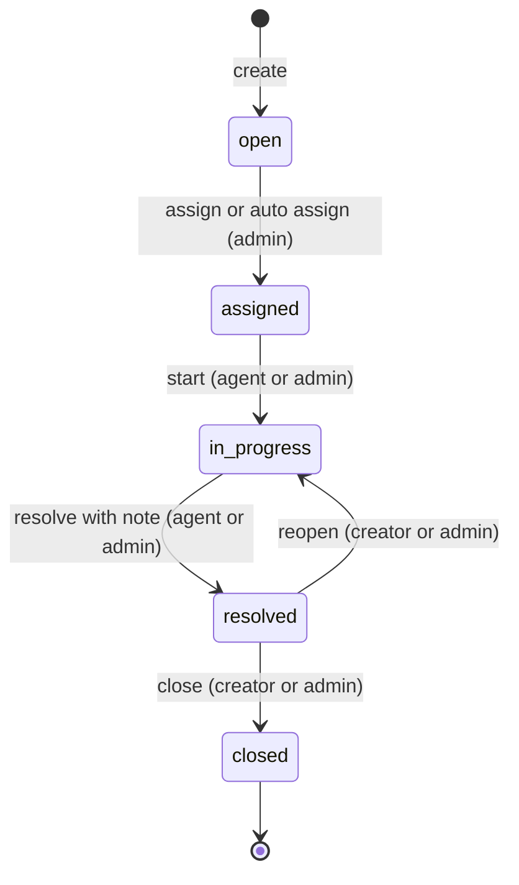

# 05 — Module-wise Code Explanation

This document walks through **every implemented module** of ResolveDesk. For every important operation it
follows the same 25-point structure required by `MASTER_PROMPT.md` §20, then explains the important code
block by block with snippets copied from the real files.

Read [04 — Laravel MVC Guide](04-LARAVEL-MVC-GUIDE.md) first if words like *middleware*, *policy*,
*route model binding* or *flash message* are new to you.

Other related guides: [Database](03-DATABASE-GUIDE.md) · [Business logic](06-BUSINESS-LOGIC-GUIDE.md) ·
[UI to backend](07-UI-TO-BACKEND-MAPPING.md) · [Debugging](11-DEBUGGING-GUIDE.md) ·
[Notifications](13-NOTIFICATION-SYSTEM-GUIDE.md) · [Queue and email](14-QUEUE-AND-EMAIL-GUIDE.md) ·
[Caching](15-CACHING-GUIDE.md)

---

## Table of contents

0. [How to read this document + PHP syntax used in the project](#0-how-to-read-this-document)
1. [Authentication](#1-authentication)
2. [User Management](#2-user-management)
3. [Category Management](#3-category-management)
4. [Tickets: create, list/filter, show, edit](#4-tickets-create-listfilter-show-edit)
5. [Assignment: manual, automatic, reassignment](#5-assignment-manual-automatic-reassignment)
6. [Lifecycle: start, resolve, reopen, close](#6-lifecycle-start-resolve-reopen-close)
7. [Comments](#7-comments)
8. [Activity history](#8-activity-history)
9. [Dashboards](#9-dashboards)
10. [Notifications](#10-notifications)
11. [Email and queue](#11-email-and-queue)
12. [Caching](#12-caching)
13. [Known issues and limitations found while writing this document](#13-known-issues-and-limitations-found-while-writing-this-document)

---

## 0. How to read this document

### 0.1 The 25-point table

Each operation has a table with these rows:

1 Business purpose · 2 User roles · 3 UI page · 4 Available UI actions · 5 Relevant Blade file ·
6 What happens on click · 7 Submitted form data · 8 HTTP method and URL · 9 Laravel route ·
10 Middleware · 11 Controller method · 12 Validation · 13 Authorization · 14 Business logic ·
15 Eloquent operations · 16 Equivalent SQL · 17 Database changes · 18 Notification operations ·
19 Queue operations · 20 Cache operations · 21 Response or redirect · 22 Blade rendering or JavaScript update ·
23 Error handling · 24 Relevant source files · 25 Common modifications

"SQL" is simplified to show the idea (Laravel uses `?` bindings and backtick-quoted names).
Every form also sends the hidden `_token` field (CSRF) — it is not repeated in each table.
The middleware `web` group (session, CSRF, route model binding) applies to all routes and is also not repeated.

### 0.2 The common shape of a ticket action

Almost every ticket action uses the same pipeline. Learn it once:

```mermaid
flowchart LR
    A["Button in tickets/show.blade.php (@can)"] --> B["POST route (auth, active, maybe role:admin)"]
    B --> C["TicketController method"]
    C --> D["Gate::authorize (TicketPolicy)"]
    D --> E["$request->validate"]
    E --> F["TicketService method"]
    F --> G["DB::transaction + lockTicket"]
    G --> H["save + recordActivity + notifyUser"]
    H --> I["COMMIT, afterCommit: queue email"]
    I --> J["clearDashboardCache"]
    J --> K["back()->with('success')"]
```



`TicketService` class comment (copied from `app/Services/TicketService.php`):

```php
 * Every method follows the same pattern:
 *   1. DB::transaction(): all database changes succeed together or are all rolled back.
 *   2. lockTicket(): SELECT ... FOR UPDATE so two people cannot change the same ticket at once.
 *   3. Re-check the business rule on the freshly locked row.
 *   4. Save, record activity, create database notification (same transaction).
 *   5. Emails are queued only AFTER the transaction commits (queueEmail()).
 *   6. Clear the admin dashboard cache after a successful commit.
```

### 0.3 PHP syntax used in this project (quick reference)

| Syntax | Real example | Meaning |
|---|---|---|
| Constructor property promotion | `public function __construct(private TicketService $ticketService) {}` (`TicketController`) | Declares a property **and** assigns the constructor argument in one step (PHP 8.0). |
| Typed properties | `public int $tries = 3;` (`SendTicketEmail`) | The property may only hold an `int`. |
| Return types | `public function canPerform(string $action): bool` | The method must return a `bool`. `: void` = returns nothing. `: ?User` = a `User` **or** `null`. |
| Nullable parameter types | `private function notifyUser(?User $recipient, ...)` | `?User` accepts a `User` or `null`. |
| Class constants | `public const STATUS_OPEN = 'open';`, `private const PER_PAGE = 15;` | Fixed values; read with `Ticket::STATUS_OPEN` or `self::PER_PAGE` inside the class. |
| `::class` | `TicketController::class` | The full class name as a string. |
| Named arguments | `new Envelope(subject: '...')`, `new Content(view: 'emails.ticket-update', with: [...])` (`TicketUpdateMail`) | Pass arguments by parameter name instead of position (PHP 8.0). |
| Nullsafe operator `?->` | `$ticket->assignedAgent?->name` (Blade), `$exception?->getMessage()` (`SendTicketEmail::failed`) | If the left side is `null`, the whole expression is `null` (no error). |
| Null coalescing `??` | `$data['title'] ?? 'Notification'` (`NotificationController`) | Use the right side if the left side is `null` or does not exist. |
| Closure with `use` | `DB::transaction(function () use ($data, $creator) { ... })` | An anonymous function. `use (...)` copies outer variables into it. |
| Arrow function | `fn ($notification) => $this->formatNotification($notification)` | Short one-expression closure; automatically sees outer variables. |
| Variadic / spread `...` | `string ...$roles` (`RoleMiddleware::handle`) | Collects any number of extra arguments into an array. |
| String interpolation | `"Ticket {$ticket->ticket_number} was created successfully."` | Inside double quotes, `{$expr}` is replaced by its value. |
| Concatenation `.` | `'TK-' . str_pad((string) $id, 6, '0', STR_PAD_LEFT)` | Joins strings. |
| Casting | `(int) $validated['category_id']`, `(string) $id` | Converts a value to another type. |
| Strict comparison | `$ticket->assigned_to === $agent->id` | Same value **and** same type. `!==` is the opposite. |
| `in_array(..., true)` | `in_array($ticket->status, Ticket::ACTIVE_STATUSES, true)` | Third argument `true` = strict comparison. |
| Static method | `Ticket::calculateDueAt($createdAt, $ticket->priority)` | Called on the class, not on an object. |
| `throw` | `throw ValidationException::withMessages([...]);` | Stops the method and hands an error to Laravel. |
| `try / catch` | `try { SendTicketEmail::dispatch(...); } catch (Throwable $exception) { ... }` | Catch an error instead of crashing. `Throwable` catches both exceptions and PHP errors. |

> **বাংলায়:** এই প্রজেক্টে আধুনিক PHP 8 syntax ব্যবহার করা হয়েছে। Constructor property promotion কোড ছোট করে,
> named arguments (`subject: ...`) পড়া সহজ করে, `?->` null হলে error না দিয়ে null দেয়, আর `??` না থাকলে একটি
> default মান দেয়। Closure-এর `use ($x)` বাইরের variable ভিতরে নিয়ে আসে, কারণ PHP closure নিজে থেকে বাইরের
> variable দেখতে পায় না (arrow function `fn` পারে)।

---

## 1. Authentication

Files: `app/Http/Controllers/AuthController.php`, `app/Http/Middleware/ActiveUserMiddleware.php`,
`resources/views/auth/login.blade.php`, `resources/views/layouts/guest.blade.php`,
`resources/views/partials/navbar.blade.php` (logout form), `bootstrap/app.php` (redirects).

### 1.1 Operation: Show the login page

| # | Item | Detail |
|---|---|---|
| 1 | Business purpose | Let staff and customers sign in. There is no public registration. |
| 2 | User roles | Guests (not logged in). |
| 3 | UI page | Sign-in page. |
| 4 | UI actions | Enter email + password, tick "Remember me", click **Sign in**. |
| 5 | Blade | `resources/views/auth/login.blade.php` (extends `layouts.guest`). |
| 6 | On click | Browser opens `/login` (or is redirected there by the `auth` middleware). |
| 7 | Form data | — (GET). |
| 8 | Method + URL | `GET /login` |
| 9 | Route | `login` |
| 10 | Middleware | `guest` (a logged-in user is redirected to `/dashboard` by `redirectUsersTo`). |
| 11 | Controller | `AuthController::showLogin()` → `return view('auth.login');` |
| 12 | Validation | — |
| 13 | Authorization | — |
| 14 | Business logic | Local demo accounts are shown only when `app()->environment('local')`. |
| 15 | Eloquent | — |
| 16 | SQL | Only the session read (`sessions` table). |
| 17 | DB changes | A session row may be created for the guest. |
| 18–20 | Notification / Queue / Cache | — |
| 21 | Response | 200 HTML. |
| 22 | Blade | `old('email')` refills the email after a failed login; `@error('email')` shows the message; `session('success')` / `session('error')` show logout / deactivation messages. |
| 23 | Errors | — |
| 24 | Files | `AuthController.php`, `auth/login.blade.php`, `layouts/guest.blade.php` |
| 25 | Modifications | Remove the demo-account card, change the page title (`@section('title', 'Sign in')`). |

### 1.2 Operation: Log in

| # | Item | Detail |
|---|---|---|
| 1 | Business purpose | Verify identity, block brute force, block inactive accounts, start a session. |
| 2 | User roles | Any active user (admin, agent, customer). |
| 3 | UI page | Sign-in page. |
| 4 | UI actions | **Sign in** button. |
| 5 | Blade | `auth/login.blade.php`: `<form method="POST" action="{{ route('login.attempt') }}" novalidate>` with `@csrf`. |
| 6 | On click | Browser POSTs the form. |
| 7 | Form data | `email`, `password`, `remember` (only sent if ticked, value `1`), `_token`. |
| 8 | Method + URL | `POST /login` |
| 9 | Route | `login.attempt` |
| 10 | Middleware | `guest` |
| 11 | Controller | `AuthController::login(Request $request)` |
| 12 | Validation | `'email' => ['required', 'email']`, `'password' => ['required', 'string']` |
| 13 | Authorization | Not needed (it *is* authentication). Inactive check after password check. |
| 14 | Business logic | Rate limit (5 attempts / email+IP, 60 s lock) → `Auth::attempt` → `is_active` check → clear limiter → regenerate session → redirect. |
| 15 | Eloquent | `Auth::attempt()` loads the `User` by email through the Eloquent user provider. |
| 16 | SQL | `SELECT * FROM users WHERE email = 'sarah.agent@resolvedesk.test' LIMIT 1;` (+ `UPDATE users SET remember_token = ? WHERE id = ?` when "Remember me" is ticked) |
| 17 | DB changes | `sessions` row gets the user id (new session id after `regenerate()`); rate-limit counters in the `cache` table (`CACHE_STORE=database`). |
| 18–19 | Notification / Queue | — |
| 20 | Cache | `RateLimiter::hit()` / `RateLimiter::clear()` use the cache store. |
| 21 | Response | `redirect()->intended(route('dashboard'))` → the page the user wanted before login, or `/dashboard`. |
| 22 | Blade | Dashboard renders. On failure, the login page shows the red `@error('email')` message. |
| 23 | Errors | Wrong credentials, too many attempts, inactive account → `ValidationException` → back to `/login` with an error under the email field. |
| 24 | Files | `AuthController.php`, `auth/login.blade.php`, `tests/Feature/AuthTest.php` |
| 25 | Modifications | Change `MAX_LOGIN_ATTEMPTS` / `LOCKOUT_SECONDS`; change the redirect after login. |

#### Code explained block by block

```php
/** Maximum failed login attempts per email + IP address before a lockout. */
private const MAX_LOGIN_ATTEMPTS = 5;

/** Lockout length in seconds. */
private const LOCKOUT_SECONDS = 60;
```

`private const` — a class constant visible only inside `AuthController`. Used as `self::MAX_LOGIN_ATTEMPTS`.

```php
$credentials = $request->validate([
    'email' => ['required', 'email'],
    'password' => ['required', 'string'],
]);
```

`$credentials` is now `['email' => '...', 'password' => '...']` — exactly the shape `Auth::attempt()` expects.

```php
$throttleKey = Str::lower($credentials['email']) . '|' . $request->ip();

if (RateLimiter::tooManyAttempts($throttleKey, self::MAX_LOGIN_ATTEMPTS)) {
    $seconds = RateLimiter::availableIn($throttleKey);
    throw ValidationException::withMessages([
        'email' => "Too many login attempts. Please try again in {$seconds} seconds.",
    ]);
}
```

- The key is e.g. `john.customer@example.com|127.0.0.1`. Lower-casing stops an attacker bypassing the limit with
  `JOHN.customer@...`.
- `tooManyAttempts(key, 5)` is true after 5 recorded failures. `availableIn()` returns the remaining lock seconds.
- **If removed:** unlimited password guessing (brute force).

```php
if (! Auth::attempt($credentials, $request->boolean('remember'))) {
    RateLimiter::hit($throttleKey, self::LOCKOUT_SECONDS);
    throw ValidationException::withMessages([
        'email' => 'These credentials do not match our records.',
    ]);
}
```

- `Auth::attempt()` finds the user by email, compares the password hash, and if it matches **logs the user in**
  (writes the user id into the session). It returns `true`/`false`.
- `RateLimiter::hit(key, 60)` adds one failure; the counter expires after 60 seconds.
- One generic message for wrong email *and* wrong password (does not reveal which emails exist).

```php
if (! Auth::user()->is_active) {
    Auth::logout();
    throw ValidationException::withMessages([
        'email' => 'Your account has been deactivated. Please contact an administrator.',
    ]);
}
```

The password was correct, so `Auth::attempt()` already logged the user in. We log them out immediately.
Test: log in as `tanvir.customer@example.com` (inactive seed user).

```php
RateLimiter::clear($throttleKey);

// 4. New session id after login prevents "session fixation" attacks.
$request->session()->regenerate();

return redirect()->intended(route('dashboard'));
```

- `regenerate()` gives the session a new id while keeping its data.
- `intended()` — if a guest opened `/tickets/7`, the `auth` middleware remembered that URL; after login the user
  lands there instead of the dashboard.

> **বাংলায়:** Login-এর ধাপগুলো: প্রথমে input যাচাই, তারপর rate limit দেখা (৫ বার ভুল হলে ৬০ সেকেন্ড বন্ধ), তারপর
> `Auth::attempt()` দিয়ে password hash মেলানো, তারপর account active কিনা দেখা, আর সব শেষে নতুন session id তৈরি।
> Session fixation মানে আক্রমণকারী আগে থেকে একটি session id ঠিক করে রাখে; login-এর পর id বদলে দিলে সেই পুরোনো id আর
> কাজ করে না।

### 1.3 Operation: Log out

| # | Item | Detail |
|---|---|---|
| 1 | Business purpose | End the session safely. |
| 2 | User roles | Any logged-in user. |
| 3 | UI page | Every page (profile dropdown in the navbar). |
| 4 | UI actions | **Sign out**. |
| 5 | Blade | `partials/navbar.blade.php`: `<form method="POST" action="{{ route('logout') }}">` + `@csrf`. |
| 6 | On click | POST form submitted. |
| 7 | Form data | `_token` only. |
| 8 | Method + URL | `POST /logout` |
| 9 | Route | `logout` |
| 10 | Middleware | `auth`, `active` |
| 11 | Controller | `AuthController::logout(Request $request)` |
| 12–13 | Validation / Authorization | — |
| 14 | Business logic | `Auth::logout()`; `invalidate()` destroys session data; `regenerateToken()` makes a new CSRF token. |
| 15 | Eloquent | — (remember token may be cycled by Laravel). |
| 16 | SQL | `DELETE FROM sessions WHERE id = 'old-id'` (invalidate) and a new session row on save. |
| 17 | DB changes | Session row replaced. |
| 18–20 | Notification / Queue / Cache | — |
| 21 | Response | `redirect()->route('login')->with('success', 'You have been logged out.')` |
| 22 | Blade | Login page prints `session('success')`. |
| 23 | Errors | Old tab still open after logout → its POST forms return 419 (token changed). |
| 24 | Files | `AuthController.php`, `partials/navbar.blade.php` |
| 25 | Modifications | Change the redirect target or the message. |

**Why POST and not a link?** A GET logout link could be triggered by any website (``).

### 1.4 Operation: Deactivated while logged in (middleware)

| # | Item | Detail |
|---|---|---|
| 1 | Business purpose | An admin deactivates someone who is currently logged in; they must lose access on the next request. |
| 2 | User roles | Any user whose `is_active` became `false`. |
| 3–7 | UI | Any page / any AJAX poll. No form. |
| 8 | Method + URL | Any protected URL, e.g. `GET /notifications/feed`. |
| 9 | Route | Any route in the `['auth', 'active']` group. |
| 10 | Middleware | `active` → `ActiveUserMiddleware::handle()` |
| 11 | Controller | Not reached. |
| 12–13 | Validation / Authorization | — |
| 14 | Business logic | `if ($user !== null && ! $user->is_active)` → logout + invalidate + regenerate token. |
| 15–16 | Eloquent / SQL | `$request->user()` was loaded by `auth`: `SELECT * FROM users WHERE id = ? LIMIT 1`. |
| 17 | DB changes | Session destroyed. |
| 18–20 | — | — |
| 21 | Response | HTML request: redirect to login with `error`. JSON request: `401` `{"message": "..."}`. |
| 22 | JS update | `notifications.js` sees 401 → `handleExpiredSession()` → stops polling, shows "Sign in again". |
| 23 | Errors | — |
| 24 | Files | `app/Http/Middleware/ActiveUserMiddleware.php`, `public/js/notifications.js`, `tests/Feature/AuthTest.php` |
| 25 | Modifications | Also check something else on every request (e.g. a "must change password" flag) in the same middleware. |

---

## 2. User Management

Files: `app/Http/Controllers/UserController.php`, `resources/views/users/index.blade.php`, `create.blade.php`,
`edit.blade.php`, `show.blade.php`, `_form.blade.php`, `app/Models/User.php`.
All routes are inside `Route::middleware('role:admin')`. Users are **never deleted** (the resource route excludes
`destroy`) because tickets, comments and activities reference them.

### 2.1 Operation: List, search and filter users

| # | Item | Detail |
|---|---|---|
| 1 | Business purpose | Admin finds users quickly. |
| 2 | User roles | Admin. |
| 3 | UI page | Users. |
| 4 | UI actions | Search, Role filter, Status filter, **Filter**, **Reset**, View, Edit, Activate/Deactivate. |
| 5 | Blade | `users/index.blade.php` |
| 6 | On click | GET form submits filters in the URL query string. |
| 7 | Form data | `search`, `role`, `status` (`active` / `inactive`). |
| 8 | Method + URL | `GET /users?search=sarah&role=agent&status=active` |
| 9 | Route | `users.index` |
| 10 | Middleware | `auth`, `active`, `role:admin` |
| 11 | Controller | `UserController::index(Request $request)` |
| 12 | Validation | None (filters only use bound parameters; unknown values just return no rows). |
| 13 | Authorization | `role:admin` |
| 14 | Business logic | Build query step by step only for filled filters. |
| 15 | Eloquent | `User::query()->where(function ($subQuery) use ($search) {...})->where('role', ...)->where('is_active', true)->orderBy('name')->paginate(15)->withQueryString()` |
| 16 | SQL | `SELECT COUNT(*) AS aggregate FROM users WHERE (name LIKE '%sarah%' OR email LIKE '%sarah%') AND role = 'agent' AND is_active = 1;` then `SELECT * FROM users WHERE (...) AND role = 'agent' AND is_active = 1 ORDER BY name ASC LIMIT 15 OFFSET 0;` |
| 17 | DB changes | — |
| 18–20 | — | — |
| 21 | Response | `view('users.index', ['users' => $users])` |
| 22 | Blade | `@forelse ($users as $user)` rows; `{{ $users->links() }}` Bootstrap pagination; toggle button hidden for yourself (`@if ($user->id !== auth()->id())`). |
| 23 | Errors | Non-admin → 403. |
| 24 | Files | `UserController.php`, `users/index.blade.php` |
| 25 | Modifications | Add a "created after" filter: add an input and `if ($request->filled('created_from')) { $query->whereDate('created_at', '>=', ...); }`. |

```php
if ($request->filled('search')) {
    $search = $request->input('search');
    $query->where(function ($subQuery) use ($search) {
        $subQuery->where('name', 'like', "%{$search}%")
            ->orWhere('email', 'like', "%{$search}%");
    });
}
```

The closure creates **brackets** in SQL: `WHERE (name LIKE ? OR email LIKE ?) AND role = ?`. Without it, the `OR`
would break the other filters: `WHERE name LIKE ? OR email LIKE ? AND role = ?` (AND binds stronger than OR).
`use ($search)` copies `$search` into the closure. `withQueryString()` keeps `?search=...` in pagination links.

### 2.2 Operation: Create a user

| # | Item | Detail |
|---|---|---|
| 1 | Business purpose | Admin creates accounts (no public registration). |
| 2 | User roles | Admin. |
| 3 | UI page | Create User. |
| 4 | UI actions | Fill form, **Create User**, Cancel. |
| 5 | Blade | `users/create.blade.php` + `users/_form.blade.php` |
| 6 | On click | POST form. |
| 7 | Form data | `name`, `email`, `password`, `password_confirmation`, `role`, `is_active` (checkbox, `1` or missing). |
| 8 | Method + URL | `GET /users/create` (form), `POST /users` (save) |
| 9 | Route | `users.create`, `users.store` |
| 10 | Middleware | `auth`, `active`, `role:admin` |
| 11 | Controller | `UserController::create()`, `UserController::store(Request $request)` |
| 12 | Validation | `name` required max 255; `email` required, email, `unique:users,email`; `password` required min 8 `confirmed`; `role` `Rule::in(array_keys(User::ROLES))`; `is_active` boolean. |
| 13 | Authorization | `role:admin` |
| 14 | Business logic | `$validated['is_active'] = $request->boolean('is_active');` (unchecked checkbox is not sent). |
| 15 | Eloquent | `User::create($validated)` — mass assignment limited by `$fillable`; password hashed by the `'hashed'` cast. |
| 16 | SQL | `SELECT COUNT(*) AS aggregate FROM users WHERE email = ?;` then `INSERT INTO users (name, email, password, role, is_active, updated_at, created_at) VALUES (?, ?, '$2y$12$...', 'agent', 1, NOW(), NOW());` |
| 17 | DB changes | One `users` row. |
| 18–20 | — | — |
| 21 | Response | `redirect()->route('users.show', $user)->with('success', "User {$user->name} was created.")` |
| 22 | Blade | User details page with flash message. |
| 23 | Errors | Duplicate email / short password / mismatch → back with `@error` messages and `old()` values (password fields are not refilled). |
| 24 | Files | `UserController.php`, `users/_form.blade.php`, `User.php`, `tests/Feature/UserAndCategoryManagementTest.php` |
| 25 | Modifications | Add a phone column: migration + `$fillable` + rule + form input. |

`users/_form.blade.php` handles both create and edit:

```blade
@php($user = $user ?? null)
@php($isEdit = $user !== null)
...
<input class="form-check-input" type="checkbox" role="switch" id="is_active" name="is_active" value="1"
       @checked(old('is_active', $user?->is_active ?? true))>
```

`$user?->is_active ?? true` — on the create page `$user` is `null`, so `?->` returns `null` and `??` gives the
default `true` (new users are active by default).

### 2.3 Operation: View a user

| # | Item | Detail |
|---|---|---|
| 1 | Business purpose | See role, status, ticket counts and recent tickets of one user. |
| 2 | User roles | Admin. |
| 3 | UI page | User details. |
| 4 | UI actions | Edit, Activate/Deactivate, open a ticket. |
| 5 | Blade | `users/show.blade.php` |
| 6 | On click | Link from the list. |
| 7 | Form data | — |
| 8 | Method + URL | `GET /users/{user}` |
| 9 | Route | `users.show` |
| 10 | Middleware | `auth`, `active`, `role:admin` |
| 11 | Controller | `UserController::show(User $user)` (route model binding) |
| 12–13 | Validation / Authorization | — / `role:admin` |
| 14 | Business logic | Count created tickets, count current workload (`WORKLOAD_STATUSES`), last 10 related tickets. |
| 15 | Eloquent | `$user->createdTickets()->count()`, `$user->assignedTickets()->whereIn('status', Ticket::WORKLOAD_STATUSES)->count()`, `Ticket::with([...])->where(function ...)->latest()->take(10)->get()` |
| 16 | SQL | `SELECT COUNT(*) FROM tickets WHERE created_by = 5 AND created_by IS NOT NULL;` · `SELECT COUNT(*) FROM tickets WHERE assigned_to = 5 AND assigned_to IS NOT NULL AND status IN ('assigned','in_progress');` · `SELECT * FROM tickets WHERE (created_by = 5 OR assigned_to = 5) ORDER BY created_at DESC LIMIT 10;` + eager loads |
| 17–20 | — | — |
| 21 | Response | `view('users.show', [...])` |
| 22 | Blade | Stat cards + table with `@include('partials.ticket-badges', ['ticket' => $ticket])`. |
| 23 | Errors | Unknown id → 404. |
| 24 | Files | `UserController.php`, `users/show.blade.php` |
| 25 | Modifications | Show "resolved tickets" count: `$user->assignedTickets()->where('status', Ticket::STATUS_RESOLVED)->count()`. |

### 2.4 Operation: Edit a user

| # | Item | Detail |
|---|---|---|
| 1 | Business purpose | Change name, email, password, role, active flag — safely. |
| 2 | User roles | Admin. |
| 3 | UI page | Edit User. |
| 4 | UI actions | **Save Changes**, Cancel. |
| 5 | Blade | `users/edit.blade.php` (`@method('PUT')`) + `users/_form.blade.php` |
| 6 | On click | POST with `_method=PUT`. |
| 7 | Form data | `name`, `email`, `password` (optional), `password_confirmation`, `role`, `is_active`, `_method`. |
| 8 | Method + URL | `PUT /users/{user}` |
| 9 | Route | `users.update` |
| 10 | Middleware | `auth`, `active`, `role:admin` |
| 11 | Controller | `UserController::update(Request $request, User $user)` |
| 12 | Validation | `Rule::unique('users', 'email')->ignore($user->id)`; `'password' => ['nullable', 'string', 'min:8', 'confirmed']` |
| 13 | Authorization | `role:admin` + business rules in `ensureRoleOrStatusChangeIsAllowed()` |
| 14 | Business logic | 3 rules (below). Empty password → keep the current one. |
| 15 | Eloquent | `$user->update($validated)` |
| 16 | SQL | `UPDATE users SET name = ?, role = ?, updated_at = ? WHERE id = ?;` (only changed columns) |
| 17 | DB changes | One `users` row. |
| 18–20 | — | — |
| 21 | Response | `redirect()->route('users.show', $user)->with('success', 'User updated successfully.')` |
| 22 | Blade | Details page. Business-rule error appears in the red alert under the form (`@error('is_active')`) and in the flash box. |
| 23 | Errors | Rule violations → `ValidationException` on key `is_active`. |
| 24 | Files | `UserController.php`, `users/_form.blade.php` |
| 25 | Modifications | Add a rule "agents cannot become admins": another `if` inside `ensureRoleOrStatusChangeIsAllowed()`. |

```php
// Empty password field = keep the current password.
if (empty($validated['password'])) {
    unset($validated['password']);
}

$user->update($validated);
```

`unset()` removes the key, so `update()` does not overwrite the password with `null`.
(`ConvertEmptyStringsToNull` middleware already turned `""` into `null`, which `nullable` allows.)

**The three safety rules** (`ensureRoleOrStatusChangeIsAllowed`):

```php
$isDeactivating = $user->is_active && ! $newIsActive;
$isChangingRole = $user->role !== $newRole;

if (! $isDeactivating && ! $isChangingRole) {
    return;
}

// Rule 1: an administrator cannot deactivate or demote themselves.
if ($user->id === $currentAdmin->id) { throw ValidationException::withMessages([...]); }

// Rule 2: always keep at least one active administrator.
if ($user->isAdmin() && $user->is_active) {
    $otherActiveAdmins = User::where('role', User::ROLE_ADMIN)
        ->where('is_active', true)
        ->where('id', '!=', $user->id)
        ->count();
    ...
}

// Rule 3: an agent responsible for unfinished or reopenable tickets must hand them over first.
if ($user->isAgent()) {
    $responsibleTickets = Ticket::where('assigned_to', $user->id)
        ->whereIn('status', [Ticket::STATUS_ASSIGNED, Ticket::STATUS_IN_PROGRESS, Ticket::STATUS_RESOLVED])
        ->count();
    ...
}
```

(The `throw` bodies are shortened here; see the file for the exact messages.)

- Rule 2 SQL: `SELECT COUNT(*) FROM users WHERE role = 'admin' AND is_active = 1 AND id != 1;`
- Rule 3 includes **Resolved** tickets because a customer can **reopen** them, and a reopened ticket goes back to
  its assigned agent, who must be active (see `TicketService::reopen`). Resolved tickets cannot be reassigned, so
  the admin must close them first.
- **If removed:** the system could be left with no admin (nobody can manage users) or with tickets stuck on an
  inactive agent.

### 2.5 Operation: Activate / deactivate a user

| # | Item | Detail |
|---|---|---|
| 1 | Business purpose | Block or restore access without deleting history. |
| 2 | User roles | Admin. |
| 3 | UI page | Users list and User details. |
| 4 | UI actions | **Deactivate** / **Activate** (with a JS confirm dialog). |
| 5 | Blade | `users/index.blade.php`, `users/show.blade.php`: `<form method="POST" action="{{ route('users.toggle-active', $user) }}" data-confirm="...">` + `@csrf` + `@method('PATCH')` |
| 6 | On click | `public/js/app.js` shows `window.confirm(message)`; Cancel → `event.preventDefault()`, OK → submit. |
| 7 | Form data | `_method=PATCH`, `_token`. |
| 8 | Method + URL | `PATCH /users/{user}/toggle-active` |
| 9 | Route | `users.toggle-active` |
| 10 | Middleware | `auth`, `active`, `role:admin` |
| 11 | Controller | `UserController::toggleActive(Request $request, User $user)` |
| 12 | Validation | — |
| 13 | Authorization | `role:admin` + `ensureRoleOrStatusChangeIsAllowed($user, $user->role, $newIsActive, $request->user())` |
| 14 | Business logic | `$newIsActive = ! $user->is_active;` — flip the flag, check the 3 rules. |
| 15 | Eloquent | `$user->is_active = $newIsActive; $user->save();` |
| 16 | SQL | `UPDATE users SET is_active = 0, updated_at = ? WHERE id = 7;` |
| 17 | DB changes | `users.is_active`. The user's next request is stopped by `ActiveUserMiddleware`. |
| 18–20 | — | — |
| 21 | Response | `back()->with('success', "User {$user->name} was {$word}.")` |
| 22 | Blade | Badge switches between Active / Inactive. |
| 23 | Errors | Rule violation → red flash error. |
| 24 | Files | `UserController.php`, `public/js/app.js`, `tests/Feature/UserAndCategoryManagementTest.php` |
| 25 | Modifications | Write an audit row when a user is deactivated (new table or log). |

`public/js/app.js` (used by every `data-confirm` form in the project):

```js
document.addEventListener('submit', function (event) {
    const form = event.target;
    const message = form.getAttribute('data-confirm');

    if (message && !window.confirm(message)) {
        event.preventDefault();
    }
});
```

One listener on the whole document (**event delegation**) instead of one listener per form.

---

## 3. Category Management

Files: `app/Http/Controllers/CategoryController.php`, `app/Models/Category.php`,
`resources/views/categories/index.blade.php`, `create.blade.php`, `edit.blade.php`, `_form.blade.php`.
Routes: `Route::resource('categories', CategoryController::class)->except(['show']);` inside `role:admin`.

### 3.1 Operation: List categories

| # | Item | Detail |
|---|---|---|
| 1 | Business purpose | See all categories, how many tickets use each, and their status. |
| 2 | User roles | Admin. |
| 3 | UI page | Ticket Categories. |
| 4 | UI actions | Create Category, Edit, Delete (only when unused). |
| 5 | Blade | `categories/index.blade.php` |
| 6–7 | Click / data | Sidebar link "Categories" / — |
| 8 | Method + URL | `GET /categories` |
| 9 | Route | `categories.index` |
| 10 | Middleware | `auth`, `active`, `role:admin` |
| 11 | Controller | `CategoryController::index()` |
| 12–13 | Validation / Authorization | — / `role:admin` |
| 14 | Business logic | Delete button only if `tickets_count === 0`. |
| 15 | Eloquent | `Category::withCount('tickets')->orderBy('name')->paginate(15)` |
| 16 | SQL | `SELECT categories.*, (SELECT COUNT(*) FROM tickets WHERE categories.id = tickets.category_id) AS tickets_count FROM categories ORDER BY name ASC LIMIT 15 OFFSET 0;` |
| 17–20 | — | — (this page reads the database, not the cache) |
| 21 | Response | `view('categories.index', [...])` |
| 22 | Blade | `@if ($category->tickets_count === 0)` → Delete form, else a disabled button "Used by tickets - deactivate it instead". |
| 23 | Errors | Non-admin → 403. |
| 24 | Files | `CategoryController.php`, `categories/index.blade.php` |
| 25 | Modifications | Sort by ticket count: `->orderByDesc('tickets_count')`. |

### 3.2 Operation: Create / update a category

| # | Item | Detail |
|---|---|---|
| 1 | Business purpose | Maintain the list customers choose from when creating tickets. |
| 2 | User roles | Admin. |
| 3 | UI page | Create Category / Edit Category. |
| 4 | UI actions | **Create Category** / **Save Changes**, Cancel. |
| 5 | Blade | `categories/create.blade.php`, `categories/edit.blade.php` (`@method('PUT')`), `categories/_form.blade.php` |
| 6 | On click | POST (create) or POST + `_method=PUT` (update). |
| 7 | Form data | `name`, `description`, `is_active` (checkbox). |
| 8 | Method + URL | `POST /categories`; `PUT /categories/{category}` |
| 9 | Route | `categories.store`, `categories.update` |
| 10 | Middleware | `auth`, `active`, `role:admin` |
| 11 | Controller | `CategoryController::store()`, `CategoryController::update(Request $request, Category $category)` |
| 12 | Validation | `name` required, max 100, `unique:categories,name` (update: `Rule::unique('categories', 'name')->ignore($category->id)`); `description` nullable max 1000; `is_active` boolean. |
| 13 | Authorization | `role:admin` |
| 14 | Business logic | `is_active` from `$request->boolean('is_active')`; then clear two caches. |
| 15 | Eloquent | `Category::create($validated)` / `$category->update($validated)` |
| 16 | SQL | `INSERT INTO categories (name, description, is_active, updated_at, created_at) VALUES (...);` / `UPDATE categories SET ... WHERE id = ?;` |
| 17 | DB changes | One `categories` row. |
| 18–19 | Notification / Queue | — |
| 20 | Cache | `clearCaches()` → `Category::clearActiveCache()` (key `ticket:active-categories`) and `Cache::forget(TicketService::DASHBOARD_CACHE_KEY)` (key `dashboard:admin:stats`). |
| 21 | Response | `redirect()->route('categories.index')->with('success', 'Category created.')` / `'Category updated.'` |
| 22 | Blade | List page with flash. |
| 23 | Errors | Duplicate name → back with `@error('name')`. |
| 24 | Files | `CategoryController.php`, `Category.php`, `categories/_form.blade.php`, `tests/Feature/CacheTest.php` |
| 25 | Modifications | Add a `sort_order` column and order the dropdown by it (change the query inside `activeForDropdown()`). |

```php
private function clearCaches(): void
{
    Category::clearActiveCache();
    Cache::forget(TicketService::DASHBOARD_CACHE_KEY);
}
```

Why both? The ticket form dropdown shows active category names (category cache), and the admin dashboard's
"tickets by category" chart shows category names (dashboard cache). **If removed:** a renamed/deactivated category
would still show in the dropdown for up to 1 hour.

### 3.3 Operation: Delete a category

| # | Item | Detail |
|---|---|---|
| 1 | Business purpose | Remove a category created by mistake. Used categories must be deactivated instead. |
| 2 | User roles | Admin. |
| 3 | UI page | Ticket Categories. |
| 4 | UI actions | **Delete** (only visible when unused; JS confirm). |
| 5 | Blade | `categories/index.blade.php`: form with `@csrf` + `@method('DELETE')` |
| 6 | On click | Confirm dialog → POST with `_method=DELETE`. |
| 7 | Form data | `_method`, `_token`. |
| 8 | Method + URL | `DELETE /categories/{category}` |
| 9 | Route | `categories.destroy` |
| 10 | Middleware | `auth`, `active`, `role:admin` |
| 11 | Controller | `CategoryController::destroy(Category $category)` |
| 12 | Validation | — |
| 13 | Authorization | `role:admin` |
| 14 | Business logic | `if ($category->tickets()->exists())` → refuse. |
| 15 | Eloquent | `$category->tickets()->exists()`, `$category->delete()` |
| 16 | SQL | `SELECT EXISTS(SELECT * FROM tickets WHERE tickets.category_id = 3 AND tickets.category_id IS NOT NULL) AS exists_flag;` then `DELETE FROM categories WHERE id = 3;` |
| 17 | DB changes | Row deleted. The FK `tickets.category_id ... restrictOnDelete()` would also block deletion at database level. |
| 18–19 | — | — |
| 20 | Cache | `clearCaches()` |
| 21 | Response | Success: `redirect()->route('categories.index')->with('success', 'Category deleted.')`. Used: `back()->with('error', '...Deactivate it instead.')` |
| 22 | Blade | Flash message. |
| 23 | Errors | Category in use → red error (button is also disabled in the UI). |
| 24 | Files | `CategoryController.php`, `categories/index.blade.php`, migration `2026_11_25_000002_create_tickets_table.php` |
| 25 | Modifications | Soft deletes (`SoftDeletes` trait + `deleted_at`) instead of hard delete. |

### 3.4 The active-category dropdown cache (`Category::activeForDropdown`)

```php
public const ACTIVE_CACHE_KEY = 'ticket:active-categories';

public const ACTIVE_CACHE_TTL_SECONDS = 3600;

public static function activeForDropdown(): Collection
{
    $rows = Cache::remember(self::ACTIVE_CACHE_KEY, self::ACTIVE_CACHE_TTL_SECONDS, function () {
        return Category::where('is_active', true)->orderBy('name')->get(['id', 'name'])->toArray();
    });

    return Category::hydrate($rows);
}

public static function clearActiveCache(): void
{
    Cache::forget(self::ACTIVE_CACHE_KEY);
}
```

Explained in [section 12](#12-caching). Important: this list is for **display only**. Saving a ticket always
validates against the real `categories` table (`Rule::exists('categories', 'id')->where('is_active', true)`).

> ✅ **Bug found and fixed:** the first version cached the Eloquent `Collection` itself. With
> `CACHE_STORE=database` and `config/cache.php` → `'serializable_classes' => false`, a **cache hit** returned
> `__PHP_Incomplete_Class`, so `activeForDropdown()` threw a `TypeError` (500 on the second visit to the ticket
> form). The method now caches a plain array (`->toArray()`) and rebuilds models with `Category::hydrate($rows)`.
> The full story is in [section 13](#13-known-issues-and-limitations-found-while-writing-this-document).

---

## 4. Tickets: create, list/filter, show, edit

Files: `app/Http/Controllers/TicketController.php`, `app/Services/TicketService.php`, `app/Models/Ticket.php`,
`app/Policies/TicketPolicy.php`, `resources/views/tickets/*.blade.php`, `resources/views/partials/ticket-badges.blade.php`.

### 4.1 Operation: Create a ticket

| # | Item | Detail |
|---|---|---|
| 1 | Business purpose | Report a problem. The system sets the number, status and SLA deadline. |
| 2 | User roles | All active roles (`TicketPolicy::create` returns `true`). Normally customers. |
| 3 | UI page | Create Ticket. |
| 4 | UI actions | Fill subject, description, category, priority → **Submit Ticket**; Cancel. |
| 5 | Blade | `tickets/create.blade.php` + `tickets/_form.blade.php` |
| 6 | On click | POST form. |
| 7 | Form data | `subject`, `description`, `category_id`, `priority`. |
| 8 | Method + URL | `GET /tickets/create` (form) · `POST /tickets` (save) |
| 9 | Route | `tickets.create`, `tickets.store` |
| 10 | Middleware | `auth`, `active` |
| 11 | Controller | `TicketController::create()`, `TicketController::store(Request $request)` |
| 12 | Validation | `subject` required string max 255 · `description` required string max 5000 · `category_id` required integer `Rule::exists('categories', 'id')->where('is_active', true)` · `priority` `Rule::in(array_keys(Ticket::PRIORITIES))` · custom message `'category_id.exists' => 'Please choose an active category.'` |
| 13 | Authorization | `Gate::authorize('create', Ticket::class)` |
| 14 | Business logic | `TicketService::createTicket()`: status Open, unassigned, `due_at = created_at + SLA hours`, ticket number from id, activity "created", then a "New ticket created" notification to every active admin. |
| 15 | Eloquent | `new Ticket()`, `fill()`, `save()` ×2, `TicketActivity::create()`, `User::where('role', User::ROLE_ADMIN)->where('is_active', true)->get()`, `$admin->notify(...)` |
| 16 | SQL | see below |
| 17 | DB changes | 1 `tickets` row, 1 `ticket_activities` row, 1 `notifications` row per active admin (except the creator); after COMMIT 1 `jobs` row per notified admin. |
| 18 | Notification | "New ticket created" (`event_type` `created`) to every **active admin**, except an admin who created the ticket themselves (`notifyUser()` skips the actor). Agents and the creator get nothing. Added at the project owner's request, beyond the original MASTER_PROMPT §9.2 matrix. |
| 19 | Queue | One `SendTicketEmail` job per notified admin, pushed after COMMIT (`queueEmail()` → `DB::afterCommit()`). |
| 20 | Cache | Form: reads `ticket:active-categories` via `Category::activeForDropdown()`. After save: `clearDashboardCache()` → forget `dashboard:admin:stats`. |
| 21 | Response | `redirect()->route('tickets.show', $ticket)->with('success', "Ticket {$ticket->ticket_number} was created successfully.")` |
| 22 | Blade | Ticket details page with green flash. |
| 23 | Errors | Missing fields / inactive category → back with `@error` + `old()`. Database error → transaction rolled back, 500 page. |
| 24 | Files | `TicketController.php`, `TicketService.php`, `Ticket.php`, `tickets/_form.blade.php`, `tests/Feature/TicketManagementTest.php`, `tests/Feature/QueueAndEmailTest.php` |
| 25 | Modifications | Add a new priority (add to `PRIORITIES` **and** `SLA_HOURS`); make the admin alert in-app only (change the last `notifyUser()` argument from `true` to `false`). |

#### `TicketService::createTicket()` line by line

```php
public function createTicket(array $data, User $creator): Ticket
{
    $ticket = DB::transaction(function () use ($data, $creator) {
        $createdAt = now();

        $ticket = new Ticket();
        $ticket->fill($data);
        $ticket->created_by = $creator->id;           // From the logged-in user, never from the form.
        $ticket->assigned_to = null;
        $ticket->status = Ticket::STATUS_OPEN;
        $ticket->created_at = $createdAt;
        $ticket->due_at = Ticket::calculateDueAt($createdAt, $ticket->priority);
        $ticket->save();                               // INSERT -> the database generates the id.

        // Ticket number is built from the database id, so it is always unique
        // (unlike MAX(id) + 1, which two requests could calculate at the same time).
        $ticket->ticket_number = Ticket::makeTicketNumber($ticket->id);
        $ticket->save();                               // UPDATE

        $this->recordActivity($ticket, $creator, 'created', null, 'Open');

        // Tell every active administrator that a new ticket is waiting (in-app + email).
        // notifyUser() skips an admin who created the ticket themselves.
        $admins = User::where('role', User::ROLE_ADMIN)->where('is_active', true)->get();
        foreach ($admins as $admin) {
            $this->notifyUser($admin, $ticket, $creator, 'created',
                'New ticket created',
                "{$creator->name} created ticket {$ticket->ticket_number} \"{$ticket->subject}\".",
                true);
        }

        return $ticket;
    });

    $this->clearDashboardCache();

    return $ticket;
}
```

| Line(s) | Explanation |
|---|---|
| `array $data, User $creator): Ticket` | Typed parameters and return type. `$data` is the validated array. |
| `DB::transaction(function () use ($data, $creator) {...})` | Runs the closure inside `BEGIN ... COMMIT`. If any line throws, Laravel runs `ROLLBACK` and re-throws. The closure's `return` value becomes the return value of `DB::transaction()`. |
| `$createdAt = now();` | One Carbon timestamp used for **both** `created_at` and the SLA calculation, so they match exactly. |
| `$ticket->fill($data);` | Copies only `$fillable` keys: `subject`, `description`, `category_id`, `priority`. |
| `created_by = $creator->id` | Never from the form — a user cannot create tickets in someone else's name. |
| `status = Ticket::STATUS_OPEN` | Every ticket starts Open. |
| `Ticket::calculateDueAt(...)` | Static helper: `$createdAt->copy()->addHours(self::SLA_HOURS[$priority])`. `copy()` prevents changing `$createdAt` itself (Carbon objects are mutable). |
| first `save()` | `INSERT`. After it, `$ticket->id` holds the auto-increment id. |
| `Ticket::makeTicketNumber($ticket->id)` | `'TK-' . str_pad((string) $id, 6, '0', STR_PAD_LEFT)` → `7` becomes `TK-000007`. |
| second `save()` | `UPDATE` of the dirty column only. |
| `recordActivity(..., 'created', null, 'Open')` | First timeline entry. |
| `User::where('role', User::ROLE_ADMIN)->where('is_active', true)->get()` | Loads every active administrator. |
| `foreach ... notifyUser($admin, ..., 'created', ..., true)` | One in-app notification per admin; `true` = also queue an email (pushed only after COMMIT). `notifyUser()` skips an admin who is the creator (`$recipient->id === $actor->id`). |
| `clearDashboardCache()` | **After** the transaction, so the cache is only cleared when the data is really committed. |

Equivalent SQL:

```sql
START TRANSACTION;
INSERT INTO tickets (subject, description, category_id, priority, created_by, assigned_to, status,
                     created_at, due_at, updated_at)
VALUES ('Cannot export invoices', '...', 3, 'high', 12, NULL, 'open',
        '2026-11-25 10:00:00', '2026-11-25 18:00:00', '2026-11-25 10:00:00');
-- suppose the new id is 33
UPDATE tickets SET ticket_number = 'TK-000033', updated_at = NOW() WHERE id = 33;
INSERT INTO ticket_activities (ticket_id, user_id, action, old_value, new_value, created_at, updated_at)
VALUES (33, 12, 'created', NULL, 'Open', NOW(), NOW());
SELECT * FROM users WHERE role = 'admin' AND is_active = 1;
-- one per active admin (here admin id 1):
INSERT INTO notifications (id, type, notifiable_type, notifiable_id, data, read_at, created_at, updated_at)
VALUES ('<uuid>', 'App\\Notifications\\TicketNotification', 'App\\Models\\User', 1,
        '{"ticket_id":33,"ticket_number":"TK-000033","title":"New ticket created",...,"event_type":"created"}', NULL, NOW(), NOW());
COMMIT;
INSERT INTO jobs (queue, payload, attempts, reserved_at, available_at, created_at) VALUES ('default', '{...}', 0, NULL, ..., ...);  -- afterCommit, per admin
DELETE FROM cache WHERE `key` = 'resolvedesk-cache-dashboard:admin:stats';
```

**Why `ticket_number` is nullable:** between the INSERT and the UPDATE the number does not exist yet. Both happen
inside one transaction, so no other request ever sees a ticket without a number.

**Why `due_at` is DATETIME:** on MariaDB/older MySQL the first non-null `TIMESTAMP` column silently gets
`ON UPDATE CURRENT_TIMESTAMP`, which overwrote the SLA deadline on every update. Found during seeding; see
`DEVELOPMENT_PROGRESS.md`.

> **বাংলায়:** Transaction মানে কয়েকটি database কাজকে একটি প্যাকেটে বাঁধা — হয় সবগুলো সফল হবে (COMMIT), নয়তো
> একটিও থাকবে না (ROLLBACK)। এখানে টিকিট INSERT, ticket number UPDATE আর activity INSERT একসাথে হয়; মাঝপথে error
> হলে অর্ধেক তৈরি টিকিট database-এ থেকে যায় না।

### 4.2 Operation: List, search and filter tickets

| # | Item | Detail |
|---|---|---|
| 1 | Business purpose | Find tickets fast; each role sees only what it may see. |
| 2 | User roles | Admin (all tickets, "All Tickets"); agent and customer (created by or assigned to them, "My Tickets"). |
| 3 | UI page | Tickets list. |
| 4 | UI actions | Search, Status, Priority, Category, Assigned agent (admin only, incl. "Unassigned"), Created from/to, Overdue only, **Filter**, **Reset**, View, Edit (if allowed), pagination. Dashboard tiles also link here (e.g. `?status=open`, `?overdue=1`). |
| 5 | Blade | `tickets/index.blade.php`, `partials/ticket-badges.blade.php` |
| 6 | On click | GET form → filters go into the URL. |
| 7 | Form data | `search`, `status`, `priority`, `category_id`, `assigned_to`, `date_from`, `date_to`, `overdue`, `page`. |
| 8 | Method + URL | `GET /tickets?search=TK-00002&status=in_progress&overdue=1` |
| 9 | Route | `tickets.index` |
| 10 | Middleware | `auth`, `active` |
| 11 | Controller | `TicketController::index(Request $request)` |
| 12 | Validation | `search` nullable max 100 · `status` `Rule::in(array_keys(Ticket::STATUSES))` · `priority` `Rule::in(...)` · `category_id` nullable integer · `date_from` nullable date · `date_to` nullable date `after_or_equal:date_from`. (`assigned_to` has no rule; it is only used for admins and always passed as a bound parameter.) |
| 13 | Authorization | Row-level filter with the `visibleTo($user)` scope; Edit button with `@can('update', $ticket)`. |
| 14 | Business logic | Add a `where` only for filled filters; `overdue` uses the `overdue()` scope. |
| 15 | Eloquent | `Ticket::with(['category', 'creator', 'assignedAgent'])->visibleTo($user)->...->latest()->paginate(self::PER_PAGE)->withQueryString()` |
| 16 | SQL | see below |
| 17–19 | DB / Notification / Queue | — |
| 20 | Cache | Not cached (filters change constantly). The category filter uses a fresh query (`Category::orderBy('name')->get(['id', 'name'])`) so inactive categories are listed too, for old tickets. |
| 21 | Response | `view('tickets.index', ['tickets' => ..., 'categories' => ..., 'agents' => ...])` |
| 22 | Blade | `@forelse ($tickets as $ticket)`; overdue rows get class `row-overdue`; `{{ $ticket->assignedAgent?->name ?? '—' }}`; `{{ $tickets->links() }}`. |
| 23 | Errors | Invalid filter (e.g. `status=foo`, `date_to` before `date_from`) → redirect back with errors. |
| 24 | Files | `TicketController.php`, `Ticket.php` (scopes), `tickets/index.blade.php`, `tests/Feature/TicketManagementTest.php` |
| 25 | Modifications | Add a "created by" filter for admins; change `PER_PAGE`; sort by deadline: replace `latest()` with `orderBy('due_at')`. |

Key code:

```php
// with(): eager loading. Loads categories, creators and agents in 3 extra
// queries in total instead of 3 queries PER ROW (avoids the N+1 problem).
$query = Ticket::with(['category', 'creator', 'assignedAgent'])
    ->visibleTo($user);

if ($request->filled('search')) {
    $search = $request->input('search');
    $query->where(function ($subQuery) use ($search) {
        $subQuery->where('ticket_number', 'like', "%{$search}%")
            ->orWhere('subject', 'like', "%{$search}%");
    });
}
...
// Assigned agent filter is only offered to admins.
if ($user->isAdmin() && $request->filled('assigned_to')) {
    if ($request->input('assigned_to') === 'unassigned') {
        $query->whereNull('assigned_to');
    } else {
        $query->where('assigned_to', $request->input('assigned_to'));
    }
}
...
if ($request->boolean('overdue')) {
    $query->overdue();
}

// withQueryString(): keeps the filters in the pagination links.
$tickets = $query->latest()->paginate(self::PER_PAGE)->withQueryString();
```

- `$query` is a **query builder**: nothing runs until `paginate()`. Each `if` adds one condition.
- `latest()` = `ORDER BY created_at DESC`.
- `paginate(15)` runs **two** queries: a `COUNT(*)` for the total and the page query with `LIMIT/OFFSET`.

Equivalent SQL for a customer (id 12) searching "printer", status in_progress, overdue only:

```sql
SELECT COUNT(*) AS aggregate FROM tickets
WHERE (created_by = 12 OR assigned_to = 12)
  AND (ticket_number LIKE '%printer%' OR subject LIKE '%printer%')
  AND status = 'in_progress'
  AND status IN ('open', 'assigned', 'in_progress') AND due_at < NOW();

SELECT * FROM tickets
WHERE (created_by = 12 OR assigned_to = 12)
  AND (ticket_number LIKE '%printer%' OR subject LIKE '%printer%')
  AND status = 'in_progress'
  AND status IN ('open', 'assigned', 'in_progress') AND due_at < NOW()
ORDER BY created_at DESC LIMIT 15 OFFSET 0;

-- eager loading: one query per relationship for the whole page
SELECT * FROM categories WHERE id IN (1, 3, 4);
SELECT * FROM users WHERE id IN (12);          -- creator
SELECT * FROM users WHERE id IN (2, 5);        -- assignedAgent
```

Admin-only `agentList()` (dropdowns with workload):

```php
return User::where('role', User::ROLE_AGENT)
    ->where('is_active', true)
    ->withCount(['assignedTickets as workload_count' => function ($query) {
        $query->whereIn('status', Ticket::WORKLOAD_STATUSES);
    }])
    ->orderBy('name')
    ->get();
```

`'assignedTickets as workload_count'` renames the count attribute from the default `assigned_tickets_count` to
`workload_count`. The closure adds conditions to the counting sub-query.

> **বাংলায়:** Eager loading (`with()`) না করলে ১৫টি টিকিটের জন্য category, creator, agent আনতে ৪৫টি অতিরিক্ত query
> চলত — এটাই N+1 সমস্যা। `with()` দিলে প্রতিটি relationship-এর জন্য মাত্র একটি `WHERE id IN (...)` query চলে।
> আর `visibleTo()` scope নিশ্চিত করে যে admin ছাড়া অন্য কেউ শুধু নিজের তৈরি বা নিজের কাছে assign করা টিকিট দেখবে।

### 4.3 Operation: Show ticket details

| # | Item | Detail |
|---|---|---|
| 1 | Business purpose | One page with everything about a ticket and its allowed actions. |
| 2 | User roles | Admin; creator; assigned agent. |
| 3 | UI page | Ticket details. |
| 4 | UI actions | Edit Ticket, Assign/Reassign, Auto Assign, Start Working, Resolve, Confirm & Close, Reopen, Post Comment (each only if allowed). |
| 5 | Blade | `tickets/show.blade.php`, `partials/ticket-badges.blade.php` |
| 6 | On click | Link from list, dashboard, notification or email. |
| 7 | Form data | — |
| 8 | Method + URL | `GET /tickets/{ticket}` |
| 9 | Route | `tickets.show` |
| 10 | Middleware | `auth`, `active` |
| 11 | Controller | `TicketController::show(Request $request, Ticket $ticket)` |
| 12 | Validation | — |
| 13 | Authorization | `Gate::authorize('view', $ticket)` → `TicketPolicy::view()`; buttons with `@can(...)`. |
| 14 | Business logic | Eager-load everything; admins also get the agent list with workloads. |
| 15 | Eloquent | `$ticket->load(['category', 'creator', 'assignedAgent', 'comments.user', 'activities.user'])` |
| 16 | SQL | `SELECT * FROM tickets WHERE id = 7 LIMIT 1;` (binding) · `SELECT * FROM categories WHERE id IN (3);` · `SELECT * FROM users WHERE id IN (12);` · `SELECT * FROM users WHERE id IN (5);` · `SELECT * FROM ticket_comments WHERE ticket_id IN (7) ORDER BY created_at, id;` · `SELECT * FROM users WHERE id IN (...);` (comment authors) · `SELECT * FROM ticket_activities WHERE ticket_id IN (7) ORDER BY created_at, id;` · `SELECT * FROM users WHERE id IN (...);` (activity users) |
| 17–20 | — | — |
| 21 | Response | `view('tickets.show', ['ticket' => $ticket, 'agents' => ...])` |
| 22 | Blade | Description, resolution note, conversation, activity timeline, Actions card, details card (SLA deadline, overdue badge with `diffForHumans`). |
| 23 | Errors | Not allowed → 403 page; unknown id → 404. |
| 24 | Files | `TicketController.php`, `TicketPolicy.php`, `tickets/show.blade.php` |
| 25 | Modifications | Show the SLA hours next to the priority: `{{ \App\Models\Ticket::SLA_HOURS[$ticket->priority] }}`. |

`'comments.user'` is **nested eager loading**: load the comments, then the user of every comment.
The relationships `comments()` and `activities()` already contain `->orderBy('created_at')->orderBy('id')`, so
the lists are chronological (the `id` tie-breaker keeps rows created in the same second in insert order).

`TicketPolicy::view()`:

```php
public function view(User $user, Ticket $ticket): bool
{
    if ($user->isAdmin()) {
        return true;
    }

    return $this->isCreator($user, $ticket) || $this->isAssignedAgent($user, $ticket);
}
```

The Actions card is only shown if at least one action is allowed:

```blade
@php($hasActions = auth()->user()->can('assign', $ticket) || auth()->user()->can('start', $ticket) || auth()->user()->can('resolve', $ticket) || auth()->user()->can('reopen', $ticket) || auth()->user()->can('close', $ticket))
```

### 4.4 Operation: Edit a ticket

| # | Item | Detail |
|---|---|---|
| 1 | Business purpose | Correct subject, description, category or priority. **Status is never edited here.** |
| 2 | User roles | Admin: any non-closed ticket. Creator: only while **Open and unassigned**. |
| 3 | UI page | Edit Ticket. |
| 4 | UI actions | **Save Changes**, Cancel. |
| 5 | Blade | `tickets/edit.blade.php` (`@method('PUT')`) + `tickets/_form.blade.php` |
| 6 | On click | POST with `_method=PUT`. |
| 7 | Form data | `subject`, `description`, `category_id`, `priority`. |
| 8 | Method + URL | `GET /tickets/{ticket}/edit` · `PUT /tickets/{ticket}` |
| 9 | Route | `tickets.edit`, `tickets.update` |
| 10 | Middleware | `auth`, `active` |
| 11 | Controller | `TicketController::edit(Ticket $ticket)`, `TicketController::update(Request $request, Ticket $ticket)` |
| 12 | Validation | Same as create, but `category_id` uses `'exists:categories,id'` (the current category may be **inactive**). A **new** category must be active (manual check below). |
| 13 | Authorization | `Gate::authorize('update', $ticket)` → `TicketPolicy::update()` |
| 14 | Business logic | `TicketService::updateTicket()`: detect changes with `isDirty()`; priority change → recalculate `due_at` from the original `created_at`; write activities. |
| 15 | Eloquent | `fill()`, `isDirty()`, `getOriginal()`, `save()`, `TicketActivity::create()` |
| 16 | SQL | `UPDATE tickets SET priority = 'critical', due_at = '2026-11-25 12:00:00', updated_at = NOW() WHERE id = 7;` + up to 3 `INSERT INTO ticket_activities ...` |
| 17 | DB changes | Ticket row + activities `updated`, `priority_changed`, `due_date_changed`. |
| 18–19 | Notification / Queue | None. |
| 20 | Cache | `clearDashboardCache()` (priority counts may change). The edit form reads the category cache. |
| 21 | Response | `redirect()->route('tickets.show', $ticket)->with('success', $message)` — `'Ticket updated successfully.'` or `'No changes were made.'` |
| 22 | Blade | Details page; timeline shows "changed the priority  High → Critical" and "sla deadline recalculated". |
| 23 | Errors | Inactive new category → `ValidationException` on `category_id`. Not allowed → 403. |
| 24 | Files | `TicketController.php`, `TicketService.php`, `TicketPolicy.php`, `tickets/edit.blade.php` |
| 25 | Modifications | Allow agents to change priority: change `TicketPolicy::update()`. |

Keeping an inactive current category selectable (`edit()`):

```php
$categories = Category::activeForDropdown();

// Keep the ticket's current category selectable even if it was deactivated,
// so editing does not force a category change.
if (! $categories->contains('id', $ticket->category_id)) {
    // concat() returns a NEW collection, so the cached list itself is not modified.
    $categories = $categories->concat([$ticket->category])->sortBy('name');
}
```

New category must be active (`update()`):

```php
$newCategoryId = (int) $validated['category_id'];
if ($newCategoryId !== $ticket->category_id) {
    $isActive = Category::where('id', $newCategoryId)->where('is_active', true)->exists();
    if (! $isActive) {
        throw ValidationException::withMessages(['category_id' => 'Please choose an active category.']);
    }
}
```

`(int)` is needed because form values are strings and `!==` is strict; `$ticket->category_id` is an `int` thanks
to the `'integer'` cast.

`TicketService::updateTicket()` — the important part:

```php
$ticket->fill($data);

if (! $ticket->isDirty()) {
    return false;
}

// Remember old values before saving, for the activity history.
$oldPriority = $ticket->getOriginal('priority');
$oldDueAt = $ticket->due_at;
$priorityChanged = $ticket->isDirty('priority');
...
DB::transaction(function () use ($ticket, $editor, $changedFields, $priorityChanged, $oldPriority, $oldDueAt) {
    if ($priorityChanged) {
        // SLA is always recalculated from the ORIGINAL creation time.
        $ticket->due_at = Ticket::calculateDueAt($ticket->created_at, $ticket->priority);
    }

    $ticket->save();

    if (count($changedFields) > 0) {
        $this->recordActivity($ticket, $editor, 'updated', null, 'Changed: ' . implode(', ', $changedFields));
    }

    if ($priorityChanged) {
        $this->recordActivity($ticket, $editor, 'priority_changed', Ticket::PRIORITIES[$oldPriority], $ticket->priorityLabel());
        $this->recordActivity($ticket, $editor, 'due_date_changed', $this->formatDate($oldDueAt), $this->formatDate($ticket->due_at));
    }
});
```

- `isDirty()` — "has any attribute changed since loading?". `isDirty('priority')` checks one column.
- `getOriginal('priority')` — the value as loaded from the database.
- Old values are captured **before** `save()`; after saving, "original" becomes the new value.
- `implode(', ', $changedFields)` → `"Changed: Subject, Category"`.
- Example: created 10:00, priority High (8 h) → due 18:00. Changed to Critical (2 h) → due **12:00** (counted from
  10:00, not from "now").
- Note: unlike the workflow actions, `updateTicket()` does not lock the row (see
  [section 13](#13-known-issues-and-limitations-found-while-writing-this-document)).

---

## 5. Assignment: manual, automatic, reassignment

Files: `TicketController::assign()` / `autoAssign()`, `TicketService::assignAgent()` / `autoAssign()` /
`findLeastBusyAgent()` / `performAssignment()`, `TicketPolicy::assign()`, `tickets/show.blade.php` (Actions card).

### 5.1 Operation: Manual assign / reassign

| # | Item | Detail |
|---|---|---|
| 1 | Business purpose | Admin gives the ticket to a specific agent, or moves it to another agent. |
| 2 | User roles | Admin. |
| 3 | UI page | Ticket details → Actions card. |
| 4 | UI actions | Choose an agent (shown as "Sarah Ahmed (2 active)") → **Assign** / **Reassign** (JS confirm). |
| 5 | Blade | `tickets/show.blade.php` inside `@can('assign', $ticket)`. |
| 6 | On click | Confirm → POST form. |
| 7 | Form data | `agent_id`. |
| 8 | Method + URL | `POST /tickets/{ticket}/assign` |
| 9 | Route | `tickets.assign` |
| 10 | Middleware | `auth`, `active`, `role:admin` |
| 11 | Controller | `TicketController::assign(Request $request, Ticket $ticket)` |
| 12 | Validation | `'agent_id' => ['required', 'integer', 'exists:users,id']`, then `User::findOrFail(...)`; in the service: the user must still be an **active agent**. |
| 13 | Authorization | `role:admin` + `Gate::authorize('assign', $ticket)` → admin **and** status in `ACTIVE_STATUSES` (Open / Assigned / In Progress). |
| 14 | Business logic | Lock ticket → re-check status → re-read agent → same agent? return `false` → set `assigned_to`; Open → Assigned; reassign keeps status → activities → notify agent (+ email). |
| 15 | Eloquent | `lockTicket()`, `User::find()`, `$ticket->save()`, `setRelation()`, `TicketActivity::create()`, `$agent->notify()` |
| 16 | SQL | see below |
| 17 | DB changes | `tickets.assigned_to`, maybe `tickets.status`; activity rows; 1 `notifications` row; after commit 1 `jobs` row. |
| 18 | Notification | To the new agent: "New ticket assigned" or "Ticket reassigned to you". |
| 19 | Queue | `SendTicketEmail` to the new agent (after commit). |
| 20 | Cache | `clearDashboardCache()` only if something changed. |
| 21 | Response | Changed: `back()->with('success', "Ticket assigned to {$agent->name}.")`. Same agent: `back()->with('info', "The ticket is already assigned to {$agent->name}. Nothing was changed.")` |
| 22 | Blade / JS | Details page: agent name, status badge, timeline, flash. The agent's bell updates within ~5 s (polling). |
| 23 | Errors | Inactive agent / customer chosen → "Please select an active support agent."; Resolved/Closed ticket → 403 from the policy (or the service's "Only Open, Assigned or In Progress tickets can be assigned." if the status changed in between). |
| 24 | Files | `TicketController.php`, `TicketService.php`, `TicketPolicy.php`, `tests/Feature/TicketWorkflowTest.php` |
| 25 | Modifications | Also notify the **previous** agent on reassignment: add a `notifyUser($previousAgent, ...)` call in the `else` branch. |

#### `assignAgent()` and the row lock

```php
public function assignAgent(Ticket $ticket, User $agent, User $admin): bool
{
    $wasChanged = DB::transaction(function () use ($ticket, $agent, $admin) {
        $lockedTicket = $this->lockTicket($ticket);

        return $this->performAssignment($lockedTicket, $agent, $admin);
    });

    if ($wasChanged) {
        $this->clearDashboardCache();
    }

    return $wasChanged;
}

private function lockTicket(Ticket $ticket): Ticket
{
    return Ticket::whereKey($ticket->id)->lockForUpdate()->firstOrFail();
}
```

- `whereKey($id)` = `WHERE id = ?`. `lockForUpdate()` adds `FOR UPDATE`. `firstOrFail()` = `LIMIT 1` or 404.
- SQL: `SELECT * FROM tickets WHERE tickets.id = 7 LIMIT 1 FOR UPDATE;`
- The lock is held **until COMMIT/ROLLBACK**. A second admin clicking at the same moment waits, then reads the
  **updated** row, and the checks run on fresh data.
- Why re-read? The `$ticket` from route model binding was loaded **before** the transaction; it may be stale.

> **বাংলায়:** Row locking (`SELECT ... FOR UPDATE`) মানে টিকিটের row-টিতে তালা দেওয়া। দুইজন admin একই সময়ে একই
> টিকিট assign করলে দ্বিতীয়জন অপেক্ষা করবে যতক্ষণ না প্রথমজনের transaction শেষ হয়; তারপর সে নতুন অবস্থা দেখে
> সিদ্ধান্ত নেবে। এতে duplicate notification বা ভুল status-এর মতো race condition হয় না।

#### `performAssignment()` block by block

```php
private function performAssignment(Ticket $ticket, User $agent, User $admin): bool
{
    if (! in_array($ticket->status, Ticket::ACTIVE_STATUSES, true)) {
        throw ValidationException::withMessages([
            'ticket' => 'Only Open, Assigned or In Progress tickets can be assigned.',
        ]);
    }
```

Status re-check on the **locked** row (the policy checked the possibly stale copy).

```php
    // Re-read the agent from the database: never trust that the selected user is still an active agent.
    $agent = User::find($agent->id);
    if ($agent === null || ! $agent->isAgent() || ! $agent->is_active) {
        throw ValidationException::withMessages([
            'agent_id' => 'Please select an active support agent.',
        ]);
    }
```

The form rule only proves the id **exists**. This check ensures it is an **active agent** — a customer id or a
deactivated agent is rejected.

```php
    // Duplicate prevention: same agent => nothing to do.
    if ($ticket->assigned_to === $agent->id) {
        return false;
    }

    $previousAgent = $ticket->assignedAgent; // null if the ticket was unassigned
    $previousStatusLabel = $ticket->statusLabel();

    $ticket->assigned_to = $agent->id;
    if ($ticket->status === Ticket::STATUS_OPEN) {
        $ticket->status = Ticket::STATUS_ASSIGNED; // Open -> Assigned happens through assignment.
    }
    // Reassignment keeps the current status (Assigned or In Progress).
    $ticket->save();
    $ticket->setRelation('assignedAgent', $agent);
```

- `return false` → no activity, no notification, no email (duplicate prevention).
- `$ticket->assignedAgent` is read **before** `assigned_to` changes, so we still know the old agent.
  (This is a lazy load, but on a single model — `preventLazyLoading` only complains when the model came from a
  multi-row result.)
- `setRelation('assignedAgent', $agent)` updates the cached relationship so later code sees the new agent without
  another query.

```php
    if ($previousAgent === null) {
        $this->recordActivity($ticket, $admin, 'assigned', null, $agent->name);
        $this->recordActivity($ticket, $admin, 'status_changed', $previousStatusLabel, $ticket->statusLabel());

        $this->notifyUser($agent, $ticket, $admin, 'assigned',
            'New ticket assigned',
            "Ticket {$ticket->ticket_number} \"{$ticket->subject}\" has been assigned to you.",
            true);
    } else {
        $this->recordActivity($ticket, $admin, 'reassigned', $previousAgent->name, $agent->name);

        $this->notifyUser($agent, $ticket, $admin, 'reassigned',
            'Ticket reassigned to you',
            "Ticket {$ticket->ticket_number} \"{$ticket->subject}\" has been reassigned to you.",
            true);
    }

    return true;
}
```

- `\"` inside a double-quoted string prints a literal `"`.
- The last argument `true` = also send an email.
- On reassignment only the **new** agent is notified.

Equivalent SQL (first assignment of ticket 7 to agent 5 by admin 1):

```sql
START TRANSACTION;
SELECT * FROM tickets WHERE id = 7 LIMIT 1 FOR UPDATE;
SELECT * FROM users WHERE id = 5 LIMIT 1;
UPDATE tickets SET assigned_to = 5, status = 'assigned', updated_at = NOW() WHERE id = 7;
INSERT INTO ticket_activities (ticket_id, user_id, action, old_value, new_value, created_at, updated_at)
VALUES (7, 1, 'assigned', NULL, 'Sarah Ahmed', NOW(), NOW());
INSERT INTO ticket_activities (ticket_id, user_id, action, old_value, new_value, created_at, updated_at)
VALUES (7, 1, 'status_changed', 'Open', 'Assigned', NOW(), NOW());
INSERT INTO notifications (id, type, notifiable_type, notifiable_id, data, read_at, created_at, updated_at)
VALUES ('<uuid>', 'App\\Notifications\\TicketNotification', 'App\\Models\\User', 5,
        '{"ticket_id":7,"ticket_number":"TK-000007","title":"New ticket assigned",...}', NULL, NOW(), NOW());
COMMIT;
-- DB::afterCommit callback:
INSERT INTO jobs (queue, payload, attempts, reserved_at, available_at, created_at)
VALUES ('default', '{..."SendTicketEmail"...}', 0, NULL, <unix time>, <unix time>);
-- clearDashboardCache():
DELETE FROM cache WHERE `key` = 'resolvedesk-cache-dashboard:admin:stats';
```

### 5.2 Operation: Auto assign

| # | Item | Detail |
|---|---|---|
| 1 | Business purpose | Balance workload: give an Open ticket to the active agent with the fewest Assigned + In Progress tickets. |
| 2 | User roles | Admin. |
| 3 | UI page | Ticket details → Actions card (only while the status is Open). |
| 4 | UI actions | **Auto Assign** (JS confirm). |
| 5 | Blade | `tickets/show.blade.php`: `@if ($ticket->status === \App\Models\Ticket::STATUS_OPEN)` form inside `@can('assign', $ticket)`. |
| 6 | On click | Confirm → POST. |
| 7 | Form data | `_token` only. |
| 8 | Method + URL | `POST /tickets/{ticket}/auto-assign` |
| 9 | Route | `tickets.auto-assign` |
| 10 | Middleware | `auth`, `active`, `role:admin` |
| 11 | Controller | `TicketController::autoAssign(Request $request, Ticket $ticket)` |
| 12 | Validation | Service: ticket must be Open, else `'Auto assign is only available for Open tickets. Use Reassign instead.'` |
| 13 | Authorization | `Gate::authorize('assign', $ticket)` |
| 14 | Business logic | Lock → Open check → `findLeastBusyAgent()` → none? return `null` (no change) → `performAssignment()`. |
| 15 | Eloquent | `User::where(...)->withCount([...])->orderBy('workload_count')->orderBy('id')->first()` |
| 16 | SQL | see below |
| 17 | DB changes | Same as manual assignment; nothing if no agent is available. |
| 18 | Notification | "New ticket assigned" to the chosen agent. |
| 19 | Queue | Email job to the chosen agent. |
| 20 | Cache | `clearDashboardCache()` only if an agent was chosen. |
| 21 | Response | `back()->with('success', "Ticket automatically assigned to {$agent->name} (lowest current workload).")` or `back()->with('error', 'No active support agent is available. The ticket remains Open.')` |
| 22 | Blade | Details page refreshed. |
| 23 | Errors | Not Open → validation error in the flash box. |
| 24 | Files | `TicketService.php`, `tests/Feature/TicketWorkflowTest.php` (`test_auto_assign_picks_agent_with_lowest_workload`, `test_auto_assign_uses_lowest_user_id_as_tie_breaker`, `test_auto_assign_without_active_agents_leaves_ticket_open`) |
| 25 | Modifications | Count only high/critical tickets as workload (change the closure); prefer agents with a category skill (needs a new table). |

```php
public function findLeastBusyAgent(): ?User
{
    return User::where('role', User::ROLE_AGENT)
        ->where('is_active', true)
        ->withCount(['assignedTickets as workload_count' => function ($query) {
            $query->whereIn('status', Ticket::WORKLOAD_STATUSES);
        }])
        ->orderBy('workload_count')
        ->orderBy('id')
        ->first();
}
```

Equivalent SQL (from the method's own comment):

```sql
SELECT users.*, (SELECT COUNT(*) FROM tickets
                 WHERE tickets.assigned_to = users.id
                 AND tickets.status IN ('assigned','in_progress')) AS workload_count
FROM users
WHERE role = 'agent' AND is_active = 1
ORDER BY workload_count ASC, id ASC      -- id = deterministic tie-breaker
LIMIT 1;
```

- `?User` return type: `first()` returns `null` when there is no active agent.
- `orderBy('id')` is a **tie-breaker**: with equal workloads the lowest id wins, so the result is predictable and
  testable.
- Resolved/Closed tickets are not workload (`WORKLOAD_STATUSES` = assigned, in_progress).

Inside `autoAssign()`:

```php
$agent = $this->findLeastBusyAgent();

if ($agent === null) {
    return null; // Nothing changes: no activity, no notification, no email.
}

$this->performAssignment($lockedTicket, $agent, $admin);

return $agent;
```

> **বাংলায়:** Auto assign-এর নিয়ম সহজ: যে active agent-এর হাতে এই মুহূর্তে সবচেয়ে কম Assigned + In Progress টিকিট,
> তাকেই দাও। সমান হলে যার id ছোট সে পাবে, যাতে ফলাফল সবসময় একই (deterministic) হয় এবং test করা যায়।
> কোনো active agent না থাকলে টিকিট Open অবস্থায় থেকে যায়।

---

## 6. Lifecycle: start, resolve, reopen, close

The allowed transitions live in **one** constant in `app/Models/Ticket.php`:

```php
public const TRANSITIONS = [
    'start' => ['from' => self::STATUS_ASSIGNED, 'to' => self::STATUS_IN_PROGRESS],
    'resolve' => ['from' => self::STATUS_IN_PROGRESS, 'to' => self::STATUS_RESOLVED],
    'close' => ['from' => self::STATUS_RESOLVED, 'to' => self::STATUS_CLOSED],
    'reopen' => ['from' => self::STATUS_RESOLVED, 'to' => self::STATUS_IN_PROGRESS],
];

public function canPerform(string $action): bool
{
    return $this->status === self::TRANSITIONS[$action]['from'];
}
```



`canPerform()` is used **twice**: in `TicketPolicy` (hide button / 403) and in
`TicketService::ensureActionAllowed()` on the locked row (in case the status changed between page load and click).

> **বাংলায়:** একটি টিকিট কোন অবস্থা থেকে কোন অবস্থায় যেতে পারবে তা `Ticket::TRANSITIONS`-এ এক জায়গায় লেখা আছে।
> Policy এটি দেখে বোতাম দেখায় বা লুকায়, আর service lock করা row-এ আবার এটি যাচাই করে। তাই কেউ সরাসরি POST
> পাঠিয়েও Closed টিকিটকে In Progress করতে পারবে না।

### 6.1 Operation: Start working

| # | Item | Detail |
|---|---|---|
| 1 | Business purpose | The agent signals that work has begun. |
| 2 | User roles | Assigned agent or admin. |
| 3 | UI page | Ticket details. |
| 4 | UI actions | **Start Working** (confirm). |
| 5 | Blade | `tickets/show.blade.php` `@can('start', $ticket)` |
| 6 | On click | Confirm → POST. |
| 7 | Form data | `_token`. |
| 8 | Method + URL | `POST /tickets/{ticket}/start` |
| 9 | Route | `tickets.start` |
| 10 | Middleware | `auth`, `active` |
| 11 | Controller | `TicketController::start()` |
| 12 | Validation | Service: `ensureActionAllowed($lockedTicket, 'start')` |
| 13 | Authorization | `TicketPolicy::start()`: (admin **or** assigned agent) **and** `$ticket->canPerform('start')` |
| 14 | Business logic | Assigned → In Progress; activity `status_changed` Assigned → In Progress. |
| 15 | Eloquent | `lockTicket()`, `save()`, `TicketActivity::create()` |
| 16 | SQL | `SELECT * FROM tickets WHERE id = 7 LIMIT 1 FOR UPDATE;` · `UPDATE tickets SET status = 'in_progress', updated_at = NOW() WHERE id = 7;` · `INSERT INTO ticket_activities (..., action, old_value, new_value) VALUES (..., 'status_changed', 'Assigned', 'In Progress');` |
| 17 | DB changes | status + 1 activity. |
| 18 | Notification | None. |
| 19 | Queue | None. |
| 20 | Cache | `clearDashboardCache()` |
| 21 | Response | `back()->with('success', 'Ticket is now In Progress.')` |
| 22 | Blade | Badge "In Progress"; the Resolve form now appears. |
| 23 | Errors | Wrong status → 403 (policy) or "This action is not allowed while the ticket is ..." (service). |
| 24 | Files | `TicketController.php`, `TicketService.php` (`startWork`), `TicketPolicy.php` |
| 25 | Modifications | Notify the customer that work started: add `$this->notifyUser($lockedTicket->creator, ...)`. |

```php
public function startWork(Ticket $ticket, User $user): void
{
    DB::transaction(function () use ($ticket, $user) {
        $lockedTicket = $this->lockTicket($ticket);
        $this->ensureActionAllowed($lockedTicket, 'start');

        $lockedTicket->status = Ticket::STATUS_IN_PROGRESS;
        $lockedTicket->save();

        $this->recordActivity($lockedTicket, $user, 'status_changed', 'Assigned', 'In Progress');
    });

    $this->clearDashboardCache();
}
```

### 6.2 Operation: Resolve

| # | Item | Detail |
|---|---|---|
| 1 | Business purpose | The agent records the fix and asks the customer to confirm. |
| 2 | User roles | Assigned agent or admin. |
| 3 | UI page | Ticket details. |
| 4 | UI actions | Type a **Resolution note** → **Resolve Ticket** (confirm). |
| 5 | Blade | `tickets/show.blade.php` `@can('resolve', $ticket)`; textarea `resolution_note` with `old('resolution_note')` and `@error('resolution_note')`. |
| 6 | On click | Confirm → POST. |
| 7 | Form data | `resolution_note`. |
| 8 | Method + URL | `POST /tickets/{ticket}/resolve` |
| 9 | Route | `tickets.resolve` |
| 10 | Middleware | `auth`, `active` |
| 11 | Controller | `TicketController::resolve()` |
| 12 | Validation | `'resolution_note' => ['required', 'string', 'max:5000']`; the service also rejects whitespace-only notes (`trim($resolutionNote) === ''`). |
| 13 | Authorization | `TicketPolicy::resolve()` |
| 14 | Business logic | In Progress → Resolved; set `resolved_at = now()` and `resolution_note`; activity `resolved`; notify the creator (+ email). |
| 15 | Eloquent | `lockTicket()`, `save()`, `TicketActivity::create()`, `$lockedTicket->creator`, `notify()` |
| 16 | SQL | `UPDATE tickets SET status = 'resolved', resolved_at = NOW(), resolution_note = '...', updated_at = NOW() WHERE id = 7;` + activity INSERT + notifications INSERT; after commit a jobs INSERT |
| 17 | DB changes | ticket, activity, notification, job. |
| 18 | Notification | To the creator: "Ticket resolved" — "Ticket TK-000007 has been resolved. Please review the resolution note." |
| 19 | Queue | `SendTicketEmail` to the creator. |
| 20 | Cache | `clearDashboardCache()` (status counts and average resolution time change). |
| 21 | Response | `back()->with('success', 'Ticket marked as Resolved.')` |
| 22 | Blade | Green "Resolution Note" card; the customer now sees **Confirm & Close** and **Reopen**. |
| 23 | Errors | Empty note → back with `@error`. |
| 24 | Files | `TicketService.php` (`resolve`), `tests/Feature/TicketWorkflowTest.php` (`test_resolution_note_is_required`) |
| 25 | Modifications | Add a "resolution category" dropdown (column + validation + `$lockedTicket->...` assignment). |

```php
public function resolve(Ticket $ticket, string $resolutionNote, User $user): void
{
    if (trim($resolutionNote) === '') {
        throw ValidationException::withMessages([
            'resolution_note' => 'A resolution note is required to resolve a ticket.',
        ]);
    }

    DB::transaction(function () use ($ticket, $resolutionNote, $user) {
        $lockedTicket = $this->lockTicket($ticket);
        $this->ensureActionAllowed($lockedTicket, 'resolve');

        $lockedTicket->status = Ticket::STATUS_RESOLVED;
        $lockedTicket->resolved_at = now();
        $lockedTicket->resolution_note = $resolutionNote;
        $lockedTicket->save();

        $this->recordActivity($lockedTicket, $user, 'resolved', 'In Progress', 'Resolved');

        $this->notifyUser($lockedTicket->creator, $lockedTicket, $user, 'resolved',
            'Ticket resolved',
            "Ticket {$lockedTicket->ticket_number} has been resolved. Please review the resolution note.",
            true);
    });

    $this->clearDashboardCache();
}
```

The service repeats the "note required" check because a service should protect its own rules even when it is called
from somewhere other than this controller (a test, a future API).

### 6.3 Operation: Reopen

| # | Item | Detail |
|---|---|---|
| 1 | Business purpose | The customer is not satisfied: send the ticket back to the same agent. |
| 2 | User roles | Ticket creator or admin. |
| 3 | UI page | Ticket details (status Resolved). |
| 4 | UI actions | **Reopen Ticket** (confirm). |
| 5 | Blade | `tickets/show.blade.php` `@can('reopen', $ticket)` |
| 6 | On click | Confirm → POST. |
| 7 | Form data | `_token`. |
| 8 | Method + URL | `POST /tickets/{ticket}/reopen` |
| 9 | Route | `tickets.reopen` |
| 10 | Middleware | `auth`, `active` |
| 11 | Controller | `TicketController::reopen()` |
| 12 | Validation | Service: transition allowed; the assigned agent must exist and be active. |
| 13 | Authorization | `TicketPolicy::reopen()`: (admin **or** creator) **and** `$ticket->canPerform('reopen')` |
| 14 | Business logic | Resolved → In Progress; clear `resolved_at` and `resolution_note`; keep the old note in the activity; keep the original `due_at`. |
| 15 | Eloquent | `lockTicket()`, `$lockedTicket->assignedAgent`, `save()`, `TicketActivity::create()`, `notify()` |
| 16 | SQL | `UPDATE tickets SET status = 'in_progress', resolved_at = NULL, resolution_note = NULL, updated_at = NOW() WHERE id = 7;` + activity INSERT (old_value `'Previous resolution: ...'`) + notifications INSERT; after commit a jobs INSERT |
| 17 | DB changes | ticket, activity, notification, job. |
| 18 | Notification | To the assigned agent: "Ticket reopened" — "... was reopened and needs more work." |
| 19 | Queue | Email to the agent. |
| 20 | Cache | `clearDashboardCache()` |
| 21 | Response | `back()->with('success', 'Ticket reopened and moved back to In Progress.')` |
| 22 | Blade | Status In Progress; the resolution card disappears; the timeline shows the previous resolution as the struck-through old value. If `due_at` has passed, the Overdue badge appears immediately. |
| 23 | Errors | Agent inactive → "This ticket cannot be reopened because its assigned agent is not active. Please contact an administrator." |
| 24 | Files | `TicketService.php` (`reopen`), `tests/Feature/TicketWorkflowTest.php` (`test_creator_can_reopen_a_resolved_ticket`, `test_reopen_requires_an_active_assigned_agent`) |
| 25 | Modifications | Give a fresh SLA on reopen: set `$lockedTicket->due_at = Ticket::calculateDueAt(now(), $lockedTicket->priority);` and record a `due_date_changed` activity. |

```php
$agent = $lockedTicket->assignedAgent;
if ($agent === null || ! $agent->is_active) {
    throw ValidationException::withMessages([
        'ticket' => 'This ticket cannot be reopened because its assigned agent is not active. Please contact an administrator.',
    ]);
}

// Keep the old note in the activity history before clearing it.
$previousNote = $lockedTicket->resolution_note;

$lockedTicket->status = Ticket::STATUS_IN_PROGRESS;
$lockedTicket->resolved_at = null;
$lockedTicket->resolution_note = null;
$lockedTicket->save();

$this->recordActivity($lockedTicket, $user, 'reopened', 'Previous resolution: ' . $previousNote, 'In Progress');
```

Why must the agent be active? A reopened ticket is In Progress and needs a working owner. `UserController`'s rule 3
(an agent with Resolved tickets cannot be deactivated) normally prevents this situation.

### 6.4 Operation: Close

| # | Item | Detail |
|---|---|---|
| 1 | Business purpose | The customer confirms the fix; the ticket becomes read-only. |
| 2 | User roles | Ticket creator or admin. |
| 3 | UI page | Ticket details (status Resolved). |
| 4 | UI actions | **Confirm & Close Ticket** (confirm: "Closed tickets cannot be changed."). |
| 5 | Blade | `tickets/show.blade.php` `@can('close', $ticket)` |
| 6 | On click | Confirm → POST. |
| 7 | Form data | `_token`. |
| 8 | Method + URL | `POST /tickets/{ticket}/close` |
| 9 | Route | `tickets.close` |
| 10 | Middleware | `auth`, `active` |
| 11 | Controller | `TicketController::close()` |
| 12 | Validation | `ensureActionAllowed($lockedTicket, 'close')` |
| 13 | Authorization | `TicketPolicy::close()` |
| 14 | Business logic | Resolved → Closed; `resolved_at` is kept; activity `closed`; notify the agent (in-app only). |
| 15 | Eloquent | `lockTicket()`, `save()`, `TicketActivity::create()`, `$lockedTicket->assignedAgent`, `notify()` |
| 16 | SQL | `UPDATE tickets SET status = 'closed', updated_at = NOW() WHERE id = 7;` + activity INSERT + notifications INSERT |
| 17 | DB changes | ticket, activity, notification. |
| 18 | Notification | To the assigned agent: "Ticket closed" — "... was confirmed and closed." |
| 19 | Queue | **None** (`$sendEmail = false`). |
| 20 | Cache | `clearDashboardCache()` |
| 21 | Response | `back()->with('success', 'Ticket closed. Thank you for confirming the resolution.')` |
| 22 | Blade | No Actions card; the comment form is replaced by "This ticket is closed and read-only."; the Edit button is hidden. |
| 23 | Errors | Wrong status → 403 / validation error. |
| 24 | Files | `TicketService.php` (`close`), `tests/Feature/TicketWorkflowTest.php` (`test_closed_tickets_are_read_only`) |
| 25 | Modifications | Auto-close Resolved tickets after N days — would need the Laravel scheduler (**not implemented**). |

"Closed tickets are read-only" is enforced in several places: `TicketPolicy::update()` (returns false for closed),
`TicketPolicy::comment()`, `TRANSITIONS` (no action starts from `closed`), `TicketPolicy::assign()` (closed is not
in `ACTIVE_STATUSES`) and `TicketService::addComment()`.

---

## 7. Comments

Files: `app/Http/Controllers/TicketCommentController.php`, `TicketService::addComment()`,
`app/Models/TicketComment.php`, `TicketPolicy::comment()`, `tickets/show.blade.php` (Conversation card).

### 7.1 Operation: Add a comment

| # | Item | Detail |
|---|---|---|
| 1 | Business purpose | Conversation between customer, agent and admin on one ticket. |
| 2 | User roles | Anyone who can view the ticket (admin, creator, assigned agent). |
| 3 | UI page | Ticket details → Conversation. |
| 4 | UI actions | Type a message → **Post Comment**. |
| 5 | Blade | `tickets/show.blade.php`: `@can('comment', $ticket)` form, `@else` "This ticket is closed and read-only." |
| 6 | On click | POST form. |
| 7 | Form data | `message`. |
| 8 | Method + URL | `POST /tickets/{ticket}/comments` |
| 9 | Route | `tickets.comments.store` |
| 10 | Middleware | `auth`, `active` |
| 11 | Controller | `TicketCommentController::store(Request $request, Ticket $ticket)` |
| 12 | Validation | `'message' => ['required', 'string', 'max:5000']`; service: ticket not Closed. |
| 13 | Authorization | `Gate::authorize('comment', $ticket)` → `$this->view($user, $ticket) && ! $ticket->isClosed()` |
| 14 | Business logic | Lock ticket, closed check, insert comment, notify creator and assigned agent except the author, no duplicates. |
| 15 | Eloquent | `new TicketComment()`, `save()`, `$lockedTicket->creator`, `$lockedTicket->assignedAgent`, `notify()` |
| 16 | SQL | `SELECT ... FOR UPDATE;` · `INSERT INTO ticket_comments (message, ticket_id, user_id, created_at, updated_at) VALUES (?, 7, 12, NOW(), NOW());` · `SELECT * FROM users WHERE id = 12 LIMIT 1;` (creator) · `SELECT * FROM users WHERE id = 5 LIMIT 1;` (agent) · 0–2 `INSERT INTO notifications ...` |
| 17 | DB changes | 1 comment row, up to 2 notification rows. **No** activity row (comments are not part of the audit trail list in MASTER_PROMPT Module 6). |
| 18 | Notification | "New comment from {name}" — "New comment on ticket TK-000007: {first 80 chars}..." |
| 19 | Queue | **None** — no email per comment (spec: "Do not send an email for every comment"). |
| 20 | Cache | None (the dashboard does not show comments). |
| 21 | Response | `redirect()->to(route('tickets.show', $ticket) . '#conversation')->with('success', 'Comment added.')` |
| 22 | Blade | Page scrolls to `id="conversation"`; the new comment shows author name, role badge, date. |
| 23 | Errors | Empty message → `@error('message')`; closed ticket → 403 (policy) or the service message. |
| 24 | Files | `TicketCommentController.php`, `TicketService.php`, `TicketComment.php`, `tests/Feature/NotificationTest.php` |
| 25 | Modifications | Internal notes visible only to staff: add an `is_internal` column, a checkbox for agents/admins, and filter in the view for customers. |

#### `addComment()` block by block

```php
return DB::transaction(function () use ($ticket, $message, $author) {
    $lockedTicket = $this->lockTicket($ticket);

    if ($lockedTicket->isClosed()) {
        throw ValidationException::withMessages([
            'message' => 'Closed tickets are read-only. Comments are not allowed.',
        ]);
    }

    $comment = new TicketComment();
    $comment->message = $message;
    $comment->ticket_id = $lockedTicket->id;
    $comment->user_id = $author->id;
    $comment->save();
```

`TicketComment::$fillable` contains only `message`; `ticket_id` and `user_id` are assigned explicitly from the
locked ticket and the logged-in user — never from the form.

```php
    $recipients = [$lockedTicket->creator, $lockedTicket->assignedAgent];
    $alreadyNotifiedIds = [];

    foreach ($recipients as $recipient) {
        if ($recipient === null || in_array($recipient->id, $alreadyNotifiedIds, true)) {
            continue; // No agent yet, or creator and agent are the same person.
        }
        $alreadyNotifiedIds[] = $recipient->id;

        $this->notifyUser($recipient, $lockedTicket, $author, 'comment',
            'New comment from ' . $author->name,
            "New comment on ticket {$lockedTicket->ticket_number}: " . mb_strimwidth($message, 0, 80, '...'),
            false);
    }

    return $comment;
});
```

- One simple rule covers every case: **notify the creator and the assigned agent, except the author.**
  Customer comments → agent. Agent reply → customer. Admin comment → both.
- `continue` skips to the next loop item. `$alreadyNotifiedIds[] = ...` appends to an array.
- The author is skipped inside `notifyUser()` (`$recipient->id === $actor->id`).
- `mb_strimwidth($message, 0, 80, '...')` cuts the text to 80 characters, **multibyte-safe** (Bangla text is not
  broken in the middle of a character).
- Tests: `test_creator_comment_notifies_only_the_assigned_agent`, `test_agent_reply_notifies_the_creator`,
  `test_admin_comment_notifies_creator_and_agent`, `test_no_duplicate_when_creator_is_also_the_assigned_agent`.

---

## 8. Activity history

Files: `app/Models/TicketActivity.php`, `TicketService::recordActivity()`, `tickets/show.blade.php` (Activity History card).

### 8.1 Operation: Record and display the audit trail

| # | Item | Detail |
|---|---|---|
| 1 | Business purpose | Who did what and when, with old and new values. |
| 2 | User roles | Written by every action; read by anyone who can view the ticket. |
| 3 | UI page | Ticket details → Activity History. |
| 4 | UI actions | Read only. |
| 5 | Blade | `tickets/show.blade.php` (`<ul class="timeline">`) |
| 6–7 | Click / data | Written automatically by `TicketService`; no form. |
| 8–9 | URL / route | Displayed on `GET /tickets/{ticket}` (`tickets.show`). |
| 10 | Middleware | `auth`, `active` |
| 11 | Controller | `TicketController::show()` loads `'activities.user'`. |
| 12 | Validation | — |
| 13 | Authorization | `TicketPolicy::view()` |
| 14 | Business logic | Actions written: `created`, `updated`, `assigned`, `reassigned`, `priority_changed`, `due_date_changed`, `status_changed`, `resolved`, `reopened`, `closed`. |
| 15 | Eloquent | `TicketActivity::create([...])` (mass assignment through `$fillable`) |
| 16 | SQL | `INSERT INTO ticket_activities (ticket_id, user_id, action, old_value, new_value, updated_at, created_at) VALUES (7, 5, 'status_changed', 'Assigned', 'In Progress', NOW(), NOW());` · display: `SELECT * FROM ticket_activities WHERE ticket_id IN (7) ORDER BY created_at ASC, id ASC;` |
| 17 | DB changes | One row per event, always inside the same transaction as the change it describes. |
| 18–20 | — | — |
| 21 | Response | Part of the details page. |
| 22 | Blade | User name + lower-cased label + "old → new" (old value struck through) + date. |
| 23 | Errors | If the activity insert fails, the whole transaction (including the ticket change) is rolled back — no change without history. |
| 24 | Files | `TicketActivity.php`, `TicketService.php`, `tickets/show.blade.php` |
| 25 | Modifications | Record comments in the timeline: call `recordActivity($lockedTicket, $author, 'commented', null, ...)` in `addComment()` and add `'commented' => '...'` to `ACTION_LABELS`. |

```php
private function recordActivity(Ticket $ticket, User $user, string $action, ?string $oldValue, ?string $newValue): void
{
    TicketActivity::create([
        'ticket_id' => $ticket->id,
        'user_id' => $user->id,
        'action' => $action,
        'old_value' => $oldValue,
        'new_value' => $newValue,
    ]);
}
```

`?string` = text or `null` (e.g. `created` has no old value). Values are stored as **readable text** ("Open",
"Sarah Ahmed") instead of ids, so the history stays correct even if a name changes later.

`TicketActivity::actionLabel()`:

```php
public function actionLabel(): string
{
    return self::ACTION_LABELS[$this->action] ?? $this->action;
}
```

`??` falls back to the raw action name if a label is missing.

Blade:

```blade
@foreach ($ticket->activities as $activity)
    <li class="timeline-item">
        <div>
            <span class="fw-semibold">{{ $activity->user->name }}</span>
            <span class="text-muted">{{ strtolower($activity->actionLabel()) }}</span>
        </div>
        @if ($activity->old_value !== null || $activity->new_value !== null)
            <div class="small text-prewrap">
                @if ($activity->old_value !== null)
                    <span class="text-muted text-decoration-line-through">{{ $activity->old_value }}</span>
                    <i class="bi bi-arrow-right mx-1 text-muted"></i>
                @endif
                <span>{{ $activity->new_value }}</span>
            </div>
        @endif
        <div class="small text-muted">{{ $activity->created_at->format('d M Y, h:i A') }}</div>
    </li>
@endforeach
```

`$activity->user` does not cause N+1 because `show()` eager-loaded `'activities.user'`.

---

## 9. Dashboards

File: `app/Http/Controllers/DashboardController.php`. Views: `dashboard/admin.blade.php`, `dashboard/agent.blade.php`,
`dashboard/customer.blade.php`, `dashboard/_stat-card.blade.php`.

One URL, three dashboards:

```php
public function index(Request $request)
{
    $user = $request->user();

    if ($user->isAdmin()) {
        return $this->adminDashboard();
    }

    if ($user->isAgent()) {
        return $this->agentDashboard($user);
    }

    return $this->customerDashboard($user);
}
```

### 9.1 Operation: Admin dashboard

| # | Item | Detail |
|---|---|---|
| 1 | Business purpose | Operations overview: totals per status, overdue, average resolution time, charts, agent workload, recent tickets. |
| 2 | User roles | Admin. |
| 3 | UI page | Operations Dashboard. |
| 4 | UI actions | Stat tiles link to filtered ticket lists (e.g. `route('tickets.index', ['status' => 'open'])`, `['overdue' => 1]`). |
| 5 | Blade | `dashboard/admin.blade.php` + `dashboard/_stat-card.blade.php`; Chart.js pushed with `@push('scripts')`. |
| 6–7 | Click / data | Sidebar "Dashboard", or `/` redirects to `/dashboard`. |
| 8 | Method + URL | `GET /dashboard` |
| 9 | Route | `dashboard` |
| 10 | Middleware | `auth`, `active` |
| 11 | Controller | `DashboardController::index()` → `adminDashboard()` → `buildAdminStatistics()` |
| 12–13 | Validation / Authorization | — / role checked in `index()` with `isAdmin()` |
| 14 | Business logic | Cache-aside for heavy aggregates (60 s); overdue count, recent tickets and workload always live. |
| 15 | Eloquent | `Cache::remember(...)`, `Ticket::select('status', DB::raw('COUNT(*) AS total'))->groupBy('status')->pluck('total', 'status')`, `Category::withCount('tickets')`, `Ticket::overdue()->count()`, `User::where('role', ...)->withCount([...3 counts...])` |
| 16 | SQL | see below |
| 17 | DB changes | Cache row written on a cache miss. |
| 18–19 | Notification / Queue | — |
| 20 | Cache | Key `dashboard:admin:stats` (constant `TicketService::DASHBOARD_CACHE_KEY`), TTL `ADMIN_STATS_TTL_SECONDS = 60`. Cleared by every ticket change and every category change. |
| 21 | Response | `view('dashboard.admin', ['stats' => ..., 'overdueCount' => ..., 'recentTickets' => ..., 'agentWorkload' => ...])` |
| 22 | Blade / JS | Tiles via `@include('dashboard._stat-card', [...])`; "Statistics generated at {{ $stats['generated_at'] }}" shows when the cached data was built; `@json($stats['trend'])` passes data to Chart.js (line, doughnut, bar charts). |
| 23 | Errors | No tickets → zeros and "—" for average resolution. |
| 24 | Files | `DashboardController.php`, `dashboard/admin.blade.php`, `tests/Feature/CacheTest.php` |
| 25 | Modifications | Add a "tickets per agent" chart: add a query in `buildAdminStatistics()`, a new key in the returned array, a canvas and a `new Chart(...)`. |

```php
// Cache-aside: read from cache, or run buildAdminStatistics() and store the result.
$stats = Cache::remember(TicketService::DASHBOARD_CACHE_KEY, self::ADMIN_STATS_TTL_SECONDS, function () {
    return $this->buildAdminStatistics();
});

// NOT cached: these must always be current.
$overdueCount = Ticket::overdue()->count();
```

Inside `buildAdminStatistics()`:

```php
// SELECT status, COUNT(*) AS total FROM tickets GROUP BY status
$countsByStatus = Ticket::select('status', DB::raw('COUNT(*) AS total'))
    ->groupBy('status')
    ->pluck('total', 'status');

$statusCounts = [];
foreach (Ticket::STATUSES as $status => $label) {
    $statusCounts[$status] = (int) ($countsByStatus[$status] ?? 0);
}
```

- `DB::raw()` inserts raw SQL (`COUNT(*) AS total`) into the select.
- `pluck('total', 'status')` builds `['open' => 5, 'assigned' => 3, ...]`.
- The loop guarantees **every** status exists (0 if missing), in the order of `Ticket::STATUSES`.
- `(int)` because `COUNT` can come back as a string.

Other aggregate SQL:

```sql
SELECT priority, COUNT(*) AS total FROM tickets GROUP BY priority;

SELECT categories.*, (SELECT COUNT(*) FROM tickets WHERE categories.id = tickets.category_id) AS tickets_count
FROM categories ORDER BY name ASC;

SELECT DATE(created_at) AS day, COUNT(*) AS total FROM tickets
WHERE created_at >= '2026-11-12 00:00:00' GROUP BY day;           -- last 14 days

SELECT AVG(TIMESTAMPDIFF(MINUTE, created_at, resolved_at)) FROM tickets
WHERE status IN ('resolved', 'closed') AND resolved_at IS NOT NULL LIMIT 1;
```

`TIMESTAMPDIFF` and `DATE()` are MySQL/MariaDB functions (the only database-specific SQL in the project).
The 14-day loop fills missing days with 0 so the chart has no gaps.

Agent workload (live):

```php
$agentWorkload = User::where('role', User::ROLE_AGENT)
    ->withCount([
        'assignedTickets as active_count' => function ($query) {
            $query->whereIn('status', Ticket::WORKLOAD_STATUSES);
        },
        'assignedTickets as overdue_count' => function ($query) {
            $query->overdue();
        },
        'assignedTickets as resolved_count' => function ($query) {
            $query->whereIn('status', [Ticket::STATUS_RESOLVED, Ticket::STATUS_CLOSED]);
        },
    ])
    ->orderBy('name')
    ->get();
```

Three counted sub-queries on the same relationship, each with its own alias. `$query->overdue()` reuses the model
scope inside the sub-query. Inactive agents are included (no `is_active` filter) so their old work is visible.

### 9.2 Operation: Agent dashboard

| # | Item | Detail |
|---|---|---|
| 1 | Business purpose | The agent's personal workload. |
| 2 | User roles | Agent. |
| 3 | UI page | My Dashboard. |
| 4 | UI actions | Tiles link to `tickets.index` with `status=assigned`, `status=in_progress`, `overdue=1`; ticket links. |
| 5 | Blade | `dashboard/agent.blade.php` |
| 8–9 | URL / route | `GET /dashboard`, `dashboard` |
| 10 | Middleware | `auth`, `active` |
| 11 | Controller | `DashboardController::agentDashboard(User $agent)` |
| 12–13 | Validation / Authorization | — / queries are limited to `assigned_to = agent id` |
| 14 | Business logic | 5 counts (assigned total, pending = Assigned, in progress, resolved+closed, overdue), 8 recently updated, 5 most urgent overdue. |
| 15 | Eloquent | `Ticket::where('assigned_to', $agent->id)->...->count()`, `Ticket::with(['category', 'creator'])->where(...)->latest('updated_at')->take(8)->get()`, `...->overdue()->orderBy('due_at')->take(5)->get()` |
| 16 | SQL | e.g. `SELECT COUNT(*) FROM tickets WHERE assigned_to = 5 AND status = 'assigned';` · `SELECT * FROM tickets WHERE assigned_to = 5 AND status IN ('open','assigned','in_progress') AND due_at < NOW() ORDER BY due_at ASC LIMIT 5;` |
| 17–19 | — | — |
| 20 | Cache | **Not cached** — personal and small. |
| 21 | Response | `view('dashboard.agent', ['counts' => ..., 'recentTickets' => ..., 'overdueTickets' => ...])` |
| 22 | Blade | Stat cards and two tables. |
| 23 | Errors | — |
| 24 | Files | `DashboardController.php`, `dashboard/agent.blade.php` |
| 25 | Modifications | Add "due today": `Ticket::where('assigned_to', $agent->id)->whereIn('status', Ticket::ACTIVE_STATUSES)->whereDate('due_at', today())->count()`. |

### 9.3 Operation: Customer dashboard

| # | Item | Detail |
|---|---|---|
| 1 | Business purpose | The customer's own tickets at a glance. |
| 2 | User roles | Customer. |
| 3 | UI page | Customer dashboard. |
| 4 | UI actions | Create Ticket button; tiles link to filtered lists (`status=resolved`, `status=closed`). |
| 5 | Blade | `dashboard/customer.blade.php` |
| 8–9 | URL / route | `GET /dashboard`, `dashboard` |
| 10 | Middleware | `auth`, `active` |
| 11 | Controller | `DashboardController::customerDashboard(User $customer)` |
| 12–13 | Validation / Authorization | — / queries limited to `created_by = customer id` |
| 14 | Business logic | Counts: total, active (`ACTIVE_STATUSES`), resolved (awaiting confirmation), closed; 8 most recently updated tickets. |
| 15 | Eloquent | `Ticket::where('created_by', $customer->id)->whereIn('status', Ticket::ACTIVE_STATUSES)->count()`, `Ticket::with(['category', 'assignedAgent'])->where(...)->latest('updated_at')->take(8)->get()` |
| 16 | SQL | `SELECT COUNT(*) FROM tickets WHERE created_by = 12 AND status IN ('open','assigned','in_progress');` · `SELECT * FROM tickets WHERE created_by = 12 ORDER BY updated_at DESC LIMIT 8;` |
| 17–19 | — | — |
| 20 | Cache | Not cached. |
| 21 | Response | `view('dashboard.customer', [...])` |
| 22 | Blade | Stat cards + "recent ticket updates" table. |
| 23 | Errors | — |
| 24 | Files | `DashboardController.php`, `dashboard/customer.blade.php` |
| 25 | Modifications | Show tickets created by the customer that are overdue. |

> **বাংলায়:** একই `/dashboard` URL, কিন্তু role অনুযায়ী তিনটি আলাদা method চলে। Admin dashboard-এর ভারী GROUP BY
> query-গুলো ৬০ সেকেন্ডের জন্য cache করা হয়, কিন্তু overdue সংখ্যা আর agent workload সবসময় সরাসরি database থেকে আসে,
> কারণ এগুলো সময়ের সাথে বদলায় এবং ভুল দেখানো চলবে না।

---

## 10. Notifications

Files: `app/Notifications/TicketNotification.php`, `TicketService::notifyUser()`,
`app/Http/Controllers/NotificationController.php`, `public/js/notifications.js`,
`resources/views/partials/navbar.blade.php` (bell), `resources/views/notifications/index.blade.php`,
`resources/views/layouts/app.blade.php` (toast container). Full guide: [13 — Notification system](13-NOTIFICATION-SYSTEM-GUIDE.md).

Notification matrix (as implemented):

| Event | Recipient | In-app | Email |
|---|---|---|---|
| Ticket created (`created`) | every active admin, except the creator | yes | yes |
| Assigned (`assigned`) | new agent | yes | yes |
| Reassigned (`reassigned`) | new agent | yes | yes |
| Comment (`comment`) | creator + assigned agent, except author | yes | no |
| Resolved (`resolved`) | creator | yes | yes |
| Reopened (`reopened`) | assigned agent | yes | yes |
| Closed (`closed`) | assigned agent | yes | no |

### 10.1 Operation: Create an in-app notification (`notifyUser`)

| # | Item | Detail |
|---|---|---|
| 1 | Business purpose | Tell the right person about a ticket event. |
| 2 | User roles | Recipients per the matrix above. |
| 3–7 | UI | Triggered by the workflow actions; no own form. |
| 8–11 | URL / route / controller | Runs inside `TicketService` during the action's request. |
| 12 | Validation | Recipient must exist, be active and not be the actor. |
| 13 | Authorization | — (recipients are chosen by business rules). |
| 14 | Business logic | Skip null/inactive/self; insert a database notification; optionally queue an email. |
| 15 | Eloquent | `$recipient->notify(new TicketNotification($ticket, $eventType, $title, $message))` (from the `Notifiable` trait on `User`) |
| 16 | SQL | `INSERT INTO notifications (id, type, notifiable_type, notifiable_id, data, read_at, created_at, updated_at) VALUES ('<uuid>', 'App\\Notifications\\TicketNotification', 'App\\Models\\User', 5, '{"ticket_id":7,...}', NULL, NOW(), NOW());` |
| 17 | DB changes | 1 `notifications` row, inside the same transaction as the ticket change. |
| 18 | Notification | This *is* the notification step. |
| 19 | Queue | `queueEmail()` when `$sendEmail` is true. |
| 20 | Cache | — |
| 21–22 | Response / JS | The recipient's browser finds it at the next poll. |
| 23 | Errors | Exception → whole transaction rolled back (no ticket change without its notification). |
| 24 | Files | `TicketService.php`, `TicketNotification.php`, `User.php` (`use HasFactory, Notifiable;`) |
| 25 | Modifications | Add a new event: call `notifyUser(...)` with a new `$eventType`; nothing else is needed because the notification class is generic. |

```php
private function notifyUser(?User $recipient, Ticket $ticket, User $actor, string $eventType, string $title, string $message, bool $sendEmail): void
{
    if ($recipient === null || ! $recipient->is_active) {
        return;
    }

    if ($recipient->id === $actor->id) {
        return; // Do not notify people about their own actions.
    }

    // Database notification: inserted inside the current transaction.
    $recipient->notify(new TicketNotification($ticket, $eventType, $title, $message));

    if ($sendEmail) {
        $this->queueEmail($recipient, $ticket, $title, $message);
    }
}
```

`TicketNotification` — one reusable class for every event:

```php
class TicketNotification extends Notification
{
    public function __construct(
        public Ticket $ticket,
        public string $eventType,   // e.g. "assigned", "comment", "resolved"
        public string $title,       // short heading shown in bold
        public string $message,     // one-line description
    ) {
    }

    /** Which channels to use. "database" = store in the notifications table. */
    public function via(object $notifiable): array
    {
        return ['database'];
    }

    public function toArray(object $notifiable): array
    {
        return [
            'ticket_id' => $this->ticket->id,
            'ticket_number' => $this->ticket->ticket_number,
            'title' => $this->title,
            'message' => $this->message,
            'event_type' => $this->eventType,
        ];
    }
}
```

- Constructor property promotion with **public** properties; the trailing comma after the last parameter is allowed in PHP 8.
- `via()` returns `['database']` → Laravel's database channel calls `toArray()` and JSON-encodes the result into
  `notifications.data`.
- The class does **not** implement `ShouldQueue`, so the row is inserted immediately — in-app notifications work
  even when no queue worker is running.

> **বাংলায়:** Laravel-এর `notifications` টেবিল একটি polymorphic টেবিল: `notifiable_type` (যেমন `App\Models\User`) আর
> `notifiable_id` মিলে বলে notification-টি কার। `$user->notify(...)` একটি row insert করে, আর `data` column-এ JSON আকারে
> টিকিট নম্বর, শিরোনাম, বার্তা রাখে। এটি queue ছাড়াই সরাসরি insert হয়, তাই worker না চললেও bell-এ notification আসে।

### 10.2 Operation: Polling feed (JSON) + toasts

| # | Item | Detail |
|---|---|---|
| 1 | Business purpose | Near-real-time bell badge, dropdown and toasts without reloading the page. |
| 2 | User roles | Every logged-in user. |
| 3 | UI page | Every page using `layouts/app.blade.php`. |
| 4 | UI actions | None — automatic every 5 s (30 s when the tab is hidden; immediately when the tab becomes visible again). |
| 5 | Blade | `partials/navbar.blade.php`: `<div class="dropdown" id="notificationBell" data-feed-url="{{ route('notifications.feed') }}" ...>`; `#toast-container` in `layouts/app.blade.php`. |
| 6 | On load | `notifications.js` calls `poll()` immediately, then schedules the next poll with `setTimeout` after each response. |
| 7 | Data | Query string `since=<server_time of previous poll>` (ISO 8601). |
| 8 | Method + URL | `GET /notifications/feed?since=2026-11-25T14:05:10%2B06:00` with `Accept: application/json` |
| 9 | Route | `notifications.feed` |
| 10 | Middleware | `auth`, `active` |
| 11 | Controller | `NotificationController::feed(Request $request)` |
| 12 | Validation | `'since' => ['nullable', 'date']` → invalid value returns 422 instead of crashing. |
| 13 | Authorization | Queries start from `$request->user()->notifications()` → only own rows. |
| 14 | Business logic | `$serverTime` captured first; latest 5 for the dropdown; unread since `since` minus a 10 s overlap (`SINCE_OVERLAP_SECONDS`, max 20) for toasts; unread count. |
| 15 | Eloquent | `$user->notifications()->take(5)->get()`, `$user->unreadNotifications()->where('created_at', '>=', $since)->take(20)->get()`, `$user->unreadNotifications()->count()` |
| 16 | SQL | see below |
| 17 | DB changes | — (read only; the session row's `last_activity` is updated). |
| 18–20 | — | — |
| 21 | Response | `response()->json([...])` with `unread_count`, `notifications`, `new_notifications`, `server_time`. |
| 22 | JS update | `updateBadge()`, `renderDropdown()`, `showToasts()` (Bootstrap Toast, 8 s). |
| 23 | Errors | 401/419 → `handleExpiredSession()` stops polling and shows "Sign in again". Other errors → `console.warn`, retry on the next timer. |
| 24 | Files | `NotificationController.php`, `public/js/notifications.js`, `partials/navbar.blade.php`, `tests/Feature/NotificationTest.php` |
| 25 | Modifications | Change `POLL_INTERVAL_MS`; show 10 items: change `DROPDOWN_LIMIT`. Real push (WebSockets/Reverb/SSE) is a **future improvement**, not implemented. |

SQL (user id 5):

```sql
SELECT * FROM notifications
WHERE notifiable_type = 'App\\Models\\User' AND notifiable_id = 5
ORDER BY created_at DESC LIMIT 5;

SELECT * FROM notifications
WHERE notifiable_type = 'App\\Models\\User' AND notifiable_id = 5 AND read_at IS NULL
  AND created_at >= '2026-11-25 14:05:00'   -- since 14:05:10 minus SINCE_OVERLAP_SECONDS (10)
ORDER BY created_at DESC LIMIT 20;

SELECT COUNT(*) AS aggregate FROM notifications
WHERE notifiable_type = 'App\\Models\\User' AND notifiable_id = 5 AND read_at IS NULL;
```

`formatNotification()` keeps the JSON small and uses `??` for missing keys:

```php
return [
    'id' => $notification->id,
    'title' => $data['title'] ?? 'Notification',
    'message' => $data['message'] ?? '',
    'ticket_number' => $data['ticket_number'] ?? '',
    'event_type' => $data['event_type'] ?? '',
    'ticket_url' => isset($data['ticket_id']) ? route('tickets.show', $data['ticket_id']) : null,
    'is_read' => $notification->read_at !== null,
    'time_ago' => $notification->created_at->diffForHumans(),
];
```

JavaScript polling loop (`public/js/notifications.js`):

```js
async function poll() {
    if (isRequestRunning || isStopped) {
        return;
    }
    isRequestRunning = true;

    try {
        let url = feedUrl;
        if (lastServerTime) {
            url += '?since=' + encodeURIComponent(lastServerTime);
        }

        const response = await fetch(url, {
            headers: { 'Accept': 'application/json', 'X-Requested-With': 'XMLHttpRequest' },
            credentials: 'same-origin',
        });
        ...
        const data = await response.json();

        updateBadge(data.unread_count);
        renderDropdown(data.notifications);

        if (!isFirstLoad) {
            showToasts(data.new_notifications);
        } else {
            // Remember the existing IDs so they never pop up as "new".
            data.notifications.forEach(function (item) { shownToastIds.add(item.id); });
        }

        isFirstLoad = false;
        lastServerTime = data.server_time;
    } catch (error) {
        console.warn('Notification polling failed:', error.message);
    } finally {
        isRequestRunning = false;
        scheduleNextPoll();
    }
}
```

| Idea | Why |
|---|---|
| `async` / `await` | Wait for `fetch()` without blocking the page. |
| Recursive `setTimeout` (in `finally`) instead of `setInterval` | The next poll is scheduled only after the current one finished, so requests never overlap. |
| `isRequestRunning` flag | Prevents two parallel requests (e.g. visibility change during a poll). |
| `since = server_time` | Uses the **server's** clock, not the browser's, so wrong PC clocks do not lose notifications. |
| `isFirstLoad` | Old notifications are not shown as toasts on page load. |
| `shownToastIds` (`Set`) | De-duplication: the same notification id is never toasted twice (the `>=` comparison can return the same row twice). |
| `textContent` (never `innerHTML`) | Ticket subjects and comments are user input; this prevents XSS. |
| `data-feed-url` etc. on the bell | URLs come from `route()` in Blade, not hard-coded in JS. |

> **বাংলায়:** Polling মানে browser নিজে প্রতি ৫ সেকেন্ডে server-কে জিজ্ঞেস করে "নতুন কিছু আছে?"। এটি সত্যিকারের push
> (WebSocket) নয়, তাই notification কয়েক সেকেন্ড দেরিতে আসতে পারে, কিন্তু এটি সহজ এবং কোনো আলাদা server লাগে না।
> `since` হিসেবে server-এর সময় ব্যবহার করা হয় এবং toast-এর id একটি `Set`-এ রাখা হয়, যাতে একই toast দুবার না আসে।

### 10.3 Operation: Mark one as read / mark all as read

| # | Item | Detail |
|---|---|---|
| 1 | Business purpose | Clear the unread badge. |
| 2 | User roles | Every logged-in user (own notifications only). |
| 3 | UI page | Bell dropdown (any page) and the Notifications history page. |
| 4 | UI actions | Click a dropdown item / toast (mark + open ticket), **Mark all as read** (dropdown or page), **Open ticket**, **Mark as read** (page). |
| 5 | Blade | `partials/navbar.blade.php` (`#markAllReadButton`), `notifications/index.blade.php` (POST forms with `@csrf`; `open_ticket` hidden input). |
| 6 | On click | Dropdown: `fetch` POST with `X-CSRF-TOKEN` (`postJson()`). History page: normal form POST. |
| 7 | Form data | `open_ticket=1` (optional, history page). |
| 8 | Method + URL | `POST /notifications/{id}/read` · `POST /notifications/read-all` |
| 9 | Route | `notifications.read`, `notifications.read-all` |
| 10 | Middleware | `auth`, `active` |
| 11 | Controller | `NotificationController::markAsRead(Request $request, string $id)`, `markAllAsRead(Request $request)` |
| 12 | Validation | `findOrFail($id)` on the user's own notifications → 404 for someone else's id. |
| 13 | Authorization | Ownership through the query (`$request->user()->notifications()`). |
| 14 | Business logic | Set `read_at`. Return JSON for AJAX, redirect otherwise. |
| 15 | Eloquent | `$notification->markAsRead()`, `$request->user()->unreadNotifications()->update(['read_at' => now()])` |
| 16 | SQL | `SELECT * FROM notifications WHERE notifiable_type = 'App\\Models\\User' AND notifiable_id = 5 AND id = '<uuid>' LIMIT 1;` · `UPDATE notifications SET read_at = NOW(), updated_at = NOW() WHERE id = '<uuid>';` · read-all: `UPDATE notifications SET read_at = NOW() WHERE notifiable_type = 'App\\Models\\User' AND notifiable_id = 5 AND read_at IS NULL;` |
| 17 | DB changes | `notifications.read_at`. |
| 18–20 | — | — |
| 21 | Response | JSON `{"success": true, "unread_count": N}`; or redirect to `tickets.show` (`open_ticket`), or `back()->with('success', 'Notification marked as read.')` / `'All notifications marked as read.'` |
| 22 | JS / Blade | JS: `updateBadge()`, remove `.unread` class, or navigate to `item.ticket_url`. Page: "New" badge disappears. |
| 23 | Errors | Foreign id → 404; expired session → 419/401 → `handleExpiredSession()`; ticket no longer visible → 403 page when opening it. |
| 24 | Files | `NotificationController.php`, `notifications.js`, `notifications/index.blade.php`, `tests/Feature/NotificationTest.php` (`test_user_cannot_read_someone_elses_notification`) |
| 25 | Modifications | Add "delete notification": new POST/DELETE route + `$request->user()->notifications()->findOrFail($id)->delete()`. |

### 10.4 Operation: Notification history page

| # | Item | Detail |
|---|---|---|
| 1 | Business purpose | See all past notifications with a read/unread filter. |
| 2 | User roles | Every logged-in user. |
| 3 | UI page | Notifications. |
| 4 | UI actions | All / Unread / Read pills, Mark all as read, Open ticket, Mark as read, pagination. |
| 5 | Blade | `notifications/index.blade.php` |
| 7 | Data | `filter=unread` or `filter=read`. |
| 8 | Method + URL | `GET /notifications?filter=unread` |
| 9 | Route | `notifications.index` |
| 10 | Middleware | `auth`, `active` |
| 11 | Controller | `NotificationController::index()` |
| 12–13 | Validation / Authorization | Unknown filter value = no filter / own rows only. |
| 15 | Eloquent | `$request->user()->notifications()->whereNull('read_at')->paginate(15)->withQueryString()` |
| 16 | SQL | `SELECT * FROM notifications WHERE notifiable_type = 'App\\Models\\User' AND notifiable_id = 5 AND read_at IS NULL ORDER BY created_at DESC LIMIT 15 OFFSET 0;` (+ count query) |
| 17–20 | — | — |
| 21 | Response | `view('notifications.index', ['notifications' => $notifications])` |
| 22 | Blade | `$notification->data['title'] ?? 'Notification'` — `data` is already decoded from JSON to an array by Laravel. |
| 23 | Errors | — |
| 24 | Files | `NotificationController.php`, `notifications/index.blade.php` |
| 25 | Modifications | Filter by event type: `$query->where('data->event_type', 'comment')` (JSON path query). |

---

## 11. Email and queue

Files: `TicketService::queueEmail()`, `app/Jobs/SendTicketEmail.php`, `app/Mail/TicketUpdateMail.php`,
`resources/views/emails/ticket-update.blade.php`. Full guide: [14 — Queue and email](14-QUEUE-AND-EMAIL-GUIDE.md).

### 11.1 Operation: Queue and send a ticket email

| # | Item | Detail |
|---|---|---|
| 1 | Business purpose | Email important events (ticket created → admins, assigned, reassigned, resolved, reopened) without slowing the web request. |
| 2 | User roles | Recipients per the notification matrix. |
| 3–7 | UI | No own UI; triggered by workflow actions. |
| 8–11 | URL / controller | Producer: the action's request (`TicketService::queueEmail`). Consumer: `php artisan queue:work` → `SendTicketEmail::handle()`. |
| 12 | Validation | — |
| 13 | Authorization | The email link only opens the ticket after login + `TicketPolicy::view`. |
| 14 | Business logic | Dispatch only **after COMMIT**; dispatch failure is logged, not shown to the user; 3 tries, 10 s backoff; `failed()` logs the final failure. |
| 15 | Eloquent | None in the job (it receives plain strings and an array). |
| 16 | SQL | Producer: `INSERT INTO jobs (queue, payload, attempts, reserved_at, available_at, created_at) VALUES ('default', '{...}', 0, NULL, ..., ...);` Worker: reserves the row (`UPDATE jobs SET reserved_at = ?, attempts = attempts + 1 ...`), runs it, then `DELETE FROM jobs WHERE id = ?`. After the last failure: `INSERT INTO failed_jobs (uuid, connection, queue, payload, exception, failed_at) ...`. |
| 17 | DB changes | `jobs` row (temporary), `failed_jobs` on permanent failure. |
| 18 | Notification | The in-app notification was created before, in the transaction. |
| 19 | Queue | `QUEUE_CONNECTION=database`, default queue. |
| 20 | Cache | — |
| 21 | Response | The web request does **not** wait for the email. |
| 22 | Output | `MAIL_MAILER=log` → the email HTML is written to `storage/logs/laravel.log`. |
| 23 | Errors | Rollback → closure discarded, no job. Dispatch throws → `Log::error('Could not queue ticket email', ...)`. Send fails 3 times → `failed_jobs` + `Log::error('Ticket email failed permanently', ...)`. |
| 24 | Files | `TicketService.php`, `SendTicketEmail.php`, `TicketUpdateMail.php`, `emails/ticket-update.blade.php`, `tests/Feature/QueueAndEmailTest.php` |
| 25 | Modifications | Email on comments: pass `true` as the last `notifyUser()` argument in `addComment()`. Real SMTP: set `MAIL_MAILER=smtp` and the SMTP variables in `.env` (no code change). |

#### `queueEmail()` block by block

```php
private function queueEmail(User $recipient, Ticket $ticket, string $title, string $message): void
{
    $recipientEmail = $recipient->email;
    $recipientName = $recipient->name;
    $emailData = [
        'ticket_id' => $ticket->id,
        'ticket_number' => $ticket->ticket_number,
        'subject' => $ticket->subject,
        'status' => $ticket->statusLabel(),
        'event_title' => $title,
        'event_message' => $message,
    ];
```

Plain values are copied **now**, inside the transaction, so the email shows the state at the moment of the event and
the job payload stays small (no model serialization).

```php
    DB::afterCommit(function () use ($recipientEmail, $recipientName, $emailData) {
        try {
            SendTicketEmail::dispatch($recipientEmail, $recipientName, $emailData);
        } catch (Throwable $exception) {
            Log::error('Could not queue ticket email', [
                'recipient' => $recipientEmail,
                'ticket_number' => $emailData['ticket_number'],
                'error' => $exception->getMessage(),
            ]);
        }
    });
}
```

| Part | Meaning |
|---|---|
| `DB::afterCommit(closure)` | Keep the closure until the current transaction **commits**. On rollback it is thrown away. |
| `use (...)` | Copies the three variables into the closure (it runs later, after the method has returned). |
| `SendTicketEmail::dispatch(...)` | Static helper from the `Queueable`/dispatchable trait: creates the job with these constructor arguments and pushes it to the queue (`jobs` table). |
| `try / catch (Throwable $exception)` | If pushing fails (e.g. `jobs` table unavailable), the ticket change is already committed; showing an error would be misleading, so we only log it. |
| `Log::error(message, context)` | Writes to `storage/logs/laravel.log` with the context array. |

**Why after commit?** If the job were pushed inside the transaction and the transaction then rolled back, an email
would describe a change that never happened. (With a fast worker, the job could even run before the commit and read
old data.)

> **বাংলায়:** Queue মানে কাজটি এখনই না করে একটি তালিকায় (`jobs` টেবিল) রেখে দেওয়া, যাতে আলাদা worker process
> (`php artisan queue:work`) পরে সেটি করে। এতে email পাঠাতে দেরি হলেও ব্যবহারকারীকে অপেক্ষা করতে হয় না।
> `DB::afterCommit()` নিশ্চিত করে যে transaction সফলভাবে commit হলেই কেবল job তৈরি হবে; rollback হলে ভুল email যাবে না।

#### `SendTicketEmail` (the job)

```php
class SendTicketEmail implements ShouldQueue
{
    use Queueable;

    /** Try the job at most 3 times before moving it to failed_jobs. */
    public int $tries = 3;

    /** Wait 10 seconds before each retry. */
    public int $backoff = 10;

    public function __construct(
        public string $recipientEmail,
        public string $recipientName,
        public array $emailData,
    ) {
    }

    /** Runs inside the queue worker process, not during the web request. */
    public function handle(): void
    {
        Mail::to($this->recipientEmail)->send(
            new TicketUpdateMail($this->recipientName, $this->emailData)
        );
    }

    /** Called once after the final failed attempt (the job is then stored in failed_jobs). */
    public function failed(?Throwable $exception): void
    {
        Log::error('Ticket email failed permanently', [
            'recipient' => $this->recipientEmail,
            'ticket_number' => $this->emailData['ticket_number'] ?? null,
            'error' => $exception?->getMessage(),
        ]);
    }
}
```

- `implements ShouldQueue` — marks the class as a queued job (without it, dispatch would run it immediately).
- `use Queueable;` — a **trait**: copies queue-related methods (`dispatch`, `onQueue`, `delay`, ...) into the class.
- `public int $tries = 3;` / `public int $backoff = 10;` — **typed properties** the worker reads.
- Constructor property promotion: the three public properties are serialized into `jobs.payload`.
- `?Throwable $exception` + `$exception?->getMessage()` — nullable type and nullsafe call: if there is no exception
  object, the value is `null` instead of a crash.
- Tests use `QUEUE_CONNECTION=sync` (job runs immediately) and `MAIL_MAILER=array` (`phpunit.xml`).

#### `TicketUpdateMail` (the email) — named arguments

```php
public function envelope(): Envelope
{
    return new Envelope(
        subject: '[' . $this->emailData['ticket_number'] . '] ' . $this->emailData['event_title'],
    );
}

public function content(): Content
{
    return new Content(
        view: 'emails.ticket-update',
        with: [
            'recipientName' => $this->recipientName,
            'ticketNumber' => $this->emailData['ticket_number'],
            'ticketSubject' => $this->emailData['subject'],
            'eventTitle' => $this->emailData['event_title'],
            'eventMessage' => $this->emailData['event_message'],
            'statusLabel' => $this->emailData['status'],
            // The link only opens the ticket after login + TicketPolicy@view,
            // so the email itself never grants access.
            'ticketUrl' => route('tickets.show', $this->emailData['ticket_id']),
        ],
    );
}
```

- `subject:`, `view:`, `with:` are **named arguments**: `Envelope` and `Content` have many optional parameters;
  naming them avoids passing `null` for the ones we skip.
- Subject example: `[TK-000007] New ticket assigned`.
- `with:` variables become `$recipientName`, `$ticketNumber`, ... in `emails/ticket-update.blade.php`
  (inline CSS, escaped with `{{ }}`).
- The mailable is **not** queued itself; the job is already running in the worker.

Verified (from `DEVELOPMENT_PROGRESS.md`): with no worker running, 2 jobs waited in `jobs`;
`php artisan queue:work --stop-when-empty` processed both and the emails appeared in `storage/logs/laravel.log`.
Gmail SMTP delivery was **not** verified.

---

## 12. Caching

Files: `app/Models/Category.php`, `app/Http/Controllers/DashboardController.php`,
`app/Http/Controllers/CategoryController.php`, `TicketService::clearDashboardCache()`.
`CACHE_STORE=database` → table `cache`, keys prefixed with `resolvedesk-cache-`. Full guide: [15 — Caching](15-CACHING-GUIDE.md).

| Cache | Key | TTL | Built by | Cleared by |
|---|---|---|---|---|
| Active categories (dropdown) | `ticket:active-categories` (`Category::ACTIVE_CACHE_KEY`) | 3600 s (`ACTIVE_CACHE_TTL_SECONDS`) | `Category::activeForDropdown()` | `Category::clearActiveCache()` in `CategoryController::clearCaches()` (store, update, destroy) |
| Admin statistics | `dashboard:admin:stats` (`TicketService::DASHBOARD_CACHE_KEY`) | 60 s (`DashboardController::ADMIN_STATS_TTL_SECONDS`) | `DashboardController::buildAdminStatistics()` | `TicketService::clearDashboardCache()` after create, update, assign, auto-assign, start, resolve, reopen, close; `CategoryController::clearCaches()` |

**Not cached (on purpose):** overdue counts, ticket lists, ticket details, agent/customer dashboards,
notifications, permissions. They must always be current.

### 12.1 Operation: Cache-aside read

| # | Item | Detail |
|---|---|---|
| 1 | Business purpose | Avoid repeating expensive or frequent queries. |
| 2 | User roles | Admin (dashboard); anyone opening the ticket create/edit form (categories). |
| 3 | UI page | Operations Dashboard; Create Ticket; Edit Ticket. |
| 4–7 | UI | Normal page loads. |
| 8 | Method + URL | `GET /dashboard` · `GET /tickets/create` · `GET /tickets/{ticket}/edit` |
| 9 | Route | `dashboard`, `tickets.create`, `tickets.edit` |
| 10 | Middleware | `auth`, `active` |
| 11 | Controller | `DashboardController::adminDashboard()`, `TicketController::create()` / `edit()` |
| 12–13 | Validation / Authorization | Saving never trusts the cache: `Rule::exists('categories', 'id')->where('is_active', true)` checks the real table. |
| 14 | Business logic | `Cache::remember(key, ttl, closure)` |
| 15 | Eloquent | Inside the closure only, on a miss. |
| 16 | SQL | Hit: `SELECT * FROM cache WHERE key = 'resolvedesk-cache-ticket:active-categories' LIMIT 1;` Miss: that + `SELECT id, name FROM categories WHERE is_active = 1 ORDER BY name ASC;` + an upsert into `cache` (`key`, `value` = serialized data, `expiration` = now + TTL). |
| 17 | DB changes | `cache` row on a miss. |
| 18–19 | — | — |
| 20 | Cache | This operation. |
| 21–22 | Response / Blade | Same view either way; the admin dashboard shows "Statistics generated at ..." so you can see whether data came from the cache. |
| 23 | Errors | None expected. (An earlier `__PHP_Incomplete_Class` bug on a category cache hit is fixed — see section 13.) |
| 24 | Files | `Category.php`, `DashboardController.php`, `tests/Feature/CacheTest.php` |
| 25 | Modifications | Change a TTL constant; cache another expensive list the same way and clear it wherever the data changes. |

```php
$rows = Cache::remember(self::ACTIVE_CACHE_KEY, self::ACTIVE_CACHE_TTL_SECONDS, function () {
    return Category::where('is_active', true)->orderBy('name')->get(['id', 'name'])->toArray();
});

return Category::hydrate($rows);
```

1. Look for the key in the cache.
2. **Hit** → return the stored value; the closure is not executed.
3. **Miss** (missing or expired) → run the closure, store the result for the TTL, return it.
4. `Category::hydrate($rows)` turns the plain array rows back into `Category` models (no query), so the views
   keep using `$category->id` / `$category->name`. A plain array is cached because Laravel 13 does not unserialize
   objects from the cache (`'serializable_classes' => false`).

### 12.2 Operation: Invalidation

```php
public function clearDashboardCache(): void
{
    Cache::forget(self::DASHBOARD_CACHE_KEY);
}
```

SQL: `DELETE FROM cache WHERE key = 'resolvedesk-cache-dashboard:admin:stats';`

It is called **after** the transaction (outside the closure). If it were called inside and the transaction rolled
back, a concurrent dashboard request could rebuild the cache from data that is about to change. The TTL (60 s) is a
safety net if an invalidation is ever missed.

> **বাংলায়:** Cache-aside মানে: আগে cache-এ খুঁজি; পেলে সেটাই দিই (hit), না পেলে database থেকে এনে cache-এ রেখে দিই
> (miss)। Data বদলালে `Cache::forget()` দিয়ে পুরোনো মান মুছে ফেলি (invalidation), যাতে পরের request আবার নতুন
> data দিয়ে cache বানায়। TTL হলো নিরাপত্তা জাল — কোথাও মুছতে ভুলে গেলেও নির্দিষ্ট সময় পর cache নিজে থেকে মেয়াদোত্তীর্ণ হয়।

---

## 13. Known issues and limitations found while writing this document

These were noticed while reading the code for this document. Item 1 was a real bug that has since been **fixed**
(kept here because it is a good interview story). Items 2–7 are current limitations, listed so you can explain or
fix them.

1. **Category dropdown cache failed on a cache hit — found and FIXED.**
   - **Symptom:** the first `GET /tickets/create` (cache miss) worked; the second request to `/tickets/create` or
     `/tickets/{id}/edit` returned a 500 with
     `TypeError: ... Return value must be of type Illuminate\Database\Eloquent\Collection, __PHP_Incomplete_Class returned`.
   - **Cause:** the first version cached the Eloquent `Collection` itself. Laravel 13's `config/cache.php` contains
     `'serializable_classes' => false`, so with `CACHE_STORE=database` Laravel unserializes cached values with
     `allowed_classes => false` (a security protection against PHP object injection). The cached `Collection` came
     back as `__PHP_Incomplete_Class`.
   - **Why the tests missed it:** `phpunit.xml` uses `CACHE_STORE=array`, which keeps values in memory without
     serializing them. The admin dashboard cache was never affected because it already stored a plain array.
   - **Fix:** cache a plain array and rebuild models after reading it:
     ```php
     $rows = Cache::remember(self::ACTIVE_CACHE_KEY, self::ACTIVE_CACHE_TTL_SECONDS, function () {
         return Category::where('is_active', true)->orderBy('name')->get(['id', 'name'])->toArray();
     });

     return Category::hydrate($rows);
     ```
     Views and controllers did not need to change. Any old broken cache row can be removed with
     `php artisan cache:clear`.
   - **Regression test:** `test_category_cache_works_with_the_real_database_cache_store` in
     `tests/Feature/CacheTest.php` switches to the real `database` store and requests the form twice.

   > **বাংলায়:** Laravel 13 নিরাপত্তার জন্য cache থেকে কোনো PHP object unserialize করে না
   > (`serializable_classes => false`)। তাই Eloquent Collection cache-এ রাখলে ফেরত আসত একটা "অসম্পূর্ণ"
   > object (`__PHP_Incomplete_Class`)। সমাধান: cache-এ শুধু সাধারণ array রাখি, পড়ার পর `hydrate()` দিয়ে
   > আবার model বানাই। Test-এ `array` store ছিল বলে bug ধরা পড়েনি — তাই এখন আসল `database` store দিয়ে একটা test আছে।
2. **`TicketService::updateTicket()` does not lock the row** (`lockTicket()` is not used) and does not re-check the
   policy inside the transaction. A customer editing at the same moment an admin assigns the ticket could still save
   the edit. Low risk, but different from the other workflow methods.
3. **`assigned_to` filter on the ticket list is not validated** (`TicketController::index`). It is safe (bound
   parameter, admin only), but other filters are validated.
4. **Reassignment notifies only the new agent**; the previous agent is not told the ticket was taken away.
5. **Reopen keeps the original SLA deadline** (documented simplification in `TicketService::reopen`): a reopened
   ticket may be overdue immediately.
6. **Polling, not push**: notifications appear within ~5 seconds. WebSockets / Reverb / SSE are future improvements.
7. **Comments are not written to the activity timeline** (not required by the spec).
