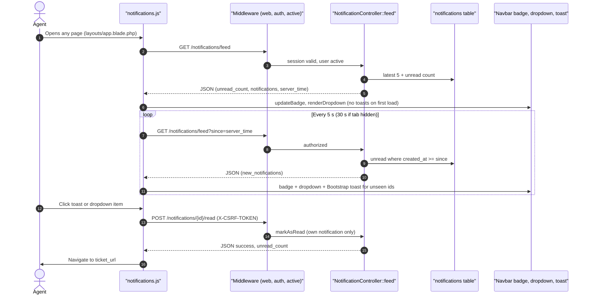

# 07 — UI to Backend Mapping

A **lookup reference** for a live interview. Find the button you are asked about, and you immediately see the
Blade file, the route, the controller method, the service method, the tables, the rules and the response.

Related: [Business logic](06-BUSINESS-LOGIC-GUIDE.md) ·
[Notification system](13-NOTIFICATION-SYSTEM-GUIDE.md) ·
[Queue and email](14-QUEUE-AND-EMAIL-GUIDE.md) ·
[Caching](15-CACHING-GUIDE.md)

Tip: `php artisan route:list --except-vendor -v` prints every route with its name and middleware
(use PHP 8.4 first: `export PATH="/c/php-8.4.28:$PATH"`).

---

## Legend

**Middleware abbreviations** (from `routes/web.php`):

| Short | Middleware | Meaning | Code |
|---|---|---|---|
| `web` | web group | session, cookies, CSRF check (`@csrf` / `X-CSRF-TOKEN`) | Laravel default |
| `guest` | guest | only for logged-out users; logged-in users go to `/dashboard` | `bootstrap/app.php` `redirectUsersTo` |
| `auth` | auth | must be logged in; else redirect to `/login` | `bootstrap/app.php` `redirectGuestsTo` |
| `active` | active | must be `is_active`; else logout (redirect, or 401 JSON for AJAX) | `app/Http/Middleware/ActiveUserMiddleware.php` |
| `admin` | `role:admin` | role must be admin; else 403 | `app/Http/Middleware/RoleMiddleware.php` |

So "`web, auth, active`" is the normal logged-in stack and "`web, auth, active, admin`" is the admin stack.

**Shared JavaScript on every logged-in page** (loaded in `resources/views/layouts/app.blade.php`):
- `public/js/app.js` — any `<form data-confirm="...">` shows `window.confirm()` before submitting.
- `public/js/notifications.js` — bell polling, dropdown, toasts, mark-as-read.

**Standard responses:**
- Success → `redirect` + flash (`success` / `info` / `error`) shown by `resources/views/partials/flash.blade.php`.
- `ValidationException` → redirect back with `$errors` (red "Please fix the following:" alert), or 422 JSON for AJAX.
- Policy / role failure → 403 page `resources/views/errors/403.blade.php`.
- Missing/expired CSRF token → 419 page `resources/views/errors/419.blade.php`.
- Unknown id in URL (route model binding) → 404.

**Constant facts used below:**
- In-app notifications are inserted in the same DB transaction (database channel, **not queued**).
- Emails: `TicketService::queueEmail()` → `DB::afterCommit()` → `SendTicketEmail::dispatch()` → `jobs` table.
- Dashboard cache key `dashboard:admin:stats` is cleared by `TicketService::clearDashboardCache()` after
  ticket writes; category cache `ticket:active-categories` by `Category::clearActiveCache()`.

---

## Quick lookup (one line per action)

| UI action | Method + URL | Route name | Controller@method | Service method |
|---|---|---|---|---|
| Open login page | GET `/login` | `login` | `AuthController@showLogin` | — |
| Sign in | POST `/login` | `login.attempt` | `AuthController@login` | — |
| Sign out | POST `/logout` | `logout` | `AuthController@logout` | — |
| `/` | ANY `/` | — | redirect to `/dashboard` | — |
| Dashboard (any role) | GET `/dashboard` | `dashboard` | `DashboardController@index` | — |
| Ticket list / filter / reset / page | GET `/tickets` | `tickets.index` | `TicketController@index` | — |
| New ticket form | GET `/tickets/create` | `tickets.create` | `TicketController@create` | — |
| Submit ticket | POST `/tickets` | `tickets.store` | `TicketController@store` | `TicketService::createTicket` |
| Ticket details | GET `/tickets/{ticket}` | `tickets.show` | `TicketController@show` | — |
| Edit ticket form | GET `/tickets/{ticket}/edit` | `tickets.edit` | `TicketController@edit` | — |
| Save ticket edit | PUT `/tickets/{ticket}` | `tickets.update` | `TicketController@update` | `TicketService::updateTicket` |
| Assign / Reassign | POST `/tickets/{ticket}/assign` | `tickets.assign` | `TicketController@assign` | `TicketService::assignAgent` |
| Auto Assign | POST `/tickets/{ticket}/auto-assign` | `tickets.auto-assign` | `TicketController@autoAssign` | `TicketService::autoAssign` |
| Start Working | POST `/tickets/{ticket}/start` | `tickets.start` | `TicketController@start` | `TicketService::startWork` |
| Resolve Ticket | POST `/tickets/{ticket}/resolve` | `tickets.resolve` | `TicketController@resolve` | `TicketService::resolve` |
| Reopen Ticket | POST `/tickets/{ticket}/reopen` | `tickets.reopen` | `TicketController@reopen` | `TicketService::reopen` |
| Confirm & Close | POST `/tickets/{ticket}/close` | `tickets.close` | `TicketController@close` | `TicketService::close` |
| Post Comment | POST `/tickets/{ticket}/comments` | `tickets.comments.store` | `TicketCommentController@store` | `TicketService::addComment` |
| User list / filter | GET `/users` | `users.index` | `UserController@index` | — |
| Create user form / save | GET `/users/create` · POST `/users` | `users.create` · `users.store` | `UserController@create` · `@store` | — |
| User details | GET `/users/{user}` | `users.show` | `UserController@show` | — |
| Edit user form / save | GET `/users/{user}/edit` · PUT `/users/{user}` | `users.edit` · `users.update` | `UserController@edit` · `@update` | — |
| Activate / Deactivate | PATCH `/users/{user}/toggle-active` | `users.toggle-active` | `UserController@toggleActive` | — |
| Category list | GET `/categories` | `categories.index` | `CategoryController@index` | — |
| Create category form / save | GET `/categories/create` · POST `/categories` | `categories.create` · `categories.store` | `CategoryController@create` · `@store` | — |
| Edit category form / save | GET `/categories/{category}/edit` · PUT `/categories/{category}` | `categories.edit` · `categories.update` | `CategoryController@edit` · `@update` | — |
| Delete category | DELETE `/categories/{category}` | `categories.destroy` | `CategoryController@destroy` | — |
| Bell polling (AJAX) | GET `/notifications/feed[?since=…]` | `notifications.feed` | `NotificationController@feed` | — |
| Click a dropdown item (AJAX) | POST `/notifications/{id}/read` | `notifications.read` | `NotificationController@markAsRead` | — |
| Mark all as read (dropdown, AJAX) | POST `/notifications/read-all` | `notifications.read-all` | `NotificationController@markAllAsRead` | — |
| Notification history / filter | GET `/notifications[?filter=…]` | `notifications.index` | `NotificationController@index` | — |
| History: Open ticket / Mark as read / Mark all | POST (normal forms) | `notifications.read` / `notifications.read-all` | `NotificationController@markAsRead` / `@markAllAsRead` | — |

There is **no** `tickets.destroy`, `users.destroy` or `categories.show` route (`->except([...])` in
`routes/web.php`).

---

## 1. Authentication

### 1.1 Login page and Sign in

| Item | Value |
|---|---|
| Page | Login |
| UI action | Fill email + password (+ "Remember me"), click **Sign in** |
| Blade | `resources/views/auth/login.blade.php` (layout `layouts/guest.blade.php`); form `action="{{ route('login.attempt') }}"` with `novalidate` |
| JS | none (no `notifications.js` on guest pages) |
| HTTP | GET `/login` (show) · POST `/login` (submit) |
| Route names | `login` · `login.attempt` |
| Middleware | `web, guest` |
| Controller | `AuthController@showLogin` · `AuthController@login` |
| Service | — |
| Model / table | `User` / `users`; rate-limit counters in the `cache` table |
| Validation | `email` required + email; `password` required + string |
| Authorization | Must be a guest. Account must be active (`is_active`) |
| Business logic | `RateLimiter` key `lower(email)|ip`: 5 failed attempts → locked 60 s (`MAX_LOGIN_ATTEMPTS`, `LOCKOUT_SECONDS`). `Auth::attempt()` compares bcrypt hash. Inactive → `Auth::logout()` + error. Success → `RateLimiter::clear()`, `session()->regenerate()` (prevents session fixation) |
| Notification / queue / cache | none / none / rate-limiter uses the cache store |
| Response | `redirect()->intended(route('dashboard'))`. Errors on key `email`: `These credentials do not match our records.` · `Too many login attempts. Please try again in {N} seconds.` · `Your account has been deactivated. Please contact an administrator.` |

### 1.2 Sign out

| Item | Value |
|---|---|
| UI action | Profile dropdown (top right) → **Sign out** |
| Blade | `resources/views/partials/navbar.blade.php` — POST form with `@csrf` (never a GET link) |
| HTTP / route | POST `/logout` · `logout` |
| Middleware | `web, auth, active` |
| Controller | `AuthController@logout` |
| Logic | `Auth::logout()`, `session()->invalidate()`, `session()->regenerateToken()` |
| Response | redirect `login` with "You have been logged out." |

---

## 2. Layout: sidebar and navbar

Blade: `resources/views/partials/sidebar.blade.php`, `resources/views/partials/navbar.blade.php`.
All links are GET requests with middleware `web, auth, active` (+ `admin` for Users/Categories).

| Sidebar link | Visible to | Route | Controller@method |
|---|---|---|---|
| Dashboard | all | `dashboard` | `DashboardController@index` |
| All Tickets (admin) / My Tickets (others) | all | `tickets.index` | `TicketController@index` |
| New Ticket | all | `tickets.create` | `TicketController@create` |
| Notifications | all | `notifications.index` | `NotificationController@index` |
| Users | admin only (`@if (auth()->user()->isAdmin())`) | `users.index` | `UserController@index` |
| Categories | admin only | `categories.index` | `CategoryController@index` |

Hiding Users/Categories is cosmetic; the `role:admin` middleware is the real protection
(`AuthorizationTest::test_customer_and_agent_cannot_open_admin_pages`). The active link is highlighted
with `request()->routeIs(...)`.

---

## 3. Dashboards

| Item | Value |
|---|---|
| Page | Dashboard (one URL, three views) |
| HTTP / route | GET `/dashboard` · `dashboard` |
| Middleware | `web, auth, active` |
| Controller | `DashboardController@index` → `adminDashboard()` / `agentDashboard($user)` / `customerDashboard($user)` |
| Blade | `resources/views/dashboard/admin.blade.php`, `agent.blade.php`, `customer.blade.php`; card partial `dashboard/_stat-card.blade.php` |
| JS | shared scripts; admin view adds Chart.js (`public/vendor/chartjs/chart.umd.min.js`) via `@push('scripts')` with an inline script drawing `trendChart`, `priorityChart`, `categoryChart` from `$stats` (no extra AJAX) |
| Models / tables | `Ticket`/`tickets`, `User`/`users`, `Category`/`categories`; `cache` table (admin) |
| Authorization | role decides which method runs (`isAdmin()`, `isAgent()`, else customer) |
| Cache | Admin: `Cache::remember('dashboard:admin:stats', 60, ...)` → `buildAdminStatistics()`. Overdue count, recent tickets and agent workload are **not** cached. Agent and customer dashboards are **not** cached |
| Notification / queue | none |
| Response | HTML view |

### 3.1 Stat-card links

A stat card with a `link` parameter renders a "View tickets" `stretched-link` (whole card clickable).
All links go to GET `/tickets` (`tickets.index`, `TicketController@index`) with a query string.

| Dashboard | Card | Link |
|---|---|---|
| Admin | Total tickets | `route('tickets.index')` |
| Admin | Open / Assigned / In progress / Resolved / Closed | `route('tickets.index', ['status' => 'open' / 'assigned' / 'in_progress' / 'resolved' / 'closed'])` |
| Admin | Overdue | `route('tickets.index', ['overdue' => 1])` |
| Admin | Avg. resolution | no link (shows `—` when there is no data) |
| Agent | My assigned tickets | no link |
| Agent | Pending (not started) | `['status' => 'assigned']` |
| Agent | In progress | `['status' => 'in_progress']` |
| Agent | Resolved / closed | no link |
| Agent | Overdue | `['overdue' => 1]` |
| Customer | My total tickets | `route('tickets.index')` |
| Customer | Active | no link |
| Customer | Resolved (awaiting your confirmation) | `['status' => 'resolved']` |
| Customer | Closed | `['status' => 'closed']` |

Other dashboard links: ticket numbers → `tickets.show`; "View all" → `tickets.index`; agent names in the admin
workload table → `users.show`; "Create Ticket" (customer) → `tickets.create`; "My Tickets" (agent) →
`tickets.index`.

Note: agent card counts use `assigned_to = agent` only, while the ticket list for an agent shows tickets
**created by OR assigned to** them (`Ticket::scopeVisibleTo()`), so a linked list can contain extra rows.

---

## 4. Ticket list (filters, reset, pagination)

| Item | Value |
|---|---|
| Page | All Tickets (admin) / My Tickets |
| UI actions | Search box, Status, Priority, Category, Assigned agent (admin only), Created from/to, "Overdue only" checkbox, **Filter**, **Reset**, pagination links, **View**, **Edit** (only `@can('update', $ticket)`), **Create Ticket** |
| Blade | `resources/views/tickets/index.blade.php`; badges `partials/ticket-badges.blade.php` |
| JS | none specific |
| HTTP / route | GET `/tickets?search=&status=&priority=&category_id=&assigned_to=&date_from=&date_to=&overdue=1&page=2` · `tickets.index` |
| Middleware | `web, auth, active` |
| Controller | `TicketController@index` (+ private `agentList()` for the admin agent filter) |
| Service | — |
| Models / tables | `Ticket`, `Category`, `User` / `tickets`, `categories`, `users` |
| Validation | `search` nullable string max 100; `status` in `Ticket::STATUSES` keys; `priority` in `Ticket::PRIORITIES` keys; `category_id` nullable integer; `date_from` date; `date_to` date `after_or_equal:date_from`. Invalid values → redirect back with errors (`TicketManagementTest::test_invalid_filter_values_are_rejected`). `assigned_to` is not validated but is only used for admins and is bound as a parameter (or `unassigned` → `whereNull`) |
| Authorization | `Ticket::visibleTo($user)` — admin all; others `WHERE (created_by = ? OR assigned_to = ?)` |
| Business logic | `with(['category', 'creator', 'assignedAgent'])` eager loading (no N+1); search = `ticket_number LIKE %x% OR subject LIKE %x%`; `whereDate('created_at', ...)`; `->overdue()` scope; `latest()->paginate(15)->withQueryString()` |
| Notification / queue / cache | none / none / none (category filter list is read directly: `Category::orderBy('name')->get(['id','name'])`, includes inactive) |
| Response | HTML; **Filter** = GET form submit (filters appear in the URL); **Reset** = plain link to `route('tickets.index')`; pagination links keep filters thanks to `withQueryString()`; Bootstrap 5 pagination via `Paginator::useBootstrapFive()` in `AppServiceProvider` |

> **বাংলায়:** Filter form-টা GET, তাই সব filter URL-এ query string হিসেবে থাকে — link copy করলে একই ফলাফল দেখা যায়,
> আর `withQueryString()` pagination-এর link-এও filter রেখে দেয়। `with([...])` হলো eager loading: ১৫টা ticket-এর
> জন্য ১৫×৩টা আলাদা query না চালিয়ে মোট ৩টা extra query-তে সব category/creator/agent নিয়ে আসে (N+1 সমস্যা এড়ানো)।

---

## 5. Create and edit ticket

### 5.1 Create ticket

| Item | Value |
|---|---|
| UI action | Sidebar **New Ticket** / **Create Ticket** button → fill form → **submit** |
| Blade | `resources/views/tickets/create.blade.php` + shared fields `tickets/_form.blade.php` (`subject`, `description`, `category_id`, `priority`) |
| JS | none specific |
| HTTP / route | GET `/tickets/create` (`tickets.create`) · POST `/tickets` (`tickets.store`) |
| Middleware | `web, auth, active` |
| Controller | `TicketController@create` · `TicketController@store` |
| Service | `TicketService::createTicket($validated, $request->user())` |
| Models / tables | `Ticket`, `TicketActivity`, `Category`, `User` / `tickets`, `ticket_activities`, `categories`, `notifications`, `jobs` |
| Validation | `subject` required string max 255; `description` required string max 5000; `category_id` required integer `Rule::exists('categories','id')->where('is_active', true)` (message `Please choose an active category.`); `priority` in `Ticket::PRIORITIES` keys |
| Authorization | `Gate::authorize('create', Ticket::class)` → `TicketPolicy::create()` (true for every active user) |
| Business logic | In `DB::transaction()`: INSERT ticket (status open, `assigned_to` null, `created_by` = logged-in user, `due_at` = `Ticket::calculateDueAt()`), UPDATE `ticket_number` = `Ticket::makeTicketNumber($id)`, activity `created`, then `notifyUser()` for every active admin |
| Notification | "New ticket created" (`created`) to every active admin, except an admin who created the ticket themselves (added at the project owner's request, beyond MASTER_PROMPT §9.2) |
| Queue | one `SendTicketEmail` job per notified admin, pushed after COMMIT (`DB::afterCommit()`) |
| Cache | Form dropdown reads `Category::activeForDropdown()` (`ticket:active-categories`, 3600 s). After save: `clearDashboardCache()` |
| Response | redirect `tickets.show` + "Ticket TK-000033 was created successfully." |

### 5.2 Edit ticket

| Item | Value |
|---|---|
| UI action | **Edit Ticket** on details page / **Edit** in list → change fields → save |
| Blade | `resources/views/tickets/edit.blade.php` (form `@method('PUT')`, shows a note if the current category is inactive) + `tickets/_form.blade.php` |
| HTTP / route | GET `/tickets/{ticket}/edit` (`tickets.edit`) · PUT `/tickets/{ticket}` (`tickets.update`) |
| Middleware | `web, auth, active` |
| Controller | `TicketController@edit` · `TicketController@update` |
| Service | `TicketService::updateTicket($ticket, $validated, $user)` |
| Models / tables | `Ticket`, `TicketActivity`, `Category` |
| Validation | same as create but `category_id` `exists:categories,id`; if the category **changed**, it must be active (`Please choose an active category.`) |
| Authorization | `Gate::authorize('update', $ticket)` → not closed AND (admin OR creator while Open + unassigned) |
| Business logic | `fill()` + `isDirty()`; no change → returns false ("No changes were made."). Priority change → `due_at` recalculated from `created_at`; activities `updated`, `priority_changed`, `due_date_changed`. Status is never edited here |
| Notification / queue | none / none |
| Cache | edit dropdown = cached active list + current (maybe inactive) category via `concat()`; after a real change `clearDashboardCache()` |
| Response | redirect `tickets.show` + "Ticket updated successfully." or "No changes were made." |

---

## 6. Ticket details page and workflow buttons

Page: `resources/views/tickets/show.blade.php` — GET `/tickets/{ticket}` (`tickets.show`),
`TicketController@show`: `Gate::authorize('view', $ticket)`, eager loads
`['category', 'creator', 'assignedAgent', 'comments.user', 'activities.user']`, and for admins passes
`agentList()` (active agents with `workload_count`).

The **Actions** card shows a button only if `@can(...)` is true for that action (same `TicketPolicy` the
controller uses). Every action form has `@csrf` and `data-confirm` (`public/js/app.js` asks for
confirmation). All use middleware `web, auth, active` (+ `admin` for assign/auto-assign).

| Button | Form fields | Route | Controller@method | Policy | Service | Tables written | In-app notification | Email job | Cache | Success flash |
|---|---|---|---|---|---|---|---|---|---|---|
| **Assign** / **Reassign** (label depends on `assigned_to`) | `agent_id` (select: "Name (N active)") | `tickets.assign` | `TicketController@assign` | `assign` | `assignAgent()` → `performAssignment()` | `tickets`, `ticket_activities`, `notifications` | new agent (`assigned` / `reassigned`) | yes | cleared if changed | "Ticket assigned to {name}." / info "The ticket is already assigned to {name}. Nothing was changed." |
| **Auto Assign** (only when status is Open) | none | `tickets.auto-assign` | `TicketController@autoAssign` | `assign` | `autoAssign()` → `findLeastBusyAgent()` → `performAssignment()` | same | chosen agent (`assigned`) | yes | cleared if assigned | "Ticket automatically assigned to {name} (lowest current workload)." / error "No active support agent is available. The ticket remains Open." |
| **Start Working** | none | `tickets.start` | `TicketController@start` | `start` | `startWork()` | `tickets`, `ticket_activities` | none | no | cleared | "Ticket is now In Progress." |
| **Resolve Ticket** | `resolution_note` (required, max 5000) | `tickets.resolve` | `TicketController@resolve` | `resolve` | `resolve()` | `tickets` (+`resolved_at`, `resolution_note`), `ticket_activities`, `notifications` | creator (`resolved`) | yes | cleared | "Ticket marked as Resolved." |
| **Confirm & Close Ticket** | none | `tickets.close` | `TicketController@close` | `close` | `close()` | `tickets`, `ticket_activities`, `notifications` | assigned agent (`closed`) | **no** | cleared | "Ticket closed. Thank you for confirming the resolution." |
| **Reopen Ticket** | none | `tickets.reopen` | `TicketController@reopen` | `reopen` | `reopen()` | `tickets` (clears `resolved_at`, `resolution_note`), `ticket_activities`, `notifications` | assigned agent (`reopened`) | yes | cleared | "Ticket reopened and moved back to In Progress." |

Business-rule errors (from `TicketService`, red alert after redirect back):

| Action | Message |
|---|---|
| Assign / Reassign | `Please select an active support agent.` · `Only Open, Assigned or In Progress tickets can be assigned.` |
| Auto Assign | `Auto assign is only available for Open tickets. Use Reassign instead.` |
| Start / Resolve / Close / Reopen (race) | `This action is not allowed while the ticket is {Status}.` |
| Resolve | `The resolution note field is required.` · `A resolution note is required to resolve a ticket.` |
| Reopen | `This ticket cannot be reopened because its assigned agent is not active. Please contact an administrator.` |

All workflow responses are `back()` (return to the details page). All service methods run in
`DB::transaction()` with `lockTicket()` (`SELECT ... FOR UPDATE`).

### 6.1 Comment form

| Item | Value |
|---|---|
| UI action | Type in "Add a comment" → **Post Comment** |
| Blade | `resources/views/tickets/show.blade.php` (Conversation card, `@can('comment', $ticket)`; otherwise "This ticket is closed and read-only.") |
| HTTP / route | POST `/tickets/{ticket}/comments` · `tickets.comments.store` |
| Middleware | `web, auth, active` |
| Controller | `TicketCommentController@store` |
| Service | `TicketService::addComment($ticket, $message, $user)` |
| Models / tables | `TicketComment` / `ticket_comments`; `notifications` |
| Validation | `message` required string max 5000 |
| Authorization | `Gate::authorize('comment', $ticket)` → can view AND not closed |
| Business logic | Lock ticket, re-check not closed, insert comment; recipients = {creator, assigned agent} minus author, minus inactive, no duplicates |
| Notification | in-app `comment` (title "New comment from {author}") |
| Queue / cache | no email / no cache change |
| Response | redirect to `tickets.show` + `#conversation`, "Comment added." Error: `Closed tickets are read-only. Comments are not allowed.` |

---

## 7. Users (admin only)

All routes: middleware `web, auth, active, admin`. Controller `app/Http/Controllers/UserController.php`.
Model/table `User` / `users`. No service class (plain CRUD). No notifications, no queue, no cache.

| UI action | Blade | HTTP + URL | Route | Method | Validation / rules | Response |
|---|---|---|---|---|---|---|
| List, **Filter** (search name/email, role, status active/inactive), **Reset**, pagination | `users/index.blade.php` | GET `/users?search=&role=&status=` | `users.index` | `index` | none (values used in bound `where`s); `paginate(15)->withQueryString()` | HTML |
| **Create User** → form | `users/create.blade.php` + `users/_form.blade.php` | GET `/users/create` | `users.create` | `create` | — | HTML |
| Save new user | same | POST `/users` | `users.store` | `store` | `name` required max 255; `email` required email unique; `password` required min 8 `confirmed`; `role` in `User::ROLES`; `is_active` boolean (`$request->boolean()`); password hashed by the `hashed` cast | redirect `users.show` "User {name} was created." |
| **View** user | `users/show.blade.php` | GET `/users/{user}` | `users.show` | `show` | counts created / active assigned (`WORKLOAD_STATUSES`), 10 recent tickets | HTML |
| **Edit** → form | `users/edit.blade.php` + `_form` | GET `/users/{user}/edit` | `users.edit` | `edit` | — | HTML |
| Save edit | same (`@method('PUT')`) | PUT `/users/{user}` | `users.update` | `update` | email unique ignoring self; password optional (empty = keep); then `ensureRoleOrStatusChangeIsAllowed()` | redirect `users.show` "User updated successfully." |
| **Activate / Deactivate** (hidden for your own row) | `users/index.blade.php`, `users/show.blade.php` (`@method('PATCH')`, `data-confirm`) | PATCH `/users/{user}/toggle-active` | `users.toggle-active` | `toggleActive` | `ensureRoleOrStatusChangeIsAllowed()` (self, last admin, agent with Assigned/In Progress/Resolved tickets) | `back()` "User {name} was activated/deactivated." |

Errors (key `is_active`): `You cannot deactivate your own account or change your own role.` ·
`The last active administrator cannot be deactivated or demoted.` ·
`This agent is still responsible for {N} unresolved or reopenable ticket(s). Reassign their Assigned/In Progress tickets and close their Resolved tickets first.`

Effect of deactivation on the user's open browser: `ActiveUserMiddleware` logs them out on their next request
(redirect to login) and the next notification poll receives 401 JSON.

---

## 8. Categories (admin only)

Middleware `web, auth, active, admin`. Controller `app/Http/Controllers/CategoryController.php`. Model/table
`Category` / `categories`. No notifications, no queue.

| UI action | Blade | HTTP + URL | Route | Method | Validation / rules | Cache | Response |
|---|---|---|---|---|---|---|---|
| List (with ticket counts) | `categories/index.blade.php` | GET `/categories` | `categories.index` | `index` | `withCount('tickets')`, `paginate(15)` | — | HTML |
| **Create Category** → form | `categories/create.blade.php` + `categories/_form.blade.php` | GET `/categories/create` | `categories.create` | `create` | — | — | HTML |
| Save new | same | POST `/categories` | `categories.store` | `store` | `name` required max 100 unique; `description` nullable max 1000; `is_active` boolean | `clearCaches()`: `ticket:active-categories` + `dashboard:admin:stats` | redirect `categories.index` "Category created." |
| **Edit** → form / save | `categories/edit.blade.php` (`@method('PUT')`) | GET `/categories/{category}/edit` · PUT `/categories/{category}` | `categories.edit` · `categories.update` | `edit` · `update` | unique name ignoring self | `clearCaches()` | redirect "Category updated." |
| **Delete** (button only when `tickets_count === 0`; `data-confirm`) | `categories/index.blade.php` (`@method('DELETE')`) | DELETE `/categories/{category}` | `categories.destroy` | `destroy` | refuses if `$category->tickets()->exists()` | `clearCaches()` on success | redirect "Category deleted." or `back()` error "This category is used by existing tickets and cannot be deleted. Deactivate it instead." |

---

## 9. Notifications

### 9.1 Bell polling (AJAX)

| Item | Value |
|---|---|
| Page | Every logged-in page (navbar) |
| UI action | none — automatic every 5 s (30 s when the tab is hidden); immediate poll when the tab becomes visible again |
| Blade | `resources/views/partials/navbar.blade.php` — `#notificationBell` with `data-feed-url`, `data-read-url` (contains `__ID__`), `data-read-all-url`, `data-login-url`; badge `#notificationCount`; list `#notificationList`; toast container `#toast-container`; CSRF meta tag in `layouts/app.blade.php` |
| JS | `public/js/notifications.js` → `poll()`, `scheduleNextPoll()`, `updateBadge()`, `renderDropdown()`, `showToasts()`, `handleExpiredSession()` |
| HTTP / route | GET `/notifications/feed` (first call) then `/notifications/feed?since=<server_time>` · `notifications.feed`; headers `Accept: application/json`, `X-Requested-With: XMLHttpRequest` |
| Middleware | `web, auth, active` (inactive → 401 JSON; expired session → 401) |
| Controller | `NotificationController@feed` (+ private `formatNotification()`) |
| Model / table | Laravel `DatabaseNotification` via `User` `Notifiable` trait / `notifications` |
| Validation | `since` nullable date (invalid → 422) |
| Authorization | queries start from `$request->user()->notifications()` → only own rows |
| Business logic | `latest` 5 (`DROPDOWN_LIMIT`), `new_notifications` = unread with `created_at >= since - 10 s` (max 20), `unread_count`, `server_time` |
| Notification / queue / cache | read-only / none / none |
| Response | JSON `{unread_count, notifications[], new_notifications[], server_time}`; each item `{id, title, message, ticket_number, event_type, ticket_url, is_read, time_ago}` |

### 9.2 Click a dropdown item

| Item | Value |
|---|---|
| UI action | Click a notification row in the bell dropdown (or the body of a toast) |
| JS | `notifications.js` → `openNotification(item)` → `postJson()` with `X-CSRF-TOKEN` (only if unread) → `window.location.href = item.ticket_url` |
| HTTP / route | POST `/notifications/{id}/read` · `notifications.read` |
| Middleware | `web, auth, active` |
| Controller | `NotificationController@markAsRead` |
| Logic | `$request->user()->notifications()->findOrFail($id)` (someone else's id → 404) → `markAsRead()` |
| Response | JSON `{success: true, unread_count}` (because `expectsJson()`); then the browser opens the ticket, where `TicketPolicy::view` is checked again (403 if access was lost) |

### 9.3 Mark all as read (dropdown)

| Item | Value |
|---|---|
| UI action | **Mark all as read** button in the dropdown (`#markAllReadButton`) |
| JS | `notifications.js` click handler → `postJson(readAllUrl)` → `updateBadge(0)` and removes `.unread` classes |
| HTTP / route | POST `/notifications/read-all` · `notifications.read-all` |
| Controller | `NotificationController@markAllAsRead` → `unreadNotifications()->update(['read_at' => now()])` |
| Response | JSON `{success: true, unread_count: 0}` |

### 9.4 Notification history page

| UI action | Blade | HTTP + URL | Route | Controller@method | Response |
|---|---|---|---|---|---|
| Open page / **All** · **Unread** · **Read** pills | `resources/views/notifications/index.blade.php` | GET `/notifications?filter=unread\|read` | `notifications.index` | `NotificationController@index` (`whereNull/whereNotNull('read_at')`, `paginate(15)`) | HTML |
| **Open ticket** (normal form, hidden `open_ticket=1`) | same | POST `/notifications/{id}/read` | `notifications.read` | `@markAsRead` | redirect `tickets.show` (`data['ticket_id']`) |
| **Mark as read** (only for unread) | same | POST `/notifications/{id}/read` | `notifications.read` | `@markAsRead` | `back()` "Notification marked as read." |
| **Mark all as read** (page header) | same | POST `/notifications/read-all` | `notifications.read-all` | `@markAllAsRead` | `back()` "All notifications marked as read." |

No JavaScript is needed on this page (plain forms with `@csrf`), which is why `markAsRead()` and
`markAllAsRead()` check `$request->expectsJson()` and return either JSON or a redirect.

---

## Chain 1: Assign Agent

Example from `MASTER_PROMPT.md` §20, traced through the real code.

1. **Blade form** — `resources/views/tickets/show.blade.php`, inside `@can('assign', $ticket)`:
   `<form method="POST" action="{{ route('tickets.assign', $ticket) }}" data-confirm="...">` with `@csrf`,
   `<select name="agent_id">` filled from `$agents` (`TicketController::agentList()`).
2. **JS confirm** — `public/js/app.js` submit listener shows `window.confirm()`; Cancel → `preventDefault()`.
3. **POST route** — `routes/web.php`: `Route::post('/tickets/{ticket}/assign', [TicketController::class, 'assign'])->name('tickets.assign')`
   inside `middleware(['auth', 'active'])` and `middleware('role:admin')`.
4. **Middleware** — `web` (session + CSRF token check; missing → 419), `auth`, `ActiveUserMiddleware::handle()`,
   `RoleMiddleware::handle()` (`role:admin`, else 403).
5. **Route model binding** — `{ticket}` → `Ticket` loaded by id (404 if missing).
6. **Controller** — `TicketController::assign()`.
7. **Authorization** — `Gate::authorize('assign', $ticket)` → `TicketPolicy::assign()` (admin AND status
   Open/Assigned/In Progress), else 403.
8. **Validation** — `$request->validate(['agent_id' => ['required', 'integer', 'exists:users,id']])`, then
   `User::findOrFail($validated['agent_id'])`.
9. **Service** — `TicketService::assignAgent($ticket, $agent, $request->user())`.
10. **Transaction + lock** — `DB::transaction()` → `lockTicket()` (`SELECT ... FOR UPDATE`).
11. **Business checks** — `performAssignment()`: status still active; agent re-read with `User::find()` and
    must be an active agent; same agent → return `false` (no duplicates).
12. **Ticket update** — `assigned_to` set; Open → Assigned; `$ticket->save()` (UPDATE `tickets`).
13. **Activity record** — `recordActivity()` → `assigned` + `status_changed` (first assignment) or
    `reassigned` (INSERT `ticket_activities`).
14. **Database notification** — `notifyUser()` → `$agent->notify(new TicketNotification(...))` (INSERT
    `notifications`, same transaction).
15. **Email registered** — `queueEmail()` → `DB::afterCommit(function () { SendTicketEmail::dispatch(...); })`.
16. **Transaction commit** — closure returns `true` → COMMIT. Lock released.
17. **Queued email** — the after-commit callback runs → INSERT into `jobs` (errors only logged with
    `Log::error('Could not queue ticket email', ...)`).
18. **Cache invalidation** — back in `assignAgent()`: `if ($wasChanged) $this->clearDashboardCache();`
    → `Cache::forget('dashboard:admin:stats')`.
19. **Redirect** — `back()->with('success', "Ticket assigned to {$agent->name}.")`; the details page shows
    the flash via `partials/flash.blade.php`.
20. **Later** — `php artisan queue:work` runs `SendTicketEmail::handle()` → `Mail::to(...)->send(new TicketUpdateMail(...))`
    (`MAIL_MAILER=log` writes to `storage/logs/laravel.log`). The agent's browser sees the notification on its
    next poll (Chain 2).

```mermaid
sequenceDiagram
    autonumber
    actor Admin
    participant Browser as "Browser (show.blade.php + app.js)"
    participant MW as "Middleware (web, auth, active, role:admin)"
    participant TC as "TicketController::assign"
    participant Policy as "TicketPolicy::assign"
    participant TS as "TicketService"
    participant DB as "MySQL/MariaDB"
    participant Cache as "Cache (database store)"
    participant Queue as "jobs table"
    participant Worker as "queue:work"

    Admin->>Browser: Select agent, click Assign
    Browser->>Browser: data-confirm -> window.confirm()
    Browser->>MW: POST /tickets/33/assign (agent_id, _token)
    MW->>TC: CSRF ok, logged in, active, admin
    TC->>Policy: Gate::authorize('assign', ticket)
    Policy-->>TC: allowed (admin + active status)
    TC->>TC: validate agent_id, User::findOrFail
    TC->>TS: assignAgent(ticket, agent, admin)
    TS->>DB: BEGIN; SELECT ... FOR UPDATE
    TS->>DB: re-read agent, check active agent
    TS->>DB: UPDATE tickets (assigned_to, status)
    TS->>DB: INSERT ticket_activities
    TS->>DB: INSERT notifications
    TS->>TS: DB::afterCommit(dispatch email)
    TS->>DB: COMMIT
    TS->>Queue: SendTicketEmail::dispatch (after commit)
    TS->>Cache: forget dashboard:admin:stats
    TS-->>TC: true (changed)
    TC-->>Browser: 302 back() + flash success
    Worker->>Queue: pick job
    Worker->>Worker: Mail::to(agent)->send(TicketUpdateMail)
```

> **বাংলায়:** এই chain-টা interview-এ মুখস্থ বলার মতো: Blade form → POST route → middleware (CSRF, login, active,
> admin) → controller → policy → validation → service → transaction + lock → ticket update → activity → database
> notification → commit → email job (commit-এর পরে) → cache মুছে ফেলা → redirect। প্রতিটা ধাপের file আর method
> উপরের তালিকায় আছে।

---

## Chain 2: Agent notification polling

1. **Page load** — `resources/views/layouts/app.blade.php` loads `public/js/notifications.js`; the IIFE finds
   `#notificationBell` and reads `data-feed-url`, `data-read-url`, `data-read-all-url`, `data-login-url`
   and the CSRF token from `<meta name="csrf-token">`.
2. **First poll** — `poll()` runs immediately: GET `/notifications/feed` (no `since`). `isFirstLoad = true`,
   so existing notifications are **not** shown as toasts; their ids are added to `shownToastIds`.
3. **Authenticated GET endpoint** — route `notifications.feed`, middleware `web, auth, active`.
   (Inactive or logged-out → 401 → `handleExpiredSession()` stops polling and shows "Sign in again".)
4. **Controller** — `NotificationController::feed()`: validates `since`; `$user->notifications()->take(5)`;
   if `since` present, `$user->unreadNotifications()->where('created_at', '>=', $since)->take(20)` (`$since` = the
   given time minus `SINCE_OVERLAP_SECONDS` = 10, so late-committed rows still get a toast);
   `unreadNotifications()->count()`.
5. **Database notifications** — rows in `notifications` where `notifiable_type = App\Models\User` and
   `notifiable_id = <agent id>` (inserted by `TicketService::notifyUser()` in Chain 1).
6. **JSON response** — `formatNotification()` builds `{id, title, message, ticket_number, event_type,
   ticket_url, is_read, time_ago}`; plus `unread_count` and `server_time` (ISO 8601).
7. **Remember time** — JS stores `lastServerTime = data.server_time` and sends it as `?since=` next time
   (server clock, so the browser clock does not matter).
8. **Schedule next** — `finally { scheduleNextPoll(); }` → `setTimeout(poll, 5000)` (or 30000 if
   `document.hidden`). Recursive `setTimeout` + `isRequestRunning` flag = requests never overlap.
9. **DOM update** — `updateBadge(unread_count)` (shows `99+` above 99), `renderDropdown(notifications)` builds
   rows with `textContent` (XSS-safe).
10. **Bootstrap toast** — `showToasts(new_notifications)`: skips ids already in `shownToastIds`, creates a
    `.toast`, `new bootstrap.Toast(toast, { delay: 8000 }).show()`, removes it on `hidden.bs.toast`.
11. **Click** — toast body or dropdown row → `openNotification()` → POST `notifications.read` with
    `X-CSRF-TOKEN` → navigate to `ticket_url`.



> **বাংলায়:** Polling মানে browser নিজেই কয়েক সেকেন্ড পর পর server-কে জিজ্ঞেস করে "আমার নতুন কিছু আছে?" — server
> নিজে থেকে push করে না (সেটা WebSocket হতো, এই project-এ নেই)। `since=server_time` পাঠানো হয় যাতে server শুধু
> নতুন notification-গুলো আলাদা করে দেয়, আর `shownToastIds` Set-টা নিশ্চিত করে একই toast দুইবার দেখাবে না।

---

## "Where is the code for...?" (fast answers)

| Question | Answer |
|---|---|
| Who may click Resolve? | `TicketPolicy::resolve()` |
| Where is status changed to Resolved? | `TicketService::resolve()` |
| Where are valid transitions listed? | `Ticket::TRANSITIONS` |
| SLA hours? | `Ticket::SLA_HOURS`, `Ticket::calculateDueAt()` |
| Overdue? | `Ticket::isOverdue()`, `Ticket::scopeOverdue()` |
| Least-busy agent query? | `TicketService::findLeastBusyAgent()` |
| Comment recipients? | `TicketService::addComment()` + `notifyUser()` |
| Email after commit? | `TicketService::queueEmail()` |
| Dashboard cache? | `DashboardController::adminDashboard()`, `TicketService::DASHBOARD_CACHE_KEY` |
| Category dropdown cache? | `Category::activeForDropdown()` |
| Inactive user logout? | `ActiveUserMiddleware::handle()` |
| Admin-only routes? | `routes/web.php` `middleware('role:admin')` group |
| Polling interval? | `POLL_INTERVAL_MS` / `HIDDEN_POLL_INTERVAL_MS` in `public/js/notifications.js` |
| Notification JSON shape? | `NotificationController::formatNotification()` |
| Notification stored data? | `TicketNotification::toArray()` |
| Confirm dialogs? | `public/js/app.js` + `data-confirm` attributes |
| Deactivation rules? | `UserController::ensureRoleOrStatusChangeIsAllowed()` |
