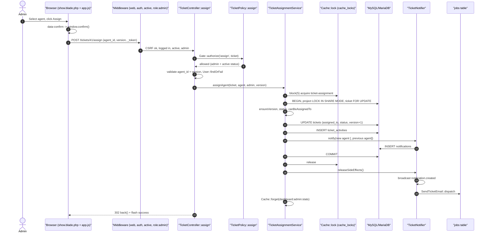
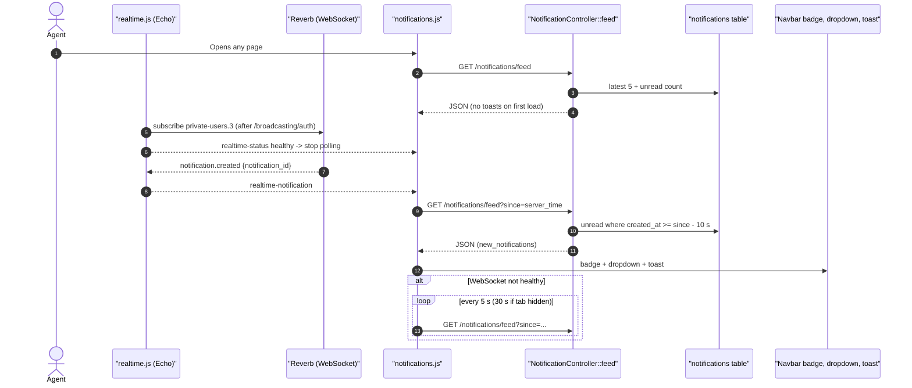

# 07 — UI to Backend Mapping

A **lookup reference** for a live interview. Find the button you are asked about, and you immediately see the
Blade file, the route, the controller method, the service method, the tables, the rules and the response.

Updated for **V2** (projects, clients, ticket scope, internal notes, attachments, reports, real-time
notifications, optimistic locking, idempotency, rate limiters). The six most important V2 operations are
explained in the full 30-question format in [22 — V2 business features](22-V2-BUSINESS-FEATURES.md#15-thirty-question-walkthroughs).

Related: [Business logic](06-BUSINESS-LOGIC-GUIDE.md) ·
[Module-wise code](05-MODULE-WISE-CODE-EXPLANATION.md) ·
[Notification system](13-NOTIFICATION-SYSTEM-GUIDE.md) ·
[Queue and email](14-QUEUE-AND-EMAIL-GUIDE.md) ·
[Caching](15-CACHING-GUIDE.md)

Tip: `php artisan route:list --except-vendor -v` prints every route with its name and middleware
(use PHP 8.4 first: `export PATH="/c/php-8.4.28:$PATH"`).

---

## Legend

**Middleware abbreviations** (from `routes/web.php` and `bootstrap/app.php`):

| Short | Middleware | Meaning | Code |
|---|---|---|---|
| `web` | web group | session, cookies, CSRF check (`@csrf` / `X-CSRF-TOKEN`), route model binding; V2 also appends `AddRequestContext` (request id + user id in every log line, `X-Request-Id` response header) | Laravel default + `bootstrap/app.php` |
| `guest` | guest | only for logged-out users; logged-in users go to `/dashboard` | `bootstrap/app.php` `redirectUsersTo` |
| `auth` | auth | must be logged in; else redirect to `/login` | `bootstrap/app.php` `redirectGuestsTo` |
| `active` | active | must be `is_active`; else logout (redirect, or 401 JSON for AJAX) | `app/Http/Middleware/ActiveUserMiddleware.php` |
| `admin` | `role:admin` | role must be admin; else 403 | `app/Http/Middleware/RoleMiddleware.php` |
| `throttle:NAME` | V2 named rate limiter | too many requests → 429 (`resources/views/errors/429.blade.php` or JSON) | `AppServiceProvider::configureRateLimiting()` |

V2 named rate limiters (per logged-in user id, guests per IP):

| Limiter | Limit | Route |
|---|---|---|
| `ticket-create` | 10 / minute | `tickets.store` |
| `comments` | 30 / minute | `tickets.comments.store` |
| `notifications` | 120 / minute | `notifications.feed` |
| `exports` | 5 / minute | `reports.export` |
| `throttle:60,1` | 60 / minute | `health.ready` |

Login has its own limiter inside `AuthController` (5 failed attempts per email + IP).

So "`web, auth, active`" is the normal logged-in stack and "`web, auth, active, admin`" is the admin stack.

**Shared JavaScript on every logged-in page** (loaded in `resources/views/layouts/app.blade.php`):
- `public/js/app.js` — any `<form data-confirm="...">` shows `window.confirm()` before submitting; any
  `<form data-disable-on-submit>` disables its submit buttons after the first submit and shows a spinner
  (UI convenience only — the server-side protection is `request_token` / `version`).
- `public/js/notifications.js` — bell, dropdown, toasts, mark-as-read; polling fallback.
- V2: `resources/js/realtime.js` (built by Vite, loaded with `@vite` only if `public/build/manifest.json` exists) —
  Laravel Echo + Reverb, private channel `users.{id}`.

**Standard responses:**
- Success → `redirect` + flash (`success` / `info` / `error`) shown by `resources/views/partials/flash.blade.php`.
- `ValidationException` → redirect back with `$errors` (red "Please fix the following:" alert), or 422 JSON for AJAX.
- V2 `TicketConflictException` (stale `version`, or a reused `request_token` with different content) → normal
  form: redirect back **with input** + error flash; JSON: **409** `{"message": "..."}`.
- Policy / role failure → 403 page `resources/views/errors/403.blade.php`.
- Missing/expired CSRF token → 419 page `resources/views/errors/419.blade.php`.
- Rate limit → 429 page `resources/views/errors/429.blade.php`.
- Unknown id in URL (route model binding) → 404.

**Constant facts used below (V2):**
- In-app notifications are inserted in the same DB transaction by `App\Services\TicketNotifier::notify()`
  (database channel, **not queued**).
- After COMMIT, `TicketNotifier` broadcasts `UserNotificationCreated` (payload only `notification_id`) and, if
  requested, pushes `SendTicketEmail` to the `jobs` table (`DB::afterCommit()`).
- Assignment lives in `App\Services\TicketAssignmentService`; association changes in
  `App\Services\ProjectService`; files in `App\Services\AttachmentService`.
- Dashboard cache key `dashboard:admin:stats` is cleared after ticket, project, client and user writes;
  category cache `ticket:active-categories` by `Category::clearActiveCache()`.
- Every ticket mutation form on the details/edit page sends a hidden **`version`** field (optimistic locking).

---

## Quick lookup (one line per action)

| UI action | Method + URL | Route name | Controller@method | Service method |
|---|---|---|---|---|
| Open login page | GET `/login` | `login` | `AuthController@showLogin` | — |
| Sign in | POST `/login` | `login.attempt` | `AuthController@login` | — |
| Sign out | POST `/logout` | `logout` | `AuthController@logout` | — |
| `/` | ANY `/` | — | redirect to `/dashboard` | — |
| Readiness check (monitoring) | GET `/health/ready` | `health.ready` | closure in `routes/web.php` | — |
| Dashboard (any role) | GET `/dashboard` | `dashboard` | `DashboardController@index` | — |
| Ticket list / filter / reset / page | GET `/tickets` | `tickets.index` | `TicketController@index` (+ static `applyFilters()`) | — |
| New ticket form | GET `/tickets/create` | `tickets.create` | `TicketController@create` | — |
| Project dropdown reload (AJAX, admin form) | GET `/tickets/project-options?client_id=` | `tickets.project-options` | `TicketController@projectOptions` | — |
| Submit ticket | POST `/tickets` | `tickets.store` | `TicketController@store` (`StoreTicketRequest`) | `TicketService::createTicket` |
| Ticket details | GET `/tickets/{ticket}` | `tickets.show` | `TicketController@show` | `TicketAssignmentService::eligibleAgents` (admin) |
| Download attachment | GET `/tickets/{ticket}/attachments/{attachment}` | `tickets.attachments.download` | `TicketAttachmentController@download` | — |
| Edit ticket form | GET `/tickets/{ticket}/edit` | `tickets.edit` | `TicketController@edit` | — |
| Save ticket edit | PUT `/tickets/{ticket}` | `tickets.update` | `TicketController@update` | `TicketService::updateTicket` |
| Assign / Reassign | POST `/tickets/{ticket}/assign` | `tickets.assign` | `TicketController@assign` | `TicketAssignmentService::assignAgent` |
| Auto Assign | POST `/tickets/{ticket}/auto-assign` | `tickets.auto-assign` | `TicketController@autoAssign` | `TicketAssignmentService::autoAssign` |
| Start Working | POST `/tickets/{ticket}/start` | `tickets.start` | `TicketController@start` | `TicketService::startWork` |
| Resolve Ticket | POST `/tickets/{ticket}/resolve` | `tickets.resolve` | `TicketController@resolve` | `TicketService::resolve` |
| Reopen Ticket | POST `/tickets/{ticket}/reopen` | `tickets.reopen` | `TicketController@reopen` | `TicketService::reopen` |
| Confirm & Close | POST `/tickets/{ticket}/close` | `tickets.close` | `TicketController@close` | `TicketService::close` |
| Post reply / internal note | POST `/tickets/{ticket}/comments` | `tickets.comments.store` | `TicketCommentController@store` | `TicketService::addComment` |
| User list / filter | GET `/users` | `users.index` | `UserController@index` | — |
| Create user form / save | GET `/users/create` · POST `/users` | `users.create` · `users.store` | `UserController@create` · `@store` | — |
| User details | GET `/users/{user}` | `users.show` | `UserController@show` | — |
| Edit user form / save | GET `/users/{user}/edit` · PUT `/users/{user}` | `users.edit` · `users.update` | `UserController@edit` · `@update` | — |
| Activate / Deactivate user | PATCH `/users/{user}/toggle-active` | `users.toggle-active` | `UserController@toggleActive` | — |
| Category list | GET `/categories` | `categories.index` | `CategoryController@index` | — |
| Create category form / save | GET `/categories/create` · POST `/categories` | `categories.create` · `categories.store` | `CategoryController@create` · `@store` | — |
| Edit category form / save | GET `/categories/{category}/edit` · PUT `/categories/{category}` | `categories.edit` · `categories.update` | `CategoryController@edit` · `@update` | — |
| Delete category | DELETE `/categories/{category}` | `categories.destroy` | `CategoryController@destroy` | — |
| Project list / filter | GET `/projects` | `projects.index` | `ProjectController@index` | — |
| Create project form / save | GET `/projects/create` · POST `/projects` | `projects.create` · `projects.store` | `ProjectController@create` · `@store` | — |
| Project details | GET `/projects/{project}` | `projects.show` | `ProjectController@show` | — |
| Edit project form / save (incl. activate/deactivate) | GET `/projects/{project}/edit` · PUT `/projects/{project}` | `projects.edit` · `projects.update` | `ProjectController@edit` · `@update` | — |
| Save clients of a project | PUT `/projects/{project}/clients` | `projects.clients.update` | `ProjectController@updateClients` | `ProjectService::syncClients` |
| Save agents of a project | PUT `/projects/{project}/agents` | `projects.agents.update` | `ProjectController@updateAgents` | `ProjectService::syncAgents` |
| Client list / filter | GET `/clients` | `clients.index` | `ClientController@index` | — |
| Create client form / save | GET `/clients/create` · POST `/clients` | `clients.create` · `clients.store` | `ClientController@create` · `@store` | — |
| Client details | GET `/clients/{client}` | `clients.show` | `ClientController@show` | — |
| Edit client form / save | GET `/clients/{client}/edit` · PUT `/clients/{client}` | `clients.edit` · `clients.update` | `ClientController@edit` · `@update` | — |
| Report page / filter | GET `/reports` | `reports.index` | `ReportController@index` | — |
| Export CSV | GET `/reports/export?...filters` | `reports.export` | `ReportController@export` | — |
| Bell feed (AJAX: polling or after a WebSocket signal) | GET `/notifications/feed[?since=…]` | `notifications.feed` | `NotificationController@feed` | — |
| Click a dropdown item (AJAX) | POST `/notifications/{id}/read` | `notifications.read` | `NotificationController@markAsRead` | — |
| Mark all as read (dropdown, AJAX) | POST `/notifications/read-all` | `notifications.read-all` | `NotificationController@markAllAsRead` | — |
| Notification history / filter | GET `/notifications[?filter=…]` | `notifications.index` | `NotificationController@index` | — |
| History: Open ticket / Mark as read / Mark all | POST (normal forms) | `notifications.read` / `notifications.read-all` | `NotificationController@markAsRead` / `@markAllAsRead` | — |
| Private channel authorization (Echo) | POST `/broadcasting/auth` | (Laravel broadcasting) | `routes/channels.php` callback `users.{userId}` | — |
| (no UI) SLA reminders | CLI `php artisan tickets:check-sla` (scheduled every minute) | — | `CheckSlaBreaches::handle` | `TicketService::processSlaBreach` |

There is **no** `tickets.destroy`, `users.destroy`, `projects.destroy`, `clients.destroy` or `categories.show`
route (`->except([...])` in `routes/web.php`). Projects, clients and users are deactivated, never deleted.

---

## 1. Authentication

### 1.1 Login page and Sign in

| Item | Value |
|---|---|
| Page | Login |
| UI action | Fill email + password (+ "Remember me"), click **Sign in** |
| Blade | `resources/views/auth/login.blade.php` (layout `layouts/guest.blade.php`); form `action="{{ route('login.attempt') }}"` with `novalidate` |
| JS | none (no `notifications.js` on guest pages) |
| HTTP | GET `/login` (show) · POST `/login` (submit) |
| Route names | `login` · `login.attempt` |
| Middleware | `web, guest` |
| Controller | `AuthController@showLogin` · `AuthController@login` |
| Service | — |
| Model / table | `User` / `users`; rate-limit counters in the `cache` table |
| Validation | `email` required + email; `password` required + string |
| Authorization | Must be a guest. Account must be active (`is_active`) |
| Business logic | `RateLimiter` key `lower(email)|ip`: 5 failed attempts → locked 60 s (`MAX_LOGIN_ATTEMPTS`, `LOCKOUT_SECONDS`). `Auth::attempt()` compares bcrypt hash. Inactive → `Auth::logout()` + error. Success → `RateLimiter::clear()`, `session()->regenerate()` (prevents session fixation) |
| Notification / queue / cache | none / none / rate-limiter uses the cache store |
| Response | `redirect()->intended(route('dashboard'))`. Errors on key `email`: `These credentials do not match our records.` · `Too many login attempts. Please try again in {N} seconds.` · `Your account has been deactivated. Please contact an administrator.` |

### 1.2 Sign out

| Item | Value |
|---|---|
| UI action | Profile dropdown (top right) → **Sign out** |
| Blade | `resources/views/partials/navbar.blade.php` — POST form with `@csrf` (never a GET link) |
| HTTP / route | POST `/logout` · `logout` |
| Middleware | `web, auth, active` |
| Controller | `AuthController@logout` |
| Logic | `Auth::logout()`, `session()->invalidate()`, `session()->regenerateToken()` |
| Response | redirect `login` with "You have been logged out." |

---

## 2. Layout: sidebar and navbar

Blade: `resources/views/partials/sidebar.blade.php`, `resources/views/partials/navbar.blade.php`.
All links are GET requests with middleware `web, auth, active` (+ `admin` for the admin section).

| Sidebar link | Visible to | Route | Controller@method |
|---|---|---|---|
| Dashboard | all | `dashboard` | `DashboardController@index` |
| All Tickets (admin) / My Tickets (others) | all | `tickets.index` | `TicketController@index` |
| New Ticket | all | `tickets.create` | `TicketController@create` |
| Notifications | all | `notifications.index` | `NotificationController@index` |
| Projects (V2) | admin only | `projects.index` | `ProjectController@index` |
| Clients (V2) | admin only | `clients.index` | `ClientController@index` |
| Reports (V2) | admin only | `reports.index` | `ReportController@index` |
| Users | admin only | `users.index` | `UserController@index` |
| Categories | admin only | `categories.index` | `CategoryController@index` |

Hiding admin links is cosmetic; the `role:admin` middleware is the real protection
(`AuthorizationTest::test_customer_and_agent_cannot_open_admin_pages`,
`ProjectAndClientTest::test_non_admins_cannot_manage_projects_or_clients`,
`SlaReportsAndHardeningTest::test_only_admins_can_open_reports_or_export`). The active link is highlighted
with `request()->routeIs(...)`.

---

## 3. Dashboards

| Item | Value |
|---|---|
| Page | Dashboard (one URL, three views) |
| HTTP / route | GET `/dashboard` · `dashboard` |
| Middleware | `web, auth, active` |
| Controller | `DashboardController@index` → `adminDashboard()` / `agentDashboard($user)` / `customerDashboard($user)` |
| Blade | `resources/views/dashboard/admin.blade.php`, `agent.blade.php`, `customer.blade.php`; partials `dashboard/_stat-card.blade.php`, V2 `dashboard/_recent-activity.blade.php` |
| JS | shared scripts; admin view adds Chart.js (`public/vendor/chartjs/chart.umd.min.js`) via `@push('scripts')` with an inline script drawing `trendChart`, `priorityChart`, `categoryChart` and V2 `projectChart`, `clientChart` from `$stats` (no extra AJAX) |
| Models / tables | `Ticket`, `User`, `Category`, V2 `Project`, `Client`, `TicketActivity`; `notifications` (customer); `cache` table (admin) |
| Authorization | role decides which method runs (`isAdmin()`, `isAgent()`, else customer); agent/customer queries are limited to their own tickets |
| Cache | Admin: `Cache::remember('dashboard:admin:stats', 60, ...)` → `buildAdminStatistics()` (incl. V2 global/project counts, tickets by project/client, SLA compliance, active projects/clients/agents). Overdue count, recent tickets, agent workload and V2 recent activity are **not** cached. Agent and customer dashboards are **not** cached |
| Notification / queue | none |
| Response | HTML view |

### 3.1 Stat-card links

A stat card with a `link` parameter renders a "View" `stretched-link` (whole card clickable).

| Dashboard | Card | Link |
|---|---|---|
| Admin | Total tickets | `route('tickets.index')` |
| Admin | Open / Assigned / In progress / Resolved / Closed | `route('tickets.index', ['status' => 'open' / 'assigned' / 'in_progress' / 'resolved' / 'closed'])` |
| Admin | Overdue | `route('tickets.index', ['overdue' => 1])` |
| Admin | Avg. resolution | no link (shows `—` when there is no data) |
| Admin (V2) | Active projects | `route('projects.index', ['status' => 'active'])` |
| Admin (V2) | Active clients | `route('clients.index', ['status' => 'active'])` |
| Admin (V2) | Active agents | `route('users.index', ['role' => 'agent', 'status' => 'active'])` |
| Admin (V2) | Global tickets | `route('tickets.index', ['project_id' => 'global'])` |
| Admin (V2) | Project tickets | no link |
| Admin (V2) | SLA compliance | `route('reports.index')` (shows `—` when nothing is resolved) |
| Agent | My assigned tickets | no link |
| Agent | Pending (not started) | `['status' => 'assigned']` |
| Agent | In progress | `['status' => 'in_progress']` |
| Agent | Resolved / closed | no link |
| Agent (V2) | My workload (Assigned + In Progress) | no link |
| Agent | Overdue | `['overdue' => 1]` |
| Customer | My total tickets | `route('tickets.index')` |
| Customer | Active | no link |
| Customer | Resolved (awaiting your confirmation) | `['status' => 'resolved']` |
| Customer | Closed | `['status' => 'closed']` |
| Customer (V2) | Overdue | `['overdue' => 1]` |

Other dashboard links: ticket numbers → `tickets.show`; "View all" → `tickets.index` / `notifications.index`
(customer's latest notifications); agent names in the admin workload table → `users.show`; "Create Ticket"
(customer) → `tickets.create`; "My Tickets" (agent) → `tickets.index`.

Note: agent card counts use `assigned_to = agent` only, while the ticket list for an agent shows tickets
**created by OR assigned to** them (`Ticket::scopeVisibleTo()`), so a linked list can contain extra rows.

---

## 4. Ticket list (filters, reset, pagination)

| Item | Value |
|---|---|
| Page | All Tickets (admin) / My Tickets |
| UI actions | Search box, Status, Priority, Category, V2 **Project** (incl. "Global"), V2 **Client** (admin only, incl. "Internal"), Assigned agent (admin only, incl. "Unassigned"), Created from/to, "Overdue only" checkbox, **Filter**, **Reset**, pagination links, **View**, **Edit** (only `@can('update', $ticket)`), **Create Ticket** |
| Blade | `resources/views/tickets/index.blade.php`; badges `partials/ticket-badges.blade.php` |
| JS | none specific |
| HTTP / route | GET `/tickets?search=&status=&priority=&category_id=&project_id=global&client_id=internal&assigned_to=unassigned&date_from=&date_to=&overdue=1&page=2` · `tickets.index` |
| Middleware | `web, auth, active` |
| Controller | `TicketController@index` → `TicketController::applyFilters($query, $request, $user)` (V2, `public static`, also used by `ReportController`) |
| Service | — |
| Models / tables | `Ticket`, `Category`, `Project`, `Client`, `User` |
| Validation | `search` nullable string max 100; `status` in `Ticket::STATUSES` keys; `priority` in `Ticket::PRIORITIES` keys; `category_id` nullable integer; V2 `project_id` regex `^(global|\d+)$`; V2 `client_id` regex `^(internal|\d+)$`; V2 `assigned_to` regex `^(unassigned|\d+)$`; `date_from` date; `date_to` date `after_or_equal:date_from`. Invalid → redirect back with errors |
| Authorization | `Ticket::visibleTo($user)` **first** — admin all; others `WHERE (created_by = ? OR assigned_to = ?)`. Client and agent filters are applied only for admins |
| Business logic | `with(['category', 'project', 'client', 'creator', 'assignedAgent'])` eager loading (no N+1); search = `ticket_number LIKE %x% OR subject LIKE %x%`; `global` → `whereNull('project_id')`; `internal` → `whereNull('client_id')`; `whereDate('created_at', ...)`; `->overdue()` scope; `latest()->paginate(15)->withQueryString()` |
| Notification / queue / cache | none / none / none (filter dropdowns read directly; categories include inactive ones) |
| Response | HTML; **Filter** = GET form submit (filters appear in the URL); **Reset** = plain link to `route('tickets.index')`; pagination keeps filters via `withQueryString()` |

Note: the Project filter dropdown lists **all** projects for every role (`Project::orderBy('code')->get(...)`);
it does not widen the result (still `visibleTo()`), but it shows every product name.

> **বাংলায়:** Filter form-টা GET, তাই সব filter URL-এ query string হিসেবে থাকে — link copy করলে একই ফলাফল দেখা যায়,
> আর `withQueryString()` pagination-এর link-এও filter রেখে দেয়। `applyFilters()` একটাই method, ticket list আর
> report/CSV দুই জায়গাতেই ব্যবহার হয় — তাই দুই জায়গায় ফলাফল কখনো আলাদা হয় না।

---

## 5. Create and edit ticket

### 5.1 Create ticket

| Item | Value |
|---|---|
| UI action | Sidebar **New Ticket** / **Create Ticket** button → fill form → **Submit Ticket** |
| Blade | `resources/views/tickets/create.blade.php` (`enctype="multipart/form-data"`, `data-disable-on-submit`, hidden `request_token`) + V2 `tickets/_scope-fields.blade.php` (Client select for admins, read-only organization for customers, "Internal ticket" text for agents; Project select) + `tickets/_form.blade.php` (`subject`, `description`, `category_id`, `priority`) + V2 `tickets/_attachment-input.blade.php` (`attachments[]`) |
| JS | `public/js/app.js` (disable on submit); V2 `public/js/ticket-form.js` (admin only: reloads the project list when the client changes, see 5.2) |
| HTTP / route | GET `/tickets/create` (`tickets.create`) · POST `/tickets` (`tickets.store`) |
| Middleware | `web, auth, active`; store also `throttle:ticket-create` |
| Controller | `TicketController@create` (fresh `requestToken` UUID, `selectableProjects()`) · `TicketController@store(StoreTicketRequest $request)` |
| Service | `TicketService::createTicket($request->safe()->except('attachments'), $request->user(), $request->file('attachments', []))` |
| Models / tables | `Ticket`, `TicketActivity`, `TicketAttachment`, `Category`, `Project`, `Client`, `User` / `tickets`, `ticket_activities`, `ticket_attachments`, `notifications`, `jobs` |
| Validation | `StoreTicketRequest`: `subject` required max 255; `description` required max 5000; `category_id` exists AND active; `priority` in keys; `project_id` / `client_id` nullable integer exists; `request_token` required uuid; attachments max 5 files, 5 MB each, pdf/png/jpg/jpeg/txt/docx/xlsx (extension + detected MIME) |
| Authorization | `StoreTicketRequest::authorize()` → `TicketPolicy::create()` (false for a customer whose client is inactive); scope rules in `TicketService::resolveScope()` (customer: own client only; agent: internal + supported projects; admin: any active combination) |
| Business logic | Replay check by `(created_by, request_token)` → store files → transaction: `resolveScope()` (project row shared lock) → INSERT ticket (open, unassigned, `version` 1, `due_at`) → `ticket_number` → activity `created` (+ `attachment_added`) → attachment rows → notify admins. Files deleted again on failure |
| Notification | "New ticket created" to every active admin, except an admin who created it |
| Queue | one `SendTicketEmail` per notified admin, after COMMIT |
| Cache | form reads `Category::activeForDropdown()`; after save `clearDashboardCache()` |
| Response | redirect `tickets.show` + "Ticket TK-000041 was created successfully." · replay: "This form was already submitted. Showing ticket TK-000041." · same token, different content: conflict flash "This form was already submitted with different content. Please open a new ticket form and try again." |

Scope error messages (key `project_id` / `client_id`): `Your organization is inactive, so new tickets cannot be
created.` · `Your account is not linked to a client organization, so you can only create global tickets.` ·
`Please choose an active client organization.` · `Please choose an active project.` · `You can only create
tickets for projects you support.` · `The selected project is not used by this client organization.`

### 5.2 Dependent dropdown: project options (V2, AJAX)

| Item | Value |
|---|---|
| UI action | Admin changes **Client organization** on the Create Ticket form |
| Blade | `tickets/_scope-fields.blade.php`: `<select id="client_id" ... data-project-options-url="{{ route('tickets.project-options') }}">` and `<select id="project_id">` |
| JS | `public/js/ticket-form.js` → `reloadProjects()`: `fetch(url, { headers: { 'Accept': 'application/json', 'X-Requested-With': 'XMLHttpRequest' }, credentials: 'same-origin' })`; disables the select while loading; rebuilds options with `textContent`; keeps the previous choice if still allowed; also runs once on load if a client is preselected (after a validation error) |
| HTTP / route | GET `/tickets/project-options?client_id=2` · `tickets.project-options` (registered before the resource route) |
| Middleware | `web, auth, active` |
| Controller | `TicketController@projectOptions` → `selectableProjects($user, $clientId)` |
| Validation | `client_id` nullable integer |
| Authorization | `Gate::authorize('create', Ticket::class)`; customers always get their own client's projects (requested id ignored) |
| Response | JSON `{"projects":[{"id":2,"label":"ERP - Enterprise Resource Planning"}, ...]}` (active projects only) |
| Security note | Convenience only — `TicketService::resolveScope()` re-validates the chosen project on save |

### 5.3 Edit ticket

| Item | Value |
|---|---|
| UI action | **Edit Ticket** on details page / **Edit** in list → change fields → save |
| Blade | `resources/views/tickets/edit.blade.php` (form `@method('PUT')`, V2 hidden `version` = `$ticket->version` (always current; after a 409 the user's input is kept and saving again is deliberate), shows project/client read-only, note if the current category is inactive) + `tickets/_form.blade.php` |
| HTTP / route | GET `/tickets/{ticket}/edit` (`tickets.edit`) · PUT `/tickets/{ticket}` (`tickets.update`) |
| Middleware | `web, auth, active` |
| Controller | `TicketController@edit` · `TicketController@update` |
| Service | `TicketService::updateTicket($ticket, $validated, $expectedVersion, $request->user())` |
| Models / tables | `Ticket`, `TicketActivity`, `Category` |
| Validation | `subject`, `description`, `priority` as create; `category_id` `exists:categories,id` and, if **changed**, active; V2 `version` required integer |
| Authorization | `Gate::authorize('update', $ticket)` → not closed AND (admin OR creator while Open + unassigned) |
| Business logic | `fill()` + `isDirty()`; no change → "No changes were made." Priority change → `due_at` recalculated from `created_at` and `sla_notified_at` reset. One conditional `UPDATE ... WHERE id = ? AND version = ? AND status <> 'closed'` with `version = version + 1`; 0 rows → conflict. Activities `updated`, `priority_changed`, `due_date_changed`. Scope and status are never edited here |
| Notification / queue | none / none |
| Cache | edit dropdown = cached active list + current (maybe inactive) category via `concat()`; after a real change `clearDashboardCache()` |
| Response | redirect `tickets.show` + "Ticket updated successfully." / "No changes were made." · stale version: back with input + "This ticket was changed by someone else after you opened the page. Please review the latest version and try again." |

---

## 6. Ticket details page and workflow buttons

Page: `resources/views/tickets/show.blade.php` — GET `/tickets/{ticket}` (`tickets.show`),
`TicketController@show`: `Gate::authorize('view', $ticket)`, eager loads `category, project, client, creator,
assignedAgent`, comments `->visibleTo($user)->with(['user', 'attachments'])`, activities `->visibleTo($user)->with('user')`
and ticket-level attachments (`whereNull('ticket_comment_id')`). For admins it passes
`TicketAssignmentService::eligibleAgents($ticket)` (active agents of the ticket's project, or all active agents for
a global ticket, with `workload_count`).

Header: `TK-000041 · HRMS · ACME` (or `Global`). Details card: Project (with "Inactive" badge), Client
("Internal (no client)"), SLA deadline with remaining time / overdue / resolved within or after SLA, **Version vN**.

The **Actions** card shows a button only if `@can(...)` is true (same `TicketPolicy` the controller uses). Every
action form has `@csrf`, `data-confirm`, `data-disable-on-submit` and a hidden **`version`** field. All use
middleware `web, auth, active` (+ `admin` for assign/auto-assign).

| Button | Form fields | Route | Controller@method | Policy | Service | Tables written | In-app notification | Email job | Cache | Success flash |
|---|---|---|---|---|---|---|---|---|---|---|
| **Assign** / **Reassign** | `agent_id` (select "Name (N active)", eligible agents only), `version` | `tickets.assign` | `TicketController@assign` | `assign` | `TicketAssignmentService::assignAgent()` → `performAssignment()` | `tickets`, `ticket_activities`, `notifications`, `cache_locks` (temporary) | new agent (`assigned` / `reassigned`); V2 previous agent (`unassigned`, in-app only) | yes (new agent) | cleared if changed | "Ticket assigned to {name}." / info "The ticket is already assigned to {name}. Nothing was changed." |
| **Auto Assign** (only when Open) | `version` | `tickets.auto-assign` | `TicketController@autoAssign` | `assign` | `autoAssign()` → `findLeastBusyAgent($projectId)` → `performAssignment()` | same | chosen agent (`assigned`) | yes | cleared if assigned | "Ticket automatically assigned to {name} (lowest current workload)." / error "No eligible active support agent [for this project] is available. The ticket remains Open." |
| **Start Working** | `version` | `tickets.start` | `TicketController@start` | `start` | `TicketService::startWork()` | `tickets`, `ticket_activities` | none | no | cleared | "Ticket is now In Progress." |
| **Resolve Ticket** | `resolution_note` (required, max 5000), `version` | `tickets.resolve` | `TicketController@resolve` | `resolve` | `resolve()` | `tickets` (+`resolved_at`, `resolution_note`), `ticket_activities`, `notifications` | creator (`resolved`) | yes | cleared | "Ticket marked as Resolved." |
| **Confirm & Close Ticket** | `version` | `tickets.close` | `TicketController@close` | `close` | `close()` | `tickets`, `ticket_activities`, `notifications` | assigned agent (`closed`) | **no** | cleared | "Ticket closed. Thank you for confirming the resolution." |
| **Reopen Ticket** | `version` | `tickets.reopen` | `TicketController@reopen` | `reopen` | `reopen()` | `tickets` (clears `resolved_at`, `resolution_note`, `sla_notified_at`), `ticket_activities`, `notifications` | assigned agent (`reopened`) | yes | cleared | "Ticket reopened and moved back to In Progress." |

Business-rule errors (red alert after redirect back):

| Action | Message |
|---|---|
| Assign / Reassign | `Please select an active support agent.` (global) · `Please select an active support agent who supports this ticket's project.` · `Only Open, Assigned or In Progress tickets can be assigned.` · `Another assignment is being processed right now. Please try again in a moment.` (lock wait > 5 s) |
| Auto Assign | `Auto assign is only available for Open tickets. Use Reassign instead.` |
| Start / Resolve / Close / Reopen (race) | `This action is not allowed while the ticket is {Status}.` |
| Any action with a stale `version` | `This ticket was changed by someone else after you opened the page. Please review the latest version and try again.` |
| Resolve | `The resolution note field is required.` · `A resolution note is required to resolve a ticket.` |
| Reopen | `This ticket cannot be reopened because its assigned agent is no longer active or no longer supports this project. Please contact an administrator.` |

All workflow responses are `back()`. Lifecycle methods run in `DB::transaction(..., 3)` with
`lockTicket()` (`SELECT ... FOR UPDATE`) and `ensureVersion()`. Assignment additionally holds
`Cache::lock('ticket-assignment')` and a shared lock on the project row.

### 6.1 Comment form (public reply / internal note)

| Item | Value |
|---|---|
| UI action | Type in "Add a message", (staff) choose **Visibility**, optionally attach files → **Post** |
| Blade | `resources/views/tickets/show.blade.php` (Conversation card, `@can('comment', $ticket)`; V2 select `visibility` only inside `@can('addInternalNote', $ticket)`; `tickets/_attachment-input.blade.php`; otherwise "This ticket is closed and read-only.") |
| JS | `public/js/app.js` (`data-disable-on-submit`) |
| HTTP / route | POST `/tickets/{ticket}/comments` (`multipart/form-data`) · `tickets.comments.store` |
| Middleware | `web, auth, active, throttle:comments` |
| Controller | `TicketCommentController@store` |
| Service | `TicketService::addComment($ticket, $message, $visibility, $user, $files)` |
| Models / tables | `TicketComment`, `TicketActivity`, `TicketAttachment` / `ticket_comments`, `ticket_activities`, `ticket_attachments`, `notifications`, `jobs` |
| Validation | `message` required string max 5000; `visibility` nullable in `public,internal` (default public); attachment rules |
| Authorization | `Gate::authorize('comment', $ticket)` → can view AND not closed; if `visibility=internal` also `Gate::authorize('addInternalNote', $ticket)` → staff (customer → 403) |
| Business logic | Store files → lock ticket → re-check not closed → INSERT comment → activity `comment_added` or `internal_note_added` (internal flag) → attachment rows + `attachment_added` → notify recipients |
| Notification | Public: creator + assigned agent, minus author ("New comment from {author}"). Internal: assigned agent + creator only if staff ("Internal note from {author}"); never the customer |
| Queue | V2: **email only when a customer posts a public reply** → to the assigned agent. Agent/admin replies and internal notes: no email |
| Cache | none |
| Response | redirect `tickets.show#conversation`, "Comment added." / "Internal note added." Error: `Closed tickets are read-only. Comments are not allowed.` |

Customers never see internal notes, internal activities or internal-note files: filtered in SQL
(`TicketComment::scopeVisibleTo()`, `TicketActivity::scopeVisibleTo()`) and in `TicketPolicy::downloadAttachment()`.

### 6.2 Attachment download (V2)

| Item | Value |
|---|---|
| UI action | Click a file button ("payroll-config.pdf (240 KB)") under the description or a comment |
| Blade | `resources/views/tickets/_attachments.blade.php`: `route('tickets.attachments.download', [$attachment->ticket_id, $attachment->id])` |
| HTTP / route | GET `/tickets/{ticket}/attachments/{attachment}` · `tickets.attachments.download` |
| Middleware | `web, auth, active` |
| Controller | `TicketAttachmentController@download` |
| Authorization | `Gate::authorize('downloadAttachment', [$ticket, $attachment])` → attachment belongs to this ticket, user can view the ticket, internal-note files staff only |
| Logic | File missing on disk → `Log::error('Attachment file missing on disk', ...)` + 404 |
| Response | `Storage::disk(...)->download(path, original_name, ['Content-Type' => mime, 'X-Content-Type-Options' => 'nosniff'])` → `Content-Disposition: attachment` |

---

## 7. Users (admin only)

All routes: middleware `web, auth, active, admin`. Controller `app/Http/Controllers/UserController.php`.
Model/table `User` / `users`. No service class. No notifications, no queue. Every save clears
`dashboard:admin:stats` ("Active agents" count).

| UI action | Blade | HTTP + URL | Route | Method | Validation / rules | Response |
|---|---|---|---|---|---|---|
| List, **Filter** (search name/email, role, status, V2 client), **Reset**, pagination | `users/index.blade.php` | GET `/users?search=&role=&status=&client_id=` | `users.index` | `index` | `search` max 100, `role` in roles, `status` active/inactive, `client_id` integer; `User::with('client')`; `paginate(15)->withQueryString()` | HTML |
| **Create User** → form | `users/create.blade.php` + `users/_form.blade.php` (V2 "Client organization (customers only)" select) | GET `/users/create` | `users.create` | `create` | — | HTML |
| Save new user | same | POST `/users` | `users.store` | `store` | `name`, `email` unique, `password` min 8 `confirmed`, `role`, `is_active`; V2 `client_id` nullable `Rule::exists('clients','id')->where('is_active', true)` and ignored unless role is customer | redirect `users.show` "User {name} was created." |
| **View** user | `users/show.blade.php` (V2: client link for customers, "Supported projects" badges for agents) | GET `/users/{user}` | `users.show` | `show` | `load(['client', 'projects'])`, counts, 10 recent tickets | HTML |
| **Edit** → form | `users/edit.blade.php` + `_form` (client list = active clients + current one) | GET `/users/{user}/edit` | `users.edit` | `edit` | — | HTML |
| Save edit | same (`@method('PUT')`) | PUT `/users/{user}` | `users.update` | `update` | email unique ignoring self; password optional; `ensureRoleOrStatusChangeIsAllowed()`; V2 `ensureClientChangeIsAllowed()` | redirect `users.show` "User updated successfully." |
| **Activate / Deactivate** (hidden for your own row) | `users/index.blade.php`, `users/show.blade.php` (`@method('PATCH')`, `data-confirm`) | PATCH `/users/{user}/toggle-active` | `users.toggle-active` | `toggleActive` | `ensureRoleOrStatusChangeIsAllowed()` | `back()` "User {name} was activated/deactivated." |

Errors (key `is_active`): `You cannot deactivate your own account or change your own role.` ·
`The last active administrator cannot be deactivated or demoted.` ·
`This agent is still responsible for {N} unresolved or reopenable ticket(s). Reassign their Assigned/In Progress tickets and close their Resolved tickets first.`
V2 (key `client_id`): `Please choose an active client organization.` ·
`This customer already created {N} ticket(s) for their organization, so the organization (and the customer role) cannot be changed. Create a new user account instead.`

Agent project memberships are **not** edited here; they are edited on the project page (section 10).

Effect of deactivation on the user's open browser: `ActiveUserMiddleware` logs them out on their next request
(redirect to login), the next feed poll receives 401 JSON, and `routes/channels.php` refuses a new private-channel
subscription for an inactive user.

---

## 8. Categories (admin only)

Middleware `web, auth, active, admin`. Controller `app/Http/Controllers/CategoryController.php`. Model/table
`Category` / `categories`. No notifications, no queue.

| UI action | Blade | HTTP + URL | Route | Method | Validation / rules | Cache | Response |
|---|---|---|---|---|---|---|---|
| List (with ticket counts) | `categories/index.blade.php` | GET `/categories` | `categories.index` | `index` | `withCount('tickets')`, `paginate(15)` | — | HTML |
| **Create Category** → form | `categories/create.blade.php` + `categories/_form.blade.php` | GET `/categories/create` | `categories.create` | `create` | — | — | HTML |
| Save new | same | POST `/categories` | `categories.store` | `store` | `name` required max 100 unique; `description` nullable max 1000; `is_active` boolean | `clearCaches()`: `ticket:active-categories` + `dashboard:admin:stats` | redirect `categories.index` "Category created." |
| **Edit** → form / save | `categories/edit.blade.php` (`@method('PUT')`) | GET `/categories/{category}/edit` · PUT `/categories/{category}` | `categories.edit` · `categories.update` | `edit` · `update` | unique name ignoring self | `clearCaches()` | redirect "Category updated." |
| **Delete** (button only when `tickets_count === 0`; `data-confirm`) | `categories/index.blade.php` (`@method('DELETE')`) | DELETE `/categories/{category}` | `categories.destroy` | `destroy` | refuses if `$category->tickets()->exists()` | `clearCaches()` on success | redirect "Category deleted." or `back()` error "This category is used by existing tickets and cannot be deleted. Deactivate it instead." |

---

## 9. Notifications

### 9.0 Real-time path (V2)

| Item | Value |
|---|---|
| Trigger | Any `TicketNotifier::notify()` after the transaction commits |
| Server | `event(new UserNotificationCreated($recipientId, $notificationId))` — `ShouldBroadcastNow`, channel `private-users.{id}`, event name `notification.created`, payload `{"notification_id": "..."}`; wrapped in try/catch (Reverb down → `Log::warning`, request still succeeds) |
| Channel authorization | Echo calls POST `/broadcasting/auth` (session + CSRF); `routes/channels.php`: `Broadcast::channel('users.{userId}', fn (User $user, $userId) => $user->id === (int) $userId && $user->is_active)` |
| Browser | `resources/js/realtime.js` (Echo + pusher-js, Reverb keys from `VITE_REVERB_*`) fires `resolvedesk:realtime-notification` and `resolvedesk:realtime-status`; `public/js/notifications.js` then calls the normal feed endpoint (9.1) and stops continuous polling while the socket is healthy |
| Fallback | Socket not healthy (Reverb stopped, build missing, 403) → polling every 5 s continues |

### 9.1 Bell feed (AJAX)

| Item | Value |
|---|---|
| Page | Every logged-in page (navbar) |
| UI action | none — on page load, after each real-time signal, and every 5 s (30 s when the tab is hidden) while the WebSocket is not healthy; immediate request when the tab becomes visible again |
| Blade | `resources/views/partials/navbar.blade.php` — `#notificationBell` with `data-feed-url`, `data-read-url` (contains `__ID__`), `data-read-all-url`, `data-login-url`; badge `#notificationCount`; list `#notificationList`; toast container `#toast-container`; CSRF and V2 `user-id` meta tags in `layouts/app.blade.php` |
| JS | `public/js/notifications.js` → `poll()`, `scheduleNextPoll()`, `updateBadge()`, `renderDropdown()`, `showToasts()`, `handleExpiredSession()` + real-time event listeners |
| HTTP / route | GET `/notifications/feed` (first call) then `/notifications/feed?since=<server_time>` · `notifications.feed`; headers `Accept: application/json`, `X-Requested-With: XMLHttpRequest` |
| Middleware | `web, auth, active, throttle:notifications` (120/min; inactive → 401 JSON; expired session → 401) |
| Controller | `NotificationController@feed` (+ private `formatNotification()`) |
| Model / table | Laravel `DatabaseNotification` via `User` `Notifiable` trait / `notifications` (V2 index `(notifiable_type, notifiable_id, created_at)`) |
| Validation | `since` nullable date (invalid → 422) |
| Authorization | queries start from `$request->user()->notifications()` → only own rows |
| Business logic | latest 5 (`DROPDOWN_LIMIT`), `new_notifications` = unread with `created_at >= since - 10 s` (max 20), `unread_count`, `server_time` |
| Response | JSON `{unread_count, notifications[], new_notifications[], server_time}`; each item `{id, title, message, ticket_number, event_type, ticket_url, is_read, time_ago}` |

### 9.2 Click a dropdown item

| Item | Value |
|---|---|
| UI action | Click a notification row in the bell dropdown (or the body of a toast) |
| JS | `notifications.js` → `openNotification(item)` → `postJson()` with `X-CSRF-TOKEN` (only if unread) → `window.location.href = item.ticket_url` |
| HTTP / route | POST `/notifications/{id}/read` · `notifications.read` |
| Middleware | `web, auth, active` |
| Controller | `NotificationController@markAsRead` |
| Logic | `$request->user()->notifications()->findOrFail($id)` (someone else's id → 404) → `markAsRead()` |
| Response | JSON `{success: true, unread_count}` (because `expectsJson()`); then the browser opens the ticket, where `TicketPolicy::view` is checked again (403 if access was lost, e.g. the previous agent after reassignment) |

### 9.3 Mark all as read (dropdown)

| Item | Value |
|---|---|
| UI action | **Mark all as read** button in the dropdown (`#markAllReadButton`) |
| JS | `notifications.js` click handler → `postJson(readAllUrl)` → `updateBadge(0)` and removes `.unread` classes |
| HTTP / route | POST `/notifications/read-all` · `notifications.read-all` |
| Controller | `NotificationController@markAllAsRead` → `unreadNotifications()->update(['read_at' => now()])` |
| Response | JSON `{success: true, unread_count: 0}` |

### 9.4 Notification history page

| UI action | Blade | HTTP + URL | Route | Controller@method | Response |
|---|---|---|---|---|---|
| Open page / **All** · **Unread** · **Read** pills | `resources/views/notifications/index.blade.php` | GET `/notifications?filter=unread\|read` | `notifications.index` | `NotificationController@index` (`whereNull/whereNotNull('read_at')`, `paginate(15)`) | HTML |
| **Open ticket** (normal form, hidden `open_ticket=1`) | same | POST `/notifications/{id}/read` | `notifications.read` | `@markAsRead` | redirect `tickets.show` (`data['ticket_id']`) |
| **Mark as read** (only for unread) | same | POST `/notifications/{id}/read` | `notifications.read` | `@markAsRead` | `back()` "Notification marked as read." |
| **Mark all as read** (page header) | same | POST `/notifications/read-all` | `notifications.read-all` | `@markAllAsRead` | `back()` "All notifications marked as read." |

No JavaScript is needed on this page (plain forms with `@csrf`), which is why `markAsRead()` and
`markAllAsRead()` check `$request->expectsJson()` and return either JSON or a redirect.

---

## 10. Projects (admin only, V2)

Middleware `web, auth, active, admin`. Controller `app/Http/Controllers/ProjectController.php`, model `Project`.
Association changes go through `app/Services/ProjectService.php`. Never deleted.

| UI action | Blade | HTTP + URL | Route | Method | Validation / rules | Response |
|---|---|---|---|---|---|---|
| List, search (name/code), status filter, pagination | `projects/index.blade.php` | GET `/projects?search=&status=` | `projects.index` | `index` | `search` max 100, `status` active/inactive; `withCount(['clients', 'agents', 'tickets'])` | HTML |
| **Create Project** → form / save | `projects/create.blade.php` + `projects/_form.blade.php` (code, name, description, Active switch) | GET `/projects/create` · POST `/projects` | `projects.create` · `projects.store` | `create` · `store` | `name` required max 150; `code` required max 30 `alpha_dash` unique (stored upper case); `description` max 2000; `is_active` boolean | redirect `projects.show` "Project {code} was created." |
| **View** project | `projects/show.blade.php` + `partials/sla-stats.blade.php` | GET `/projects/{project}` | `projects.show` | `show` | `load(['clients', 'agents'])`, tickets `paginate(10)`, `Ticket::slaSummary(...)`, choices = active + already linked | HTML |
| **Edit** / activate / deactivate | `projects/edit.blade.php` + `_form` | GET `/projects/{project}/edit` · PUT `/projects/{project}` | `projects.edit` · `projects.update` | `edit` · `update` | same, code unique ignoring self; deactivation always allowed | redirect `projects.show` "Project updated." |
| **Save clients** (checkbox list, `data-confirm`) | `projects/show.blade.php` `#clients` | PUT `/projects/{project}/clients` | `projects.clients.update` | `updateClients` | `client_ids` array, `client_ids.*` integer exists; service: new clients active; removal blocked while this client's project tickets are open/reopenable | redirect `projects.show#clients` "Clients updated (N added, M removed)." |
| **Save agents** (checkbox list, `data-confirm`) | `projects/show.blade.php` `#agents` | PUT `/projects/{project}/agents` | `projects.agents.update` | `updateAgents` | `agent_ids` array, `agent_ids.*` integer exists; service: new agents active agents; removal blocked while the agent has open/reopenable tickets of this project | redirect `projects.show#agents` "Support agents updated (N added, M removed)." |
| **All tickets** button | `projects/show.blade.php` | GET `/tickets?project_id={id}` | `tickets.index` | `TicketController@index` | — | HTML |

Service errors: `Only active clients can be added to a project.` · `{Client} still has {N} unresolved or
reopenable ticket(s) in this project. Close them before removing the client.` · `Only active support agents can
be added to a project.` · `{Agent} still has {N} unresolved or reopenable ticket(s) in this project. Reassign or
close them before removing the agent.` (shown under the checklist via `@error('client_ids')` /
`@error('agent_ids')`).

Database: `projects`; associations `client_project` / `project_user` via `sync()` inside
`DB::transaction(..., 3)` with `SELECT ... FOR UPDATE` on the project row. Cache: `dashboard:admin:stats` cleared
after every successful save. Walkthrough of the blocked removal: [22 — 15.3](22-V2-BUSINESS-FEATURES.md#153-remove-an-agent-from-a-project-blocked-case).

---

## 11. Clients (admin only, V2)

Middleware `web, auth, active, admin`. Controller `app/Http/Controllers/ClientController.php`, model `Client`.
Never deleted.

| UI action | Blade | HTTP + URL | Route | Method | Validation / rules | Response |
|---|---|---|---|---|---|---|
| List, search (name/code/email), status filter | `clients/index.blade.php` | GET `/clients?search=&status=` | `clients.index` | `index` | `withCount(['projects', 'customers', 'tickets'])`, `paginate(15)` | HTML |
| **Create Client** → form / save | `clients/create.blade.php` + `clients/_form.blade.php` | GET `/clients/create` · POST `/clients` | `clients.create` · `clients.store` | `create` · `store` | `name` max 150; `code` max 30 `alpha_dash` unique (upper case); `email` email; `phone` max 50; `address` max 500; `description` max 2000; `is_active` | redirect `clients.show` "Client {code} was created." |
| **View** client | `clients/show.blade.php` | GET `/clients/{client}` | `clients.show` | `show` | projects (read-only links), customers, tickets `paginate(10)`, `slaSummary` | HTML |
| **Edit** / activate / deactivate | `clients/edit.blade.php` | GET `/clients/{client}/edit` · PUT `/clients/{client}` | `clients.edit` · `clients.update` | `edit` · `update` | same; deactivation → its customers can no longer create tickets (`TicketPolicy::create`) | redirect `clients.show` "Client updated." |
| **All tickets** button | `clients/show.blade.php` | GET `/tickets?client_id={id}` | `tickets.index` | — | — | HTML |

Project links of a client are edited on the **project** page (one place for the removal rules).

---

## 12. Reports and CSV export (admin only, V2)

| UI action | Blade | HTTP + URL | Route | Middleware | Method | Notes |
|---|---|---|---|---|---|---|
| Open / **Filter** / **Reset** | `reports/index.blade.php` + `partials/sla-stats.blade.php` | GET `/reports?project_id=&client_id=&assigned_to=&status=&priority=&category_id=&date_from=&date_to=` | `reports.index` | `web, auth, active, admin` | `ReportController@index` | Same validation and `TicketController::applyFilters()` as the ticket list; one `GROUP BY status` query; `Ticket::slaSummary()`; `paginate(20)` |
| **Export CSV** | link `route('reports.export', request()->query())` | GET `/reports/export?...same filters` | `reports.export` | + `throttle:exports` (5/min) | `ReportController@export` | `streamDownload`, UTF-8 BOM, `chunkById(500)` with eager loading, `safeCsvValue()` (prefix `'` for cells starting with `=`, `+`, `-`, `@`, tab, CR) |

Formulas shown on the page: SLA compliance % = resolved on/before `due_at` ÷ all Resolved/Closed × 100 ("—" when
none); Overdue = active AND `due_at < now`; date range = `created_at` date, both ends inclusive. Walkthrough:
[22 — 15.6](22-V2-BUSINESS-FEATURES.md#156-csv-export).

---

## Chain 1: Assign Agent

Example from `MASTER_PROMPT.md` §20, traced through the real V2 code.

1. **Blade form** — `resources/views/tickets/show.blade.php`, inside `@can('assign', $ticket)`:
   `<form method="POST" action="{{ route('tickets.assign', $ticket) }}" data-disable-on-submit data-confirm="...">`
   with `@csrf`, hidden `<input name="version" value="{{ $ticket->version }}">` and `<select name="agent_id">`
   filled from `$agents` (`TicketAssignmentService::eligibleAgents($ticket)`).
2. **JS** — `public/js/app.js` shows `window.confirm()`; Cancel → `preventDefault()`; OK → button disabled + spinner.
3. **POST route** — `routes/web.php`: `Route::post('/tickets/{ticket}/assign', [TicketController::class, 'assign'])->name('tickets.assign')`
   inside `middleware(['auth', 'active'])` and `middleware('role:admin')`.
4. **Middleware** — `web` (session + CSRF token check; missing → 419; request id added), `auth`,
   `ActiveUserMiddleware::handle()`, `RoleMiddleware::handle()` (`role:admin`, else 403).
5. **Route model binding** — `{ticket}` → `Ticket` loaded by id (404 if missing).
6. **Controller** — `TicketController::assign()`.
7. **Authorization** — `Gate::authorize('assign', $ticket)` → `TicketPolicy::assign()` (admin AND status
   Open/Assigned/In Progress), else 403.
8. **Validation** — `agent_id` required integer `exists:users,id`; `version` nullable integer; then
   `User::findOrFail($validated['agent_id'])`.
9. **Service** — `TicketAssignmentService::assignAgent($ticket, $agent, $request->user(), $expectedVersion)`.
10. **Assignment lock** — `withAssignmentLock()`: `TicketNotifier::holdSideEffects()`, then
    `Cache::lock('ticket-assignment', 10)->block(5, ...)` (row in `cache_locks`).
11. **Transaction + locks** — `DB::transaction(..., 3)` → `lockProjectAndTicket()`: project row
    `LOCK IN SHARE MODE` (project tickets), ticket row `FOR UPDATE` → `ensureVersion()` (stale → 409 conflict).
12. **Business checks** — `performAssignment()`: status still active; agent re-read with `User::find()` and
    `$ticket->canBeAssignedTo($agent)` (active agent; member of the ticket's project); same agent → `false`.
13. **Ticket update** — `assigned_to` set; Open → Assigned; `version + 1`; `$ticket->save()`.
14. **Activity record** — `TicketActivity::record()` → `assigned` + `status_changed` (first assignment) or
    `reassigned` (INSERT `ticket_activities`).
15. **Database notification** — `TicketNotifier::notify()` → INSERT `notifications` for the new agent (same
    transaction); on reassignment also the previous agent ("Ticket reassigned to another agent", in-app only).
16. **Side effects registered** — `DB::afterCommit()` callbacks for the broadcast and the email; because
    side effects are held, they wait in a list.
17. **Commit + lock release** — closure returns `true` → COMMIT → `block()` releases the cache lock.
18. **Held side effects run** — `releaseSideEffects()`: broadcast `UserNotificationCreated` to Reverb (errors
    logged), `SendTicketEmail::dispatch()` (INSERT `jobs`; errors logged with `Log::error('Could not queue ticket email', ...)`).
19. **Cache invalidation** — back in `assignAgent()`: `if ($wasChanged) Cache::forget(TicketService::DASHBOARD_CACHE_KEY);`
20. **Redirect** — `back()->with('success', "Ticket assigned to {$agent->name}.")`.
21. **Later** — the agent's browser receives `notification.created` (or polls) and fetches the feed;
    `php artisan queue:work` runs `SendTicketEmail::handle()` → `Mail::to(...)->send(new TicketUpdateMail(...))`.

> **বাংলায়:** V2-তে chain-টা একটু লম্বা: form-এ `version` যায়; service প্রথমে cache lock নেয় (একসাথে একটাই
> assignment), তারপর transaction-এ project row-এ shared lock আর ticket row-এ FOR UPDATE lock; version মিলিয়ে
> দেখে; agent এই project-এর সদস্য কিনা যাচাই করে; তারপর update, activity, notification, commit; lock ছাড়ার পরে
> broadcast আর email job।

---

## Chain 2: Agent notification (real-time + polling fallback)

1. **Page load** — `layouts/app.blade.php` loads `public/js/notifications.js` and (if built) `resources/js/realtime.js`.
2. **WebSocket** — `realtime.js` connects to Reverb and subscribes to `private-users.{id}`; Echo first calls
   POST `/broadcasting/auth`; `routes/channels.php` allows only the same, active user.
3. **First feed request** — `poll()` runs immediately: GET `/notifications/feed`. Existing notifications are
   **not** shown as toasts; their ids go into `shownToastIds`.
4. **Health** — `realtime.js` fires `resolvedesk:realtime-status {healthy: true}` once connected + subscribed;
   `notifications.js` then stops scheduling polls.
5. **New event** — after another user's action commits, `TicketNotifier` broadcasts `notification.created`
   (`{notification_id}` only). `realtime.js` fires `resolvedesk:realtime-notification`.
6. **Fetch** — `notifications.js` calls GET `/notifications/feed?since=<server_time>` (route `notifications.feed`,
   `web, auth, active, throttle:notifications`).
7. **Controller** — `NotificationController::feed()`: validates `since`; latest 5; unread since `since − 10 s`
   (max 20); `unread_count`; `server_time`.
8. **DOM update** — `updateBadge()`, `renderDropdown()` (built with `textContent`, XSS-safe), `showToasts()` for
   unseen ids (Bootstrap toast, 8 s).
9. **Fallback** — if the socket is not healthy (Reverb stopped, build missing, auth refused), `scheduleNextPoll()`
   keeps polling every 5 s (30 s when hidden). Recursive `setTimeout` + `isRequestRunning` = no overlapping requests.
10. **Click** — toast body or dropdown row → `openNotification()` → POST `notifications.read` with `X-CSRF-TOKEN`
    → navigate to `ticket_url`.

> **বাংলায়:** V2-তে notification আসে WebSocket দিয়ে প্রায় সাথে সাথে — কিন্তু WebSocket-এ শুধু notification-এর id যায়,
> আসল তথ্য browser নিরাপদ feed endpoint থেকে আনে (authorization সহ)। Reverb বন্ধ থাকলে আগের মতো ৫ সেকেন্ড পর পর
> polling চলে, তাই কোনো notification হারায় না।

---

## "Where is the code for...?" (fast answers)

| Question | Answer |
|---|---|
| Who may click Resolve? | `TicketPolicy::resolve()` |
| Where is status changed to Resolved? | `TicketService::resolve()` |
| Where are valid transitions listed? | `Ticket::TRANSITIONS` |
| SLA hours? | `Ticket::SLA_HOURS`, `Ticket::calculateDueAt()` |
| Overdue? | `Ticket::isOverdue()`, `Ticket::scopeOverdue()` |
| Least-busy agent query? | `TicketAssignmentService::findLeastBusyAgent()` |
| Who is eligible for a project ticket? | `Ticket::canBeAssignedTo()`, `TicketAssignmentService::eligibleAgents()` |
| Which project/client may a user choose? | `TicketController::selectableProjects()` (dropdown), `TicketService::resolveScope()` (enforced) |
| Duplicate ticket protection? | `request_token` hidden field + UNIQUE `(created_by, request_token)` + `TicketService::createTicket()` / `replayOrReject()` |
| Lost-update protection? | hidden `version` field + `Ticket::ensureVersion()` + conditional UPDATE in `TicketService::updateTicket()` |
| Comment recipients / who gets email? | `TicketService::notifyCommentRecipients()` |
| Internal note visibility? | `TicketPolicy::addInternalNote()`, `TicketComment::scopeVisibleTo()`, `TicketActivity::scopeVisibleTo()` |
| Attachment rules / storage? | `AttachmentService::validationRules()` / `storeFiles()`, `config/resolvedesk.php` |
| Attachment download check? | `TicketPolicy::downloadAttachment()`, `TicketAttachmentController::download()` |
| Notification + email + broadcast creation? | `TicketNotifier::notify()` / `notifyAdmins()` / private `queueEmail()` / `broadcast()` |
| Email after commit? | `TicketNotifier::afterCommit()` (wraps `DB::afterCommit()`) |
| Assignment lock settings? | `config/resolvedesk.php` → `assignment_lock` |
| Project/client association rules? | `ProjectService::syncAgents()` / `syncClients()` |
| Customer organization change rule? | `UserController::ensureClientChangeIsAllowed()` |
| SLA reminders? | `app/Console/Commands/CheckSlaBreaches.php`, `TicketService::processSlaBreach()`, schedule in `routes/console.php` |
| Report filters / CSV? | `TicketController::applyFilters()`, `ReportController::export()`, `safeCsvValue()` |
| SLA compliance formula? | `Ticket::slaSummary()` |
| Rate limits? | `AppServiceProvider::configureRateLimiting()` + `throttle:` in `routes/web.php` |
| Dashboard cache? | `DashboardController::adminDashboard()`, `TicketService::DASHBOARD_CACHE_KEY` |
| Category dropdown cache? | `Category::activeForDropdown()` |
| Inactive user logout? | `ActiveUserMiddleware::handle()` |
| Admin-only routes? | `routes/web.php` `middleware('role:admin')` group |
| Private channel rule? | `routes/channels.php` |
| Polling interval? | `POLL_INTERVAL_MS` / `HIDDEN_POLL_INTERVAL_MS` in `public/js/notifications.js` |
| Notification JSON shape? | `NotificationController::formatNotification()` |
| Notification stored data? | `TicketNotification::toArray()` |
| Confirm dialogs / double-submit? | `public/js/app.js` + `data-confirm` / `data-disable-on-submit` |
| Deactivation rules? | `UserController::ensureRoleOrStatusChangeIsAllowed()` |
