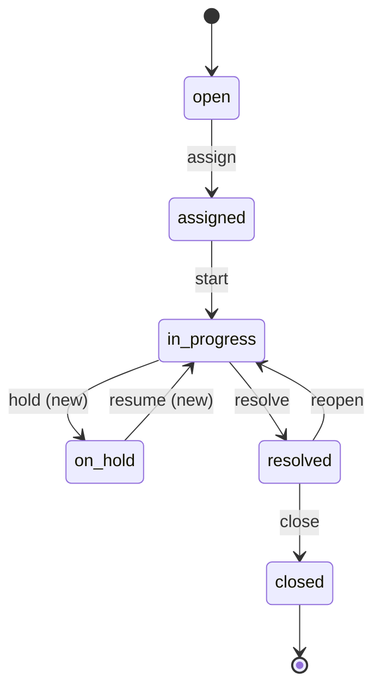

# 08 — Live Coding Practice (35 exercises)

This file prepares you for the "please change X in your project" part of a live Laravel interview.
Every exercise is written for **this** ResolveDesk codebase: real files, real constants, real tests.

- **PART A** lists only the questions. Try each one yourself first (with a timer).
- **PART B** gives the full solutions.

> **Important:** none of these exercises are implemented in the application. The "updated code" in PART B is a
> proposal for practice. The current application code is the "existing code" shown in each solution.

Related guides: [Business logic](06-BUSINESS-LOGIC-GUIDE.md) · [Interview Q&A](09-INTERVIEW-QUESTIONS-AND-ANSWERS.md) ·
[System design](10-SYSTEM-DESIGN-GUIDE.md) · [Notifications](13-NOTIFICATION-SYSTEM-GUIDE.md)

---

## How to work during a live coding exercise

1. **Repeat the requirement in your own words** and ask one or two clarifying questions
   ("Should existing tickets change too?", "Who is allowed to do this?").
2. **Find the single source of truth first.** In ResolveDesk most allowed values live in constants:
   `User::ROLES`, `Ticket::STATUSES`, `Ticket::PRIORITIES`, `Ticket::SLA_HOURS`, `Ticket::TRANSITIONS`,
   `Ticket::ACTIVE_STATUSES`, `Ticket::WORKLOAD_STATUSES`. Search for the constant name to find every place
   that uses it (VS Code: `Ctrl+Shift+F`).
3. **Follow the request path:** `routes/web.php` → middleware → controller → `TicketPolicy` →
   validation → `TicketService` → model → Blade view.
4. **Change the backend first** (validation, policy, service), then the view.
5. **Run the tests**, then test manually in the browser.

### Terminal setup (every new terminal)

```bash
# Git Bash
export PATH="/c/php-8.4.28:$PATH"
php -v          # must print PHP 8.4.28
```

```powershell
# PowerShell
$env:Path = "C:\php-8.4.28;$env:Path"
php -v
```

Useful commands for all exercises:

```bash
php artisan test                               # all tests (uses the resolvedesk_testing database)
php artisan test --filter=TicketManagementTest # one test class
php artisan test --filter=test_sla_deadline_matches_priority   # one test method
php artisan route:list --except-vendor         # all routes with names
php artisan migrate                            # run NEW migrations only (safe, keeps data)
php artisan tinker                             # interactive PHP console with the app loaded
```

> Never run `php artisan migrate:fresh` on the development database during an interview unless you are told to:
> it **drops every table** and all demo data. `php artisan migrate` only runs migrations that have not run yet.

### Universal checklist when you add a new allowed value

| You add a new... | Also check |
|---|---|
| ticket **priority** | `Ticket::PRIORITIES`, `Ticket::SLA_HOURS`, `.badge-priority-*` in `public/css/app.css`, doughnut colors in `resources/views/dashboard/admin.blade.php` |
| ticket **status** | `Ticket::STATUSES`, `Ticket::TRANSITIONS`, `ACTIVE_STATUSES` / `WORKLOAD_STATUSES`, `TicketPolicy`, `TicketService`, routes, buttons in `tickets/show.blade.php`, `.badge-status-*` CSS, admin dashboard tiles, `UserController::ensureRoleOrStatusChangeIsAllowed()` |
| **column** filled from a form | migration, the model's `$fillable`, validation in the controller (store **and** update), the form partial, the display view, factory (optional) |
| **role** | `User::ROLES`, a helper like `isAdmin()`, `Ticket::scopeVisibleTo()`, `TicketPolicy`, `DashboardController::index()`, sidebar |
| **cached** value | the cache key's invalidation (`Cache::forget`) and old cached data that has a different shape |

Remember: `status`, `created_by`, `assigned_to`, `ticket_number`, `due_at`, `resolved_at` and `resolution_note`
are **not** in `Ticket::$fillable`. They are set explicitly in `TicketService`, never by `fill()` from a form.

---

# PART A — Questions only

Difficulty: **B** = Beginner, **B+** = Beginner-plus, **I** = Intermediate, **I+** = Intermediate-plus.

| # | Interviewer's requirement | Difficulty |
|---|---|---|
| 1 | "The ticket list shows 15 tickets per page. Show 25 instead." | B |
| 2 | "Our SLA for **High** priority tickets changes from 8 hours to 6 hours." | B |
| 3 | "Notification polling every 5 seconds is too frequent. Make it every 10 seconds." | B |
| 4 | "Cache the admin dashboard statistics for 5 minutes instead of 60 seconds." | B |
| 5 | "Change every ticket email subject to `[ResolveDesk] TK-000001 - New ticket assigned`." | B |
| 6 | "Change the in-app message an agent gets when a ticket is assigned to them. It should also show the priority." | B |
| 7 | "Email jobs should be tried 5 times, waiting 10, 30 and then 60 seconds between attempts." | B |
| 8 | "A ticket subject must have at least 5 characters." | B |
| 9 | "The ticket search box should also search the description and the creator's name." | B+ |
| 10 | "A user reports *419 Page Expired* when submitting a form. Debug it." | B+ |
| 11 | "An agent gets *403 Access denied* when opening a ticket from a notification. Debug it." | B+ |
| 12 | "Emails are not arriving. The `jobs` table has pending rows. Debug it." | B+ |
| 13 | "Some email jobs failed because the mail server was down. Retry them." | B+ |
| 14 | "Add a *Refresh statistics* button that clears the cached admin dashboard data." | B+ |
| 15 | "Write a feature test: an agent cannot close a ticket, but the creator can close a resolved ticket." | B+ |
| 16 | "Add an optional phone number to users." | I |
| 17 | "Customers want to enter their own reference number (e.g. an order number) on a ticket, and search by it." | I |
| 18 | "Add a *sort order* field to categories so admins control the order in the ticket form dropdown." | I |
| 19 | "Let users choose whether the date-range filter uses the created date, the due date or the resolved date." | I |
| 20 | "Add a *Created today* statistic to the admin dashboard." | I |
| 21 | "Add a new ticket priority **Urgent** with a 1-hour SLA." | I |
| 22 | "The assigned agent should be able to edit a ticket while it is Assigned or In Progress." | I |
| 23 | "Notify the ticket creator (in-app) when an agent starts working on their ticket." | I |
| 24 | "On the notifications page, let users filter by event type (assigned, comment, resolved...)." | I |
| 25 | "Every ticket email must also be BCC'd to a supervisor mailbox configured in `.env`." | I |
| 26 | "When an agent or admin comments, also send the ticket creator a queued email." | I |
| 27 | "Show the latest comment's author on the ticket list (add a new relationship)." | I |
| 28 | "A developer added a comment count column to the ticket list and the page now crashes locally. Fix the N+1 problem." | I |
| 29 | "The customer dashboard is slow with millions of tickets. Add a suitable database index." | I |
| 30 | "Auto-assignment must not give an agent more than 10 active tickets." | I |
| 31 | "A customer may have at most 5 active tickets at the same time." | I+ |
| 32 | "Add a **Supervisor** role that can view and comment on all tickets but cannot manage anything." | I+ |
| 33 | "Add an SLA report: for a date range, how many tickets per priority were resolved on time vs late." | I+ |
| 34 | "Add a simple CRUD module for *canned responses* (saved reply templates) for admins." | I+ |
| 35 | "Add a new ticket status **On Hold** (waiting for the customer) between In Progress and Resolved." | I+ |

Tip: for each question, write down (1) which files you will touch, (2) whether the database changes, and
(3) which existing tests might break — **before** you look at the solution.

---

# PART B — Solutions

## Solution 1 — Change pagination size (B)

**Requirement:** "The ticket list shows 15 tickets per page. Show 25 instead."

**Requirement analysis.** Only the ticket list (`tickets.index`) changes. Other lists (users, categories,
notifications) keep 15 unless the interviewer says otherwise. No database change.

**Files to modify:** `app/Http/Controllers/TicketController.php`

**Artisan commands:** none.

**Existing code** (`TicketController`):

```php
    /** Tickets per page in the list. */
    private const PER_PAGE = 15;
```

```php
        // withQueryString(): keeps the filters in the pagination links.
        $tickets = $query->latest()->paginate(self::PER_PAGE)->withQueryString();
```

**Updated code:**

```php
    /** Tickets per page in the list. */
    private const PER_PAGE = 25;
```

**Explanation.**
- `PER_PAGE` is a class constant. `paginate(self::PER_PAGE)` adds `LIMIT 25 OFFSET ...` to the SQL and runs one
  extra `COUNT(*)` query to know the total number of pages.
- Because the number lives in one constant, there is exactly one line to change.
- Other lists use their own numbers: `UserController::PER_PAGE` (15), `CategoryController::index()` uses
  `paginate(15)`, `NotificationController::index()` uses `paginate(15)`.

**Optional extension** (only if asked: "let the user choose 15/25/50"):

```php
        $request->validate([
            // ...existing rules...
            'per_page' => ['nullable', Rule::in([15, 25, 50])],
        ]);

        $perPage = (int) $request->input('per_page', self::PER_PAGE);
        $tickets = $query->latest()->paginate($perPage)->withQueryString();
```

`Rule::in` stops someone from sending `?per_page=1000000` and loading the whole table.

**Database impact:** none.

**How to test.** Manual: log in as `admin@resolvedesk.test`, open *All Tickets*. The seeder creates 32 tickets,
so page 1 now shows 25 rows and page 2 shows 7. PHPUnit:

```php
public function test_ticket_list_shows_25_tickets_per_page(): void
{
    $admin = User::factory()->admin()->create();
    Ticket::factory()->count(26)->create();

    $response = $this->actingAs($admin)->get(route('tickets.index'));

    $response->assertOk();
    $this->assertCount(25, $response->viewData('tickets')); // the paginator holds 25 items on page 1
}
```

**Common mistakes.**
- Changing the number in the Blade view: the view only displays what the controller paginated.
- Forgetting `->withQueryString()` (already present): page 2 would lose the filters.
- Accepting a free `per_page` value without validation.

---

## Solution 2 — Change SLA duration (B)

**Requirement:** "Our SLA for High priority tickets changes from 8 hours to 6 hours."

**Requirement analysis.** The SLA hours live in `Ticket::SLA_HOURS`. Ask: "Should **existing** tickets get a new
deadline?" Usually **no** — a deadline that was promised stays. New tickets (and tickets whose priority is
edited) use the new value.

**Files to modify:** `app/Models/Ticket.php`, and the existing tests in `tests/Feature/TicketManagementTest.php`.

**Artisan commands:** none.

**Existing code** (`Ticket.php`):

```php
    /** SLA: hours allowed to resolve a ticket, per priority (continuous calendar hours). */
    public const SLA_HOURS = [
        self::PRIORITY_LOW => 48,
        self::PRIORITY_MEDIUM => 24,
        self::PRIORITY_HIGH => 8,
        self::PRIORITY_CRITICAL => 2,
    ];
```

**Updated code:**

```php
    public const SLA_HOURS = [
        self::PRIORITY_LOW => 48,
        self::PRIORITY_MEDIUM => 24,
        self::PRIORITY_HIGH => 6,
        self::PRIORITY_CRITICAL => 2,
    ];
```

Update the two tests that assert the old value (`tests/Feature/TicketManagementTest.php`):

```php
// test_customer_can_create_a_ticket (created 10:00, high)
$this->assertSame('2026-01-10 16:00:00', $ticket->due_at->format('Y-m-d H:i:s')); // high = 6 hours

// test_sla_deadline_matches_priority (created 09:00)
$this->assertSame('2026-03-01 15:00', Ticket::calculateDueAt($createdAt, 'high')->format('Y-m-d H:i'));     // 6h
```

**Explanation.**
- `Ticket::calculateDueAt()` reads `self::SLA_HOURS[$priority]` and adds the hours to the creation time.
  It is used by `TicketService::createTicket()` and `TicketService::updateTicket()` (when the priority changes).
- The ticket form (`resources/views/tickets/_form.blade.php`) prints
  `resolve within {{ \App\Models\Ticket::SLA_HOURS[$value] }} hours`, so the UI updates automatically.
- The seeder (`DatabaseSeeder::createTicketWithHistory()`) also uses `Ticket::SLA_HOURS`.

**Database impact:** no schema change. Existing rows keep their stored `due_at`. If the business wants existing
active tickets recalculated, that is a separate, deliberate data update (back up first, and log a
`due_date_changed` activity for each changed ticket).

**How to test.** Manual: create a High ticket at 10:00 → *SLA deadline* on the details page shows 16:00.
PHPUnit: `php artisan test --filter=TicketManagementTest` (after updating the two assertions above).

**Common mistakes.**
- Forgetting the tests: two existing assertions fail (good — tests catch the business change).
- Expecting old tickets to change: `due_at` is **stored**, not calculated on the fly.
- Confusing SLA with overdue: overdue is calculated live by `isOverdue()` / `scopeOverdue()` from the stored `due_at`.

---

## Solution 3 — Change notification polling interval (B)

**Requirement:** "Polling every 5 seconds is too frequent. Make it every 10 seconds."

**Requirement analysis.** Polling happens in the browser, in `public/js/notifications.js`. The server endpoint
(`GET /notifications/feed`, `NotificationController::feed()`) does not change.

**Files to modify:** `public/js/notifications.js`

**Artisan commands:** none.

**Existing code:**

```js
    // ---- Configuration (change the polling interval here) -------------------
    const POLL_INTERVAL_MS = 5000;          // 5 seconds while the tab is visible
    const HIDDEN_POLL_INTERVAL_MS = 30000;  // slower polling while the tab is hidden
```

**Updated code:**

```js
    const POLL_INTERVAL_MS = 10000;         // 10 seconds while the tab is visible
    const HIDDEN_POLL_INTERVAL_MS = 30000;  // slower polling while the tab is hidden
```

**Explanation.**
- `scheduleNextPoll()` uses `document.hidden ? HIDDEN_POLL_INTERVAL_MS : POLL_INTERVAL_MS` with a recursive
  `setTimeout`, so the next request starts only after the previous one finished.
- No notification is lost by polling slower: the browser sends `?since=<server_time>` and the server returns
  every unread notification created since then (up to 20).
- Load math for the interview: 200 logged-in users at 5 s = 40 requests/second; at 10 s = 20 requests/second.

**Database impact:** none (fewer queries on `notifications`).

**How to test.** Manual: hard refresh (`Ctrl+F5`; the file URL has no version string, so the browser may cache it),
open DevTools → Network → filter `feed`, and check that requests arrive about every 10 s. Assign a ticket to the
agent from another browser and confirm the toast appears within ~10 s. There is no PHPUnit test for JavaScript in
this project.

**Common mistakes.** Writing `10` instead of `10000` (milliseconds); forgetting the browser cache; replacing
`setTimeout` with `setInterval` (slow requests could overlap).

---

## Solution 4 — Change cache TTL (B)

**Requirement:** "Cache the admin dashboard statistics for 5 minutes instead of 60 seconds."

**Requirement analysis.** The TTL (time to live) is a constant in `DashboardController`. The tooltip in the admin
dashboard view also says "60 seconds".

**Files to modify:** `app/Http/Controllers/DashboardController.php`, `resources/views/dashboard/admin.blade.php`

**Artisan commands:** optional `php artisan cache:forget dashboard:admin:stats` (removes the current entry).

**Existing code:**

```php
    /** Admin statistics are cached for 60 seconds (and cleared after ticket changes). */
    private const ADMIN_STATS_TTL_SECONDS = 60;
```

```blade
    <span class="small text-muted" title="Aggregate statistics are cached for 60 seconds and refreshed after every ticket change.">
```

**Updated code:**

```php
    /** Admin statistics are cached for 5 minutes (and cleared after ticket changes). */
    private const ADMIN_STATS_TTL_SECONDS = 300;
```

```blade
    <span class="small text-muted" title="Aggregate statistics are cached for 5 minutes and refreshed after every ticket change.">
```

**Explanation.**
- `Cache::remember(TicketService::DASHBOARD_CACHE_KEY, self::ADMIN_STATS_TTL_SECONDS, ...)` stores the array
  from `buildAdminStatistics()` for 300 seconds (cache-aside pattern).
- Ticket changes still clear the key at once (`TicketService::clearDashboardCache()`), so a longer TTL mostly
  matters for things that do **not** clear it (e.g. the "last 14 days" trend crossing midnight).
- The category dropdown cache has its own TTL: `Category::ACTIVE_CACHE_TTL_SECONDS = 3600`.

> **বাংলায়:** Cache TTL মানে ক্যাশে রাখা ডেটা কতক্ষণ "বৈধ" থাকবে। TTL বাড়ালে ডাটাবেসে কম query যায়, কিন্তু
> পুরনো (stale) ডেটা দেখানোর ঝুঁকি বাড়ে। ResolveDesk-এ টিকিট বদলালেই ক্যাশ মুছে ফেলা হয়, তাই এখানে TTL শুধু
> একটি নিরাপত্তা-সীমা হিসেবে কাজ করে।

**Database impact:** none (fewer aggregate queries).

**How to test.** PHPUnit (tests use the `array` cache store, which respects `travel()`):

```php
public function test_dashboard_statistics_cache_lives_for_five_minutes(): void
{
    $admin = User::factory()->admin()->create();
    $this->actingAs($admin)->get('/dashboard')->assertOk();

    $this->travel(299)->seconds();
    $this->assertTrue(Cache::has(TicketService::DASHBOARD_CACHE_KEY));

    $this->travel(2)->seconds();
    $this->assertFalse(Cache::has(TicketService::DASHBOARD_CACHE_KEY));
}
```

Manual: open the admin dashboard and watch "Statistics generated at ..." — it stays the same for up to 5 minutes
unless a ticket changes.

**Common mistakes.** Writing `5` (seconds, not minutes); forgetting the tooltip text; caching values that must be
live (`$overdueCount` is deliberately **not** cached).

---

## Solution 5 — Change an email subject (B)

**Requirement:** "Change every ticket email subject to `[ResolveDesk] TK-000001 - New ticket assigned`."

**Requirement analysis.** All ticket emails use one Mailable, `App\Mail\TicketUpdateMail`. The subject is built in
`envelope()`.

**Files to modify:** `app/Mail/TicketUpdateMail.php`, `tests/Feature/QueueAndEmailTest.php`

**Artisan commands:** `php artisan queue:restart` (a running worker keeps the old code in memory).

**Existing code:**

```php
    public function envelope(): Envelope
    {
        return new Envelope(
            subject: '[' . $this->emailData['ticket_number'] . '] ' . $this->emailData['event_title'],
        );
    }
```

**Updated code:**

```php
    public function envelope(): Envelope
    {
        return new Envelope(
            subject: '[ResolveDesk] ' . $this->emailData['ticket_number'] . ' - ' . $this->emailData['event_title'],
        );
    }
```

Update the assertion in `test_job_sends_the_ticket_update_mail`:

```php
                && $mail->envelope()->subject === '[ResolveDesk] TK-000001 - New ticket assigned';
```

**Explanation.** `subject:` is a PHP 8 named argument. `$this->emailData` is the small array that
`TicketService::queueEmail()` put into the job; `event_title` is the same title as the in-app notification.

**Database impact:** none. Jobs **already waiting** in `jobs` will also get the new subject, because the subject is
built when the worker sends the email, not when the job is queued.

**How to test.** Manual: assign a ticket as admin, run `php artisan queue:work --stop-when-empty`, open
`storage/logs/laravel.log` (`MAIL_MAILER=log`) and look for `Subject: [ResolveDesk] ...`. PHPUnit:

```php
public function test_email_subject_format(): void
{
    $mail = new TicketUpdateMail('Sarah', [
        'ticket_id' => 1, 'ticket_number' => 'TK-000001', 'subject' => 'Printer offline',
        'status' => 'Assigned', 'event_title' => 'New ticket assigned', 'event_message' => 'Assigned to you.',
    ]);

    $mail->assertHasSubject('[ResolveDesk] TK-000001 - New ticket assigned');
}
```

**Common mistakes.** Forgetting `queue:restart`; changing the in-app notification title instead; forgetting the
existing test.

---

## Solution 6 — Change notification message (B)

**Requirement:** "Change the in-app message an agent gets when a ticket is assigned. It should also show the priority."

**Requirement analysis.** Notification texts are written in `TicketService`. The assignment text is in the private
method `performAssignment()`. The same `$message` is also used as the email body (`event_message`).

**Files to modify:** `app/Services/TicketService.php`

**Artisan commands:** `php artisan queue:restart` if a worker is running.

**Existing code** (`performAssignment()`):

```php
            $this->notifyUser($agent, $ticket, $admin, 'assigned',
                'New ticket assigned',
                "Ticket {$ticket->ticket_number} \"{$ticket->subject}\" has been assigned to you.",
                true);
```

**Updated code:**

```php
            $this->notifyUser($agent, $ticket, $admin, 'assigned',
                'New ticket assigned',
                "Ticket {$ticket->ticket_number} \"{$ticket->subject}\" ({$ticket->priorityLabel()} priority) has been assigned to you.",
                true);
```

**Explanation.**
- In a double-quoted PHP string, `{$ticket->ticket_number}` inserts a property and `{$ticket->priorityLabel()}`
  calls a method (a method call needs the curly braces).
- `\"` is an escaped double quote inside the string.
- The reassignment text (the `else` branch, event `'reassigned'`) is a separate string — change it too if asked.

**Database impact:** no schema change. Old rows keep the **old** text: the message is stored as JSON in
`notifications.data` when the notification is created.

**How to test.** Manual: as admin assign a ticket to Sarah, log in as `sarah.agent@resolvedesk.test` and open the
bell. PHPUnit:

```php
public function test_assignment_message_contains_priority(): void
{
    Queue::fake();
    $admin = User::factory()->admin()->create();
    $agent = User::factory()->agent()->create();
    $ticket = Ticket::factory()->create(['priority' => 'high']);

    $this->actingAs($admin)->post(route('tickets.assign', $ticket), ['agent_id' => $agent->id]);

    $this->assertStringContainsString('(High priority)', $agent->notifications()->first()->data['message']);
}
```

**Common mistakes.** Single quotes (no interpolation); `$ticket->priorityLabel` without `()`; expecting old
notifications to change.

---

## Solution 7 — Change queue retry attempts (B)

**Requirement:** "Email jobs should be tried 5 times, waiting 10, 30 and then 60 seconds between attempts."

**Requirement analysis.** Retry settings are public properties of `App\Jobs\SendTicketEmail`.

**Files to modify:** `app/Jobs/SendTicketEmail.php`, `tests/Feature/QueueAndEmailTest.php`

**Artisan commands:** `php artisan queue:restart`

**Existing code:**

```php
    /** Try the job at most 3 times before moving it to failed_jobs. */
    public int $tries = 3;

    /** Wait 10 seconds before each retry. */
    public int $backoff = 10;
```

**Updated code:**

```php
    /** Try the job at most 5 times before moving it to failed_jobs. */
    public int $tries = 5;

    /** Wait 10s before retry 1, 30s before retry 2, then 60s before every later retry. */
    public array $backoff = [10, 30, 60];
```

Update `test_job_retry_configuration`:

```php
        $this->assertSame(5, $job->tries);
        $this->assertSame([10, 30, 60], $job->backoff);
```

**Explanation.**
- `$tries` = total attempts (first try + retries). After the last failure Laravel calls `failed()` (which logs
  "Ticket email failed permanently") and stores the job in `failed_jobs`.
- An **array** `$backoff` gives a different delay per retry; the last value is reused for later retries.
- The property **type** must change from `int` to `array`; `public int $backoff = [10, 30, 60];` is a fatal error.
- `retry_after` in `config/queue.php` (90 seconds for the `database` connection) must stay longer than one attempt
  can take, otherwise another worker could pick up a job that is still running.

**Database impact:** none. While a job waits for its next attempt, its `available_at` in `jobs` is in the future.

**How to test.** Manual failure simulation: in `.env` set `MAIL_MAILER=smtp`, `MAIL_HOST=127.0.0.1`,
`MAIL_PORT=2525` (nothing listens there), run `php artisan config:clear`, assign a ticket, run
`php artisan queue:work -v` and watch the attempts. Restore `MAIL_MAILER=log` afterwards. PHPUnit: the updated
`test_job_retry_configuration`.

**Common mistakes.** Keeping the `int` type; not restarting the worker; thinking `$tries = 5` means 5 *retries*.

---

## Solution 8 — Add a validation rule (B)

**Requirement:** "A ticket subject must have at least 5 characters."

**Requirement analysis.** Tickets are validated in two methods: `TicketController::store()` and
`TicketController::update()`. Both must change, otherwise the rule can be bypassed by editing.

**Files to modify:** `app/Http/Controllers/TicketController.php`, optional `resources/views/tickets/_form.blade.php`

**Artisan commands:** none.

**Existing code** (same line in `store()` and `update()`):

```php
            'subject' => ['required', 'string', 'max:255'],
```

**Updated code** (both methods):

```php
            'subject' => ['required', 'string', 'min:5', 'max:255'],
```

Optional custom message in `store()` (the second array of `validate()` already exists there):

```php
        ], [
            'category_id.exists' => 'Please choose an active category.',
            'subject.min' => 'The subject must be at least 5 characters, e.g. "Printer offline".',
        ]);
```

Optional browser hint: add `minlength="5"` to the subject `<input>` in `_form.blade.php`. It is only a
convenience — the backend rule is the real protection.

**Explanation.** For a `string`, `min:5` means at least 5 characters. When validation fails, Laravel redirects back,
keeps the old input (`old('subject')`) and fills `$errors`; the form shows it with `@error('subject')`.

**Database impact:** none.

**How to test.** PHPUnit:

```php
public function test_subject_needs_at_least_five_characters(): void
{
    $customer = User::factory()->customer()->create();
    $category = Category::factory()->create();

    $this->actingAs($customer)->post('/tickets', [
        'subject' => 'Help', 'description' => 'Something broke.', 'category_id' => $category->id, 'priority' => 'low',
    ])->assertSessionHasErrors('subject');

    $this->assertSame(0, Ticket::count());
}
```

Then run the whole suite. Existing tests use subjects such as `"Ticket {$i}"` and `'Again'` (5 characters), so they
still pass. If you instead put `min:20` on **description**, tests that post `'description' => 'x'` or `'d'` would
fail and must be updated.

**Common mistakes.** Changing only `store()`; relying on HTML `minlength`; using `size:5` (= exactly 5).

---

## Solution 9 — Add a ticket search condition (B+)

**Requirement:** "The search box should also search the description and the creator's name."

**Requirement analysis.** Search lives in `TicketController::index()`. It currently matches `ticket_number` and
`subject`. We add `description` (a column) and the creator's `name` (a related table → `orWhereHas`). The
**visibility rule must stay intact**: a customer must still see only their own tickets.

**Files to modify:** `app/Http/Controllers/TicketController.php`, `resources/views/tickets/index.blade.php` (placeholder text)

**Artisan commands:** none.

**Existing code:**

```php
        if ($request->filled('search')) {
            $search = $request->input('search');
            $query->where(function ($subQuery) use ($search) {
                $subQuery->where('ticket_number', 'like', "%{$search}%")
                    ->orWhere('subject', 'like', "%{$search}%");
            });
        }
```

**Updated code:**

```php
        if ($request->filled('search')) {
            $search = $request->input('search');
            $query->where(function ($subQuery) use ($search) {
                $subQuery->where('ticket_number', 'like', "%{$search}%")
                    ->orWhere('subject', 'like', "%{$search}%")
                    ->orWhere('description', 'like', "%{$search}%")
                    ->orWhereHas('creator', function ($creatorQuery) use ($search) {
                        $creatorQuery->where('name', 'like', "%{$search}%");
                    });
            });
        }
```

```blade
<input type="text" id="search" name="search" value="{{ request('search') }}" class="form-control" placeholder="Number, subject, description or creator">
```

**Explanation.**
- The closure passed to `where()` puts all `OR` conditions inside **brackets**. The final SQL is:
  `WHERE (created_by = ? OR assigned_to = ?) AND (ticket_number LIKE ? OR subject LIKE ? OR description LIKE ? OR EXISTS (SELECT * FROM users WHERE users.id = tickets.created_by AND name LIKE ?))`.
- `orWhereHas('creator', ...)` uses the existing `Ticket::creator()` relationship and becomes an `EXISTS` sub-query.
- `use ($search)` gives the inner closure access to the outer variable.
- The search value is a **bound parameter** (`?`), so it is safe from SQL injection.

> **বাংলায়:** `orWhere` কে অবশ্যই closure-এর ভেতরে রাখতে হবে। বাইরে রাখলে SQL হয়
> `... visibleTo ... AND subject LIKE ? OR description LIKE ?` — তখন `OR` এর কারণে visibility শর্ত ভেঙে যায় এবং
> একজন customer অন্যের টিকিটও দেখতে পারে। Closure মানে SQL-এ বন্ধনী ( ), যা শর্তগুলোকে একসাথে বেঁধে রাখে।

**Database impact:** no schema change. `LIKE '%text%'` (leading wildcard) cannot use a normal index, so on very large
tables this becomes slow; a FULLTEXT index or a search engine would be a future improvement.

**How to test.** PHPUnit — include a security check:

```php
public function test_search_matches_description_but_respects_visibility(): void
{
    $customer = User::factory()->customer()->create();
    $mine = Ticket::factory()->create(['created_by' => $customer->id, 'description' => 'The printer is jammed']);
    $notMine = Ticket::factory()->create(['description' => 'Another printer problem']);

    $this->actingAs($customer)->get('/tickets?search=printer')
        ->assertSee($mine->subject)
        ->assertDontSee($notMine->subject);
}
```

**Common mistakes.** Adding `->orWhere(...)` outside the closure (data leak); searching a relationship with a join
and getting duplicate rows; forgetting the placeholder text.

---

## Solution 10 — Debug HTTP 419 (B+)

**Requirement:** "A user reports *419 Page Expired* when submitting a form. Debug it."

**Requirement analysis.** 419 means Laravel's CSRF check failed: the POST/PUT/PATCH/DELETE request did not carry a
token that matches the token in the user's session. The custom page is `resources/views/errors/419.blade.php`.

**Files to inspect:** the form's Blade view, `resources/views/layouts/app.blade.php` (CSRF meta tag),
`public/js/notifications.js` (AJAX header), `.env` (`SESSION_DRIVER`, `SESSION_LIFETIME`, `APP_KEY`).

**Artisan commands:** `php artisan config:clear`, `php artisan route:list --except-vendor`.

**Checklist (most common first).**

| Cause | How to check | Fix |
|---|---|---|
| Form has no `@csrf` | View page source: is there `<input type="hidden" name="_token" ...>` inside the `<form>`? | Add `@csrf` |
| Session expired (`SESSION_LIFETIME=120` minutes) or user logged out in another tab (`logout()` calls `regenerateToken()`) | Happens after a long idle time | Refresh the page and resubmit; this is expected behaviour |
| AJAX request without the header | DevTools → Network → request headers: is `X-CSRF-TOKEN` present? | Read `<meta name="csrf-token">` and send it, as `postJson()` in `notifications.js` does |
| Session not saved | `SESSION_DRIVER=database` but the `sessions` table is missing / DB down | Run `php artisan migrate`, start MariaDB |
| Cookie not sent back | Mixing `localhost` and `127.0.0.1`, or `SESSION_DOMAIN` wrong | Use one host consistently |
| `APP_KEY` changed | Existing encrypted cookies become invalid | Do not change `APP_KEY` on a running app; users log in again |

**Existing code (correct example)** from `resources/views/notifications/index.blade.php`:

```blade
    <form method="POST" action="{{ route('notifications.read-all') }}">
        @csrf
        <button type="submit" class="btn btn-outline-primary"><i class="bi bi-check2-all me-1"></i> Mark all as read</button>
    </form>
```

**Broken version you might be shown**, and the fix:

```blade
{{-- BROKEN: no @csrf -> 419 --}}
<form method="POST" action="{{ route('notifications.read-all') }}">
    <button type="submit">Mark all as read</button>
</form>
```

```js
// AJAX: notifications.js already does this
const csrfToken = document.querySelector('meta[name="csrf-token"]').getAttribute('content');
// ...
headers: { 'Accept': 'application/json', 'X-CSRF-TOKEN': csrfToken, 'X-Requested-With': 'XMLHttpRequest' },
```

**Explanation.** `@csrf` prints a hidden `_token` field. Laravel's CSRF middleware (part of the `web` middleware
group) compares it with the token stored in the session. A different website cannot read this token, so it cannot
forge a valid form submission for the logged-in user. `notifications.js` treats 419 like an expired session
(`handleExpiredSession()`) and shows "Sign in again".

> **বাংলায়:** CSRF token হলো session-এর সাথে যুক্ত একটি গোপন random string। প্রতিটি POST ফর্মে এটি পাঠাতে হয়।
> অন্য কোনো ওয়েবসাইট এই token জানে না, তাই ব্যবহারকারীর নামে নকল request পাঠাতে পারে না। Token না মিললে
> Laravel 419 "Page Expired" দেখায়।

**Database impact:** none (unless the `sessions` table is missing).

**How to test.** Laravel feature tests **skip** the CSRF check automatically, so 419 cannot be reproduced with a
normal `$this->post()` test. Test manually (this was verified for the project with curl):

```bash
php artisan serve
# in another terminal: POST to the login form without a token or session cookie
curl -i -X POST http://127.0.0.1:8000/login -d "email=a@b.test&password=x"
# -> HTTP/1.1 419
```

**Common mistakes.** "Fixing" it by excluding routes from CSRF protection; using GET for data-changing actions
(ResolveDesk never does — see the comment at the top of `routes/web.php`); forgetting `@method('PUT')` together with
`@csrf` on edit forms (that causes 405, not 419).

---

## Solution 11 — Debug HTTP 403 (B+)

**Requirement:** "An agent gets *403 Access denied* when opening a ticket from a notification. Debug it."

**Requirement analysis.** ResolveDesk returns 403 from two places:
1. **Route middleware** `role:admin` → `RoleMiddleware::handle()` calls `abort(403, 'You do not have permission to access this page.')`.
2. **Policies** → `Gate::authorize('view', $ticket)` in a controller throws an `AuthorizationException` when the
   `TicketPolicy` method returns `false` (message "This action is unauthorized.").

The 403 page (`resources/views/errors/403.blade.php`) prints the exception message, which already tells you which one.

**Step-by-step.**

1. Which route? `php artisan route:list --except-vendor -v` shows the middleware of each route. `tickets.show`
   only has `web, auth, active` → the 403 must come from the policy.
2. Which policy method? `TicketController::show()` calls `Gate::authorize('view', $ticket)` → `TicketPolicy::view()`:

```php
    public function view(User $user, Ticket $ticket): bool
    {
        if ($user->isAdmin()) {
            return true;
        }

        return $this->isCreator($user, $ticket) || $this->isAssignedAgent($user, $ticket);
    }
```

3. Check the data in tinker:

```php
php artisan tinker
>>> $user = App\Models\User::where('email', 'sarah.agent@resolvedesk.test')->first();
>>> $ticket = App\Models\Ticket::where('ticket_number', 'TK-000007')->first();
>>> $ticket->assigned_to;          // who is assigned NOW?
>>> $user->id;
>>> $user->can('view', $ticket);   // false = policy denies
```

4. Typical result: the ticket was **reassigned** to another agent after the notification was sent. The 403 is then
   **correct** behaviour — notifications never grant access; the policy is checked again on every request. The 403
   page even says: "If you opened this from a notification, the ticket may have been reassigned".

**Real bug you could be asked to find:** someone removed the integer casts from `Ticket::casts()`:

```php
            // Integer casts make comparisons like $ticket->created_by === $user->id reliable.
            'category_id' => 'integer',
            'created_by' => 'integer',
            'assigned_to' => 'integer',
```

Without them some database drivers return `"5"` (string) and `isAssignedAgent()` compares
`$ticket->assigned_to === $user->id` with `===` (type **and** value) → `"5" === 5` is `false` → 403 for the real
assigned agent. Fix: keep the casts.

**Database impact:** none.

**How to test.** PHPUnit (see `AuthorizationTest`):

```php
public function test_agent_loses_access_after_reassignment(): void
{
    Queue::fake();
    $admin = User::factory()->admin()->create();
    $sarah = User::factory()->agent()->create();
    $david = User::factory()->agent()->create();
    $ticket = Ticket::factory()->assignedTo($sarah)->create();

    $this->actingAs($sarah)->get(route('tickets.show', $ticket))->assertOk();

    $this->actingAs($admin)->post(route('tickets.assign', $ticket), ['agent_id' => $david->id]);

    $this->actingAs($sarah)->get(route('tickets.show', $ticket))->assertForbidden();
}
```

**Common mistakes.** "Fixing" a correct 403 by loosening the policy; checking only the Blade `@can` (hiding buttons is
not security); forgetting that `role:admin` routes (`tickets.assign`, `users.*`, `categories.*`) return 403 for
non-admins before the controller even runs.

---

## Solution 12 — Debug a pending queue job (B+)

**Requirement:** "Emails are not arriving. The `jobs` table has pending rows. Debug it."

**Requirement analysis.** Producer: `TicketService::queueEmail()` → `SendTicketEmail::dispatch(...)` after commit
(inserts a row into `jobs` because `QUEUE_CONNECTION=database`). Consumer: `php artisan queue:work`. Pending rows
mean **no consumer processed them**.

**Checklist.**

1. Is a worker running? In development nobody starts it automatically. Start one:
   ```bash
   php artisan queue:work            # keeps running; Ctrl+C to stop
   php artisan queue:work --stop-when-empty   # process everything, then exit (verified in this project)
   ```
2. Look at the rows:
   ```sql
   SELECT id, queue, attempts, reserved_at, FROM_UNIXTIME(available_at) AS available_at FROM jobs;
   ```
   - `available_at` in the future → the job is waiting for its `$backoff` delay (it already failed once).
   - `reserved_at` set but nothing happens → a worker took it and crashed; after `retry_after` (90 s,
     `config/queue.php`) another worker can take it again.
   - `queue` is not `default` → start the worker with `--queue=thatname`.
3. Is the configuration what you think? After editing `.env`, run `php artisan config:clear`. Check
   `php artisan tinker` → `config('queue.default')` returns `database`.
4. Did the job fail? `php artisan queue:failed` lists rows in `failed_jobs` (see Solution 13).
5. Where do emails go? `MAIL_MAILER=log` writes them to `storage/logs/laravel.log`, not to a real inbox.

**Existing code (producer):**

```php
        DB::afterCommit(function () use ($recipientEmail, $recipientName, $emailData) {
            try {
                SendTicketEmail::dispatch($recipientEmail, $recipientName, $emailData);
            } catch (Throwable $exception) {
                Log::error('Could not queue ticket email', [
```

**Updated code:** none needed if the cause is "no worker". If you want extra visibility while debugging, you could
temporarily add a log line at the start of `SendTicketEmail::handle()`:

```php
    public function handle(): void
    {
        Log::info('Sending ticket email', ['to' => $this->recipientEmail, 'ticket' => $this->emailData['ticket_number']]);

        Mail::to($this->recipientEmail)->send(
            new TicketUpdateMail($this->recipientName, $this->emailData)
        );
    }
```

**Explanation.** In-app notifications are **not** queued (they are inserted inside the ticket transaction), so users
still see the bell notification even when no worker runs. Only the email waits.

> **বাংলায়:** Queue হলো একটি "অপেক্ষার তালিকা"। ওয়েব request শুধু `jobs` টেবিলে একটি কাজ লিখে রাখে (producer)।
> `queue:work` নামের আলাদা process সেই কাজ তুলে নিয়ে ইমেইল পাঠায় (consumer)। Worker না চললে কাজগুলো টেবিলে
> জমে থাকে — হারায় না।

**Database impact:** none (rows in `jobs` are deleted after successful processing).

**How to test.** `QueueAndEmailTest::test_in_app_notification_works_without_a_queue_worker()` already proves a job
stays in `jobs` when no worker runs. Manual: assign a ticket, check `SELECT COUNT(*) FROM jobs;` → 1, run
`php artisan queue:work --stop-when-empty` → 0, open `storage/logs/laravel.log`.

**Common mistakes.** Forgetting that a running worker must be restarted after code changes (`php artisan queue:restart`);
editing `.env` without `config:clear` when config is cached; deleting rows from `jobs` by hand.

---

## Solution 13 — Retry a failed job (B+)

**Requirement:** "Some email jobs failed because the mail server was down. Retry them."

**Requirement analysis.** After `$tries = 3` failed attempts, Laravel calls `SendTicketEmail::failed()` (logs
"Ticket email failed permanently") and moves the job to `failed_jobs` with the exception text.

**Commands:**

```bash
php artisan queue:failed              # list failed jobs (UUID, connection, queue, class, failed time)
php artisan queue:retry <uuid>        # push one failed job back onto the queue
php artisan queue:retry all           # push all failed jobs back
php artisan queue:forget <uuid>       # delete one failed job without retrying
php artisan queue:flush               # delete ALL failed jobs (careful)
php artisan queue:work --stop-when-empty   # retried jobs still need a worker!
```

**Procedure.**
1. Read the error: `SELECT uuid, exception FROM failed_jobs ORDER BY failed_at DESC LIMIT 5;` or check
   `storage/logs/laravel.log` for "Ticket email failed permanently".
2. **Fix the cause first** (e.g. restore `MAIL_MAILER=log` or correct SMTP settings, `php artisan config:clear`,
   `php artisan queue:restart`).
3. `php artisan queue:retry all`, then run a worker.

**Existing code:**

```php
    /** Called once after the final failed attempt (the job is then stored in failed_jobs). */
    public function failed(?Throwable $exception): void
    {
        Log::error('Ticket email failed permanently', [
            'recipient' => $this->recipientEmail,
            'ticket_number' => $this->emailData['ticket_number'] ?? null,
            'error' => $exception?->getMessage(),
        ]);
    }
```

**Updated code:** none.

**Explanation.** `queue:retry` copies the stored payload back into `jobs` with a fresh attempt counter. The payload
contains only simple values (email, name, small array), so a retry sends the same email content as before — the
ticket status in the email is the status at the time of the event, not the current status.

**Idempotency warning.** An email is not idempotent: if the SMTP server accepted the email but the connection broke
before Laravel saw "OK", the job counts as failed and a retry sends the email **twice**. For notification emails
this is acceptable; for payments it would not be.

> **বাংলায়:** Idempotent মানে একই কাজ একাধিকবার করলেও ফলাফল একই থাকে। ইমেইল পাঠানো idempotent নয় — retry করলে
> একই ইমেইল দুবার যেতে পারে। তাই retry করার আগে আসল সমস্যা (যেমন mail server) ঠিক করতে হয়।

**Database impact:** rows move from `failed_jobs` back to `jobs`.

**How to test.** Manual simulation (see Solution 7: point SMTP to a closed port, run the worker until the job fails,
restore the setting, retry). PHPUnit cannot easily test Artisan retry; the existing
`test_email_failure_does_not_reverse_the_committed_assignment` proves a mail failure never undoes the ticket change.

**Common mistakes.** Retrying before fixing the cause (fails again 3 times); forgetting to run a worker after
`queue:retry`; using `queue:flush` and losing the evidence.

---

## Solution 14 — Invalidate a cache key (B+)

**Requirement:** "Add a *Refresh statistics* button that clears the cached admin dashboard data."

**Requirement analysis.** The admin statistics are cached under `TicketService::DASHBOARD_CACHE_KEY`
(`'dashboard:admin:stats'`). `TicketService::clearDashboardCache()` is already **public**, so a controller can call it.
Only admins may use the button → put the route in the `role:admin` group. Clearing data is a change → use **POST**
with `@csrf`.

**Files to modify:** `routes/web.php`, `app/Http/Controllers/DashboardController.php`,
`resources/views/dashboard/admin.blade.php`

**Artisan commands:** none for the code. Without any code you can also clear the key from the terminal:

```bash
php artisan cache:forget dashboard:admin:stats      # one key
php artisan cache:forget ticket:active-categories   # the category dropdown key
php artisan cache:clear                             # every cache key (sessions are NOT affected: they are in the sessions table)
```

**Existing code:**

```php
    public function clearDashboardCache(): void
    {
        Cache::forget(self::DASHBOARD_CACHE_KEY);
    }
```

**Updated code.** `routes/web.php`, inside `Route::middleware('role:admin')->group(function () { ... })`:

```php
        Route::post('/dashboard/refresh', [DashboardController::class, 'refresh'])->name('dashboard.refresh');
```

`DashboardController` (add the method; `TicketService` is already imported):

```php
    /** Admin button: forget the cached statistics so the next page load rebuilds them. */
    public function refresh(TicketService $ticketService)
    {
        $ticketService->clearDashboardCache();

        return redirect()->route('dashboard')->with('success', 'Statistics refreshed.');
    }
```

`resources/views/dashboard/admin.blade.php`, inside the `page-header` next to the "Statistics generated at" text:

```blade
    <form method="POST" action="{{ route('dashboard.refresh') }}">
        @csrf
        <button type="submit" class="btn btn-sm btn-outline-primary"><i class="bi bi-arrow-clockwise me-1"></i> Refresh statistics</button>
    </form>
```

**Explanation.**
- `refresh(TicketService $ticketService)` uses **method injection**: the service container creates the service.
- `Cache::forget()` deletes the row from the `cache` table (`CACHE_STORE=database`). The next `GET /dashboard` is a
  cache miss, so `Cache::remember()` runs `buildAdminStatistics()` again.

**Database impact:** none (one row removed from `cache`).

**How to test.**

```php
public function test_admin_can_refresh_dashboard_statistics(): void
{
    $admin = User::factory()->admin()->create();
    $this->actingAs($admin)->get('/dashboard');
    $this->assertTrue(Cache::has(TicketService::DASHBOARD_CACHE_KEY));

    $this->actingAs($admin)->post(route('dashboard.refresh'))->assertRedirect(route('dashboard'));
    $this->assertFalse(Cache::has(TicketService::DASHBOARD_CACHE_KEY));
}

public function test_customer_cannot_refresh_statistics(): void
{
    $customer = User::factory()->customer()->create();
    $this->actingAs($customer)->post(route('dashboard.refresh'))->assertForbidden();
}
```

**Common mistakes.** A GET link that clears cache (CSRF-unsafe, can be triggered by prefetching); putting the route
outside the admin group; using `Cache::flush()` (clears everything, including the category cache).

---

## Solution 15 — Add a feature test (B+)

**Requirement:** "Write a feature test: an agent cannot close a ticket, but the creator can close a resolved ticket."

**Requirement analysis.** `TicketPolicy::close()` allows only an admin or the creator, and only when
`canPerform('close')` (status `resolved`). `TicketService::close()` writes a `closed` activity and an in-app
notification to the assigned agent, with **no email**.

**Files to create:** `tests/Feature/TicketCloseTest.php`

**Artisan commands:**

```bash
php artisan make:test TicketCloseTest        # creates tests/Feature/TicketCloseTest.php
php artisan test --filter=TicketCloseTest
```

**Existing code under test** (`TicketPolicy`):

```php
    /** Resolved -> Closed, by the ticket creator or an admin. */
    public function close(User $user, Ticket $ticket): bool
    {
        return ($user->isAdmin() || $this->isCreator($user, $ticket))
            && $ticket->canPerform('close');
    }
```

**New code:**

```php
<?php

namespace Tests\Feature;

use App\Models\Ticket;
use App\Models\User;
use Illuminate\Foundation\Testing\RefreshDatabase;
use Illuminate\Support\Facades\Queue;
use Tests\TestCase;

class TicketCloseTest extends TestCase
{
    use RefreshDatabase; // fresh tables in resolvedesk_testing for every test

    public function test_assigned_agent_cannot_close_a_resolved_ticket(): void
    {
        $customer = User::factory()->customer()->create();
        $agent = User::factory()->agent()->create();
        $ticket = Ticket::factory()->resolved($agent)->create(['created_by' => $customer->id]);

        $this->actingAs($agent)
            ->post(route('tickets.close', $ticket))
            ->assertForbidden();

        $this->assertSame(Ticket::STATUS_RESOLVED, $ticket->fresh()->status);
    }

    public function test_creator_can_close_a_resolved_ticket_and_agent_is_notified_without_email(): void
    {
        Queue::fake();
        $customer = User::factory()->customer()->create();
        $agent = User::factory()->agent()->create();
        $ticket = Ticket::factory()->resolved($agent)->create(['created_by' => $customer->id]);

        $this->actingAs($customer)
            ->post(route('tickets.close', $ticket))
            ->assertSessionHas('success');

        $this->assertSame(Ticket::STATUS_CLOSED, $ticket->fresh()->status);
        $this->assertNotNull($ticket->fresh()->resolved_at, 'resolved_at is kept when closing');
        $this->assertDatabaseHas('ticket_activities', ['ticket_id' => $ticket->id, 'action' => 'closed']);
        $this->assertSame('closed', $agent->notifications()->first()->data['event_type']);
        Queue::assertNothingPushed(); // closure is in-app only
    }

    public function test_open_ticket_cannot_be_closed(): void
    {
        $customer = User::factory()->customer()->create();
        $ticket = Ticket::factory()->create(['created_by' => $customer->id]);

        $this->actingAs($customer)->post(route('tickets.close', $ticket))->assertForbidden();
    }
}
```

**Explanation.**
- `RefreshDatabase` migrates the test database (`resolvedesk_testing`, set in `phpunit.xml`) and rolls back after each
  test, so tests never touch development data.
- Factory states (`resolved($agent)`) come from `database/factories/TicketFactory.php`. Factories may set `status`
  even though it is not fillable (factories create models unguarded).
- `actingAs()` logs a user in for the request. Feature tests skip CSRF automatically.
- `Queue::fake()` records dispatched jobs instead of running them.
- `fresh()` re-reads the row from the database; the `$ticket` variable itself is stale after the request.

**Database impact:** only the test database.

**How to test.** `php artisan test --filter=TicketCloseTest` (MariaDB must be running and `resolvedesk_testing`
must exist).

**Common mistakes.** Asserting on `$ticket->status` without `fresh()`; forgetting `RefreshDatabase`; running tests
against the development database (never change `DB_DATABASE` in `phpunit.xml`).

---

## Solution 16 — Add a phone number to users (I)

**Requirement:** "Add an optional phone number to users."

**Requirement analysis.** New column on `users` → migration. Admins create/edit users in `UserController`, so
validation goes into `store()` **and** `update()`. `User::create($validated)` and `$user->update($validated)` use
mass assignment → `phone` must be in `User::$fillable`. Show it on the user form and the user details page.

**Files to modify:** new migration, `app/Models/User.php`, `app/Http/Controllers/UserController.php`,
`resources/views/users/_form.blade.php`, `resources/views/users/show.blade.php`, optional
`database/factories/UserFactory.php`.

**Artisan commands:**

```bash
php artisan make:migration add_phone_to_users_table --table=users
php artisan migrate
```

**Existing code** (`User.php`):

```php
    protected $fillable = [
        'name',
        'email',
        'password',
        'role',
        'is_active',
    ];
```

(`UserController::store()`)

```php
        $validated = $request->validate([
            'name' => ['required', 'string', 'max:255'],
            'email' => ['required', 'email', 'max:255', 'unique:users,email'],
            'password' => ['required', 'string', 'min:8', 'confirmed'],
            'role' => ['required', Rule::in(array_keys(User::ROLES))],
            'is_active' => ['boolean'],
        ]);
```

**Updated code.** Migration (`database/migrations/xxxx_xx_xx_xxxxxx_add_phone_to_users_table.php`):

```php
<?php

use Illuminate\Database\Migrations\Migration;
use Illuminate\Database\Schema\Blueprint;
use Illuminate\Support\Facades\Schema;

return new class extends Migration
{
    public function up(): void
    {
        Schema::table('users', function (Blueprint $table) {
            // Optional, so existing users simply get NULL.
            $table->string('phone', 20)->nullable()->after('email');
        });
    }

    public function down(): void
    {
        Schema::table('users', function (Blueprint $table) {
            $table->dropColumn('phone');
        });
    }
};
```

`User.php`:

```php
    protected $fillable = [
        'name',
        'email',
        'phone',
        'password',
        'role',
        'is_active',
    ];
```

`UserController` — add the same rule in `store()` and `update()`:

```php
            'phone' => ['nullable', 'string', 'max:20', 'regex:/^\+?[0-9 \-]{7,20}$/'],
```

`users/_form.blade.php` — a new field after the email row:

```blade
<div class="row">
    <div class="col-md-6 mb-3">
        <label for="phone" class="form-label">Phone</label>
        <input type="text" id="phone" name="phone" value="{{ old('phone', $user?->phone) }}"
               class="form-control @error('phone') is-invalid @enderror" placeholder="+880 1711-000000">
        @error('phone')<div class="invalid-feedback">{{ $message }}</div>@enderror
    </div>
</div>
```

`users/show.blade.php` — under the name:

```blade
            <p class="page-subtitle">{{ $user->email }}@if ($user->phone) · {{ $user->phone }}@endif</p>
```

**Explanation.**
- `Schema::table()` changes an existing table (`Schema::create()` would try to create it again).
- `nullable()` is required: existing rows have no phone. `after('email')` only controls column position (MySQL/MariaDB).
- `down()` makes the migration reversible (`php artisan migrate:rollback`).
- The regex rule is inside an **array**, which matters: in the old pipe-string format (`'nullable|regex:...'`) a `|`
  inside the regex would break parsing.
- Phone is stored as a **string**, not an integer: leading `0` and `+` must be kept, and you never calculate with it.

**Database impact:** one new nullable column `users.phone VARCHAR(20)`. Non-destructive; existing data kept.

**How to test.**

```php
public function test_admin_can_save_a_phone_number(): void
{
    $admin = User::factory()->admin()->create();

    $this->actingAs($admin)->post(route('users.store'), [
        'name' => 'Nina Agent', 'email' => 'nina@resolvedesk.test',
        'password' => 'password123', 'password_confirmation' => 'password123',
        'role' => 'agent', 'is_active' => '1', 'phone' => '+880 1711-000000',
    ])->assertSessionHasNoErrors();

    $this->assertDatabaseHas('users', ['email' => 'nina@resolvedesk.test', 'phone' => '+880 1711-000000']);
}
```

Manual: *Users → Create User*, enter a phone, save, open the user page.

**Common mistakes.**
- Forgetting `$fillable`: no error at all — Laravel **silently drops** `phone` and the column stays NULL.
- Validating only in `store()`.
- Forgetting `nullable()` (existing users would need a value).
- Forgetting `php artisan migrate` on the development database. (The test database does not need it:
  `RefreshDatabase` runs all migrations automatically.)

---

## Solution 17 — Add a reference number to tickets (I)

**Requirement:** "Customers want to enter their own reference number (e.g. an order number) on a ticket, and search by it."

**Requirement analysis.** This is a **customer-entered**, optional value, different from `ticket_number` (generated by
the system from the id and never fillable). New column `customer_reference`, fillable, validated on create and edit,
shown on the details page, searchable.

> If the interviewer actually means "a second **system-generated** reference like `REF-2026-000123`", do **not** make
> it fillable. Generate it in `TicketService::createTicket()` after the first `save()` — exactly like
> `Ticket::makeTicketNumber($ticket->id)` — because the id is unique (never use `MAX(id) + 1`).

**Files to modify:** new migration, `app/Models/Ticket.php`, `app/Http/Controllers/TicketController.php`,
`app/Services/TicketService.php`, `resources/views/tickets/_form.blade.php`, `resources/views/tickets/show.blade.php`.

**Artisan commands:**

```bash
php artisan make:migration add_customer_reference_to_tickets_table --table=tickets
php artisan migrate
```

**Existing code** (`Ticket::$fillable`):

```php
    protected $fillable = [
        'subject',
        'description',
        'category_id',
        'priority',
    ];
```

(`TicketService::updateTicket()`)

```php
        $changedFields = [];
        if ($ticket->isDirty('subject')) {
            $changedFields[] = 'Subject';
        }
        if ($ticket->isDirty('description')) {
            $changedFields[] = 'Description';
        }
        if ($ticket->isDirty('category_id')) {
            $changedFields[] = 'Category';
        }
```

**Updated code.** Migration:

```php
    public function up(): void
    {
        Schema::table('tickets', function (Blueprint $table) {
            $table->string('customer_reference', 50)->nullable()->after('ticket_number');
            $table->index('customer_reference'); // exact-match lookups by reference
        });
    }

    public function down(): void
    {
        Schema::table('tickets', function (Blueprint $table) {
            $table->dropIndex(['customer_reference']);
            $table->dropColumn('customer_reference');
        });
    }
```

`Ticket.php`:

```php
    protected $fillable = [
        'subject',
        'description',
        'category_id',
        'priority',
        'customer_reference',
    ];
```

`TicketController` — add the rule to **both** `store()` and `update()`:

```php
            'customer_reference' => ['nullable', 'string', 'max:50'],
```

and to the search closure in `index()`:

```php
                $subQuery->where('ticket_number', 'like', "%{$search}%")
                    ->orWhere('subject', 'like', "%{$search}%")
                    ->orWhere('customer_reference', 'like', "%{$search}%");
```

`TicketService::updateTicket()` — so the activity history mentions the change:

```php
        if ($ticket->isDirty('customer_reference')) {
            $changedFields[] = 'Reference';
        }
```

`tickets/_form.blade.php` (new field, e.g. after the subject):

```blade
<div class="mb-3">
    <label for="customer_reference" class="form-label">Your reference (optional)</label>
    <input type="text" id="customer_reference" name="customer_reference" maxlength="50"
           value="{{ old('customer_reference', $ticket?->customer_reference) }}"
           class="form-control @error('customer_reference') is-invalid @enderror" placeholder="e.g. Order #INV-2291">
    @error('customer_reference')
        <div class="invalid-feedback">{{ $message }}</div>
    @enderror
</div>
```

`tickets/show.blade.php` (in the *Ticket Details* `<dl>`, after the ticket number):

```blade
                    @if ($ticket->customer_reference)
                        <dt>Customer reference</dt>
                        <dd>{{ $ticket->customer_reference }}</dd>
                    @endif
```

**Explanation.**
- `createTicket()` calls `$ticket->fill($data)` with the validated array, so once the column is fillable and
  validated, creation needs no service change.
- In `updateTicket()`, if only the reference changes, `isDirty()` is true and the row is saved — but without the new
  `isDirty('customer_reference')` check, **no activity** would be written. That is why the service changes too.
- `{{ }}` escapes output, so a malicious reference like `<script>` is shown as text (XSS protection).

**Database impact:** new nullable column + index on `tickets`. Existing tickets get NULL.

**How to test.**

```php
public function test_customer_reference_is_saved_and_searchable(): void
{
    $customer = User::factory()->customer()->create();
    $category = Category::factory()->create();

    $this->actingAs($customer)->post('/tickets', [
        'subject' => 'Wrong invoice', 'description' => 'VAT is wrong.', 'category_id' => $category->id,
        'priority' => 'low', 'customer_reference' => 'ORD-7781',
    ])->assertSessionHasNoErrors();

    $this->assertSame('ORD-7781', Ticket::first()->customer_reference);
    $this->actingAs($customer)->get('/tickets?search=ORD-7781')->assertSee('Wrong invoice');
}
```

**Common mistakes.** Making `ticket_number` fillable instead; forgetting `update()` validation (field is then
silently ignored on edit — validated data does not contain it); forgetting the activity line.

---

## Solution 18 — Add a category field (I)

**Requirement:** "Add a *sort order* field to categories so admins control the order in the ticket form dropdown."

**Requirement analysis.** New integer column `categories.sort_order` (default 0). Admin CRUD in `CategoryController`.
The dropdown comes from the **cached** `Category::activeForDropdown()` — the ordering changes there, and the cached
list must be refreshed once after deployment.

**Files to modify:** new migration, `app/Models/Category.php`, `app/Http/Controllers/CategoryController.php`,
`resources/views/categories/_form.blade.php`, optional `resources/views/categories/index.blade.php`.

**Artisan commands:**

```bash
php artisan make:migration add_sort_order_to_categories_table --table=categories
php artisan migrate
php artisan cache:forget ticket:active-categories   # old cached list is ordered by name
```

**Existing code** (`Category.php`):

```php
    public static function activeForDropdown(): Collection
    {
        $rows = Cache::remember(self::ACTIVE_CACHE_KEY, self::ACTIVE_CACHE_TTL_SECONDS, function () {
            return Category::where('is_active', true)->orderBy('name')->get(['id', 'name'])->toArray();
        });

        return Category::hydrate($rows);
    }
```

**Updated code.** Migration:

```php
    public function up(): void
    {
        Schema::table('categories', function (Blueprint $table) {
            $table->unsignedSmallInteger('sort_order')->default(0)->after('name');
        });
    }

    public function down(): void
    {
        Schema::table('categories', function (Blueprint $table) {
            $table->dropColumn('sort_order');
        });
    }
```

`Category.php`:

```php
    protected $fillable = [
        'name',
        'sort_order',
        'description',
        'is_active',
    ];

    public static function activeForDropdown(): Collection
    {
        $rows = Cache::remember(self::ACTIVE_CACHE_KEY, self::ACTIVE_CACHE_TTL_SECONDS, function () {
            return Category::where('is_active', true)->orderBy('sort_order')->orderBy('name')->get(['id', 'name'])->toArray();
        });

        return Category::hydrate($rows);
    }
```

`CategoryController::store()` and `update()` — new rule plus a default:

```php
            'sort_order' => ['nullable', 'integer', 'min:0', 'max:1000'],
        ]);
        $validated['is_active'] = $request->boolean('is_active');
        $validated['sort_order'] = $validated['sort_order'] ?? 0;
```

`CategoryController::index()`:

```php
        $categories = Category::withCount('tickets')->orderBy('sort_order')->orderBy('name')->paginate(15);
```

`categories/_form.blade.php`:

```blade
<div class="mb-3">
    <label for="sort_order" class="form-label">Sort order</label>
    <input type="number" id="sort_order" name="sort_order" min="0" max="1000"
           value="{{ old('sort_order', $category?->sort_order ?? 0) }}"
           class="form-control @error('sort_order') is-invalid @enderror">
    <div class="form-text">Lower numbers appear first in the ticket form.</div>
    @error('sort_order')<div class="invalid-feedback">{{ $message }}</div>@enderror
</div>
```

**Explanation.**
- `nullable` + `?? 0` keeps the existing tests (which post categories **without** `sort_order`) passing.
- `CategoryController::clearCaches()` already calls `Category::clearActiveCache()` after every create/update/delete,
  so new sort orders appear immediately. Only the list cached **before** the deployment must be forgotten once.
- Keep `->toArray()` + `Category::hydrate($rows)`: caching Eloquent objects breaks on a cache hit because
  `config/cache.php` has `'serializable_classes' => false` (see [Caching guide §5.1](15-CACHING-GUIDE.md)).
- `TicketController::edit()` adds an inactive current category with `->concat([...])->sortBy('name')`. With sort
  orders you may want the same order there; it is cosmetic and can stay as it is.

**Database impact:** new column with default 0; existing categories all get 0 (so they stay alphabetical).

**How to test.**

```php
public function test_dropdown_uses_sort_order_then_name(): void
{
    Category::factory()->create(['name' => 'Billing', 'sort_order' => 2]);
    Category::factory()->create(['name' => 'Technical Issue', 'sort_order' => 1]);
    Category::clearActiveCache();

    $this->assertSame(['Technical Issue', 'Billing'], Category::activeForDropdown()->pluck('name')->all());
}
```

**Common mistakes.** Forgetting the cache (the dropdown "does not change"); `required` on the new field breaking
existing tests; forgetting `$fillable` (value silently ignored).

---

## Solution 19 — Modify date-range filtering (I)

**Requirement:** "Let users choose whether the date-range filter uses the created date, the due date or the resolved date."

**Requirement analysis.** The filter in `TicketController::index()` always uses `created_at` with `whereDate()`.
We add a `date_field` parameter. **A column name can never be taken directly from user input**: Laravel binds
values (`?`) but not column names. So the value must be whitelisted.

**Files to modify:** `app/Http/Controllers/TicketController.php`, `resources/views/tickets/index.blade.php`

**Artisan commands:** none.

**Existing code:**

```php
            'date_from' => ['nullable', 'date'],
            'date_to' => ['nullable', 'date', 'after_or_equal:date_from'],
```

```php
        if ($request->filled('date_from')) {
            $query->whereDate('created_at', '>=', $request->input('date_from'));
        }

        if ($request->filled('date_to')) {
            $query->whereDate('created_at', '<=', $request->input('date_to'));
        }
```

**Updated code.** Add `use Illuminate\Support\Carbon;` at the top of the controller, then:

```php
            'date_from' => ['nullable', 'date'],
            'date_to' => ['nullable', 'date', 'after_or_equal:date_from'],
            'date_field' => ['nullable', Rule::in(['created_at', 'due_at', 'resolved_at'])],
```

```php
        // Safe as a column name ONLY because the validation above whitelists it.
        $dateColumn = $request->input('date_field') ?: 'created_at';

        // Index-friendly range: "column >= day start AND column <= day end"
        // instead of DATE(column), which wraps the column in a function.
        if ($request->filled('date_from')) {
            $query->where($dateColumn, '>=', Carbon::parse($request->input('date_from'))->startOfDay());
        }

        if ($request->filled('date_to')) {
            $query->where($dateColumn, '<=', Carbon::parse($request->input('date_to'))->endOfDay());
        }
```

`tickets/index.blade.php` (new select in the filter form, before "Created from"; rename the two labels to "From"/"To"):

```blade
            <div class="col-6 col-md-4 col-xl-2">
                <label for="date_field" class="form-label small mb-1">Date type</label>
                <select id="date_field" name="date_field" class="form-select">
                    @foreach (['created_at' => 'Created', 'due_at' => 'Due (SLA)', 'resolved_at' => 'Resolved'] as $value => $label)
                        <option value="{{ $value }}" @selected(request('date_field', 'created_at') === $value)>{{ $label }}</option>
                    @endforeach
                </select>
            </div>
```

**Explanation.**
- `Rule::in([...])` returns a validation error (redirect with errors) for anything else, e.g. `?date_field=password`.
- `whereDate('created_at', ...)` produces `DATE(created_at) >= ?`. A function on the column prevents MySQL from using
  the index on `created_at`. The range form `created_at >= '2026-11-01 00:00:00'` can use it.
- Tickets with `resolved_at = NULL` are excluded automatically by the comparison — correct for "resolved date".
- `->withQueryString()` (already there) keeps `date_field` in pagination links.

**Database impact:** none. `created_at` and `due_at` have indexes; `resolved_at` has none (add one if this filter is
used a lot — see Solution 29).

**How to test.**

```php
public function test_date_filter_can_use_the_due_date(): void
{
    $admin = User::factory()->admin()->create();
    $ticket = Ticket::factory()->create([
        'subject' => 'Due tomorrow', 'created_at' => now()->subDays(5), 'due_at' => now()->addDay(),
    ]);
    $tomorrow = now()->addDay()->toDateString();

    $this->actingAs($admin)->get("/tickets?date_field=due_at&date_from={$tomorrow}&date_to={$tomorrow}")
        ->assertSee('Due tomorrow');
    $this->actingAs($admin)->get("/tickets?date_from={$tomorrow}")   // default: created_at
        ->assertDontSee('Due tomorrow');
    $this->actingAs($admin)->get('/tickets?date_field=password')->assertSessionHasErrors('date_field');
}
```

**Common mistakes.** `$query->where($request->input('date_field'), ...)` without a whitelist (SQL injection through a
column name); using `endOfDay` on `date_from`; forgetting `use Illuminate\Support\Carbon;`.

---

## Solution 20 — Add a dashboard statistic (I)

**Requirement:** "Add a *Created today* statistic to the admin dashboard."

**Requirement analysis.** Admin statistics are built in `DashboardController::buildAdminStatistics()` and cached
under `dashboard:admin:stats`. Ticket creation already clears the cache (`TicketService::createTicket()` →
`clearDashboardCache()`), so a cached count stays correct.

**Files to modify:** `app/Http/Controllers/DashboardController.php`, `resources/views/dashboard/admin.blade.php`

**Artisan commands:** `php artisan cache:forget dashboard:admin:stats` (**important** — see below).

**Existing code** (end of `buildAdminStatistics()`):

```php
        return [
            'total' => array_sum($statusCounts),
            'status_counts' => $statusCounts,
            'priority_counts' => $priorityCounts,
            'category_counts' => $categoryCounts,
            'trend' => $trend,
            'average_resolution_hours' => $averageResolutionHours,
            'generated_at' => now()->format('h:i:s A'),
        ];
```

**Updated code:**

```php
        // SELECT COUNT(*) FROM tickets WHERE created_at >= 'today 00:00:00'  (uses the created_at index)
        $createdToday = Ticket::where('created_at', '>=', now()->startOfDay())->count();

        return [
            'total' => array_sum($statusCounts),
            'created_today' => $createdToday,
            'status_counts' => $statusCounts,
            // ...the other keys stay the same...
        ];
```

`admin.blade.php` — a new tile in the statistic row:

```blade
    <div class="col-6 col-md-3 col-xl">
        @include('dashboard._stat-card', ['label' => 'Created today', 'value' => $stats['created_today'] ?? 0, 'icon' => 'bi-calendar-plus', 'color' => 'info'])
    </div>
```

**Explanation.**
- `_stat-card` is a reusable partial that takes `$label`, `$value`, `$icon`, `$color` and an optional `$link`.
- **Cache shape gotcha:** the array cached *before* your change has no `created_today` key. Without
  `cache:forget` (or the `?? 0` fallback) the page throws "Undefined array key" for up to 60 seconds. Always think
  about old cached data when you change the structure of a cached value.

**Database impact:** none.

**How to test.**

```php
public function test_dashboard_counts_tickets_created_today(): void
{
    $admin = User::factory()->admin()->create();
    Ticket::factory()->count(2)->create();
    Ticket::factory()->create(['created_at' => now()->subDays(2)]);

    $this->actingAs($admin)->get('/dashboard')->assertOk();

    $this->assertSame(2, Cache::get(TicketService::DASHBOARD_CACHE_KEY)['created_today']);
}
```

**Common mistakes.** Putting the query in the Blade view; forgetting old cached data; using `whereDate()` (works, but
cannot use the index as well).

---

## Solution 21 — Add a new ticket priority (I)

**Requirement:** "Add a new priority **Urgent** with a 1-hour SLA."

**Requirement analysis.** `priority` is a `VARCHAR(20)` column, **not** a database ENUM, so no migration is needed.
Allowed values come from `Ticket::PRIORITIES`; validation, the form, the filter and the dashboard loop over it.
Things that are **not** automatic: `SLA_HOURS`, the CSS badge class and the chart colors.

**Files to modify:** `app/Models/Ticket.php`, `public/css/app.css`, `resources/views/dashboard/admin.blade.php`

**Artisan commands:** none (optional `php artisan cache:forget dashboard:admin:stats`).

**Existing code:**

```php
    public const PRIORITY_LOW = 'low';
    public const PRIORITY_MEDIUM = 'medium';
    public const PRIORITY_HIGH = 'high';
    public const PRIORITY_CRITICAL = 'critical';

    public const PRIORITIES = [
        self::PRIORITY_LOW => 'Low',
        self::PRIORITY_MEDIUM => 'Medium',
        self::PRIORITY_HIGH => 'High',
        self::PRIORITY_CRITICAL => 'Critical',
    ];

    /** SLA: hours allowed to resolve a ticket, per priority (continuous calendar hours). */
    public const SLA_HOURS = [
        self::PRIORITY_LOW => 48,
        self::PRIORITY_MEDIUM => 24,
        self::PRIORITY_HIGH => 8,
        self::PRIORITY_CRITICAL => 2,
    ];
```

```css
.badge-priority-critical { background: #fee2e2; color: #b91c1c; }
```

```js
                backgroundColor: ['#9ca3af', '#3b82f6', '#f97316', '#dc2626'], // low, medium, high, critical
```

**Updated code** (`Ticket.php`):

```php
    public const PRIORITY_CRITICAL = 'critical';
    public const PRIORITY_URGENT = 'urgent';

    public const PRIORITIES = [
        self::PRIORITY_LOW => 'Low',
        self::PRIORITY_MEDIUM => 'Medium',
        self::PRIORITY_HIGH => 'High',
        self::PRIORITY_CRITICAL => 'Critical',
        self::PRIORITY_URGENT => 'Urgent',
    ];

    public const SLA_HOURS = [
        self::PRIORITY_LOW => 48,
        self::PRIORITY_MEDIUM => 24,
        self::PRIORITY_HIGH => 8,
        self::PRIORITY_CRITICAL => 2,
        self::PRIORITY_URGENT => 1,
    ];
```

`public/css/app.css`:

```css
.badge-priority-urgent   { background: #ede9fe; color: #5b21b6; }
```

`resources/views/dashboard/admin.blade.php` (doughnut chart):

```js
                backgroundColor: ['#9ca3af', '#3b82f6', '#f97316', '#dc2626', '#7c3aed'], // low, medium, high, critical, urgent
```

**Explanation.**
- Automatic because they read `Ticket::PRIORITIES`: validation `Rule::in(array_keys(Ticket::PRIORITIES))` in
  `store()`, `update()` and `index()`; the form dropdown in `_form.blade.php`; the list filter; the
  `priority_counts` loop in `buildAdminStatistics()`; `priorityLabel()`.
- `SLA_HOURS` must have the new key: `calculateDueAt()` does `self::SLA_HOURS[$priority]` and `_form.blade.php`
  prints `SLA_HOURS[$value]` → missing key = "Undefined array key" error.
- `partials/ticket-badges.blade.php` prints `badge-priority-{{ $ticket->priority }}` → `badge-priority-urgent`.
  Without the CSS rule the badge has white text on no background (invisible).
- Chart colors are matched **by position**. The order of `PRIORITIES` = order of the chart labels.

**Database impact:** none. (With a DB ENUM column you would need a migration — one reason this project uses
strings plus PHP constants.)

**How to test.**

```php
public function test_urgent_priority_has_a_one_hour_sla(): void
{
    Carbon::setTestNow('2026-01-10 10:00:00');
    $customer = User::factory()->customer()->create();
    $category = Category::factory()->create();

    $this->actingAs($customer)->post('/tickets', [
        'subject' => 'Production down', 'description' => 'Nothing works.', 'category_id' => $category->id,
        'priority' => 'urgent',
    ])->assertSessionHasNoErrors();

    $this->assertSame('2026-01-10 11:00:00', Ticket::first()->due_at->format('Y-m-d H:i:s'));
    Carbon::setTestNow();
}
```

Manual: create an Urgent ticket, check the purple badge, the SLA text "resolve within 1 hours" and the admin chart.

**Common mistakes.** Forgetting `SLA_HOURS` (500 error); forgetting the CSS class; adding the color in the wrong
position; writing a migration that is not needed.

---

## Solution 22 — Modify ticket permissions (I)

**Requirement:** "The assigned agent should be able to edit a ticket while it is Assigned or In Progress."

**Requirement analysis.** Edit permission is `TicketPolicy::update()`. Controllers (`edit()`, `update()`) call
`Gate::authorize('update', $ticket)` and views use `@can('update', $ticket)`, so changing the policy updates the
backend check **and** shows the Edit buttons — one change, both places.

**Files to modify:** `app/Policies/TicketPolicy.php`

**Artisan commands:** none.

**Existing code:**

```php
    public function update(User $user, Ticket $ticket): bool
    {
        if ($ticket->isClosed()) {
            return false;
        }

        if ($user->isAdmin()) {
            return true;
        }

        return $this->isCreator($user, $ticket)
            && $ticket->status === Ticket::STATUS_OPEN
            && $ticket->assigned_to === null;
    }
```

**Updated code:**

```php
    public function update(User $user, Ticket $ticket): bool
    {
        if ($ticket->isClosed()) {
            return false;
        }

        if ($user->isAdmin()) {
            return true;
        }

        // NEW: the assigned agent may edit while actively working on the ticket.
        if ($this->isAssignedAgent($user, $ticket)
            && in_array($ticket->status, [Ticket::STATUS_ASSIGNED, Ticket::STATUS_IN_PROGRESS], true)) {
            return true;
        }

        return $this->isCreator($user, $ticket)
            && $ticket->status === Ticket::STATUS_OPEN
            && $ticket->assigned_to === null;
    }
```

**Explanation.**
- `in_array(..., true)` uses strict comparison (type and value).
- The edit form also allows changing **priority**, which recalculates `due_at` in `TicketService::updateTicket()`.
  If the business says "agents may not change priority", you must enforce it on the backend too — e.g. in
  `TicketController::update()` reject a changed priority for non-admins with a `ValidationException`. Hiding the
  dropdown alone is not enough.
- Status is still never editable through this form: `status` is not in `$fillable` and not validated.

**Database impact:** none.

**How to test.**

```php
public function test_assigned_agent_can_edit_but_other_agents_cannot(): void
{
    $agent = User::factory()->agent()->create();
    $otherAgent = User::factory()->agent()->create();
    $ticket = Ticket::factory()->inProgress($agent)->create();
    $data = ['subject' => 'Updated by agent', 'description' => 'd', 'category_id' => $ticket->category_id, 'priority' => 'medium'];

    $this->actingAs($agent)->put(route('tickets.update', $ticket), $data)->assertSessionHasNoErrors();
    $this->assertSame('Updated by agent', $ticket->fresh()->subject);

    $this->actingAs($otherAgent)->put(route('tickets.update', $ticket), $data)->assertForbidden();
}
```

Also re-run `AuthorizationTest` (`test_customer_can_edit_only_open_unassigned_own_tickets` must still pass).

**Common mistakes.** Changing only the Blade `@can`/buttons; forgetting the status condition (agent could edit
Resolved tickets); returning `true` for any agent instead of the **assigned** agent.

---

## Solution 23 — Add a notification trigger (I)

**Requirement:** "Notify the ticket creator (in-app) when an agent starts working on their ticket."

**Requirement analysis.** "Start Working" is `TicketService::startWork()`. All notifications go through the private
helper `notifyUser()`, which already skips missing users, inactive users and the person who did the action.

**Files to modify:** `app/Services/TicketService.php` (optionally the docblock list of events in
`app/Notifications/TicketNotification.php`).

**Artisan commands:** none.

**Existing code:**

```php
    /** Assigned -> In Progress. */
    public function startWork(Ticket $ticket, User $user): void
    {
        DB::transaction(function () use ($ticket, $user) {
            $lockedTicket = $this->lockTicket($ticket);
            $this->ensureActionAllowed($lockedTicket, 'start');

            $lockedTicket->status = Ticket::STATUS_IN_PROGRESS;
            $lockedTicket->save();

            $this->recordActivity($lockedTicket, $user, 'status_changed', 'Assigned', 'In Progress');
        });

        $this->clearDashboardCache();
    }
```

**Updated code:**

```php
    /** Assigned -> In Progress. */
    public function startWork(Ticket $ticket, User $user): void
    {
        DB::transaction(function () use ($ticket, $user) {
            $lockedTicket = $this->lockTicket($ticket);
            $this->ensureActionAllowed($lockedTicket, 'start');

            $lockedTicket->status = Ticket::STATUS_IN_PROGRESS;
            $lockedTicket->save();

            $this->recordActivity($lockedTicket, $user, 'status_changed', 'Assigned', 'In Progress');

            // NEW: tell the creator that work has started (in-app only, so the last argument is false).
            $this->notifyUser($lockedTicket->creator, $lockedTicket, $user, 'started',
                'Work started',
                "An agent has started working on ticket {$lockedTicket->ticket_number}.",
                false);
        });

        $this->clearDashboardCache();
    }
```

**Explanation.**
- The notification is created **inside** the transaction. If anything fails later, the notification row is rolled
  back together with the status change — no "ghost" notification.
- `false` = no email. With `true`, `queueEmail()` would push `SendTicketEmail` only **after commit**.
- `$lockedTicket->creator` loads the creator with one query. This is fine: `preventLazyLoading` only complains for
  models loaded as part of a multi-row result (the N+1 situation), and this is a single locked row.
- `notifications.js` and the history page show any `event_type`, so the frontend needs no change.

**Database impact:** none (new rows in `notifications`).

**How to test.**

```php
public function test_creator_is_notified_when_work_starts(): void
{
    $customer = User::factory()->customer()->create();
    $agent = User::factory()->agent()->create();
    $ticket = Ticket::factory()->assignedTo($agent)->create(['created_by' => $customer->id]);

    $this->actingAs($agent)->post(route('tickets.start', $ticket))->assertSessionHas('success');

    $this->assertSame('started', $customer->notifications()->first()->data['event_type']);
    $this->assertSame(0, $agent->notifications()->count()); // never notify yourself
}
```

Manual: log in as Sarah in one browser and John (customer) in another; Sarah clicks *Start Working*; John sees a
toast within the polling interval.

**Common mistakes.** Calling `$recipient->notify(...)` directly and losing the "skip inactive / skip self" rules;
sending the notification outside the transaction before the save; passing `true` and sending emails nobody asked for.

---

## Solution 24 — Add notification filtering (I)

**Requirement:** "On the notifications page, let users filter by event type (assigned, comment, resolved...)."

**Requirement analysis.** The history page is `NotificationController::index()` (it already filters read/unread).
The event type is **inside the JSON** column `notifications.data` (key `event_type`, written by
`TicketNotification::toArray()`). Laravel can query JSON keys with the `->` syntax. Only known values are accepted.

**Files to modify:** `app/Http/Controllers/NotificationController.php`, `resources/views/notifications/index.blade.php`

**Artisan commands:** none.

**Existing code:**

```php
    public function index(Request $request)
    {
        $query = $request->user()->notifications(); // newest first by default

        if ($request->input('filter') === 'unread') {
            $query->whereNull('read_at');
        } elseif ($request->input('filter') === 'read') {
            $query->whereNotNull('read_at');
        }

        $notifications = $query->paginate(15)->withQueryString();

        return view('notifications.index', ['notifications' => $notifications]);
    }
```

**Updated code:**

```php
    /** Event types users can filter by (the values TicketService passes to notifyUser()). */
    private const EVENT_TYPES = [
        'created' => 'New tickets',
        'assigned' => 'Assigned',
        'reassigned' => 'Reassigned',
        'comment' => 'Comments',
        'resolved' => 'Resolved',
        'reopened' => 'Reopened',
        'closed' => 'Closed',
    ];

    public function index(Request $request)
    {
        $query = $request->user()->notifications(); // newest first by default

        if ($request->input('filter') === 'unread') {
            $query->whereNull('read_at');
        } elseif ($request->input('filter') === 'read') {
            $query->whereNotNull('read_at');
        }

        // Whitelist: unknown values are ignored instead of reaching the query.
        $type = $request->input('type');
        if (array_key_exists((string) $type, self::EVENT_TYPES)) {
            // "data->event_type" is compiled to JSON_EXTRACT(data, '$."event_type"') by Laravel.
            $query->where('data->event_type', $type);
        }

        $notifications = $query->paginate(15)->withQueryString();

        return view('notifications.index', [
            'notifications' => $notifications,
            'eventTypes' => self::EVENT_TYPES,
        ]);
    }
```

`notifications/index.blade.php` — keep the type when switching read/unread pills, and add a small GET form:

```blade
               href="{{ route('notifications.index', array_filter(['filter' => $value, 'type' => request('type')])) }}">{{ $label }}</a>
```

```blade
<form method="GET" action="{{ route('notifications.index') }}" class="mb-3 d-flex gap-2" style="max-width: 360px;">
    <input type="hidden" name="filter" value="{{ request('filter') }}">
    <select name="type" class="form-select form-select-sm">
        <option value="">All event types</option>
        @foreach ($eventTypes as $value => $label)
            <option value="{{ $value }}" @selected(request('type') === $value)>{{ $label }}</option>
        @endforeach
    </select>
    <button type="submit" class="btn btn-sm btn-outline-primary">Filter</button>
</form>
```

**Explanation.**
- The query still starts from `$request->user()->notifications()`, so a user only ever sees **their own** rows.
- `data` is a `text` column containing JSON. MySQL 8 and MariaDB can run `JSON_EXTRACT` on JSON text. This could not
  use an index; for one user's notifications that is fine. At large scale you would store `event_type` in its own
  indexed column.
- `withQueryString()` keeps `type` and `filter` in pagination links.
- If you implemented Solution 23, add `'started' => 'Work started'` to the list.

**Database impact:** none. (The JSON query is expected to work on MySQL 8 / MariaDB 10.4; prove it with the test below.)

**How to test.**

```php
public function test_notifications_can_be_filtered_by_event_type(): void
{
    $user = User::factory()->agent()->create();
    $ticket = Ticket::factory()->create();
    $user->notify(new TicketNotification($ticket, 'assigned', 'New ticket assigned', 'Assigned message'));
    $user->notify(new TicketNotification($ticket, 'comment', 'New comment', 'Comment message'));

    $this->actingAs($user)->get('/notifications?type=comment')
        ->assertSee('Comment message')
        ->assertDontSee('Assigned message');

    $this->actingAs($user)->get('/notifications?type=hacker')   // unknown type = no filter
        ->assertSee('Comment message')
        ->assertSee('Assigned message');
}
```

**Common mistakes.** `where('data', 'like', '%comment%')` (also matches the message text); filtering on the `type`
column (it is always `App\Notifications\TicketNotification`); starting the query from `DatabaseNotification::query()`
(would show other users' notifications).

---

## Solution 25 — Change an email recipient (I)

**Requirement:** "Every ticket email must also be BCC'd to a supervisor mailbox configured in `.env`."

**Requirement analysis.** All ticket emails are sent in one place: `SendTicketEmail::handle()`. The address must be
configurable → `.env` value read through a **config file** (never call `env()` in application code: after
`php artisan config:cache`, `env()` returns `null` outside config files).

**Files to modify:** `config/mail.php`, `.env`, `.env.example`, `app/Jobs/SendTicketEmail.php`

**Artisan commands:** `php artisan config:clear` (if config was cached), `php artisan queue:restart`.

**Existing code:**

```php
    /** Runs inside the queue worker process, not during the web request. */
    public function handle(): void
    {
        Mail::to($this->recipientEmail)->send(
            new TicketUpdateMail($this->recipientName, $this->emailData)
        );
    }
```

**Updated code.** `config/mail.php` (next to the existing `'from' => [...]` entry):

```php
    // ResolveDesk: optional mailbox that receives a BCC copy of every ticket email.
    'supervisor_address' => env('MAIL_SUPERVISOR_ADDRESS'),
```

`.env` and `.env.example`:

```dotenv
MAIL_SUPERVISOR_ADDRESS=supervisor@resolvedesk.test
```

`SendTicketEmail::handle()`:

```php
    public function handle(): void
    {
        $pendingMail = Mail::to($this->recipientEmail);

        // Optional BCC copy (empty setting = no copy).
        $supervisorAddress = config('mail.supervisor_address');
        if ($supervisorAddress) {
            $pendingMail->bcc($supervisorAddress);
        }

        $pendingMail->send(new TicketUpdateMail($this->recipientName, $this->emailData));
    }
```

**Explanation.**
- `Mail::to()` returns a "pending mail" object; `bcc()` adds a hidden recipient; `send()` sends.
- BCC (not CC) so the customer does not see the internal mailbox address.
- Because the job runs in the worker, a running worker must be restarted to load the new code and config.
- Related trick for local development: `Mail::alwaysTo('dev-inbox@resolvedesk.test')` in
  `AppServiceProvider::boot()` (inside an `if ($this->app->environment('local'))`) redirects **all** emails to one
  address — useful when testing with real SMTP.

**Database impact:** none.

**How to test.**

```php
public function test_ticket_email_is_bcced_to_the_supervisor(): void
{
    config(['mail.supervisor_address' => 'supervisor@resolvedesk.test']);
    Mail::fake();

    (new SendTicketEmail('agent@resolvedesk.test', 'Sarah', [
        'ticket_id' => 1, 'ticket_number' => 'TK-000001', 'subject' => 'Printer offline',
        'status' => 'Assigned', 'event_title' => 'New ticket assigned', 'event_message' => 'Assigned to you.',
    ]))->handle();

    Mail::assertSent(TicketUpdateMail::class, function (TicketUpdateMail $mail) {
        return $mail->hasTo('agent@resolvedesk.test') && $mail->hasBcc('supervisor@resolvedesk.test');
    });
}
```

Manual: with `MAIL_MAILER=log`, assign a ticket, run `php artisan queue:work --stop-when-empty`, check the `Bcc:`
header in `storage/logs/laravel.log`.

**Common mistakes.** `env('MAIL_SUPERVISOR_ADDRESS')` inside the job; using CC and exposing the address; editing
`.env` without `config:clear`/worker restart.

---

## Solution 26 — Add a queued email event (I)

**Requirement:** "When an agent or admin comments, also send the ticket creator a queued email."

**Requirement analysis.** Comments are handled by `TicketService::addComment()`. Today every comment notification is
in-app only (last argument `false`). We want an email only when the **recipient is the ticket creator**.
`notifyUser()` already skips the author, so a customer commenting on their own ticket emails nobody.

**Files to modify:** `app/Services/TicketService.php`, update the comment in `tests/Feature/NotificationTest.php`.

**Artisan commands:** none (a worker must run to actually send: `php artisan queue:work`).

**Existing code:**

```php
            foreach ($recipients as $recipient) {
                if ($recipient === null || in_array($recipient->id, $alreadyNotifiedIds, true)) {
                    continue; // No agent yet, or creator and agent are the same person.
                }
                $alreadyNotifiedIds[] = $recipient->id;

                $this->notifyUser($recipient, $lockedTicket, $author, 'comment',
                    'New comment from ' . $author->name,
                    "New comment on ticket {$lockedTicket->ticket_number}: " . mb_strimwidth($message, 0, 80, '...'),
                    false);
            }
```

**Updated code:**

```php
            foreach ($recipients as $recipient) {
                if ($recipient === null || in_array($recipient->id, $alreadyNotifiedIds, true)) {
                    continue; // No agent yet, or creator and agent are the same person.
                }
                $alreadyNotifiedIds[] = $recipient->id;

                // NEW: only the ticket creator also receives an email.
                $sendEmail = $recipient->id === $lockedTicket->created_by;

                $this->notifyUser($recipient, $lockedTicket, $author, 'comment',
                    'New comment from ' . $author->name,
                    "New comment on ticket {$lockedTicket->ticket_number}: " . mb_strimwidth($message, 0, 80, '...'),
                    $sendEmail);
            }
```

**Explanation.**
- `notifyUser(..., true)` calls `queueEmail()`, which registers `SendTicketEmail::dispatch(...)` with
  `DB::afterCommit()`. The job is pushed only if the comment transaction commits.
- `mb_strimwidth($message, 0, 80, '...')` shortens the text safely for multibyte characters (e.g. Bangla text), so the
  email shows a preview, not the full conversation.
- The comment in `NotificationTest::test_creator_comment_notifies_only_the_assigned_agent` ("comments never send
  emails") becomes outdated — the assertion itself still passes because the creator is the author there.
- Product thought: busy conversations create many emails; a future improvement would be a digest.

**Database impact:** none (more rows in `jobs`).

**How to test.**

```php
public function test_agent_comment_emails_the_creator_but_creator_comment_emails_nobody(): void
{
    Queue::fake();
    $customer = User::factory()->customer()->create(['email' => 'customer@example.com']);
    $agent = User::factory()->agent()->create();
    $ticket = Ticket::factory()->inProgress($agent)->create(['created_by' => $customer->id]);

    $this->actingAs($agent)->post(route('tickets.comments.store', $ticket), ['message' => 'Please restart the router.']);
    Queue::assertPushed(SendTicketEmail::class, fn (SendTicketEmail $job) => $job->recipientEmail === 'customer@example.com');

    $this->actingAs($customer)->post(route('tickets.comments.store', $ticket), ['message' => 'Done, still broken.']);
    Queue::assertPushed(SendTicketEmail::class, 1); // still only one email
}
```

**Common mistakes.** Calling `Mail::send()` directly inside the request (slow, and an SMTP error would roll back the
comment); dispatching before commit; emailing the comment author.

---

## Solution 27 — Modify an Eloquent relationship (I)

**Requirement:** "Show the latest comment's author on the ticket list (add a new relationship)."

**Requirement analysis.** `Ticket::comments()` is a `HasMany` (all comments). Loading all comments for 15 tickets just
to show one name is wasteful. Laravel's `hasOne(...)->latestOfMany()` defines "the newest comment" as a relationship
that can be **eager loaded** for the whole page in one query.

**Files to modify:** `app/Models/Ticket.php`, `app/Http/Controllers/TicketController.php`,
`resources/views/tickets/index.blade.php`

**Artisan commands:** none.

**Existing code** (`Ticket.php`):

```php
    public function comments(): HasMany
    {
        return $this->hasMany(TicketComment::class)->orderBy('created_at')->orderBy('id');
    }
```

(`TicketController::index()`)

```php
        $query = Ticket::with(['category', 'creator', 'assignedAgent'])
            ->visibleTo($user);
```

**Updated code** (`Ticket.php` — add the import and the method):

```php
use Illuminate\Database\Eloquent\Relations\HasOne;

    /** Only the newest comment (highest id) - cheap to eager load for a whole list. */
    public function latestComment(): HasOne
    {
        return $this->hasOne(TicketComment::class)->latestOfMany();
    }
```

`TicketController::index()`:

```php
        $query = Ticket::with(['category', 'creator', 'assignedAgent', 'latestComment.user'])
            ->visibleTo($user);
```

`tickets/index.blade.php` — new header `<th>Last reply</th>` after "Assigned agent", a new cell, and the empty-row
`colspan="10"` becomes `colspan="11"`:

```blade
                        <td class="text-nowrap small">{{ $ticket->latestComment?->user->name ?? '—' }}</td>
```

**Explanation.**
- `latestOfMany()` builds a sub-query "MAX(id) per ticket_id" and joins it, so each ticket gets at most one comment.
- `'latestComment.user'` is **nested eager loading**: load the latest comments, then their users — 2 extra queries for
  the whole page.
- `?->` (nullsafe operator): if a ticket has no comment, `latestComment` is `null` and the expression becomes `null`;
  `?? '—'` then shows a dash.

**Database impact:** none. (The `ticket_comments.ticket_id` foreign key already has an index.)

**How to test.**

```php
public function test_ticket_list_shows_the_last_reply_author(): void
{
    $customer = User::factory()->customer()->create();
    $agent = User::factory()->agent()->create();
    $admin = User::factory()->admin()->create(['name' => 'Nadia Lastreply']);
    $ticket = Ticket::factory()->inProgress($agent)->create(['created_by' => $customer->id]);

    $this->actingAs($agent)->post(route('tickets.comments.store', $ticket), ['message' => 'First reply']);
    $this->actingAs($admin)->post(route('tickets.comments.store', $ticket), ['message' => 'Second reply']);

    $this->actingAs($customer)->get(route('tickets.index'))->assertOk()->assertSee('Nadia Lastreply');
}
```

**Common mistakes.** Using `$ticket->comments->last()` in the view (loads every comment, and triggers a lazy-loading
error); forgetting to eager load `latestComment.user` (lazy-loading error for `user`); forgetting the `HasOne` import.

---

## Solution 28 — Fix an N+1 query (I)

**Requirement:** "A developer added a comment count column to the ticket list. Locally the page now crashes. Fix it."

**Requirement analysis.** The broken Blade line is typically:

```blade
<td class="text-center">{{ $ticket->comments->count() }}</td>
```

`$ticket->comments` was not eager loaded, so Laravel would run **one extra query per ticket** (N+1). In ResolveDesk
`AppServiceProvider` enables `Model::preventLazyLoading(! $this->app->isProduction())`, so locally (and in tests) this
throws:

```
Illuminate\Database\LazyLoadingViolationException
Attempted to lazy load [comments] on model [App\Models\Ticket] but lazy loading is disabled.
```

**Files to modify:** `app/Http/Controllers/TicketController.php`, `resources/views/tickets/index.blade.php`

**Artisan commands:** none.

**Existing code** (`TicketController::index()`):

```php
        // with(): eager loading. Loads categories, creators and agents in 3 extra
        // queries in total instead of 3 queries PER ROW (avoids the N+1 problem).
        $query = Ticket::with(['category', 'creator', 'assignedAgent'])
            ->visibleTo($user);
```

**Updated code:**

```php
        $query = Ticket::with(['category', 'creator', 'assignedAgent'])
            ->withCount('comments')   // adds a comments_count column with ONE sub-query
            ->visibleTo($user);
```

```blade
<td class="text-center">{{ $ticket->comments_count }}</td>
```

**Explanation.**
- `withCount('comments')` adds `(SELECT COUNT(*) FROM ticket_comments WHERE ticket_comments.ticket_id = tickets.id) AS comments_count`
  to the main query: no extra query per row and no comment rows loaded into memory.
- `with('comments')` would also fix the crash, but it loads **every comment row** only to count them.
- `preventLazyLoading` only fires for models that came from a result with **more than one row**. With only one ticket
  in the list you would not see the exception — that is why tests should create several tickets.
- In production it is disabled (`! isProduction()`), so a forgotten eager load makes pages slow instead of crashing.

> **বাংলায়:** N+1 সমস্যা মানে: ১টি query দিয়ে N টি টিকিট আনা হলো, তারপর প্রতিটি টিকিটের জন্য আলাদা করে আরো ১টি
> query চললো — মোট N+1 টি query। Eager loading (`with()` / `withCount()`) দিয়ে আগেই একসাথে সব ডেটা আনা হয়,
> ফলে টিকিট যতই হোক query-এর সংখ্যা স্থির থাকে।

**Database impact:** none.

**How to test.** Count queries and prove the number does not grow with the number of rows:

```php
use Illuminate\Support\Facades\DB;

public function test_ticket_list_query_count_does_not_grow_with_rows(): void
{
    $admin = User::factory()->admin()->create();
    Ticket::factory()->count(3)->create();

    DB::enableQueryLog();
    $this->actingAs($admin)->get(route('tickets.index'))->assertOk();
    $queriesForThree = count(DB::getQueryLog());

    Ticket::factory()->count(10)->create();
    DB::flushQueryLog();
    $this->actingAs($admin)->get(route('tickets.index'))->assertOk();

    $this->assertSame($queriesForThree, count(DB::getQueryLog()));
}
```

Before the fix, the first `assertOk()` already fails with the lazy-loading exception.

**Common mistakes.** Disabling `preventLazyLoading` to "fix" the error; using `->comments()->count()` in the view
(still one query per row — the method call bypasses the check but not the cost); forgetting the `_count` suffix.

---

## Solution 29 — Add a database index (I)

**Requirement:** "The customer dashboard is slow with millions of tickets. Add a suitable database index."

**Requirement analysis.** `DashboardController::customerDashboard()` runs several queries like:

```php
            'active' => Ticket::where('created_by', $customer->id)->whereIn('status', Ticket::ACTIVE_STATUSES)->count(),
            'resolved' => Ticket::where('created_by', $customer->id)->where('status', Ticket::STATUS_RESOLVED)->count(),
```

The `tickets` migration already has indexes on `status`, `priority`, `due_at`, `created_at` and a composite
`['assigned_to', 'status']` (for agent workload). `created_by` only has the index MySQL creates for its foreign key.
A composite index `['created_by', 'status']` lets the database answer "this customer's tickets with this status"
directly from the index — the mirror image of the existing agent index.

**Files to modify:** new migration.

**Artisan commands:**

```bash
php artisan make:migration add_created_by_status_index_to_tickets_table --table=tickets
php artisan migrate
```

**Existing code** (`database/migrations/2026_11_25_000002_create_tickets_table.php`):

```php
            // Indexes for the most common filters and dashboard queries.
            $table->index('status');
            $table->index('priority');
            $table->index('due_at');
            $table->index('created_at');
            // Agent workload query: "WHERE assigned_to = ? AND status IN (...)".
            // MySQL can also use this composite index for the assigned_to foreign key.
            $table->index(['assigned_to', 'status']);
```

**New migration:**

```php
<?php

use Illuminate\Database\Migrations\Migration;
use Illuminate\Database\Schema\Blueprint;
use Illuminate\Support\Facades\Schema;

return new class extends Migration
{
    public function up(): void
    {
        Schema::table('tickets', function (Blueprint $table) {
            // Customer dashboard / "my tickets": WHERE created_by = ? AND status IN (...)
            $table->index(['created_by', 'status']); // name: tickets_created_by_status_index
        });
    }

    public function down(): void
    {
        Schema::table('tickets', function (Blueprint $table) {
            $table->dropIndex(['created_by', 'status']);
        });
    }
};
```

**Explanation.**
- Column order matters: an index on `(created_by, status)` helps `WHERE created_by = ?` and
  `WHERE created_by = ? AND status = ?`, but **not** `WHERE status = ?` alone (leftmost-prefix rule).
- Never edit the old `create_tickets_table` migration on a database where it has already run — add a new migration.
- Indexes speed up reads but cost disk space and slow down every INSERT/UPDATE a little. Do not index every column.

> **বাংলায়:** Index হলো বইয়ের সূচিপত্রের মতো। সূচি না থাকলে ডাটাবেসকে প্রতিটি row পড়তে হয় (full table scan)।
> Composite index-এ কলামের ক্রম গুরুত্বপূর্ণ: `(created_by, status)` index বাম দিকের কলাম (`created_by`) দিয়ে
> শুরু হওয়া query-তেই কাজে লাগে।

**Database impact:** one new index on `tickets`; no data change. On a huge production table, creating an index takes
time — plan it for a quiet period.

**How to test.** Before and after, in MySQL/MariaDB (phpMyAdmin or `mysql` client):

```sql
EXPLAIN SELECT COUNT(*) FROM tickets WHERE created_by = 6 AND status IN ('open','assigned','in_progress');
```

Look at the `key` column: after the migration it should show `tickets_created_by_status_index`. With only 32 demo
rows the optimizer may still choose a scan — the benefit shows on large tables. PHPUnit (checks the schema):

```php
public function test_tickets_table_has_created_by_status_index(): void
{
    $this->assertTrue(Schema::hasIndex('tickets', ['created_by', 'status']));
}
```

**Common mistakes.** Indexing `status` alone again (already exists, low selectivity); wrong column order; forgetting
`down()`; changing the original migration file.

---

## Solution 30 — Modify automatic assignment logic (I)

**Requirement:** "Auto-assignment must not give an agent more than 10 active tickets."

**Requirement analysis.** Auto-assignment = `TicketService::autoAssign()` → `findLeastBusyAgent()` (active agent with
the lowest `workload_count` of Assigned/In Progress tickets, tie-breaker `id`). If even the **least** busy agent
already has 10, then **every** agent has at least 10 → nobody has capacity → keep the ticket Open. Manual assignment
by an admin stays unlimited (a deliberate override) unless the interviewer says otherwise.

**Files to modify:** `app/Services/TicketService.php`, `app/Http/Controllers/TicketController.php`,
`tests/Feature/TicketWorkflowTest.php` (message text).

**Artisan commands:** none.

**Existing code** (`autoAssign()`):

```php
            $agent = $this->findLeastBusyAgent();

            if ($agent === null) {
                return null; // Nothing changes: no activity, no notification, no email.
            }

            $this->performAssignment($lockedTicket, $agent, $admin);

            return $agent;
```

(`TicketController::autoAssign()`)

```php
        if ($agent === null) {
            return back()->with('error', 'No active support agent is available. The ticket remains Open.');
        }
```

**Updated code** (`TicketService`):

```php
    /** Auto-assignment never gives an agent more than this many Assigned/In Progress tickets. */
    public const MAX_ACTIVE_TICKETS_PER_AGENT = 10;
```

```php
            $agent = $this->findLeastBusyAgent();

            // No agent at all, or even the least busy agent is full => nobody has capacity.
            if ($agent === null || $agent->workload_count >= self::MAX_ACTIVE_TICKETS_PER_AGENT) {
                return null; // Nothing changes: no activity, no notification, no email.
            }

            $this->performAssignment($lockedTicket, $agent, $admin);

            return $agent;
```

`TicketController::autoAssign()`:

```php
        if ($agent === null) {
            return back()->with('error', 'No active support agent has free capacity. The ticket remains Open.');
        }
```

Update the expected message in `TicketWorkflowTest` (the test that asserts
`'No active support agent is available. The ticket remains Open.'`).

**Explanation.**
- `workload_count` exists because `findLeastBusyAgent()` uses
  `withCount(['assignedTickets as workload_count' => ...])`.
- Using `self::` inside the transaction closure works: closures created inside a class method keep the class scope.
- **Concurrency limit (be honest in the interview):** the ticket row is locked, but the agent's workload is not.
  Two admins auto-assigning two *different* tickets at the same moment could both pick an agent with 9 tickets → 11.
  A strict limit would need a lock on the agent row (e.g. `User::whereKey($agent->id)->lockForUpdate()->first()` and
  re-count) — acceptable to mention as a trade-off.

**Database impact:** none.

**How to test.**

```php
public function test_auto_assign_respects_the_agent_capacity(): void
{
    $admin = User::factory()->admin()->create();
    $agent = User::factory()->agent()->create();
    Ticket::factory()->count(10)->assignedTo($agent)->create();
    $ticket = Ticket::factory()->create();

    $this->actingAs($admin)->post(route('tickets.auto-assign', $ticket))
        ->assertSessionHas('error', 'No active support agent has free capacity. The ticket remains Open.');

    $this->assertSame(Ticket::STATUS_OPEN, $ticket->fresh()->status);
    $this->assertNull($ticket->fresh()->assigned_to);
}
```

**Common mistakes.** Filtering with `->where('workload_count', '<', 10)` (it is an alias created by `withCount`; a
`WHERE` cannot use it — you would need `having()`); hard-coding `10` in two places; silently limiting manual assignment
too without asking.

---

## Solution 31 — Add a new business rule (I+)

**Requirement:** "A customer may have at most 5 active tickets at the same time."

**Requirement analysis.** "Active" already has a definition: `Ticket::ACTIVE_STATUSES` (Open, Assigned, In Progress).
The rule belongs in `TicketService::createTicket()` (business rules live in the service), applies to customers only,
and fails with a `ValidationException` like the other business rules. Two quick double-clicks must not create a 6th
ticket → serialize per customer with a row lock.

**Files to modify:** `app/Services/TicketService.php`

**Artisan commands:** none.

**Existing code:**

```php
    public function createTicket(array $data, User $creator): Ticket
    {
        $ticket = DB::transaction(function () use ($data, $creator) {
            $createdAt = now();

            $ticket = new Ticket();
            $ticket->fill($data);
```

**Updated code:**

```php
    /** Business rule: a customer may have at most this many active (Open/Assigned/In Progress) tickets. */
    public const MAX_ACTIVE_TICKETS_PER_CUSTOMER = 5;

    public function createTicket(array $data, User $creator): Ticket
    {
        $ticket = DB::transaction(function () use ($data, $creator) {
            if ($creator->isCustomer()) {
                $this->ensureCustomerCanOpenAnotherTicket($creator);
            }

            $createdAt = now();

            $ticket = new Ticket();
            $ticket->fill($data);
            // ...rest unchanged...
```

```php
    private function ensureCustomerCanOpenAnotherTicket(User $customer): void
    {
        // Lock this customer's user row until COMMIT. A second "create" request from the
        // same customer waits here, so both requests cannot pass the count check together.
        User::whereKey($customer->id)->lockForUpdate()->first();

        $activeCount = Ticket::where('created_by', $customer->id)
            ->whereIn('status', Ticket::ACTIVE_STATUSES)
            ->count();

        if ($activeCount >= self::MAX_ACTIVE_TICKETS_PER_CUSTOMER) {
            throw ValidationException::withMessages([
                'ticket' => 'You already have ' . self::MAX_ACTIVE_TICKETS_PER_CUSTOMER
                    . ' active tickets. Please wait until one of them is resolved.',
            ]);
        }
    }
```

**Explanation.**
- Throwing inside `DB::transaction()` rolls the transaction back and re-throws the exception. Laravel turns a
  `ValidationException` into "redirect back with errors and old input" (or 422 JSON for AJAX). The message is shown by
  `resources/views/partials/flash.blade.php` (it lists `$errors->all()`).
- **Why the lock?** Without it: request A counts 4, request B counts 4, both insert → 6 active tickets (a race
  condition). `lockForUpdate()` makes B wait until A commits; B then counts 5 and is rejected.
- Resolved tickets do not count (not in `ACTIVE_STATUSES`), which matches "active".
- Agents and admins creating tickets are not limited.

> **বাংলায়:** Race condition হলো যখন দুটি request একই সময়ে একই ডেটা পড়ে এবং দুজনেই ভাবে নিয়ম মানা হচ্ছে।
> `lockForUpdate()` (SELECT ... FOR UPDATE) একটি row "তালাবদ্ধ" করে — দ্বিতীয় transaction প্রথমটি শেষ না হওয়া
> পর্যন্ত অপেক্ষা করে। ফলে গণনা সবসময় সঠিক থাকে।

**Database impact:** none.

**How to test.**

```php
public function test_customer_cannot_have_more_than_five_active_tickets(): void
{
    $customer = User::factory()->customer()->create();
    $category = Category::factory()->create();
    Ticket::factory()->count(5)->create(['created_by' => $customer->id]);

    $this->actingAs($customer)->post('/tickets', [
        'subject' => 'Sixth ticket', 'description' => 'One more problem.', 'category_id' => $category->id, 'priority' => 'low',
    ])->assertSessionHasErrors('ticket');

    $this->assertSame(5, Ticket::where('created_by', $customer->id)->count());
}
```

Manual: log in as `john.customer@example.com` and create tickets until the limit message appears (check how many
active tickets the seeder already gave John on *My Tickets*).

**Common mistakes.** Checking only in the Blade view (hiding the button); counting all tickets instead of active ones;
putting the check outside the transaction without a lock; forgetting to exempt staff.

---

## Solution 32 — Add or modify a user role (I+)

**Requirement:** "Add a **Supervisor** role that can view and comment on all tickets but cannot manage anything."

**Requirement analysis.** `users.role` is a `VARCHAR(20)` with allowed values in `User::ROLES` → no migration.
Validation `Rule::in(array_keys(User::ROLES))` in `UserController` picks the new role up automatically, and the user
form loops over `User::ROLES`. What needs code:
1. **Visibility**: `Ticket::scopeVisibleTo()` (lists) and `TicketPolicy::view()` (single ticket) — keep them in sync.
2. **Dashboard**: `DashboardController::index()` sends every role that is not admin/agent to the **customer**
   dashboard — a hidden trap for new roles.
3. Everything else is already admin-only (`role:admin` routes; `TicketPolicy` methods check `isAdmin()` or ownership),
   so a supervisor automatically cannot assign, edit, resolve, close, or manage users/categories.

**Files to modify:** `app/Models/User.php`, `app/Models/Ticket.php`, `app/Policies/TicketPolicy.php`,
`app/Http/Controllers/DashboardController.php`, `resources/views/partials/sidebar.blade.php`,
`resources/views/tickets/index.blade.php` (title text).

**Artisan commands:** none.

**Existing code** (`DashboardController::index()`):

```php
        if ($user->isAdmin()) {
            return $this->adminDashboard();
        }

        if ($user->isAgent()) {
            return $this->agentDashboard($user);
        }

        return $this->customerDashboard($user);
```

(`Ticket::scopeVisibleTo()`)

```php
        if ($user->isAdmin()) {
            return $query;
        }
```

**Updated code.** `User.php`:

```php
    public const ROLE_ADMIN = 'admin';
    public const ROLE_SUPERVISOR = 'supervisor';
    public const ROLE_AGENT = 'agent';
    public const ROLE_CUSTOMER = 'customer';

    public const ROLES = [
        self::ROLE_ADMIN => 'Administrator',
        self::ROLE_SUPERVISOR => 'Supervisor',
        self::ROLE_AGENT => 'Support Agent',
        self::ROLE_CUSTOMER => 'Customer',
    ];

    public function isSupervisor(): bool
    {
        return $this->role === self::ROLE_SUPERVISOR;
    }
```

`Ticket::scopeVisibleTo()`:

```php
        if ($user->isAdmin() || $user->isSupervisor()) {
            return $query;
        }
```

`TicketPolicy::view()`:

```php
        if ($user->isAdmin() || $user->isSupervisor()) {
            return true;
        }
```

`DashboardController::index()` (before the customer fallback):

```php
        // Supervisors have no dashboard of their own: send them to the full ticket list.
        if ($user->isSupervisor()) {
            return redirect()->route('tickets.index');
        }
```

`partials/sidebar.blade.php` and the heading in `tickets/index.blade.php`:

```blade
{{ auth()->user()->isAdmin() || auth()->user()->isSupervisor() ? 'All Tickets' : 'My Tickets' }}
```

**Explanation.**
- `TicketPolicy::comment()` is `view() && ! isClosed()`, so supervisors can comment automatically.
  `addComment()` notifies the creator and assigned agent (the supervisor is the author, so not notified).
- `findLeastBusyAgent()` and `performAssignment()` require role `agent`, so a supervisor is never assigned tickets.
- `TicketPolicy::create()` returns `true` for everyone, so supervisors could create tickets. If that is not wanted,
  change it to `return ! $user->isSupervisor();`.
- Why both scope **and** policy? The scope filters lists (`index`), the policy protects single-ticket URLs. Changing
  only one causes either a 403 from a visible link or a hidden-but-accessible ticket.

**Database impact:** none (no ENUM). Create a supervisor via *Users → Create User* (role dropdown).

**How to test.**

```php
public function test_supervisor_can_view_and_comment_but_not_manage(): void
{
    Queue::fake();
    $supervisor = User::factory()->create(['role' => User::ROLE_SUPERVISOR]);
    $agent = User::factory()->agent()->create();
    $ticket = Ticket::factory()->inProgress($agent)->create();

    $this->actingAs($supervisor)->get(route('tickets.show', $ticket))->assertOk();
    $this->actingAs($supervisor)->post(route('tickets.comments.store', $ticket), ['message' => 'Please prioritise.'])
        ->assertSessionHas('success');

    $this->actingAs($supervisor)->post(route('tickets.assign', $ticket), ['agent_id' => $agent->id])->assertForbidden();
    $this->actingAs($supervisor)->post(route('tickets.resolve', $ticket), ['resolution_note' => 'x'])->assertForbidden();
    $this->actingAs($supervisor)->get(route('users.index'))->assertForbidden();
    $this->actingAs($supervisor)->get('/dashboard')->assertRedirect(route('tickets.index'));
}
```

**Common mistakes.** Updating `scopeVisibleTo()` but not `TicketPolicy::view()` (or the reverse); forgetting the
dashboard fallback; adding the role to `role:admin` routes by writing `role:admin,supervisor` (that would give user
management to supervisors).

---

## Solution 33 — Add a ticket report (I+)

**Requirement:** "Add an SLA report: for a date range, how many tickets per priority were resolved on time vs late."

**Requirement analysis.** "On time" = `resolved_at <= due_at`. Only Resolved and Closed tickets with `resolved_at`
count (`resolved_at` is kept when a ticket is closed, and cleared when it is reopened, so it is the **latest**
resolution). Admin-only page → route in the `role:admin` group. One `GROUP BY` query, not one query per priority.

**Files to create/modify:** `app/Http/Controllers/ReportController.php` (new), `routes/web.php`,
`resources/views/reports/sla.blade.php` (new), `resources/views/partials/sidebar.blade.php`.

**Artisan commands:**

```bash
php artisan make:controller ReportController
```

**Existing code** — the dashboard already uses the same style of aggregate query
(`DashboardController::buildAdminStatistics()`):

```php
        $averageMinutes = Ticket::whereIn('status', [Ticket::STATUS_RESOLVED, Ticket::STATUS_CLOSED])
            ->whereNotNull('resolved_at')
            ->value(DB::raw('AVG(TIMESTAMPDIFF(MINUTE, created_at, resolved_at))'));
```

**New code.** `app/Http/Controllers/ReportController.php`:

```php
<?php

namespace App\Http\Controllers;

use App\Models\Ticket;
use Illuminate\Http\Request;
use Illuminate\Support\Carbon;
use Illuminate\Support\Facades\DB;

class ReportController extends Controller
{
    /** SLA compliance per priority for tickets resolved in a date range (default: last 30 days). */
    public function sla(Request $request)
    {
        $validated = $request->validate([
            'date_from' => ['nullable', 'date'],
            'date_to' => ['nullable', 'date', 'after_or_equal:date_from'],
        ]);

        $dateFrom = isset($validated['date_from'])
            ? Carbon::parse($validated['date_from'])->startOfDay()
            : now()->subDays(30)->startOfDay();
        $dateTo = isset($validated['date_to'])
            ? Carbon::parse($validated['date_to'])->endOfDay()
            : now()->endOfDay();

        // One query:
        // SELECT priority, COUNT(*) AS total,
        //        SUM(CASE WHEN resolved_at <= due_at THEN 1 ELSE 0 END) AS on_time
        // FROM tickets WHERE status IN ('resolved','closed') AND resolved_at BETWEEN ? AND ?
        // GROUP BY priority
        $rows = Ticket::whereIn('status', [Ticket::STATUS_RESOLVED, Ticket::STATUS_CLOSED])
            ->whereNotNull('resolved_at')
            ->whereBetween('resolved_at', [$dateFrom, $dateTo])
            ->select(
                'priority',
                DB::raw('COUNT(*) AS total'),
                DB::raw('SUM(CASE WHEN resolved_at <= due_at THEN 1 ELSE 0 END) AS on_time')
            )
            ->groupBy('priority')
            ->get()
            ->keyBy('priority');

        // Always show every priority, even with 0 tickets.
        $report = [];
        foreach (Ticket::PRIORITIES as $priority => $label) {
            $total = (int) ($rows[$priority]->total ?? 0);
            $onTime = (int) ($rows[$priority]->on_time ?? 0);

            $report[] = [
                'label' => $label,
                'sla_hours' => Ticket::SLA_HOURS[$priority],
                'total' => $total,
                'on_time' => $onTime,
                'late' => $total - $onTime,
                'percentage' => $total > 0 ? round($onTime / $total * 100, 1) : null,
            ];
        }

        return view('reports.sla', [
            'report' => $report,
            'dateFrom' => $dateFrom,
            'dateTo' => $dateTo,
        ]);
    }
}
```

`routes/web.php` (add `use App\Http\Controllers\ReportController;` at the top; route inside the `role:admin` group):

```php
        Route::get('/reports/sla', [ReportController::class, 'sla'])->name('reports.sla');
```

`resources/views/reports/sla.blade.php`:

```blade
@extends('layouts.app')

@section('title', 'SLA Report')

@section('breadcrumbs')
    <li class="breadcrumb-item active" aria-current="page">SLA Report</li>
@endsection

@section('content')
<div class="page-header">
    <div>
        <h1 class="page-title">SLA Report</h1>
        <p class="page-subtitle">Tickets resolved from {{ $dateFrom->format('d M Y') }} to {{ $dateTo->format('d M Y') }}.</p>
    </div>
</div>

<div class="card mb-3">
    <div class="card-body">
        <form method="GET" action="{{ route('reports.sla') }}" class="row g-2 align-items-end">
            <div class="col-6 col-md-3">
                <label for="date_from" class="form-label small mb-1">Resolved from</label>
                <input type="date" id="date_from" name="date_from" value="{{ $dateFrom->toDateString() }}" class="form-control">
            </div>
            <div class="col-6 col-md-3">
                <label for="date_to" class="form-label small mb-1">Resolved to</label>
                <input type="date" id="date_to" name="date_to" value="{{ $dateTo->toDateString() }}" class="form-control">
            </div>
            <div class="col-12 col-md-auto">
                <button type="submit" class="btn btn-primary">Show report</button>
            </div>
        </form>
    </div>
</div>

<div class="card">
    <div class="table-responsive">
        <table class="table align-middle table-card">
            <thead>
                <tr><th>Priority</th><th class="text-center">SLA</th><th class="text-center">Resolved</th><th class="text-center">On time</th><th class="text-center">Late</th><th class="text-center">On-time %</th></tr>
            </thead>
            <tbody>
                @foreach ($report as $row)
                    <tr>
                        <td class="fw-semibold">{{ $row['label'] }}</td>
                        <td class="text-center">{{ $row['sla_hours'] }} h</td>
                        <td class="text-center">{{ $row['total'] }}</td>
                        <td class="text-center text-success">{{ $row['on_time'] }}</td>
                        <td class="text-center {{ $row['late'] > 0 ? 'text-danger fw-semibold' : '' }}">{{ $row['late'] }}</td>
                        <td class="text-center">{{ $row['percentage'] === null ? '—' : $row['percentage'] . ' %' }}</td>
                    </tr>
                @endforeach
            </tbody>
        </table>
    </div>
</div>
@endsection
```

`partials/sidebar.blade.php` (inside the `@if (auth()->user()->isAdmin())` block):

```blade
            <a href="{{ route('reports.sla') }}" class="sidebar-link {{ request()->routeIs('reports.*') ? 'active' : '' }}">
                <i class="bi bi-bar-chart"></i> SLA Report
            </a>
```

**Explanation.**
- `SUM(CASE WHEN ... THEN 1 ELSE 0 END)` counts rows that match a condition inside one `GROUP BY` query.
- `->keyBy('priority')` turns the result into a collection indexed by priority, so `$rows['high']` works.
  `$rows[$priority]->total ?? 0` returns 0 when a priority has no rows (`??` checks existence first).
- The database returns aggregates as strings/decimals → cast with `(int)`.
- Looping over `Ticket::PRIORITIES` keeps the report correct if a priority is added (Solution 21).
- `resolved_at` has no index; for big tables add one (Solution 29 style).

**Database impact:** none.

**How to test.**

```php
public function test_sla_report_counts_on_time_and_late_tickets(): void
{
    $admin = User::factory()->admin()->create();
    $agent = User::factory()->agent()->create();
    Ticket::factory()->resolved($agent)->create(['priority' => 'high', 'due_at' => now()->addHour(), 'resolved_at' => now()]);
    Ticket::factory()->resolved($agent)->create(['priority' => 'high', 'due_at' => now()->subHour(), 'resolved_at' => now()]);

    $response = $this->actingAs($admin)->get(route('reports.sla'))->assertOk();

    $high = collect($response->viewData('report'))->firstWhere('label', 'High');
    $this->assertSame(2, $high['total']);
    $this->assertSame(1, $high['on_time']);
    $this->assertSame(1, $high['late']);

    $customer = User::factory()->customer()->create();
    $this->actingAs($customer)->get(route('reports.sla'))->assertForbidden();
}
```

**Common mistakes.** One query per priority inside a loop; comparing `resolved_at` with `created_at` instead of
`due_at`; counting Open tickets; forgetting `endOfDay()` for the end date (would drop the last day).

---

## Solution 34 — Add a simple CRUD module (I+)

**Requirement:** "Add a simple CRUD module for *canned responses* (saved reply templates) for admins."

**Requirement analysis.** Standard resource: table, model, resource controller, routes, views. Follow the existing
**categories** module as the template (`CategoryController`, `resources/views/categories/*`). Admin-only →
`role:admin` group. No `show` page needed.

**Files to create/modify:** migration, `app/Models/CannedResponse.php`, `app/Http/Controllers/CannedResponseController.php`,
`routes/web.php`, `resources/views/canned-responses/{index,create,edit,_form}.blade.php`,
`resources/views/partials/sidebar.blade.php`.

**Artisan commands:**

```bash
php artisan make:model CannedResponse -m          # model + create_canned_responses_table migration
php artisan make:controller CannedResponseController --resource --model=CannedResponse
php artisan migrate
```

**Existing code to copy the pattern from** (`routes/web.php`, admin group):

```php
        Route::resource('categories', CategoryController::class)->except(['show']);
```

**New code.** Migration `up()`:

```php
        Schema::create('canned_responses', function (Blueprint $table) {
            $table->id();
            $table->string('title', 100)->unique();
            $table->text('body');
            $table->timestamps();
        });
```

`app/Models/CannedResponse.php`:

```php
<?php

namespace App\Models;

use Illuminate\Database\Eloquent\Model;

class CannedResponse extends Model
{
    protected $fillable = [
        'title',
        'body',
    ];
}
```

`app/Http/Controllers/CannedResponseController.php` (delete the generated `show()` method):

```php
<?php

namespace App\Http\Controllers;

use App\Models\CannedResponse;
use Illuminate\Http\Request;
use Illuminate\Validation\Rule;

/** Saved reply templates (administrators only - see the role:admin route group). */
class CannedResponseController extends Controller
{
    public function index()
    {
        return view('canned-responses.index', [
            'cannedResponses' => CannedResponse::orderBy('title')->paginate(15),
        ]);
    }

    public function create()
    {
        return view('canned-responses.create');
    }

    public function store(Request $request)
    {
        $validated = $request->validate([
            'title' => ['required', 'string', 'max:100', 'unique:canned_responses,title'],
            'body' => ['required', 'string', 'max:5000'],
        ]);

        CannedResponse::create($validated);

        return redirect()->route('canned-responses.index')->with('success', 'Canned response created.');
    }

    public function edit(CannedResponse $cannedResponse)
    {
        return view('canned-responses.edit', ['cannedResponse' => $cannedResponse]);
    }

    public function update(Request $request, CannedResponse $cannedResponse)
    {
        $validated = $request->validate([
            'title' => ['required', 'string', 'max:100', Rule::unique('canned_responses', 'title')->ignore($cannedResponse->id)],
            'body' => ['required', 'string', 'max:5000'],
        ]);

        $cannedResponse->update($validated);

        return redirect()->route('canned-responses.index')->with('success', 'Canned response updated.');
    }

    public function destroy(CannedResponse $cannedResponse)
    {
        $cannedResponse->delete();

        return redirect()->route('canned-responses.index')->with('success', 'Canned response deleted.');
    }
}
```

`routes/web.php` (import the controller; inside the `role:admin` group):

```php
        Route::resource('canned-responses', CannedResponseController::class)->except(['show']);
```

`resources/views/canned-responses/_form.blade.php`:

```blade
@php($cannedResponse = $cannedResponse ?? null)

<div class="mb-3">
    <label for="title" class="form-label required">Title</label>
    <input type="text" id="title" name="title" maxlength="100" value="{{ old('title', $cannedResponse?->title) }}"
           class="form-control @error('title') is-invalid @enderror" placeholder="e.g. Password reset steps" required>
    @error('title')<div class="invalid-feedback">{{ $message }}</div>@enderror
</div>

<div class="mb-4">
    <label for="body" class="form-label required">Reply text</label>
    <textarea id="body" name="body" rows="6" class="form-control @error('body') is-invalid @enderror" required>{{ old('body', $cannedResponse?->body) }}</textarea>
    @error('body')<div class="invalid-feedback">{{ $message }}</div>@enderror
</div>
```

`resources/views/canned-responses/index.blade.php`:

```blade
@extends('layouts.app')

@section('title', 'Canned Responses')

@section('content')
<div class="page-header">
    <h1 class="page-title">Canned Responses</h1>
    <a href="{{ route('canned-responses.create') }}" class="btn btn-primary"><i class="bi bi-plus-lg me-1"></i> Create</a>
</div>

<div class="card">
    <div class="table-responsive">
        <table class="table table-hover align-middle table-card">
            <thead><tr><th>Title</th><th>Reply text</th><th class="text-end">Actions</th></tr></thead>
            <tbody>
                @forelse ($cannedResponses as $cannedResponse)
                    <tr>
                        <td class="fw-semibold text-nowrap">{{ $cannedResponse->title }}</td>
                        <td class="text-muted small">{{ \Illuminate\Support\Str::limit($cannedResponse->body, 80) }}</td>
                        <td class="text-end text-nowrap">
                            <a href="{{ route('canned-responses.edit', $cannedResponse) }}" class="btn btn-sm btn-outline-secondary">Edit</a>
                            <form method="POST" action="{{ route('canned-responses.destroy', $cannedResponse) }}" class="d-inline"
                                  data-confirm="Delete this canned response?">
                                @csrf
                                @method('DELETE')
                                <button type="submit" class="btn btn-sm btn-outline-danger">Delete</button>
                            </form>
                        </td>
                    </tr>
                @empty
                    <tr><td colspan="3" class="text-center text-muted py-4">No canned responses yet.</td></tr>
                @endforelse
            </tbody>
        </table>
    </div>
    @if ($cannedResponses->hasPages())
        <div class="card-footer bg-white">{{ $cannedResponses->links() }}</div>
    @endif
</div>
@endsection
```

`create.blade.php` / `edit.blade.php`: copy `categories/create.blade.php` and `categories/edit.blade.php`, change the
routes to `canned-responses.store` / `canned-responses.update`, the include to `canned-responses._form`, and pass
`['cannedResponse' => $cannedResponse]` in the edit view. Keep `@csrf` and, in edit, `@method('PUT')`.

Sidebar link (admin block):

```blade
            <a href="{{ route('canned-responses.index') }}" class="sidebar-link {{ request()->routeIs('canned-responses.*') ? 'active' : '' }}">
                <i class="bi bi-chat-square-quote"></i> Canned Responses
            </a>
```

**Explanation.**
- `Route::resource()` creates 7 routes; `->except(['show'])` leaves 6. The URL parameter is `{canned_response}`;
  Laravel binds it to the `$cannedResponse` argument (it matches the snake_case form of the variable name).
- `Rule::unique(...)->ignore($id)` lets a record keep its own title when edited.
- `@method('DELETE')` adds a hidden `_method` field because HTML forms only support GET and POST.
- `data-confirm` is handled by `public/js/app.js` (a `confirm()` dialog before submit).
- Optional extension: on `tickets/show.blade.php`, a dropdown that inserts a canned response into the comment
  textarea with a few lines of vanilla JS (pass the list from `TicketController::show()`).

**Database impact:** new table `canned_responses`.

**How to test.**

```php
public function test_admin_can_manage_canned_responses_and_customers_cannot(): void
{
    $admin = User::factory()->admin()->create();
    $customer = User::factory()->customer()->create();

    $this->actingAs($admin)->post(route('canned-responses.store'), ['title' => 'Reset password', 'body' => 'Click "Forgot password"...'])
        ->assertRedirect(route('canned-responses.index'));
    $response = CannedResponse::first();

    $this->actingAs($admin)->put(route('canned-responses.update', $response), ['title' => 'Reset password', 'body' => 'New text'])
        ->assertSessionHasNoErrors();
    $this->assertSame('New text', $response->fresh()->body);

    $this->actingAs($customer)->get(route('canned-responses.index'))->assertForbidden();

    $this->actingAs($admin)->delete(route('canned-responses.destroy', $response));
    $this->assertDatabaseCount('canned_responses', 0);
}
```

**Common mistakes.** Routes outside the admin group; forgetting `$fillable` (a model with no `$fillable` is fully
guarded, so `create($validated)` throws a `MassAssignmentException`; a model that has `$fillable` but misses one
column silently ignores that column instead); naming the controller argument `$canned`
(binding no longer matches the route parameter → empty model); forgetting `@method('PUT')`/`@method('DELETE')`.

---

## Solution 35 — Add a new ticket status (I+)

**Requirement:** "Add a new status **On Hold** (waiting for the customer) between In Progress and Resolved."

**Requirement analysis.** This is the largest exercise because the status machine is used everywhere. Decisions to
state out loud:
- Transitions: `in_progress → on_hold` (action `hold`) and `on_hold → in_progress` (action `resume`). Resolve still
  requires In Progress.
- Who: the assigned agent or an admin (same as Start/Resolve).
- Is On Hold **active**? Yes — it still needs work, so it belongs in `ACTIVE_STATUSES` (it can be overdue, reassigned,
  and counts as active for customers). The SLA clock does **not** pause (simple rule; pausing would need extra columns).
- Is it **workload**? No — the agent is waiting, so `WORKLOAD_STATUSES` stays unchanged and auto-assignment may give
  that agent new work.
- `status` is not mass assignable: the service sets it explicitly.



**Files to modify:** `app/Models/Ticket.php`, `app/Policies/TicketPolicy.php`, `app/Services/TicketService.php`,
`app/Http/Controllers/TicketController.php`, `routes/web.php`, `resources/views/tickets/show.blade.php`,
`public/css/app.css`, `resources/views/dashboard/admin.blade.php`, `app/Http/Controllers/UserController.php`.

**Artisan commands:** `php artisan cache:forget dashboard:admin:stats` after deploying (cached array has no `on_hold`).

**Existing code** (`Ticket.php`):

```php
    public const TRANSITIONS = [
        'start' => ['from' => self::STATUS_ASSIGNED, 'to' => self::STATUS_IN_PROGRESS],
        'resolve' => ['from' => self::STATUS_IN_PROGRESS, 'to' => self::STATUS_RESOLVED],
        'close' => ['from' => self::STATUS_RESOLVED, 'to' => self::STATUS_CLOSED],
        'reopen' => ['from' => self::STATUS_RESOLVED, 'to' => self::STATUS_IN_PROGRESS],
    ];

    /** Statuses that still need work. Only these can be "overdue". */
    public const ACTIVE_STATUSES = [
        self::STATUS_OPEN,
        self::STATUS_ASSIGNED,
        self::STATUS_IN_PROGRESS,
    ];
```

**Updated code.** `Ticket.php`:

```php
    public const STATUS_IN_PROGRESS = 'in_progress';
    public const STATUS_ON_HOLD = 'on_hold';

    public const STATUSES = [
        self::STATUS_OPEN => 'Open',
        self::STATUS_ASSIGNED => 'Assigned',
        self::STATUS_IN_PROGRESS => 'In Progress',
        self::STATUS_ON_HOLD => 'On Hold',
        self::STATUS_RESOLVED => 'Resolved',
        self::STATUS_CLOSED => 'Closed',
    ];

    public const TRANSITIONS = [
        'start' => ['from' => self::STATUS_ASSIGNED, 'to' => self::STATUS_IN_PROGRESS],
        'hold' => ['from' => self::STATUS_IN_PROGRESS, 'to' => self::STATUS_ON_HOLD],
        'resume' => ['from' => self::STATUS_ON_HOLD, 'to' => self::STATUS_IN_PROGRESS],
        'resolve' => ['from' => self::STATUS_IN_PROGRESS, 'to' => self::STATUS_RESOLVED],
        'close' => ['from' => self::STATUS_RESOLVED, 'to' => self::STATUS_CLOSED],
        'reopen' => ['from' => self::STATUS_RESOLVED, 'to' => self::STATUS_IN_PROGRESS],
    ];

    public const ACTIVE_STATUSES = [
        self::STATUS_OPEN,
        self::STATUS_ASSIGNED,
        self::STATUS_IN_PROGRESS,
        self::STATUS_ON_HOLD,
    ];
```

`TicketPolicy.php`:

```php
    /** In Progress -> On Hold, by the assigned agent or an admin. */
    public function hold(User $user, Ticket $ticket): bool
    {
        return ($user->isAdmin() || $this->isAssignedAgent($user, $ticket))
            && $ticket->canPerform('hold');
    }

    /** On Hold -> In Progress, by the assigned agent or an admin. */
    public function resume(User $user, Ticket $ticket): bool
    {
        return ($user->isAdmin() || $this->isAssignedAgent($user, $ticket))
            && $ticket->canPerform('resume');
    }
```

`TicketService.php` (same pattern as `startWork()`):

```php
    /** In Progress -> On Hold (waiting for the customer). The creator is told in-app. */
    public function putOnHold(Ticket $ticket, User $user): void
    {
        DB::transaction(function () use ($ticket, $user) {
            $lockedTicket = $this->lockTicket($ticket);
            $this->ensureActionAllowed($lockedTicket, 'hold');

            $lockedTicket->status = Ticket::STATUS_ON_HOLD; // not fillable: always set explicitly
            $lockedTicket->save();

            $this->recordActivity($lockedTicket, $user, 'status_changed', 'In Progress', 'On Hold');

            $this->notifyUser($lockedTicket->creator, $lockedTicket, $user, 'on_hold',
                'Waiting for your reply',
                "Ticket {$lockedTicket->ticket_number} is on hold until you reply.",
                false);
        });

        $this->clearDashboardCache();
    }

    /** On Hold -> In Progress. */
    public function resumeWork(Ticket $ticket, User $user): void
    {
        DB::transaction(function () use ($ticket, $user) {
            $lockedTicket = $this->lockTicket($ticket);
            $this->ensureActionAllowed($lockedTicket, 'resume');

            $lockedTicket->status = Ticket::STATUS_IN_PROGRESS;
            $lockedTicket->save();

            $this->recordActivity($lockedTicket, $user, 'status_changed', 'On Hold', 'In Progress');
        });

        $this->clearDashboardCache();
    }
```

Also update the error text in `performAssignment()` to
`'Only Open, Assigned, In Progress or On Hold tickets can be assigned.'`.

`TicketController.php`:

```php
    public function hold(Request $request, Ticket $ticket)
    {
        Gate::authorize('hold', $ticket);

        $this->ticketService->putOnHold($ticket, $request->user());

        return back()->with('success', 'Ticket is now On Hold.');
    }

    public function resume(Request $request, Ticket $ticket)
    {
        Gate::authorize('resume', $ticket);

        $this->ticketService->resumeWork($ticket, $request->user());

        return back()->with('success', 'Ticket is back In Progress.');
    }
```

`routes/web.php` (next to the other workflow routes, in the `auth`/`active` group):

```php
    Route::post('/tickets/{ticket}/hold', [TicketController::class, 'hold'])->name('tickets.hold');
    Route::post('/tickets/{ticket}/resume', [TicketController::class, 'resume'])->name('tickets.resume');
```

`tickets/show.blade.php` — extend `$hasActions` with
`|| auth()->user()->can('hold', $ticket) || auth()->user()->can('resume', $ticket)` and add the buttons:

```blade
                    @can('hold', $ticket)
                        <form method="POST" action="{{ route('tickets.hold', $ticket) }}" data-confirm="Put this ticket on hold while you wait for the customer?">
                            @csrf
                            <button type="submit" class="btn btn-outline-secondary w-100"><i class="bi bi-pause-circle me-1"></i> Put On Hold</button>
                        </form>
                    @endcan

                    @can('resume', $ticket)
                        <form method="POST" action="{{ route('tickets.resume', $ticket) }}">
                            @csrf
                            <button type="submit" class="btn btn-primary w-100"><i class="bi bi-play-circle me-1"></i> Resume Work</button>
                        </form>
                    @endcan
```

`public/css/app.css`:

```css
.badge-status-on_hold     { background: #f3e8ff; color: #6b21a8; }
```

`dashboard/admin.blade.php` — a tile (the `status_counts` array gets `on_hold` automatically because
`buildAdminStatistics()` loops over `Ticket::STATUSES`):

```blade
    <div class="col-6 col-md-3 col-xl">
        @include('dashboard._stat-card', ['label' => 'On hold', 'value' => $stats['status_counts']['on_hold'] ?? 0, 'icon' => 'bi-pause-circle', 'color' => 'secondary', 'link' => route('tickets.index', ['status' => 'on_hold'])])
    </div>
```

`UserController::ensureRoleOrStatusChangeIsAllowed()` — Rule 3 must count On Hold tickets too:

```php
                ->whereIn('status', [Ticket::STATUS_ASSIGNED, Ticket::STATUS_IN_PROGRESS, Ticket::STATUS_ON_HOLD, Ticket::STATUS_RESOLVED])
```

**Explanation.**
- `canPerform($action)` reads `self::TRANSITIONS[$action]['from']`; a policy calling `canPerform('hold')` without the
  `'hold'` key would crash with "Undefined array key".
- Automatic thanks to `STATUSES`: index filter dropdown, `Rule::in(array_keys(Ticket::STATUSES))` filter validation,
  `statusLabel()`, the dashboard status counts.
- Automatic thanks to `ACTIVE_STATUSES`: `isOverdue()`, `scopeOverdue()`, `TicketPolicy::assign()`,
  `performAssignment()`, customer dashboard "active" count.
- The badge partial prints `badge-status-{{ $ticket->status }}` → needs `.badge-status-on_hold`.
- Without the `UserController` change an admin could deactivate an agent who still owns On Hold tickets — those
  tickets would then have an inactive agent.
- Same safety pattern as every transition: transaction → `lockTicket()` → `ensureActionAllowed()` → save → activity →
  notification → clear cache.

**Database impact:** none — `status` is `VARCHAR(20)` and `'on_hold'` fits. (A DB ENUM would need a migration.)

**How to test.**

```php
public function test_agent_can_put_a_ticket_on_hold_and_resume_it(): void
{
    $customer = User::factory()->customer()->create();
    $agent = User::factory()->agent()->create();
    $ticket = Ticket::factory()->inProgress($agent)->create(['created_by' => $customer->id]);

    $this->actingAs($agent)->post(route('tickets.hold', $ticket))->assertSessionHas('success');
    $this->assertSame(Ticket::STATUS_ON_HOLD, $ticket->fresh()->status);
    $this->assertSame('on_hold', $customer->notifications()->first()->data['event_type']);

    // Resolve is only allowed from In Progress.
    $this->actingAs($agent)->post(route('tickets.resolve', $ticket), ['resolution_note' => 'x'])->assertForbidden();

    $this->actingAs($agent)->post(route('tickets.resume', $ticket))->assertSessionHas('success');
    $this->assertSame(Ticket::STATUS_IN_PROGRESS, $ticket->fresh()->status);
}

public function test_customer_cannot_put_a_ticket_on_hold(): void
{
    $customer = User::factory()->customer()->create();
    $ticket = Ticket::factory()->inProgress(User::factory()->agent()->create())->create(['created_by' => $customer->id]);

    $this->actingAs($customer)->post(route('tickets.hold', $ticket))->assertForbidden();
}
```

Then run the full suite: existing workflow tests must still pass.

**Common mistakes.** Adding the status to `STATUSES` only; `$ticket->update(['status' => 'on_hold'])` (silently
ignored — `status` is not fillable); forgetting the lock/transition check in the service (a stale page could move a
Resolved ticket to On Hold); forgetting the cache shape issue on the admin dashboard; forgetting the agent
deactivation rule.

---

# Practice plan

1. Day 1: exercises 1–8 without looking at solutions (target: 5 minutes each).
2. Day 2: exercises 9–15, including the debugging ones out loud ("first I check the route middleware...").
3. Day 3: exercises 16–24 — always write the migration, `$fillable`, validation, view **and** a test.
4. Day 4: exercises 25–35 — practise explaining trade-offs (locks, cache shape, idempotency).
5. Before the interview: `php artisan test` must be green on an unchanged copy of the project.

See also: [Interview questions and answers](09-INTERVIEW-QUESTIONS-AND-ANSWERS.md).
