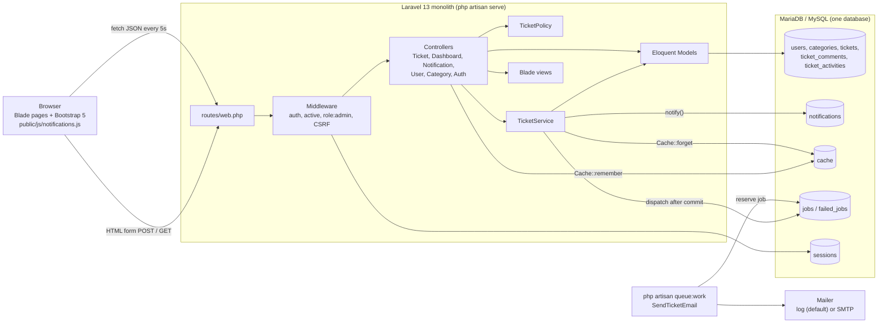
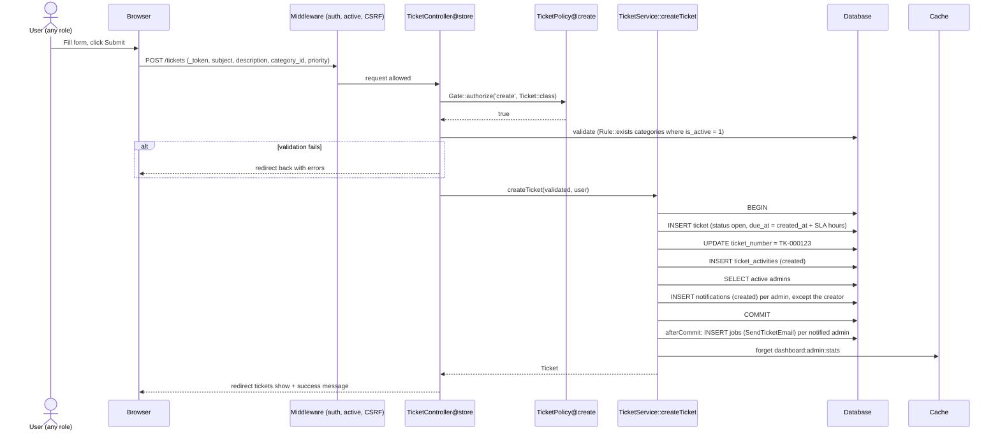
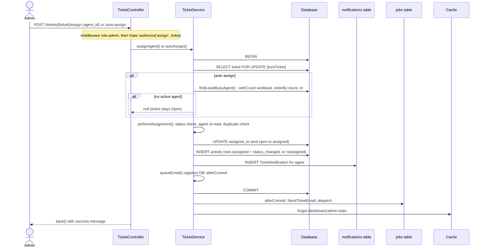
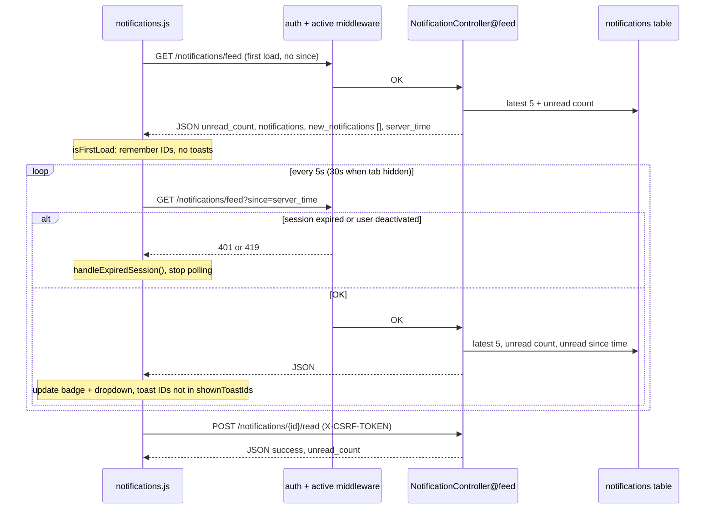
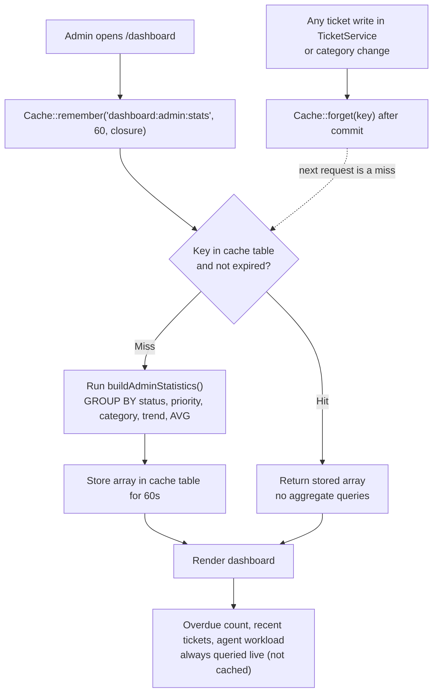
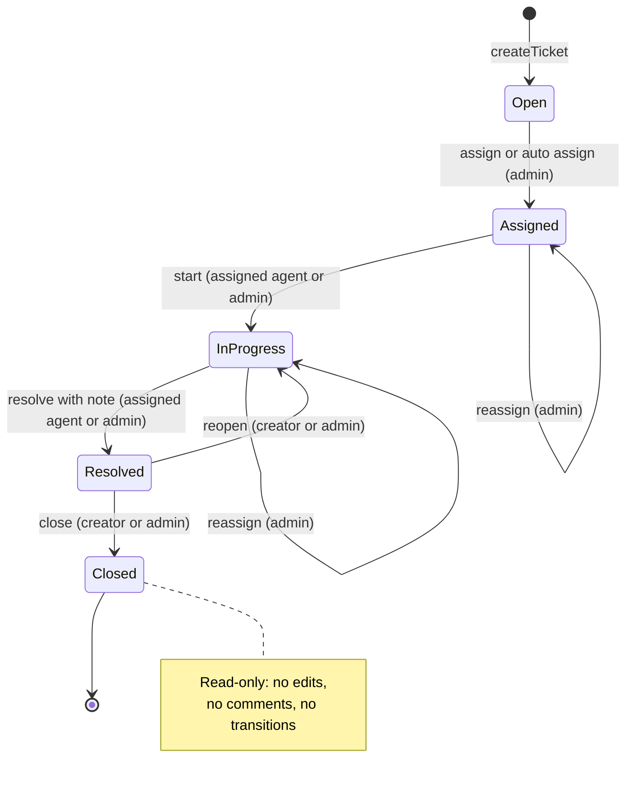

# 10 — System Design Guide

This guide explains **how ResolveDesk is designed** and **why** each decision was made.
Everything in Part A is **implemented** and can be found in the code.
Everything in Part C is **NOT implemented**. It is only a list of ideas for a bigger system.

Related guides: [Business logic](06-BUSINESS-LOGIC-GUIDE.md) ·
[Notifications](13-NOTIFICATION-SYSTEM-GUIDE.md) · [Queue and email](14-QUEUE-AND-EMAIL-GUIDE.md) ·
[Caching](15-CACHING-GUIDE.md) · [Database](03-DATABASE-GUIDE.md) · [Debugging](11-DEBUGGING-GUIDE.md)

---

## Contents

- [Part A — Implemented design concepts](#part-a--implemented-design-concepts)
- [Part B — Diagrams](#part-b--diagrams)
- [Part C — Future improvements (NOT implemented)](#part-c--future-improvements-not-implemented)
- [Part D — Trade-offs and known limitations](#part-d--trade-offs-and-known-limitations)

---

## The system in one paragraph

ResolveDesk is **one Laravel 13 application** (a monolith). Browsers send normal HTML form
requests and a few JSON (AJAX) requests. Routes pass through middleware (`auth`, `active`,
`role:admin`), then a controller. The controller checks permission with `TicketPolicy`, validates
the input, and calls `TicketService` for ticket business rules. Data lives in **one MariaDB/MySQL
database**. The same database also stores the **cache** (`cache` table), the **queue** (`jobs` and
`failed_jobs` tables), the **sessions** (`sessions` table) and the **in-app notifications**
(`notifications` table). A separate process, `php artisan queue:work`, sends emails in the
background. The browser asks for new notifications every 5 seconds (AJAX polling).

| Piece | Implemented with | Where configured |
|---|---|---|
| Web framework | Laravel 13.44.1, PHP 8.4.28 | `composer.json` |
| Database | MariaDB 10.4 (XAMPP) — code is MySQL 8 compatible | `.env` `DB_CONNECTION=mysql` |
| Sessions | Database driver | `.env` `SESSION_DRIVER=database` |
| Cache | Database driver (`cache` table) | `.env` `CACHE_STORE=database` |
| Queue | Database driver (`jobs`, `failed_jobs`) | `.env` `QUEUE_CONNECTION=database` |
| Mail | `log` mailer (emails written to `storage/logs/laravel.log`) | `.env` `MAIL_MAILER=log` |
| Frontend | Blade + Bootstrap 5.3 + Vanilla JS | `resources/views`, `public/js` |

> Note: the project specification asks for MySQL 8.x. Only MariaDB 10.4 is installed on the
> development PC, so the app was built and tested on MariaDB (see `DEVELOPMENT_PROGRESS.md`).
> The only database-specific SQL is `TIMESTAMPDIFF` and `DATE()` in `DashboardController`, and both
> work on MySQL 8 too.

---

# Part A — Implemented design concepts

Each concept below has the same structure: **what it is → where it is in ResolveDesk → why we chose it →
what would go wrong without it**.

## A1. Monolithic architecture

**What:** One codebase, one deployable application, one database. All modules (auth, users,
categories, tickets, comments, notifications, dashboard, email) live together in the same Laravel app.

**Where:** The whole repository. There is only one entry point (`public/index.php`), one route file
for the web (`routes/web.php`) and one database connection.

**Why:**
- The team is one developer. A monolith is the simplest thing to build, run, test and **explain in an interview**.
- Business operations need **one database transaction** across several tables (ticket + activity +
  notification). That is easy in a monolith and hard across microservices.
- Deployment is one `php artisan serve` (locally) plus one queue worker.

**Trade-off:** You can only scale the whole app, not one module. For ResolveDesk's size this is fine.

> **বাংলায়:** Monolith মানে পুরো application একটাই project, একটাই database। সব module একসাথে থাকে,
> তাই একটা transaction-এ ticket, activity আর notification একসাথে save করা সহজ। ছোট team আর
> interview project-এর জন্য এটাই সবচেয়ে সহজ ও বোঝার মতো design।

## A2. MVC (Model–View–Controller)

| Layer | ResolveDesk files | Job |
|---|---|---|
| **Model** | `app/Models/User.php`, `Ticket.php`, `Category.php`, `TicketComment.php`, `TicketActivity.php` | Table mapping, relationships, constants, small helpers (`calculateDueAt()`, `canPerform()`, `isOverdue()`), query scopes |
| **View** | `resources/views/**` (Blade) | HTML only. Reads data, shows buttons with `@can` |
| **Controller** | `app/Http/Controllers/*.php` | Receive request → authorize → validate → call model/service → return view/redirect/JSON |

Request flow written at the top of `app/Http/Controllers/TicketController.php`:

```php
 *   route -> middleware (auth, active[, role:admin]) -> this controller
 *   -> Gate::authorize() (TicketPolicy) -> validation -> TicketService -> redirect with message
```

**Why:** MVC is the standard Laravel structure. Any Laravel developer (and any interviewer) knows where
to look.

## A3. Separation of concerns

Each class has one clear job:

| Concern | Class | Example |
|---|---|---|
| "Is the user logged in and active?" | `auth` middleware + `app/Http/Middleware/ActiveUserMiddleware.php` | deactivated user is logged out on the next request |
| "Does the user have this role?" | `app/Http/Middleware/RoleMiddleware.php` (`role:admin`) | customer opening `/users` → 403 |
| "May THIS user do THIS action on THIS ticket?" | `app/Policies/TicketPolicy.php` | `Gate::authorize('resolve', $ticket)` |
| "Is the input valid?" | `$request->validate([...])` in controllers | `'priority' => ['required', Rule::in(array_keys(Ticket::PRIORITIES))]` |
| "What are the business rules?" | `app/Services/TicketService.php` | lock ticket, check transition, save, activity, notify |
| "How do we send an email?" | `app/Jobs/SendTicketEmail.php` + `app/Mail/TicketUpdateMail.php` | |
| "What does an in-app notification contain?" | `app/Notifications/TicketNotification.php` | |

**Important decision:** only **ticket** operations use a service class, because they coordinate many
steps. Plain CRUD (users, categories) stays inside the controller. This avoids unnecessary abstraction
(see `DEVELOPMENT_PROGRESS.md` → "Important decisions").

**Two different questions, two different places:**
- **WHO** may do it → `TicketPolicy` (checked in the controller).
- **WHEN** (in which state) it is allowed and **WHAT** happens → `TicketService` (checked again on the locked row).

## A4. Database normalization

**What:** Each fact is stored once, and other tables point to it with a foreign key.

| Table | Stores | Points to |
|---|---|---|
| `users` | people + `role` + `is_active` | — |
| `categories` | category name, description, `is_active` | — |
| `tickets` | ticket data, `status`, `priority`, `due_at` | `category_id` → categories, `created_by` → users, `assigned_to` → users (nullable) |
| `ticket_comments` | messages | `ticket_id`, `user_id` |
| `ticket_activities` | audit trail | `ticket_id`, `user_id` |
| `notifications` | in-app notifications (Laravel standard, polymorphic `notifiable`) | `notifiable_type` + `notifiable_id` |

Examples of normalization in the code:
- A ticket stores `category_id`, not the category name. Renaming a category changes it everywhere.
- A ticket stores the **status key** (`in_progress`). The label (`In Progress`) lives once in `Ticket::STATUSES`.

**Deliberate denormalization (snapshots):**
- `ticket_activities.old_value` / `new_value` store readable text such as `"Medium"` → `"Critical"`.
  An audit trail must show what was true **at that time**, even if names change later.
- `notifications.data` stores a JSON snapshot (`ticket_id`, `ticket_number`, `title`, `message`, `event_type`).
- The email job payload stores simple strings, not models (see A13).

**Foreign key rules** (`database/migrations/2026_11_25_000002_create_tickets_table.php`):

```php
$table->foreignId('category_id')->constrained('categories')->restrictOnDelete();
$table->foreignId('created_by')->constrained('users')->restrictOnDelete();
$table->foreignId('assigned_to')->nullable()->constrained('users')->restrictOnDelete();
```

`restrictOnDelete()` means the database **refuses** to delete a category or user that a ticket uses.
That is why users are deactivated, never deleted, and why categories in use must be deactivated.

> **বাংলায়:** Normalization মানে একই তথ্য একাধিক জায়গায় না রেখে একবার রাখা, আর অন্য table থেকে
> foreign key দিয়ে refer করা। যেমন ticket-এ category-র নাম না রেখে শুধু `category_id` রাখা হয়।
> তবে audit trail-এ পুরনো মান text হিসেবে রাখা হয়, কারণ ইতিহাস কখনো বদলানো উচিত নয়।

## A5. Role-based access control (RBAC)

**What:** Permissions depend on the user's role: `admin`, `agent`, `customer` (`User::ROLES`).

**Where:**
- Column `users.role` (string, indexed) and helpers `isAdmin()`, `isAgent()`, `isCustomer()` in `app/Models/User.php`.
- Route groups in `routes/web.php`:

```php
Route::middleware(['auth', 'active'])->group(function () {
    // all logged-in, active users
    Route::middleware('role:admin')->group(function () {
        // assign, auto-assign, users, categories
    });
});
```

- `RoleMiddleware::handle(Request $request, Closure $next, string ...$roles)` aborts with 403 when the role
  is not in the list. The alias `role` is registered in `bootstrap/app.php`.

**Why a simple string role and not a roles/permissions package:** only three fixed roles exist. A
constant + middleware is easy to read and modify. A package would be an unapproved dependency.

## A6. Resource authorization (policies)

**What:** RBAC answers "is this an admin?". Resource authorization answers "may **this** customer see
**this** ticket?".

**Where:** `app/Policies/TicketPolicy.php`. Laravel finds it automatically by name
(`App\Models\Ticket` → `App\Policies\TicketPolicy`).

```php
public function view(User $user, Ticket $ticket): bool
{
    if ($user->isAdmin()) {
        return true;
    }

    return $this->isCreator($user, $ticket) || $this->isAssignedAgent($user, $ticket);
}
```

The same rules are used in two places:
- **Controller:** `Gate::authorize('resolve', $ticket);` → throws 403 if false (real security).
- **Blade:** `@can('resolve', $ticket) ... @endcan` → hides buttons the user cannot use (only UX).

**List pages** use the matching query scope `Ticket::visibleTo($user)`, so a customer's list only
contains their own tickets. The policy protects single pages; the scope protects lists.

**Why both role middleware AND policy for assignment?** Defence in depth. `role:admin` blocks
non-admins at the route; `TicketPolicy::assign()` also checks the ticket is still active.

> **বাংলায়:** Role check বলে "তুমি কি admin?"; কিন্তু policy বলে "তুমি কি **এই নির্দিষ্ট** ticket-টা
> দেখতে বা বদলাতে পারো?"। Customer শুধু নিজের ticket দেখতে পারে — এটা policy আর `visibleTo()` scope
> দিয়ে backend-এ check হয়। Blade-এর `@can` শুধু button লুকায়, আসল নিরাপত্তা controller-এর `Gate::authorize()`।

## A7. State transitions (ticket lifecycle as a state machine)

**What:** A ticket can only move between statuses along allowed arrows. All arrows are in one constant:

```php
public const TRANSITIONS = [
    'start' => ['from' => self::STATUS_ASSIGNED, 'to' => self::STATUS_IN_PROGRESS],
    'resolve' => ['from' => self::STATUS_IN_PROGRESS, 'to' => self::STATUS_RESOLVED],
    'close' => ['from' => self::STATUS_RESOLVED, 'to' => self::STATUS_CLOSED],
    'reopen' => ['from' => self::STATUS_RESOLVED, 'to' => self::STATUS_IN_PROGRESS],
];
```

`Open → Assigned` is not in the table: it happens only through assignment (`performAssignment()`).

`Ticket::canPerform($action)` returns `$this->status === self::TRANSITIONS[$action]['from']`.

It is checked **three times**:
1. `TicketPolicy` (e.g. `start()` calls `$ticket->canPerform('start')`) → button hidden / 403.
2. `TicketService::ensureActionAllowed()` on the **locked** row → `ValidationException` if another user changed the status in the meantime.
3. The general edit form never touches `status` — `status` is **not** in `Ticket::$fillable`.

**Why a constant table and not a state-machine package:** the whole lifecycle fits in 4 lines and can be
changed in one place.

See the [ticket lifecycle diagram](#b7-ticket-lifecycle).

## A8. Workload-based assignment

**What:** "Auto Assign" picks the **active agent with the fewest Assigned + In Progress tickets**.
Ties are broken by the lowest `id` so the result is deterministic (and testable).

**Where:** `TicketService::findLeastBusyAgent()`:

```php
return User::where('role', User::ROLE_AGENT)
    ->where('is_active', true)
    ->withCount(['assignedTickets as workload_count' => function ($query) {
        $query->whereIn('status', Ticket::WORKLOAD_STATUSES);
    }])
    ->orderBy('workload_count')
    ->orderBy('id')
    ->first();
```

`Ticket::WORKLOAD_STATUSES` = `assigned`, `in_progress`. Resolved/closed tickets do not count, because
the agent is no longer working on them.

**Why one SQL query with `withCount`:** it counts in the database with a sub-query instead of loading
every ticket into PHP. The composite index `['assigned_to', 'status']` on `tickets` makes this count fast.

**If no active agent exists:** `autoAssign()` returns `null`, nothing is changed, and the admin sees
"No active support agent is available. The ticket remains Open."

**Limitation:** see [Part D](#part-d--trade-offs-and-known-limitations) — concurrent auto-assignment of
**different** tickets can choose the same agent.

## A9. Audit trail

**What:** Every important ticket change writes one row to `ticket_activities`
(`ticket_id`, `user_id`, `action`, `old_value`, `new_value`, timestamps).

**Where:** `TicketService::recordActivity()`, called inside the same transaction as the change.
Action names and labels: `TicketActivity::ACTION_LABELS`
(`created`, `updated`, `assigned`, `reassigned`, `priority_changed`, `due_date_changed`,
`status_changed`, `resolved`, `reopened`, `closed`).

**Why inside the transaction:** the history can never say something happened that was rolled back, and a
change can never be saved without its history.

**Why it matters:** support teams need to answer "who changed this, and when?". The reopen action even
stores the old resolution note: `'Previous resolution: ' . $previousNote`.

## A10. ACID transactions and row locking

**What:** Every `TicketService` write method wraps its work in `DB::transaction(function () { ... })`.

| ACID letter | What it means in ResolveDesk |
|---|---|
| **Atomicity** | Ticket update + activity rows + notification row are saved together or not at all. If anything throws, Laravel rolls back. |
| **Consistency** | Foreign keys, unique `ticket_number`, and the transition checks keep data valid. |
| **Isolation** | `lockTicket()` uses `SELECT ... FOR UPDATE`, so two people cannot change the same ticket at the same moment. |
| **Durability** | After COMMIT, MariaDB/InnoDB keeps the data even if the server crashes. |

```php
private function lockTicket(Ticket $ticket): Ticket
{
    return Ticket::whereKey($ticket->id)->lockForUpdate()->firstOrFail();
}
```

**Example of the race it prevents:** a ticket is Resolved. The customer clicks **Close** and, at the same
moment, an admin clicks **Reopen**. Both pages showed the button, so both policy checks passed.
The first transaction locks the row and closes the ticket. The second waits, then reads the **new** status
(`closed`), and `ensureActionAllowed()` throws "This action is not allowed while the ticket is Closed."

**Ticket number inside the transaction:** `createTicket()` inserts first (database gives the `id`), then
sets `ticket_number = Ticket::makeTicketNumber($ticket->id)` (e.g. `TK-000007`) and saves again — in the
same transaction. Using `MAX(id) + 1` instead could give two tickets the same number.

> **বাংলায়:** Transaction মানে কয়েকটা database কাজ একসাথে "সব হবে, নয়তো কিছুই হবে না"। মাঝপথে error হলে
> আগের সব পরিবর্তন rollback হয়ে যায়। `lockForUpdate()` একটা ticket row-কে lock করে, ফলে দুজন একই সময়ে
> একই ticket বদলাতে পারে না — দ্বিতীয়জন অপেক্ষা করে, তারপর নতুন status দেখে rule আবার check করে।

## A11. Database indexing

Defined in the migrations:

| Index | Table | Used by |
|---|---|---|
| `unique(email)` | users | login lookup, uniqueness |
| `index(role)` | users | `where('role', 'agent')` in auto-assign and agent lists |
| `unique(name)` | categories | uniqueness |
| `unique(ticket_number)` | tickets | search, guarantee no duplicates (allows multiple NULLs) |
| `index(status)` | tickets | status filter, dashboard counts |
| `index(priority)` | tickets | priority filter, dashboard counts |
| `index(due_at)` | tickets | `overdue()` scope (`due_at < NOW()`) |
| `index(created_at)` | tickets | list ordering (`latest()`), date filters, 14-day trend |
| `index(['assigned_to', 'status'])` | tickets | workload count `WHERE assigned_to = ? AND status IN (...)` |
| `morphs('notifiable')` index | notifications | `$user->notifications()` |
| FK columns | all | MySQL/MariaDB creates an index for each foreign key automatically if none exists |

**Why not index everything:** each index slows down INSERT/UPDATE a little and uses disk. We only index
columns that appear in `WHERE`, `ORDER BY` or joins. Note: `LIKE '%text%'` search on `subject` cannot use
a normal index (leading wildcard) — acceptable at this size.

## A12. Eager loading (and preventing N+1)

**Problem (N+1):** showing 15 tickets and calling `$ticket->creator->name` in the loop runs 1 query for the
list + 15 queries for creators (+15 for categories, +15 for agents).

**Solution in `TicketController@index`:**

```php
$query = Ticket::with(['category', 'creator', 'assignedAgent'])
    ->visibleTo($user);
```

This runs 1 query for tickets + 1 query per relationship = 4 queries, no matter how many rows.

Other places: `$ticket->load(['category', 'creator', 'assignedAgent', 'comments.user', 'activities.user'])`
in `TicketController@show`; `withCount(...)` for counts in `DashboardController` and `CategoryController@index`.

**Safety net:** `app/Providers/AppServiceProvider.php`:

```php
Model::preventLazyLoading(! $this->app->isProduction());
```

Outside production, forgetting `with()` throws `LazyLoadingViolationException`, so N+1 bugs are found
during development (and `tests/Feature/PageRenderingTest.php` opens every page to catch them). In
production it is turned off so a missed case is slow, not broken.

> **বাংলায়:** N+1 সমস্যা মানে list-এর প্রতিটা row-এর জন্য আলাদা query চলা — 15টা ticket মানে আরও 15টা
> query। `with()` দিয়ে eager loading করলে সব relationship একবারে কয়েকটা query-তে load হয়।
> `preventLazyLoading()` development-এ ভুল ধরিয়ে দেয়, error throw করে।

## A13. Pagination

`TicketController@index`: `$query->latest()->paginate(self::PER_PAGE)->withQueryString();` with
`PER_PAGE = 15`. Users, categories and the notification history also paginate by 15.

- `paginate()` runs `LIMIT 15 OFFSET ...` plus one `COUNT(*)` query for the page links.
- `withQueryString()` keeps filters (`?status=open&priority=high`) in the page links.
- `Paginator::useBootstrapFive()` (in `AppServiceProvider`) renders Bootstrap 5 HTML for `{{ $tickets->links() }}`.

**Why:** never load all tickets into memory. **Limitation:** OFFSET pagination gets slower on very deep
pages; cursor pagination would be the alternative for huge tables (not needed here).

## A14. Cache-aside pattern

**What:** The application checks the cache first. On a miss it reads the database and stores the result.
The database stays the source of truth.

Two caches are implemented (both in the `cache` table because `CACHE_STORE=database`):

| Cache key | Code | TTL | What is cached |
|---|---|---|---|
| `dashboard:admin:stats` (`TicketService::DASHBOARD_CACHE_KEY`) | `DashboardController::adminDashboard()` | 60 s (`ADMIN_STATS_TTL_SECONDS`) | status/priority/category counts, 14-day trend, average resolution hours |
| `ticket:active-categories` (`Category::ACTIVE_CACHE_KEY`) | `Category::activeForDropdown()` | 3600 s (`ACTIVE_CACHE_TTL_SECONDS`) | active categories for ticket form dropdowns |

```php
$stats = Cache::remember(TicketService::DASHBOARD_CACHE_KEY, self::ADMIN_STATS_TTL_SECONDS, function () {
    return $this->buildAdminStatistics();
});
```

**Not cached on purpose:** the overdue count (`Ticket::overdue()->count()`), recent tickets, agent
workload, agent and customer dashboards, notifications and permissions. These must always be current.

**Cache is display-only:** `TicketController@store` validates the category against the database:
`Rule::exists('categories', 'id')->where('is_active', true)`. A stale cache can never let a user save a
ticket with an inactive category (tested by `test_validation_never_trusts_a_stale_category_cache`).

> **বাংলায়:** Cache-aside মানে আগে cache-এ খোঁজো; পেলে (hit) সেটাই ফেরত দাও, না পেলে (miss) database
> থেকে হিসাব করে cache-এ রেখে দাও। Database সবসময় আসল সত্য — cache শুধু দ্রুত দেখানোর জন্য। তাই
> validation বা permission কখনো cache থেকে নয়, database থেকে check হয়।

## A15. Cache invalidation

Two strategies are combined:

1. **Explicit invalidation (forget on write):**
   - Every successful ticket write in `TicketService` calls `clearDashboardCache()` → `Cache::forget(self::DASHBOARD_CACHE_KEY)`.
     (`addComment()` does not, because comments do not change dashboard numbers.)
   - `CategoryController::clearCaches()` runs after store/update/destroy and forgets **both** keys
     (the dashboard chart shows category names).
2. **TTL expiry:** even if a write path forgets to clear the cache (e.g. someone edits data in phpMyAdmin),
   the dashboard is at most 60 seconds old, the category list at most 1 hour old.

**Why forget instead of update:** deleting the key is simple and always correct; the next request rebuilds
fresh data. Updating cached numbers by hand is error-prone.

**Why clear after the transaction, not inside it:** if the cache were cleared inside the transaction, another
request could rebuild the cache from the **old** (not yet committed) data.

## A16. Asynchronous email processing

**What:** Emails are not sent during the web request. The request only stores a job in the `jobs` table.

**Why:** SMTP can take seconds or fail. The user who clicks **Assign** should not wait for Gmail, and a
mail-server problem must not roll back a valid assignment.

**Where:** `TicketService::queueEmail()`:

```php
DB::afterCommit(function () use ($recipientEmail, $recipientName, $emailData) {
    try {
        SendTicketEmail::dispatch($recipientEmail, $recipientName, $emailData);
    } catch (Throwable $exception) {
        Log::error('Could not queue ticket email', [ ... ]);
    }
});
```

Three design decisions:
1. **`DB::afterCommit()`** — the job is pushed only after COMMIT. If the transaction rolls back, the closure
   is discarded and no email is sent about something that never happened
   (`test_no_email_job_is_dispatched_when_the_transaction_rolls_back`).
   Laravel can also do this through `'after_commit' => true` in `config/queue.php`; ResolveDesk keeps it
   `false` and calls `DB::afterCommit()` explicitly so the behaviour is visible in the code.
2. **`try/catch` + `Log::error`** — if pushing the job fails, the ticket change is already committed, so the
   user still sees success and the problem is logged.
3. **Simple payload** — only strings and a small array (`ticket_id`, `ticket_number`, `subject`, `status`,
   `event_title`, `event_message`), not Eloquent models. The payload is small and independent of later changes.

**Which events email?** Only `created` (to every active admin, except the creator), `assigned`, `reassigned`,
`resolved`, `reopened` (the `true` last argument of `notifyUser()`). Comments and closure are in-app only.
The `created` → admins email was added at the project owner's request, beyond MASTER_PROMPT §9.2.

**In-app notifications are not queued.** `TicketNotification::via()` returns `['database']` and the class
does not implement `ShouldQueue`, so the row is inserted inside the transaction and works even when no
worker runs.

## A17. Producer–consumer pattern

| Role | ResolveDesk |
|---|---|
| **Producer** | `TicketService::queueEmail()` → `SendTicketEmail::dispatch(...)` inserts a row into `jobs` |
| **Buffer** | `jobs` table (database queue driver) |
| **Consumer** | `php artisan queue:work` process → reserves a row → runs `SendTicketEmail::handle()` → deletes the row |

The producer and the consumer run at different speeds and can be restarted independently. If the worker
is stopped, jobs simply wait (verified: 2 jobs waited, then `php artisan queue:work --stop-when-empty`
processed both).

> **বাংলায়:** Producer-consumer মানে একজন কাজ তৈরি করে লাইনে রাখে (web request → `jobs` table), আর
> আরেকজন আলাদাভাবে লাইন থেকে কাজ নিয়ে করে (`queue:work`)। দুজনের গতি আলাদা হলেও সমস্যা নেই —
> worker বন্ধ থাকলে job শুধু অপেক্ষা করে, হারিয়ে যায় না।

## A18. Queue retry

`app/Jobs/SendTicketEmail.php`:

```php
public int $tries = 3;     // at most 3 attempts
public int $backoff = 10;  // wait 10 seconds before each retry
```

If `handle()` throws (e.g. SMTP down), the worker releases the job back to `jobs` with `available_at = now + 10s`.
After the 3rd failure it is moved to `failed_jobs`.

Also relevant: `config/queue.php` → database connection `'retry_after' => 90`. If a worker reserves a job and
then crashes, the job becomes available again after 90 seconds.

## A19. Failed job handling

- After the last attempt, Laravel stores the job in `failed_jobs` (`uuid`, `payload`, `exception`, `failed_at`).
- `SendTicketEmail::failed(?Throwable $exception)` runs once and writes
  `Log::error('Ticket email failed permanently', [...])` to `storage/logs/laravel.log`.
- An admin/developer can inspect and retry: `php artisan queue:failed`, `php artisan queue:retry <uuid>`
  or `php artisan queue:retry all`.
- The ticket change is **not** affected — it was committed long before.

## A20. AJAX polling

**What:** `public/js/notifications.js` asks `GET /notifications/feed` every 5 seconds and updates the
bell badge, the dropdown, and shows Bootstrap toasts for new notifications.

Key design choices in the JS:

| Choice | Code | Why |
|---|---|---|
| Interval | `POLL_INTERVAL_MS = 5000`, `HIDDEN_POLL_INTERVAL_MS = 30000` | near-real-time, but slower in background tabs to save server load |
| Recursive `setTimeout`, not `setInterval` | `scheduleNextPoll()` called in `finally` | next request starts only after the previous one finished → requests never overlap |
| `isRequestRunning` flag + `clearTimeout(timerId)` | | only one polling loop ever exists |
| `?since=<server_time>` | `lastServerTime = data.server_time` | server returns only new notifications; uses the **server's** clock, not the browser's |
| `shownToastIds` (a `Set`) | | the same toast is never shown twice |
| `isFirstLoad` | | old notifications are not shown as toasts on page load |
| `visibilitychange` listener | | poll immediately when the user returns to the tab |
| 401/419 handling | `handleExpiredSession()` | stop polling and show "Sign in again" |
| `textContent`, never `innerHTML` | | prevents XSS from ticket subjects/comments |

**Why polling and not WebSockets:** no extra server (Reverb/Pusher), no extra dependency, works with plain
PHP and Bootstrap. The cost is latency (up to ~5 s) and some extra requests.

> **বাংলায়:** Polling মানে browser নিজেই কয়েক সেকেন্ড পর পর server-কে জিজ্ঞেস করে "নতুন কিছু আছে?"।
> Server নিজে থেকে push করে না। তাই notification সাথে সাথে না এসে সর্বোচ্চ ~5 সেকেন্ড দেরিতে আসে, কিন্তু
> setup খুব সহজ — কোনো আলাদা WebSocket server লাগে না।

## A21. JSON API communication

`NotificationController@feed` returns:

```php
return response()->json([
    'unread_count' => $user->unreadNotifications()->count(),
    'notifications' => $latest->map(fn ($notification) => $this->formatNotification($notification)),
    'new_notifications' => $newNotifications->map(fn ($notification) => $this->formatNotification($notification)),
    // The browser sends this back as ?since= on the next poll.
    'server_time' => $serverTime, // now()->toIso8601String(), captured before the queries
]);
```

`new_notifications` uses `created_at >= since` minus a 10-second overlap (`SINCE_OVERLAP_SECONDS`), so a row
from a transaction that committed after the previous poll still gets a toast; the JS `shownToastIds` Set drops
duplicates.

Each item has the shape built by `formatNotification()`: `id`, `title`, `message`, `ticket_number`,
`event_type`, `ticket_url`, `is_read`, `time_ago`.

Rules of this small internal API:
- Same session cookie as the HTML pages (`credentials: 'same-origin'`), so the same `auth` + `active` middleware applies.
- Requests send `Accept: application/json`, so Laravel returns JSON errors: 401 (not logged in / deactivated),
  419 (CSRF), 422 (`?since=abc` fails `'since' => ['nullable', 'date']`).
- POST endpoints (`notifications.read`, `notifications.read-all`) send the `X-CSRF-TOKEN` header read from
  `<meta name="csrf-token">` in `resources/views/layouts/app.blade.php`.
- `markAsRead` and `markAllAsRead` return JSON when `$request->expectsJson()`, and a redirect for normal forms —
  one endpoint serves both the JS dropdown and the history page.
- Security: every query starts from `$request->user()->notifications()`, so a user can never read or change
  another user's notification (another user's id → 404).

---

# Part B — Diagrams

All diagrams show **implemented** behaviour.

## B1. Overall architecture



## B2. Ticket creation



## B3. Ticket assignment (manual and automatic)



## B4. Notification polling



## B5. Queue and email


## B6. Cache hit and miss



## B7. Ticket lifecycle



`InProgress` in the diagram = status value `in_progress`.

---

# Part C — Future improvements (NOT implemented)

> **Everything in this part is NOT in the code.** These are ideas to discuss in an interview when asked
> "How would you scale this?". Do not describe them as existing features.

| # | Idea | Problem it would solve in ResolveDesk | What would change | Trade-off |
|---|---|---|---|---|
| C1 | **Redis cache** | `CACHE_STORE=database` still runs a SQL query to read the cache | `.env` `CACHE_STORE=redis`; same `Cache::remember()` code works unchanged | New server to run and monitor; data in memory |
| C2 | **Redis queue** | Database queue polls the `jobs` table and locks rows; heavy load hurts the main DB | `QUEUE_CONNECTION=redis`; same `SendTicketEmail` class | Redis must be persistent/backed up or queued jobs can be lost |
| C3 | **Multiple queue workers** | One worker sends emails one by one | Run several `queue:work` processes (Supervisor on Linux, a service on Windows) | Jobs may run in a different order; need idempotency (C13) |
| C4 | **Laravel Reverb** | Notifications arrive up to 5 s late and every tab polls | First-party Laravel WebSocket server; broadcast `TicketNotification` on a private channel | Extra long-running process, more moving parts |
| C5 | **WebSockets (general)** | Polling wastes requests when nothing is new | Persistent two-way connection; server pushes instantly | Connection management, scaling sticky connections, auth on channels |
| C6 | **Server-Sent Events (SSE)** | Same as above, but one-way push is enough for notifications | One long HTTP response streaming events to the browser | Holds a PHP worker per open tab with classic PHP-FPM |
| C7 | **Load balancer** | One `php artisan serve` handles all traffic | Nginx/HAProxy/cloud LB in front of many app servers | Need shared state (C9) and health checks (`/up` route already exists from the skeleton) |
| C8 | **Multiple application servers** | One server is a single point of failure | Same code on N servers behind C7 | Deployments must update all servers; local files must not be used for shared data |
| C9 | **Shared sessions** | Sessions on one server would not be seen by another | Already **partly ready**: `SESSION_DRIVER=database` stores sessions in the shared DB. At scale, move to Redis | DB session writes on every request add DB load |
| C10 | **Database read replicas** | Dashboard and list reads compete with writes | Laravel `read`/`write` hosts in `config/database.php` | Replication lag: a user may not see their own change immediately |
| C11 | **Object storage** | Not needed today (no attachments) — becomes needed if file attachments are added | Store files on S3-compatible storage via the `Storage` facade | Cost, signed URLs for private files |
| C12 | **Scheduled SLA escalation** | Today "overdue" is only **calculated live** (`isOverdue()`, `overdue()` scope); nobody is alerted | A Laravel Scheduler task (e.g. every 5 minutes) that finds overdue tickets and notifies admins once, plus `php artisan schedule:work` / a cron entry | Must avoid alerting twice (store an `escalated_at` column) |
| C13 | **Idempotent processing** | A retried `SendTicketEmail` can send the same email twice | Give each email a unique key; record "sent" in a table before/after sending and skip if already sent | Extra table/write per email |
| C14 | **Transactional outbox** | `DB::afterCommit()` + `dispatch()` is not atomic: if the process dies after COMMIT but before the job is stored, the email is lost (we only log dispatch errors) | Insert an "outbox" row **inside** the same transaction; a separate relay moves outbox rows to the queue | More code, a relay process, still needs idempotent consumers |

### Short explanations

- **Redis vs database cache:** Redis keeps keys in RAM, so reads take microseconds and do not touch MySQL.
  ResolveDesk only caches two small keys, so the database store is acceptable today.
- **Reverb/WebSockets/SSE vs polling:** polling is "ask every 5 seconds"; push is "server tells you when
  something happens". Push gives instant delivery and fewer empty requests, but needs a long-running server.
- **Scaling the web tier:** a load balancer spreads requests over several identical servers. Anything stored
  on one server's disk or memory (sessions, cache, uploaded files) must move to a shared store first.
- **Read replicas:** copies of the database that receive changes from the primary. Reads go to replicas,
  writes to the primary.
- **Outbox:** the ticket change and the "please send email" message are saved in the **same** transaction,
  so they can never disagree.

> **বাংলায়:** এই অংশের কোনো কিছুই এখন code-এ নেই — এগুলো শুধু ভবিষ্যতে বড় system-এর জন্য ধারণা।
> Interview-তে "কীভাবে scale করবেন?" প্রশ্ন এলে বলবেন: cache ও queue Redis-এ নেব, একাধিক worker চালাব,
> polling-এর বদলে Reverb/WebSocket দিয়ে push করব, load balancer-এর পেছনে একাধিক server রাখব, আর
> duplicate email ঠেকাতে idempotency ও transactional outbox ব্যবহার করব।

> **বাংলায় (Outbox ও Idempotency):** Idempotent মানে একই কাজ দুবার চালালেও ফলাফল একবারের মতোই থাকে —
> যেমন email আগে পাঠানো হয়ে থাকলে আবার পাঠাবে না। Transactional outbox মানে ticket-এর পরিবর্তন আর
> "email পাঠাতে হবে" বার্তা একই transaction-এ database-এ লেখা, যাতে একটা save হয়ে অন্যটা হারিয়ে না যায়।

---

# Part D — Trade-offs and known limitations

These are honest limitations of the **current** implementation. Knowing them is a strength in an interview.

| # | Limitation | Why it happens | Impact | Possible fix (not implemented) |
|---|---|---|---|---|
| D1 | **Concurrent auto-assign of different tickets can pick the same agent** | `autoAssign()` locks only the **ticket** row (`lockTicket()`), not the agent workload. Two admins auto-assigning ticket A and ticket B at the same moment can both read "Michael has 2" and both assign to Michael. | Workload can become slightly unbalanced (never corrupt data). | Lock the agent rows too (`lockForUpdate()` on the chosen user) or use an atomic counter. |
| D2 | **Duplicate email possible on retry** | A job may send the email and then fail (or the worker may crash) before the job row is deleted. With `$tries = 3` the job runs again. Also if a send takes longer than `retry_after` (90 s), another worker could pick it up. | Recipient may get the same email twice. | Idempotency key (C13). |
| D3 | **Email can be lost between COMMIT and dispatch** | `DB::afterCommit()` runs after COMMIT; if dispatch fails, we only `Log::error()`. | In-app notification exists, email does not. | Transactional outbox (C14). |
| D4 | **Database cache still hits the database** | `CACHE_STORE=database` reads the `cache` table. It saves the **expensive** aggregate queries, but not the round-trip to MySQL. | Smaller benefit than Redis. | Redis cache (C1). |
| D5 | **Dashboard numbers can be up to 60 s stale** | Only if data changes outside `TicketService`/`CategoryController` (e.g. direct SQL, phpMyAdmin, tinker). Normal app writes clear the key. | Admin sees old counts for up to 60 s. | `php artisan cache:clear` or `Cache::forget('dashboard:admin:stats')`. |
| D6 | **Notification latency up to ~5 s (30 s in a hidden tab)** | Polling interval `POLL_INTERVAL_MS = 5000`, `HIDDEN_POLL_INTERVAL_MS = 30000`. | Not instant. | Reverb/WebSockets/SSE (C4–C6). |
| D7 | **Polling load grows with open tabs** | Each open tab sends 1 request / 5 s → 3 queries each (latest 5, unread count, since-query). | Fine for a small team; heavy for thousands of users. | Push (C4) or longer interval. |
| D8 | **No automatic SLA escalation** | Overdue is calculated live only when someone views a page. | Nobody is alerted when a ticket becomes overdue. | Scheduler task (C12). |
| D9 | **Reopen keeps the original SLA deadline** | Deliberate simplified rule in `TicketService::reopen()`. | A reopened ticket can be immediately overdue. | Recalculate `due_at` on reopen if the business wants it. |
| D10 | **Single server, single DB** | Monolith design. | Single point of failure. | C7–C10. |
| D11 | **SLA uses calendar hours** | `Ticket::calculateDueAt()` adds hours with `addHours()`. | Weekends/nights count. | Business-hours calendar. |

> **বাংলায়:** D1 উদাহরণ: দুজন admin একই মুহূর্তে দুটো আলাদা ticket auto-assign করলে, দুজনেই একই
> agent-কে "সবচেয়ে কম কাজ" দেখে assign করতে পারে, কারণ আমরা শুধু ticket row lock করি, agent নয়। Data নষ্ট হয়
> না, শুধু কাজের ভাগ একটু অসমান হতে পারে। D2 উদাহরণ: email পাঠানোর পর job delete হওয়ার আগে worker crash
> করলে retry-তে একই email দুবার যেতে পারে।

---

## Interview summary (30 seconds)

"ResolveDesk is a Laravel MVC monolith on one MySQL-compatible database. Middleware handles login, active
status and roles; `TicketPolicy` handles per-ticket permissions; `TicketService` runs every ticket change in a
transaction with a row lock, writes an audit trail, inserts an in-app notification, and pushes an email job
only after commit. A database queue worker sends emails with 3 tries and a 10-second backoff; failures go to
`failed_jobs`. Admin statistics and the category dropdown use cache-aside with explicit invalidation. The
browser polls a JSON endpoint every 5 seconds for notifications. To scale, I would move cache and queue to
Redis, add workers, replace polling with Reverb, and add idempotency/outbox for exactly-once email."
