# 10 — System Design Guide

This guide explains **how ResolveDesk is designed** and **why** each decision was made.

- **Part A** (design concepts) and **Part B** (diagrams) describe the base design from V1. It is still valid; where V2
  changed something, a **V2:** note says so.
- **Part E** is the **V2 system design** (V2 spec §37): requirements, high-level architecture, ER summary, sequence
  diagrams (assignment, notification, queue, cache, concurrency), security boundaries, deployment architecture,
  failure scenarios and scaling. Each item is marked **Implemented** or **Future**.
- **Part C** lists future ideas (NOT implemented). **Part D** lists trade-offs and known limitations.

Related guides: [Business logic](06-BUSINESS-LOGIC-GUIDE.md) ·
[Notifications](13-NOTIFICATION-SYSTEM-GUIDE.md) · [Queue and email](14-QUEUE-AND-EMAIL-GUIDE.md) ·
[Caching](15-CACHING-GUIDE.md) · [Database](03-DATABASE-GUIDE.md) · [Debugging](11-DEBUGGING-GUIDE.md) ·
[Production deployment](18-PRODUCTION-DEPLOYMENT.md) · [Backup and recovery](19-BACKUP-AND-RECOVERY.md) ·
[Concurrency](20-CONCURRENCY-AND-DATA-INTEGRITY.md) · [Real-time](21-REALTIME-REVERB-ECHO.md) ·
[V2 features](22-V2-BUSINESS-FEATURES.md) · [Security/ops](23-SECURITY-ERRORS-LOGGING-OPERATIONS.md)

---

## Contents

- [Part A — Implemented design concepts](#part-a--implemented-design-concepts)
- [Part B — Diagrams](#part-b--diagrams)
- [Part C — Future improvements (NOT implemented)](#part-c--future-improvements-not-implemented)
- [Part D — Trade-offs and known limitations](#part-d--trade-offs-and-known-limitations)
- [Part E — V2 system design](#part-e--v2-system-design)

---

## The system in one paragraph (V2)

ResolveDesk is **one Laravel 13 application** (a modular monolith). Browsers send normal HTML form requests and a few
JSON requests. Routes pass through middleware (`web` + `AddRequestContext`, `auth`, `active`, `role:admin`,
`throttle:*`), then a controller. The controller checks permission with `TicketPolicy` (or a Form Request), validates
the input, and calls a service (`TicketService`, `TicketAssignmentService`, `ProjectService`, `AttachmentService`).
Data lives in **one MariaDB/MySQL database**, which also stores the **cache** and **atomic locks** (`cache`,
`cache_locks`), the **queue** (`jobs`, `failed_jobs`), the **sessions** and the **in-app notifications**. Three
long-running helper processes run next to the web server: `php artisan queue:work` (emails),
`php artisan reverb:start` (WebSocket push on private channels `users.{id}`) and the scheduler
(`schedule:work` locally / cron `schedule:run`) which runs `tickets:check-sla` every minute. Attachments are stored on
the private local disk. If Reverb is down, the browser falls back to polling every 5 seconds.

| Piece | Implemented with | Where configured |
|---|---|---|
| Web framework | Laravel 13.44.1, PHP 8.4.28 | `composer.json` |
| Database | MariaDB 10.4 (XAMPP) — MySQL 8 is the target but was **not tested** | `.env` `DB_CONNECTION=mysql` |
| Sessions | Database driver | `SESSION_DRIVER=database` |
| Cache + locks | Database driver (`cache`, `cache_locks`) | `CACHE_STORE=database` |
| Queue | Database driver (`jobs`, `failed_jobs`) | `QUEUE_CONNECTION=database` |
| Real-time | Laravel Reverb 1.14 + Echo/pusher-js (Vite bundle) | `BROADCAST_CONNECTION=reverb`, `REVERB_*`, `VITE_REVERB_*` |
| Scheduler | `routes/console.php` | cron / `schedule:work` |
| Files | `local` private disk (`storage/app/private`) | `config/resolvedesk.php` |
| Mail | `log` mailer | `MAIL_MAILER=log` |
| Frontend | Blade + Bootstrap 5.3 + Vanilla JS | `resources/views`, `public/js`, `resources/js/realtime.js` |

> Note: the only database-specific SQL is `TIMESTAMPDIFF` and `DATE()` in `DashboardController`; both work on MySQL 8.
> InnoDB `FOR UPDATE` / `LOCK IN SHARE MODE` behave the same on MariaDB 10.4 for this project.

---

# Part A — Implemented design concepts

Each concept below has the same structure: **what it is → where it is in ResolveDesk → why we chose it →
what would go wrong without it**.

## A1. Monolithic architecture

**What:** One codebase, one deployable application, one database. All modules (auth, users,
categories, tickets, comments, notifications, dashboard, email) live together in the same Laravel app.

**Where:** The whole repository. There is only one entry point (`public/index.php`), one route file
for the web (`routes/web.php`) and one database connection.

**Why:**
- The team is one developer. A monolith is the simplest thing to build, run, test and **explain in an interview**.
- Business operations need **one database transaction** across several tables (ticket + activity +
  notification). That is easy in a monolith and hard across microservices.
- Deployment is one `php artisan serve` (locally) plus one queue worker.

**Trade-off:** You can only scale the whole app, not one module. For ResolveDesk's size this is fine.

> **বাংলায়:** Monolith মানে পুরো application একটাই project, একটাই database। সব module একসাথে থাকে,
> তাই একটা transaction-এ ticket, activity আর notification একসাথে save করা সহজ। ছোট team আর
> interview project-এর জন্য এটাই সবচেয়ে সহজ ও বোঝার মতো design।

## A2. MVC (Model–View–Controller)

| Layer | ResolveDesk files | Job |
|---|---|---|
| **Model** | `app/Models/User.php`, `Ticket.php`, `Category.php`, `TicketComment.php`, `TicketActivity.php` | Table mapping, relationships, constants, small helpers (`calculateDueAt()`, `canPerform()`, `isOverdue()`), query scopes |
| **View** | `resources/views/**` (Blade) | HTML only. Reads data, shows buttons with `@can` |
| **Controller** | `app/Http/Controllers/*.php` | Receive request → authorize → validate → call model/service → return view/redirect/JSON |

Request flow written at the top of `app/Http/Controllers/TicketController.php`:

```php
 *   route -> middleware (auth, active[, role:admin]) -> this controller
 *   -> Gate::authorize() (TicketPolicy) -> validation -> TicketService -> redirect with message
```

**Why:** MVC is the standard Laravel structure. Any Laravel developer (and any interviewer) knows where
to look.

## A3. Separation of concerns

Each class has one clear job:

| Concern | Class | Example |
|---|---|---|
| "Is the user logged in and active?" | `auth` middleware + `app/Http/Middleware/ActiveUserMiddleware.php` | deactivated user is logged out on the next request |
| "Does the user have this role?" | `app/Http/Middleware/RoleMiddleware.php` (`role:admin`) | customer opening `/users` → 403 |
| "May THIS user do THIS action on THIS ticket?" | `app/Policies/TicketPolicy.php` | `Gate::authorize('resolve', $ticket)` |
| "Is the input valid?" | `$request->validate([...])` in controllers; V2: `StoreTicketRequest` for ticket creation | `'priority' => ['required', Rule::in(array_keys(Ticket::PRIORITIES))]` |
| "What are the business rules?" | `app/Services/TicketService.php` | lock ticket, check transition, save, activity, notify |
| "How do we send an email?" | `app/Jobs/SendTicketEmail.php` + `app/Mail/TicketUpdateMail.php` | |
| "What does an in-app notification contain?" | `app/Notifications/TicketNotification.php` | |

**Important decision:** only operations that coordinate many steps use a service class (V2: ticket rules,
assignment, notification delivery, attachments, project associations). Plain CRUD (users, categories, clients, project
fields) stays inside the controller. This avoids unnecessary abstraction
(see `DEVELOPMENT_PROGRESS.md` → "Important decisions").

**Two different questions, two different places:**
- **WHO** may do it → `TicketPolicy` (checked in the controller).
- **WHEN** (in which state) it is allowed and **WHAT** happens → `TicketService` (checked again on the locked row).

## A4. Database normalization

**What:** Each fact is stored once, and other tables point to it with a foreign key.

| Table | Stores | Points to |
|---|---|---|
| `users` | people + `role` + `is_active` | — |
| `categories` | category name, description, `is_active` | — |
| `tickets` | ticket data, `status`, `priority`, `due_at` | `category_id` → categories, `created_by` → users, `assigned_to` → users (nullable) |
| `ticket_comments` | messages | `ticket_id`, `user_id` |
| `ticket_activities` | audit trail | `ticket_id`, `user_id` |
| `notifications` | in-app notifications (Laravel standard, polymorphic `notifiable`) | `notifiable_type` + `notifiable_id` |

Examples of normalization in the code:
- A ticket stores `category_id`, not the category name. Renaming a category changes it everywhere.
- A ticket stores the **status key** (`in_progress`). The label (`In Progress`) lives once in `Ticket::STATUSES`.

**Deliberate denormalization (snapshots):**
- `ticket_activities.old_value` / `new_value` store readable text such as `"Medium"` → `"Critical"`.
  An audit trail must show what was true **at that time**, even if names change later.
- `notifications.data` stores a JSON snapshot (`ticket_id`, `ticket_number`, `title`, `message`, `event_type`).
- The email job payload stores simple strings, not models (see A13).

**Foreign key rules** (`database/migrations/2026_11_25_000002_create_tickets_table.php`):

```php
$table->foreignId('category_id')->constrained('categories')->restrictOnDelete();
$table->foreignId('created_by')->constrained('users')->restrictOnDelete();
$table->foreignId('assigned_to')->nullable()->constrained('users')->restrictOnDelete();
```

`restrictOnDelete()` means the database **refuses** to delete a category or user that a ticket uses.
That is why users are deactivated, never deleted, and why categories in use must be deactivated.

> **বাংলায়:** Normalization মানে একই তথ্য একাধিক জায়গায় না রেখে একবার রাখা, আর অন্য table থেকে
> foreign key দিয়ে refer করা। যেমন ticket-এ category-র নাম না রেখে শুধু `category_id` রাখা হয়।
> তবে audit trail-এ পুরনো মান text হিসেবে রাখা হয়, কারণ ইতিহাস কখনো বদলানো উচিত নয়।

## A5. Role-based access control (RBAC)

**What:** Permissions depend on the user's role: `admin`, `agent`, `customer` (`User::ROLES`).

**Where:**
- Column `users.role` (string, indexed) and helpers `isAdmin()`, `isAgent()`, `isCustomer()` in `app/Models/User.php`.
- Route groups in `routes/web.php`:

```php
Route::middleware(['auth', 'active'])->group(function () {
    // all logged-in, active users
    Route::middleware('role:admin')->group(function () {
        // assign, auto-assign, users, categories
    });
});
```

- `RoleMiddleware::handle(Request $request, Closure $next, string ...$roles)` aborts with 403 when the role
  is not in the list. The alias `role` is registered in `bootstrap/app.php`.

**Why a simple string role and not a roles/permissions package:** only three fixed roles exist. A
constant + middleware is easy to read and modify. A package would be an unapproved dependency.

## A6. Resource authorization (policies)

**What:** RBAC answers "is this an admin?". Resource authorization answers "may **this** customer see
**this** ticket?".

**Where:** `app/Policies/TicketPolicy.php`. Laravel finds it automatically by name
(`App\Models\Ticket` → `App\Policies\TicketPolicy`).

```php
public function view(User $user, Ticket $ticket): bool
{
    if ($user->isAdmin()) {
        return true;
    }

    return $this->isCreator($user, $ticket) || $this->isAssignedAgent($user, $ticket);
}
```

The same rules are used in two places:
- **Controller:** `Gate::authorize('resolve', $ticket);` → throws 403 if false (real security).
- **Blade:** `@can('resolve', $ticket) ... @endcan` → hides buttons the user cannot use (only UX).

**List pages** use the matching query scope `Ticket::visibleTo($user)`, so a customer's list only
contains their own tickets. The policy protects single pages; the scope protects lists.

**Why both role middleware AND policy for assignment?** Defence in depth. `role:admin` blocks
non-admins at the route; `TicketPolicy::assign()` also checks the ticket is still active.

> **বাংলায়:** Role check বলে "তুমি কি admin?"; কিন্তু policy বলে "তুমি কি **এই নির্দিষ্ট** ticket-টা
> দেখতে বা বদলাতে পারো?"। Customer শুধু নিজের ticket দেখতে পারে — এটা policy আর `visibleTo()` scope
> দিয়ে backend-এ check হয়। Blade-এর `@can` শুধু button লুকায়, আসল নিরাপত্তা controller-এর `Gate::authorize()`।

## A7. State transitions (ticket lifecycle as a state machine)

**What:** A ticket can only move between statuses along allowed arrows. All arrows are in one constant:

```php
public const TRANSITIONS = [
    'start' => ['from' => self::STATUS_ASSIGNED, 'to' => self::STATUS_IN_PROGRESS],
    'resolve' => ['from' => self::STATUS_IN_PROGRESS, 'to' => self::STATUS_RESOLVED],
    'close' => ['from' => self::STATUS_RESOLVED, 'to' => self::STATUS_CLOSED],
    'reopen' => ['from' => self::STATUS_RESOLVED, 'to' => self::STATUS_IN_PROGRESS],
];
```

`Open → Assigned` is not in the table: it happens only through assignment (`performAssignment()`).

`Ticket::canPerform($action)` returns `$this->status === self::TRANSITIONS[$action]['from']`.

It is checked **three times**:
1. `TicketPolicy` (e.g. `start()` calls `$ticket->canPerform('start')`) → button hidden / 403.
2. `TicketService::ensureActionAllowed()` on the **locked** row → `ValidationException` if another user changed the status in the meantime.
3. The general edit form never touches `status` — `status` is **not** in `Ticket::$fillable`.

**Why a constant table and not a state-machine package:** the whole lifecycle fits in 4 lines and can be
changed in one place.

See the [ticket lifecycle diagram](#b7-ticket-lifecycle).

## A8. Workload-based assignment

> **V2:** only agents linked to the ticket's project are eligible (`findLeastBusyAgent($projectId)`, `Ticket::canBeAssignedTo()`), and assignment runs under the global `Cache::lock('ticket-assignment')` so parallel auto-assigns cannot pick the same agent. See E7.

**What:** "Auto Assign" picks the **active agent with the fewest Assigned + In Progress tickets**.
Ties are broken by the lowest `id` so the result is deterministic (and testable).

**Where:** `TicketAssignmentService::findLeastBusyAgent()`:

```php
return User::where('role', User::ROLE_AGENT)
    ->where('is_active', true)
    ->withCount(['assignedTickets as workload_count' => function ($query) {
        $query->whereIn('status', Ticket::WORKLOAD_STATUSES);
    }])
    ->orderBy('workload_count')
    ->orderBy('id')
    ->first();
```

`Ticket::WORKLOAD_STATUSES` = `assigned`, `in_progress`. Resolved/closed tickets do not count, because
the agent is no longer working on them.

**Why one SQL query with `withCount`:** it counts in the database with a sub-query instead of loading
every ticket into PHP. The composite index `['assigned_to', 'status']` on `tickets` makes this count fast.

**If no active agent exists:** `autoAssign()` returns `null`, nothing is changed, and the admin sees
"No active support agent is available. The ticket remains Open."

**Limitation:** see [Part D](#part-d--trade-offs-and-known-limitations) — concurrent auto-assignment of
**different** tickets can choose the same agent.

## A9. Audit trail

**What:** Every important ticket change writes one row to `ticket_activities`
(`ticket_id`, `user_id`, `action`, `old_value`, `new_value`, timestamps).

**Where:** `TicketActivity::record()`, called inside the same transaction as the change.
Action names and labels: `TicketActivity::ACTION_LABELS`
(`created`, `updated`, `assigned`, `reassigned`, `priority_changed`, `due_date_changed`,
`status_changed`, `resolved`, `reopened`, `closed`).

**Why inside the transaction:** the history can never say something happened that was rolled back, and a
change can never be saved without its history.

**Why it matters:** support teams need to answer "who changed this, and when?". The reopen action even
stores the old resolution note: `'Previous resolution: ' . $previousNote`.

## A10. ACID transactions and row locking

> **V2:** plus optimistic locking (`version`), a shared lock on the project row, deadlock retry `DB::transaction(..., 3)` and idempotent creation. See E11 and [20](20-CONCURRENCY-AND-DATA-INTEGRITY.md).

**What:** Every `TicketService` write method wraps its work in `DB::transaction(function () { ... })`.

| ACID letter | What it means in ResolveDesk |
|---|---|
| **Atomicity** | Ticket update + activity rows + notification row are saved together or not at all. If anything throws, Laravel rolls back. |
| **Consistency** | Foreign keys, unique `ticket_number`, and the transition checks keep data valid. |
| **Isolation** | `lockTicket()` uses `SELECT ... FOR UPDATE`, so two people cannot change the same ticket at the same moment. |
| **Durability** | After COMMIT, MariaDB/InnoDB keeps the data even if the server crashes. |

```php
private function lockTicket(Ticket $ticket): Ticket
{
    return Ticket::whereKey($ticket->id)->lockForUpdate()->firstOrFail();
}
```

**Example of the race it prevents:** a ticket is Resolved. The customer clicks **Close** and, at the same
moment, an admin clicks **Reopen**. Both pages showed the button, so both policy checks passed.
The first transaction locks the row and closes the ticket. The second waits, then reads the **new** status
(`closed`), and `ensureActionAllowed()` throws "This action is not allowed while the ticket is Closed."

**Ticket number inside the transaction:** `createTicket()` inserts first (database gives the `id`), then
sets `ticket_number = Ticket::makeTicketNumber($ticket->id)` (e.g. `TK-000007`) and saves again — in the
same transaction. Using `MAX(id) + 1` instead could give two tickets the same number.

> **বাংলায়:** Transaction মানে কয়েকটা database কাজ একসাথে "সব হবে, নয়তো কিছুই হবে না"। মাঝপথে error হলে
> আগের সব পরিবর্তন rollback হয়ে যায়। `lockForUpdate()` একটা ticket row-কে lock করে, ফলে দুজন একই সময়ে
> একই ticket বদলাতে পারে না — দ্বিতীয়জন অপেক্ষা করে, তারপর নতুন status দেখে rule আবার check করে।

## A11. Database indexing

Defined in the migrations:

| Index | Table | Used by |
|---|---|---|
| `unique(email)` | users | login lookup, uniqueness |
| `index(role)` | users | `where('role', 'agent')` in auto-assign and agent lists |
| `unique(name)` | categories | uniqueness |
| `unique(ticket_number)` | tickets | search, guarantee no duplicates (allows multiple NULLs) |
| `index(status)` | tickets | status filter, dashboard counts |
| `index(priority)` | tickets | priority filter, dashboard counts |
| `index(due_at)` | tickets | `overdue()` scope (`due_at < NOW()`) |
| `index(created_at)` | tickets | list ordering (`latest()`), date filters, 14-day trend |
| `index(['assigned_to', 'status'])` | tickets | workload count `WHERE assigned_to = ? AND status IN (...)` |
| `morphs('notifiable')` index | notifications | `$user->notifications()` |
| FK columns | all | MySQL/MariaDB creates an index for each foreign key automatically if none exists |

**Why not index everything:** each index slows down INSERT/UPDATE a little and uses disk. We only index
columns that appear in `WHERE`, `ORDER BY` or joins. Note: `LIKE '%text%'` search on `subject` cannot use
a normal index (leading wildcard) — acceptable at this size.

## A12. Eager loading (and preventing N+1)

**Problem (N+1):** showing 15 tickets and calling `$ticket->creator->name` in the loop runs 1 query for the
list + 15 queries for creators (+15 for categories, +15 for agents).

**Solution in `TicketController@index`:**

```php
$query = Ticket::with(['category', 'creator', 'assignedAgent'])
    ->visibleTo($user);
```

This runs 1 query for tickets + 1 query per relationship = 4 queries, no matter how many rows.

Other places: `$ticket->load(['category', 'creator', 'assignedAgent', 'comments.user', 'activities.user'])`
in `TicketController@show`; `withCount(...)` for counts in `DashboardController` and `CategoryController@index`.

**Safety net:** `app/Providers/AppServiceProvider.php`:

```php
Model::preventLazyLoading(! $this->app->isProduction());
```

Outside production, forgetting `with()` throws `LazyLoadingViolationException`, so N+1 bugs are found
during development (and `tests/Feature/PageRenderingTest.php` opens every page to catch them). In
production it is turned off so a missed case is slow, not broken.

> **বাংলায়:** N+1 সমস্যা মানে list-এর প্রতিটা row-এর জন্য আলাদা query চলা — 15টা ticket মানে আরও 15টা
> query। `with()` দিয়ে eager loading করলে সব relationship একবারে কয়েকটা query-তে load হয়।
> `preventLazyLoading()` development-এ ভুল ধরিয়ে দেয়, error throw করে।

## A13. Pagination

`TicketController@index`: `$query->latest()->paginate(self::PER_PAGE)->withQueryString();` with
`PER_PAGE = 15`. Users, categories and the notification history also paginate by 15.

- `paginate()` runs `LIMIT 15 OFFSET ...` plus one `COUNT(*)` query for the page links.
- `withQueryString()` keeps filters (`?status=open&priority=high`) in the page links.
- `Paginator::useBootstrapFive()` (in `AppServiceProvider`) renders Bootstrap 5 HTML for `{{ $tickets->links() }}`.

**Why:** never load all tickets into memory. **Limitation:** OFFSET pagination gets slower on very deep
pages; cursor pagination would be the alternative for huge tables (not needed here).

## A14. Cache-aside pattern

**What:** The application checks the cache first. On a miss it reads the database and stores the result.
The database stays the source of truth.

Two caches are implemented (both in the `cache` table because `CACHE_STORE=database`):

| Cache key | Code | TTL | What is cached |
|---|---|---|---|
| `dashboard:admin:stats` (`TicketService::DASHBOARD_CACHE_KEY`) | `DashboardController::adminDashboard()` | 60 s (`ADMIN_STATS_TTL_SECONDS`) | status/priority/category counts, 14-day trend, average resolution hours |
| `ticket:active-categories` (`Category::ACTIVE_CACHE_KEY`) | `Category::activeForDropdown()` | 3600 s (`ACTIVE_CACHE_TTL_SECONDS`) | active categories for ticket form dropdowns |

```php
$stats = Cache::remember(TicketService::DASHBOARD_CACHE_KEY, self::ADMIN_STATS_TTL_SECONDS, function () {
    return $this->buildAdminStatistics();
});
```

**Not cached on purpose:** the overdue count (`Ticket::overdue()->count()`), recent tickets, agent
workload, agent and customer dashboards, notifications and permissions. These must always be current.

**Cache is display-only:** `TicketController@store` validates the category against the database:
`Rule::exists('categories', 'id')->where('is_active', true)`. A stale cache can never let a user save a
ticket with an inactive category (tested by `test_validation_never_trusts_a_stale_category_cache`).

> **বাংলায়:** Cache-aside মানে আগে cache-এ খোঁজো; পেলে (hit) সেটাই ফেরত দাও, না পেলে (miss) database
> থেকে হিসাব করে cache-এ রেখে দাও। Database সবসময় আসল সত্য — cache শুধু দ্রুত দেখানোর জন্য। তাই
> validation বা permission কখনো cache থেকে নয়, database থেকে check হয়।

## A15. Cache invalidation

Two strategies are combined:

1. **Explicit invalidation (forget on write):**
   - Every successful ticket write in `TicketService` calls `clearDashboardCache()` → `Cache::forget(self::DASHBOARD_CACHE_KEY)`.
     (`addComment()` does not, because comments do not change dashboard numbers.)
   - `CategoryController::clearCaches()` runs after store/update/destroy and forgets **both** keys
     (the dashboard chart shows category names).
2. **TTL expiry:** even if a write path forgets to clear the cache (e.g. someone edits data in phpMyAdmin),
   the dashboard is at most 60 seconds old, the category list at most 1 hour old.

**Why forget instead of update:** deleting the key is simple and always correct; the next request rebuilds
fresh data. Updating cached numbers by hand is error-prone.

**Why clear after the transaction, not inside it:** if the cache were cleared inside the transaction, another
request could rebuild the cache from the **old** (not yet committed) data.

## A16. Asynchronous email processing

**What:** Emails are not sent during the web request. The request only stores a job in the `jobs` table.

**Why:** SMTP can take seconds or fail. The user who clicks **Assign** should not wait for Gmail, and a
mail-server problem must not roll back a valid assignment.

**Where:** `TicketNotifier::queueEmail()`:

```php
DB::afterCommit(function () use ($recipientEmail, $recipientName, $emailData) {
    try {
        SendTicketEmail::dispatch($recipientEmail, $recipientName, $emailData);
    } catch (Throwable $exception) {
        Log::error('Could not queue ticket email', [ ... ]);
    }
});
```

Three design decisions:
1. **`DB::afterCommit()`** — the job is pushed only after COMMIT. If the transaction rolls back, the closure
   is discarded and no email is sent about something that never happened
   (`test_no_email_job_is_dispatched_when_the_transaction_rolls_back`).
   Laravel can also do this through `'after_commit' => true` in `config/queue.php`; ResolveDesk keeps it
   `false` and calls `DB::afterCommit()` explicitly so the behaviour is visible in the code.
2. **`try/catch` + `Log::error`** — if pushing the job fails, the ticket change is already committed, so the
   user still sees success and the problem is logged.
3. **Simple payload** — only strings and a small array (`ticket_id`, `ticket_number`, `subject`, `status`,
   `event_title`, `event_message`), not Eloquent models. The payload is small and independent of later changes.

**Which events email?** Only `created` (to every active admin, except the creator), `assigned`, `reassigned`,
`resolved`, `reopened` (the `true` last argument of `TicketNotifier::notify()`). Comments and closure are in-app only.
The `created` → admins email was added at the project owner's request, beyond MASTER_PROMPT §9.2.

**In-app notifications are not queued.** `TicketNotification::via()` returns `['database']` and the class
does not implement `ShouldQueue`, so the row is inserted inside the transaction and works even when no
worker runs.

## A17. Producer–consumer pattern

| Role | ResolveDesk |
|---|---|
| **Producer** | `TicketNotifier::queueEmail()` → `SendTicketEmail::dispatch(...)` inserts a row into `jobs` |
| **Buffer** | `jobs` table (database queue driver) |
| **Consumer** | `php artisan queue:work` process → reserves a row → runs `SendTicketEmail::handle()` → deletes the row |

The producer and the consumer run at different speeds and can be restarted independently. If the worker
is stopped, jobs simply wait (verified: 2 jobs waited, then `php artisan queue:work --stop-when-empty`
processed both).

> **বাংলায়:** Producer-consumer মানে একজন কাজ তৈরি করে লাইনে রাখে (web request → `jobs` table), আর
> আরেকজন আলাদাভাবে লাইন থেকে কাজ নিয়ে করে (`queue:work`)। দুজনের গতি আলাদা হলেও সমস্যা নেই —
> worker বন্ধ থাকলে job শুধু অপেক্ষা করে, হারিয়ে যায় না।

## A18. Queue retry

`app/Jobs/SendTicketEmail.php`:

```php
public int $tries = 3;     // at most 3 attempts
public int $backoff = 10;  // wait 10 seconds before each retry
```

If `handle()` throws (e.g. SMTP down), the worker releases the job back to `jobs` with `available_at = now + 10s`.
After the 3rd failure it is moved to `failed_jobs`.

Also relevant: `config/queue.php` → database connection `'retry_after' => 90`. If a worker reserves a job and
then crashes, the job becomes available again after 90 seconds.

## A19. Failed job handling

- After the last attempt, Laravel stores the job in `failed_jobs` (`uuid`, `payload`, `exception`, `failed_at`).
- `SendTicketEmail::failed(?Throwable $exception)` runs once and writes
  `Log::error('Ticket email failed permanently', [...])` to `storage/logs/laravel.log`.
- An admin/developer can inspect and retry: `php artisan queue:failed`, `php artisan queue:retry <uuid>`
  or `php artisan queue:retry all`.
- The ticket change is **not** affected — it was committed long before.

## A20. AJAX polling

> **V2:** polling is now the **fallback**. Real-time delivery uses Reverb (E8); `notifications.js` stops continuous polling while the WebSocket channel is healthy.

**What:** `public/js/notifications.js` asks `GET /notifications/feed` every 5 seconds and updates the
bell badge, the dropdown, and shows Bootstrap toasts for new notifications.

Key design choices in the JS:

| Choice | Code | Why |
|---|---|---|
| Interval | `POLL_INTERVAL_MS = 5000`, `HIDDEN_POLL_INTERVAL_MS = 30000` | near-real-time, but slower in background tabs to save server load |
| Recursive `setTimeout`, not `setInterval` | `scheduleNextPoll()` called in `finally` | next request starts only after the previous one finished → requests never overlap |
| `isRequestRunning` flag + `clearTimeout(timerId)` | | only one polling loop ever exists |
| `?since=<server_time>` | `lastServerTime = data.server_time` | server returns only new notifications; uses the **server's** clock, not the browser's |
| `shownToastIds` (a `Set`) | | the same toast is never shown twice |
| `isFirstLoad` | | old notifications are not shown as toasts on page load |
| `visibilitychange` listener | | poll immediately when the user returns to the tab |
| 401/419 handling | `handleExpiredSession()` | stop polling and show "Sign in again" |
| `textContent`, never `innerHTML` | | prevents XSS from ticket subjects/comments |

**Why polling and not WebSockets:** no extra server (Reverb/Pusher), no extra dependency, works with plain
PHP and Bootstrap. The cost is latency (up to ~5 s) and some extra requests.

> **বাংলায়:** Polling মানে browser নিজেই কয়েক সেকেন্ড পর পর server-কে জিজ্ঞেস করে "নতুন কিছু আছে?"।
> Server নিজে থেকে push করে না। তাই notification সাথে সাথে না এসে সর্বোচ্চ ~5 সেকেন্ড দেরিতে আসে, কিন্তু
> setup খুব সহজ — কোনো আলাদা WebSocket server লাগে না।

## A21. JSON API communication

`NotificationController@feed` returns:

```php
return response()->json([
    'unread_count' => $user->unreadNotifications()->count(),
    'notifications' => $latest->map(fn ($notification) => $this->formatNotification($notification)),
    'new_notifications' => $newNotifications->map(fn ($notification) => $this->formatNotification($notification)),
    // The browser sends this back as ?since= on the next poll.
    'server_time' => $serverTime, // now()->toIso8601String(), captured before the queries
]);
```

`new_notifications` uses `created_at >= since` minus a 10-second overlap (`SINCE_OVERLAP_SECONDS`), so a row
from a transaction that committed after the previous poll still gets a toast; the JS `shownToastIds` Set drops
duplicates.

Each item has the shape built by `formatNotification()`: `id`, `title`, `message`, `ticket_number`,
`event_type`, `ticket_url`, `is_read`, `time_ago`.

Rules of this small internal API:
- Same session cookie as the HTML pages (`credentials: 'same-origin'`), so the same `auth` + `active` middleware applies.
- Requests send `Accept: application/json`, so Laravel returns JSON errors: 401 (not logged in / deactivated),
  419 (CSRF), 422 (`?since=abc` fails `'since' => ['nullable', 'date']`).
- POST endpoints (`notifications.read`, `notifications.read-all`) send the `X-CSRF-TOKEN` header read from
  `<meta name="csrf-token">` in `resources/views/layouts/app.blade.php`.
- `markAsRead` and `markAllAsRead` return JSON when `$request->expectsJson()`, and a redirect for normal forms —
  one endpoint serves both the JS dropdown and the history page.
- Security: every query starts from `$request->user()->notifications()`, so a user can never read or change
  another user's notification (another user's id → 404).

---

# Part B — Diagrams

All diagrams show **implemented** behaviour.

## B1. Overall architecture

> **V2:** the current architecture (with Reverb, scheduler and private disk) is in E4. B1–B7 show the V1 base flows, still valid.

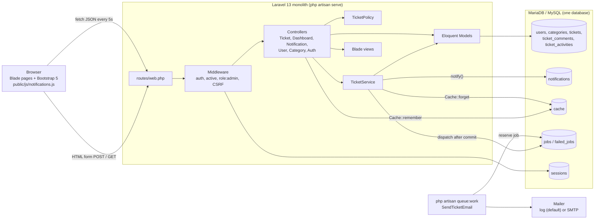

## B2. Ticket creation

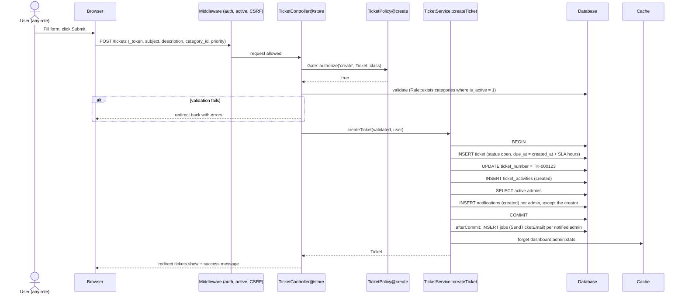

## B3. Ticket assignment (manual and automatic)

> **V2:** see E7 for the current sequence with the cache lock, project shared lock and held side effects.

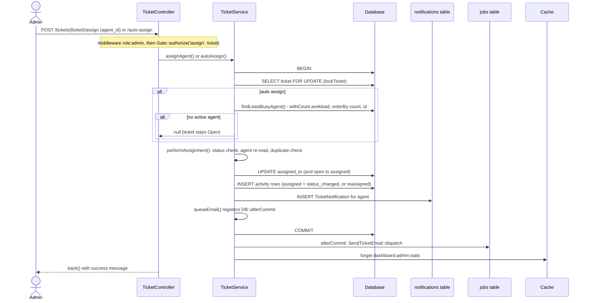

## B4. Notification polling

> **V2:** see E8 for the real-time path; this polling flow is the fallback.

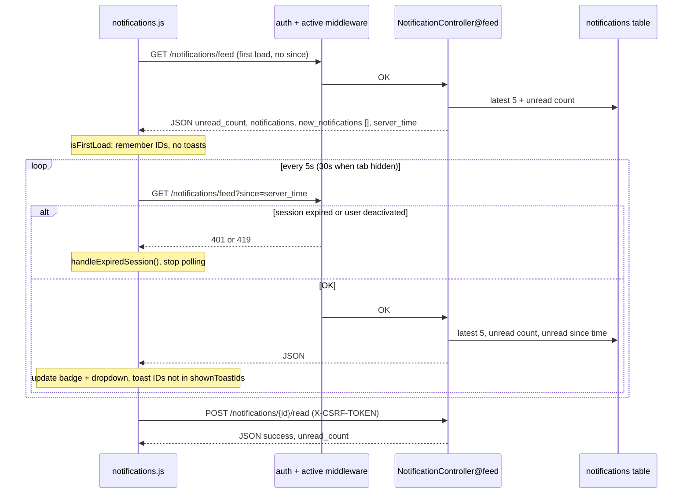

## B5. Queue and email

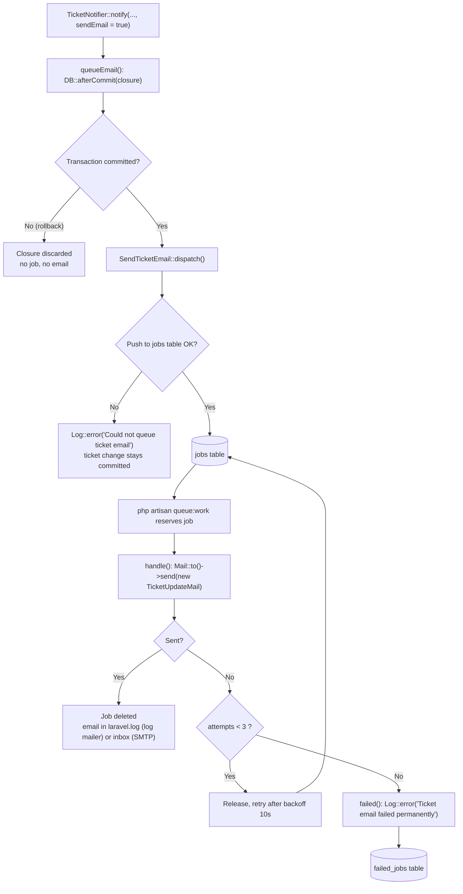

## B6. Cache hit and miss

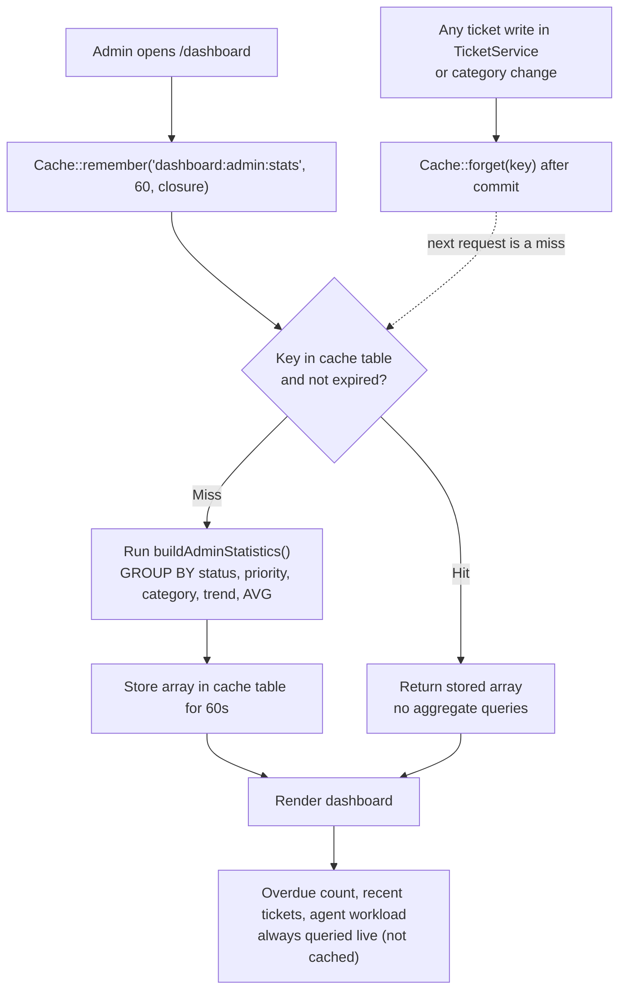

## B7. Ticket lifecycle

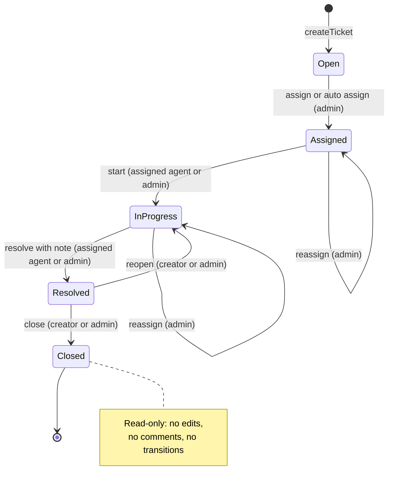

`InProgress` in the diagram = status value `in_progress`.

---

# Part C — Future improvements (NOT implemented)

> **Everything in this table is NOT in the code.** These are ideas to discuss when asked "How would you scale this?".

**Moved to "implemented" by V2** (no longer future): Laravel Reverb / WebSockets (old C4/C5), scheduled SLA reminders
(old C12), a practical email de-dup key (old C13, best effort), attachments on a private disk (object storage remains
future). See Part E.

| # | Idea | Problem it would solve in ResolveDesk | What would change | Trade-off |
|---|---|---|---|---|
| C1 | **Redis cache + locks** | `CACHE_STORE=database` runs SQL for every cache read and lock attempt | `CACHE_STORE=redis`; `Cache::remember()` and `Cache::lock()` code unchanged | New server to run, monitor, secure |
| C2 | **Redis queue** | The database queue polls `jobs` and competes with app queries | `QUEUE_CONNECTION=redis`; same `SendTicketEmail` | Redis persistence/backup needed |
| C3 | **Multiple queue workers** | One worker sends emails one by one | Several `queue:work` processes under Supervisor | Ordering not guaranteed; consumers must stay idempotent |
| C4 | **Reverb horizontal scaling** | One Reverb process is a single point of failure and has a connection limit | Several Reverb servers with `REVERB_SCALING_ENABLED=true` (Redis pub/sub) behind a WebSocket-aware load balancer | Redis required; more ops work |
| C5 | **Server-Sent Events** | Alternative one-way push | Streamed HTTP response | Holds a PHP worker per tab with PHP-FPM |
| C6 | **Load balancer** | One web server handles all traffic | Nginx/HAProxy/cloud LB, health checks on `/up` and `/health/ready` (both exist) | Shared state needed (C8) |
| C7 | **Multiple application servers** | Single point of failure | Same release on N servers | Deploy to all; no local state |
| C8 | **Shared sessions** | Sessions must be visible on every server | Already shared via `SESSION_DRIVER=database`; Redis at higher load | DB write per request today |
| C9 | **Shared object storage** | Attachments live on one server's disk | `ATTACHMENT_DISK=s3` (`config/resolvedesk.php` reads it) + S3 Flysystem package; `Storage::disk()` code unchanged | Cost, network latency, bucket policy |
| C10 | **Read replicas** | Reports/dashboards compete with writes | `read`/`write` hosts in `config/database.php` | Replication lag; locks must use the primary |
| C11 | **Scheduler on one server** | With several servers, each cron would run `tickets:check-sla` | `->onOneServer()` with a shared cache store | Needs shared cache (DB or Redis) |
| C12 | **Transactional outbox** | Crash between COMMIT and job dispatch loses an email | Outbox row in the same transaction + relay process | More code and a relay |
| C13 | **Centralized monitoring** | Logs are files per server; no metrics | Log shipping (ELK/Loki), error tracker, uptime checks, queue-length alerts | Cost and setup |
| C14 | **Agent availability / customer manager role** | Business extensions | New column + eligibility rule; new policy branch on `client_id` | More rules to test |

> **বাংলায়:** এই টেবিলের কিছুই এখন কোডে নেই — "কীভাবে scale করবেন?" প্রশ্নে বলবেন: Redis-এ cache/queue/lock,
> একাধিক worker, load balancer-এর পেছনে একাধিক server, Reverb-এর Redis scaling, S3-তে ফাইল, read replica আর
> কেন্দ্রীয় monitoring। আর পরিষ্কার বলবেন যে Reverb আর scheduler V2-তে **implemented**।

---

# Part D — Trade-offs and known limitations (V2)

| # | Limitation | Why | Impact | Possible fix |
|---|---|---|---|---|
| D1 | ~~Concurrent auto-assign picks the same agent~~ **Fixed in V2** | Global `Cache::lock('ticket-assignment')` serializes assignment | — | — |
| D2 | Assignment is serialized globally | One lock for all assignments; 5 s wait, 10 s expiry | Under heavy load admins may see "try again" | Per-project locks (careful: workload is global) |
| D3 | Duplicate email still possible | Cache de-dup key is written after SMTP accepts; a crash in between repeats the send | Rare duplicate | Outbox + provider idempotency keys (C12) |
| D4 | Email can be lost between COMMIT and dispatch | `DB::afterCommit()` + dispatch is not atomic; error only logged | In-app notification exists, email does not | Outbox (C12) |
| D5 | Single Reverb server, every tab its own socket | No scaling configured | Each tab shows the toast; Reverb outage → 5 s polling | C4 |
| D6 | `ShouldBroadcastNow` inside the request | Broadcast is an HTTP call to Reverb after commit | If Reverb hangs, the response waits up to the broadcaster timeout (connect 2 s / 3 s) | Queued `ShouldBroadcast` (needs worker) |
| D7 | Database used for everything | No Redis on XAMPP | More DB load at scale | C1, C2 |
| D8 | Timestamps in `Asia/Dhaka`, not UTC | V1 data stored that way | Care needed across time zones | Planned UTC migration |
| D9 | Dashboard stats up to 60 s stale for out-of-band changes | Direct SQL bypasses `Cache::forget()` | Old counts briefly | `cache:clear` |
| D10 | Reopen keeps the original SLA deadline | Simplified rule | Reopened ticket may be overdue at once (a fresh reminder is sent because `sla_notified_at` is reset) | Recalculate on reopen |
| D11 | Calendar-hour SLA | `addHours()` | Nights/weekends count | Business-hours calendar |
| D12 | No antivirus scan, no attachment delete | Out of scope | Risky files can be uploaded (but are never executed or rendered inline) | ClamAV job, delete UI |
| D13 | Single server, single DB | Monolith deployment | Single point of failure | C6–C10 |

---

## Interview summary (30 seconds, V2)

"ResolveDesk is a Laravel modular monolith on one MySQL-compatible database. Middleware handles login, active status,
roles, rate limits and request ids; `TicketPolicy` handles per-ticket permissions; services run every change in a
transaction with row locks and a version check, and assignment additionally takes a global cache lock. Ticket creation
is idempotent through a request token. The in-app notification is written in the transaction; after commit a tiny event
goes to Reverb on the user's private channel and an email job goes to the database queue. If Reverb is down, polling
takes over. A scheduler sends one SLA reminder per breach. Files are private and downloaded through a policy. To scale,
I'd add Redis, more web servers and workers behind a load balancer, Reverb scaling, S3 and a read replica — none of that
is implemented yet."

---

# Part E — V2 system design

Legend: **[I]** = implemented in the code · **[F]** = future, not implemented.

## E1. Business requirements

- A software company supports **many products (projects)** used by **many client organizations**. **[I]**
- Each client has customer users; each support engineer supports several projects. **[I]**
- Tickets may belong to project + client, project only (internal), client only, or neither (global). **[I]**
- Client data must never leak to another client; internal discussion must stay internal. **[I]**
- Work should go only to engineers who know the product, balanced by workload. **[I]**
- Deadlines (SLA) must be watched automatically. **[I]**
- Managers need per-project and per-client reporting. **[I]**

## E2. Functional requirements

| Requirement | Status | Main code |
|---|---|---|
| Project and client CRUD, activate/deactivate, associations | [I] | `ProjectController`, `ClientController`, `ProjectService` |
| Role-based ticket scope on creation | [I] | `TicketService::resolveScope()`, `StoreTicketRequest` |
| Assignment limited to project agents, least-workload auto-assign | [I] | `TicketAssignmentService` |
| Controlled lifecycle | [I] | `Ticket::TRANSITIONS`, `TicketService` |
| Public replies and internal notes | [I] | `TicketService::addComment()`, `TicketComment::scopeVisibleTo()` |
| Private attachments | [I] | `AttachmentService`, `TicketAttachmentController` |
| Activity history incl. system activities | [I] | `TicketActivity::record()` |
| Database + real-time notifications, polling fallback | [I] | `TicketNotifier`, `UserNotificationCreated`, `realtime.js`, `notifications.js` |
| Queued email | [I] | `SendTicketEmail` |
| SLA breach reminder (once) | [I] | `CheckSlaBreaches`, `processSlaBreach()` |
| Dashboards, reports, CSV export | [I] | `DashboardController`, `ReportController` |
| Customer manager role, agent availability | [F] | — |

## E3. Non-functional requirements

| Quality | How it is met | Status |
|---|---|---|
| Correctness under concurrency | transactions, row locks, version column, cache lock, unique token index, deadlock retry | [I] |
| Security | layered authorization, CSRF, escaping, private channels, private files, rate limits | [I] |
| Availability of core function | graceful degradation (Reverb, worker, scheduler optional) | [I] |
| Performance | indexes for new access paths, eager loading + `preventLazyLoading`, cached aggregates, `chunkById` | [I] |
| Observability | `X-Request-Id` + log context, `/up`, `/health/ready`, daily logs in production | [I] (production logging documented, not deployed) |
| Maintainability | plain Laravel, five small services, config in `config/resolvedesk.php`, 164 tests | [I] |
| Horizontal scalability | shared DB state is a start; Redis/LB/S3 needed | [F] |

## E4. High-level architecture

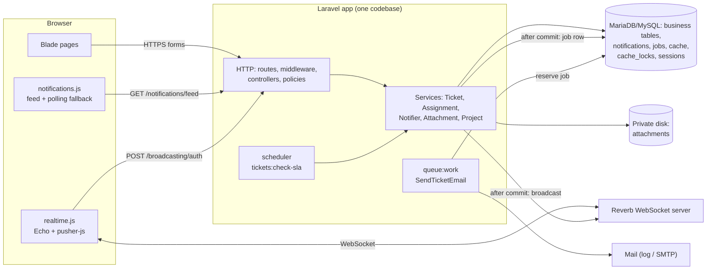

**Modular monolith:** one deployable app, but code is grouped by responsibility (services per concern, one policy, one
event, one command). No microservices — one team, one database, simpler transactions. **[I]**

## E5. ER summary (V2 tables)

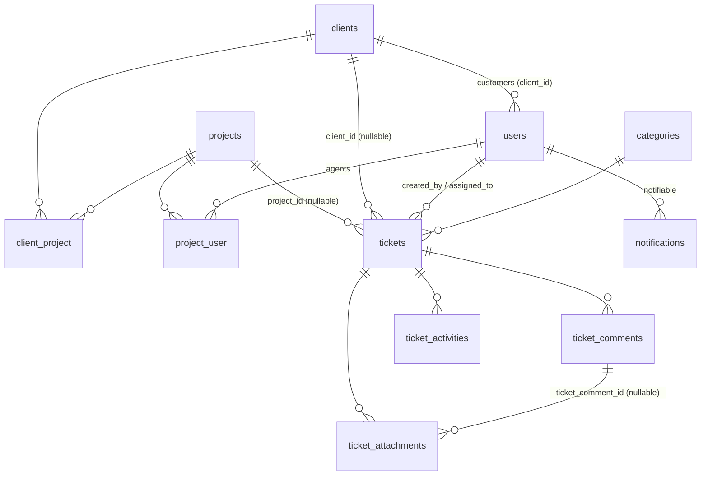

Key V2 columns: `tickets.version`, `tickets.request_token` (unique with `created_by`), `tickets.sla_notified_at`,
`ticket_comments.visibility`, `ticket_activities.is_internal` + nullable `user_id`. Full detail:
[03-DATABASE-GUIDE.md](03-DATABASE-GUIDE.md).

## E6. Request lifecycle and ticket lifecycle

Request: `public/index.php` → `web` group (session, CSRF) → `AddRequestContext` → `auth`, `active`, (`role:admin`),
(`throttle:*`) → route model binding → Form Request / `Gate::authorize()` + validation → service (transaction, locks)
→ after-commit side effects → response with `X-Request-Id`. Details: [04](04-LARAVEL-MVC-GUIDE.md) §26.

Ticket lifecycle is unchanged from V1 (Part B7): `open → assigned → in_progress → resolved → closed`, `resolved →
in_progress` (reopen). V2 adds `version + 1` on every mutation and the SLA reminder flag.

## E7. Assignment sequence (manual or auto) **[I]**

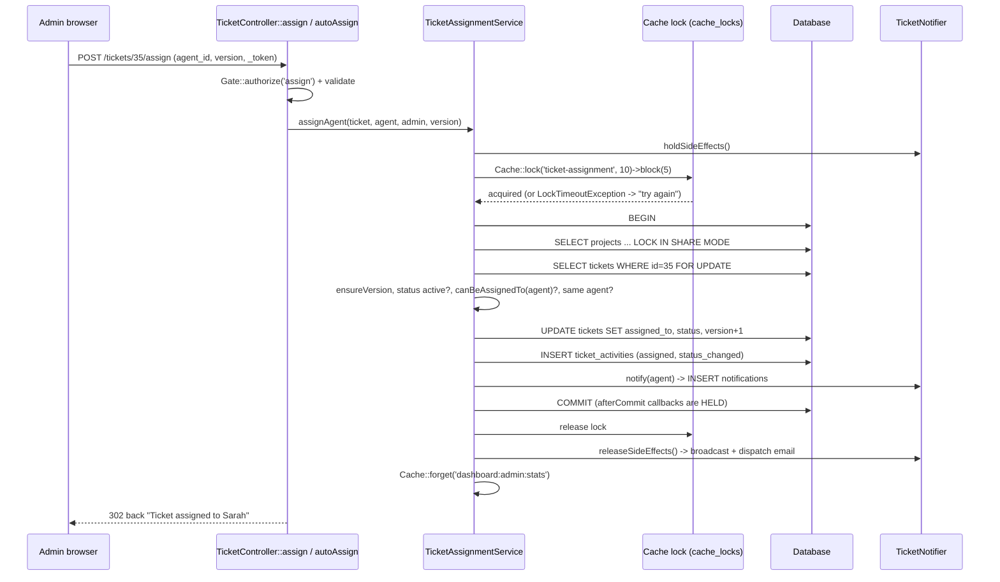

Auto-assign is the same, but inside the lock it requires status Open and calls `findLeastBusyAgent($projectId)` on
fresh data.

## E8. Notification and real-time sequence **[I]**

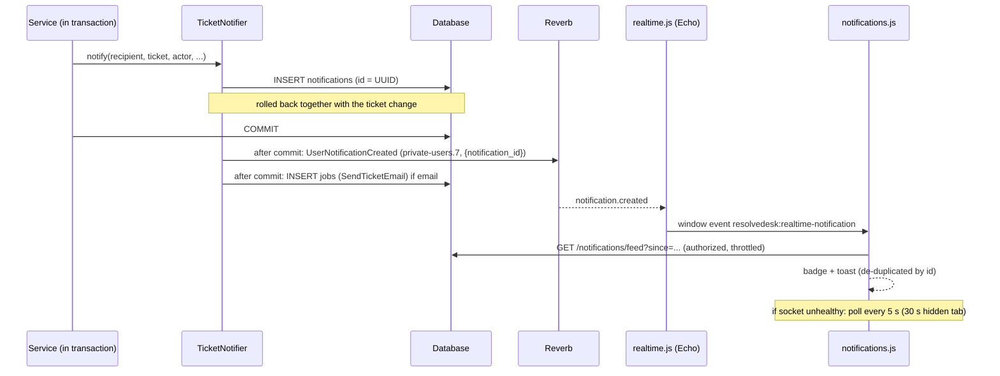

Channel subscription beforehand: Echo → `POST /broadcasting/auth` → `routes/channels.php` → allowed only for the same
active user.

## E9. Queue processing flow **[I]**

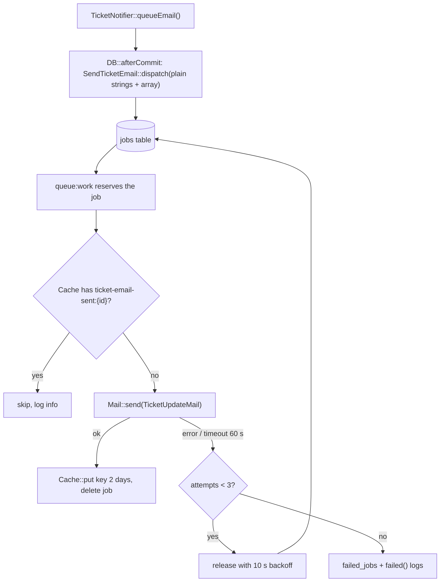

Producer–consumer: the web request produces, the worker consumes; `retry_after` (90 s) > `$timeout` (60 s).

## E10. Cache flow **[I]**

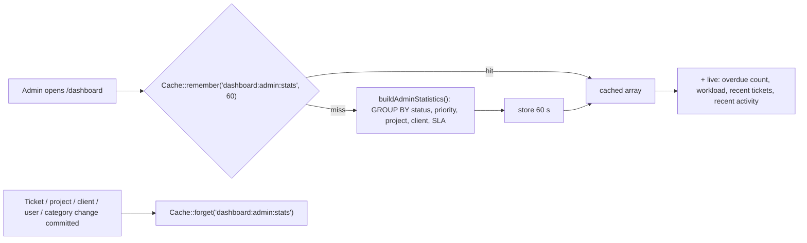

Cache-aside with explicit invalidation; locks use the same store. Details: [15-CACHING-GUIDE.md](15-CACHING-GUIDE.md).

## E11. Concurrency sequence diagrams **[I]**

**Optimistic locking — two admins edit the same ticket:**

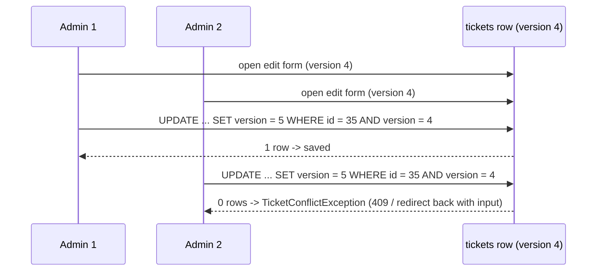

**Idempotent creation — double submit:**

```mermaid
sequenceDiagram
    participant B as Browser (double click)
    participant S1 as Request 1
    participant S2 as Request 2
    participant DB as tickets (UNIQUE created_by, request_token)
    B->>S1: POST /tickets token T
    B->>S2: POST /tickets token T
    S1->>DB: findByRequestToken -> none; INSERT
    S2->>DB: findByRequestToken -> none; INSERT
    DB-->>S1: ok (ticket 36)
    DB-->>S2: UniqueConstraintViolationException
    S2->>DB: findByRequestToken -> ticket 36 -> replayOrReject: same content
    S2-->>B: redirect to ticket 36 "already submitted"
```

**Pessimistic locking — SLA scheduler vs. agent resolving:** both call `lockTicket()`; whoever gets the row first
finishes; the other re-reads: the scheduler sees "not overdue any more" (resolved) and does nothing, or the agent sees
the new `version` and — if their form carried the old version — gets a conflict.

> **বাংলায়:** তিন রকম সুরক্ষা: (১) pessimistic — row-এ তালা, অন্যরা অপেক্ষা করে; (২) optimistic — version মিলিয়ে
> সেভ, না মিললে 409; (৩) idempotency — একই token দুবার এলে একটাই টিকিট। আর workload-এর মতো অনেক row-এর উপর
> নির্ভরশীল সিদ্ধান্তের জন্য cache lock।

## E12. Security boundaries **[I]**

| Boundary | Enforced by |
|---|---|
| Internet → app | CSRF on every POST/PUT/PATCH/DELETE, session auth, `throttle:*`, login rate limit |
| Logged-in → admin area | `role:admin` middleware **and** policy checks |
| User → ticket | `TicketPolicy` (`view`, `update`, `assign`, `start`, `resolve`, `close`, `reopen`, `comment`, `addInternalNote`, `downloadAttachment`) |
| Customer → other clients' data | `resolveScope()` (client from account), `scopeVisibleTo()` in SQL, dependent dropdown endpoint filtered |
| Customer → internal content | `TicketComment/TicketActivity::scopeVisibleTo()`, `addInternalNote` policy, internal-note files staff-only |
| Browser → WebSocket channels | `routes/channels.php` (`users.{id}` = same active user); payload only an id |
| Browser → files | private disk, UUID names, policy-checked download, `nosniff`, `Content-Disposition: attachment` |
| Logs | only ids in context (no passwords, cookies, ticket text) |
| Secrets | `.env` git-ignored; only `VITE_REVERB_APP_KEY` (public) reaches the browser |

## E13. Deployment architecture

**Development (implemented, verified):** Windows, `php artisan serve` + `queue:work` + `reverb:start` + `schedule:work`,
MariaDB 10.4 (XAMPP), log mailer.

**Single-server production (documented in [18](18-PRODUCTION-DEPLOYMENT.md), NOT executed):**

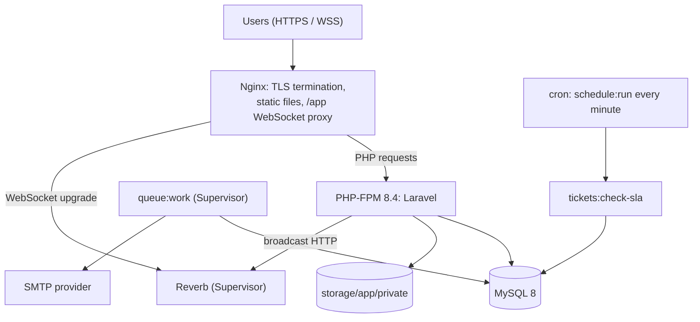

**Scaled production [F]:** load balancer → N app servers; Redis for cache/locks/queue/sessions; Reverb cluster with
Redis scaling; S3 for attachments; MySQL primary + read replica; `onOneServer()` scheduler; central logs/metrics.

## E14. Failure scenarios

| Failure | What happens | Recovery | Status |
|---|---|---|---|
| Reverb down | Broadcast exception caught + logged; operation succeeds; browser polls every 5 s | Restart Reverb; Echo reconnects automatically | [I] tested |
| Queue worker down | Email jobs wait in `jobs`; everything else works | Start worker; jobs are processed | [I] verified |
| SMTP failing | 3 attempts, 10 s apart, then `failed_jobs` + log | Fix config, `queue:retry all` | [I] tested with fakes |
| Worker crash mid-job | Job reappears after `retry_after`; de-dup key prevents most resends | automatic | [I] partial (best effort) |
| Scheduler down | No reminders while down | Next run sends one reminder per pending breach | [I] |
| Two scheduler runs overlap | `withoutOverlapping()` + row lock + `sla_notified_at` | — | [I] tested |
| DB deadlock | `DB::transaction(..., 3)` retries | automatic, else error page | [I] |
| Lock wait / assignment lock busy | "try again" message (5 s), lock auto-expires after 10 s | retry | [I] tested |
| Database down | 500 pages; `/health/ready` returns 503 | Restart DB; restore from backup if needed ([19](19-BACKUP-AND-RECOVERY.md)) | [I] endpoint; restore drill **not performed** |
| File write OK but DB transaction fails | Files deleted again by `AttachmentService::deleteFiles()` | — | [I] tested |
| Attachment file missing on disk | 404 + error log | Restore from file backup | [I] |
| Duplicate submit / browser retry | Idempotent replay | — | [I] tested (incl. 6 parallel processes) |
| Stale form | 409 / redirect back with input | User reloads | [I] tested |

## E15. Concepts explained with this project

| Concept | In ResolveDesk |
|---|---|
| Modular monolith | One Laravel app; services grouped by responsibility |
| MVC | Routes → controllers → models/services → Blade |
| RBAC | `users.role` + `role:admin` |
| Resource-level authorization | `TicketPolicy` per ticket, `downloadAttachment` per file, channel rule per user |
| Logical client data isolation | Scope rules + `visibleTo()` scopes, one database |
| ACID | `DB::transaction()` around ticket + activity + notification + attachment rows |
| Race condition | Double resolve, parallel auto-assign, double create |
| Pessimistic locking | `lockForUpdate()` / `sharedLock()` |
| Optimistic locking | `version` + conditional UPDATE |
| Atomic locking | `Cache::lock('ticket-assignment')` |
| Deadlocks | Fixed lock order + retry 3 |
| Idempotency | `request_token`; same-agent assignment no-op; email de-dup key |
| Producer–consumer | Request → `jobs` → `queue:work` |
| Asynchronous processing | Emails in the worker; SLA in the scheduler |
| Event-driven communication | `UserNotificationCreated` broadcast |
| WebSockets | Reverb + Echo private channels |
| Cache-aside | `Cache::remember()` for admin stats and categories |
| Database indexing | `(project_id,status)`, `(client_id,status)`, `(status,due_at)`, notifications feed index |
| N+1 queries | `with()`, `withCount()`, `preventLazyLoading` |
| Rate limiting | Named limiters, 429 |
| Graceful degradation | Polling fallback, optional worker/scheduler |
| Retry behaviour | Job retries/backoff, deadlock retries, Echo reconnect, lock `block()` |
| Failure recovery | `failed_jobs` + `queue:retry`, scheduler catch-up, backups ([19](19-BACKUP-AND-RECOVERY.md)) |

## E16. Scaling considerations **[F] unless marked**

1. **Redis cache and queue** — switch `CACHE_STORE`/`QUEUE_CONNECTION`; locks and rate limiters follow the cache store.
2. **Multiple Laravel app servers + load balancer** — same release everywhere, shared `APP_KEY`, health checks on
   `/up` and `/health/ready` **[I: endpoints exist]**.
3. **Shared session storage** — already shared through the database **[I]**; Redis at higher load.
4. **Shared object storage** — `ATTACHMENT_DISK=s3`; code uses `Storage::disk(config(...))` **[I: configurable]**.
5. **Multiple queue workers** — Supervisor `numprocs`; the job is already safe to retry (de-dup key, timeout < retry_after).
6. **Reverb horizontal scaling** — Redis pub/sub (`REVERB_SCALING_ENABLED`), WebSocket-aware LB.
7. **Scheduler** — `onOneServer()` with a shared cache.
8. **Database read replicas** — reports/dashboards on replicas; locking and writes on the primary.
9. **Centralized monitoring** — shipped logs (request id already present **[I]**), queue length, failed jobs, Reverb
   connections, DB slow log.
