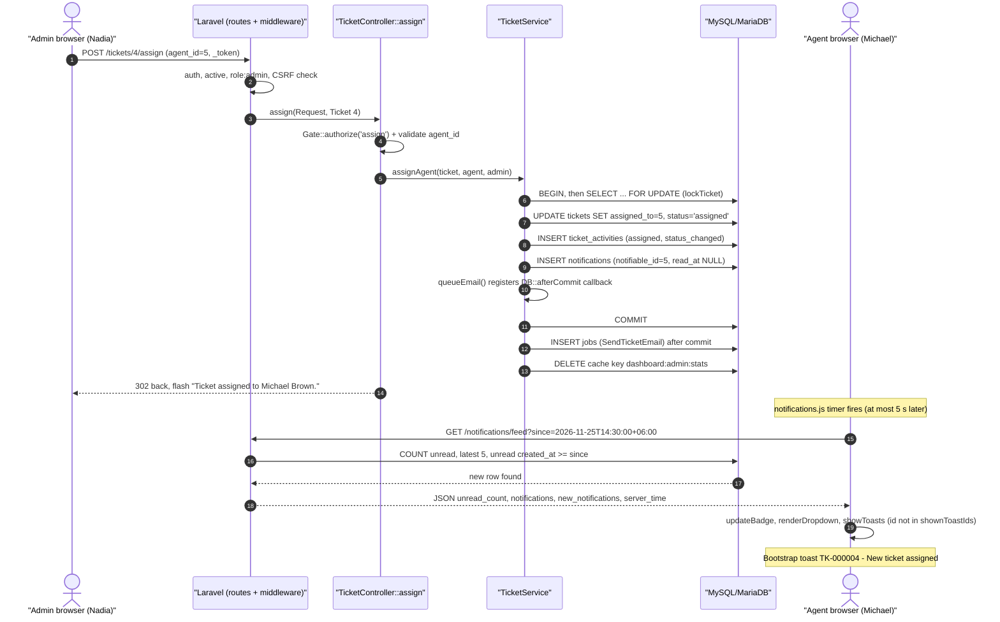

# 13 — Notification System Guide

This guide explains how ResolveDesk shows **in-app notifications** (the bell in the navbar and the pop-up toasts)
without reloading the page. Everything here is **implemented** unless a section says *Future improvement*.

Files covered:

| File | Role |
|---|---|
| `app/Notifications/TicketNotification.php` | The one reusable Laravel Notification class |
| `app/Models/User.php` | Uses the `Notifiable` trait |
| `database/migrations/2026_11_25_140742_create_notifications_table.php` | The standard `notifications` table |
| `app/Services/TicketService.php` | Decides **who** gets a notification (`notifyUser()`, `addComment()`) |
| `app/Http/Controllers/NotificationController.php` | History page + JSON endpoints |
| `routes/web.php` | Routes `notifications.index`, `notifications.feed`, `notifications.read`, `notifications.read-all` |
| `resources/views/partials/navbar.blade.php` | The bell, badge, dropdown and `data-*` URLs |
| `resources/views/layouts/app.blade.php` | CSRF `<meta>` tag, `#toast-container`, loads `notifications.js` |
| `public/js/notifications.js` | AJAX polling, badge, dropdown, toasts, mark-as-read |
| `resources/views/notifications/index.blade.php` | Full notification history page |
| `tests/Feature/NotificationTest.php` | 13 tests for recipients and JSON endpoints |

Related guides: [Business logic](06-BUSINESS-LOGIC-GUIDE.md), [Queue and email](14-QUEUE-AND-EMAIL-GUIDE.md),
[Caching](15-CACHING-GUIDE.md), [Debugging](11-DEBUGGING-GUIDE.md).

---

## 1. The big picture

There are two halves:

1. **Server side (PHP):** when something happens to a ticket, `TicketService` calls
   `$user->notify(new TicketNotification(...))`. Laravel inserts **one row** into the `notifications` table.
2. **Browser side (JavaScript):** every page of a logged-in user loads `public/js/notifications.js`. Every
   5 seconds it calls `GET /notifications/feed`. The server answers with JSON. The script updates the badge,
   the dropdown and shows a toast for genuinely new rows.

The server never "pushes" anything. The browser keeps **asking**. This is called **polling**, and it is
**near-real-time** (a delay of up to ~5 seconds), not true real-time.

> **বাংলায়:** এখানে সার্ভার নিজে থেকে ব্রাউজারকে কিছু পাঠায় না। ব্রাউজার প্রতি ৫ সেকেন্ড পর পর সার্ভারকে জিজ্ঞেস করে
> "আমার নতুন কোনো notification আছে?" — একে polling বলে। তাই notification সাথে সাথে না এসে সর্বোচ্চ কয়েক সেকেন্ড দেরিতে আসে,
> এজন্য একে near-real-time বলা হয়।

Notification matrix (from MASTER_PROMPT §9.2, plus the "Ticket created" row added at the project owner's
request; implemented in `TicketService`):

| Event | Recipient | In-app | Queued email | Code |
|---|---|---|---|---|
| Ticket created | Every active admin (except the creator) | Yes | Yes | `createTicket()` |
| Ticket assigned | Assigned agent | Yes | Yes | `performAssignment()` |
| Ticket reassigned | New agent | Yes | Yes | `performAssignment()` |
| Creator comment | Assigned agent | Yes | No | `addComment()` |
| Agent reply | Ticket creator | Yes | No | `addComment()` |
| Admin comment | Creator and agent | Yes | No | `addComment()` |
| Ticket resolved | Ticket creator | Yes | Yes | `resolve()` |
| Ticket reopened | Assigned agent | Yes | Yes | `reopen()` |
| Ticket closed | Assigned agent | Yes | No | `close()` |

---

## 2. The Laravel Notification class — `TicketNotification`

```php
namespace App\Notifications;

use App\Models\Ticket;
use Illuminate\Notifications\Notification;

class TicketNotification extends Notification
{
    public function __construct(
        public Ticket $ticket,
        public string $eventType,   // e.g. "assigned", "comment", "resolved"
        public string $title,       // short heading shown in bold
        public string $message,     // one-line description
    ) {
    }

    /** Which channels to use. "database" = store in the notifications table. */
    public function via(object $notifiable): array
    {
        return ['database'];
    }

    public function toArray(object $notifiable): array
    {
        return [
            'ticket_id' => $this->ticket->id,
            'ticket_number' => $this->ticket->ticket_number,
            'title' => $this->title,
            'message' => $this->message,
            'event_type' => $this->eventType,
        ];
    }
}
```

### Line by line

| Code | Meaning |
|---|---|
| `extends Notification` | Laravel's base class. It knows how to be "sent" through channels. |
| `public function __construct(public Ticket $ticket, ...)` | **Constructor property promotion** (PHP 8). Writing `public` in the parameter list creates a property and assigns it automatically. It is the same as declaring `public Ticket $ticket;` and writing `$this->ticket = $ticket;`. |
| `via(object $notifiable): array` | Laravel asks: "which channels?" We return `['database']`, so the notification is **only** stored in the `notifications` table. Other channels exist (`mail`, `broadcast`, ...) but are not used. Email is sent separately by a queued job (see [guide 14](14-QUEUE-AND-EMAIL-GUIDE.md)). |
| `$notifiable` | The object receiving the notification — here always a `User`. |
| `toArray()` | The array that Laravel JSON-encodes into the `notifications.data` column. These exact keys are later read by `NotificationController::formatNotification()`. |

**One reusable class** handles all seven events (`created`, `assigned`, `reassigned`, `comment`, `resolved`,
`reopened`, `closed`). Only the `$eventType`, `$title` and `$message` change.

### Important: it is NOT queued

The class does **not** implement `ShouldQueue`. So `notify()` inserts the row **immediately, inside the current
database transaction**. Consequences:

- In-app notifications work even if no queue worker is running (tested in
  `QueueAndEmailTest::test_in_app_notification_works_without_a_queue_worker`).
- If the transaction rolls back, the notification row is rolled back too (tested in
  `QueueAndEmailTest::test_no_email_job_is_dispatched_when_the_transaction_rolls_back`, which asserts
  `assertDatabaseCount('notifications', 0)`).

**What if you remove `via()`?** Laravel's base `Notification` class has no default `via()`, so sending would fail.
**What if you add `'mail'` to `via()`?** Laravel would look for a `toMail()` method — it does not exist, so it would
throw an error. Emails are deliberately handled by `SendTicketEmail` instead.

**How to modify:** to store one more field (e.g. priority), add `'priority' => $this->ticket->priority` to
`toArray()`, then add it to `formatNotification()` and use it in `notifications.js`. Old rows will not have the
key, so always read it with `?? ''`.

---

## 3. The `Notifiable` trait

```php
// app/Models/User.php
use Illuminate\Notifications\Notifiable;

class User extends Authenticatable
{
    use HasFactory, Notifiable;
```

A **trait** is a group of methods that PHP copies into a class. `Notifiable` gives every `User`:

| Method | What it does |
|---|---|
| `$user->notify($notification)` | Sends a notification to this user now |
| `$user->notifications()` | Relationship: all of this user's rows in `notifications`, **newest first** (Laravel adds `->latest()`) |
| `$user->unreadNotifications()` | Same, but only rows where `read_at IS NULL` |
| `$notification->markAsRead()` | (on a `DatabaseNotification` row) sets `read_at = now()` |

Remove `Notifiable` from `User` and every `notify()` / `notifications()` call fails with "Call to undefined method".

## 4. `notify()` — what happens internally

When `TicketService::notifyUser()` runs:

```php
$recipient->notify(new TicketNotification($ticket, $eventType, $title, $message));
```

Laravel internally:

1. Calls `via($recipient)` → `['database']`.
2. Calls `toArray($recipient)` → the 5-key array.
3. Inserts a row:

```sql
INSERT INTO notifications (id, type, notifiable_type, notifiable_id, data, read_at, created_at, updated_at)
VALUES ('e53960f6-…', 'App\Notifications\TicketNotification', 'App\Models\User', 5,
        '{"ticket_id":2,"ticket_number":"TK-000002","title":"New ticket assigned",…,"event_type":"assigned"}',
        NULL, NOW(), NOW());
```

This is a real row read from the local development database (Michael Brown, user id 5):

| Column | Value |
|---|---|
| `id` | `e53960f6-b86d-4db7-be82-00b1db1ec880` (UUID) |
| `type` | `App\Notifications\TicketNotification` |
| `notifiable_type` | `App\Models\User` |
| `notifiable_id` | `5` |
| `data` | `{"ticket_id":2,"ticket_number":"TK-000002","title":"New ticket assigned","message":"Ticket TK-000002 \"Cannot reset my password\" has been assigned to you.","event_type":"assigned"}` |
| `read_at` | `NULL` (unread) |

---

## 5. The `notifications` table and polymorphic columns

```php
Schema::create('notifications', function (Blueprint $table) {
    $table->uuid('id')->primary();
    $table->string('type');
    $table->morphs('notifiable');
    $table->text('data');
    $table->timestamp('read_at')->nullable();
    $table->timestamps();
});
```

| Column | Purpose |
|---|---|
| `id` | A UUID string, not an auto-increment number. That is why the route is `/notifications/{id}/read` with a string `$id`. |
| `type` | The notification class name. |
| `notifiable_type` + `notifiable_id` | Created by `morphs('notifiable')`. Together they say **who** owns the row: "the `App\Models\User` with id 5". `morphs()` also adds an index on both columns. |
| `data` | JSON text from `toArray()`. Laravel casts it back to an array (`$notification->data['ticket_id']`). |
| `read_at` | `NULL` = unread. A time = when it was read. |

### Polymorphic relationship

A normal foreign key points to **one** table (`tickets.created_by → users.id`). A **polymorphic** relationship
stores the **table/model name** as well as the id, so the same table could hold notifications for users,
teams, or any other model. In ResolveDesk only `App\Models\User` is ever stored, but Laravel's standard table is
designed to be generic. `$user->notifications()` is a `morphMany` relationship:

```sql
SELECT * FROM notifications
WHERE notifiable_type = 'App\Models\User' AND notifiable_id = 5
ORDER BY created_at DESC;
```

> **বাংলায়:** সাধারণ foreign key শুধু একটা নির্দিষ্ট টেবিলের id রাখে। Polymorphic relation-এ দুইটা কলাম থাকে —
> `notifiable_type` (কোন model, যেমন `App\Models\User`) আর `notifiable_id` (সেই model-এর কোন row)। ফলে একটাই
> `notifications` টেবিল যেকোনো ধরনের model-এর notification রাখতে পারে। আমাদের প্রজেক্টে শুধু User ব্যবহার হয়।

**Limitation:** because there is no real foreign key, the database cannot enforce that user 5 exists. That is
fine here because users are never deleted (they are deactivated).

---

## 6. Recipient selection (who gets notified?)

### 6.1 `TicketService::notifyUser()` — the gatekeeper

```php
private function notifyUser(?User $recipient, Ticket $ticket, User $actor, string $eventType, string $title, string $message, bool $sendEmail): void
{
    if ($recipient === null || ! $recipient->is_active) {
        return;
    }

    if ($recipient->id === $actor->id) {
        return; // Do not notify people about their own actions.
    }

    // Database notification: inserted inside the current transaction.
    $recipient->notify(new TicketNotification($ticket, $eventType, $title, $message));

    if ($sendEmail) {
        $this->queueEmail($recipient, $ticket, $title, $message);
    }
}
```

| Rule | Why |
|---|---|
| `?User $recipient` — the `?` means "may be null" | Example: `close()` passes `$lockedTicket->assignedAgent`, which is null for an unassigned ticket. "Skip unavailable recipients safely." |
| `! $recipient->is_active` → skip | Deactivated users cannot log in, so they should not get notifications or emails. Tested in `test_inactive_recipient_is_skipped`. |
| `$recipient->id === $actor->id` → skip | An admin who resolves their own ticket should not be notified about their own action. |
| `$sendEmail` | `true` for created (admins)/assigned/reassigned/resolved/reopened, `false` for comments and closed (the matrix). |

Every workflow method calls `notifyUser()` **inside** `DB::transaction()`, after the row lock and after saving.

### 6.2 `addComment()` — several recipients without duplicates

```php
$recipients = [$lockedTicket->creator, $lockedTicket->assignedAgent];
$alreadyNotifiedIds = [];

foreach ($recipients as $recipient) {
    if ($recipient === null || in_array($recipient->id, $alreadyNotifiedIds, true)) {
        continue; // No agent yet, or creator and agent are the same person.
    }
    $alreadyNotifiedIds[] = $recipient->id;

    $this->notifyUser($recipient, $lockedTicket, $author, 'comment',
        'New comment from ' . $author->name,
        "New comment on ticket {$lockedTicket->ticket_number}: " . mb_strimwidth($message, 0, 80, '...'),
        false);
}
```

One simple rule — "notify the creator and the assigned agent, except the author" — covers every case:

| Who comments | Creator | Agent | Result |
|---|---|---|---|
| Customer (creator) | skipped by `notifyUser` (actor) | notified | agent only |
| Assigned agent | notified | skipped (actor) | creator only |
| Admin | notified | notified | both |
| Agent who created a ticket assigned to themselves | same user twice | `$alreadyNotifiedIds` stops the duplicate | nobody (it is the author) |

`mb_strimwidth($message, 0, 80, '...')` cuts the comment to 80 characters for a short message. `mb_` functions are
multi-byte safe, so Bangla text is not cut in the middle of a character.

Tests: `test_creator_comment_notifies_only_the_assigned_agent`, `test_agent_reply_notifies_the_creator`,
`test_admin_comment_notifies_creator_and_agent`, `test_no_duplicate_when_creator_is_also_the_assigned_agent`.

**No change → no notification:** `assignAgent()` returns `false` (and notifies nobody) when the ticket is already
assigned to the same agent (`if ($ticket->assigned_to === $agent->id) return false;`).

---

## 7. Routes and JSON endpoints

```php
// routes/web.php — inside Route::middleware(['auth', 'active'])
Route::get('/notifications', [NotificationController::class, 'index'])->name('notifications.index');
Route::get('/notifications/feed', [NotificationController::class, 'feed'])->name('notifications.feed');
Route::post('/notifications/read-all', [NotificationController::class, 'markAllAsRead'])->name('notifications.read-all');
Route::post('/notifications/{id}/read', [NotificationController::class, 'markAsRead'])->name('notifications.read');
```

- `auth` → a guest gets **401 JSON** (when the request expects JSON) instead of the login page. Tested in
  `test_feed_requires_authentication`.
- `active` → `ActiveUserMiddleware` logs out a deactivated user and returns **401 JSON** for AJAX requests.
- `read-all` is declared **before** `{id}/read`. Both are POST, so they are protected by CSRF.

---

## 8. `NotificationController` — authorization by query scope

The class comment says it best: *"Every query starts from `$request->user()->notifications()`, so a user can only
ever see or change THEIR OWN notification rows."* There is no policy for notifications; the **query itself** is
the authorization.

### 8.1 `index()` — history page

```php
public function index(Request $request)
{
    $query = $request->user()->notifications(); // newest first by default

    if ($request->input('filter') === 'unread') {
        $query->whereNull('read_at');
    } elseif ($request->input('filter') === 'read') {
        $query->whereNotNull('read_at');
    }

    $notifications = $query->paginate(15)->withQueryString();

    return view('notifications.index', ['notifications' => $notifications]);
}
```

`?filter=unread` / `?filter=read` / nothing = all. `withQueryString()` keeps `filter` in the pagination links.
This page keeps the **complete history** (the dropdown only shows 5).

### 8.2 `feed()` — the JSON endpoint polled by JavaScript

```php
public function feed(Request $request)
{
    $request->validate([
        'since' => ['nullable', 'date'], // an invalid value returns 422 instead of crashing
    ]);

    $user = $request->user();

    // Taken BEFORE the queries: a notification inserted while this request runs
    // is then still "new" on the next poll (duplicates are filtered by ID in JS).
    $serverTime = now()->toIso8601String();

    $latest = $user->notifications()->take(self::DROPDOWN_LIMIT)->get();

    $newNotifications = collect();
    if ($request->filled('since')) {
        // Look 10 seconds further back than asked: a notification created inside a
        // transaction that had not committed yet during the previous poll is still found.
        // notifications.js ignores IDs it has already shown, so the overlap causes no duplicate toasts.
        $since = Carbon::parse($request->input('since'))->subSeconds(self::SINCE_OVERLAP_SECONDS);
        $newNotifications = $user->unreadNotifications()
            ->where('created_at', '>=', $since)
            ->take(20)
            ->get();
    }

    return response()->json([
        'unread_count' => $user->unreadNotifications()->count(),
        'notifications' => $latest->map(fn ($notification) => $this->formatNotification($notification)),
        'new_notifications' => $newNotifications->map(fn ($notification) => $this->formatNotification($notification)),
        // The browser sends this back as ?since= on the next poll.
        'server_time' => $serverTime,
    ]);
}
```

(`private const SINCE_OVERLAP_SECONDS = 10;` is declared at the top of the class next to `DROPDOWN_LIMIT`.)

| Part | Explanation |
|---|---|
| `validate(['since' => ['nullable', 'date']])` | `since` comes from the URL, so it is user input. `?since=hello` returns 422 instead of a crash in `Carbon::parse()`. |
| `take(self::DROPDOWN_LIMIT)` | `DROPDOWN_LIMIT = 5`: the latest 5 rows (read **and** unread) for the dropdown. |
| `$serverTime` taken first | Captured **before** the queries. A row inserted while this request is running has `created_at` ≥ `server_time`, so the next poll still finds it. |
| `subSeconds(self::SINCE_OVERLAP_SECONDS)` | Looks 10 s further back than `since`. A notification created inside a transaction that had **not committed yet** during the previous poll (so it was invisible then) is still found by the next poll. Rows returned twice are ignored by `shownToastIds` in `notifications.js`. |
| `new_notifications` | Only when `since` is given: **unread** rows created at or after `since` (minus the 10 s overlap), max 20. These become toasts. This handles "multiple notifications arriving between two polls" — even 6+ new rows all produce toasts. |
| `unread_count` | A fresh `COUNT(*)` every time (never cached — see [Caching guide](15-CACHING-GUIDE.md)). |
| `fn ($notification) => ...` | A PHP **arrow function**: a short one-line closure that automatically sees `$this`. |
| `server_time` | The server's clock as ISO 8601 (e.g. `2026-11-25T14:30:05+06:00`). The browser does **not** use its own clock, so a wrong PC clock cannot break the logic. |
| `response()->json([...])` | Converts the array to JSON and sets `Content-Type: application/json`. |

Example JSON response:

```json
{
  "unread_count": 3,
  "notifications": [
    {
      "id": "e53960f6-b86d-4db7-be82-00b1db1ec880",
      "title": "New ticket assigned",
      "message": "Ticket TK-000002 \"Cannot reset my password\" has been assigned to you.",
      "ticket_number": "TK-000002",
      "event_type": "assigned",
      "ticket_url": "http://127.0.0.1:8000/tickets/2",
      "is_read": false,
      "time_ago": "5 seconds ago"
    }
  ],
  "new_notifications": [ /* same shape */ ],
  "server_time": "2026-11-25T14:30:05+06:00"
}
```

### 8.3 `markAsRead()` — one row

```php
public function markAsRead(Request $request, string $id)
{
    // findOrFail() on the user's own notifications => 404 for someone else's id.
    $notification = $request->user()->notifications()->findOrFail($id);
    $notification->markAsRead();

    if ($request->expectsJson()) {
        return response()->json([
            'success' => true,
            'unread_count' => $request->user()->unreadNotifications()->count(),
        ]);
    }

    if ($request->boolean('open_ticket') && isset($notification->data['ticket_id'])) {
        return redirect()->route('tickets.show', $notification->data['ticket_id']);
    }

    return back()->with('success', 'Notification marked as read.');
}
```

- **Authorization:** `->notifications()->findOrFail($id)` runs
  `WHERE notifiable_id = <me> AND id = ?`. Another user's UUID is simply "not found" → **404**. It does not even
  reveal that the row exists. Tested in `test_user_cannot_read_someone_elses_notification`.
- **One method, two clients:** `expectsJson()` is true when the request has `Accept: application/json` (our
  `fetch()` sends it). Then it returns JSON. The history page uses a normal HTML form, so it gets a redirect.
- `open_ticket=1` (the history page's "Open ticket" button) redirects to the ticket. The ticket page then runs
  `Gate::authorize('view', $ticket)` again — if access was revoked (e.g. ticket reassigned), the user sees 403.

### 8.4 `markAllAsRead()`

```php
$request->user()->unreadNotifications()->update(['read_at' => now()]);
```

One SQL `UPDATE notifications SET read_at = NOW() WHERE notifiable_type = ... AND notifiable_id = ? AND read_at IS NULL`.
Mass update, no loop.

### 8.5 `formatNotification()` — the JSON shape

```php
private function formatNotification(DatabaseNotification $notification): array
{
    $data = $notification->data;

    return [
        'id' => $notification->id,
        'title' => $data['title'] ?? 'Notification',
        'message' => $data['message'] ?? '',
        'ticket_number' => $data['ticket_number'] ?? '',
        'event_type' => $data['event_type'] ?? '',
        'ticket_url' => isset($data['ticket_id']) ? route('tickets.show', $data['ticket_id']) : null,
        'is_read' => $notification->read_at !== null,
        'time_ago' => $notification->created_at->diffForHumans(),
    ];
}
```

- `??` (null coalescing): use the right side if the key is missing. Protects against old/odd rows.
- `route('tickets.show', ...)` builds the URL on the server, so JavaScript never hard-codes URLs.
- `diffForHumans()` (Carbon) → "5 minutes ago" (the **relative timestamp** in the dropdown).
- Only these 8 keys leave the server. The full model is never returned.

---

## 9. The navbar HTML that JavaScript uses

```blade
<div class="dropdown" id="notificationBell"
     data-feed-url="{{ route('notifications.feed') }}"
     data-read-url="{{ route('notifications.read', ['id' => '__ID__']) }}"
     data-read-all-url="{{ route('notifications.read-all') }}"
     data-login-url="{{ route('login') }}">
    <button ...>
        <i class="bi bi-bell fs-5"></i>
        <span class="badge rounded-pill bg-danger notification-badge d-none" id="notificationCount">0</span>
    </button>
    <div class="dropdown-menu dropdown-menu-end notification-menu p-0 shadow-sm">
        ... <button type="button" ... id="markAllReadButton">Mark all as read</button>
        <div id="notificationList"> <div class="text-muted small p-3">Loading...</div> </div>
        <a href="{{ route('notifications.index') }}" ...>View all notifications</a>
    </div>
</div>
```

And in `layouts/app.blade.php`:

```blade
<meta name="csrf-token" content="{{ csrf_token() }}">
...
<div class="toast-container position-fixed bottom-0 end-0 p-3" id="toast-container"></div>

<script src="{{ asset('vendor/bootstrap/bootstrap.bundle.min.js') }}"></script>
<script src="{{ asset('js/app.js') }}"></script>
<script src="{{ asset('js/notifications.js') }}"></script>
```

- `data-read-url` contains the placeholder `__ID__` because Blade cannot know the notification id in advance.
  JavaScript replaces it later.
- The scripts are at the **end of `<body>`**, so all the HTML elements exist when the script runs.
- `bootstrap.bundle.min.js` must load **before** `notifications.js`, because the script uses `bootstrap.Toast`.
- Because the navbar and the layout are used by every logged-in page, the system "works on every authenticated page".

---

## 10. `public/js/notifications.js` — line by line

### 10.1 IIFE and strict mode

```js
(function () {
    'use strict';
    ...
})();
```

- **IIFE** = Immediately Invoked Function Expression: a function that is defined and called at once.
  All variables (`timerId`, `shownToastIds`, ...) live **inside** the function, so they do not become global
  variables and cannot clash with other scripts (`app.js`, Chart.js). This satisfies "avoid interfering with
  existing page functionality".
- `'use strict'` turns on JavaScript strict mode: assigning to an undeclared variable throws an error instead of
  silently creating a global. It catches typos early.

> **বাংলায়:** IIFE হলো এমন একটা function যেটা বানানোর সাথে সাথেই চালানো হয়। এর ভেতরের সব variable বাইরে থেকে দেখা যায় না,
> তাই অন্য JavaScript ফাইলের variable-এর সাথে নামের সংঘর্ষ হয় না।

### 10.2 Constants

```js
const POLL_INTERVAL_MS = 5000;          // 5 seconds while the tab is visible
const HIDDEN_POLL_INTERVAL_MS = 30000;  // slower polling while the tab is hidden
```

The interval is configurable in **one place**. Change `5000` to `10000` to poll every 10 seconds.
`const` = the variable can never be reassigned.

### 10.3 Find the bell; read URLs from `data-*` attributes

```js
const bell = document.getElementById('notificationBell');
if (!bell) {
    return; // Not on a logged-in page.
}

const feedUrl = bell.dataset.feedUrl;
const readUrlTemplate = bell.dataset.readUrl;   // contains "__ID__"
const readAllUrl = bell.dataset.readAllUrl;
const loginUrl = bell.dataset.loginUrl;
```

- If the bell does not exist (e.g. the login page uses `layouts/guest`), the script stops immediately.
- `dataset` converts `data-feed-url` to `dataset.feedUrl` (kebab-case → camelCase).
- Why not hard-code `'/notifications/feed'`? If the app runs in a sub-folder or a route URL changes, Blade's
  `route()` still produces the right URL.

### 10.4 CSRF token from the meta tag

```js
const csrfToken = document.querySelector('meta[name="csrf-token"]').getAttribute('content');
```

Laravel rejects every POST/PUT/PATCH/DELETE without a valid CSRF token (HTTP **419**). Forms use `@csrf`
(a hidden input). JavaScript has no form, so it reads the token from the `<meta>` tag and sends it in the
`X-CSRF-TOKEN` header (see `postJson()`).

> **বাংলায়:** CSRF (Cross-Site Request Forgery) হলো এমন আক্রমণ যেখানে অন্য কোনো ওয়েবসাইট আপনার লগইন করা browser
> দিয়ে গোপনে আমাদের সাইটে POST request পাঠায়। Laravel প্রতিটি session-এর জন্য একটা গোপন token বানায়; সঠিক token ছাড়া
> POST এলে 419 error দেয়। অন্য সাইট এই token জানে না, তাই আক্রমণ ব্যর্থ হয়।

### 10.5 DOM references and state variables

```js
const countBadge = document.getElementById('notificationCount');
const listContainer = document.getElementById('notificationList');
const markAllButton = document.getElementById('markAllReadButton');
const toastContainer = document.getElementById('toast-container');

let lastServerTime = null;      // sent back as ?since= so the server returns only new items
let isFirstLoad = true;         // historical notifications are not shown as toasts
let timerId = null;             // the one and only pending setTimeout
let isRequestRunning = false;   // prevents two requests at the same time
let isStopped = false;          // set when the session has expired
const shownToastIds = new Set();
```

| Variable | Job |
|---|---|
| `lastServerTime` | `server_time` from the previous response. |
| `isFirstLoad` | `true` only for the first request after page load. |
| `timerId` | The id returned by `setTimeout`, so we can cancel it with `clearTimeout`. |
| `isRequestRunning` | A simple lock: never two feed requests at once. |
| `isStopped` | `true` after a 401/419: stop polling forever on this page. |
| `shownToastIds` | A JavaScript `Set` (a list with unique values and fast `has()`) of notification ids already shown or already known. |

### 10.6 `poll()` — AJAX with Fetch, async/await

```js
async function poll() {
    if (isRequestRunning || isStopped) {
        return;
    }
    isRequestRunning = true;

    try {
        let url = feedUrl;
        if (lastServerTime) {
            url += '?since=' + encodeURIComponent(lastServerTime);
        }

        const response = await fetch(url, {
            headers: { 'Accept': 'application/json', 'X-Requested-With': 'XMLHttpRequest' },
            credentials: 'same-origin',
        });
```

- **AJAX** = the browser sends an HTTP request in the background and updates part of the page, without a reload.
- **Fetch API** = the modern built-in browser function for AJAX. `fetch(url)` returns a **Promise** (a value that
  will arrive later).
- **`async` / `await`:** `async function` may use `await`. `await fetch(...)` pauses *this function only* until the
  response arrives; the page stays responsive. Without `await`, `response` would be a Promise, not the response.
- `encodeURIComponent()` makes the time URL-safe. The ISO time contains `+06:00`; an un-encoded `+` would be read
  as a space by the server and `since` would be invalid (422).
- `'Accept': 'application/json'` → Laravel's `expectsJson()` is true, so errors come back as JSON (401, 422) and
  not as an HTML redirect to the login page.
- `credentials: 'same-origin'` → send the session cookie, so the server knows who is logged in.

> **বাংলায়:** `fetch()` সাথে সাথে উত্তর দেয় না, একটা Promise দেয় — মানে "উত্তর পরে আসবে"। `await` লিখলে function টা
> উত্তর আসা পর্যন্ত অপেক্ষা করে, কিন্তু পুরো পেজ আটকে যায় না। `await` শুধু `async` function-এর ভেতরেই লেখা যায়।

```js
        if (response.status === 401 || response.status === 419) {
            handleExpiredSession();
            return;
        }

        if (!response.ok) {
            throw new Error('Server responded with ' + response.status);
        }

        const data = await response.json();
```

- **401** = not logged in (session expired, or `ActiveUserMiddleware` logged out a deactivated user).
  **419** = CSRF token/session expired. Both mean "polling cannot work any more" → `handleExpiredSession()`.
- `response.ok` is true for status 200–299. A 500 error throws, and the `catch` below handles it.
- `response.json()` parses the JSON body into a JavaScript object (also a Promise, hence `await`).

```js
        updateBadge(data.unread_count);
        renderDropdown(data.notifications);

        if (!isFirstLoad) {
            showToasts(data.new_notifications);
        } else {
            // Remember the existing IDs so they never pop up as "new".
            data.notifications.forEach(function (item) { shownToastIds.add(item.id); });
        }

        isFirstLoad = false;
        lastServerTime = data.server_time;
```

**First-load logic (no toasts for history):** on the first request `lastServerTime` is `null`, so no `?since=` is
sent and the server returns an empty `new_notifications`. The ids of the 5 visible notifications are added to
`shownToastIds`. So when you open a page, old notifications are **not** shown as toasts. From the second request
onward, `?since=` is sent, and only rows created since the previous poll become toasts.

```js
    } catch (error) {
        // Network problem or server error: keep the page working and try again later.
        console.warn('Notification polling failed:', error.message);
    } finally {
        isRequestRunning = false;
        scheduleNextPoll();
    }
}
```

- `catch`: Wi-Fi off, server down, 500 error → only a warning in the browser console. The page keeps working and
  the next poll tries again (**graceful network error handling**).
- `finally` runs **always** — after success, after an error, and even after the `return` in the 401/419 branch.
  It releases the lock and schedules the next poll. (After 401/419, `scheduleNextPoll()` sees `isStopped` and does
  nothing.)

### 10.7 Recursive `setTimeout` (not `setInterval`)

```js
function scheduleNextPoll() {
    if (isStopped) {
        return;
    }
    clearTimeout(timerId); // guarantees only one polling loop exists
    const delay = document.hidden ? HIDDEN_POLL_INTERVAL_MS : POLL_INTERVAL_MS;
    timerId = setTimeout(poll, delay);
}
```

`poll()` → (request finishes) → `finally` → `scheduleNextPoll()` → `setTimeout(poll, 5000)` → `poll()` → ...
The function schedules itself again — **recursive setTimeout**.

Why not `setInterval(poll, 5000)`? `setInterval` fires every 5 seconds **even if the previous request has not
finished**. On a slow server (say 8 seconds per response) requests would pile up and overlap. With recursive
`setTimeout` the next request is scheduled **only after** the current one finished, so they never overlap.

Three protections against multiple loops:

1. `isRequestRunning` — `poll()` returns immediately if a request is in flight.
2. `clearTimeout(timerId)` — any old pending timer is cancelled before a new one is created, so only **one**
   timer exists.
3. `isStopped` — after session expiry, no more timers.

> **বাংলায়:** `setInterval` ঘড়ি ধরে প্রতি ৫ সেকেন্ডে request পাঠায়, আগেরটা শেষ হোক বা না হোক — সার্ভার ধীর হলে একসাথে
> অনেক request জমে যায়। Recursive `setTimeout`-এ একটা request শেষ হওয়ার পরেই পরেরটা ৫ সেকেন্ড পরে নির্ধারণ করা হয়,
> তাই কখনো দুইটা request একসাথে চলে না।

### 10.8 Hidden tab: slow down; visible again: fetch now

```js
document.addEventListener('visibilitychange', function () {
    if (!document.hidden && !isStopped) {
        clearTimeout(timerId);
        poll();
    }
});
```

- `document.hidden` is `true` when the tab is in the background or the window is minimized. Then
  `scheduleNextPoll()` uses **30 seconds** instead of 5 → 6× fewer requests from idle tabs.
- When the user returns, the `visibilitychange` event fires. The pending (up to 30 s) timer is cancelled and
  `poll()` runs **immediately**, so the user sees fresh data at once.
- If a request is already running, `poll()` simply returns; that request's `finally` schedules the next one.

### 10.9 Expired session

```js
function handleExpiredSession() {
    isStopped = true;
    clearTimeout(timerId);
    listContainer.textContent = '';
    const message = document.createElement('div');
    message.className = 'p-3 small text-muted';
    message.textContent = 'Your session has expired. ';
    const link = document.createElement('a');
    link.href = loginUrl;
    link.textContent = 'Sign in again';
    message.appendChild(link);
    listContainer.appendChild(message);
}
```

Stops polling for good (otherwise every 5 seconds it would hit 401 forever) and puts a "Sign in again" link in the
dropdown. The page is **not** reloaded — the user may be typing a comment.

### 10.10 DOM manipulation and XSS safety

```js
function updateBadge(unreadCount) {
    if (unreadCount > 0) {
        countBadge.textContent = unreadCount > 99 ? '99+' : String(unreadCount);
        countBadge.classList.remove('d-none');
    } else {
        countBadge.classList.add('d-none');
    }
}
```

`d-none` is Bootstrap's `display: none`. The badge is hidden when there are no unread notifications and shows
"99+" for large numbers.

```js
function renderDropdown(notifications) {
    listContainer.textContent = '';
    ...
    notifications.forEach(function (item) {
        const row = document.createElement('a');
        row.className = 'notification-item' + (item.is_read ? '' : ' unread');
        row.href = item.ticket_url || '#';

        const title = document.createElement('div');
        title.className = 'notification-title';
        title.textContent = item.ticket_number + ' · ' + item.title;
        ...
        row.addEventListener('click', function (event) {
            event.preventDefault();
            openNotification(item);
        });

        listContainer.appendChild(row);
    });
}
```

- `listContainer.textContent = ''` clears the old list (the dropdown is fully re-rendered on each poll).
- `document.createElement()` + `appendChild()` = **DOM manipulation**: building HTML elements with JavaScript.
- The `unread` CSS class highlights unread rows (**read/unread indicator**).
- `event.preventDefault()` stops the normal link navigation so we can first mark the row as read.

**`textContent` vs `innerHTML` (XSS):** the message contains the **ticket subject** typed by a customer. Imagine a
subject ``.

- `element.innerHTML = item.message` → the browser parses it as HTML → the script runs → **XSS** (Cross-Site
  Scripting).
- `element.textContent = item.message` → the browser shows the literal characters `` → harmless.

That is why the file never uses `innerHTML` for data. (There is no automated JavaScript test for this; it is
enforced by code review. The PHP test `test_feed_returns_unread_count_and_latest_five_notifications` checks a
different security rule: another user's notification — message `Secret` — never appears in your feed.)

> **বাংলায়:** XSS হলো যখন কোনো ব্যবহারকারী ticket subject-এ JavaScript কোড লিখে দেয়, আর সেটা অন্য কারো browser-এ
> চলে যায়। `innerHTML` লেখাটাকে HTML হিসেবে চালায়, তাই বিপজ্জনক। `textContent` লেখাটাকে শুধু সাধারণ text হিসেবে
> দেখায়, তাই কোড কখনো চলে না।

### 10.11 Bootstrap toasts and duplicate prevention

```js
function showToasts(newNotifications) {
    newNotifications.forEach(function (item) {
        if (shownToastIds.has(item.id)) {
            return; // already shown once
        }
        shownToastIds.add(item.id);

        const toast = document.createElement('div');
        toast.className = 'toast';
        toast.setAttribute('role', 'status');
        toast.setAttribute('aria-live', 'polite');
        ... header with bell icon, "<ticket_number> · <title>" and a close button ...
        const body = document.createElement('div');
        body.className = 'toast-body';
        body.style.cursor = 'pointer';
        body.textContent = item.message;
        body.addEventListener('click', function () { openNotification(item); });

        toast.appendChild(header);
        toast.appendChild(body);
        toastContainer.appendChild(toast);

        const bootstrapToast = new bootstrap.Toast(toast, { delay: 8000 });
        bootstrapToast.show();
        toast.addEventListener('hidden.bs.toast', function () { toast.remove(); });
    });
}
```

**Duplicate prevention — why is it needed?** The server filter is `created_at >= since - 10 seconds`. `>=` (not `>`)
is used so a row created in the **same second** as `server_time` is not lost, and the 10-second overlap
(`SINCE_OVERLAP_SECONDS`) catches rows from transactions that committed late. But that means the same row is often
returned by two consecutive polls. `shownToastIds` remembers every id already shown, so a toast never appears twice.

- `new bootstrap.Toast(toast, { delay: 8000 })` — Bootstrap's JavaScript component; it auto-hides after 8 seconds.
- `data-bs-dismiss="toast"` on the close button lets Bootstrap close it.
- `hidden.bs.toast` is the event Bootstrap fires when the toast is hidden; we then remove the element so the DOM
  does not grow forever.
- `role="status"` and `aria-live="polite"` make screen readers announce the toast.
- The toast contains **ticket number, title and short message**.

### 10.12 POST requests with the CSRF header

```js
async function postJson(url) {
    const response = await fetch(url, {
        method: 'POST',
        headers: {
            'Accept': 'application/json',
            'X-CSRF-TOKEN': csrfToken,
            'X-Requested-With': 'XMLHttpRequest',
        },
        credentials: 'same-origin',
    });

    if (response.status === 401 || response.status === 419) {
        handleExpiredSession();
        throw new Error('Session expired');
    }
    if (!response.ok) {
        throw new Error('Server responded with ' + response.status);
    }
    return response.json();
}
```

Laravel's CSRF middleware accepts the token from the `_token` form field **or** the `X-CSRF-TOKEN` header.
Verified in the HTTP smoke test (DEVELOPMENT_PROGRESS.md): AJAX mark-all-read with `X-CSRF-TOKEN` worked, and a
POST without the token returned **419**.

### 10.13 `openNotification()` — mark as read, then open the ticket

```js
async function openNotification(item) {
    try {
        if (!item.is_read) {
            await postJson(readUrlTemplate.replace('__ID__', encodeURIComponent(item.id)));
        }
    } catch (error) {
        console.warn('Could not mark notification as read:', error.message);
    }

    if (item.ticket_url) {
        window.location.href = item.ticket_url;
    } else {
        poll();
    }
}
```

1. If unread, `POST /notifications/{id}/read` (the `__ID__` placeholder is replaced with the UUID).
2. `await` makes sure the row is marked **before** we leave the page.
3. Even if marking fails, we still navigate (the user asked to open the ticket).
4. Navigation goes to `tickets.show`, where `Gate::authorize('view', $ticket)` checks permission **again**. If the
   ticket was reassigned to another agent in the meantime, the user gets a friendly 403 page
   (`resources/views/errors/403.blade.php`). The notification never grants access by itself.

### 10.14 Mark all as read and start

```js
markAllButton.addEventListener('click', async function () {
    try {
        const data = await postJson(readAllUrl);
        updateBadge(data.unread_count);
        listContainer.querySelectorAll('.notification-item.unread').forEach(function (row) {
            row.classList.remove('unread');
        });
    } catch (error) {
        console.warn('Could not mark all notifications as read:', error.message);
    }
});

// First request immediately on page load.
poll();
```

The badge disappears and unread highlighting is removed **without a page reload**. The final `poll()` starts the
loop right away (no 5-second wait after page load).

---

## 11. Mark-as-read workflow summary

| Where | Action | Request | Server |
|---|---|---|---|
| Dropdown row / toast click | `openNotification()` | `POST /notifications/{id}/read` (JSON) | `markAsRead()` → JSON `{success, unread_count}` → JS navigates to ticket |
| Dropdown "Mark all as read" | click handler | `POST /notifications/read-all` (JSON) | `markAllAsRead()` → JSON `{success, unread_count: 0}` |
| History page "Mark as read" | HTML form with `@csrf` | `POST /notifications/{id}/read` | redirect back with flash message |
| History page "Open ticket" | HTML form, `open_ticket=1` | `POST /notifications/{id}/read` | redirect to `tickets.show` |
| History page "Mark all as read" | HTML form | `POST /notifications/read-all` | redirect back |

---

## 12. Complete workflow: admin clicks Assign → agent sees a toast (no refresh)

Scenario with seeded data: admin Nadia Rahman assigns Open ticket **TK-000004** "API returns 504 for bulk uploads"
to **Michael Brown**, who is logged in in another browser.



Step by step:

1. The admin submits the Assign form on `tickets/show.blade.php` (a normal POST with `@csrf`).
2. Middleware: `auth` (logged in), `active` (account active), `role:admin`, CSRF.
3. `TicketController::assign()` → `Gate::authorize('assign', $ticket)` (`TicketPolicy::assign`) → validation.
4. `TicketService::assignAgent()` opens a transaction, locks the row, `performAssignment()` changes the ticket,
   writes two activities and calls `notifyUser(..., 'assigned', 'New ticket assigned', ..., true)`.
5. `notify()` inserts the `notifications` row **inside the transaction**; `queueEmail()` only registers a callback.
6. COMMIT. Now the row is visible to other connections. The email job is pushed; the dashboard cache is cleared.
7. The admin's page reloads with the success message. **The agent's page does not reload.**
8. Within ≤ 5 seconds, the agent's `poll()` sends `?since=<previous server_time>`. The new row matches
   `created_at >= since - 10 s` and `read_at IS NULL`.
9. JavaScript updates the badge (+1), redraws the dropdown, and shows a toast because the id is new.
10. The agent clicks the toast → `POST /notifications/{id}/read` → navigates to `/tickets/4`.

---

## 13. Polling performance

Each poll costs one HTTP request and about **three small SQL queries** (latest 5, unread count, new since) plus
the session and user lookups that every Laravel request does (sessions are stored in the database).

Rough load: 100 logged-in users with visible tabs → 100 / 5 s = **20 requests per second**, mostly returning
"nothing new". Ways the code reduces the cost:

| Technique | Where |
|---|---|
| Hidden tabs poll every 30 s instead of 5 s | `HIDDEN_POLL_INTERVAL_MS` |
| No overlapping requests | recursive `setTimeout` + `isRequestRunning` |
| Small responses (max 5 + 20 items, 8 fields each) | `DROPDOWN_LIMIT`, `take(20)`, `formatNotification()` |
| Index on `notifiable_type, notifiable_id` | created by `morphs()` |
| Stop after 401/419 | `isStopped` |

Known limitations (honest):

- Most requests return no new data — polling wastes requests compared with push.
- There is no index on `read_at` or `created_at` in `notifications`; for very large tables an index on
  `(notifiable_id, read_at)` would help (*future improvement*).
- `new_notifications` uses the row's `created_at`. A row inserted by a transaction that had not committed during
  the previous poll could have a `created_at` older than the next `since` and miss its toast. This is **mitigated**:
  `feed()` looks back an extra 10 seconds (`SINCE_OVERLAP_SECONDS`) and takes `server_time` before running its
  queries; `shownToastIds` prevents duplicate toasts. Only a transaction kept open for more than ~10 seconds could
  still miss a toast (the row would still appear in the badge and dropdown). Transactions in this app are very short.
- A user with many open tabs polls once per tab.

---

## 14. Polling vs SSE vs WebSockets

Only **AJAX polling is implemented**. SSE and WebSockets are described for interview comparison only
(MASTER_PROMPT §9.4 forbids WebSockets/Reverb/Pusher in this version).

| | AJAX polling (implemented) | Server-Sent Events (SSE) — future | WebSockets (e.g. Laravel Reverb) — future |
|---|---|---|---|
| Direction | Browser asks repeatedly | Server → browser stream over one HTTP connection | Two-way, persistent connection |
| Latency | Up to the interval (5 s) | Near-instant | Instant |
| Server load | Many short requests, mostly empty | One long-lived connection per user | One long-lived connection per user, very little per message |
| Infrastructure | Nothing extra; works with `php artisan serve`, any host | PHP must hold connections open (PHP-FPM workers get busy) | A separate WebSocket server (Reverb), often Redis, broadcast events, Echo client |
| Complexity | Very low — one controller method + one JS file | Medium | High |
| Fits a 1-day interview project? | Yes | Possible | Too much for this scope |

**Interview answer:** "I chose polling because it is simple, uses only standard Laravel and Fetch, and a 5-second
delay is acceptable for a helpdesk. I reduced its cost with tab-visibility throttling and non-overlapping
requests. If we needed instant updates for thousands of users, I would switch to Laravel Reverb with broadcast
events — the `notifications` table and `TicketNotification` could stay; I would add the `broadcast` channel in
`via()`."

> **বাংলায়:** Polling-এ browser বারবার জিজ্ঞেস করে; SSE-তে সার্ভার একটা খোলা connection দিয়ে browser-কে খবর পাঠায়;
> WebSocket-এ দুই দিকেই স্থায়ী connection থাকে, তাই সবচেয়ে দ্রুত। কিন্তু WebSocket-এর জন্য আলাদা server লাগে।
> আমাদের ছোট helpdesk-এর জন্য ৫ সেকেন্ডের polling যথেষ্ট এবং সবচেয়ে সহজ।

---

## 15. What was verified (from DEVELOPMENT_PROGRESS.md)

- Feature tests in `tests/Feature/NotificationTest.php` pass (recipients, no duplicates, inactive skipped, feed,
  `since`, mark one/all, 404 for another user's id, history filter, auth required).
- Real HTTP smoke test (curl, separate sessions): admin assign → the agent's `/notifications/feed?since=` returned
  the new notification; AJAX mark-all-read with `X-CSRF-TOKEN` worked; POST without a token → 419.
- **Not verified:** the toast actually popping up in a real browser (no browser automation was available). Check it
  yourself with the demo in [17-DEMO-AND-INTERVIEW-GUIDE.md](17-DEMO-AND-INTERVIEW-GUIDE.md).

## 16. Debugging checklist

| Symptom | Check |
|---|---|
| Badge never updates | Browser DevTools → Network: is `/notifications/feed` called every 5 s? Console errors? Is `bootstrap.bundle.min.js` loaded before `notifications.js`? |
| Feed returns 401 | Session expired or user deactivated (`ActiveUserMiddleware`). Log in again. |
| Feed returns 422 | Bad `since` value — check `encodeURIComponent`. |
| POST returns 419 | Missing/old CSRF token; the `<meta name="csrf-token">` tag must be in the layout. Reload the page. |
| No notification row at all | Recipient inactive? Recipient = actor? Same agent assigned again (`assignAgent` returns false)? Check with `php artisan tinker`: `App\Models\User::find(5)->notifications()->count()`. |
| Toast shows twice | `shownToastIds` logic changed? Two tabs open (each tab shows its own toast — expected). |
| Old notifications pop up on page load | `isFirstLoad` logic removed. |

## 17. Practice modifications

1. Change polling to 10 seconds: edit `POLL_INTERVAL_MS`.
2. Show 10 items in the dropdown: change `DROPDOWN_LIMIT` in `NotificationController`.
3. Notify the customer when their ticket is assigned: in `performAssignment()` add a
   `notifyUser($ticket->creator, $ticket, $admin, 'assigned', ...)` call (decide whether `$sendEmail` is true), and
   add a test in `NotificationTest`.
4. Change toast duration: `{ delay: 8000 }` in `showToasts()`.
