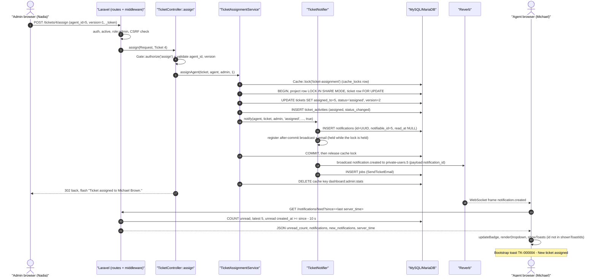

# 13 — Notification System Guide

This guide explains how ResolveDesk shows **in-app notifications** (the bell in the navbar and the pop-up toasts)
without reloading the page. Everything here is **implemented** unless a section says *Future improvement*.

> **V2 update:** notifications are now created by `App\Services\TicketNotifier` (it replaced the private
> `notifyUser()` / `queueEmail()` methods that V1 had inside `TicketService`). New events were added
> (`created` → admins, `unassigned` → previous agent, `internal_note` → staff only, `sla_breached` → by the
> system). Delivery is now **real-time** through Laravel Reverb + Echo, with the V1 AJAX polling kept as a
> **fallback**. The WebSocket part is explained in detail in
> [21-REALTIME-REVERB-ECHO.md](21-REALTIME-REVERB-ECHO.md); this guide covers the notification data, recipients,
> endpoints and `notifications.js`.

Files covered:

| File | Role |
|---|---|
| `app/Notifications/TicketNotification.php` | The one reusable Laravel Notification class |
| `app/Models/User.php` | Uses the `Notifiable` trait |
| `database/migrations/2026_11_25_140742_create_notifications_table.php` | The standard `notifications` table |
| `database/migrations/2026_11_26_000008_add_notification_feed_index.php` | V2: index `(notifiable_type, notifiable_id, created_at)` for the feed |
| `app/Services/TicketNotifier.php` | V2: `notify()` / `notifyAdmins()` — skip rules, DB row, after-commit broadcast and email |
| `app/Services/TicketService.php` | Decides **who** gets a notification for create, comments/internal notes, resolve, reopen, close, SLA breach |
| `app/Services/TicketAssignmentService.php` | Decides who gets a notification for assign / reassign (new **and** previous agent) |
| `app/Events/UserNotificationCreated.php`, `routes/channels.php`, `resources/js/realtime.js` | V2 real-time signal on the private channel `users.{id}` (see guide 21) |
| `app/Http/Controllers/NotificationController.php` | History page + JSON endpoints |
| `routes/web.php` | Routes `notifications.index`, `notifications.feed`, `notifications.read`, `notifications.read-all` |
| `resources/views/partials/navbar.blade.php` | The bell, badge, dropdown and `data-*` URLs |
| `resources/views/layouts/app.blade.php` | CSRF and `user-id` `<meta>` tags, `#toast-container`, loads `notifications.js` and (if built) `realtime.js` |
| `public/js/notifications.js` | Feed fetch on real-time signal, fallback polling, badge, dropdown, toasts, mark-as-read |
| `resources/views/notifications/index.blade.php` | Full notification history page |
| `tests/Feature/NotificationTest.php` | 13 tests for recipients and JSON endpoints |
| `tests/Feature/RealtimeAndDeliveryTest.php` | 8 V2 tests: channel auth, id-only payload, after-commit, Reverb down, email delivery key |
| `tests/Feature/InternalNotesAndAttachmentsTest.php`, `tests/Feature/SlaReportsAndHardeningTest.php` | Internal-note and SLA-breach notification rules |

Related guides: [Business logic](06-BUSINESS-LOGIC-GUIDE.md), [Queue and email](14-QUEUE-AND-EMAIL-GUIDE.md),
[Caching](15-CACHING-GUIDE.md), [Debugging](11-DEBUGGING-GUIDE.md),
[Concurrency](20-CONCURRENCY-AND-DATA-INTEGRITY.md), [Real-time](21-REALTIME-REVERB-ECHO.md).

---

## 1. The big picture

There are three parts:

1. **Server side (PHP):** when something happens to a ticket, the service calls
   `TicketNotifier::notify()`, which runs `$user->notify(new TicketNotification(...))`. Laravel inserts **one
   row** into the `notifications` table **inside the same transaction** as the ticket change. This row is the
   durable source of truth.
2. **After COMMIT:** `TicketNotifier` broadcasts a tiny real-time signal (`UserNotificationCreated`, payload =
   the notification id only) to the recipient's private channel `users.{id}` through Laravel Reverb, and — for
   events that send email — queues a `SendTicketEmail` job.
3. **Browser side (JavaScript):** every logged-in page loads `public/js/notifications.js` (and
   `resources/js/realtime.js` when the Vite bundle is built). When the signal arrives, the script calls
   `GET /notifications/feed` at once, updates the badge and dropdown and shows a toast. When the WebSocket is not
   healthy, it **polls** the same endpoint every 5 seconds instead (V1 behaviour).

> **বাংলায়:** Notification প্রথমে database-এ সংরক্ষণ হয় (এটাই আসল তথ্য)। Commit-এর পরে Reverb WebSocket দিয়ে
> browser-কে একটা ছোট সংকেত পাঠানো হয় — "নতুন notification আছে"। Browser তখন `/notifications/feed` থেকে আসল data
> এনে toast দেখায়। WebSocket কাজ না করলে browser আগের মতো প্রতি ৫ সেকেন্ডে জিজ্ঞেস করে (polling) — তাই কোনো
> notification হারায় না।

### Notification matrix (V2)

From MASTER_PROMPT §9.2 and V2_MASTER_PROMPT §20, plus the "Ticket created" row added at the project owner's
request. "Real-time" = a `UserNotificationCreated` broadcast after commit (every in-app notification gets one).

| Event (`event_type`) | Recipient | In-app | Email | Real-time | Code |
|---|---|---|---|---|---|
| Ticket created (`created`) | Every active admin, except an admin who created it | Yes | Yes | Yes | `TicketService::createTicket()` → `notifyAdmins()` |
| Ticket assigned (`assigned`) | Assigned agent | Yes | Yes | Yes | `TicketAssignmentService::performAssignment()` |
| Ticket reassigned (`reassigned`) | New agent | Yes | Yes | Yes | `performAssignment()` |
| Reassigned away (`unassigned`) | **Previous** agent (message contains only the ticket number — they lose access) | Yes | No | Yes | `performAssignment()` |
| Customer public reply (`comment`) | Assigned agent | Yes | **Yes** (V2) | Yes | `TicketService::notifyCommentRecipients()` |
| Agent / admin public reply (`comment`) | Creator (and agent, if the author is not the agent) | Yes | No | Yes | `notifyCommentRecipients()` |
| Internal note (`internal_note`) | **Staff only**: assigned agent, and the creator only if the creator is staff; never a customer | Yes | No | Yes | `notifyCommentRecipients()` |
| Ticket resolved (`resolved`) | Ticket creator | Yes | Yes | Yes | `TicketService::resolve()` |
| Ticket reopened (`reopened`) | Assigned agent | Yes | Yes | Yes | `TicketService::reopen()` |
| Ticket closed (`closed`) | Assigned agent | Yes | No | Yes | `TicketService::close()` |
| SLA breached (`sla_breached`) | Assigned active agent; if unassigned or the agent is inactive: every active admin. Actor = **system** | Yes | Yes | Yes | `TicketService::processSlaBreach()` |

Common rules for every row (in `TicketNotifier::notify()`): no notification to a missing or inactive user, and
no notification to the person who performed the action. Edits (`updateTicket()`) and "Start work" notify nobody.

---

## 2. The Laravel Notification class — `TicketNotification`

```php
namespace App\Notifications;

use App\Models\Ticket;
use Illuminate\Notifications\Notification;

class TicketNotification extends Notification
{
    public function __construct(
        public Ticket $ticket,
        public string $eventType,   // e.g. "assigned", "comment", "resolved"
        public string $title,       // short heading shown in bold
        public string $message,     // one-line description
    ) {
    }

    /** Which channels to use. "database" = store in the notifications table. */
    public function via(object $notifiable): array
    {
        return ['database'];
    }

    public function toArray(object $notifiable): array
    {
        return [
            'ticket_id' => $this->ticket->id,
            'ticket_number' => $this->ticket->ticket_number,
            'title' => $this->title,
            'message' => $this->message,
            'event_type' => $this->eventType,
        ];
    }
}
```

### Line by line

| Code | Meaning |
|---|---|
| `extends Notification` | Laravel's base class. It knows how to be "sent" through channels. |
| `public function __construct(public Ticket $ticket, ...)` | **Constructor property promotion** (PHP 8). Writing `public` in the parameter list creates a property and assigns it automatically. It is the same as declaring `public Ticket $ticket;` and writing `$this->ticket = $ticket;`. |
| `via(object $notifiable): array` | Laravel asks: "which channels?" We return `['database']`, so the notification is **only** stored in the `notifications` table. Other channels exist (`mail`, `broadcast`, ...) but are not used here. Email is sent separately by a queued job (see [guide 14](14-QUEUE-AND-EMAIL-GUIDE.md)), and the real-time signal is a separate event `UserNotificationCreated` fired by `TicketNotifier` after commit (see [guide 21](21-REALTIME-REVERB-ECHO.md)). Keeping them separate lets us broadcast **only the id** and fire it strictly after commit. |
| `$notifiable` | The object receiving the notification — here always a `User`. |
| `toArray()` | The array that Laravel JSON-encodes into the `notifications.data` column. These exact keys are later read by `NotificationController::formatNotification()`. |

**One reusable class** handles all eleven event types (`created`, `assigned`, `reassigned`, `unassigned`,
`comment`, `internal_note`, `resolved`, `reopened`, `closed`, `sla_breached`). Only the `$eventType`, `$title`
and `$message` change. (The class docblock still lists only the V1 events.)

**V2: the id is chosen before sending.** `TicketNotifier` sets `$notification->id = (string) Str::uuid();` before
`$recipient->notify($notification)`. Laravel keeps an id that is already set, so we know exactly which
`notifications.id` was inserted and can broadcast it and use it as the email `delivery_key`.

### Important: it is NOT queued

The class does **not** implement `ShouldQueue`. So `notify()` inserts the row **immediately, inside the current
database transaction**. Consequences:

- In-app notifications work even if no queue worker is running (tested in
  `QueueAndEmailTest::test_in_app_notification_works_without_a_queue_worker`).
- If the transaction rolls back, the notification row is rolled back too (tested in
  `QueueAndEmailTest::test_no_email_job_is_dispatched_when_the_transaction_rolls_back`, which asserts
  `assertDatabaseCount('notifications', 0)`).

**What if you remove `via()`?** Laravel's base `Notification` class has no default `via()`, so sending would fail.
**What if you add `'mail'` to `via()`?** Laravel would look for a `toMail()` method — it does not exist, so it would
throw an error. Emails are deliberately handled by `SendTicketEmail` instead.

**How to modify:** to store one more field (e.g. priority), add `'priority' => $this->ticket->priority` to
`toArray()`, then add it to `formatNotification()` and use it in `notifications.js`. Old rows will not have the
key, so always read it with `?? ''`.

---

## 3. The `Notifiable` trait

```php
// app/Models/User.php
use Illuminate\Notifications\Notifiable;

class User extends Authenticatable
{
    use HasFactory, Notifiable;
```

A **trait** is a group of methods that PHP copies into a class. `Notifiable` gives every `User`:

| Method | What it does |
|---|---|
| `$user->notify($notification)` | Sends a notification to this user now |
| `$user->notifications()` | Relationship: all of this user's rows in `notifications`, **newest first** (Laravel adds `->latest()`) |
| `$user->unreadNotifications()` | Same, but only rows where `read_at IS NULL` |
| `$notification->markAsRead()` | (on a `DatabaseNotification` row) sets `read_at = now()` |

Remove `Notifiable` from `User` and every `notify()` / `notifications()` call fails with "Call to undefined method".

## 4. `notify()` — what happens internally

When `TicketNotifier::notify()` runs:

```php
$notification = new TicketNotification($ticket, $eventType, $title, $message);
$notification->id = (string) Str::uuid();
$recipient->notify($notification);
```

Laravel internally:

1. Calls `via($recipient)` → `['database']`.
2. Calls `toArray($recipient)` → the 5-key array.
3. Inserts a row:

```sql
INSERT INTO notifications (id, type, notifiable_type, notifiable_id, data, read_at, created_at, updated_at)
VALUES ('e53960f6-…', 'App\Notifications\TicketNotification', 'App\Models\User', 5,
        '{"ticket_id":2,"ticket_number":"TK-000002","title":"New ticket assigned",…,"event_type":"assigned"}',
        NULL, NOW(), NOW());
```

This is a real row read from the local development database (Michael Brown, user id 5):

| Column | Value |
|---|---|
| `id` | `e53960f6-b86d-4db7-be82-00b1db1ec880` (UUID) |
| `type` | `App\Notifications\TicketNotification` |
| `notifiable_type` | `App\Models\User` |
| `notifiable_id` | `5` |
| `data` | `{"ticket_id":2,"ticket_number":"TK-000002","title":"New ticket assigned","message":"Ticket TK-000002 \"Cannot reset my password\" has been assigned to you.","event_type":"assigned"}` |
| `read_at` | `NULL` (unread) |

---

## 5. The `notifications` table and polymorphic columns

```php
Schema::create('notifications', function (Blueprint $table) {
    $table->uuid('id')->primary();
    $table->string('type');
    $table->morphs('notifiable');
    $table->text('data');
    $table->timestamp('read_at')->nullable();
    $table->timestamps();
});
```

| Column | Purpose |
|---|---|
| `id` | A UUID string, not an auto-increment number. That is why the route is `/notifications/{id}/read` with a string `$id`. |
| `type` | The notification class name. |
| `notifiable_type` + `notifiable_id` | Created by `morphs('notifiable')`. Together they say **who** owns the row: "the `App\Models\User` with id 5". `morphs()` adds an index on both columns; V2 migration `2026_11_26_000008` replaced it with `(notifiable_type, notifiable_id, created_at)` so the feed's `ORDER BY created_at DESC LIMIT 5` uses the index (EXPLAIN before: "Using filesort"; after: index used, no filesort). |
| `data` | JSON text from `toArray()`. Laravel casts it back to an array (`$notification->data['ticket_id']`). |
| `read_at` | `NULL` = unread. A time = when it was read. |

### Polymorphic relationship

A normal foreign key points to **one** table (`tickets.created_by → users.id`). A **polymorphic** relationship
stores the **table/model name** as well as the id, so the same table could hold notifications for users,
teams, or any other model. In ResolveDesk only `App\Models\User` is ever stored, but Laravel's standard table is
designed to be generic. `$user->notifications()` is a `morphMany` relationship:

```sql
SELECT * FROM notifications
WHERE notifiable_type = 'App\Models\User' AND notifiable_id = 5
ORDER BY created_at DESC;
```

> **বাংলায়:** সাধারণ foreign key শুধু একটা নির্দিষ্ট টেবিলের id রাখে। Polymorphic relation-এ দুইটা কলাম থাকে —
> `notifiable_type` (কোন model, যেমন `App\Models\User`) আর `notifiable_id` (সেই model-এর কোন row)। ফলে একটাই
> `notifications` টেবিল যেকোনো ধরনের model-এর notification রাখতে পারে। আমাদের প্রজেক্টে শুধু User ব্যবহার হয়।

**Limitation:** because there is no real foreign key, the database cannot enforce that user 5 exists. That is
fine here because users are never deleted (they are deactivated).

---

## 6. Recipient selection (who gets notified?)

### 6.1 `TicketNotifier::notify()` — the gatekeeper (V2)

In V1 this logic was a private `notifyUser()` method (plus `queueEmail()`) inside `TicketService`. V2 moved it
into its own class, `App\Services\TicketNotifier`, because three services now need it (`TicketService`,
`TicketAssignmentService`, and the SLA path) and because it gained after-commit broadcasting.

```php
public function notify(?User $recipient, Ticket $ticket, ?User $actor, string $eventType, string $title, string $message, bool $sendEmail): void
{
    if ($recipient === null || ! $recipient->is_active) {
        return;
    }

    if ($actor !== null && $recipient->id === $actor->id) {
        return; // Do not notify people about their own actions.
    }

    $notification = new TicketNotification($ticket, $eventType, $title, $message);
    $notification->id = (string) Str::uuid();
    $recipient->notify($notification);               // INSERT, inside the current transaction

    $recipientId = $recipient->id;
    $notificationId = $notification->id;
    $this->afterCommit(function () use ($recipientId, $notificationId) {
        $this->broadcast($recipientId, $notificationId);   // real-time signal, after COMMIT
    });

    if ($sendEmail) {
        $this->queueEmail($recipient, $ticket, $title, $message, $notificationId);  // job, after COMMIT
    }
}
```

| Rule | Why |
|---|---|
| `?User $recipient` — the `?` means "may be null" | Example: `close()` passes `$lockedTicket->assignedAgent`, which is null for an unassigned ticket. "Skip unavailable recipients safely." |
| `! $recipient->is_active` → skip | Deactivated users cannot log in, so they should not get notifications or emails. Tested in `test_inactive_recipient_is_skipped`. |
| `?User $actor`; `$recipient->id === $actor->id` → skip | No self-notifications. `$actor = null` means the **system** acted (SLA scheduler), so nobody is skipped. |
| `$sendEmail` | See the matrix in section 1 (`true` for created, assigned, reassigned, customer reply, resolved, reopened, SLA breach). |
| `afterCommit()` | Broadcast and email run only after COMMIT, never on rollback. During an assignment they are additionally held until the assignment cache lock is released ([guide 20](20-CONCURRENCY-AND-DATA-INTEGRITY.md), section 5.5). |

`notifyAdmins()` loops over every active admin and calls `notify()` for each (used for `created` and for
unassigned `sla_breached`):

```php
public function notifyAdmins(Ticket $ticket, ?User $actor, string $eventType, string $title, string $message, bool $sendEmail): void
{
    $admins = User::where('role', User::ROLE_ADMIN)->where('is_active', true)->get();

    foreach ($admins as $admin) {
        $this->notify($admin, $ticket, $actor, $eventType, $title, $message, $sendEmail);
    }
}
```

Every workflow method calls the notifier **inside** `DB::transaction()`, after the row lock and after saving, so
the notification row commits or rolls back together with the ticket change.

### 6.2 Comments and internal notes — `notifyCommentRecipients()`

```php
if ($isInternal) {
    // Staff participants only. A customer creator is never told about internal notes.
    $recipients = [$agent];
    if ($creator->isStaff()) {
        $recipients[] = $creator;
    }
    $title = 'Internal note from ' . $author->name;
    $text = "Internal note on ticket {$ticket->ticket_number}: {$snippet}";
} else {
    $recipients = [$creator, $agent];
    $title = 'New comment from ' . $author->name;
    $text = "New comment on ticket {$ticket->ticket_number}: {$snippet}";
}

$alreadyNotifiedIds = [];
foreach ($recipients as $recipient) {
    if ($recipient === null || in_array($recipient->id, $alreadyNotifiedIds, true)) {
        continue; // no agent yet, or creator and agent are the same person
    }
    $alreadyNotifiedIds[] = $recipient->id;

    // Email only for a customer's public reply to the assigned agent.
    $sendEmail = ! $isInternal
        && $author->isCustomer()
        && $agent !== null
        && $recipient->id === $agent->id;

    $this->notifier->notify($recipient, $ticket, $author, $isInternal ? 'internal_note' : 'comment', $title, $text, $sendEmail);
}
```

Public replies — one rule, "notify the creator and the assigned agent, except the author":

| Who comments | Creator | Agent | Result |
|---|---|---|---|
| Customer (creator) | skipped (actor) | notified **+ email** (V2) | agent only |
| Assigned agent | notified | skipped (actor) | creator only, no email |
| Admin | notified | notified | both, no email |
| Agent who created a ticket assigned to themselves | same user twice | `$alreadyNotifiedIds` stops the duplicate | nobody (it is the author) |

Internal notes: only the assigned agent and a **staff** creator can be recipients, the event type is
`internal_note`, and **no email** is ever sent. A customer is never notified, so the existence of internal notes
is not revealed. Tested in `InternalNotesAndAttachmentsTest::test_internal_note_never_notifies_or_emails_the_customer`.

`mb_strimwidth($message, 0, 80, '...')` cuts the comment to 80 characters for a short message. `mb_` functions are
multi-byte safe, so Bangla text is not cut in the middle of a character.

Tests: `test_creator_comment_notifies_only_the_assigned_agent` (now also asserts exactly one email job to the
agent), `test_agent_reply_notifies_the_creator`, `test_admin_comment_notifies_creator_and_agent`,
`test_no_duplicate_when_creator_is_also_the_assigned_agent`.

### 6.3 Reassignment — the previous agent (V2)

`TicketAssignmentService::performAssignment()` notifies the new agent (`reassigned`, with email) **and** the
previous agent (`unassigned`, in-app only):

```php
// The previous agent loses access, so the message contains only the ticket number.
$this->notifier->notify($previousAgent, $ticket, $admin, 'unassigned',
    'Ticket reassigned to another agent',
    "Ticket {$ticket->ticket_number} is no longer assigned to you.",
    false);
```

The previous agent can normally no longer open the ticket (agent visibility = tickets they created or are
assigned to). The message therefore does not repeat the subject; the link opens a 403 page because
`tickets.show` re-checks `TicketPolicy::view` (unless that agent created the ticket).

### 6.4 SLA breach — the system as actor (V2)

`TicketService::processSlaBreach()` (called by `php artisan tickets:check-sla`) passes `$actor = null`:

```php
if ($agent !== null && $agent->is_active) {
    $this->notifier->notify($agent, $lockedTicket, null, 'sla_breached', $title, $message, true);
} else {
    // Unassigned (or agent inactive): the administrators must act.
    $this->notifier->notifyAdmins($lockedTicket, null, 'sla_breached', $title, $message, true);
}
```

It runs under a row lock with the `sla_notified_at` check, so one breach produces exactly one notification
([guide 20](20-CONCURRENCY-AND-DATA-INTEGRITY.md), section 9).

**No change → no notification:** `assignAgent()` returns `false` (and notifies nobody) when the ticket is already
assigned to the same agent (`if ($ticket->assigned_to === $agent->id) return false;`). A replayed ticket-creation
request (same `request_token`) creates no second admin notification.

---

## 7. Routes and JSON endpoints

```php
// routes/web.php — inside Route::middleware(['auth', 'active'])
Route::get('/notifications', [NotificationController::class, 'index'])->name('notifications.index');
Route::get('/notifications/feed', [NotificationController::class, 'feed'])->name('notifications.feed');
Route::post('/notifications/read-all', [NotificationController::class, 'markAllAsRead'])->name('notifications.read-all');
Route::post('/notifications/{id}/read', [NotificationController::class, 'markAsRead'])->name('notifications.read');
```

- `auth` → a guest gets **401 JSON** (when the request expects JSON) instead of the login page. Tested in
  `test_feed_requires_authentication`.
- `active` → `ActiveUserMiddleware` logs out a deactivated user and returns **401 JSON** for AJAX requests.
- `read-all` is declared **before** `{id}/read`. Both are POST, so they are protected by CSRF.

---

## 8. `NotificationController` — authorization by query scope

The class comment says it best: *"Every query starts from `$request->user()->notifications()`, so a user can only
ever see or change THEIR OWN notification rows."* There is no policy for notifications; the **query itself** is
the authorization.

### 8.1 `index()` — history page

```php
public function index(Request $request)
{
    $query = $request->user()->notifications(); // newest first by default

    if ($request->input('filter') === 'unread') {
        $query->whereNull('read_at');
    } elseif ($request->input('filter') === 'read') {
        $query->whereNotNull('read_at');
    }

    $notifications = $query->paginate(15)->withQueryString();

    return view('notifications.index', ['notifications' => $notifications]);
}
```

`?filter=unread` / `?filter=read` / nothing = all. `withQueryString()` keeps `filter` in the pagination links.
This page keeps the **complete history** (the dropdown only shows 5).

### 8.2 `feed()` — the JSON endpoint used by JavaScript (real-time signal and fallback polling)

```php
public function feed(Request $request)
{
    $request->validate([
        'since' => ['nullable', 'date'], // an invalid value returns 422 instead of crashing
    ]);

    $user = $request->user();

    // Taken BEFORE the queries: a notification inserted while this request runs
    // is then still "new" on the next poll (duplicates are filtered by ID in JS).
    $serverTime = now()->toIso8601String();

    $latest = $user->notifications()->take(self::DROPDOWN_LIMIT)->get();

    $newNotifications = collect();
    if ($request->filled('since')) {
        // Look 10 seconds further back than asked: a notification created inside a
        // transaction that had not committed yet during the previous poll is still found.
        // notifications.js ignores IDs it has already shown, so the overlap causes no duplicate toasts.
        $since = Carbon::parse($request->input('since'))->subSeconds(self::SINCE_OVERLAP_SECONDS);
        $newNotifications = $user->unreadNotifications()
            ->where('created_at', '>=', $since)
            ->take(20)
            ->get();
    }

    return response()->json([
        'unread_count' => $user->unreadNotifications()->count(),
        'notifications' => $latest->map(fn ($notification) => $this->formatNotification($notification)),
        'new_notifications' => $newNotifications->map(fn ($notification) => $this->formatNotification($notification)),
        // The browser sends this back as ?since= on the next poll.
        'server_time' => $serverTime,
    ]);
}
```

(`private const SINCE_OVERLAP_SECONDS = 10;` is declared at the top of the class next to `DROPDOWN_LIMIT`.)

| Part | Explanation |
|---|---|
| `validate(['since' => ['nullable', 'date']])` | `since` comes from the URL, so it is user input. `?since=hello` returns 422 instead of a crash in `Carbon::parse()`. |
| `take(self::DROPDOWN_LIMIT)` | `DROPDOWN_LIMIT = 5`: the latest 5 rows (read **and** unread) for the dropdown. |
| `$serverTime` taken first | Captured **before** the queries. A row inserted while this request is running has `created_at` ≥ `server_time`, so the next poll still finds it. |
| `subSeconds(self::SINCE_OVERLAP_SECONDS)` | Looks 10 s further back than `since`. A notification created inside a transaction that had **not committed yet** during the previous poll (so it was invisible then) is still found by the next poll. Rows returned twice are ignored by `shownToastIds` in `notifications.js`. |
| `new_notifications` | Only when `since` is given: **unread** rows created at or after `since` (minus the 10 s overlap), max 20. These become toasts. This handles "multiple notifications arriving between two polls" — even 6+ new rows all produce toasts. |
| `unread_count` | A fresh `COUNT(*)` every time (never cached — see [Caching guide](15-CACHING-GUIDE.md)). |
| `fn ($notification) => ...` | A PHP **arrow function**: a short one-line closure that automatically sees `$this`. |
| `server_time` | The server's clock as ISO 8601 (e.g. `2026-11-25T14:30:05+06:00`). The browser does **not** use its own clock, so a wrong PC clock cannot break the logic. |
| `response()->json([...])` | Converts the array to JSON and sets `Content-Type: application/json`. |

Example JSON response:

```json
{
  "unread_count": 3,
  "notifications": [
    {
      "id": "e53960f6-b86d-4db7-be82-00b1db1ec880",
      "title": "New ticket assigned",
      "message": "Ticket TK-000002 \"Cannot reset my password\" has been assigned to you.",
      "ticket_number": "TK-000002",
      "event_type": "assigned",
      "ticket_url": "http://127.0.0.1:8000/tickets/2",
      "is_read": false,
      "time_ago": "5 seconds ago"
    }
  ],
  "new_notifications": [ /* same shape */ ],
  "server_time": "2026-11-25T14:30:05+06:00"
}
```

### 8.3 `markAsRead()` — one row

```php
public function markAsRead(Request $request, string $id)
{
    // findOrFail() on the user's own notifications => 404 for someone else's id.
    $notification = $request->user()->notifications()->findOrFail($id);
    $notification->markAsRead();

    if ($request->expectsJson()) {
        return response()->json([
            'success' => true,
            'unread_count' => $request->user()->unreadNotifications()->count(),
        ]);
    }

    if ($request->boolean('open_ticket') && isset($notification->data['ticket_id'])) {
        return redirect()->route('tickets.show', $notification->data['ticket_id']);
    }

    return back()->with('success', 'Notification marked as read.');
}
```

- **Authorization:** `->notifications()->findOrFail($id)` runs
  `WHERE notifiable_id = <me> AND id = ?`. Another user's UUID is simply "not found" → **404**. It does not even
  reveal that the row exists. Tested in `test_user_cannot_read_someone_elses_notification`.
- **One method, two clients:** `expectsJson()` is true when the request has `Accept: application/json` (our
  `fetch()` sends it). Then it returns JSON. The history page uses a normal HTML form, so it gets a redirect.
- `open_ticket=1` (the history page's "Open ticket" button) redirects to the ticket. The ticket page then runs
  `Gate::authorize('view', $ticket)` again — if access was revoked (e.g. ticket reassigned), the user sees 403.

### 8.4 `markAllAsRead()`

```php
$request->user()->unreadNotifications()->update(['read_at' => now()]);
```

One SQL `UPDATE notifications SET read_at = NOW() WHERE notifiable_type = ... AND notifiable_id = ? AND read_at IS NULL`.
Mass update, no loop.

### 8.5 `formatNotification()` — the JSON shape

```php
private function formatNotification(DatabaseNotification $notification): array
{
    $data = $notification->data;

    return [
        'id' => $notification->id,
        'title' => $data['title'] ?? 'Notification',
        'message' => $data['message'] ?? '',
        'ticket_number' => $data['ticket_number'] ?? '',
        'event_type' => $data['event_type'] ?? '',
        'ticket_url' => isset($data['ticket_id']) ? route('tickets.show', $data['ticket_id']) : null,
        'is_read' => $notification->read_at !== null,
        'time_ago' => $notification->created_at->diffForHumans(),
    ];
}
```

- `??` (null coalescing): use the right side if the key is missing. Protects against old/odd rows.
- `route('tickets.show', ...)` builds the URL on the server, so JavaScript never hard-codes URLs.
- `diffForHumans()` (Carbon) → "5 minutes ago" (the **relative timestamp** in the dropdown).
- Only these 8 keys leave the server. The full model is never returned.

---

## 9. The navbar HTML that JavaScript uses

```blade
<div class="dropdown" id="notificationBell"
     data-feed-url="{{ route('notifications.feed') }}"
     data-read-url="{{ route('notifications.read', ['id' => '__ID__']) }}"
     data-read-all-url="{{ route('notifications.read-all') }}"
     data-login-url="{{ route('login') }}">
    <button ...>
        <i class="bi bi-bell fs-5"></i>
        <span class="badge rounded-pill bg-danger notification-badge d-none" id="notificationCount">0</span>
    </button>
    <div class="dropdown-menu dropdown-menu-end notification-menu p-0 shadow-sm">
        ... <button type="button" ... id="markAllReadButton">Mark all as read</button>
        <div id="notificationList"> <div class="text-muted small p-3">Loading...</div> </div>
        <a href="{{ route('notifications.index') }}" ...>View all notifications</a>
    </div>
</div>
```

And in `layouts/app.blade.php`:

```blade
<meta name="csrf-token" content="{{ csrf_token() }}">
<meta name="user-id" content="{{ auth()->id() }}">   {{-- V2: realtime.js subscribes to users.{this id} --}}
...
<div class="toast-container position-fixed bottom-0 end-0 p-3" id="toast-container"></div>

<script src="{{ asset('vendor/bootstrap/bootstrap.bundle.min.js') }}"></script>
<script src="{{ asset('js/app.js') }}"></script>
<script src="{{ asset('js/notifications.js') }}"></script>
{{-- V2 real-time bundle (Echo + Reverb), built with `npm run build`. If it was never built,
     the page still works: notifications.js simply keeps polling. --}}
@if (file_exists(public_path('build/manifest.json')) || file_exists(public_path('hot')))
    @vite('resources/js/realtime.js')
@endif
```

- The `user-id` meta tag only tells the browser **which** channel to ask for. The server still decides in
  `routes/channels.php` whether this logged-in user may join it.

- `data-read-url` contains the placeholder `__ID__` because Blade cannot know the notification id in advance.
  JavaScript replaces it later.
- The scripts are at the **end of `<body>`**, so all the HTML elements exist when the script runs.
- `bootstrap.bundle.min.js` must load **before** `notifications.js`, because the script uses `bootstrap.Toast`.
- Because the navbar and the layout are used by every logged-in page, the system "works on every authenticated page".

---

## 10. `public/js/notifications.js` — line by line

### 10.1 IIFE and strict mode

```js
(function () {
    'use strict';
    ...
})();
```

- **IIFE** = Immediately Invoked Function Expression: a function that is defined and called at once.
  All variables (`timerId`, `shownToastIds`, ...) live **inside** the function, so they do not become global
  variables and cannot clash with other scripts (`app.js`, Chart.js). This satisfies "avoid interfering with
  existing page functionality".
- `'use strict'` turns on JavaScript strict mode: assigning to an undeclared variable throws an error instead of
  silently creating a global. It catches typos early.

> **বাংলায়:** IIFE হলো এমন একটা function যেটা বানানোর সাথে সাথেই চালানো হয়। এর ভেতরের সব variable বাইরে থেকে দেখা যায় না,
> তাই অন্য JavaScript ফাইলের variable-এর সাথে নামের সংঘর্ষ হয় না।

### 10.2 Constants

```js
const POLL_INTERVAL_MS = 5000;          // 5 seconds while the tab is visible
const HIDDEN_POLL_INTERVAL_MS = 30000;  // slower polling while the tab is hidden
```

The interval is configurable in **one place**. Change `5000` to `10000` to poll every 10 seconds.
`const` = the variable can never be reassigned.

### 10.3 Find the bell; read URLs from `data-*` attributes

```js
const bell = document.getElementById('notificationBell');
if (!bell) {
    return; // Not on a logged-in page.
}

const feedUrl = bell.dataset.feedUrl;
const readUrlTemplate = bell.dataset.readUrl;   // contains "__ID__"
const readAllUrl = bell.dataset.readAllUrl;
const loginUrl = bell.dataset.loginUrl;
```

- If the bell does not exist (e.g. the login page uses `layouts/guest`), the script stops immediately.
- `dataset` converts `data-feed-url` to `dataset.feedUrl` (kebab-case → camelCase).
- Why not hard-code `'/notifications/feed'`? If the app runs in a sub-folder or a route URL changes, Blade's
  `route()` still produces the right URL.

### 10.4 CSRF token from the meta tag

```js
const csrfToken = document.querySelector('meta[name="csrf-token"]').getAttribute('content');
```

Laravel rejects every POST/PUT/PATCH/DELETE without a valid CSRF token (HTTP **419**). Forms use `@csrf`
(a hidden input). JavaScript has no form, so it reads the token from the `<meta>` tag and sends it in the
`X-CSRF-TOKEN` header (see `postJson()`).

> **বাংলায়:** CSRF (Cross-Site Request Forgery) হলো এমন আক্রমণ যেখানে অন্য কোনো ওয়েবসাইট আপনার লগইন করা browser
> দিয়ে গোপনে আমাদের সাইটে POST request পাঠায়। Laravel প্রতিটি session-এর জন্য একটা গোপন token বানায়; সঠিক token ছাড়া
> POST এলে 419 error দেয়। অন্য সাইট এই token জানে না, তাই আক্রমণ ব্যর্থ হয়।

### 10.5 DOM references and state variables

```js
const countBadge = document.getElementById('notificationCount');
const listContainer = document.getElementById('notificationList');
const markAllButton = document.getElementById('markAllReadButton');
const toastContainer = document.getElementById('toast-container');

let lastServerTime = null;      // sent back as ?since= so the server returns only new items
let isFirstLoad = true;         // historical notifications are not shown as toasts
let timerId = null;             // the one and only pending setTimeout
let isRequestRunning = false;   // prevents two requests at the same time
let isStopped = false;          // set when the session has expired
let fetchAgain = false;         // an update arrived while a request was running
let realtimeHealthy = false;    // true while the WebSocket channel is connected + subscribed
const shownToastIds = new Set();
```

| Variable | Job |
|---|---|
| `lastServerTime` | `server_time` from the previous response. |
| `isFirstLoad` | `true` only for the first request after page load. |
| `timerId` | The id returned by `setTimeout`, so we can cancel it with `clearTimeout`. |
| `isRequestRunning` | A simple lock: never two feed requests at once. |
| `isStopped` | `true` after a 401/419: stop polling forever on this page. |
| `fetchAgain` | V2: a real-time signal (or tab focus) arrived while a request was running → run exactly one more fetch afterwards, so the new notification is not missed. |
| `realtimeHealthy` | V2: set by the `resolvedesk:realtime-status` event from `realtime.js`. While `true`, continuous polling is switched off. |
| `shownToastIds` | A JavaScript `Set` (a list with unique values and fast `has()`) of notification ids already shown or already known. |

### 10.6 `poll()` — AJAX with Fetch, async/await

The function is still called `poll()`, but in V2 it is simply "fetch the feed once". It is called by the
fallback timer, by a real-time signal, on (re)connection and when the tab becomes visible.

```js
async function poll() {
    if (isStopped) {
        return;
    }
    if (isRequestRunning) {
        fetchAgain = true; // run once more when the current request finishes
        return;
    }
    isRequestRunning = true;

    try {
        let url = feedUrl;
        if (lastServerTime) {
            url += '?since=' + encodeURIComponent(lastServerTime);
        }

        const response = await fetch(url, {
            headers: { 'Accept': 'application/json', 'X-Requested-With': 'XMLHttpRequest' },
            credentials: 'same-origin',
        });
```

- **AJAX** = the browser sends an HTTP request in the background and updates part of the page, without a reload.
- **Fetch API** = the modern built-in browser function for AJAX. `fetch(url)` returns a **Promise** (a value that
  will arrive later).
- **`async` / `await`:** `async function` may use `await`. `await fetch(...)` pauses *this function only* until the
  response arrives; the page stays responsive. Without `await`, `response` would be a Promise, not the response.
- `encodeURIComponent()` makes the time URL-safe. The ISO time contains `+06:00`; an un-encoded `+` would be read
  as a space by the server and `since` would be invalid (422).
- `'Accept': 'application/json'` → Laravel's `expectsJson()` is true, so errors come back as JSON (401, 422) and
  not as an HTML redirect to the login page.
- `credentials: 'same-origin'` → send the session cookie, so the server knows who is logged in.

> **বাংলায়:** `fetch()` সাথে সাথে উত্তর দেয় না, একটা Promise দেয় — মানে "উত্তর পরে আসবে"। `await` লিখলে function টা
> উত্তর আসা পর্যন্ত অপেক্ষা করে, কিন্তু পুরো পেজ আটকে যায় না। `await` শুধু `async` function-এর ভেতরেই লেখা যায়।

```js
        if (response.status === 401 || response.status === 419) {
            handleExpiredSession();
            return;
        }

        if (!response.ok) {
            throw new Error('Server responded with ' + response.status);
        }

        const data = await response.json();
```

- **401** = not logged in (session expired, or `ActiveUserMiddleware` logged out a deactivated user).
  **419** = CSRF token/session expired. Both mean "polling cannot work any more" → `handleExpiredSession()`.
- `response.ok` is true for status 200–299. A 500 error throws, and the `catch` below handles it.
- `response.json()` parses the JSON body into a JavaScript object (also a Promise, hence `await`).

```js
        updateBadge(data.unread_count);
        renderDropdown(data.notifications);

        if (!isFirstLoad) {
            showToasts(data.new_notifications);
        } else {
            // Remember the existing IDs so they never pop up as "new".
            data.notifications.forEach(function (item) { shownToastIds.add(item.id); });
        }

        isFirstLoad = false;
        lastServerTime = data.server_time;
```

**First-load logic (no toasts for history):** on the first request `lastServerTime` is `null`, so no `?since=` is
sent and the server returns an empty `new_notifications`. The ids of the 5 visible notifications are added to
`shownToastIds`. So when you open a page, old notifications are **not** shown as toasts. From the second request
onward, `?since=` is sent, and only rows created since the previous poll become toasts.

```js
    } catch (error) {
        // Network problem or server error: keep the page working and try again later.
        console.warn('Notification polling failed:', error.message);
    } finally {
        isRequestRunning = false;
        if (fetchAgain) {
            fetchAgain = false;
            poll();
        } else {
            scheduleNextPoll();
        }
    }
}
```

- `catch`: Wi-Fi off, server down, 500 error → only a warning in the browser console. The page keeps working and
  the next poll tries again (**graceful network error handling**).
- `finally` runs **always** — after success, after an error, and even after the `return` in the 401/419 branch.
  It releases the lock, runs the one queued extra fetch if a signal arrived meanwhile (`fetchAgain`), or schedules
  the next poll. (After 401/419, `scheduleNextPoll()` sees `isStopped` and does nothing.)

### 10.7 Recursive `setTimeout` (not `setInterval`) — only while real time is unhealthy

```js
function scheduleNextPoll() {
    clearTimeout(timerId); // guarantees only one polling loop exists
    if (isStopped || realtimeHealthy) {
        return; // WebSocket is healthy: no continuous polling needed
    }
    const delay = document.hidden ? HIDDEN_POLL_INTERVAL_MS : POLL_INTERVAL_MS;
    timerId = setTimeout(poll, delay);
}
```

V2: when the WebSocket is connected **and** subscribed (`realtimeHealthy`), no timer is created — the browser
waits for real-time signals instead of asking every 5 seconds. When it is not healthy (Reverb stopped, network
blocked, bundle not built), the V1 polling loop below runs exactly as before.

`poll()` → (request finishes) → `finally` → `scheduleNextPoll()` → `setTimeout(poll, 5000)` → `poll()` → ...
The function schedules itself again — **recursive setTimeout**.

Why not `setInterval(poll, 5000)`? `setInterval` fires every 5 seconds **even if the previous request has not
finished**. On a slow server (say 8 seconds per response) requests would pile up and overlap. With recursive
`setTimeout` the next request is scheduled **only after** the current one finished, so they never overlap.

Three protections against multiple loops:

1. `isRequestRunning` — `poll()` does not start a second request while one is in flight (it only sets
   `fetchAgain`, so at most one extra fetch follows).
2. `clearTimeout(timerId)` — any old pending timer is cancelled before a new one is created, so only **one**
   timer exists.
3. `isStopped` — after session expiry, no more timers.

> **বাংলায়:** `setInterval` ঘড়ি ধরে প্রতি ৫ সেকেন্ডে request পাঠায়, আগেরটা শেষ হোক বা না হোক — সার্ভার ধীর হলে একসাথে
> অনেক request জমে যায়। Recursive `setTimeout`-এ একটা request শেষ হওয়ার পরেই পরেরটা ৫ সেকেন্ড পরে নির্ধারণ করা হয়,
> তাই কখনো দুইটা request একসাথে চলে না।

### 10.8 Hidden tab: slow down; visible again: fetch now

```js
document.addEventListener('visibilitychange', function () {
    if (!document.hidden && !isStopped) {
        clearTimeout(timerId);
        poll();
    }
});
```

- `document.hidden` is `true` when the tab is in the background or the window is minimized. Then
  `scheduleNextPoll()` uses **30 seconds** instead of 5 → 6× fewer requests from idle tabs.
- When the user returns, the `visibilitychange` event fires. The pending (up to 30 s) timer is cancelled and
  `poll()` runs **immediately**, so the user sees fresh data at once.
- If a request is already running, `poll()` sets `fetchAgain`; that request's `finally` runs one more fetch.

### 10.8a V2: the real-time bridge

`resources/js/realtime.js` (Laravel Echo) fires two browser events; `notifications.js` listens to them:

```js
// Connection state changed: connected+subscribed => stop polling; otherwise fall back.
window.addEventListener('resolvedesk:realtime-status', function (event) {
    const wasHealthy = realtimeHealthy;
    realtimeHealthy = event.detail.healthy === true;

    if (realtimeHealthy && !wasHealthy) {
        poll(); // (re)connected: synchronize anything missed while disconnected
    } else if (!realtimeHealthy && wasHealthy) {
        scheduleNextPoll(); // WebSocket lost: resume fallback polling
    }
});

// A new notification exists: fetch the authorized data now (the broadcast only carries an id).
window.addEventListener('resolvedesk:realtime-notification', function () {
    poll();
});
```

Both files communicate only through these `window` events, so `notifications.js` stays a plain file (no build
step) and works alone when `realtime.js` is not loaded. Full explanation: [guide 21](21-REALTIME-REVERB-ECHO.md).

### 10.9 Expired session

```js
function handleExpiredSession() {
    isStopped = true;
    clearTimeout(timerId);
    listContainer.textContent = '';
    const message = document.createElement('div');
    message.className = 'p-3 small text-muted';
    message.textContent = 'Your session has expired. ';
    const link = document.createElement('a');
    link.href = loginUrl;
    link.textContent = 'Sign in again';
    message.appendChild(link);
    listContainer.appendChild(message);
}
```

Stops polling for good (otherwise every 5 seconds it would hit 401 forever) and puts a "Sign in again" link in the
dropdown. The page is **not** reloaded — the user may be typing a comment.

### 10.10 DOM manipulation and XSS safety

```js
function updateBadge(unreadCount) {
    if (unreadCount > 0) {
        countBadge.textContent = unreadCount > 99 ? '99+' : String(unreadCount);
        countBadge.classList.remove('d-none');
    } else {
        countBadge.classList.add('d-none');
    }
}
```

`d-none` is Bootstrap's `display: none`. The badge is hidden when there are no unread notifications and shows
"99+" for large numbers.

```js
function renderDropdown(notifications) {
    listContainer.textContent = '';
    ...
    notifications.forEach(function (item) {
        const row = document.createElement('a');
        row.className = 'notification-item' + (item.is_read ? '' : ' unread');
        row.href = item.ticket_url || '#';

        const title = document.createElement('div');
        title.className = 'notification-title';
        title.textContent = item.ticket_number + ' · ' + item.title;
        ...
        row.addEventListener('click', function (event) {
            event.preventDefault();
            openNotification(item);
        });

        listContainer.appendChild(row);
    });
}
```

- `listContainer.textContent = ''` clears the old list (the dropdown is fully re-rendered on each poll).
- `document.createElement()` + `appendChild()` = **DOM manipulation**: building HTML elements with JavaScript.
- The `unread` CSS class highlights unread rows (**read/unread indicator**).
- `event.preventDefault()` stops the normal link navigation so we can first mark the row as read.

**`textContent` vs `innerHTML` (XSS):** the message contains the **ticket subject** typed by a customer. Imagine a
subject ``.

- `element.innerHTML = item.message` → the browser parses it as HTML → the script runs → **XSS** (Cross-Site
  Scripting).
- `element.textContent = item.message` → the browser shows the literal characters `` → harmless.

That is why the file never uses `innerHTML` for data. (There is no automated JavaScript test for this; it is
enforced by code review. The PHP test `test_feed_returns_unread_count_and_latest_five_notifications` checks a
different security rule: another user's notification — message `Secret` — never appears in your feed.)

> **বাংলায়:** XSS হলো যখন কোনো ব্যবহারকারী ticket subject-এ JavaScript কোড লিখে দেয়, আর সেটা অন্য কারো browser-এ
> চলে যায়। `innerHTML` লেখাটাকে HTML হিসেবে চালায়, তাই বিপজ্জনক। `textContent` লেখাটাকে শুধু সাধারণ text হিসেবে
> দেখায়, তাই কোড কখনো চলে না।

### 10.11 Bootstrap toasts and duplicate prevention

```js
function showToasts(newNotifications) {
    newNotifications.forEach(function (item) {
        if (shownToastIds.has(item.id)) {
            return; // already shown once
        }
        shownToastIds.add(item.id);

        const toast = document.createElement('div');
        toast.className = 'toast';
        toast.setAttribute('role', 'status');
        toast.setAttribute('aria-live', 'polite');
        ... header with bell icon, "<ticket_number> · <title>" and a close button ...
        const body = document.createElement('div');
        body.className = 'toast-body';
        body.style.cursor = 'pointer';
        body.textContent = item.message;
        body.addEventListener('click', function () { openNotification(item); });

        toast.appendChild(header);
        toast.appendChild(body);
        toastContainer.appendChild(toast);

        const bootstrapToast = new bootstrap.Toast(toast, { delay: 8000 });
        bootstrapToast.show();
        toast.addEventListener('hidden.bs.toast', function () { toast.remove(); });
    });
}
```

**Duplicate prevention — why is it needed?** The server filter is `created_at >= since - 10 seconds`. `>=` (not `>`)
is used so a row created in the **same second** as `server_time` is not lost, and the 10-second overlap
(`SINCE_OVERLAP_SECONDS`) catches rows from transactions that committed late. But that means the same row is often
returned by two consecutive polls. In V2 the same notification can also arrive through a real-time signal **and** a
poll (for example right after a reconnect). `shownToastIds` remembers every id already shown, so a toast never
appears twice **in the same tab**. Each open tab keeps its own set and its own WebSocket, so two tabs show two
toasts (documented limitation).

- `new bootstrap.Toast(toast, { delay: 8000 })` — Bootstrap's JavaScript component; it auto-hides after 8 seconds.
- `data-bs-dismiss="toast"` on the close button lets Bootstrap close it.
- `hidden.bs.toast` is the event Bootstrap fires when the toast is hidden; we then remove the element so the DOM
  does not grow forever.
- `role="status"` and `aria-live="polite"` make screen readers announce the toast.
- The toast contains **ticket number, title and short message**.

### 10.12 POST requests with the CSRF header

```js
async function postJson(url) {
    const response = await fetch(url, {
        method: 'POST',
        headers: {
            'Accept': 'application/json',
            'X-CSRF-TOKEN': csrfToken,
            'X-Requested-With': 'XMLHttpRequest',
        },
        credentials: 'same-origin',
    });

    if (response.status === 401 || response.status === 419) {
        handleExpiredSession();
        throw new Error('Session expired');
    }
    if (!response.ok) {
        throw new Error('Server responded with ' + response.status);
    }
    return response.json();
}
```

Laravel's CSRF middleware accepts the token from the `_token` form field **or** the `X-CSRF-TOKEN` header.
Verified in the HTTP smoke test (DEVELOPMENT_PROGRESS.md): AJAX mark-all-read with `X-CSRF-TOKEN` worked, and a
POST without the token returned **419**.

### 10.13 `openNotification()` — mark as read, then open the ticket

```js
async function openNotification(item) {
    try {
        if (!item.is_read) {
            await postJson(readUrlTemplate.replace('__ID__', encodeURIComponent(item.id)));
        }
    } catch (error) {
        console.warn('Could not mark notification as read:', error.message);
    }

    if (item.ticket_url) {
        window.location.href = item.ticket_url;
    } else {
        poll();
    }
}
```

1. If unread, `POST /notifications/{id}/read` (the `__ID__` placeholder is replaced with the UUID).
2. `await` makes sure the row is marked **before** we leave the page.
3. Even if marking fails, we still navigate (the user asked to open the ticket).
4. Navigation goes to `tickets.show`, where `Gate::authorize('view', $ticket)` checks permission **again**. If the
   ticket was reassigned to another agent in the meantime, the user gets a friendly 403 page
   (`resources/views/errors/403.blade.php`). The notification never grants access by itself.

### 10.14 Mark all as read and start

```js
markAllButton.addEventListener('click', async function () {
    try {
        const data = await postJson(readAllUrl);
        updateBadge(data.unread_count);
        listContainer.querySelectorAll('.notification-item.unread').forEach(function (row) {
            row.classList.remove('unread');
        });
    } catch (error) {
        console.warn('Could not mark all notifications as read:', error.message);
    }
});

// First request immediately on page load.
poll();
```

The badge disappears and unread highlighting is removed **without a page reload**. The final `poll()` starts the
loop right away (no 5-second wait after page load).

---

## 11. Mark-as-read workflow summary

| Where | Action | Request | Server |
|---|---|---|---|
| Dropdown row / toast click | `openNotification()` | `POST /notifications/{id}/read` (JSON) | `markAsRead()` → JSON `{success, unread_count}` → JS navigates to ticket |
| Dropdown "Mark all as read" | click handler | `POST /notifications/read-all` (JSON) | `markAllAsRead()` → JSON `{success, unread_count: 0}` |
| History page "Mark as read" | HTML form with `@csrf` | `POST /notifications/{id}/read` | redirect back with flash message |
| History page "Open ticket" | HTML form, `open_ticket=1` | `POST /notifications/{id}/read` | redirect to `tickets.show` |
| History page "Mark all as read" | HTML form | `POST /notifications/read-all` | redirect back |

---

## 12. Complete workflow: admin clicks Assign → agent sees a toast (no refresh)

Scenario with seeded data: admin Nadia Rahman assigns Open ticket **TK-000004** "API returns 504 for bulk uploads"
to **Michael Brown** (user id 5), who is logged in in another browser with a healthy WebSocket.



Step by step:

1. The admin submits the Assign form on `tickets/show.blade.php` (a normal POST with `@csrf` and the hidden
   `version`).
2. Middleware: `auth` (logged in), `active` (account active), `role:admin`, CSRF.
3. `TicketController::assign()` → `Gate::authorize('assign', $ticket)` (`TicketPolicy::assign`) → validation.
4. `TicketAssignmentService::assignAgent()` takes the global assignment cache lock, opens a transaction, locks
   the project row (shared) and the ticket row, checks the version, and `performAssignment()` changes the ticket,
   writes two activities and calls `TicketNotifier::notify(..., 'assigned', 'New ticket assigned', ..., true)`.
5. `notify()` inserts the `notifications` row **inside the transaction** and only registers the broadcast and the
   email as after-commit callbacks.
6. COMMIT, then the cache lock is released. Only now the held side effects run: the broadcast to Reverb and the
   `SendTicketEmail` job insert. The dashboard cache is cleared.
7. The admin's page reloads with the success message. **The agent's page does not reload.**
8. Reverb pushes `notification.created` to Michael's private channel; `realtime.js` fires
   `resolvedesk:realtime-notification`; `notifications.js` calls the feed at once (live check: **255 ms** from the
   assignment request to the event, see guide 21).
9. JavaScript updates the badge (+1), redraws the dropdown, and shows a toast because the id is new.
10. If the WebSocket is **not** healthy, step 8 is replaced by the fallback poll within ≤ 5 seconds; the result is
    the same.
11. The agent clicks the toast → `POST /notifications/{id}/read` → navigates to `/tickets/4`.

---

## 13. Polling and feed performance

With a healthy WebSocket the browser fetches the feed only when something happened (plus once on page load,
reconnect and tab focus). The numbers below apply to the **fallback** mode (Reverb down, bundle not built).

Each fetch costs one HTTP request and about **three small SQL queries** (latest 5, unread count, new since) plus
the session and user lookups that every Laravel request does (sessions are stored in the database).

Rough fallback load: 100 logged-in users with visible tabs → 100 / 5 s = **20 requests per second**, mostly
returning "nothing new". Ways the code reduces the cost:

| Technique | Where |
|---|---|
| No continuous polling while the WebSocket is healthy (V2) | `scheduleNextPoll()` checks `realtimeHealthy` |
| Hidden tabs poll every 30 s instead of 5 s | `HIDDEN_POLL_INTERVAL_MS` |
| No overlapping requests | recursive `setTimeout` + `isRequestRunning` / `fetchAgain` |
| Small responses (max 5 + 20 items, 8 fields each) | `DROPDOWN_LIMIT`, `take(20)`, `formatNotification()` |
| Index `(notifiable_type, notifiable_id, created_at)` (V2) | migration `2026_11_26_000008` — no filesort for `ORDER BY created_at DESC LIMIT 5` |
| Stop after 401/419 | `isStopped` |

Known limitations (honest):

- In fallback mode most requests return no new data — polling wastes requests compared with push.
- There is no index on `read_at`; the unread count filters `read_at IS NULL` within the user's index range, which
  is fine for normal per-user volumes.
- `new_notifications` uses the row's `created_at`. A row inserted by a transaction that had not committed during
  the previous poll could have a `created_at` older than the next `since` and miss its toast. This is **mitigated**:
  `feed()` looks back an extra 10 seconds (`SINCE_OVERLAP_SECONDS`) and takes `server_time` before running its
  queries; `shownToastIds` prevents duplicate toasts. In V2 the broadcast is sent only **after** commit, so a
  real-time fetch always sees the row.
- A user with many open tabs keeps one WebSocket (and, in fallback mode, one polling loop) per tab, and each tab
  shows its own toast.

---

## 14. Polling vs SSE vs WebSockets

V1 used only AJAX polling (MASTER_PROMPT §9.4 forbade WebSockets then). **V2 implements WebSockets** with Laravel
Reverb + Echo (V2_MASTER_PROMPT §21) and keeps polling as the fallback. The full comparison — including long
polling — and the reasons for choosing WebSockets are in
[21-REALTIME-REVERB-ECHO.md](21-REALTIME-REVERB-ECHO.md), section 1.

| | AJAX polling (V1, now fallback) | Server-Sent Events (SSE) — not used | WebSockets with Laravel Reverb (V2, implemented) |
|---|---|---|---|
| Direction | Browser asks repeatedly | Server → browser stream over one HTTP connection | Two-way, persistent connection |
| Latency | Up to the interval (5 s) | Near-instant | Near-instant (255 ms measured end-to-end) |
| Server load | Many short requests, mostly empty | One long-lived PHP response per user | One connection per tab, held by Reverb (not PHP-FPM) |
| Infrastructure | Nothing extra | PHP must hold connections open | `php artisan reverb:start`, `npm run build` for the Echo bundle; no Redis for one server |

**Interview answer:** "V2 uses Laravel Reverb and Echo on a private `users.{id}` channel. The notification is
stored in the database first; after commit we broadcast only its id, and the browser fetches the authorized data
from the same JSON feed we used for polling. If Reverb is down, the request still succeeds, a warning is logged
and the browser falls back to 5-second polling, so no notification is lost."

> **বাংলায়:** Polling-এ browser বারবার জিজ্ঞেস করে; SSE-তে সার্ভার একটা খোলা connection দিয়ে browser-কে খবর পাঠায়;
> WebSocket-এ দুই দিকেই স্থায়ী connection থাকে, তাই সবচেয়ে দ্রুত। V2-তে আমরা Reverb (WebSocket) ব্যবহার করি, আর
> Reverb বন্ধ থাকলে পুরনো polling আপনা-আপনি চালু হয়।

---

## 15. What was verified (from DEVELOPMENT_PROGRESS.md)

V1 (2026-11-25):

- Feature tests in `tests/Feature/NotificationTest.php` pass (recipients, no duplicates, inactive skipped, feed,
  `since`, mark one/all, 404 for another user's id, history filter, auth required).
- Real HTTP smoke test (curl, separate sessions): admin assign → the agent's `/notifications/feed?since=` returned
  the new notification; AJAX mark-all-read with `X-CSRF-TOKEN` worked; POST without a token → 419.

V2 (2026-11-26):

- `php artisan test` → **170 passed (682 assertions)**, including `RealtimeAndDeliveryTest` (8),
  `InternalNotesAndAttachmentsTest` and `SlaReportsAndHardeningTest`.
- Live real-time E2E with Reverb running and a Node + pusher-js client logged in as an agent: another user's
  channel refused; own channel subscribed; admin assignment → `notification.created` after **255 ms**; payload
  keys = `notification_id` only; the authorized feed contained that id.
- Reverb down: assignment succeeds and the notification is persisted (`test_failed_broadcast_does_not_break_the_operation`).
- The browser polling fallback logic was verified **only by code review**.
- **Not verified:** a visual check in a real browser and the toast rendering via WebSocket in a browser (no browser
  automation was available). Check it yourself with the two-browser demo in
  [21-REALTIME-REVERB-ECHO.md](21-REALTIME-REVERB-ECHO.md), section 7.

## 16. Debugging checklist

| Symptom | Check |
|---|---|
| Badge never updates | Browser DevTools → Network: is `/notifications/feed` called (after a WS frame, or every 5 s in fallback)? Console errors? Is `bootstrap.bundle.min.js` loaded before `notifications.js`? |
| Polling every 5 s although Reverb runs | The socket is not healthy: check the **WS** tab and `POST /broadcasting/auth` (403/419). See [guide 21](21-REALTIME-REVERB-ECHO.md), section 8. |
| Feed returns 401 | Session expired or user deactivated (`ActiveUserMiddleware`). Log in again. |
| Feed returns 422 | Bad `since` value — check `encodeURIComponent`. |
| POST returns 419 | Missing/old CSRF token; the `<meta name="csrf-token">` tag must be in the layout. Reload the page. |
| No notification row at all | Recipient inactive? Recipient = actor? Same agent assigned again (`assignAgent` returns false)? Internal note to a customer (never notified by design)? Check with `php artisan tinker`: `App\Models\User::find(5)->notifications()->count()`. |
| Row exists but no instant toast | `storage/logs/laravel.log` → "Real-time broadcast failed; polling fallback will deliver the notification". Is `reverb:start` running and `BROADCAST_CONNECTION=reverb`? |
| Toast shows twice | `shownToastIds` logic changed? Two tabs open (each tab shows its own toast — expected). |
| Old notifications pop up on page load | `isFirstLoad` logic removed. |

## 17. Practice modifications

1. Change fallback polling to 10 seconds: edit `POLL_INTERVAL_MS`.
2. Show 10 items in the dropdown: change `DROPDOWN_LIMIT` in `NotificationController`.
3. Notify the customer when their ticket is assigned: in `TicketAssignmentService::performAssignment()` add a
   `$this->notifier->notify($ticket->creator, $ticket, $admin, 'assigned', ...)` call (decide whether `$sendEmail`
   is true), and add a test in `NotificationTest`. Broadcasting comes for free because it lives in `notify()`.
4. Change toast duration: `{ delay: 8000 }` in `showToasts()`.
5. Email the assigned agent about internal notes as well: change the `$sendEmail` condition in
   `notifyCommentRecipients()` and update `InternalNotesAndAttachmentsTest` (never include the note text for
   customers).
