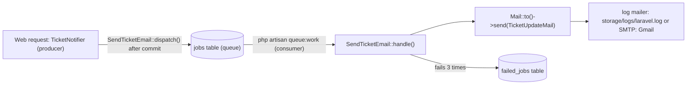
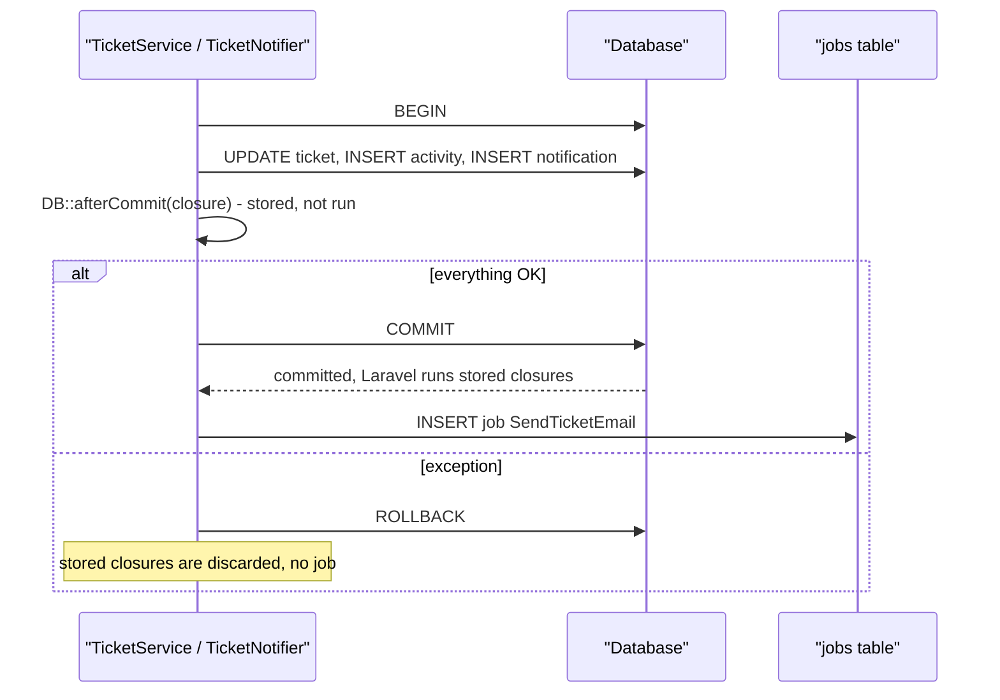

# 14 — Queue and Email Guide

This guide explains how ResolveDesk sends ticket emails **in the background** using Laravel's database queue.
Everything described is **implemented**, except sections marked *Future improvement*.

> **V2 update:** the producer is now `App\Services\TicketNotifier::queueEmail()` (it replaced the private
> `notifyUser()` / `queueEmail()` methods in `TicketService`). New: customer public replies email the assigned
> agent, SLA breaches send email, each email carries a `delivery_key` (the notification id) so a retried job does
> not send twice, the job has `$timeout = 60` (shorter than `retry_after = 90`), and the email shows the project
> name.

Files covered:

| File | Role |
|---|---|
| `app/Services/TicketNotifier.php` → `notify()`, `queueEmail()` | **Producer**: called with `$sendEmail = true`; dispatches the job after commit |
| `app/Services/TicketService.php`, `app/Services/TicketAssignmentService.php` | Decide **which** events send email (the `$sendEmail` argument) |
| `app/Jobs/SendTicketEmail.php` | The one reusable **job** (`ShouldQueue`, 3 tries, 10 s backoff, 60 s timeout, `delivery_key` check, `failed()`) |
| `app/Mail/TicketUpdateMail.php` | The one reusable **Mailable** |
| `resources/views/emails/ticket-update.blade.php` | The HTML email template |
| `database/migrations/0001_01_01_000002_create_jobs_table.php` | `jobs` and `failed_jobs` tables |
| `config/queue.php`, `config/mail.php`, `.env` | `QUEUE_CONNECTION=database`, `retry_after = 90`, `MAIL_MAILER=log` |
| `tests/Feature/QueueAndEmailTest.php` | 10 tests |
| `tests/Feature/RealtimeAndDeliveryTest.php` | V2: delivery key + project in the job, retried job sends once, timeout < retry_after, no job on rollback |

Related: [Notification system](13-NOTIFICATION-SYSTEM-GUIDE.md), [Business logic](06-BUSINESS-LOGIC-GUIDE.md),
[Debugging](11-DEBUGGING-GUIDE.md), [Concurrency](20-CONCURRENCY-AND-DATA-INTEGRITY.md),
[Real-time](21-REALTIME-REVERB-ECHO.md).

---

## 1. Why email should be asynchronous

Sending an email means connecting to an SMTP server over the internet. That can take 1–5 seconds, and it can
fail (wrong password, server down, timeout).

If the controller sent the email **during the web request**:

- The admin clicking "Assign" would wait several seconds.
- If SMTP failed, the request could show an error even though the ticket was already assigned.

So the web request only writes a small **job row** into the `jobs` table (a few milliseconds) and returns. A
separate process — the **queue worker** — sends the email later.

### Synchronous vs asynchronous

| | Synchronous | Asynchronous (what we do) |
|---|---|---|
| When does the work run? | Immediately, inside the request | Later, in another process |
| Does the user wait? | Yes | No |
| Failure affects the request? | Yes | No — the job is retried on its own |
| In ResolveDesk | In-app notifications (`TicketNotification`, database channel); V2 real-time signal (`UserNotificationCreated` is `ShouldBroadcastNow`: sent right after commit, not queued) | Emails (`SendTicketEmail`) |
| In tests | `phpunit.xml` sets `QUEUE_CONNECTION=sync`, so jobs run immediately (useful for testing) | `.env` uses `database` |

> **বাংলায়:** Synchronous মানে কাজটা এখনই, একই request-এর ভেতরে হবে এবং ব্যবহারকারী অপেক্ষা করবে। Asynchronous মানে
> কাজটা একটা তালিকায় (queue) রেখে দেওয়া হয়, আর আলাদা একটা process (queue worker) পরে সেটা করে। ইমেইল পাঠানো ধীর
> এবং ব্যর্থ হতে পারে, তাই আমরা এটাকে queue-তে পাঠাই — ব্যবহারকারীকে অপেক্ষা করতে হয় না।

### Producer, queue, consumer



| Term | In ResolveDesk |
|---|---|
| **Producer** | `TicketNotifier::queueEmail()` — creates jobs |
| **Queue** | The `jobs` table (`QUEUE_CONNECTION=database`), queue name `default` |
| **Job** | `App\Jobs\SendTicketEmail` — one unit of work |
| **Payload** | The JSON stored in `jobs.payload` (job class + serialized properties) |
| **Consumer / worker** | `php artisan queue:work` — a long-running PHP process that reads the table |

---

## 2. Database queue configuration

```env
# .env
QUEUE_CONNECTION=database
MAIL_MAILER=log
MAIL_FROM_ADDRESS="no-reply@resolvedesk.test"
MAIL_FROM_NAME="${APP_NAME}"
```

`config/queue.php` (Laravel default, unchanged):

```php
'database' => [
    'driver' => 'database',
    'connection' => env('DB_QUEUE_CONNECTION'),
    'table' => env('DB_QUEUE_TABLE', 'jobs'),
    'queue' => env('DB_QUEUE', 'default'),
    'retry_after' => (int) env('DB_QUEUE_RETRY_AFTER', 90),
    'after_commit' => false,
],
```

- `retry_after` = 90: if a worker took a job and did not finish it within 90 seconds (e.g. the worker crashed),
  another worker may pick it up again. Important for the duplicate-delivery discussion below.
- **V2 rule: worker timeout < `retry_after`.** `SendTicketEmail::$timeout = 60`. A hanging SMTP connection is
  killed after 60 s, **before** the job becomes visible again at 90 s. If the timeout were longer than
  `retry_after`, a second worker could start the same job while the first one is still sending — a duplicate
  email. Tested by `RealtimeAndDeliveryTest::test_worker_timeout_is_shorter_than_retry_after`. (If you start the
  worker with `--timeout`, keep that value below 90 too.)
- `after_commit` = false: the connection does **not** wait for commits automatically. ResolveDesk handles this
  explicitly with `DB::afterCommit()` (section 6).

The database queue needs no extra software (no Redis), which fits XAMPP on Windows.

---

## 3. The `jobs` and `failed_jobs` tables

```php
Schema::create('jobs', function (Blueprint $table) {
    $table->id();
    $table->string('queue')->index();
    $table->longText('payload');
    $table->unsignedTinyInteger('attempts');
    $table->unsignedInteger('reserved_at')->nullable();
    $table->unsignedInteger('available_at');
    $table->unsignedInteger('created_at');
});

Schema::create('failed_jobs', function (Blueprint $table) {
    $table->id();
    $table->string('uuid')->unique();
    $table->text('connection');
    $table->text('queue');
    $table->longText('payload');
    $table->longText('exception');
    $table->timestamp('failed_at')->useCurrent();
});
```

| `jobs` column | Meaning |
|---|---|
| `queue` | Queue name (`default`) |
| `payload` | JSON describing the job (see section 7) |
| `attempts` | How many times a worker has tried it |
| `reserved_at` | Unix time when a worker took it; `NULL` = waiting |
| `available_at` | Unix time from when it may run (used for backoff delays) |
| `created_at` | Unix time when it was dispatched (integers, not DATETIME) |

A successful job is **deleted** from `jobs`. A job that fails all attempts is **moved** to `failed_jobs` with the
full exception text.

---

## 4. The job — `app/Jobs/SendTicketEmail.php`

```php
namespace App\Jobs;

use App\Mail\TicketUpdateMail;
use Illuminate\Contracts\Queue\ShouldQueue;
use Illuminate\Foundation\Queue\Queueable;
use Illuminate\Support\Facades\Cache;
use Illuminate\Support\Facades\Log;
use Illuminate\Support\Facades\Mail;
use Throwable;

class SendTicketEmail implements ShouldQueue
{
    use Queueable;

    /** Try the job at most 3 times before moving it to failed_jobs. */
    public int $tries = 3;

    /** Wait 10 seconds before each retry. */
    public int $backoff = 10;

    /**
     * V2: kill the attempt after 60 seconds (e.g. a hanging SMTP server).
     * Must be SHORTER than retry_after (90 s in config/queue.php), otherwise a
     * second worker could start the same job while the first is still running.
     */
    public int $timeout = 60;

    public function __construct(
        public string $recipientEmail,
        public string $recipientName,
        public array $emailData,
    ) {}

    /** Runs inside the queue worker process, not during the web request. */
    public function handle(): void
    {
        $deliveryKey = $this->emailData['delivery_key'] ?? null;
        $cacheKey = $deliveryKey ? 'ticket-email-sent:' . $deliveryKey : null;

        if ($cacheKey !== null && Cache::has($cacheKey)) {
            Log::info('Ticket email already sent; skipping duplicate attempt', ['delivery_key' => $deliveryKey]);

            return;
        }

        Mail::to($this->recipientEmail)->send(
            new TicketUpdateMail($this->recipientName, $this->emailData)
        );

        if ($cacheKey !== null) {
            Cache::put($cacheKey, true, now()->addDays(2));
        }
    }

    /** Called once after the final failed attempt (the job is then stored in failed_jobs). */
    public function failed(?Throwable $exception): void
    {
        Log::error('Ticket email failed permanently', [
            'recipient' => $this->recipientEmail,
            'ticket_number' => $this->emailData['ticket_number'] ?? null,
            'error' => $exception?->getMessage(),
        ]);
    }
}
```

### `ShouldQueue`

An **interface** with no methods — a marker. When Laravel dispatches a class that implements `ShouldQueue`, it
puts it on the queue instead of running it now. **If you remove `implements ShouldQueue`**, `dispatch()` runs
`handle()` immediately inside the web request (synchronous) — the admin would wait for SMTP, and an SMTP error
would surface in the request (though `queueEmail()`'s try/catch would log it).

### `Queueable`

`Illuminate\Foundation\Queue\Queueable` is a trait that bundles four traits:

| Trait | Gives you |
|---|---|
| `Dispatchable` | the static `SendTicketEmail::dispatch(...)` method |
| `InteractsWithQueue` | `$this->attempts()`, `$this->release()`, `$this->fail()` inside the job |
| `Illuminate\Bus\Queueable` | `->onQueue()`, `->delay()`, `->onConnection()` |
| `SerializesModels` | Eloquent models in properties are stored as id only and re-loaded by the worker |

### Constructor

Constructor property promotion (`public string $recipientEmail`) creates public properties. The constructor runs
in the **web request** (when dispatching). The values are then serialized into the payload. The constructor
does **not** run again in the worker — the worker unserializes the object.

Design choice: only **simple values** (two strings + a small array), not a `Ticket` model. Reasons:

- Small payload.
- The email shows the status **at the time of the event** ("Assigned"), even if the ticket changes again before
  the worker runs.
- No database query is needed in the worker to load the ticket.

`$emailData` keys: `ticket_id`, `ticket_number`, `subject`, `status`, `project` (V2; `null` for global tickets),
`event_title`, `event_message`, `delivery_key` (V2; the id of the in-app notification this email belongs to).

### `handle()`

Runs only in the worker. `Mail::to(...)->send(...)` builds the Mailable and passes it to the configured mailer
(`log` or `smtp`). If it throws an exception, the attempt fails and the job is retried.

**V2 duplicate protection:** before sending, the job checks the cache key `ticket-email-sent:<delivery_key>`. After
a successful send it stores that key for 2 days. If the same job runs again (retry after a crash, `queue:retry`),
it logs "Ticket email already sent; skipping duplicate attempt" and returns. Details and limits in section 11.

### `$timeout` (V2)

`$timeout = 60`: the worker kills an attempt that runs longer than 60 seconds and counts it as failed. It must be
shorter than the connection's `retry_after` (90 s); see section 2.

### `$tries` and `$backoff` (retry)

- `$tries = 3` → maximum three attempts in total.
- `$backoff = 10` → after a failed attempt, the job is released back to `jobs` with `available_at = now + 10 s`.

Timeline if SMTP is down:

| Time | Event |
|---|---|
| 0 s | Attempt 1 fails → row back in `jobs`, `attempts = 1`, available in 10 s |
| ~10 s | Attempt 2 fails → `attempts = 2`, available in 10 s |
| ~20 s | Attempt 3 fails → `failed()` is called → row moved to `failed_jobs` |

Tested: `test_job_retry_configuration` asserts `tries === 3` and `backoff === 10`;
`RealtimeAndDeliveryTest::test_worker_timeout_is_shorter_than_retry_after` asserts `timeout < retry_after` and
`tries === 3`.

### `failed()`

Called **once**, after the last attempt. It writes a `Log::error` line to `storage/logs/laravel.log` so a developer
can see which recipient and ticket were affected. `?Throwable` = may be null; `?->` (nullsafe operator) avoids an
error if `$exception` is null.

> **বাংলায়:** Retry মানে job ব্যর্থ হলে আবার চেষ্টা করা; backoff মানে আবার চেষ্টা করার আগে কতক্ষণ অপেক্ষা করবে (এখানে
> ১০ সেকেন্ড)। তিনবার ব্যর্থ হলে job টা `failed_jobs` টেবিলে চলে যায় এবং `failed()` method log-এ error লিখে রাখে, যাতে পরে
> দেখে আবার চালানো (retry) যায়।

---

## 5. The Mailable — `app/Mail/TicketUpdateMail.php`

```php
class TicketUpdateMail extends Mailable
{
    public function __construct(
        public string $recipientName,
        public array $emailData,
    ) {
    }

    public function envelope(): Envelope
    {
        return new Envelope(
            subject: '[' . $this->emailData['ticket_number'] . '] ' . $this->emailData['event_title'],
        );
    }

    public function content(): Content
    {
        return new Content(
            view: 'emails.ticket-update',
            with: [
                'recipientName' => $this->recipientName,
                'ticketNumber' => $this->emailData['ticket_number'],
                'ticketSubject' => $this->emailData['subject'],
                'eventTitle' => $this->emailData['event_title'],
                'eventMessage' => $this->emailData['event_message'],
                'statusLabel' => $this->emailData['status'],
                // V2: project name (null for global tickets; older queued jobs may not have it).
                'projectName' => $this->emailData['project'] ?? null,
                // The link only opens the ticket after login + TicketPolicy@view,
                // so the email itself never grants access.
                'ticketUrl' => route('tickets.show', $this->emailData['ticket_id']),
            ],
        );
    }
}
```

| Part | Meaning |
|---|---|
| `extends Mailable` | Laravel's base email class. |
| `envelope()` | Email headers. Subject example: `[TK-000004] New ticket assigned`. `subject:` is a PHP 8 **named argument**. The "from" address comes from `MAIL_FROM_ADDRESS` / `MAIL_FROM_NAME`. |
| `content()` | Which Blade view to render (`emails.ticket-update` = `resources/views/emails/ticket-update.blade.php`) and which variables to pass (`with`). |
| `route('tickets.show', ...)` | Builds an absolute URL using `APP_URL` (`http://127.0.0.1:8000`). In the worker there is no HTTP request, so `APP_URL` must be correct. |
| `$this->emailData['project'] ?? null` | V2: the project's display name. `?? null` keeps jobs that were queued **before** the V2 deploy (without a `project` key) working. |
| Not `ShouldQueue` | The Mailable is **not** queued itself, because the job is already running in the queue. Queuing it again would create a second job. |

Tested: `test_job_sends_the_ticket_update_mail` (uses `Mail::fake()` and checks recipient + subject).

## 6. The email Blade template

`resources/views/emails/ticket-update.blade.php` (shortened — read the full file):

```blade
<body style="margin:0; padding:0; background:#f5f6fa; font-family: 'Segoe UI', Arial, sans-serif; color:#1f2937;">
<table role="presentation" width="100%" ...>
    ...
    <span style="... background:#4f46e5; color:#ffffff; ...">RD</span>
    <span style="font-size:18px; font-weight:bold; margin-left:8px;">ResolveDesk</span>
    ...
    <p style="margin:0 0 16px;">Hello {{ $recipientName }},</p>
    <h1 style="font-size:20px; margin:0 0 8px;">{{ $eventTitle }}</h1>
    <p style="margin:0 0 20px; color:#4b5563;">{{ $eventMessage }}</p>
    ... Ticket {{ $ticketNumber }} / Subject {{ $ticketSubject }} ...
    @if (! empty($projectName))
        ... Project {{ $projectName }} ...      {{-- V2: only for project tickets --}}
    @endif
    ... Status {{ $statusLabel }} ...
    <a href="{{ $ticketUrl }}" style="...">View ticket</a>
    <p ...>You need to sign in to view the ticket details.</p>
    ...
    This is an automated message from ResolveDesk. Please do not reply to this email.
```

- **Tables + inline styles:** many email clients (Outlook, Gmail) ignore `<style>` blocks and modern CSS layout,
  so email HTML traditionally uses tables and inline `style=""`.
- **`{{ }}` escapes HTML**, so a ticket subject containing `<script>` is shown as text, not executed.
- **Minimal data:** only number, subject, project (if any), status and the event message — no description, no
  comments, never internal notes (internal notes send no email at all). Details require logging in, and
  `TicketPolicy::view` decides access (an email link is not a permission). The project name is shown because the
  recipient is a participant of the ticket (creator, assigned agent or admin).

Tested: `test_email_template_renders_ticket_information`.

---

## 7. Dispatching after commit — `TicketNotifier::queueEmail()`

```php
private function queueEmail(User $recipient, Ticket $ticket, string $title, string $message, string $deliveryKey): void
{
    $recipientEmail = $recipient->email;
    $recipientName = $recipient->name;
    $emailData = [
        'ticket_id' => $ticket->id,
        'ticket_number' => $ticket->ticket_number,
        'subject' => $ticket->subject,
        'status' => $ticket->statusLabel(),
        'project' => $ticket->project_id ? $ticket->project?->displayName() : null,
        'event_title' => $title,
        'event_message' => $message,
        'delivery_key' => $deliveryKey, // = notification id; lets a retried job skip a sent email
    ];

    $this->afterCommit(function () use ($recipientEmail, $recipientName, $emailData) {
        try {
            SendTicketEmail::dispatch($recipientEmail, $recipientName, $emailData);
        } catch (Throwable $exception) {
            // The ticket change is already committed: log, do not fail the request.
            Log::error('Could not queue ticket email', [
                'ticket_id' => $emailData['ticket_id'],
                'error' => $exception->getMessage(),
            ]);
        }
    });
}
```

`$this->afterCommit()` is a small wrapper around `DB::afterCommit()`:

```php
private function afterCommit(Closure $sideEffect): void
{
    DB::afterCommit(function () use ($sideEffect) {
        if ($this->holding) {
            $this->heldSideEffects[] = $sideEffect;   // assignment: wait until the cache lock is released
            return;
        }
        $sideEffect();
    });
}
```

### Step by step

1. `TicketNotifier::notify()` has already inserted the in-app notification and passes its id as `$deliveryKey`.
2. Copy simple values **now** (email, name, ticket data, `statusLabel()` and project name at this moment).
3. Register a **closure** (anonymous function) with `DB::afterCommit()`. `use (...)` copies the outer variables
   into the closure.
4. Inside a transaction (always the case — every caller runs inside `DB::transaction()`), Laravel **stores** the
   closure and runs it only after the outermost transaction **commits**. Outside any transaction it runs at once.
5. During an assignment, `TicketAssignmentService` has called `holdSideEffects()`: the committed closure is
   parked and runs only after the global assignment cache lock is released (so no work happens while other admins
   wait for the lock — see [guide 20](20-CONCURRENCY-AND-DATA-INTEGRITY.md), section 5.5).
6. `SendTicketEmail::dispatch(...)` creates the job and inserts the `jobs` row.
7. `try/catch (Throwable $exception)` — if inserting the job fails (e.g. `jobs` table missing, DB connection
   dropped), we **log** the error instead of throwing.

### Why this is equivalent to `afterCommit()`

MASTER_PROMPT asks for "`afterCommit()` or an equivalent straightforward implementation". Laravel also offers
`SendTicketEmail::dispatch(...)->afterCommit()` and the job property `$afterCommit = true`. Those work the same way:
the queue waits until the open transaction commits. `DB::afterCommit()` was chosen because it also lets us wrap
the dispatch in our **own** `try/catch` + `Log::error` (with `->afterCommit()`, an exception during the delayed
dispatch would happen inside Laravel's commit handling and bubble up to the controller, so the user could see an
error page for an operation that was actually committed).

### What happens on rollback?

If anything inside `DB::transaction()` throws (e.g. a `ValidationException` from `ensureActionAllowed()`), Laravel
runs `ROLLBACK` and **discards** the stored callbacks. So:

- no ticket change, no activity rows, no notification row (all rolled back by the database), and
- **no email job** (the closure never runs).

This prevents the classic bug "the user got an email about an assignment that never happened".
Tested: `test_no_email_job_is_dispatched_when_the_transaction_rolls_back` wraps `assignAgent()` in an outer
transaction that throws, then asserts `Queue::assertNothingPushed()` and that `notifications` and
`ticket_activities` are empty. V2 adds `RealtimeAndDeliveryTest::test_no_broadcast_and_no_email_when_the_transaction_rolls_back`
(no email job **and** no real-time broadcast after a rollback).

### What happens if email fails after commit?

The ticket change is already committed and must **not** be reversed.

- Dispatch fails → `catch` → `Log::error('Could not queue ticket email', ...)`. The user still sees
  "Ticket assigned to …" because the assignment really succeeded.
- Sending fails in the worker → retries → `failed_jobs` + `failed()` log.

Tested: `test_email_failure_does_not_reverse_the_committed_assignment` (with the `sync` queue the job runs right
after commit; `Mail::to` throws "SMTP server unavailable"; the response still has the success flash, the ticket is
assigned and the agent has 1 notification).



> **বাংলায়:** Transaction মানে কয়েকটা database কাজ একসাথে — হয় সবগুলো সফল (commit), নয়তো একটাও না (rollback)।
> `DB::afterCommit()` ইমেইল পাঠানোর কাজটা আলাদা করে রেখে দেয় এবং শুধু commit সফল হলেই চালায়। Rollback হলে সেই কাজ
> ফেলে দেওয়া হয়, তাই যে assignment আসলে হয়নি তার জন্য কখনো ইমেইল যাবে না।

**Limitation (honest):** between COMMIT and the job insert there is a tiny window. If the PHP process crashes
exactly there, the ticket is saved but the email job is never created. The professional fix is a
**transactional outbox** (*future improvement only*, explicitly not implemented): write an "outbox" row inside the
same transaction and let a separate process turn outbox rows into jobs.

---

## 8. Serialization and the payload

**Serialization** = turning a PHP object into a string so it can be stored in a database and turned back into the
same object later (**unserialization**) by another process.

This is the real output of PHP's `serialize()` for a `SendTicketEmail` (generated locally with PHP 8.4.28 in V1;
a V2 job's `emailData` array has two more keys, `project` and `delivery_key`, so it shows `a:8:{...}`, and the JSON
payload below has `"timeout": 60` instead of `null`):

```text
O:24:"App\Jobs\SendTicketEmail":3:{s:14:"recipientEmail";s:30:"michael.agent@resolvedesk.test";s:13:"recipientName";s:13:"Michael Brown";s:9:"emailData";a:6:{s:9:"ticket_id";i:4;s:13:"ticket_number";s:9:"TK-000004";s:7:"subject";s:32:"API returns 504 for bulk uploads";s:6:"status";s:8:"Assigned";s:11:"event_title";s:19:"New ticket assigned";s:13:"event_message";s:46:"Ticket TK-000004 ... has been assigned to you.";}}
```

How to read it: `O:24:"App\Jobs\SendTicketEmail":3:{...}` = an **O**bject whose class name is 24 characters long,
with 3 properties. `s:14:"recipientEmail"` = a **s**tring of 14 characters. `a:6:{...}` = an **a**rray with 6
items. `i:4` = **i**nteger 4.

Laravel wraps that string in a JSON payload stored in `jobs.payload` (structure from
`Illuminate\Queue\Queue::createObjectPayload()`; values illustrative):

```json
{
  "uuid": "9b1c…",
  "displayName": "App\\Jobs\\SendTicketEmail",
  "job": "Illuminate\\Queue\\CallQueuedHandler@call",
  "maxTries": 3,
  "maxExceptions": null,
  "failOnTimeout": false,
  "backoff": 10,
  "timeout": null,
  "retryUntil": null,
  "data": {
    "commandName": "App\\Jobs\\SendTicketEmail",
    "command": "O:24:\"App\\Jobs\\SendTicketEmail\":3:{…}",
    "batchId": null
  },
  "createdAt": 1795598785
}
```

The worker reads the row, `unserialize()`s `data.command` back into a `SendTicketEmail` object, and calls
`handle()`. `maxTries` and `backoff` are copied from our `$tries` and `$backoff` properties.

Consequences:

- **Change the job's properties carefully.** Jobs already waiting in `jobs` were serialized with the old
  properties.
- **Do not put closures or open resources** (DB connections, file handles) into job properties — they cannot be
  serialized.
- If we had passed a `Ticket` model, `SerializesModels` would store only `App\Models\Ticket` + id, and the worker
  would reload the **current** row (a different status than at event time).

> **বাংলায়:** Serialization মানে একটা PHP object-কে string-এ রূপান্তর করা, যাতে database-এ রাখা যায়। Queue worker
> পরে সেই string থেকে আবার একই object বানায় (unserialize) এবং `handle()` চালায়। তাই job-এ ছোট, সাধারণ data (string,
> array) রাখা সবচেয়ে নিরাপদ।

---

## 9. The queue worker

### Commands

Always set PHP 8.4 first (see [Setup guide](02-SETUP-GUIDE.md)):

```bash
export PATH="/c/php-8.4.28:$PATH"     # Git Bash
php artisan queue:work                 # start the consumer (keeps running; Ctrl+C to stop)
php artisan queue:work --stop-when-empty   # process everything that is waiting, then exit
php artisan queue:failed               # list rows in failed_jobs
php artisan queue:retry all            # move failed jobs back to the queue (or: queue:retry <uuid>)
php artisan queue:restart              # tell running workers to exit after their current job
php artisan queue:flush                # delete ALL failed jobs (careful)
```

How `queue:work` behaves: it loops forever. It reserves the oldest available row (sets `reserved_at`, increments
`attempts`), runs the job, and deletes the row on success. When the table is empty it sleeps 3 seconds
(`--sleep=3` default) and checks again.

### What happens when the worker is stopped?

Required behaviour (MASTER_PROMPT §10.5) and how ResolveDesk meets it:

| Requirement | Why it works |
|---|---|
| Ticket operations keep working | The web request only inserts a `jobs` row; it never waits for a worker. |
| In-app notifications keep working | `TicketNotification` is **not** queued; it is inserted directly in the transaction. |
| Real-time toasts keep working (V2) | The broadcast is `ShouldBroadcastNow` (sent by the web request after commit), so it does not need the worker either — only `reverb:start`. |
| Email jobs remain pending | Rows stay in `jobs` with `reserved_at = NULL`. Nothing is lost. |
| Pending jobs are processed when the worker starts | `queue:work` reads all waiting rows, oldest first. |

### Worker restart — why it matters

The worker is a **long-running process**: it loads your PHP code **once** at start. If you edit
`SendTicketEmail.php` or `TicketUpdateMail.php`, a running worker keeps using the **old** code. After a code
change, run `php artisan queue:restart` (it sets a flag in the cache; each worker finishes its current job and
exits) and start the worker again. In production a process manager (Supervisor on Linux) restarts it
automatically. On this Windows dev PC you simply press Ctrl+C and run `queue:work` again.

If the worker is killed **in the middle** of a job, the row stays reserved. After `retry_after` (90 s) it becomes
available again and is retried — the email might already have been sent; the V2 `delivery_key` check skips it if
the "sent" marker was saved (see section 11).

---

## 10. Mail drivers: log vs SMTP

### Log mailer (default, implemented)

`MAIL_MAILER=log` writes the complete email (headers + HTML) into `storage/logs/laravel.log` instead of sending
it. The whole application works without any SMTP account, which is ideal for development and interviews.

### SMTP with Gmail (documented, not verified)

```env
MAIL_MAILER=smtp
MAIL_HOST=smtp.gmail.com
MAIL_PORT=587
MAIL_SCHEME=smtp
MAIL_USERNAME=your.address@gmail.com
MAIL_PASSWORD=your-16-character-app-password
MAIL_FROM_ADDRESS=your.address@gmail.com
MAIL_FROM_NAME="ResolveDesk"
```

- **SMTP** (Simple Mail Transfer Protocol) is the standard protocol for sending email. Port 587 uses STARTTLS
  encryption.
- **Google App Password:** Gmail does not accept your normal password from apps. Turn on **2-Step Verification**
  on the Google account, then create an **App Password** (Google Account → Security → App passwords). Google shows
  a 16-character password; put it in `MAIL_PASSWORD`.
- Put credentials **only in `.env`** (which is git-ignored). Never in `config/mail.php`, never in code, never
  committed.
- After changing `.env`: `php artisan config:clear` and **restart the queue worker** (it read the old config at
  start).

Gmail SMTP delivery was **not verified** in this project (no credentials were available; see
DEVELOPMENT_PROGRESS.md).

---

## 11. Duplicate delivery and idempotency

Queues give **at-least-once** delivery, not exactly-once, and SMTP itself has no exactly-once guarantee. Ways an
email can be sent twice:

1. SMTP accepted the email, but the connection broke before the success answer → exception → retry → sent again.
2. The worker crashed after sending but before deleting the row → after `retry_after` the job runs again.
3. An admin runs `queue:retry` on a job that actually succeeded at the SMTP level.
4. A worker ran longer than `retry_after` and a second worker started the same job (prevented in V2 by
   `$timeout = 60` < `retry_after = 90`).

**Idempotency** means "running the same operation twice has the same effect as running it once".

### What V2 implements — `delivery_key`

- `TicketNotifier` gives every email the **id of its in-app notification** as `delivery_key` (one notification =
  one email; the id is a UUID chosen before the insert).
- `SendTicketEmail::handle()` skips sending when `Cache::has('ticket-email-sent:<delivery_key>')`, and after a
  successful send stores that key for **2 days** (`Cache::put(..., now()->addDays(2))`).
- With `CACHE_STORE=database` the marker lives in the `cache` table, so it survives a worker restart and is shared
  by all workers on the same database.

Tests: `RealtimeAndDeliveryTest::test_email_job_carries_the_delivery_key_and_project` (the queued job's
`delivery_key` equals the agent's notification id) and `test_retried_email_job_does_not_send_twice` (calling
`handle()` twice → `Mail::assertSentCount(1)`).

### What it does **not** guarantee (honest)

- A crash exactly **between** "SMTP accepted the message" and `Cache::put()` still causes one duplicate on retry
  (case 1 or 2 above at the worst moment).
- If the cache is cleared (`php artisan cache:clear`) or the 2 days pass, a later manual `queue:retry` can send
  again.
- Two workers running the **same** job at the **same** moment (only possible if the timeout rule is broken) could
  both pass the `Cache::has()` check — the check is not an atomic lock.
- Laravel's `ShouldBeUnique` (not used) would only stop duplicate jobs from being **queued**; it does not stop a
  retry after a partial success.

For a ticket update email, a rare duplicate is harmless; a lost email would be worse, so the job prefers retrying.

> **বাংলায় (at-least-once):** Queue সাধারণত "অন্তত একবার" কাজটা করার নিশ্চয়তা দেয়, "ঠিক একবার" নয়। V2-তে প্রতিটি
> ইমেইলের একটা `delivery_key` (notification-এর id) থাকে; ইমেইল পাঠানোর পরে cache-এ লিখে রাখা হয় "এটা পাঠানো হয়েছে",
> তাই retry হলে দ্বিতীয়বার পাঠানো হয় না। তবে ঠিক SMTP-তে পাঠানো আর cache-এ লেখার মাঝখানে crash হলে একটা duplicate
> এখনো সম্ভব — তাই আমরা "exactly-once" দাবি করি না।

### The other gap: commit → dispatch

The job is dispatched **after** COMMIT. If the PHP process dies between COMMIT and the `jobs` insert, the ticket
change and the in-app notification exist but the email job does not. A transactional outbox would close this gap;
it is a *future improvement* and not implemented (V2_MASTER_PROMPT §22 says not to add it without approval).

---

## 12. Which events send email

The `$sendEmail` argument of `TicketNotifier::notify()` / `notifyAdmins()`:

| Method | Event (`event_type`) | Email? |
|---|---|---|
| `TicketService::createTicket()` | `created` | Yes — every active admin, except an admin who created the ticket |
| `TicketAssignmentService::performAssignment()` | `assigned` / `reassigned` | Yes — the (new) agent |
| `performAssignment()` | `unassigned` (previous agent) | No (in-app only; the message contains only the ticket number) |
| `TicketService::addComment()` → `notifyCommentRecipients()` | `comment` by the **customer** | **Yes (V2)** — the assigned agent only |
| `notifyCommentRecipients()` | `comment` by an agent/admin | No |
| `notifyCommentRecipients()` | `internal_note` | **Never** (staff-only, in-app only) |
| `TicketService::resolve()` | `resolved` | Yes — the creator |
| `TicketService::reopen()` | `reopened` | Yes — the agent |
| `TicketService::close()` | `closed` | No |
| `TicketService::processSlaBreach()` | `sla_breached` | Yes — the assigned active agent, otherwise every active admin |
| `updateTicket()`, `startWork()` | — | No notification at all |

The same skip rules apply as for in-app notifications: no email to inactive users or to the actor (for SLA
breaches the actor is the system, so nobody is skipped as actor). A replayed ticket-creation request (same
`request_token`) sends no second email.

Tested: `test_assignment_queues_one_email_to_the_assigned_agent`,
`test_resolution_emails_the_creator_but_closure_sends_no_email`,
`test_new_ticket_notifies_and_emails_every_active_admin`, `test_admin_creating_a_ticket_is_not_notified_about_it`,
`NotificationTest::test_creator_comment_notifies_only_the_assigned_agent` (exactly one email job, to the agent),
`InternalNotesAndAttachmentsTest::test_internal_note_never_notifies_or_emails_the_customer`.
The `createTicket()` → admins email was added at the project owner's request, beyond the original
MASTER_PROMPT §9.2 matrix.

---

## 13. What was actually verified (DEVELOPMENT_PROGRESS.md)

V1 (2026-11-25):

- With **no worker running**, two `SendTicketEmail` jobs waited in the `jobs` table.
- `php artisan queue:work --stop-when-empty` processed both: **0 pending, 0 failed**.
- `storage/logs/laravel.log` contained both emails with the correct To, Subject and body.

V2 (2026-11-26):

- `php artisan test` → **170 passed (682 assertions)**, including `QueueAndEmailTest` (rollback and
  email-failure tests) and the V2 delivery tests in `RealtimeAndDeliveryTest` (delivery key + project in the job,
  retried job sends once, timeout < retry_after).
- **Not verified:** real Gmail SMTP delivery.

Try it yourself:

```bash
export PATH="/c/php-8.4.28:$PATH"
# 1. Do NOT start a worker. Log in as admin and assign an Open ticket.
php artisan tinker --execute "echo DB::table('jobs')->count();"     # 1 (or more)
# 2. Process the queue:
php artisan queue:work --stop-when-empty
php artisan tinker --execute "echo DB::table('jobs')->count();"     # 0
# 3. Look at the end of storage/logs/laravel.log: Subject: [TK-0000xx] New ticket assigned
```

## 14. Failed-job debugging

| Step | Command / place |
|---|---|
| Are jobs waiting? | `php artisan tinker --execute "echo DB::table('jobs')->count();"` |
| Is a worker running? | Look for a terminal running `queue:work`. No worker = jobs wait forever. |
| What failed? | `php artisan queue:failed` (shows uuid, class, failed time) |
| Why? | `failed_jobs.exception` column, and `storage/logs/laravel.log` → "Ticket email failed permanently" (from `failed()`) or "Could not queue ticket email" (from `TicketNotifier::queueEmail()`) |
| Job "ran" but no email | Log line "Ticket email already sent; skipping duplicate attempt" = the `delivery_key` marker exists (``SELECT * FROM cache WHERE `key` LIKE '%ticket-email-sent:%';``). Expected on a retry of an email that was already sent. |
| Attempt killed after 60 s | `$timeout = 60` — the SMTP server hangs. Check host/port; do not raise the timeout above `retry_after` (90). |
| Fix and retry | Fix the cause (e.g. `.env` SMTP password), `php artisan config:clear`, restart worker, `php artisan queue:retry all` (or `php artisan queue:retry <uuid>`) |
| Code change not used? | `php artisan queue:restart`, then start the worker again |

Common causes: wrong SMTP password / no App Password, `APP_URL` wrong (bad links), worker started with the old
global PHP version (always check `php -v`), a typo in a `$emailData` key (undefined array key error in the
Mailable).

## 15. Practice modifications

1. Email the agent when a ticket is closed: in `TicketService::close()`, change the last argument of
   `$this->notifier->notify(...)` from `false` to `true`. Then update
   `test_resolution_emails_the_creator_but_closure_sends_no_email` (it currently asserts that closing sends no email).
2. Change retries to 5 with 30 s backoff: edit `$tries` and `$backoff`, update `test_job_retry_configuration`,
   restart the worker. Keep `$timeout` below `retry_after`.
3. Add the ticket priority to the email: add `'priority' => $ticket->priorityLabel()` in
   `TicketNotifier::queueEmail()`, pass it in `TicketUpdateMail::content()` with `?? null` (old queued jobs do not
   have the key), show it in the template.
4. Keep the "sent" marker for 7 days instead of 2: change `now()->addDays(2)` in `SendTicketEmail::handle()`.
