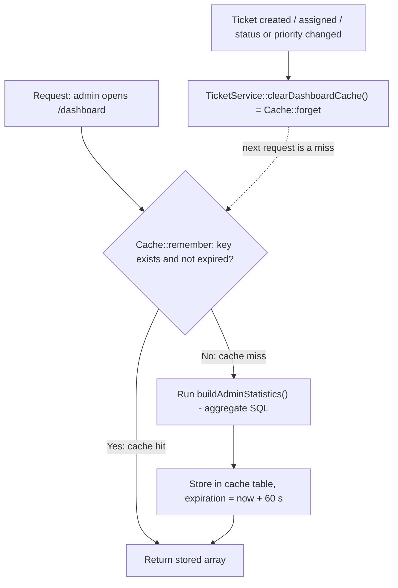

# 15 — Caching Guide

This guide explains the two caches in ResolveDesk, what is deliberately **not** cached, and how the cache is kept
correct. Redis is described only as a *future improvement* — it is **not** used.

Files covered:

| File | Cache role |
|---|---|
| `app/Http/Controllers/DashboardController.php` → `adminDashboard()`, `buildAdminStatistics()` | Admin statistics cache (read) |
| `app/Services/TicketService.php` → `DASHBOARD_CACHE_KEY`, `clearDashboardCache()` | Dashboard cache invalidation after ticket changes |
| `app/Models/Category.php` → `activeForDropdown()`, `clearActiveCache()` | Active category dropdown cache |
| `app/Http/Controllers/CategoryController.php` → `clearCaches()` | Clears both caches after category changes |
| `app/Http/Controllers/TicketController.php` → `create()`, `edit()`, `store()`, `update()` | Uses the category cache for display, the database for validation |
| `database/migrations/0001_01_01_000001_create_cache_table.php` | `cache` and `cache_locks` tables |
| `database/seeders/DatabaseSeeder.php` | Clears both keys after seeding |
| `tests/Feature/CacheTest.php` | 8 cache tests |

Related: [Business logic](06-BUSINESS-LOGIC-GUIDE.md), [System design](10-SYSTEM-DESIGN-GUIDE.md).

---

## 1. Why caching is used

The admin dashboard runs several **aggregate** queries over the whole `tickets` table (`GROUP BY status`,
`GROUP BY priority`, a category count, a 14-day trend, `AVG(TIMESTAMPDIFF(...))`). With 32 demo tickets this is
instant, but with hundreds of thousands of tickets these queries scan many rows. If the admin refreshes the
dashboard often, the same expensive work is repeated for the same answer.

A **cache** stores the result of expensive work so the next request can reuse it.

## 2. Vocabulary

| Term | Meaning | ResolveDesk example |
|---|---|---|
| **Cache key** | The name under which a value is stored | `dashboard:admin:stats`, `ticket:active-categories` |
| **Cache hit** | The key exists and has not expired → value returned, no expensive query | Second dashboard load within 60 s |
| **Cache miss** | Key missing or expired → compute the value, store it | First dashboard load, or first load after a ticket change |
| **TTL** (time to live) | How long a value is kept | 60 s (dashboard), 3600 s (categories) |
| **Invalidation** | Deleting a cached value because the source data changed | `Cache::forget()` after a ticket/category change |
| **Stale data** | A cached value that no longer matches the database | Possible for a short window (section 8) |

> **বাংলায়:** Cache হলো একটা দ্রুত "মনে রাখার জায়গা"। Cache hit মানে উত্তর আগে থেকেই রাখা আছে, তাই database-এ ভারী
> query চালাতে হয় না। Cache miss মানে উত্তর নেই বা মেয়াদ (TTL) শেষ — তখন query চালিয়ে উত্তর বের করে cache-এ রেখে দেওয়া হয়।

## 3. The cache-aside pattern and `Cache::remember()`

**Cache-aside** (also called "lazy loading"): the application checks the cache first; on a miss it reads the
database and puts the result in the cache. The database stays the **source of truth**; the cache is only a copy.

`Cache::remember($key, $ttl, $closure)` does all of this in one line:

```php
// What Cache::remember() does internally (simplified):
$value = Cache::get($key);
if ($value === null) {          // miss
    $value = $closure();        // run the expensive code
    Cache::put($key, $value, $ttl);
}
return $value;                  // hit or freshly stored
```



`Cache::forget($key)` deletes one key. The next `remember()` call is then a miss and rebuilds fresh data.

> **বাংলায়:** Cache-aside pattern-এ অ্যাপ্লিকেশন নিজেই আগে cache দেখে; না পেলে database থেকে পড়ে cache-এ রেখে দেয়।
> Data পরিবর্তন হলে আমরা `Cache::forget()` দিয়ে পুরোনো মান মুছে দিই, যাতে পরের request আবার নতুন করে হিসাব করে।
> আসল সত্য সবসময় database-এ থাকে, cache শুধু একটা কপি।

---

## 4. Dashboard caching

### 4.1 Reading — `DashboardController::adminDashboard()`

```php
/** Admin statistics are cached for 60 seconds (and cleared after ticket changes). */
private const ADMIN_STATS_TTL_SECONDS = 60;

private function adminDashboard()
{
    // Cache-aside: read from cache, or run buildAdminStatistics() and store the result.
    $stats = Cache::remember(TicketService::DASHBOARD_CACHE_KEY, self::ADMIN_STATS_TTL_SECONDS, function () {
        return $this->buildAdminStatistics();
    });

    // NOT cached: these must always be current.
    $overdueCount = Ticket::overdue()->count();

    $recentTickets = Ticket::with(['category', 'creator', 'assignedAgent'])
        ->latest()
        ->take(8)
        ->get();

    $agentWorkload = User::where('role', User::ROLE_AGENT)
        ->withCount([ ... 'active_count', 'overdue_count', 'resolved_count' ... ])
        ->orderBy('name')
        ->get();
    ...
}
```

- The key is a **shared constant** `TicketService::DASHBOARD_CACHE_KEY = 'dashboard:admin:stats'`, so the reader
  (controller) and the invalidator (service) can never use different spellings.
- `function () { return $this->buildAdminStatistics(); }` — a closure. It only runs on a miss.
- Only the admin dashboard is cached. Agent and customer dashboards are **not** cached (MASTER_PROMPT §11.3):
  they are per-user queries filtered by an indexed column, and per-user cache keys would be harder to invalidate.

### 4.2 Building — `buildAdminStatistics()`

```php
private function buildAdminStatistics(): array
{
    // SELECT status, COUNT(*) AS total FROM tickets GROUP BY status
    $countsByStatus = Ticket::select('status', DB::raw('COUNT(*) AS total'))
        ->groupBy('status')
        ->pluck('total', 'status');
    ... (statuses filled with 0 when missing)

    // SELECT priority, COUNT(*) AS total FROM tickets GROUP BY priority
    $countsByPriority = ...;

    // Category name => number of tickets (includes inactive categories).
    $categoryCounts = Category::withCount('tickets')->orderBy('name')->pluck('tickets_count', 'name')->toArray();

    // Tickets created per day for the last 14 days.
    ...
    $averageMinutes = Ticket::whereIn('status', [Ticket::STATUS_RESOLVED, Ticket::STATUS_CLOSED])
        ->whereNotNull('resolved_at')
        ->value(DB::raw('AVG(TIMESTAMPDIFF(MINUTE, created_at, resolved_at))'));
    ...
    return [
        'total' => array_sum($statusCounts),
        'status_counts' => $statusCounts,
        'priority_counts' => $priorityCounts,
        'category_counts' => $categoryCounts,
        'trend' => $trend,
        'average_resolution_hours' => $averageResolutionHours,
        'generated_at' => now()->format('h:i:s A'),
    ];
}
```

It returns a **plain PHP array** (not Eloquent models), because the value is `serialize()`d into the `cache` table.
Plain arrays are small and safe to serialize.

`generated_at` is shown on the dashboard as **"Statistics generated at 02:30:05 PM"**
(`resources/views/dashboard/admin.blade.php`). This is a great demo tool: refresh within 60 s → the time does not
change (hit); create a ticket and refresh → the time changes (miss after invalidation).

### 4.3 Invalidation — `TicketService::clearDashboardCache()`

```php
public const DASHBOARD_CACHE_KEY = 'dashboard:admin:stats';

public function clearDashboardCache(): void
{
    Cache::forget(self::DASHBOARD_CACHE_KEY);
}
```

Called **after** `DB::transaction()` returns (i.e. after a successful commit) in:

| Method | Why the stats change |
|---|---|
| `createTicket()` | total, open count, category/priority counts, trend |
| `updateTicket()` | priority or category may change |
| `assignAgent()` (only if `$wasChanged`) | Open → Assigned |
| `autoAssign()` (only if an agent was chosen) | Open → Assigned |
| `startWork()`, `resolve()`, `reopen()`, `close()` | status counts, average resolution time |

Not called in `addComment()` — comments do not affect any cached statistic.

Why after the commit and not inside the transaction? If we forgot the key **inside** the transaction, another
request could rebuild the cache **before** our commit, reading the old data, and store stale numbers for 60 s.
Clearing after the commit means the next rebuild sees the committed data. If the transaction throws, the line is
never reached (nothing changed, so nothing to clear).

Tests: `test_admin_dashboard_creates_the_statistics_cache`, `test_dashboard_reads_statistics_from_the_cache`
(puts a fake `987` into the cache and checks the page shows it — proof of a hit),
`test_ticket_creation_invalidates_dashboard_cache_and_stats_are_correct_again`,
`test_status_change_invalidates_dashboard_cache`.

---

## 5. Category caching

### 5.1 `Category::activeForDropdown()`

```php
/** Cache key for the active-category dropdown list. */
public const ACTIVE_CACHE_KEY = 'ticket:active-categories';

/** Keep the dropdown list for one hour (it is also cleared on every category change). */
public const ACTIVE_CACHE_TTL_SECONDS = 3600;

public static function activeForDropdown(): Collection
{
    $rows = Cache::remember(self::ACTIVE_CACHE_KEY, self::ACTIVE_CACHE_TTL_SECONDS, function () {
        return Category::where('is_active', true)->orderBy('name')->get(['id', 'name'])->toArray();
    });

    return Category::hydrate($rows);
}

/** Remove the cached dropdown list so the next request rebuilds it. */
public static function clearActiveCache(): void
{
    Cache::forget(self::ACTIVE_CACHE_KEY);
}
```

- `static` methods: called on the class, `Category::activeForDropdown()`, no object needed.
- `get(['id', 'name'])` loads only two columns → smaller cached value.
- `->toArray()` stores a **plain array** (`[['id' => 1, 'name' => 'Billing'], ...]`), not Eloquent objects.
  Laravel 13's `config/cache.php` has `'serializable_classes' => false`: when a value is read back from the
  `database` (or file/Redis) store, `unserialize()` runs with `allowed_classes => false`. This is a security setting
  that blocks **PHP object injection** (if an attacker could write to the cache table, a crafted serialized object
  could otherwise trigger dangerous magic methods such as `__wakeup()` / `__destruct()`). The side effect: a cached
  `Collection` of `Category` models comes back as `__PHP_Incomplete_Class`.
- `Category::hydrate($rows)` turns the array rows back into `Category` models **without a query**, so the forms
  still receive a normal Eloquent `Collection` and the Blade code (`$category->id`, `$category->name`) is unchanged.
- History: the first version cached the `Collection` directly. It worked on a cache miss but returned a 500
  (`TypeError ... __PHP_Incomplete_Class returned`) on the next request. The tests missed it because `phpunit.xml`
  uses the `array` store, which never serializes. Now covered by
  `test_category_cache_works_with_the_real_database_cache_store`, which switches to the real `database` store.

> **বাংলায়:** Laravel 13-এ নিরাপত্তার কারণে (`serializable_classes => false`) cache থেকে PHP object
> unserialize করা হয় না — এতে "PHP object injection" আক্রমণ বন্ধ হয়। তাই Eloquent model সরাসরি cache-এ রাখলে
> পরের বার সেটা `__PHP_Incomplete_Class` হয়ে ফেরত আসে। এজন্য আমরা cache-এ শুধু সাধারণ array রাখি, আর পড়ার পর
> `Category::hydrate()` দিয়ে আবার model বানিয়ে নিই (কোনো নতুন query ছাড়াই)।

- Used by `TicketController::create()` and `TicketController::edit()` (the forms). The ticket **list** filter uses
  `Category::orderBy('name')->get(...)` directly, because it must include inactive categories.
- Categories change rarely, so a long TTL (1 hour) is fine; explicit invalidation keeps it correct anyway.

### 5.2 `CategoryController::clearCaches()`

```php
private function clearCaches(): void
{
    Category::clearActiveCache();
    Cache::forget(TicketService::DASHBOARD_CACHE_KEY);
}
```

Called after `store()`, `update()` (which covers rename, activate and deactivate, because `is_active` is part of the
update form) and `destroy()`. The dashboard key is cleared too, because the "tickets by category" chart shows
category **names**.

### 5.3 The cache is never trusted for validation

```php
// TicketController::store()
'category_id' => ['required', 'integer', Rule::exists('categories', 'id')->where('is_active', true)],
```

The dropdown may come from the cache, but when the form is **submitted**, the rule runs a real query:
`SELECT COUNT(*) FROM categories WHERE id = ? AND is_active = 1`. Even if the cache were stale and still showed a
deactivated category, the ticket could not be saved with it. `update()` does the same check with
`Category::where('id', $newCategoryId)->where('is_active', true)->exists()`.

Tested: `test_validation_never_trusts_a_stale_category_cache` puts **all** categories (including an inactive one)
into the cache, then posts a ticket with the inactive category → validation error on `category_id`.

`TicketController::edit()` also shows a safe way to use a cached collection:

```php
// concat() returns a NEW collection, so the cached list itself is not modified.
$categories = $categories->concat([$ticket->category])->sortBy('name');
```

---

## 6. Database cache storage

```env
CACHE_STORE=database
```

```php
Schema::create('cache', function (Blueprint $table) {
    $table->string('key')->primary();
    $table->mediumText('value');
    $table->bigInteger('expiration')->index();
});

Schema::create('cache_locks', function (Blueprint $table) { ... });
```

- `key` = the configured prefix + our key. The prefix comes from `config/cache.php`:
  `'prefix' => env('CACHE_PREFIX', Str::slug((string) env('APP_NAME', 'laravel')).'-cache-')` → `resolvedesk-cache-`.
- `value` = the PHP `serialize()`d value.
- `expiration` = a Unix timestamp (seconds). On read, Laravel treats a row whose expiration has passed as a miss.
- `cache_locks` is used by atomic locks (not used directly by ResolveDesk code).

**Important:** a database cache **still performs a database query** (`SELECT * FROM cache WHERE key = ?` — a
primary-key lookup). The gain is replacing several heavy aggregate queries with one cheap indexed lookup, not
avoiding the database entirely.

In tests, `phpunit.xml` sets `CACHE_STORE=array` (an in-memory cache that disappears after each test). The
`array` store does **not** serialize values, so one test (`test_category_cache_works_with_the_real_database_cache_store`)
explicitly switches to the `database` store to test real serialization.

### Why certain data is stored as arrays

Both cached values are **plain PHP arrays**, never objects:

| Cache key | Stored value |
|---|---|
| `dashboard:admin:stats` | Array of numbers/strings built by `buildAdminStatistics()` |
| `ticket:active-categories` | `->get(['id', 'name'])->toArray()`; turned back into models with `Category::hydrate($rows)` |

Reasons:

1. **Security setting:** `config/cache.php` → `'serializable_classes' => false`. Laravel unserializes cached values
   with `allowed_classes => false` to prevent PHP object injection, so any object (an Eloquent model or
   `Collection`) comes back as `__PHP_Incomplete_Class`. Arrays of scalars are unaffected.
2. **Smaller and simpler:** an array holds only the needed fields, not the whole model state (relations, original
   attributes, casts...).
3. **Store-independent:** arrays work the same in the `array`, `database`, `file` and Redis stores.

Alternative (not used): list allowed classes in `serializable_classes`. Rejected because it weakens the security
protection and is easy to forget when a new class is cached.

### Cache state before and after (example)

Real state observed in the local development database (only the category cache existed at that moment):

| key | expiration |
|---|---|
| `resolvedesk-cache-ticket:active-categories` | `1795598785` |

**Step 1 — admin opens `/dashboard` (miss):** the aggregate queries run and a row is inserted:

| key | value (shortened) | expiration |
|---|---|---|
| `resolvedesk-cache-ticket:active-categories` | `O:39:"Illuminate\Database\Eloquent\Collection":…` | 1795598785 |
| `resolvedesk-cache-dashboard:admin:stats` | `a:7:{s:5:"total";i:32;s:13:"status_counts";a:5:{s:4:"open";i:6;…}` | now + 60 |

**Step 2 — admin refreshes within 60 s (hit):** no aggregate queries; "Statistics generated at" shows the same time.
The table is unchanged.

**Step 3 — a customer creates a ticket:** `tickets` gets one new row (`status = 'open'`) **and**
`TicketService::clearDashboardCache()` deletes the dashboard row:

| key | expiration |
|---|---|
| `resolvedesk-cache-ticket:active-categories` | 1795598785 |

**Step 4 — admin opens `/dashboard` again (miss):** the row is rebuilt with `total` = 33 and `open` = 7, and a new
`generated_at` time.

**Category example:** admin deactivates "Billing" (`PUT /categories/{id}`) → `categories.is_active = 0` **and**
both rows are deleted. The next "Create Ticket" page rebuilds `ticket:active-categories` without "Billing".

(Numbers assume a freshly seeded database: 32 tickets, 6 Open.)

Inspect it yourself:

```bash
export PATH="/c/php-8.4.28:$PATH"
php artisan tinker --execute "print_r(DB::table('cache')->pluck('expiration','key')->all());"
php artisan tinker --execute "print_r(Cache::get('dashboard:admin:stats'));"   # Cache adds the prefix itself
php artisan cache:clear    # deletes ALL cache rows (safe: everything is rebuilt on demand)
```

---

## 7. What is deliberately NOT cached, and why

| Not cached | Why |
|---|---|
| Overdue count (`Ticket::overdue()->count()` in `adminDashboard()`) | Overdue depends on the **current time** (`due_at < now()`). A ticket can become overdue without any database change, so no event could invalidate it. |
| Recent tickets, agent workload table on the admin dashboard | Must be current; workload is used for assignment decisions. |
| `findLeastBusyAgent()` workload | A stale count would assign tickets to the wrong agent. It runs inside the transaction on fresh data. |
| Ticket details, comments, current status | Users act on them (buttons depend on status); stale status = wrong buttons. |
| Unread notification count | Polled every 5 s; must be exact. |
| User permissions, `is_active`, authentication | Security decisions must use the database (`ActiveUserMiddleware` re-reads the user on every request). |
| Agent and customer dashboards | Spec decision for this version; per-user keys would need per-user invalidation. |

Rule of thumb: **cache only data that is expensive, read often, and where a few seconds of staleness is harmless.
Never use cached data for validation or security.**

---

## 8. Stale data and consistency

Explicit invalidation keeps the cache correct in normal use, but stale windows still exist:

| Situation | Stale window |
|---|---|
| Data changed by something that does not call `clearDashboardCache()` (e.g. a manual SQL update in phpMyAdmin, `tinker`, a future feature that forgets to clear) | Up to the TTL: **60 s** dashboard, **1 hour** categories |
| The 14-day trend and "generated_at" | Up to 60 s (the day boundary can pass inside the 60 s) |
| **Race condition:** request A misses and starts building the stats (slow queries). Meanwhile request B commits a new ticket and forgets the key. Then A finishes and stores its result, computed from the **old** data. | Up to 60 s |
| Several requests miss at the same time ("cache stampede") | No stale data, but the heavy queries run several times at once |

The 60-second TTL is the **safety net**: whatever goes wrong, the dashboard corrects itself within one minute. For
statistics, that is acceptable. That is also why the TTL is short for the dashboard and only the rarely-changing
category list gets 1 hour.

> **বাংলায়:** Stale data মানে cache-এ রাখা পুরোনো মান, যা database-এর বর্তমান অবস্থার সাথে মেলে না। আমরা data পরিবর্তনের
> পর cache মুছে দিই, তবুও একসাথে কয়েকটা request চললে কিছুক্ষণ পুরোনো মান থাকতে পারে। TTL (৬০ সেকেন্ড) হলো নিরাপত্তা জাল —
> সর্বোচ্চ এক মিনিটের মধ্যে dashboard নিজে থেকেই ঠিক হয়ে যায়।

## 9. Cache limitations in this project

- Database cache = still a DB query per read; it shares the same database server as the application.
- Expired rows are not deleted immediately; they stay until overwritten or `cache:clear`.
- No protection against cache stampede (could use `Cache::lock()` / `Cache::flexible()` — *future*).
- `Cache::forget()` must be remembered in every code path that changes cached data. Forgetting one = up to 60 s
  stale data. (That is why the key is a constant and the invalidation is centralised in `TicketService`.)
- Re-seeding does not automatically empty the cache (`migrate:fresh` recreates the `cache` table, but a plain
  `php artisan db:seed`, or a different cache store, would keep old rows). Therefore `DatabaseSeeder::run()`
  explicitly calls `Cache::forget(TicketService::DASHBOARD_CACHE_KEY)` and `Category::clearActiveCache()`.

## 10. Future improvement: Redis (not implemented)

Redis is an in-memory key-value server. Switching would be mostly configuration:

```env
CACHE_STORE=redis
REDIS_HOST=127.0.0.1
REDIS_PORT=6379
```

plus a PHP Redis client (the `phpredis` extension or the `predis/predis` package — a new dependency, so it would
need approval). **No code changes** are needed: `Cache::remember()` and `Cache::forget()` work with every store.
That is the benefit of Laravel's cache abstraction.

| | Database cache (implemented) | Redis cache (future) |
|---|---|---|
| Speed | Disk-based SQL lookup (ms) | In-memory (sub-ms) |
| Extra software | None | Redis server |
| Expiry | Checked on read | Automatic |
| Shared by many app servers | Yes (same DB) | Yes |
| Windows/XAMPP friendly | Yes | Needs extra installation |

Redis could also replace the database **queue** (`QUEUE_CONNECTION=redis`) later.

---

## 11. Debugging the cache

| Symptom | Check |
|---|---|
| Dashboard numbers wrong after a change | Is the code path calling `clearDashboardCache()`? Wait 60 s or run `php artisan cache:clear`. Compare with `Ticket::count()` in tinker. |
| New category missing from the form | Was it saved through `CategoryController` (clears the key)? Else `php artisan cache:clear`. |
| "Statistics generated at" never changes | Every request is a hit → expected within 60 s if nothing changed. |
| Error "Table 'cache' doesn't exist" | Run migrations; `CACHE_STORE=database` needs the `cache` table. |
| `TypeError ... __PHP_Incomplete_Class returned` | An object (model/collection) was cached; `serializable_classes => false` blocks it. Cache a plain array instead (see 5.1), then `php artisan cache:clear`. |

## 12. Practice modifications

1. Change the dashboard TTL to 5 minutes: `ADMIN_STATS_TTL_SECONDS = 300`. Discuss the longer stale window.
2. Add "tickets created today" to the cached stats: add a key in `buildAdminStatistics()` and show it in
   `dashboard/admin.blade.php`. Is the existing invalidation enough? (Yes — `createTicket()` already clears it.)
3. Cache the agent dashboard per agent with key `dashboard:agent:{id}` — then list every `TicketService` method
   that would need to forget it. This exercise shows why it was **not** done.
