# 16 — Codebase Learning Map

> **Start with [CODEBASE-LEARNING-MAP.md](CODEBASE-LEARNING-MAP.md)** (2026-11-26 audit): the exact file-by-file
> study order with purpose, dependencies, UI actions, business logic and likely interview modifications. This
> older step-by-step map remains useful as a deeper companion for individual methods.

A recommended **reading order** for the ResolveDesk source code. It starts with simple, standard Laravel code and
ends with the workflow engine, background work and testing. Do the steps in order: each step assumes the
previous ones.

**V2 note:** steps 1–25 were written for V1 and are still valid (method names were updated to the V2 service split:
assignment lives in `TicketAssignmentService`, notifications/emails in `TicketNotifier`, activities in
`TicketActivity::record()`). Steps **26–35** cover the V2 additions (projects/clients, scope, concurrency,
idempotency, internal notes, attachments, Reverb, scheduler, reports, operations). A **three-hour V2 plan** is at the
end. Companion guides: [22](22-V2-BUSINESS-FEATURES.md), [20](20-CONCURRENCY-AND-DATA-INTEGRITY.md),
[21](21-REALTIME-REVERB-ECHO.md), [23](23-SECURITY-ERRORS-LOGGING-OPERATIONS.md), [18](18-PRODUCTION-DEPLOYMENT.md),
[19](19-BACKUP-AND-RECOVERY.md).

How to use this map:

- Open the listed files side by side with the guide.
- Do the **exercise** at the end of each step. Undo your change afterwards (or keep a backup copy of the file).
- Run the tests after each exercise:

```bash
export PATH="/c/php-8.4.28:$PATH"   # Git Bash (PowerShell: $env:Path = "C:\php-8.4.28;$env:Path")
php -v                              # must show 8.4.28
php artisan test                    # uses the separate resolvedesk_testing database
```

Estimated time: about 1 hour for steps 1–10, 2 hours for steps 11–17, 2 hours for steps 18–25, 3 hours for the
V2 steps 26–35.

```mermaid
flowchart LR
    S1["1-3 Structure, routes, layouts"] --> S2["4-6 Category CRUD, migrations, models"]
    S2 --> S3["7-10 Auth, middleware, policies, users"]
    S3 --> S4["11-17 Tickets, assignment, lifecycle, SLA, activity, comments"]
    S4 --> S5["18-23 Notifications, polling, email, queue, cache, dashboard"]
    S5 --> S6["24-25 Testing, debugging"]
    S6 --> S7["26-29 V2: projects, scope, concurrency, idempotency"]
    S7 --> S8["30-35 V2: notes, attachments, Reverb, scheduler, reports, ops"]
```



---

## Step 1 — Application structure

**Files to read:** `composer.json`, `.env.example`, `bootstrap/app.php`, the folder tree of `app/`
(`Http/Controllers`, `Http/Middleware`, `Models`, `Policies`, `Services`, `Notifications`, `Jobs`, `Mail`,
`Providers`), `resources/views/`, `public/js/`, `database/`, `tests/Feature/`.

**Why they exist:** Laravel's conventional folders tell you where each kind of code lives. `bootstrap/app.php` is
where the application is configured in Laravel 11+ (routing files, middleware aliases, redirects).

**Concepts:** MVC, convention over configuration, environment configuration (`.env`), PSR-4 autoloading
(`App\` → `app/`).

**Related files:** `README.md`, [01-PROJECT-OVERVIEW.md](01-PROJECT-OVERVIEW.md),
[04-LARAVEL-MVC-GUIDE.md](04-LARAVEL-MVC-GUIDE.md).

**Understand before continuing:** which folder holds controllers, models, views; what `.env` is for; that
`QUEUE_CONNECTION`, `CACHE_STORE` and sessions use the database.

**Exercise:** Without opening files, write down where you would look for (a) the ticket status list,
(b) the login page HTML, (c) the email job. Then check: `app/Models/Ticket.php` (`STATUSES`),
`resources/views/auth/login.blade.php`, `app/Jobs/SendTicketEmail.php`.

## Step 2 — Routes

**Files:** `routes/web.php`.

**Why:** every URL maps to a controller method here, together with its middleware and route name.

**Concepts:** `Route::get/post`, `Route::resource(...)->except([...])`, route names (`->name('tickets.assign')`),
route groups with `middleware('guest')`, `middleware(['auth', 'active'])`, `middleware('role:admin')`, route model
binding (`{ticket}` → `Ticket $ticket`), why data-changing actions are POST (CSRF).

**Related:** `app/Http/Controllers/*`, `bootstrap/app.php` (aliases `role`, `active`).

**Understand:** the three route groups (guest, logged-in active users, admins only); that there is no
`tickets.destroy` and no `users.destroy` route.

**Exercise:** Run `php artisan route:list --except-vendor`. Find the route name, HTTP method and middleware for
"Auto Assign" (`tickets.auto-assign`, POST, inside `role:admin`).

## Step 3 — Blade layouts

**Files:** `resources/views/layouts/app.blade.php`, `resources/views/layouts/guest.blade.php`,
`resources/views/partials/navbar.blade.php`, `partials/sidebar.blade.php`, `partials/flash.blade.php`,
`partials/ticket-badges.blade.php`, `public/css/app.css`, `public/js/app.js`.

**Why:** one shared layout = the same navbar, sidebar, flash messages, CSRF meta tag and scripts on every page.

**Concepts:** `@extends`, `@section/@yield`, `@include`, `@hasSection`, `@stack('scripts')`, `{{ }}` escaping,
`@csrf`, `asset()`, `route()`, `request()->routeIs()`, `auth()->user()`; `data-confirm` forms handled by `app.js`.

**Related:** every view in `resources/views/`.

**Understand:** where flash messages (`success`, `error`, `info`) are printed; why the bell has `data-*` URLs.

**Exercise:** Add a "Help" link to the sidebar that points to `route('dashboard')`. Reload any page. Remove it.

## Step 4 — Category CRUD (the simplest feature)

**Files:** `app/Http/Controllers/CategoryController.php`, `resources/views/categories/index.blade.php`,
`create.blade.php`, `edit.blade.php`, `_form.blade.php`.

**Why:** a complete, plain CRUD with no service class — the best first feature to read.

**Concepts:** resource controller methods (index/create/store/edit/update/destroy), `$request->validate()`,
`unique:categories,name`, `Rule::unique(...)->ignore($category->id)`, `$request->boolean('is_active')`,
`withCount('tickets')`, `paginate(15)`, redirect with flash message, business rule "deactivate instead of delete",
`clearCaches()`.

**Related:** `app/Models/Category.php`, `tests/Feature/UserAndCategoryManagementTest.php`.

**Understand:** the request → validation → model → redirect cycle; why `old()` refills the form after errors.

**Exercise:** Change the category name max length from 100 to 60 in `store()` and `update()`. Try a 70-character
name in the browser. Revert.

## Step 5 — Migrations

**Files:** `database/migrations/0001_01_01_000000_create_users_table.php`,
`2026_11_25_000001_create_categories_table.php`, `2026_11_25_000002_create_tickets_table.php`,
`2026_11_25_000003_create_ticket_comments_table.php`, `2026_11_25_000004_create_ticket_activities_table.php`,
`2026_11_25_140742_create_notifications_table.php`, `0001_01_01_000001_create_cache_table.php`,
`0001_01_01_000002_create_jobs_table.php`.

**Why:** migrations are version-controlled database schema.

**Concepts:** `foreignId()->constrained()->restrictOnDelete()`, nullable `assigned_to`, unique `ticket_number`,
indexes (`status`, `priority`, `due_at`, `created_at`, `['assigned_to', 'status']`), why `due_at`/`resolved_at`
are `dateTime` (MariaDB implicit `ON UPDATE CURRENT_TIMESTAMP` on TIMESTAMP columns), `morphs('notifiable')`.

**Related:** [03-DATABASE-GUIDE.md](03-DATABASE-GUIDE.md).

**Understand:** each table's purpose and its foreign keys; that `restrictOnDelete` blocks deleting a used category.

**Exercise:** Run `php artisan migrate:status`. Then draw the five main tables and their foreign keys on paper.
(Do **not** run `migrate:fresh` on data you want to keep — it drops every table.)

## Step 6 — Eloquent models

**Files:** `app/Models/User.php`, `Category.php`, `Ticket.php`, `TicketComment.php`, `TicketActivity.php`.

**Why:** models are PHP classes for tables; they hold relationships, casts, constants and small business helpers.

**Concepts:** `$fillable` (mass-assignment protection — `status`, `assigned_to`, `created_by` are **not** fillable
on `Ticket`), `$hidden`, `casts()` (`'password' => 'hashed'`, `'due_at' => 'datetime'`, integer casts),
constants (`Ticket::STATUSES`, `PRIORITIES`, `SLA_HOURS`, `TRANSITIONS`, `ACTIVE_STATUSES`, `WORKLOAD_STATUSES`,
`User::ROLES`), helper methods (`statusLabel()`, `isOverdue()`, `canPerform()`), local scopes (`scopeOverdue`,
`scopeVisibleTo`).

**Related:** `database/factories/*`, `app/Providers/AppServiceProvider.php` (`Model::preventLazyLoading()`).

**Understand:** why constants live in the model (one place to change); difference between `Ticket::overdue()` (SQL)
and `$ticket->isOverdue()` (PHP on one row).

**Exercise:** In `php artisan tinker`: `App\Models\Ticket::overdue()->count()` and
`App\Models\Ticket::overdue()->toSql()`. Compare with the "Overdue" card on the admin dashboard.

## Step 7 — Authentication

**Files:** `app/Http/Controllers/AuthController.php`, `resources/views/auth/login.blade.php`,
`resources/views/layouts/guest.blade.php`.

**Why:** session-based login without a starter kit, written by hand so every line is explainable.

**Concepts:** `Auth::attempt()`, password hashing (bcrypt), `RateLimiter` (5 attempts, 60 s lockout, key =
email + IP), blocking inactive users after a correct password, `session()->regenerate()` (session fixation),
logout with `invalidate()` + `regenerateToken()`, `redirect()->intended()`, `ValidationException::withMessages`.

**Related:** `tests/Feature/AuthTest.php`, `routes/web.php` (guest group).

**Understand:** what is stored in the `sessions` table; why logout is a POST form.

**Exercise:** Log in as `tanvir.customer@example.com` / `password` (inactive) and read the error. Find the exact
line that produces it.

## Step 8 — Middleware

**Files:** `app/Http/Middleware/RoleMiddleware.php`, `app/Http/Middleware/ActiveUserMiddleware.php`,
`bootstrap/app.php`.

**Why:** cross-cutting checks that run before controllers: "is this an admin?", "is this account still active?".

**Concepts:** `handle(Request $request, Closure $next)`, variadic parameters (`string ...$roles` from
`role:admin,agent`), `abort(403)`, logging out an already-logged-in deactivated user, `expectsJson()` → 401 JSON
for AJAX polling.

**Related:** `routes/web.php`, `resources/views/errors/403.blade.php`.

**Understand:** middleware = coarse "who may enter this URL group"; policies (next step) = fine "may this user do
this to this ticket".

**Exercise:** Log in as a customer and open `/users`. You get 403 from `RoleMiddleware`. Which line in
`routes/web.php` attached it?

## Step 9 — Policies

**Files:** `app/Policies/TicketPolicy.php`, the `@can` blocks in `resources/views/tickets/show.blade.php`, the
`Gate::authorize()` calls in `TicketController.php` and `TicketCommentController.php`.

**Why:** one place for ticket-level permission rules, used by both views (hide buttons) and controllers
(enforce).

**Concepts:** policy auto-discovery (`Ticket` → `TicketPolicy`), `Gate::authorize()` throws 403,
`@can('resolve', $ticket)`, role + ownership + status checks (`canPerform()` from `Ticket::TRANSITIONS`).

**Related:** `tests/Feature/AuthorizationTest.php`.

**Understand:** hiding a button is only UX; the controller check is the real security.

**Exercise:** As customer John, open a ticket of another customer by changing the ID in the URL. Which policy
method returned false? (`view`.)

## Step 10 — User management

**Files:** `app/Http/Controllers/UserController.php`, `resources/views/users/*.blade.php`.

**Why:** admin-only CRUD with extra safety rules.

**Concepts:** search + filters with `when`-style `if ($request->filled(...))`, optional password on edit,
`Rule::in(array_keys(User::ROLES))`, `toggleActive()` (PATCH), `ensureRoleOrStatusChangeIsAllowed()` (an admin cannot
deactivate/demote themselves; the last active admin is protected; an agent with Assigned, In Progress or Resolved
tickets must hand them over first).

**Related:** `tests/Feature/UserAndCategoryManagementTest.php`.

**Understand:** why users are deactivated, never deleted (tickets reference them with `restrictOnDelete`).

**Exercise:** Try to deactivate agent Sarah Ahmed while she has active tickets. Read the error and find the
`ValidationException::withMessages` that produced it.

## Step 11 — Ticket creation

**Files:** `TicketController::create()` and `store()`, `app/Http/Requests/StoreTicketRequest.php` (V2),
`TicketService::createTicket()`,
`resources/views/tickets/create.blade.php`, `tickets/_form.blade.php`.

**Why:** the first use of the service class and a transaction.

**Concepts:** constructor dependency injection (`private TicketService $ticketService`), validation with
`Rule::exists('categories', 'id')->where('is_active', true)` (V2: inside `StoreTicketRequest::rules()`), `DB::transaction()`, setting protected fields
explicitly (`created_by`, `status`, `due_at`), insert-then-number (`Ticket::makeTicketNumber($ticket->id)` →
`TK-000033`), first activity row, "New ticket created" notification + queued email to every active admin
(`TicketNotifier::notify()` loop), `clearDashboardCache()`.

**Related:** [06-BUSINESS-LOGIC-GUIDE.md](06-BUSINESS-LOGIC-GUIDE.md), `tests/Feature/TicketManagementTest.php`.

**Understand:** why the ticket number comes from the database id and not `MAX(id) + 1`.

**Exercise:** Create a Critical ticket. Check that `due_at` is exactly `created_at + 2 hours` on the details page.

## Step 12 — Relationships and eager loading

**Files:** relationship methods in `User.php` (`createdTickets`, `assignedTickets`, ...), `Ticket.php` (`creator`,
`assignedAgent`, `category`, `comments`, `activities`), `TicketController::index()` (`with([...])`) and `show()`
(`load([...])`), `TicketController::index()` + `Ticket::scopeVisibleTo()`.

**Why:** the ticket list and details page show data from several tables efficiently.

**Concepts:** `belongsTo` with a custom foreign key (`'created_by'`, `'assigned_to'`), `hasMany`, nullable
relation, eager loading vs lazy loading, the **N+1 problem**, `Model::preventLazyLoading()`, `withCount()`,
`paginate()->withQueryString()`.

**Related:** `app/Providers/AppServiceProvider.php`.

**Understand:** 15 tickets per page with `with(['category','creator','assignedAgent'])` = 1 + 3 queries, not
1 + 45.

**Exercise:** Temporarily remove `'creator'` from the `with([...])` in `TicketController::index()` and open
`/tickets`. You get a `LazyLoadingViolationException` — that is `preventLazyLoading` protecting you. Revert.

## Step 13 — Assignment (manual and automatic)

**Files:** `TicketController::assign()`, `autoAssign()`, `show()`; `TicketAssignmentService::eligibleAgents()`, `TicketAssignmentService::assignAgent()`,
`autoAssign()`, `findLeastBusyAgent()`, `performAssignment()`, `lockProjectAndTicket()`, `withAssignmentLock()`.

**Why:** the core workflow; shows transactions, row locking and a query-based algorithm.

**Concepts:** `lockForUpdate()` (`SELECT ... FOR UPDATE`), re-checking rules on the locked row, re-reading the agent
from the database, duplicate prevention (`return false` for the same agent), `withCount` + `orderBy('workload_count')`
+ `orderBy('id')` tie-breaker, reassignment keeps the status.

**Related:** `tests/Feature/TicketWorkflowTest.php`, [06-BUSINESS-LOGIC-GUIDE.md](06-BUSINESS-LOGIC-GUIDE.md).

**Understand:** why two admins clicking Auto Assign at the same moment cannot both assign the same ticket.

**Exercise:** In tinker run `app(App\Services\TicketAssignmentService::class)->findLeastBusyAgent()->name` on fresh
seed data (V1 result: Michael Brown, workload 2). Then pass a project id, e.g.
`->findLeastBusyAgent(App\Models\Project::where('code','ERP')->value('id'))`, and check that only ERP agents
(David, Michael in the demo data) can be returned.

## Step 14 — Status transitions

**Files:** `Ticket::TRANSITIONS`, `canPerform()`; `TicketService::startWork()`, `resolve()`, `reopen()`, `close()`,
`ensureActionAllowed()`; `TicketController::start()`, `resolve()`, `reopen()`, `close()`; the workflow buttons in
`tickets/show.blade.php`.

**Why:** a small state machine: only valid status changes are possible.

**Concepts:** transition table keyed by action, policy + service double check, `ValidationException` for business
rule failures (redirect back with error), resolution note required, reopen clears `resolved_at` and the note,
closed = read-only.

**Related:** `TicketPolicy` (`start`, `resolve`, `close`, `reopen`).

**Understand:** why the edit form can never change status.

**Exercise:** Add a constant comment above `TRANSITIONS` describing a new action "hold" (In Progress → Open). List
every file you would need to change (constant, policy method, service method, controller method, route, button,
test). Do not implement it.

## Step 15 — SLA

**Files:** `Ticket::SLA_HOURS`, `calculateDueAt()`, `isOverdue()`, `scopeOverdue()`;
`TicketService::updateTicket()` (priority change recalculates from original `created_at`); overdue badges in
`tickets/index.blade.php` and `tickets/show.blade.php`.

**Why:** deadlines per priority; overdue is computed live.

**Concepts:** Carbon (`copy()->addHours()`), `now()->greaterThan()`, timezone `Asia/Dhaka`, why overdue is never
stored or cached, reopened tickets keep their original deadline (simplified rule).

**Related:** `config/app.php` (timezone).

**Understand:** "continuous calendar hours" — no business hours or holidays.

**Exercise:** Change High from 8 to 12 hours in `SLA_HOURS`. Create a High ticket and check `due_at`. Revert and
run the tests.

## Step 16 — Activity logging

**Files:** `TicketActivity::record()`, `app/Models/TicketActivity.php`, the timeline in
`tickets/show.blade.php`.

**Why:** an audit trail: who did what and when.

**Concepts:** one row per event (`created`, `assigned`, `reassigned`, `status_changed`, `priority_changed`,
`due_date_changed`, `updated`, `resolved`, `reopened`, `closed`), `old_value`/`new_value`, written in the same
transaction as the change.

**Related:** `DatabaseSeeder::activity()` (past timestamps).

**Understand:** if the transaction rolls back, the activity row disappears too.

**Exercise:** Change a ticket's priority from Medium to High as admin. Find the two new activity rows
(`priority_changed`, `due_date_changed`) in the timeline.

## Step 17 — Comments

**Files:** `app/Http/Controllers/TicketCommentController.php`, `TicketService::addComment()`,
`app/Models/TicketComment.php`, the conversation section of `tickets/show.blade.php`.

**Why:** customer–agent conversation with notification rules.

**Concepts:** `Gate::authorize('comment', $ticket)`, `max:5000` validation, closed tickets reject comments (policy
and service), recipients = creator + agent minus author, `$alreadyNotifiedIds`, `mb_strimwidth`, redirect to
`#conversation`.

**Related:** `tests/Feature/NotificationTest.php`.

**Understand:** why the service re-checks `isClosed()` even though the policy already did (race: the ticket may be
closed between page load and submit).

**Exercise:** As customer John, comment on one of his In Progress tickets. Log in as the assigned agent and check
the bell.

## Step 18 — Notifications

**Files:** `app/Notifications/TicketNotification.php`, `TicketNotifier::notify()`,
`app/Http/Controllers/NotificationController.php`, `resources/views/notifications/index.blade.php`.

**Why:** in-app notifications stored in the database.

**Concepts:** Notification class, `via()` → `['database']`, `toArray()`, `Notifiable` trait, polymorphic
`notifiable_type/notifiable_id`, `read_at`, authorization by query scope (`$request->user()->notifications()`),
`expectsJson()`.

**Related:** [13-NOTIFICATION-SYSTEM-GUIDE.md](13-NOTIFICATION-SYSTEM-GUIDE.md).

**Understand:** notifications are not queued and are part of the transaction.

**Exercise:** In tinker: `App\Models\User::where('email','sarah.agent@resolvedesk.test')->first()->unreadNotifications()->count()`.
Compare with Sarah's badge.

## Step 19 — AJAX polling

**Files:** `public/js/notifications.js`, `resources/views/partials/navbar.blade.php`,
`resources/views/layouts/app.blade.php`, `NotificationController::feed()`.

**Why:** near-real-time updates without page reload. **V2:** polling is now the *fallback*: while the Reverb
channel is healthy (`resolvedesk:realtime-status` event) continuous polling stops (step 32).

**Concepts:** IIFE, Fetch API, `async/await`, recursive `setTimeout`, `isRequestRunning`, `?since=server_time`,
`Set` for de-duplication, `textContent` (XSS), CSRF header, `visibilitychange`, 401/419 handling, Bootstrap Toast.

**Related:** [13-NOTIFICATION-SYSTEM-GUIDE.md](13-NOTIFICATION-SYSTEM-GUIDE.md) §10.

**Understand:** why `setInterval` was not used.

**Exercise:** Open DevTools → Network, filter "feed". Watch a request every 5 s. Switch to another tab for a
minute and come back: the interval was 30 s while hidden and a request fires immediately on return.

## Step 20 — Email

**Files:** `app/Mail/TicketUpdateMail.php`, `resources/views/emails/ticket-update.blade.php`, `config/mail.php`,
`.env` (`MAIL_MAILER=log`).

**Why:** one reusable email for all ticket events.

**Concepts:** Mailable `envelope()` / `content()`, named arguments, table-based inline-styled email HTML, log mailer,
Gmail SMTP + App Password (documented only).

**Related:** [14-QUEUE-AND-EMAIL-GUIDE.md](14-QUEUE-AND-EMAIL-GUIDE.md).

**Understand:** the email link does not grant access; `TicketPolicy::view` still applies.

**Exercise:** Add "Priority" to the email: add the key in `TicketNotifier::queueEmail()`, pass it in `content()`, show
it in the template; update `test_email_template_renders_ticket_information`.

## Step 21 — Queue

**Files:** `app/Jobs/SendTicketEmail.php`, `TicketNotifier::queueEmail()`, `config/queue.php`,
`database/migrations/0001_01_01_000002_create_jobs_table.php`.

**Why:** emails are sent asynchronously by a worker.

**Concepts:** `ShouldQueue`, `Queueable`, serialization, `$tries = 3`, `$backoff = 10`, `failed()`,
`DB::afterCommit()` + try/catch + `Log::error`, `jobs` / `failed_jobs`, `queue:work`, `queue:failed`,
`queue:retry`, `queue:restart`, at-least-once delivery.

**Related:** `tests/Feature/QueueAndEmailTest.php`.

**Understand:** what happens to emails when no worker runs (they wait) and on rollback (never created).

**Exercise:** Without a worker, assign a ticket. Count rows in `jobs`. Run `php artisan queue:work --stop-when-empty`
and find the email at the end of `storage/logs/laravel.log`.

## Step 22 — Caching

**Files:** `DashboardController::adminDashboard()`, `Category::activeForDropdown()`, `clearActiveCache()`,
`TicketService::clearDashboardCache()`, `CategoryController::clearCaches()`.

**Why:** avoid repeating expensive aggregate queries.

**Concepts:** cache-aside, `Cache::remember()`, `Cache::forget()`, TTL, database cache store, stale data, never
validating against cache.

**Related:** [15-CACHING-GUIDE.md](15-CACHING-GUIDE.md), `tests/Feature/CacheTest.php`.

**Understand:** what is cached and what is deliberately not (overdue, workload, unread count, permissions).

**Exercise:** Open the admin dashboard twice and note "Statistics generated at". Create a ticket in another window,
refresh the dashboard, and see the time change.

## Step 23 — Dashboard queries

**Files:** `app/Http/Controllers/DashboardController.php` (all three dashboards),
`resources/views/dashboard/admin.blade.php`, `agent.blade.php`, `customer.blade.php`, `_stat-card.blade.php`.

**Why:** reporting with real SQL aggregates.

**Concepts:** `select(... DB::raw('COUNT(*) AS total'))->groupBy()->pluck()`, filling missing statuses with 0,
`withCount` with conditional closures (`active_count`, `overdue_count`, `resolved_count`), `DATE(created_at)` trend,
`AVG(TIMESTAMPDIFF(MINUTE, created_at, resolved_at))`, Chart.js from local `public/vendor/chartjs/`.

**Related:** [10-SYSTEM-DESIGN-GUIDE.md](10-SYSTEM-DESIGN-GUIDE.md).

**Understand:** which numbers are cached and which are live on the admin dashboard.

**Exercise:** Add a stat "Critical open tickets" to the **agent** dashboard
(`Ticket::where('assigned_to', $agent->id)->where('priority', 'critical')->whereIn('status', Ticket::ACTIVE_STATUSES)->count()`)
and display it with `_stat-card`.

## Step 24 — Testing

**Files:** `phpunit.xml`, `tests/TestCase.php`, `tests/Feature/*.php`, `database/factories/*.php`.

**Why:** proves the rules work and protects you when you modify code in the interview.

**Concepts:** `RefreshDatabase`, separate `resolvedesk_testing` database, factories with states
(`User::factory()->agent()`, `Ticket::factory()->inProgress($agent)`), `actingAs()`, `assertSessionHas`,
`assertForbidden`, `Queue::fake()`, `Mail::fake()`, `Cache::has()`, `travel()`; test env uses `QUEUE_CONNECTION=sync`,
`CACHE_STORE=array`, `MAIL_MAILER=array`.

**Related:** [08-LIVE-CODING-PRACTICE.md](08-LIVE-CODING-PRACTICE.md).

**Understand:** how to run one test: `php artisan test --filter=test_auto_assign`.

**Exercise:** Write a test: "a customer cannot auto-assign a ticket" (expect 403). Run only that test.

## Step 25 — Debugging

**Files:** `storage/logs/laravel.log`, `.env` (`APP_DEBUG=true` locally), `app/Providers/AppServiceProvider.php`.

**Why:** in an interview you will be asked to find and fix a bug quickly.

**Concepts:** reading the stack trace, `dd()` / `dump()`, `php artisan tinker`, `php artisan route:list`,
`DB::enableQueryLog()`, browser DevTools (Network + Console), `php artisan optimize:clear`, checking `php -v`,
queue/caching pitfalls (stale worker code, stale cache).

**Related:** [11-DEBUGGING-GUIDE.md](11-DEBUGGING-GUIDE.md), [12-QUICK-REFERENCE.md](12-QUICK-REFERENCE.md).

**Understand:** the request lifecycle well enough to guess which layer an error comes from (route 404, middleware
403, policy 403, validation 302 with errors, CSRF 419, server 500).

**Exercise:** Break `Ticket::TRANSITIONS['resolve']['from']` to `self::STATUS_ASSIGNED`. Run
`php artisan test --filter=TicketWorkflowTest`. Read the failures, explain them, and revert.

---

# V2 steps (26–35)

## Step 26 — Projects, clients and associations

**Files:** `database/migrations/2026_11_26_000001..000004_*`, `app/Models/Project.php`, `Client.php`,
`User::client()` / `User::projects()`, `ProjectController` (`updateClients()`, `updateAgents()`), `ClientController`,
`app/Services/ProjectService.php`, `resources/views/projects/show.blade.php`.

**Why:** V2's business domain: many products, many client companies, agents per product.

**Concepts:** `belongsToMany` with pivot tables `client_project` / `project_user`, unique pair indexes,
`restrictOnDelete()`, deactivate instead of delete, `syncWithoutDetaching` (seeder), removal guards inside a
transaction with `Project::whereKey()->lockForUpdate()`, clearing `dashboard:admin:stats`.

**Understand:** why removing an agent from a project is refused while they still have unresolved or reopenable tickets of that project,
and why the project row is locked while checking.

**Exercise:** As admin, try to remove an agent from a project while they have an Assigned ticket of that project.
Read the error text in `ProjectService::syncAgents()`.

## Step 27 — Ticket scope (global / project / client)

**Files:** `TicketService::resolveScope()`, `TicketController::create()`, `projectOptions()`, `selectableProjects()`,
`resources/views/tickets/_form.blade.php` (dependent dropdown JS), `Ticket::scopeVisibleTo()`,
`TicketController::applyFilters()`, `tests/Feature/TicketScopeTest.php`.

**Why:** the four ticket kinds and logical client data isolation.

**Concepts:** never trusting submitted ids (a customer's `client_id` always comes from the account), `sharedLock()` on
the project row, "global" is not "public", project membership is not visibility.

**Understand:** what happens if a customer edits the HTML and submits another client's `project_id`.

**Exercise:** Write down the SQL that `Ticket::visibleTo($customer)` produces (`WHERE (created_by = ? OR assigned_to = ?)`).
Confirm with `->toRawSql()` in tinker.

## Step 28 — Concurrency control

**Files:** `TicketService::updateTicket()`, `lockTicket()`, `Ticket::ensureVersion()`,
`app/Exceptions/TicketConflictException.php`, `TicketAssignmentService::withAssignmentLock()`,
`lockProjectAndTicket()`, `config/resolvedesk.php`, `tests/Feature/ConsistencyTest.php`, `MySqlConcurrencyTest.php`.

**Why:** two admins or agents changing the same ticket at the same time.

**Concepts:** optimistic locking (conditional `UPDATE ... WHERE version = ?`), pessimistic locking (`FOR UPDATE`),
atomic cache lock (`Cache::lock()->block()`, `cache_locks` table), consistent lock order (cache lock → project row →
ticket row), deadlock retry `DB::transaction(fn, 3)`.

**Related:** [20-CONCURRENCY-AND-DATA-INTEGRITY.md](20-CONCURRENCY-AND-DATA-INTEGRITY.md).

**Exercise:** Open the same ticket's edit page in two browser windows as admin. Save in window 1, then save in
window 2 → "This ticket was changed by someone else…". Check `tickets.version`.

## Step 29 — Idempotent ticket creation

**Files:** `TicketController::create()` (`requestToken`), hidden field in the create form,
`StoreTicketRequest` (`request_token` uuid), `TicketService::createTicket()`, `findByRequestToken()`,
`replayOrReject()`, unique index `(created_by, request_token)` in migration 000005.

**Why:** double click, browser retry or slow network must not create two tickets.

**Concepts:** idempotency key, catching `UniqueConstraintViolationException`, replay vs conflict, deleting stored
files when the insert loses the race.

**Exercise:** In `ConsistencyTest::test_same_request_token_creates_only_one_ticket`, read how the second POST is
asserted. Explain why a database unique index is still needed after the "find by token" check.

## Step 30 — Internal notes and visibility

**Files:** `TicketComment::VISIBILITIES`, `scopeVisibleTo()`, `TicketActivity::scopeVisibleTo()`,
`TicketPolicy::addInternalNote()`, `TicketCommentController::store()`, `TicketService::addComment()`,
`notifyCommentRecipients()`, `tickets/show.blade.php`.

**Why:** staff need private discussion on a customer ticket.

**Concepts:** filtering in SQL (not in Blade), extra policy check for `visibility=internal`, internal activities
(`is_internal`), customers are never notified about internal notes.

**Exercise:** As a customer, submit the comment form with `visibility=internal` added by DevTools → 403.

## Step 31 — Secure attachments

**Files:** `config/resolvedesk.php`, `AttachmentService`, `TicketAttachmentController::download()`,
`TicketPolicy::downloadAttachment()`, `TicketAttachment` model, `resources/views/tickets/_attachments.blade.php`,
`tests/Feature/InternalNotesAndAttachmentsTest.php`.

**Why:** customers send screenshots and documents; files must not be public.

**Concepts:** private disk (`storage/app/private`), UUID file names (no path traversal), `extensions:` + `mimes:`
validation, files written before the transaction and deleted on failure, `Content-Disposition: attachment` +
`X-Content-Type-Options: nosniff`.

**Exercise:** Change `max_file_kb` to `1024` and run `--filter=test_file_larger_than_the_limit_is_rejected`. Revert.

## Step 32 — Real-time notifications (Reverb + Echo)

**Files:** `app/Services/TicketNotifier.php` (`broadcast()`, `afterCommit()`, `holdSideEffects()`),
`app/Events/UserNotificationCreated.php`, `routes/channels.php`, `config/broadcasting.php`, `config/reverb.php`,
`resources/js/realtime.js`, `public/js/notifications.js`, `vite.config.js`, `layouts/app.blade.php`
(`<meta name="user-id">`, conditional `@vite`), `tests/Feature/RealtimeAndDeliveryTest.php`.

**Why:** instant toasts without polling every tab every 5 seconds.

**Concepts:** WebSocket, private channel authorization (`POST /broadcasting/auth`), `ShouldBroadcastNow`,
broadcast **after commit**, tiny payload (only `notification_id`), browser custom events, polling fallback,
graceful degradation when Reverb is down.

**Related:** [21-REALTIME-REVERB-ECHO.md](21-REALTIME-REVERB-ECHO.md), [13](13-NOTIFICATION-SYSTEM-GUIDE.md).

**Exercise:** Run `php artisan reverb:start --debug`, log in as an agent in one browser and as admin in another,
assign a ticket and watch the debug output. Then stop Reverb and repeat: the toast arrives via polling.

## Step 33 — SLA scheduler

**Files:** `app/Console/Commands/CheckSlaBreaches.php`, `routes/console.php`, `TicketService::processSlaBreach()`,
`Ticket::scopeOverdue()`, `tickets.sla_notified_at`, `tests/Feature/SlaReportsAndHardeningTest.php`.

**Why:** nobody should have to watch the overdue list manually.

**Concepts:** Artisan command, `Schedule::command()->everyMinute()->withoutOverlapping()`, `chunkById(100)`,
per-row lock + re-check = one reminder per breach, system activity (`user_id = NULL`), reset on reopen or priority change.

**Exercise:** On a throw-away database copy, set a ticket's `due_at` in the past, run `php artisan tickets:check-sla`
twice: first run "1 breach notification(s)", second run "0".

## Step 34 — Dashboards and reports

**Files:** `DashboardController::buildAdminStatistics()` (V2 part: `project_counts`, `client_counts`,
`sla_compliance`), `ReportController` (`index()`, `export()`, `safeCsvValue()`, `filteredQuery()`),
`resources/views/reports/index.blade.php`, `Ticket::slaSummary()`.

**Why:** managers need per-product and per-client numbers and an export.

**Concepts:** `GROUP BY` with joins, `clone $query`, `streamDownload` + `chunkById(500)`, CSV formula injection
protection, rate-limited export.

**Exercise:** Export a CSV filtered by one project and open it; find the SLA result column.

## Step 35 — Operations: rate limits, request id, health

**Files:** `AppServiceProvider::configureRateLimiting()`, `routes/web.php` (`throttle:*`, `/health/ready`),
`app/Http/Middleware/AddRequestContext.php`, `bootstrap/app.php`, `resources/views/errors/429.blade.php`,
`config/logging.php` (`daily`).

**Why:** protect the server from abuse and make production problems traceable.

**Concepts:** named rate limiters keyed by user id or IP, `Log::withContext()`, `X-Request-Id`, liveness vs
readiness, no internal details in health output.

**Related:** [23-SECURITY-ERRORS-LOGGING-OPERATIONS.md](23-SECURITY-ERRORS-LOGGING-OPERATIONS.md),
[18-PRODUCTION-DEPLOYMENT.md](18-PRODUCTION-DEPLOYMENT.md).

**Exercise:** `curl -i http://127.0.0.1:8000/health/ready`, copy the `X-Request-Id` header. Then stop Reverb, assign a
ticket, and find the "Real-time broadcast failed" warning in `storage/logs/laravel.log` with its `request_id`.

---

## Three-hour V2 source-code learning plan

For someone who already knows V1 (or has done steps 1–25 once). Keep the app running with the four processes
from [02](02-SETUP-GUIDE.md) §8.

| Time | Focus | Do this | Done when you can say… |
|---|---|---|---|
| 0:00–0:20 | Domain + data | Read [01](01-PROJECT-OVERVIEW.md) §0–2; open migrations 000001–000008; `Project`, `Client` models | "Four kinds of tickets; project membership controls assignment, not visibility." |
| 0:20–0:45 | Scope + creation | Steps 27 + 29: `StoreTicketRequest`, `createTicket()`, `resolveScope()`, `replayOrReject()` | "The customer's client id comes from the account; token + unique index stop duplicates." |
| 0:45–1:20 | Concurrency | Step 28: `updateTicket()`, `ensureVersion()`, `withAssignmentLock()`, `lockProjectAndTicket()`; run `ConsistencyTest` and `MySqlConcurrencyTest` | "Optimistic for edits, pessimistic for transitions, atomic cache lock for workload; lock order prevents deadlocks." |
| 1:20–1:30 | Break | — | — |
| 1:30–2:05 | Notifications + real-time | Step 32: `TicketNotifier` top to bottom, `UserNotificationCreated`, `channels.php`, `realtime.js`, `notifications.js` bridge; two-browser test | "The database row is the truth; broadcast and email only after commit; polling covers Reverb outages." |
| 2:05–2:30 | Notes + attachments | Steps 30–31; run `InternalNotesAndAttachmentsTest` | "Internal content is filtered in SQL; files are private and downloaded through the policy." |
| 2:30–2:45 | Scheduler + reports | Steps 33–34; `php artisan schedule:list`, `tickets:check-sla` | "One reminder per breach because check-and-mark happens on a locked row." |
| 2:45–3:00 | Ops + recap | Step 35; skim [18](18-PRODUCTION-DEPLOYMENT.md) and [19](19-BACKUP-AND-RECOVERY.md); answer the self-check below aloud | You can draw the architecture diagram from [10](10-SYSTEM-DESIGN-GUIDE.md) from memory. |

> **বাংলায়:** তিন ঘণ্টার পরিকল্পনায় আগে ব্যবসার মডেল (project/client), তারপর টিকিট তৈরি আর ডুপ্লিকেট প্রতিরোধ, তারপর
> concurrency, তারপর নোটিফিকেশন/রিয়েল-টাইম — এই ক্রমে পড়ুন। প্রতিটি অংশ শেষে টেস্ট চালিয়ে নিজের ভাষায় এক লাইনে ব্যাখ্যা করুন।

---

## Quick self-check after all 35 steps

You should be able to answer, without looking:

1. What happens, file by file, when an admin clicks **Auto Assign**?
2. Where is the rule "only Resolved tickets can be closed" enforced? (Two places.)
3. Why does an email never go out for a rolled-back assignment?
4. Why is the overdue count not cached?
5. How does the agent's browser learn about a new assignment without a reload?
6. What prevents a customer from reading another customer's ticket or notification?

V2 questions:

7. Why can't a customer create a ticket for another client's project, even by editing the HTML?
8. What does the user see when two admins edit the same ticket, and which SQL makes that safe?
9. Why does a double-click on "Create Ticket" produce only one ticket?
10. What travels over the WebSocket, and why not the ticket text?
11. Why is an SLA reminder sent only once even if two scheduler runs overlap?
12. Which file decides that user 5 may join only the channel `users.5`?
