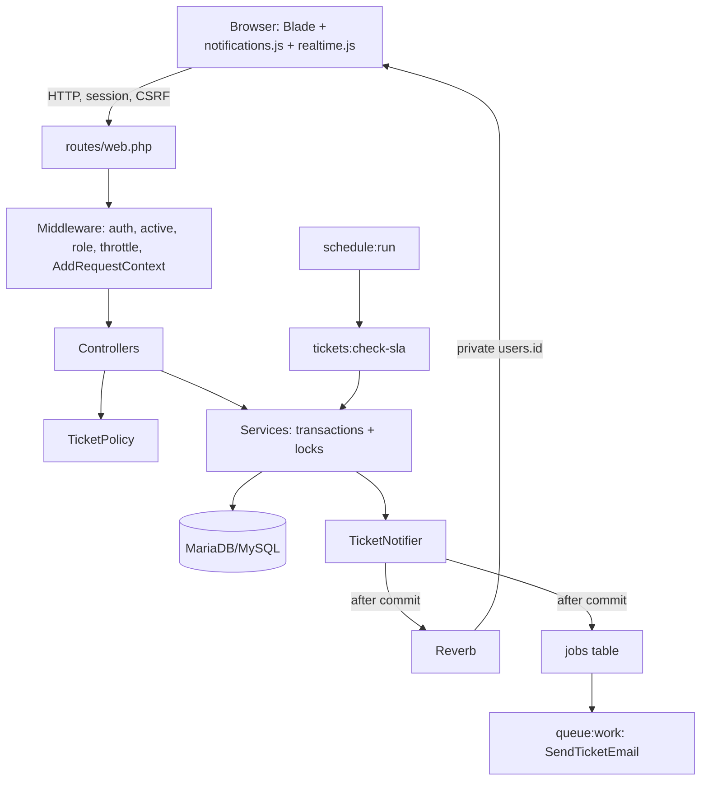

# 17 — Demo and Interview Guide (V2)

This guide prepares you to **show** ResolveDesk V2 in 5 minutes, **explain** it in 10 minutes, and **answer
follow-up questions** honestly. Everything described as a feature is implemented and was verified as listed in
`DEVELOPMENT_PROGRESS.md`. Things that are only ideas are clearly marked *future*.

Related: [01 overview](01-PROJECT-OVERVIEW.md) · [10 system design](10-SYSTEM-DESIGN-GUIDE.md) ·
[20 concurrency](20-CONCURRENCY-AND-DATA-INTEGRITY.md) · [21 real-time](21-REALTIME-REVERB-ECHO.md) ·
[22 V2 features](22-V2-BUSINESS-FEATURES.md) · [23 security/ops](23-SECURITY-ERRORS-LOGGING-OPERATIONS.md) ·
[18 deployment](18-PRODUCTION-DEPLOYMENT.md) · [19 backup](19-BACKUP-AND-RECOVERY.md)

---

## 0. How to describe the project honestly

Say this (in your own words) at the start, or when asked "did you build this yourself?":

> "I built ResolveDesk with AI assistance — I used Claude Code to generate and review much of the code from a
> detailed specification I wrote, first for V1 and then for the V2 multi-project upgrade. My goal was an application
> I fully understand, not just one that runs. I read the code, kept learning notes, ran the 164-test suite, and ran
> extra checks such as parallel PHP processes for the locks and a real WebSocket client for Reverb. I deliberately
> kept it plain Laravel MVC with a few service classes so that I can change it live. Some things were not verified —
> for example a real browser test, real SMTP and a Linux deployment — and I'll say so when they come up."

Why this matters:

- Interviewers often ask; one deep question exposes a dishonest answer.
- Your value is **understanding**: business rules, trade-offs, debugging, modifying code.
- **Not verified** (never claim otherwise): visual rendering and the toast inside a real browser (the real-time path
  was verified with a Node + pusher-js client, 255 ms), Gmail SMTP, MySQL 8 (only MariaDB 10.4), Linux/Nginx/Supervisor
  deployment, a backup restore drill. Rehearse the browser toast yourself before the interview (§1).

---

## 1. Preparation (the day before, ~15 minutes)

**Do not run `migrate:fresh` on the development database** — it contains data that must be preserved.
The demo below works on the existing dev DB after `php artisan db:seed --class=V2DemoDataSeeder` (additive), because
it creates its own new ticket. If you want a clean demo database, create a separate one (e.g. `resolvedesk_demo`),
point `.env` at it temporarily, then `migrate --seed` there.

Four terminals, each with PHP 8.4 on PATH (`export PATH="/c/php-8.4.28:$PATH"`):

```bash
php artisan serve           # 1: http://127.0.0.1:8000
php artisan queue:work      # 2: emails (log mailer)
php artisan reverb:start    # 3: WebSockets :8080 (add --debug to watch messages)
php artisan schedule:work   # 4: SLA check every minute
```

Also: MariaDB running (XAMPP), `npm run build` done once (so `public/build/manifest.json` exists),
`php artisan test` green.

Browser sessions (must not share cookies):

| Window | Browser | Log in as (password `password`) |
|---|---|---|
| A | Chrome normal | `admin@resolvedesk.test` |
| A2 | second tab in the same Chrome window | admin, used for the stale-version demo |
| B | Chrome Incognito (or Edge) | `sarah.agent@resolvedesk.test` (supports HRMS + PAYROLL in the demo data) |

Prepare a small PDF or PNG (< 5 MB) to attach. Rehearse once and confirm the toast appears in window B.

---

## 2. Five-minute V2 demo (two browsers, real-time toast)

| Time | Window | Click / action | What you say |
|---|---|---|---|
| 0:00 | A | Admin dashboard | "V2 supports several products and client companies. These cards show tickets per **project** and per **client**, global vs project tickets, and SLA compliance. Aggregates are cached 60 s; the overdue count and workload table are live." |
| 0:30 | A | **Projects** → open **HRMS** | "Each project has client organizations and support agents — two many-to-many pivot tables. Removing an agent who still has unresolved or reopenable (Resolved) HRMS tickets is refused; the project row is locked while checking." |
| 0:55 | A | **New Ticket**: client **ACME**, project **HRMS** (dropdown refreshes via `/tickets/project-options`), priority High, attach the PDF → **Create** | "The project list depends on the client, but that's only UX — `TicketService::resolveScope()` re-checks on the server. The form carries a hidden `request_token`: a double click returns the same ticket instead of creating two. The file goes to a private disk with a UUID name." |
| 1:40 | A2 | Open the new ticket → **Edit** (leave the form open, don't save) | "I'll come back to this tab to show optimistic locking." |
| 1:50 | A | On the ticket page, **Assign** → Sarah | "Assignment takes a global `Cache::lock`, then a shared lock on the project row, then `SELECT … FOR UPDATE` on the ticket. Only agents of HRMS are in the list, and the server re-checks eligibility." |
| 2:05 | B | (no click) | A toast appears **immediately**: *New ticket assigned*. "That came over a WebSocket. After the database commit, Laravel broadcasts a tiny event — only the notification id — to Reverb on the private channel `users.{Sarah's id}`. The browser then fetches the full notification from the normal authorized JSON feed." |
| 2:30 | B | Open the ticket, add an **internal note** "Checked logs, HRMS leave module", then **Start Working** | "Internal notes are staff-only: a customer never receives them — they are filtered in SQL, not just hidden. Every change increases the ticket's `version`." |
| 3:00 | A2 | Change the subject and **Save** | Error: *This ticket was changed by someone else after you opened the page…* "This is optimistic locking: `UPDATE … WHERE id = ? AND version = ?` updated 0 rows, so we reject instead of silently overwriting Sarah's change. For a JSON request it's HTTP 409." |
| 3:30 | terminal 3 | `Ctrl+C` (stop Reverb) | "Now the WebSocket server is down." |
| 3:35 | B | Type a resolution note → **Resolve Ticket** | "The request still succeeds — broadcast errors are caught and logged." |
| 3:45 | A | Wait ≤ 5 s | Toast *Ticket resolved* (admin created the ticket). "Delivered by the polling fallback. The database notification is the source of truth; real-time is an optimization. That's graceful degradation." Restart Reverb. |
| 4:10 | A | **Reports** → filter project HRMS → **Export CSV** | "Reports use the same filters; export is streamed in chunks of 500 and protected against CSV formula injection, and rate limited to 5 per minute." |
| 4:35 | terminal | `php artisan schedule:list` | "The scheduler runs `tickets:check-sla` every minute without overlapping; each breach is notified exactly once because the check and the `sla_notified_at` update happen on a locked row." |
| 5:00 | — | Stop | "So: multi-project scope, data isolation, concurrency control, real-time with fallback, secure files, SLA automation and reports — all plain Laravel." |

**If something goes wrong live:** no toast in B → check terminal 3 and DevTools → Network → WS; the bell still updates
by polling within 5 s. Sarah missing from the assign list → she is not an HRMS agent in this DB; pick an agent who is
(project page) or use a global ticket. "Another assignment is being processed" → wait a second and retry (lock
timeout is 5 s).

> **বাংলায়:** ডেমোর মূল তিনটি মুহূর্ত: (১) অন্য ব্রাউজারে সাথে সাথে toast আসা — WebSocket; (২) পুরনো এডিট ফর্ম সেভ
> করলে রিজেক্ট হওয়া — optimistic locking; (৩) Reverb বন্ধ করলেও কাজ চলা আর polling দিয়ে নোটিফিকেশন আসা —
> graceful degradation। এই তিনটা পরিষ্কারভাবে দেখাতে পারলে V2-এর মূল কাজ বোঝানো হয়ে যায়।

---

## 3. Ten-minute technical explanation

About one minute per point; name the file to open if they want code.

1. **Problem and domain (1 min).** Software company, many products and client companies. Four ticket kinds from
   nullable `project_id` / `client_id`; "global" ≠ public. (`TicketService::resolveScope()`)
2. **Architecture (1 min).** Laravel modular monolith, MVC, Blade + Bootstrap + vanilla JS. Thin controllers; five
   focused services (`TicketService`, `TicketAssignmentService`, `TicketNotifier`, `AttachmentService`,
   `ProjectService`). Four processes: web, queue worker, Reverb, scheduler.
3. **Security layers (1 min).** Middleware (`auth`, `active`, `role:admin`, `throttle:*`, `AddRequestContext`) →
   `TicketPolicy` → service re-checks on locked rows → query scopes (`visibleTo`) → channel authorization in
   `routes/channels.php`. CSRF, escaping, `$fillable`, private files.
4. **Data model (1 min).** `projects`, `clients`, `client_project`, `project_user`, `users.client_id`, ticket columns
   `project_id`, `client_id`, `version`, `request_token`, `sla_notified_at`, `ticket_attachments`. Additive
   migrations; old tickets became global.
5. **Concurrency (1.5 min).** Pessimistic `lockForUpdate` for transitions; optimistic `version` for edits (409);
   `Cache::lock('ticket-assignment')` so parallel auto-assigns don't pick the same "least busy" agent; lock order
   cache lock → project row → ticket row; `DB::transaction(fn, 3)` retries deadlocks. Verified with two-connection
   tests and 4 parallel PHP processes.
6. **Idempotency (0.5 min).** `request_token` + unique `(created_by, request_token)`; same content → replay, different
   content → conflict. 6 parallel identical submits → 1 ticket.
7. **Notifications and real-time (1.5 min).** `TicketNotifier::notify()` inserts the database notification inside
   the transaction; after commit it broadcasts `UserNotificationCreated` (`ShouldBroadcastNow`, payload only the id)
   and dispatches the email job. Echo listens on private `users.{id}`; `notifications.js` polls only when the socket
   is unhealthy. Side effects are held until the assignment lock is released.
8. **Queue and email (0.5 min).** `SendTicketEmail`: 3 tries, 10 s backoff, 60 s timeout (< `retry_after` 90),
   delivery key in the cache to skip a resend after a retry.
9. **Attachments (0.5 min).** Validation by extension + MIME, private disk, UUID names, files stored before the
   transaction and deleted on failure, download through `TicketPolicy::downloadAttachment()` with `nosniff`.
10. **SLA, reports, operations (1 min).** `tickets:check-sla` every minute with `chunkById` and per-row lock;
    `/reports` + streamed CSV; rate limiters; `X-Request-Id` in logs; `/up` and `/health/ready`.
11. **Quality (0.5 min).** 164 feature tests / 661 assertions on `resolvedesk_testing` (MariaDB 10.4), including
    `MySqlConcurrencyTest` with two real connections; `preventLazyLoading` against N+1; Pint.

---

## 4. Business problem explanation

"A company sells HRMS, ERP, Payroll and other products to many client companies. Requests come by phone, email and
chat; they get lost, engineers duplicate work, an ERP issue goes to someone who doesn't know ERP, deadlines are
missed and one client's data could leak to another. ResolveDesk groups every request by project and client, assigns
it only to agents of that product (manually or by lowest workload), runs a controlled lifecycle with SLA deadlines
and automatic breach reminders, keeps public replies and internal notes apart, stores files privately, notifies
people instantly, and gives managers per-project and per-client reports."

## 5. Architecture explanation



Why several services and not one? Each has one reason to change: ticket rules, assignment + locking, delivery of
notifications, file storage, project associations. They are plain classes injected by the container — no
interfaces or repositories, because there is only one implementation of each.

## 6. Database design explanation

- Two pivots with unique pairs and `restrictOnDelete()`; projects/clients are deactivated, never deleted.
- `tickets.version` (default 1) for optimistic locking; `request_token` with a composite unique index for
  idempotency; `sla_notified_at` to remember the reminder.
- Indexes added for the new access paths: `(project_id, status)`, `(client_id, status)`, `(status, due_at)` for the
  scheduler, and `(notifiable_type, notifiable_id, created_at)` for the feed (EXPLAIN: filesort removed).
- `ticket_activities.user_id` became nullable so the scheduler can write **system** activities.
- Attachment metadata in `ticket_attachments`; the file itself on the private disk.

## 7. System design and scaling (implemented vs future)

Implemented: one server, database-backed session/cache/queue/locks, one worker, one Reverb process, cron scheduler.
*Future* (not implemented): Redis for cache/queue/locks/sessions, several app servers behind a load balancer, Reverb
horizontal scaling through Redis pub/sub, S3 for attachments, read replica for reports, `onOneServer()` for the
scheduler, central monitoring. See [10-SYSTEM-DESIGN-GUIDE.md](10-SYSTEM-DESIGN-GUIDE.md) Part E.

---

## 8. Important trade-offs

| Decision | Benefit | Cost |
|---|---|---|
| Reverb push + polling fallback | Instant toasts, still works when Reverb is down | One more process to run and monitor |
| Broadcast only the notification id | No ticket data over the socket; reuse of authorized feed | One extra HTTP request per notification |
| `ShouldBroadcastNow` (not queued) after commit | No worker needed for real-time, simple | Request waits up to the 2–3 s broadcaster timeout if Reverb hangs |
| Global assignment `Cache::lock` | Correct least-workload choice under parallel auto-assign | Assignments are serialized (fine at this scale) |
| Optimistic locking for edits | No long locks while a user types | User must reload and retry on conflict |
| Pessimistic row locks for transitions | Simple, rules checked on current data | Short waits under contention |
| `request_token` idempotency | No duplicate tickets on double submit | Hidden field + unique index to maintain |
| Database cache/queue/locks | No Redis on XAMPP; inspectable with SQL | Slower and more DB load than Redis |
| Cache-based email de-dup | Simple, survives job retries | Best effort, not exactly-once |
| Timestamps kept in Asia/Dhaka | No rewrite of historical V1 data | Deviation from "store UTC" advice |
| One role column, no permission package | Easy to explain | Not flexible for many custom roles |
| Calendar-hour SLA | Simple | Ignores business hours/holidays |

---

## 9. Common follow-up questions and recommended answers

**Q1. Two admins assign the same ticket at the same moment?**
Both enter `TicketAssignmentService::withAssignmentLock()`; the second waits (up to 5 s) for `Cache::lock`. Inside,
the ticket row is re-read `FOR UPDATE`, the version is checked, and same-agent assignment returns false ("already
assigned"). If the lock is not free in 5 s the user sees "Another assignment is being processed right now".

**Q2. Why a cache lock if you already have row locks?**
Row locks protect *one* ticket. Two auto-assigns of *different* tickets lock different rows, both count the same
workload, and both pick the same agent. The global lock makes "count workload + assign" one-at-a-time.

**Q3. What is optimistic locking here?**
The edit form sends the `version` it was rendered with. `updateTicket()` runs
`UPDATE tickets SET …, version = version + 1 WHERE id = ? AND version = ? AND status <> 'closed'`. 0 rows → 
`TicketConflictException` (409 for JSON, redirect back with the input for forms).

**Q4. How do you stop duplicate tickets?**
Hidden UUID `request_token`; the service first looks for an existing ticket with the same creator + token; a unique
index catches the race; a parallel loser gets the existing ticket back. Different content with the same token → 409.

**Q5. Why is the broadcast after commit?**
A rolled-back assignment must not show a toast. `TicketNotifier::afterCommit()` uses `DB::afterCommit()`; on rollback
the callback is discarded — tested in `test_no_broadcast_and_no_email_when_the_transaction_rolls_back`.

**Q6. Can a user listen to someone else's notifications?**
No. Echo must call `POST /broadcasting/auth`; `routes/channels.php` returns true only when
`$user->id === (int) $userId && $user->is_active`. Otherwise 403. Tested, and verified live (AuthError).

**Q7. What if Reverb is down?**
The broadcast throws, is caught and logged as a warning; the ticket operation succeeds; `notifications.js` keeps
polling every 5 s. Tested with a real connection refusal.

**Q8. How is customer data isolated?**
Logical isolation in one database: the customer's `client_id` comes from their account, scope rules in
`resolveScope()`, `visibleTo()` scopes in SQL, internal notes filtered out, policy on attachments, private channels.
No separate tenant databases.

**Q9. Does project membership let an agent see all project tickets?**
No — membership controls assignment eligibility only. Visibility is still creator or assigned agent (spec §6).

**Q10. How do attachments stay secure?**
Extension and detected MIME both validated, size and count limited, private disk, UUID names, download only through
the controller + `TicketPolicy::downloadAttachment()` (internal-note files staff-only), `Content-Disposition:
attachment`, `nosniff`. No antivirus scanning — a known limitation.

**Q11. Why does the SLA reminder go out only once?**
`processSlaBreach()` locks the row, re-checks "still overdue and `sla_notified_at IS NULL`", sets
`sla_notified_at` and notifies in one transaction. A parallel run waits and then sees it already set. Reopen and
priority change reset it for a new breach.

**Q12. What if the queue worker dies mid-email?**
The job becomes available again after `retry_after` (90 s). `$timeout = 60` is shorter, so a running attempt is
killed first. The delivery-key cache entry stops a second send after a successful one; a crash exactly between SMTP
accept and cache write can still duplicate — at-least-once delivery.

**Q13. How do you rate limit?**
Named limiters in `AppServiceProvider`: ticket create 10/min, comments 30/min, feed 120/min, export 5/min, keyed by
user id (so an office behind one IP isn't blocked together); login 5 failures per email + IP. 429 page.

**Q14. How do you trace a production error?**
`AddRequestContext` puts `request_id` and `user_id` into every log line and returns `X-Request-Id`; a user reports
the id and you grep the log.

**Q15. How would you deploy it?**
Documented in [18](18-PRODUCTION-DEPLOYMENT.md) (not executed): Nginx + PHP-FPM, `APP_DEBUG=false`, `config:cache`,
`route:cache`, `view:cache`, Supervisor for `queue:work` and `reverb:start`, one cron line for `schedule:run`, TLS
termination with a WebSocket proxy for WSS, daily logs, backups.

**Q16. How would it scale?**
Redis for cache/queue/locks/sessions first, then more web servers behind a load balancer (sessions in Redis or DB),
Reverb scaling via Redis, S3 for files, read replica for reports, more workers. None of this is implemented.

**Q17. What was hard?**
Getting the lock order right (deadlock-free), holding broadcasts until the cache lock is released, the Reverb
installer not writing keys, a rollback bug where an index backed a foreign key, and CRLF line endings on Windows.

**Q18. What did AI do, and what did you do?**
AI generated and reviewed most code from my specifications. I defined requirements and constraints, reviewed and
ran everything, studied each file and wrote these notes. Pick any file and I'll walk through or change it.

**Q19. What would you improve first?**
Real browser tests (Dusk) for the JavaScript, a transactional outbox for emails, UTC timestamps with a careful data
migration, an agent-availability flag, antivirus scanning, business-hours SLA.

**Q20. How do you test concurrency?**
`MySqlConcurrencyTest` opens a second database connection: one holds `FOR UPDATE`, the other must wait; a parallel
duplicate insert hits the unique index; a stale optimistic update changes nothing. Plus manual multi-process runs
recorded in `DEVELOPMENT_PROGRESS.md`.

> **বাংলায়:** উত্তর দেওয়ার নিয়ম: প্রথমে এক লাইনে মূল উত্তর, তারপর কোন ফাইলে কোড আছে, তারপর সম্ভব হলে কোড খুলে
> দেখানো। যা implement বা verify করা হয়নি (Redis, load balancer, Linux deployment, SMTP, real browser test) সেটাকে
> পরিষ্কারভাবে "future" বা "not verified" বলুন।

---

## 10. Two-hour emergency preparation plan

| Time | Do |
|---|---|
| 0:00–0:15 | Start MariaDB, four processes, `php artisan test`. Log in as admin and Sarah. |
| 0:15–0:40 | Rehearse the 5-minute demo (§2) twice, including stopping Reverb. |
| 0:40–1:05 | Read `TicketAssignmentService` and `TicketNotifier` top to bottom; say each method in 2 sentences. |
| 1:05–1:20 | Read `TicketService::createTicket()`, `updateTicket()`, `resolveScope()`, `processSlaBreach()`. |
| 1:20–1:35 | Read `routes/channels.php`, `UserNotificationCreated`, `resources/js/realtime.js`, the bridge part of `public/js/notifications.js`. |
| 1:35–1:50 | Answer the 20 questions in §9 aloud. |
| 1:50–2:00 | One live change: `max_file_kb` to 1024 in `config/resolvedesk.php`, run `InternalNotesAndAttachmentsTest`, revert. |

## 11. Four-hour detailed preparation plan

| Time | Do |
|---|---|
| 0:00–0:20 | Environment + tests; read `README.md` and the V2 part of `DEVELOPMENT_PROGRESS.md`. |
| 0:20–1:20 | [16](16-CODEBASE-LEARNING-MAP.md) three-hour V2 plan, first half (domain, scope, concurrency). |
| 1:20–2:10 | Second half (notifications, real-time, notes, attachments, scheduler, reports, ops). |
| 2:10–2:50 | Two V2 exercises from [08](08-LIVE-CODING-PRACTICE.md) with a timer, with tests (e.g. V2-3 and V2-17). |
| 2:50–3:15 | Debugging drill from [11](11-DEBUGGING-GUIDE.md) Part 4: 409, 429, `/broadcasting/auth` 403, scheduler. |
| 3:15–3:40 | Rehearse the 5-minute demo and the 10-minute talk, timed. |
| 3:40–4:00 | Q&A drill: §9 + [09](09-INTERVIEW-QUESTIONS-AND-ANSWERS.md) Part 6. |

## 12. Day-of checklist

- [ ] MariaDB running; `php -v` = 8.4.28 in all four terminals.
- [ ] `serve`, `queue:work`, `reverb:start`, `schedule:work` running; `public/build/manifest.json` exists.
- [ ] Admin (window A + tab A2) and Sarah (window B) logged in; small PDF ready.
- [ ] `php artisan test` green (164 tests).
- [ ] Editor open on `TicketAssignmentService.php`, `TicketNotifier.php`, `TicketService.php`, `TicketPolicy.php`,
      `routes/channels.php`, `realtime.js`.
- [ ] Your honest AI-assistance statement (§0) and the "not verified" list.
