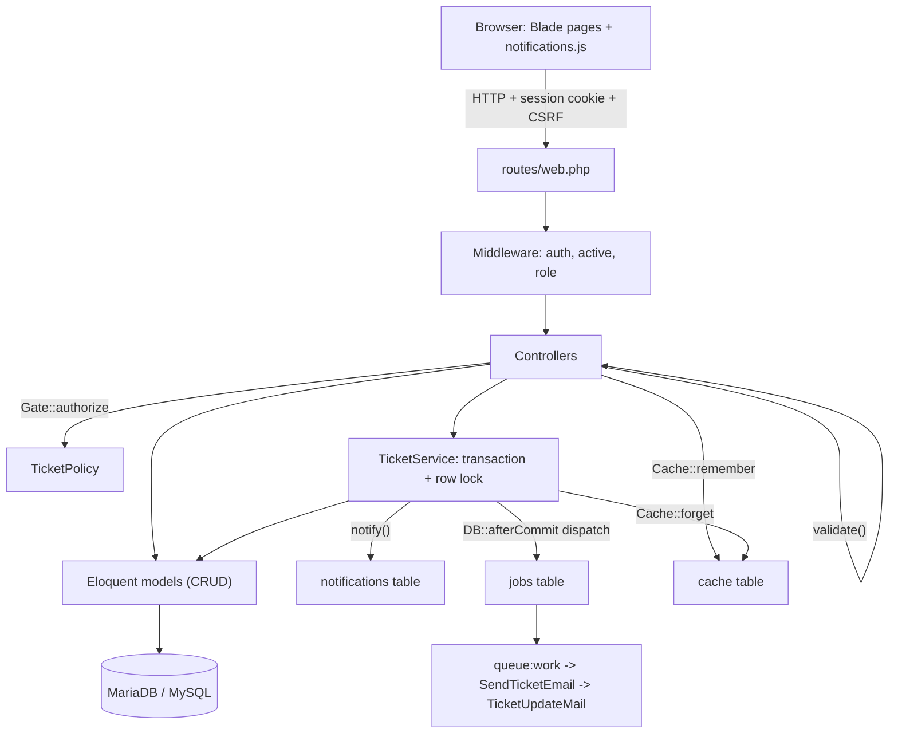

# 17 — Demo and Interview Guide

This guide prepares you to **show** ResolveDesk in 5 minutes, **explain** it in 10 minutes, and **answer
follow-up questions** honestly. Everything described as a feature is implemented and was verified as listed in
`DEVELOPMENT_PROGRESS.md`. Things that are only ideas are clearly marked *future*.

---

## 0. How to describe the project honestly

Say this (in your own words) at the start, or when asked "did you build this yourself?":

> "I built ResolveDesk with AI assistance — I used Claude Code to generate and review much of the code, based on a
> detailed specification I wrote. My goal was not just a working app but one I fully understand. I read every
> file, I wrote learning notes, I ran the test suite and a manual HTTP smoke test, and I can explain and modify any
> part of it. I deliberately kept it as plain Laravel MVC with one service class so that I can change it live."

Why this is the right approach:

- Interviewers often ask; a dishonest answer is discovered quickly by one deep question.
- The value you show is **understanding**: the business rules, the trade-offs, the debugging, the ability to
  modify code. That is what the rest of this guide trains.
- Do not claim things that were not verified. Not verified: browser rendering by automation, the toast in a real
  browser by automation, Gmail SMTP delivery. (Check the toast yourself before the interview — see §1.)

---

## 1. Preparation before the demo (10 minutes, the day before)

```bash
# Git Bash
export PATH="/c/php-8.4.28:$PATH"
php -v                                  # must be 8.4.28
# Start MariaDB: XAMPP Control Panel -> MySQL -> Start
php artisan migrate:fresh --seed        # WARNING: deletes ALL local data and recreates demo data (local only!)
php artisan serve                       # http://127.0.0.1:8000
```

Why re-seed? The demo below uses ticket numbers from a **fresh** seed (TK-000001 … TK-000032). The local
development database was already changed by the smoke test (e.g. TK-000001 is no longer Open), so without a
fresh seed the numbers differ — then simply pick any Open ticket.

Open **three separate browser sessions** (sessions are cookies, so they must not share cookies):

| Window | Browser | Log in as (password `password`) |
|---|---|---|
| A | Chrome normal window | `admin@resolvedesk.test` (Nadia Rahman, admin) |
| B | Chrome Incognito window | `michael.agent@resolvedesk.test` (Michael Brown, agent) |
| C | Edge / Firefox | `john.customer@example.com` (John Carter, customer) |

Optional second terminal for email: do **not** start a worker yet (you will show the pending job).

Rehearse once. Check that the toast actually appears in window B (this was not verified by automation).

---

## 2. Five-minute demo script (click by click)

Seed facts used below (fresh seed): 32 tickets — 6 Open, 6 Assigned, 7 In Progress, 5 Resolved, 8 Closed.
TK-000001 "Invoice #INV-2291 shows the wrong VAT amount" is an Open, Medium ticket created by **John Carter**.
The least-busy active agent is **Michael Brown** (workload 2).

| Time | Window | Click / action | What you say |
|---|---|---|---|
| 0:00 | A | Dashboard is open | "This is the admin dashboard. The status cards and three charts come from aggregate SQL and are cached for 60 seconds — see *Statistics generated at*. The Overdue card and the agent workload table are **live**, never cached, because overdue depends on the current time." |
| 0:40 | A | Click the red **Overdue** card (opens `/tickets?overdue=1`) | "Overdue = still active and `due_at` has passed. SLA is 48/24/8/2 hours for Low/Medium/High/Critical. Here TK-000004, a Critical API outage, had a 2-hour SLA and is already late." Point to the red rows and *Overdue* badges. |
| 1:10 | A | Clear the filter, open **TK-000001** | "Customer John reported a VAT problem. Status Open, unassigned. On the right: the workflow panel. Buttons appear only if `TicketPolicy` allows them — and the controller checks the same policy again." |
| 1:30 | A | Click **Auto Assign** | "Auto assign picks the active agent with the fewest Assigned + In Progress tickets, tie-break by lowest id. It runs in a transaction with a `SELECT … FOR UPDATE` row lock." Flash: *Ticket automatically assigned to Michael Brown (lowest current workload).* Show the new activity rows in the timeline (assigned, status Open → Assigned). |
| 2:00 | B | Do nothing — wait ≤ 5 s | A toast appears: **TK-000001 · New ticket assigned**, and the bell badge increases. "No refresh. The browser polls `/notifications/feed` every 5 seconds with `fetch`; the toast is de-duplicated by notification id. It's near-real-time, not push." |
| 2:30 | B | Click the toast | "Clicking marks it read with an AJAX POST that sends the CSRF token, then opens the ticket — and the ticket page checks permission again." |
| 2:45 | B | Click **Start Working** → confirm | Status Assigned → In Progress. "Transitions come from one table, `Ticket::TRANSITIONS`. Any other change is rejected." |
| 3:05 | B | Type a resolution note, click **Resolve Ticket** → confirm | "A resolution note is required; `resolved_at` is set; the creator gets an in-app notification and a queued email." |
| 3:30 | C | Wait ≤ 5 s | Toast **TK-000001 · Ticket resolved** for John. Open it. |
| 3:45 | C | Click **Reopen Ticket** → confirm (or **Confirm & Close Ticket**) | Reopen: back to In Progress, Michael gets a toast in window B (*Ticket reopened*). Close: status Closed, the ticket becomes read-only (comment form disappears). "Only the creator or an admin may close or reopen, and only from Resolved." |
| 4:15 | A | Refresh the dashboard | "*Statistics generated at* changed: every workflow action calls `Cache::forget('dashboard:admin:stats')` after commit." |
| 4:30 | terminal | `php artisan queue:work --stop-when-empty`, then show the end of `storage/logs/laravel.log` | "Emails are queued jobs in the `jobs` table. With no worker, they just wait; the ticket workflow is unaffected. The worker processed them; locally the `log` mailer writes the email to the log instead of SMTP." |
| 5:00 | — | Stop | "That's the full lifecycle: create, assign, work, resolve, confirm — with SLA, audit history, notifications, queue and cache." |

**If something goes wrong live:** no toast → open the bell dropdown (the list is still updated) or wait for the
next poll; check DevTools → Network for `/notifications/feed`. Auto Assign says no agent available → an agent was
deactivated; use manual **Assign** instead.

---

## 3. Ten-minute technical explanation

Use this structure (≈1 minute per point). Each point names the file to open if they want to see code.

1. **Problem and roles (1 min).** Support requests get lost without a central system. Three roles in one `role`
   column: admin, agent, customer. Accounts are deactivated, never deleted. (`app/Models/User.php`)
2. **Architecture (1 min).** Classic Laravel MVC monolith, Blade + Bootstrap + vanilla JS, MySQL-compatible DB.
   Controllers stay thin; one `TicketService` holds the coordinated ticket rules; plain CRUD (users, categories)
   stays in controllers. (`app/Services/TicketService.php`)
3. **Request pipeline and security (1 min).** Route → middleware `auth`, `active` (logs out deactivated users even
   mid-session), `role:admin` → controller → `Gate::authorize()` with `TicketPolicy` → validation → service. CSRF on
   every POST, `{{ }}` escaping, `$fillable`, login rate limiting, session regeneration.
4. **Data model (1 min).** `users`, `categories`, `tickets` (two FKs to users: `created_by`, nullable
   `assigned_to`), `ticket_comments`, `ticket_activities`, plus Laravel's `notifications`, `jobs`, `failed_jobs`,
   `cache`, `sessions`. Indexes on status, priority, due_at, created_at and `(assigned_to, status)`.
5. **Workflow as a state machine (1 min).** `Ticket::TRANSITIONS` keyed by action; assignment does Open → Assigned;
   the edit form never changes status. Business-rule failures throw `ValidationException` → redirect back with
   a message.
6. **Concurrency (1 min).** Every workflow method: `DB::transaction()` + `lockForUpdate()` + re-check the rule on the
   locked row. Two admins auto-assigning the same ticket: the second waits, then sees it is no longer Open.
7. **SLA (0.5 min).** `due_at = created_at + SLA_HOURS[priority]`; recalculated from original `created_at` on
   priority change; overdue computed live by a scope. `due_at` is DATETIME because of a real MariaDB TIMESTAMP bug I
   found during seeding.
8. **Notifications (1 min).** One `TicketNotification` (database channel, not queued, inside the transaction).
   Recipient rules in `notifyUser()`: skip null, inactive, and the actor. A new ticket notifies (and emails) every
   active admin — an owner-requested addition to the original matrix. Polling with recursive `setTimeout`,
   `?since=server_time`, `Set` of shown ids, `textContent` against XSS, slower polling in hidden tabs.
9. **Queue and email (1 min).** `SendTicketEmail` (`ShouldQueue`, 3 tries, 10 s backoff, `failed()` logs) dispatched
   inside `DB::afterCommit()` with try/catch: rollback → no email; email failure → never undoes the ticket change.
10. **Cache and dashboard (0.5 min).** Cache-aside with `Cache::remember()` for admin aggregates (60 s) and the
    active category dropdown (1 h), `Cache::forget()` after commits. Never cached: overdue, workload, permissions,
    unread counts. Validation always checks the database.
11. **Quality (1 min).** 85 feature tests (`tests/Feature`) on a separate `resolvedesk_testing` database,
    `Model::preventLazyLoading()` outside production to catch N+1, and a manual curl smoke test with separate
    sessions per role.

---

## 4. Business problem explanation

"A software company receives support requests by phone, email and chat. Requests get lost, two engineers work on
the same issue, some agents are overloaded, deadlines are missed, and managers cannot see what is happening.
ResolveDesk gives one place for every request (a ticket), clear ownership (assignment), a controlled lifecycle
(Open → Assigned → In Progress → Resolved → Closed, with Reopen), deadlines per priority (SLA), a conversation
and a full audit trail, automatic notifications so nobody has to refresh, and a dashboard for managers."

Key business rules to mention: customers see only their own tickets; agents see tickets they created or are
assigned to; the **customer confirms** the resolution (Close) or rejects it (Reopen); closed tickets are read-only;
a category in use cannot be deleted, only deactivated; an agent with unfinished tickets cannot be deactivated.

## 5. Architecture explanation



Why a service class only for tickets? Ticket actions touch 4–5 things at once (ticket, activity, notification,
email, cache) and must be atomic. Putting that in controllers would duplicate the pattern 8 times. Users and
categories are simple CRUD, so a service would be an unnecessary abstraction.

## 6. Database design explanation

- `tickets.created_by` and `tickets.assigned_to` both reference `users.id` → two `belongsTo` relations
  (`creator`, `assignedAgent`) with custom foreign keys.
- All FKs use `restrictOnDelete()`: history must never disappear, so users and used categories are deactivated, not
  deleted.
- `ticket_number` = `TK-` + zero-padded id, set after insert in the same transaction (unique, nullable for that
  short moment) — no `MAX(id)+1` race.
- Status/priority/role are strings validated against model constants (simpler to change than DB enums).
- `ticket_activities` stores `action`, `old_value`, `new_value` for the timeline.
- `notifications` uses a polymorphic owner (`notifiable_type`, `notifiable_id`) and JSON `data`.
- Composite index `(assigned_to, status)` supports the workload count for auto-assign and agent dashboards.

## 7. System design explanation (and how it would scale)

Current: one web server, one database, database-backed sessions, cache and queue; one queue worker; polling every
5 s. Suitable for a small/medium support team.

If load grew (all *future*):

| Bottleneck | Next step |
|---|---|
| Polling requests | Laravel Reverb / WebSockets (broadcast channel), or longer intervals |
| DB used for cache, queue, sessions | Redis for cache, queue and sessions |
| One worker | Several workers under Supervisor; separate queues (`emails`) |
| Email lost if crash between commit and dispatch | Transactional outbox table |
| Duplicate emails on retry | Idempotency key per email |
| SLA escalation | Scheduler command (`schedule:run`) that notifies about overdue tickets |
| Big ticket table | More indexes / read replica / archiving closed tickets |

See [10-SYSTEM-DESIGN-GUIDE.md](10-SYSTEM-DESIGN-GUIDE.md).

---

## 8. Important trade-offs

| Decision | Benefit | Cost |
|---|---|---|
| Polling instead of WebSockets | Simple, no extra server, works on XAMPP | Up to 5 s delay, many empty requests |
| Database queue instead of Redis | No extra software | Slower, DB load |
| Database cache | No extra software | Still a DB query per read |
| `DB::afterCommit()` instead of outbox | Simple, prevents emails for rolled-back changes | Tiny window where a crash loses an email |
| In-app notification not queued | Works without a worker, atomic with the change | Slightly longer transaction |
| One `role` column, no permission package | Easy to read and explain | Not flexible for many custom roles |
| String status + model constants instead of DB enum | Easy to add a status | DB does not enforce valid values (validation and code do) |
| `ValidationException` for business-rule errors | Reuses Laravel's error display and 422 JSON | Not a "validation" error in the strict sense |
| Reopen keeps original `due_at` | Simple rule | A reopened ticket may be instantly overdue |
| Continuous-hours SLA | Simple | Ignores business hours and holidays |
| MariaDB 10.4 instead of MySQL 8 | It was what was installed | Required DATETIME for `due_at`/`resolved_at` |

---

## 9. Common follow-up questions and recommended answers

**Q1. What happens if two admins assign the same ticket at the same time?**
Both requests start a transaction and run `lockTicket()` (`SELECT … FOR UPDATE`). The second waits until the first
commits, then reads the fresh row. For Auto Assign it sees the ticket is no longer Open and gets "Auto assign is only
available for Open tickets"; for manual assign to the same agent `performAssignment()` returns false ("already
assigned").

**Q2. Why not just hide buttons in Blade?**
Hiding is UX. Anyone can send a POST with curl. Every controller action calls `Gate::authorize()` with the same
`TicketPolicy`, and `TicketService` re-checks the status on the locked row. The smoke test confirmed a customer gets
403.

**Q3. How do you prevent N+1 queries?**
Eager loading with `with()` / `load()` in `TicketController`, `withCount()` for counts, and
`Model::preventLazyLoading(! production)` in `AppServiceProvider`, which throws an exception in development if I
forget.

**Q4. Why is the email sent after commit?**
If the transaction rolls back, the email would describe something that never happened. `DB::afterCommit()` keeps the
dispatch until COMMIT; on rollback the callback is discarded. There is a test for it.

**Q5. What if the email server is down?**
The job fails, waits 10 s, retries up to 3 times, then moves to `failed_jobs` and `failed()` logs it. The ticket
change is already committed and is never reversed. `php artisan queue:retry all` resends after fixing.

**Q6. What if the queue worker is not running?**
Ticket actions and in-app notifications still work; email jobs wait in `jobs`. I verified this: 2 jobs waited,
`queue:work --stop-when-empty` processed both, and the emails appeared in `laravel.log`.

**Q7. Can a user read someone else's notification?**
No. Every query starts from `$request->user()->notifications()`. `findOrFail($id)` on another user's UUID returns
404. Tested.

**Q8. Is the notification system real-time?**
Near-real-time. It is AJAX polling every 5 s (30 s in hidden tabs). For true push I would use Laravel Reverb with a
broadcast channel.

**Q9. How do you avoid duplicate toasts?**
The JS keeps a `Set` of shown notification ids. On first load, existing ids are added without toasts. The server
filter is `created_at >= since` minus a 10-second overlap (for late-committed transactions), so a row can come
twice; the Set skips it.

**Q10. Why recursive `setTimeout` and not `setInterval`?**
The next request is scheduled only after the previous finishes, so requests never overlap on a slow server.
Plus `isRequestRunning` and `clearTimeout` guarantee one loop.

**Q11. What do you cache, and what not?**
Admin aggregates (60 s) and the active-category dropdown (1 h). Not overdue (time-based), not workload (used for
assignment), not permissions/auth, not unread counts, not ticket details. Validation never trusts cache.

**Q12. How is the cache kept fresh?**
`Cache::forget()` after each successful commit that changes the statistics, and the TTL as a safety net. A race can
still leave stale stats for up to 60 s, which is acceptable for a dashboard.

**Q13. How does auto-assignment choose the agent?**
Active agents, `withCount` of tickets in Assigned/In Progress, order by that count, then by id. One SQL query with a
sub-select.

**Q14. Why is `due_at` DATETIME and not TIMESTAMP?**
On MariaDB/older MySQL, the first NOT NULL TIMESTAMP column gets an implicit `ON UPDATE CURRENT_TIMESTAMP`, so every
update overwrote the SLA deadline. I found it during seeding; DATETIME has no such behaviour.

**Q15. How would you add a new status, e.g. "On Hold"?**
Add the constant and label in `Ticket::STATUSES`, transitions in `TRANSITIONS`, a policy method, a service method
(transaction + lock + activity), a controller method and route, a button with `@can`, a badge colour, and tests.
Decide whether it counts in `ACTIVE_STATUSES`/`WORKLOAD_STATUSES`.

**Q16. How would you add SLA escalation?**
*Future:* an Artisan command scheduled every minute that finds `Ticket::overdue()` tickets without an escalation
record and notifies admins. Not implemented.

**Q17. What did AI do, and what did you do?**
AI generated and reviewed most code from my specification. I defined the requirements, reviewed and ran
everything, studied every file, and wrote/used these notes. I can walk through any file and change it — please pick
one.

**Q18. What would you improve first?**
WebSockets instead of polling for scale, Redis for cache/queue, an outbox for guaranteed email dispatch, business-hours
SLA, file attachments, and browser tests (Dusk) for the JavaScript.

**Q19. How do you test this?**
`php artisan test`: 85 feature tests using `RefreshDatabase` on `resolvedesk_testing`, factories with states,
`Queue::fake()`, `Mail::fake()`, cache assertions, and a page-rendering test that seeds demo data and opens every page
per role.

**Q20. What was hard / what bugs did you find?**
The MariaDB TIMESTAMP auto-update on `due_at`; Blade compiling `@json()` inside a JavaScript comment; a multi-line
`@include` with a ternary that failed to compile. All three are in `DEVELOPMENT_PROGRESS.md`.

> **বাংলায়:** ইন্টারভিউতে প্রশ্নের উত্তর দেওয়ার সময় প্রথমে এক লাইনে মূল উত্তর দিন, তারপর কোন ফাইলে কোডটা আছে সেটা
> বলুন, আর সম্ভব হলে কোডটা খুলে দেখান। যা implement করা হয়নি (Redis, WebSocket, outbox) সেটাকে স্পষ্টভাবে "future
> improvement" বলুন — কখনো দাবি করবেন না যে এগুলো আছে।

---

## 10. Two-hour emergency preparation plan

| Time | Do |
|---|---|
| 0:00–0:15 | Start XAMPP MySQL, `php -v`, `php artisan migrate:fresh --seed` (local only), `php artisan serve`, `php artisan test`. Log in with all three roles. |
| 0:15–0:40 | Rehearse the 5-minute demo (§2) twice with three browser sessions. Confirm the toast appears. |
| 0:40–1:05 | Read `app/Services/TicketService.php` top to bottom: `autoAssign`, `performAssignment`, `resolve`, `notifyUser`, `queueEmail`. Say each method aloud in 2 sentences. |
| 1:05–1:20 | Read `app/Models/Ticket.php` (constants, scopes) and `app/Policies/TicketPolicy.php`. |
| 1:20–1:35 | Skim `public/js/notifications.js` with [13-NOTIFICATION-SYSTEM-GUIDE.md](13-NOTIFICATION-SYSTEM-GUIDE.md) §10. |
| 1:35–1:50 | Read the 20 questions in §9 and answer them aloud without looking. |
| 1:50–2:00 | One live change: change `POLL_INTERVAL_MS` to 10000 and back; change `SLA_HOURS` high to 12, run tests, revert. |

## 11. Four-hour detailed preparation plan

| Time | Do |
|---|---|
| 0:00–0:20 | Environment and tests as in the 2-hour plan; read `README.md` and `DEVELOPMENT_PROGRESS.md`. |
| 0:20–1:00 | [16-CODEBASE-LEARNING-MAP.md](16-CODEBASE-LEARNING-MAP.md) steps 1–10 (structure, routes, layouts, category CRUD, migrations, models, auth, middleware, policies, users). Do 3 exercises. |
| 1:00–1:50 | Steps 11–17 (ticket creation → comments) with [06-BUSINESS-LOGIC-GUIDE.md](06-BUSINESS-LOGIC-GUIDE.md). Draw the lifecycle and the assignment sequence from memory. |
| 1:50–2:30 | Steps 18–23 with guides [13](13-NOTIFICATION-SYSTEM-GUIDE.md), [14](14-QUEUE-AND-EMAIL-GUIDE.md), [15](15-CACHING-GUIDE.md). Run the queue experiment (assign → count `jobs` → `queue:work --stop-when-empty` → read `laravel.log`). Watch the cache "generated at" time change. |
| 2:30–3:00 | Live-coding practice from [08-LIVE-CODING-PRACTICE.md](08-LIVE-CODING-PRACTICE.md): do two tasks with a timer, with tests. |
| 3:00–3:20 | Debugging drill ([11-DEBUGGING-GUIDE.md](11-DEBUGGING-GUIDE.md)): break one transition, read the test failure, fix. |
| 3:20–3:45 | Rehearse the 5-minute demo and the 10-minute talk (§3) out loud, timed. |
| 3:45–4:00 | Q&A drill: §9 plus [09-INTERVIEW-QUESTIONS-AND-ANSWERS.md](09-INTERVIEW-QUESTIONS-AND-ANSWERS.md). Write down any answer you were unsure about and re-read that code. |

## 12. Day-of checklist

- [ ] MariaDB running, `php -v` shows 8.4.28 in the terminal you use.
- [ ] Fresh seed done; three browser sessions logged in.
- [ ] `php artisan test` green.
- [ ] Editor open on `TicketService.php`, `Ticket.php`, `TicketPolicy.php`, `notifications.js`.
- [ ] A terminal ready for `php artisan queue:work --stop-when-empty` and `tinker`.
- [ ] Your one-sentence honest AI-assistance statement (§0).
