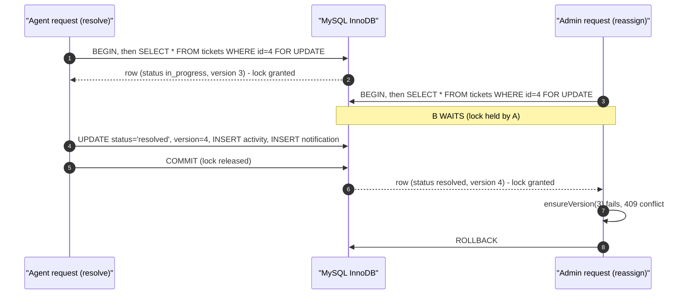
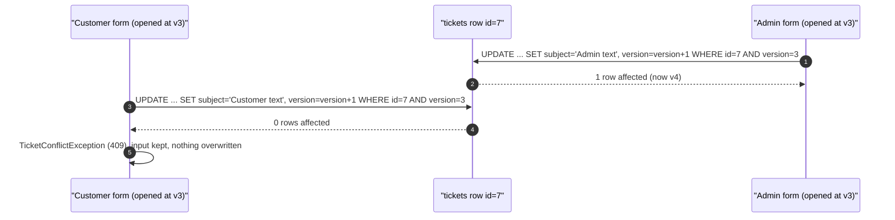
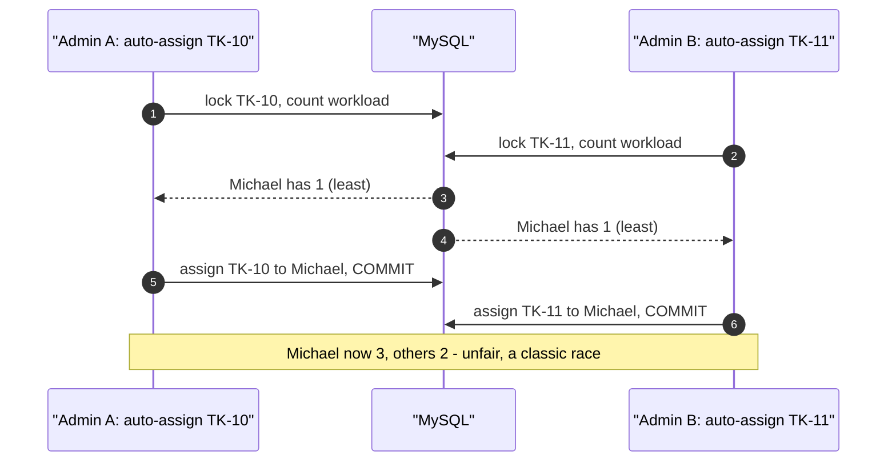
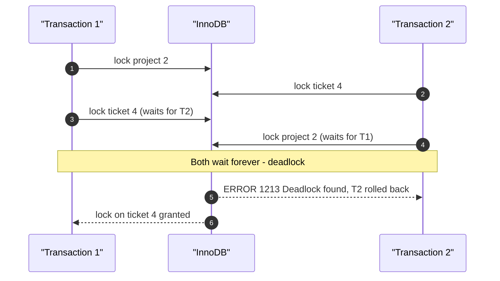
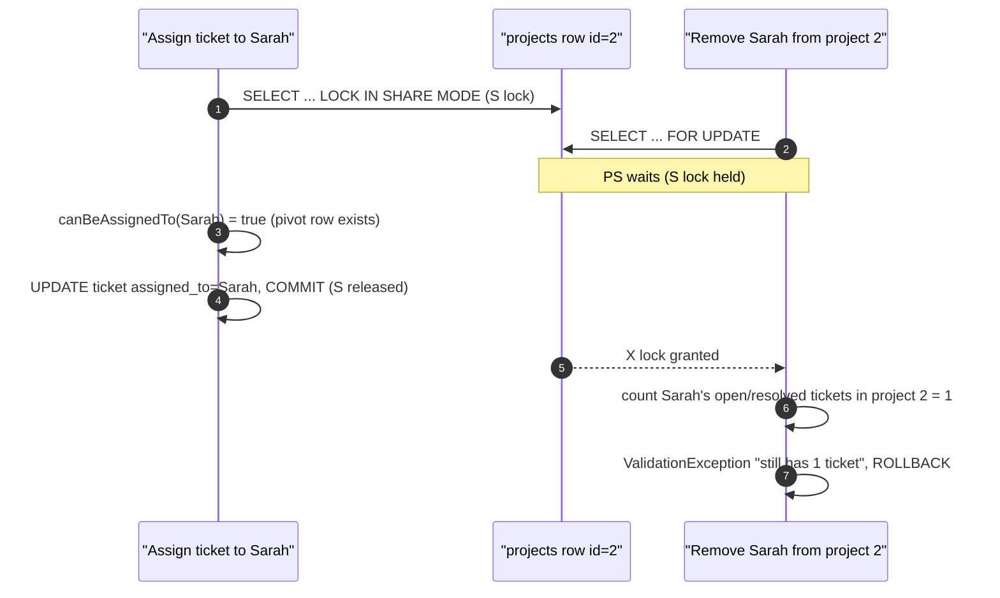
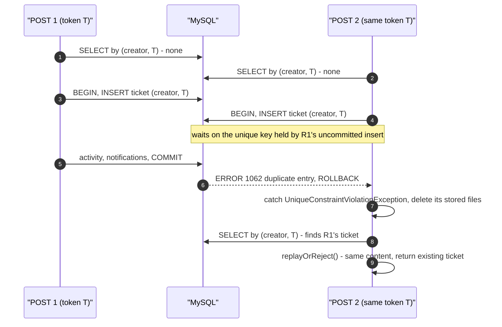

# 20 — Concurrency and Data Integrity Guide

This guide explains how ResolveDesk V2 keeps ticket data **correct when several people (or processes) act at the
same time**. Everything here is **implemented and tested** unless a section says *limitation* or *future*.
The verification results quoted at the end are copied from `DEVELOPMENT_PROGRESS.md`.

Files covered:

| File | Role |
|---|---|
| `app/Services/TicketService.php` | Create (idempotency), edit (optimistic locking), lifecycle (row lock + version), comments, SLA breach |
| `app/Services/TicketAssignmentService.php` | Manual / automatic assignment: `Cache::lock` + project row lock + ticket row lock |
| `app/Services/ProjectService.php` | Add/remove project agents and clients under a project row lock |
| `app/Services/TicketNotifier.php` | Notifications inside the transaction, side effects after commit (and after the cache lock) |
| `app/Models/Ticket.php` | `ensureVersion()`, `canBeAssignedTo()`, status constants |
| `app/Exceptions/TicketConflictException.php` | The 409 conflict response |
| `app/Http/Controllers/TicketController.php` | Reads the hidden `version` field; shows the replay message |
| `resources/views/tickets/edit.blade.php`, `tickets/show.blade.php`, `tickets/create.blade.php` | Hidden `version` and `request_token` fields |
| `public/js/app.js` | `data-disable-on-submit` (UI-only double-click protection) |
| `config/resolvedesk.php` | `assignment_lock.key / seconds / wait_seconds` |
| `database/migrations/2026_11_26_000005_add_v2_columns_to_tickets_table.php` | `version`, `request_token`, `sla_notified_at`, `UNIQUE(created_by, request_token)` |
| `tests/Feature/ConsistencyTest.php` | 11 sequential rule tests |
| `tests/Feature/MySqlConcurrencyTest.php` | 3 tests with **two real database connections** |

Related: [Notification system](13-NOTIFICATION-SYSTEM-GUIDE.md), [Queue and email](14-QUEUE-AND-EMAIL-GUIDE.md),
[Caching](15-CACHING-GUIDE.md), [System design](10-SYSTEM-DESIGN-GUIDE.md),
[Real-time with Reverb and Echo](21-REALTIME-REVERB-ECHO.md).

---

## 1. The problem in one picture

PHP handles every HTTP request in its own process (or PHP-FPM worker). Two admins clicking at the same moment
means **two PHP processes** reading and writing the **same MySQL rows** at the same time. Nothing in PHP itself
coordinates them — only the database (and the cache lock table) can.

| Term | Short meaning | ResolveDesk example |
|---|---|---|
| **Race condition** | The result depends on which request happens to run first | Two admins auto-assign two different tickets; both count workload before either saves; both pick Michael |
| **Lost update** | Request B overwrites A's change without ever seeing it | Customer and admin edit the same ticket subject; the second save silently wins |
| **Duplicate operation** | The same action is performed twice | Double-click on "Create ticket" creates two tickets |
| **Stale read** | A decision is based on data that already changed | Route-bound `$ticket` says *In Progress*, but another request already resolved it |

> **বাংলায় (race condition):** দুইটা request একসাথে চললে কে আগে শেষ করবে তার উপর ফলাফল নির্ভর করলে তাকে race
> condition বলে। যেমন দুইজন admin একই মুহূর্তে auto-assign চাপল — দুজনেই দেখল Michael-এর কাজ সবচেয়ে কম, দুজনেই
> Michael-কে দিল। আলাদা আলাদা দেখলে দুইটা সিদ্ধান্তই ঠিক, কিন্তু একসাথে হলে ভুল।

ResolveDesk uses **five tools**, each for a specific problem:

| Tool | Protects against | Where |
|---|---|---|
| `DB::transaction(..., 3)` | Half-finished changes; deadlock victims | Every mutating service method |
| Pessimistic row lock (`lockForUpdate()`) | Stale reads and double transitions | `lockTicket()`, `lockProjectAndTicket()`, `ProjectService` |
| Optimistic lock (`version` column) | Lost updates from a stale **form** | `updateTicket()`, `ensureVersion()` |
| Atomic cache lock (`Cache::lock`) | Workload race between assignments of **different** tickets | `TicketAssignmentService::withAssignmentLock()` |
| Unique index + request token | Duplicate ticket creation | `UNIQUE(created_by, request_token)` |

---

## 2. Transactions and ACID with real operations

`DB::transaction()` runs `BEGIN`, executes the closure, and runs `COMMIT`. If the closure throws, Laravel runs
`ROLLBACK` and re-throws the exception.

ACID explained with **assigning ticket TK-000004 to Michael** (`TicketAssignmentService::assignAgent()`):

| Property | Meaning | What it means for the assignment |
|---|---|---|
| **A**tomicity | All or nothing | `UPDATE tickets`, two `INSERT ticket_activities` and `INSERT notifications` either all happen or none. If the notification insert failed, the ticket would not stay assigned without history. |
| **C**onsistency | Rules hold before and after | Status goes Open → Assigned only together with `assigned_to`; foreign keys (`assigned_to → users.id`) and the unique `ticket_number` are enforced by MySQL. |
| **I**solation | Concurrent transactions do not see each other's half-done work | Another admin cannot see `assigned_to = 5` before COMMIT; with `FOR UPDATE` they wait instead of reading the old row and acting on it. |
| **D**urability | After COMMIT it survives a crash | Once the admin sees "Ticket assigned", the row is on disk (InnoDB redo log). The notification row is durable too — that is why the database, not the WebSocket, is the source of truth. |

> **বাংলায় (ACID):** Transaction মানে কয়েকটা database কাজকে এক প্যাকেটে রাখা — হয় সব হবে (commit), নয়তো কিছুই না
> (rollback)। Isolation মানে একজনের অর্ধেক কাজ অন্যজন দেখতে পায় না। Durability মানে commit হয়ে গেলে server বন্ধ
> হলেও data হারায় না।

### 2.1 The `3` in `DB::transaction(..., 3)` — deadlock retry

```php
// TicketService::startWork()
DB::transaction(function () use ($ticket, $user, $expectedVersion) {
    $lockedTicket = $this->lockTicket($ticket);
    $lockedTicket->ensureVersion($expectedVersion);
    $this->ensureActionAllowed($lockedTicket, 'start');

    $lockedTicket->status = Ticket::STATUS_IN_PROGRESS;
    $this->saveNewVersion($lockedTicket);

    TicketActivity::record($lockedTicket, $user, 'status_changed', 'Assigned', 'In Progress');
}, 3);
```

The second argument is the **number of attempts**. Laravel (`ManagesTransactions::handleTransactionException()`)
rolls back and runs the **whole closure again** when the error is a *concurrency error* — for MySQL/MariaDB that
includes `Deadlock found when trying to get lock` and `Lock wait timeout exceeded; try restarting transaction`
(list in `Illuminate\Database\ConcurrencyErrorDetector`). Any other exception (validation, 409 conflict) is **not**
retried; it is rolled back and thrown.

Important details:

- The retry re-runs the closure **from the beginning**, so the ticket is re-locked and re-validated. That is why
  every closure starts with `lockTicket()` and does not rely on values read before the transaction.
- After-commit callbacks registered by a failed attempt are **discarded** with its rollback, so a retried
  transaction does not queue two emails.
- Laravel only retries the **outermost** transaction. Inside a nested transaction (for example the
  `RefreshDatabase` transaction in feature tests) a deadlock is thrown as `DeadlockException` instead.
- Retries are immediate and bounded (max 3 attempts). After the third failure the user sees an error and nothing
  was saved.
- Nothing non-transactional (SMTP, Reverb HTTP call) runs inside the closure, so retrying never sends anything twice.

### 2.2 Keep transactions short

Transactions contain only database work: lock, validate, update, insert activities, insert notifications.
Files are written **before** the transaction (`AttachmentService::storeFiles()`), emails and broadcasts run
**after** it. Long transactions hold row locks longer and make other requests wait.

---

## 3. Pessimistic locking (`lockForUpdate`)

Pessimistic locking says: *"I expect a conflict, so I lock the row first and everybody else waits."*

```php
/** Re-reads the ticket with a row lock: SELECT * FROM tickets WHERE id = ? FOR UPDATE */
private function lockTicket(Ticket $ticket): Ticket
{
    return Ticket::whereKey($ticket->id)->lockForUpdate()->firstOrFail();
}
```

Equivalent SQL:

```sql
BEGIN;
SELECT * FROM tickets WHERE id = 4 FOR UPDATE;   -- exclusive row lock until COMMIT/ROLLBACK
-- validate status + version on THIS fresh row
UPDATE tickets SET status = 'in_progress', version = 4, updated_at = NOW() WHERE id = 4;
INSERT INTO ticket_activities (...) VALUES (...);
COMMIT;                                           -- lock released here
```

### 3.1 Why re-read instead of trusting the route-bound model?

`Route::post('/tickets/{ticket}/resolve', ...)` gives the controller a `$ticket` loaded **before** the
transaction, without a lock. Between that load and our update another request may have changed the row. So every
service method uses `$lockedTicket` (the fresh, locked copy) for all checks and changes, and only uses the
route-bound `$ticket` for its **id** (and `project_id`, which never changes after creation).

| Operation | Method | Row lock |
|---|---|---|
| Start work | `TicketService::startWork()` | ticket `FOR UPDATE` |
| Resolve | `TicketService::resolve()` | ticket `FOR UPDATE` |
| Reopen | `TicketService::reopen()` | ticket `FOR UPDATE` |
| Close | `TicketService::close()` | ticket `FOR UPDATE` |
| Comment / internal note | `TicketService::addComment()` | ticket `FOR UPDATE` (closed check) |
| SLA breach | `TicketService::processSlaBreach()` | ticket `FOR UPDATE` |
| Assign / reassign / auto-assign | `TicketAssignmentService` | project `LOCK IN SHARE MODE`, then ticket `FOR UPDATE` |
| Change project agents / clients | `ProjectService::syncAgents()` / `syncClients()` | project `FOR UPDATE` |
| Edit subject/description/category/priority | `TicketService::updateTicket()` | **no** `SELECT ... FOR UPDATE`; the conditional `UPDATE` itself takes the row lock (section 4) |

### 3.2 Lock waiting — what the second request experiences



- B does **not** get an error while waiting; MySQL simply pauses the statement.
- MySQL's `innodb_lock_wait_timeout` (default 50 s) ends very long waits with error **1205**; Laravel then retries
  the transaction (it is a concurrency error). Our transactions last milliseconds, so this should not happen in
  normal use.
- After the wait, B sees the **committed** data from A, so its checks run against the truth.

### 3.3 Duplicate operations become harmless

Double-clicking "Resolve" sends two POSTs. The first resolves the ticket. The second one is rejected — by the
policy (route-bound model is now Resolved → 403), or, if both passed the policy at the same instant, by
`ensureActionAllowed('resolve')` on the locked row (status is no longer In Progress) or by `ensureVersion()`.
Result: **one** `resolved` activity and **one** notification.
Test: `ConsistencyTest::test_double_submitted_resolve_creates_one_activity_and_one_notification`.

### 3.4 Shared lock on the project row

```php
// TicketAssignmentService::lockProjectAndTicket()
if ($ticket->project_id !== null) {
    Project::whereKey($ticket->project_id)->sharedLock()->first();
}

return Ticket::whereKey($ticket->id)->lockForUpdate()->firstOrFail();
```

```sql
SELECT * FROM projects WHERE id = 2 LOCK IN SHARE MODE;  -- shared (S) lock
SELECT * FROM tickets  WHERE id = 4 FOR UPDATE;          -- exclusive (X) lock
```

| Lock | Others may also take a shared lock? | Others may take FOR UPDATE? |
|---|---|---|
| Shared (`sharedLock()`, `LOCK IN SHARE MODE`) | Yes | No, they wait |
| Exclusive (`lockForUpdate()`, `FOR UPDATE`) | No, they wait | No, they wait |

So many assignments and ticket creations for the same project can run **together** (shared + shared), but
`ProjectService` (`FOR UPDATE` on the project) must wait for them, and they must wait for it. See section 7.

> **বাংলায় (pessimistic locking):** Pessimistic locking মানে "ঝামেলা হবেই ধরে নিয়ে আগে তালা লাগাও"। `FOR UPDATE`
> দিয়ে row-তে তালা দিলে অন্য transaction সেই row পরিবর্তন বা লক করতে চাইলে অপেক্ষা করে, যতক্ষণ না প্রথমজন commit বা
> rollback করে। Shared lock-এ অনেকে একসাথে পড়তে পারে, কিন্তু কেউ exclusive lock নিতে পারে না।

---

## 4. Optimistic locking (`version` column)

Optimistic locking says: *"Conflicts are rare. Don't lock while the user is typing; just detect the conflict when
they save."* A user can keep the edit form open for 10 minutes — a database lock cannot be held that long.

### 4.1 The column and the hidden field

```php
// migration 2026_11_26_000005
$table->unsignedInteger('version')->default(1)->after('resolution_note');
```

```blade
{{-- tickets/edit.blade.php --}}
<input type="hidden" name="version" value="{{ $ticket->version }}">
{{-- Audit fix A-4: NOT old('version'). After a 409 the form is shown again with the user's
     input; re-sending the stale version would make every further save fail. --}}
{{-- tickets/show.blade.php: every action form (assign, auto-assign, start, resolve, reopen, close) --}}
<input type="hidden" name="version" value="{{ $ticket->version }}">
```

The edit form **requires** `version` (`'version' => ['required', 'integer']` in `TicketController::update()`).
Action forms send it as `nullable`; `ensureVersion(null)` skips the check so old clients or scripts without the
field still work, but the UI always sends it.

### 4.2 The atomic conditional UPDATE in `updateTicket()`

```php
DB::transaction(function () use ($ticket, $expectedVersion, /* ... */) {
    $changes = $ticket->getDirty();
    $changes['version'] = DB::raw('version + 1');
    $changes['updated_at'] = now();

    $updatedRows = Ticket::whereKey($ticket->id)
        ->where('version', $expectedVersion)
        ->where('status', '!=', Ticket::STATUS_CLOSED)
        ->update($changes);

    if ($updatedRows === 0) {
        throw TicketConflictException::staleVersion();
    }

    $ticket->version = $expectedVersion + 1;
    $ticket->syncOriginal(); // the model now matches the database row
    // ... activities: updated, priority_changed, due_date_changed
}, 3);
```

Equivalent SQL:

```sql
UPDATE tickets
SET subject = 'Login fails on Safari', version = version + 1, updated_at = NOW()
WHERE id = 7 AND version = 3 AND status <> 'closed';
-- affected rows = 1 -> success
-- affected rows = 0 -> somebody changed the ticket (or closed it) -> 409
```

Why this is safe without `SELECT ... FOR UPDATE`: a single `UPDATE ... WHERE` is **atomic** in InnoDB. It locks
the row, checks the `WHERE` against the latest committed version, and updates — in one step. If two users submit
version 3 at the same moment, one `UPDATE` waits for the other's row lock, and then its `WHERE version = 3` no
longer matches.



Without the version check (V1 behaviour) the customer's save would have silently replaced the admin's subject — a
**lost update**.

> **বাংলায় (optimistic vs pessimistic):** Optimistic locking-এ আগে থেকে তালা দেওয়া হয় না; save করার সময় দেখা হয়
> "আমি যে version দেখেছিলাম, সেটা কি এখনো আছে?" না থাকলে 0 row update হয় আর আমরা 409 দেখাই। Pessimistic locking-এ
> কাজ শুরু করার আগেই row-তে তালা দেওয়া হয়। Form অনেকক্ষণ খোলা থাকতে পারে বলে edit-এ optimistic, আর ছোট
> lifecycle কাজে (resolve, close) pessimistic + version দুটোই ব্যবহার করা হয়।

### 4.3 Version + 1 on **every** mutation

If only the edit form changed `version`, a stale edit could still overwrite a ticket that was assigned or resolved
meanwhile. So every ticket mutation increments it:

| Mutation | How `version` is incremented |
|---|---|
| Edit | `version = version + 1` in the conditional UPDATE |
| Start / resolve / reopen / close | `saveNewVersion()` → `$ticket->version = $ticket->version + 1; $ticket->save();` |
| SLA breach reminder | **No** bump (audit fix A-3): only `sla_notified_at` changes, which no user edits, so open forms stay valid |
| Assign / reassign / auto-assign | `performAssignment()` → `$ticket->version = $ticket->version + 1;` |
| Same agent assigned again | **No** change, no version bump (`return false`) |
| Comment / internal note | No change to the `tickets` row, so no bump (comments do not conflict with edits) |

Test: `ConsistencyTest::test_every_workflow_mutation_increments_the_version` (assign → 2, start → 3, resolve → 4,
reopen → 5, resolve + close → 7).

### 4.4 Locked operations still check the version

Lifecycle methods use **both** strategies:

```php
$lockedTicket = $this->lockTicket($ticket);       // pessimistic: current row, others wait
$lockedTicket->ensureVersion($expectedVersion);   // optimistic: was the user's page up to date?
```

```php
// app/Models/Ticket.php
public function ensureVersion(?int $expectedVersion): void
{
    if ($expectedVersion !== null && $expectedVersion !== $this->version) {
        throw TicketConflictException::staleVersion();
    }
}
```

Why both? The row lock guarantees a correct transition **now**; the version check guarantees the user is acting
on what they **saw**. Example: an admin opened the page when Sarah was assigned and clicks "Reassign to David";
meanwhile another admin already reassigned to Fatima. The lock alone would happily reassign Fatima's ticket; the
version check stops it and asks the admin to look again.

### 4.5 The 409 response

```php
class TicketConflictException extends Exception
{
    public function render(Request $request)
    {
        if ($request->expectsJson()) {
            return response()->json(['message' => $this->getMessage()], 409);
        }

        return back()->withInput()->with('error', $this->getMessage());
    }
}
```

- JSON / AJAX request → **HTTP 409 Conflict** with a message
  (`ConsistencyTest::test_stale_version_returns_409_for_json_requests`).
- Normal form post → redirect back **with the typed input** and the error flash *"This ticket was changed by
  someone else after you opened the page. Please review the latest version and try again."* This is the
  documented equivalent of 409 for HTML forms (`test_stale_edit_is_rejected_and_does_not_overwrite`).

---

## 5. Atomic cache lock for assignment

### 5.1 The problem the row lock cannot solve

Two admins auto-assign **two different tickets** (TK-10 and TK-11). Each transaction locks only **its own**
ticket row, so they do not wait for each other. Both count workload *before* either commits:



### 5.2 `withAssignmentLock()`

```php
private function withAssignmentLock(Closure $operation): mixed
{
    $lock = Cache::lock(
        config('resolvedesk.assignment_lock.key'),     // 'ticket-assignment'
        config('resolvedesk.assignment_lock.seconds')  // expires after 10 s
    );

    $this->notifier->holdSideEffects();

    try {
        return $lock->block(config('resolvedesk.assignment_lock.wait_seconds'), $operation); // wait max 5 s
    } catch (LockTimeoutException) {
        throw ValidationException::withMessages([
            'ticket' => 'Another assignment is being processed right now. Please try again in a moment.',
        ]);
    } finally {
        // Lock released (block() does that) -> now run the committed side effects.
        $this->notifier->releaseSideEffects();
    }
}
```

| Part | Meaning |
|---|---|
| `Cache::lock('ticket-assignment', 10)` | A named lock stored in the `cache_locks` table (`CACHE_STORE=database`). Acquiring it is one atomic `INSERT IGNORE`; a second process's insert is ignored because the `key` primary key already exists, so only one owner exists. |
| `seconds = 10` (expiry) | If PHP crashes while holding the lock, it frees itself after 10 s. Without expiry a crash would block all assignments forever. |
| `block(5, $operation)` | Try to acquire; if busy, sleep 250 ms and try again, for at most 5 s. Then run `$operation` and **release the lock in a `finally`** (also on exceptions). |
| `LockTimeoutException` | After 5 s without the lock → a friendly validation error, nothing changed (`test_assignment_waits_for_the_lock_and_reports_a_timeout`). |
| Release after failure | `test_lock_is_released_after_a_failed_assignment` shows that an invalid assignment does not leave the lock behind. |

Equivalent SQL of Laravel's `DatabaseLock` (simplified; `<now>` is a Unix timestamp computed in PHP):

```sql
-- acquire: 1 affected row = we own the lock
INSERT IGNORE INTO cache_locks (`key`, owner, expiration) VALUES ('<prefix>ticket-assignment', '<random owner>', <now> + 10);
-- 0 rows (key exists): take it over only if we already own it or it has expired
UPDATE cache_locks SET owner = '<random owner>', expiration = <now> + 10
WHERE `key` = '<prefix>ticket-assignment' AND (owner = '<random owner>' OR expiration <= <now>);
-- release (only the owner can release)
DELETE FROM cache_locks WHERE `key` = '<prefix>ticket-assignment' AND owner = '<random owner>';
```

With the lock, the timeline becomes serial: A counts, assigns, commits, releases → B acquires, counts (Michael now
has 2) and picks the next least-busy agent.

> **বাংলায় (atomic lock):** Cache lock হলো সবার জন্য একটা চাবি। যে আগে চাবি পায় সে assignment করে, বাকিরা সর্বোচ্চ
> ৫ সেকেন্ড অপেক্ষা করে। চাবি নেওয়া একটা atomic কাজ — দুইজন একসাথে নিতে পারে না। চাবির মেয়াদ ১০ সেকেন্ড, যাতে PHP
> crash করলেও চিরদিন আটকে না থাকে।

### 5.3 Why manual assignment uses the same lock

Manual assignment also changes workload. If only auto-assign took the lock, a manual assignment could commit
between auto-assign's workload count and its save, and the count would be stale. Both `assignAgent()` and
`autoAssign()` call `withAssignmentLock()`, so **every assignment** is serialized and workload is counted inside
the lock, from live data (`findLeastBusyAgent()` is never cached).

Operations that change workload **without** the lock: `startWork()` does not change workload (Assigned and In
Progress both count); `resolve()` and `close()` only **reduce** workload; `reopen()` increases it (Resolved → In
Progress). So an auto-assign running at the same moment as a reopen can count one ticket too few for that agent.
This is a fairness detail, not data corruption, and it is why the guide does **not** claim perfect workload
consistency.

### 5.4 The lock is global and time-limited — honest limits

- **Global** (one key for all projects): agents can support several projects, so per-project locks would not
  protect cross-project workload. Cost: only one assignment at a time in the whole system (they take
  milliseconds, so this is fine for a helpdesk).
- **Time-limited**: if an assignment ever took more than 10 s, the lock could expire and a second assignment could
  start. The cache lock is a **coordination tool, not a database guarantee**. The ticket row lock, the status
  check and the version check still protect each ticket. The worst case is unfair workload, never a corrupted ticket.
- The lock needs a **shared** cache store between all servers (database or Redis). The `array` store used by
  phpunit is per-process; the real behaviour was checked with the multi-process run (section 11).

### 5.5 No network calls while holding the lock — `holdSideEffects()`

Assignment creates notifications. The broadcast to Reverb and the email job are **after-commit** side effects.
But the transaction commits **inside** `block()`, i.e. while the cache lock is still held. Calling Reverb there
would keep every other admin waiting for a network round trip (up to the 3 s broadcaster timeout).

`TicketNotifier` solves this:

```php
private function afterCommit(Closure $sideEffect): void
{
    DB::afterCommit(function () use ($sideEffect) {
        if ($this->holding) {
            $this->heldSideEffects[] = $sideEffect;   // committed, but wait for the lock release
            return;
        }
        $sideEffect();
    });
}
```

Order of events for one assignment:

1. `holdSideEffects()` — holding mode on.
2. Acquire cache lock → BEGIN → lock rows → update → `INSERT notifications` → COMMIT.
3. Laravel runs after-commit callbacks → they are **parked** in `$heldSideEffects`.
4. `block()` releases the cache lock.
5. `finally { releaseSideEffects(); }` → broadcast + dispatch email job.

If the transaction rolled back, step 3 never happens (callbacks discarded), so there is nothing to release.

---

## 6. Lock order and deadlock prevention

### 6.1 What is a deadlock?



InnoDB detects the cycle and kills one transaction (the "victim") with error 1213. Laravel's `DB::transaction(..., 3)`
then retries the victim from the beginning.

> **বাংলায় (deadlock):** Deadlock হলো যখন দুইটা transaction একে অপরের ধরা তালার জন্য অপেক্ষা করে — কেউই এগোতে পারে
> না। MySQL এটা ধরে ফেলে এবং একটা transaction বাতিল করে দেয়। সবচেয়ে ভালো প্রতিরোধ হলো সব জায়গায় একই ক্রমে তালা
> নেওয়া — তাহলে চক্র তৈরিই হয় না।

### 6.2 The ResolveDesk lock order

```text
1. Cache lock 'ticket-assignment'   (assignment only)
2. Project row                      (shared for assignment/creation, FOR UPDATE for ProjectService)
3. Ticket row                       (FOR UPDATE)
4. Agent's users row                (FOR UPDATE, assignment only - audit fix A-2)
```

`UserController::update()` / `toggleActive()` lock ONLY the target users row (and, for an admin, the other
active admin rows) and then just read tickets, so they never wait for a ticket lock while holding a user lock: no
cycle. Two admins deactivating each other at the same moment can deadlock on the admin rows; MySQL kills one,
`DB::transaction(..., 3)` retries it, and the retry sees the other change and refuses (never 0 active admins).

**Re-authorization on the locked row (audit fix A-1).** The controller's `Gate::authorize()` runs on the
route-bound ticket, read BEFORE the lock. `TicketService` therefore calls `authorizeOnCurrentState()` (=
`Gate::forUser($user)->authorize($ability, $lockedTicket)`) after locking, in start/resolve/reopen/close and
addComment. Without it, an agent removed from a ticket a moment earlier could still resolve or comment with a
hand-made request that omits `version`.

Verified by `MySqlConcurrencyTest::test_deactivation_waits_for_a_running_assignment_and_is_refused` and
`test_assignment_waits_for_a_running_deactivation_and_is_refused`: a SECOND PHP process holds a real uncommitted
transaction while the real HTTP request runs. Both tests failed before the fix.

| Code path | Locks taken, in order |
|---|---|
| `assignAgent()`, `autoAssign()` | cache lock → project (S) → ticket (X) → agent users row (X) |
| `UserController::update()` / `toggleActive()` | target users row (X) [→ other active admin rows (X)] → reads tickets |
| `createTicket()` | project (S) inside `resolveScope()` → INSERT ticket |
| `ProjectService::syncAgents()` / `syncClients()` | project (X) → reads tickets (no ticket lock) |
| Lifecycle, comments, SLA | ticket (X) only |

Because everybody goes **downwards** in the same order and nobody locks a project **after** a ticket, the cycle
in 6.1 cannot form between these paths. The cache lock comes first so that a request never waits for the cache
lock while holding a database row lock (that waiting would keep rows locked for up to 5 s).

Other deadlock defences: short transactions, no unnecessary locks (read-only pages never lock), and bounded
retry (`3`). Deadlocks are still **possible** in theory (InnoDB gap/index locks can surprise anyone), which is why
the retry exists.

---

## 7. Association changes vs ticket creation and assignment

Rule (spec §8/§10): an agent can be removed from a project only when they have no unresolved or reopenable
tickets there; a ticket for a project can only be assigned to an agent of that project; a customer can only
create tickets for projects their organisation uses.

Race without coordination: admin 1 removes Sarah from project "Mobile App" while admin 2 assigns a Mobile App
ticket to Sarah. Both check the rule before the other commits → Sarah ends up with a ticket in a project she no
longer supports.



If `ProjectService` wins the race instead, the assignment waits, then `canBeAssignedTo()` reads the pivot table
after the removal committed and rejects Sarah with *"Please select an active support agent who supports this
ticket's project."*

`ProjectService` code (the important lines):

```php
$lockedProject = Project::whereKey($project->id)->lockForUpdate()->firstOrFail();
// ... compute added/removed ids ...
$dependentTickets = Ticket::where('project_id', $lockedProject->id)
    ->where('assigned_to', $agentId)
    ->whereIn('status', Ticket::OPEN_OR_REOPENABLE_STATUSES)   // open, assigned, in_progress, resolved
    ->count();
// ...
$lockedProject->agents()->sync($agentIds);
```

Ticket creation does the same with a shared lock in `TicketService::resolveScope()` — as the **first** query of
the transaction, so later plain SELECTs read a snapshot taken after any lock wait:

```php
$project = $projectId !== null ? Project::whereKey($projectId)->sharedLock()->first() : null;
```

Reopen does not lock the project, but it does not need to: `OPEN_OR_REOPENABLE_STATUSES` contains `resolved`, so
an agent cannot be removed from a project while they still have a Resolved (reopenable) ticket there.

---

## 8. Idempotent ticket creation

**Idempotency** = doing the same request twice has the same effect as doing it once.

> **বাংলায় (idempotency):** একই request দুইবার পাঠালেও ফলাফল একবার পাঠানোর মতোই থাকবে — একে idempotency বলে।
> Double-click বা browser retry করলে দুইটা ticket তৈরি হওয়া উচিত নয়; দ্বিতীয়বার একই ticket ফেরত দেওয়া হয়।

### 8.1 The pieces

1. **Token per form.** `TicketController::create()` puts a fresh UUID into the form:
   ```php
   'requestToken' => old('request_token', (string) Str::uuid()),
   ```
   ```blade
   <input type="hidden" name="request_token" value="{{ $requestToken }}">
   ```
   `StoreTicketRequest` requires it: `'request_token' => ['required', 'string', 'uuid']`.
2. **Database guarantee.** `UNIQUE(created_by, request_token)` in the migration. The token is **scoped to the
   creator**, so two different users can never collide (`test_request_token_is_scoped_to_the_creator`). Old V1
   tickets have `request_token = NULL`; MySQL allows many NULLs in a unique index.
3. **UI convenience only.** `<form data-disable-on-submit>` + `public/js/app.js` disables the button after the first
   click. This is **not** server-side idempotency — a script, a slow network retry or a disabled JavaScript can
   still send two POSTs. The unique index is the final protection.

### 8.2 The flow in `createTicket()`

```php
$existingTicket = $this->findByRequestToken($creator, $requestToken);   // 1. fast path
if ($existingTicket !== null) {
    return $this->replayOrReject($existingTicket, $data);
}

$storedFiles = $this->attachmentService->storeFiles($files);            // 2. files before the transaction

try {
    $ticket = DB::transaction(function () use (/* ... */) {
        // ... resolveScope, fill, version = 1, request_token = $requestToken
        $ticket->save();          // INSERT - fails with a duplicate key if a parallel request won
        // ticket number, activity, attachments, notifyAdmins(...)
        return $ticket;
    }, 3);
} catch (UniqueConstraintViolationException $exception) {               // 3. lost the race
    $this->attachmentService->deleteFiles($storedFiles);
    $existingTicket = $this->findByRequestToken($creator, $requestToken);
    if ($existingTicket === null) {
        throw $exception; // some other unique index failed
    }
    return $this->replayOrReject($existingTicket, $data);
} catch (Throwable $exception) {
    $this->attachmentService->deleteFiles($storedFiles); // no orphaned files
    throw $exception;
}
```

Equivalent SQL:

```sql
SELECT * FROM tickets WHERE created_by = 12 AND request_token = '6f1c…' LIMIT 1;   -- fast path
BEGIN;
INSERT INTO tickets (subject, ..., created_by, version, request_token, ...) VALUES (..., 12, 1, '6f1c…', ...);
-- parallel duplicate: ERROR 1062 Duplicate entry '12-6f1c…' for key 'tickets_created_by_request_token_unique'
UPDATE tickets SET ticket_number = 'TK-000035' WHERE id = 35;
INSERT INTO ticket_activities (...);  INSERT INTO notifications (...);   -- one per active admin
COMMIT;
```

### 8.3 Two parallel submissions



### 8.4 Replay vs conflict policy

```php
private function replayOrReject(Ticket $existingTicket, array $data): Ticket
{
    $sameContent = $existingTicket->subject === $data['subject']
        && $existingTicket->description === $data['description']
        && $existingTicket->category_id === (int) $data['category_id']
        && $existingTicket->priority === $data['priority']
        && (int) $existingTicket->project_id === (int) ($data['project_id'] ?? 0);

    if (! $sameContent) {
        throw new TicketConflictException(
            'This form was already submitted with different content. Please open a new ticket form and try again.'
        );
    }

    return $existingTicket; // wasRecentlyCreated = false -> controller shows "already submitted"
}
```

| Situation | Result |
|---|---|
| Same token + same subject/description/category/priority/project | **Replay**: redirect to the existing ticket with *"This form was already submitted. Showing ticket TK-…"* (`test_same_request_token_creates_only_one_ticket`) |
| Same token + different content | **Conflict**: `TicketConflictException` (409 JSON / redirect back with error) (`test_reused_token_with_different_content_is_rejected`) |
| Missing token | Validation error *"The form expired. Please reload the page and try again."* (`test_ticket_creation_requires_a_request_token`) |

What a replay does **not** create: no second ticket, no second `created` activity, no second admin notification
(the transaction never ran for the replay), and **no duplicate attachments** — the replay's files are deleted
again (`deleteFiles($storedFiles)` in the catch), or never stored at all on the fast path.
The project is compared too. The client is not: for customers it comes from the account, and a real double-submit of the same form cannot change it.

---

## 9. SLA breach deduplication

The scheduler runs `tickets:check-sla` every minute (`withoutOverlapping()`). Even so, a manual run and a scheduled
run could overlap. `processSlaBreach()` makes the check and the mark **one atomic step** on the locked row:

```php
$wasNotified = DB::transaction(function () use ($ticket) {
    $lockedTicket = $this->lockTicket($ticket);

    if (! $lockedTicket->isOverdue() || $lockedTicket->sla_notified_at !== null) {
        return false; // resolved meanwhile, deadline changed, or already notified
    }

    $lockedTicket->sla_notified_at = now();
    $this->saveNewVersion($lockedTicket);
    TicketActivity::record($lockedTicket, null, 'sla_breached', null, /* ... */);   // user = null: SYSTEM
    // notify the assigned agent, or all admins if unassigned / agent inactive
    return true;
}, 3);
```

```sql
BEGIN;
SELECT * FROM tickets WHERE id = 9 FOR UPDATE;
-- second run waits here; after the first COMMIT it sees sla_notified_at IS NOT NULL -> return false
UPDATE tickets SET sla_notified_at = NOW(), version = version + 1 WHERE id = 9;
INSERT INTO ticket_activities (ticket_id, user_id, action, ...) VALUES (9, NULL, 'sla_breached', ...);
INSERT INTO notifications (...);
COMMIT;
```

`sla_notified_at` is reset to `NULL` when the deadline really changes (priority edit) or the ticket is reopened,
so a **new** overdue period gets exactly one new reminder.

---

## 10. After-commit side effects

Rule: *nothing leaves the database until the database change is final.*

| Inside the transaction | After COMMIT (`DB::afterCommit()` in `TicketNotifier`) |
|---|---|
| Ticket UPDATE/INSERT, activities, attachments rows | Real-time broadcast `UserNotificationCreated` (HTTP call to Reverb) |
| `INSERT notifications` (durable notification) | `SendTicketEmail::dispatch()` (INSERT into `jobs`) |
| | Dashboard cache `Cache::forget()` (called after `DB::transaction()` returns) |

Why:

- On rollback, there must be no email or toast about something that never happened
  (`RealtimeAndDeliveryTest::test_no_broadcast_and_no_email_when_the_transaction_rolls_back`).
- A deadlock retry must not send twice (callbacks of the failed attempt are discarded).
- A slow or dead Reverb/SMTP must not keep row locks open or roll back the ticket change
  (`test_failed_broadcast_does_not_break_the_operation`).

Remaining gap (documented, not solved): if the PHP process dies **between COMMIT and the job insert**, the
ticket change and in-app notification exist but the email job does not. A transactional outbox would close this
gap; it is not implemented (spec §22 says not to add it without approval). The in-app notification is not
affected because it is written inside the transaction.

---

## 11. What the tests prove — and what they do not

| Level | Test | What it proves | What it does **not** prove |
|---|---|---|---|
| Sequential rules | `ConsistencyTest` (11 tests, `RefreshDatabase`) | Stale version → no overwrite + 409; every mutation bumps version; double resolve → 1 activity + 1 notification; same token → 1 ticket, no duplicate activity/notification; different content → conflict; token scoped per creator; token required; lock timeout message; lock released after failure | Real parallel execution (requests run one after another in one process and one DB transaction; cache store is `array`) |
| Two DB connections | `MySqlConcurrencyTest` (3 tests, `DatabaseTruncation`, second connection `mysql_second`, `innodb_lock_wait_timeout = 1`) | (1) A `FOR UPDATE` lock makes a second session **wait** (error 1205 after 1 s) and it gets the lock right after the first one ends; (2) `UNIQUE(created_by, request_token)` rejects a parallel duplicate (error 1062); (3) the conditional `UPDATE ... WHERE version = 1` returns **0 rows** for the stale writer | That the full service code is free of races (these tests exercise InnoDB behaviour that the code relies on) |
| Multi-process run (manual check, recorded in `DEVELOPMENT_PROGRESS.md`) | 6 / 4 separate PHP processes started at the same instant, database cache store | 6 parallel creations with the same request token → **1 ticket, 1 `created` activity, 5 replays**. 4 parallel auto-assigns of different tickets → **Michael ×2, Fatima ×1, David ×1** (exactly the sequential least-workload result), **0 locks left** in `cache_locks` | Behaviour on MySQL 8 (only MariaDB 10.4.27 was available), on several servers, or under heavy load |

Current full suite: **170 passed / 682 assertions** (2026-11-26 audit) (MariaDB 10.4, database `resolvedesk_testing`).

### Honest limits

- Verified on **MariaDB 10.4.27**, not MySQL 8. Both use InnoDB with the same `FOR UPDATE`, `LOCK IN SHARE MODE`,
  unique-index and deadlock behaviour that this code relies on, but MySQL 8 itself was not tested.
- The assignment cache lock is global and expires after 10 s; it coordinates workload, while the ticket row lock
  and status/version checks remain the real guarantee.
- `reopen()` increases workload without taking the assignment lock (section 5.3), so workload balance is
  "very good", not mathematically perfect.
- Email de-duplication is cache-based and at-least-once (see [guide 14](14-QUEUE-AND-EMAIL-GUIDE.md)).
- The commit → job-dispatch window (section 10) remains.
- Isolation level is MySQL's default **REPEATABLE READ**. Locking reads (`FOR UPDATE`, `LOCK IN SHARE MODE`)
  and `UPDATE` always see the **latest committed** row, but plain `SELECT`s inside a transaction read from the
  snapshot taken at the transaction's **first plain SELECT**. The code puts the lock first in assignment and
  `ProjectService`, so their follow-up reads see current data. `resolveScope()` originally ran a plain `SELECT` on
  `clients` before the project shared lock (a very narrow race with a concurrent client removal). This was found
  during the documentation review and **fixed**: the project `sharedLock()` is now the first query in
  `resolveScope()`. The ordering itself has no dedicated automated test.

> **বাংলায় (isolation):** REPEATABLE READ-এ transaction-এর প্রথম সাধারণ SELECT-এর সময় একটা "snapshot" তৈরি হয়; পরের
> সাধারণ SELECT-গুলো সেই পুরনো ছবি দেখে। কিন্তু `FOR UPDATE` বা `LOCK IN SHARE MODE` সবসময় সর্বশেষ commit করা data
> পড়ে। তাই আমরা আগে lock নিই, তারপর সিদ্ধান্ত নিই।

---

## 12. Debugging guide

| Symptom | Where to look |
|---|---|
| "This ticket was changed by someone else…" every time | Is the hidden `version` field in the form? Is the page cached by the browser (old version)? Compare `SELECT version FROM tickets WHERE id = ?` with the form value. |
| "Another assignment is being processed right now" | A lock row stuck in `cache_locks` (`SELECT * FROM cache_locks;`). It expires after 10 s. A crashed `tinker` session holding the lock is the usual cause. |
| Duplicate ticket created | Is `request_token` in the form? Does the unique index exist (`SHOW INDEX FROM tickets;`)? Is the form opened twice in two tabs (two tokens = two tickets, by design)? |
| Requests hang for ~50 s | A transaction left open (e.g. in `tinker` after `DB::beginTransaction()`); check `SHOW PROCESSLIST;` and `SELECT * FROM information_schema.INNODB_TRX;` |
| Deadlock errors in the log | `SHOW ENGINE INNODB STATUS;` → "LATEST DETECTED DEADLOCK" shows the two statements. Check that new code follows the lock order in section 6.2. |
| Email/toast missing after an assignment | Side effects run only after commit **and** after the cache lock is released; check `storage/logs/laravel.log` for "Real-time broadcast failed" or "Could not queue ticket email". |

Try it yourself (two terminals, `php artisan tinker` in both, PHP 8.4 on PATH):

```php
// Terminal 1
DB::beginTransaction();
App\Models\Ticket::whereKey(4)->lockForUpdate()->first();
// Terminal 2 - this line now waits
App\Models\Ticket::whereKey(4)->lockForUpdate()->first();
// Terminal 1
DB::rollBack();   // terminal 2 continues immediately
```

Use a test or copy database for this, never a database with real data you care about.

## 13. Practice modifications

1. Make the assignment lock wait 10 s: change `assignment_lock.wait_seconds` in `config/resolvedesk.php`, then
   `php artisan config:clear`.
2. Make the version field required on lifecycle forms: change `'version' => ['nullable', 'integer']` to `required`
   in the matching `TicketController` actions and update the tests that post without it.
3. Add optimistic locking to a new ticket field (e.g. `tags`): add it to the edit form and the `fill()` data —
   `updateTicket()` already includes every dirty field in the conditional UPDATE.
4. Put `reopen()` under the assignment lock to make workload counting exact: wrap its transaction with the same
   `Cache::lock` (keep the order cache lock → ticket row) and add a test.

## 14. Interview quick answers

- **Optimistic or pessimistic?** Both. Optimistic (`version`) for forms that stay open for minutes; pessimistic
  (`FOR UPDATE`) for short transitions that must validate the current state. Lifecycle actions use both.
- **Why a cache lock if you have row locks?** Row locks protect one ticket. Auto-assigning two **different**
  tickets reads the same workload, which is shared state no single row represents; the cache lock serializes
  that decision.
- **How do you stop duplicate tickets?** A per-form UUID token and `UNIQUE(created_by, request_token)`. The
  disabled button is only a UI convenience.
- **How do you avoid deadlocks?** One lock order (cache lock → project → ticket), short transactions, and
  `DB::transaction(..., 3)` to retry a deadlock victim.
- **What is not guaranteed?** Exactly-once email, perfect workload fairness when reopen runs concurrently, and
  the commit → dispatch window without an outbox.
