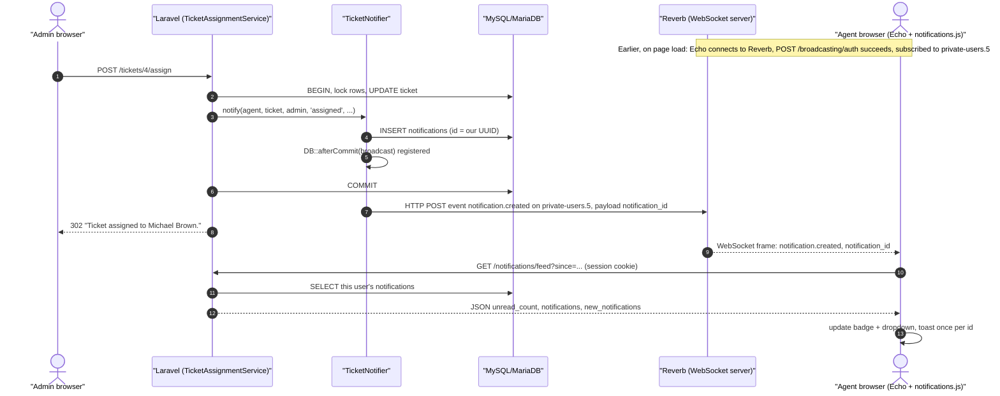

# 21 — Real-Time Notifications with Laravel Reverb and Echo

V1 showed new notifications by **polling** every 5 seconds. V2 adds **true real-time delivery** with Laravel
Broadcasting, **Laravel Reverb** (a WebSocket server written in PHP) and **Laravel Echo** (the browser client),
while keeping polling as a **fallback**. The database stays the only durable source of truth.

Everything here is **implemented**. The verification section at the end copies the real results from
`DEVELOPMENT_PROGRESS.md` — including what was **not** verified (a visual check in a real browser).

Files covered:

| File | Role |
|---|---|
| `app/Services/TicketNotifier.php` | Inserts the notification row, then broadcasts **after commit** (`broadcast()`, `afterCommit()`) |
| `app/Events/UserNotificationCreated.php` | The one broadcast event (`ShouldBroadcastNow`, payload = `notification_id` only) |
| `routes/channels.php` | Authorization for the private channel `users.{userId}` |
| `bootstrap/app.php` | `channels: __DIR__ . '/../routes/channels.php'` registers `/broadcasting/auth` |
| `config/broadcasting.php` | `reverb` connection, client timeouts 2 s / 3 s |
| `config/reverb.php` | Reverb server settings (host, port, `allowed_origins`, scaling) |
| `resources/js/realtime.js` | Echo + pusher-js: connect, subscribe, emit browser events |
| `vite.config.js`, `package.json` | Build only `realtime.js` into `public/build` |
| `public/js/notifications.js` | Feed fetch, badge, dropdown, toasts, fallback polling, dedupe |
| `resources/views/layouts/app.blade.php` | `<meta name="user-id">`, `<meta name="csrf-token">`, loads both scripts |
| `app/Http/Controllers/NotificationController.php` | `feed()` — the authorized JSON used by both paths |
| `tests/Feature/RealtimeAndDeliveryTest.php` | 8 tests (channel auth, payload, after-commit, Reverb down, email delivery key) |

Related: [Notification system](13-NOTIFICATION-SYSTEM-GUIDE.md), [Queue and email](14-QUEUE-AND-EMAIL-GUIDE.md),
[Concurrency](20-CONCURRENCY-AND-DATA-INTEGRITY.md), [System design](10-SYSTEM-DESIGN-GUIDE.md).

---

## 1. Polling vs long polling vs SSE vs WebSockets

| | Short polling (V1, now fallback) | Long polling | Server-Sent Events (SSE) | WebSockets (V2) |
|---|---|---|---|---|
| How it works | Browser asks every N seconds | Browser asks; server holds the request open until there is news (or a timeout), then the browser asks again | One long HTTP response; the server keeps writing events into it | One persistent TCP connection, upgraded from HTTP; both sides can send messages any time |
| Direction | Browser → server | Browser → server (answer delayed) | Server → browser only | Both directions |
| Latency | Up to the interval (5 s) | Low | Low | Very low (255 ms measured end-to-end, see section 10) |
| Cost | Many requests, mostly "nothing new" | One PHP worker blocked per waiting user | One open PHP response per user (PHP-FPM workers get busy) | One connection per tab held by a separate, event-driven server (Reverb), not by PHP-FPM |
| Laravel support | Plain controller + `fetch()` | Hand-written | Hand-written / streamed responses | First-class: Broadcasting, Reverb, Echo, private channel auth |

**Why WebSockets here?** The spec (§21) asks for true real-time, private per-user channels and no paid
provider. Laravel Reverb gives exactly that with official support: it runs on the same machine
(`php artisan reverb:start`), needs no Redis for one server, speaks the Pusher protocol (so the standard
`pusher-js` + Echo client works), and Laravel already handles private channel authorization. SSE or long polling
would keep PHP-FPM workers busy for every open tab, which PHP is not good at.

> **বাংলায় (WebSocket):** সাধারণ HTTP-তে browser প্রশ্ন করে, server উত্তর দেয়, তারপর connection শেষ। WebSocket-এ
> browser আর server-এর মধ্যে একটা connection খোলা থাকে, ফলে server যখন খুশি browser-কে খবর পাঠাতে পারে — browser-কে
> বারবার জিজ্ঞেস করতে হয় না। তাই notification প্রায় সাথে সাথেই (এখানে ~255 ms) পৌঁছায়।

---

## 2. The complete flow



### 2.1 Step 1 — the notification row (inside the transaction)

```php
// TicketNotifier::notify()
$notification = new TicketNotification($ticket, $eventType, $title, $message);
// We choose the UUID ourselves so we know which notifications.id row was created
// (Laravel keeps an id that is already set).
$notification->id = (string) Str::uuid();
$recipient->notify($notification);

$recipientId = $recipient->id;
$notificationId = $notification->id;
$this->afterCommit(function () use ($recipientId, $notificationId) {
    $this->broadcast($recipientId, $notificationId);
});
```

```sql
INSERT INTO notifications (id, type, notifiable_type, notifiable_id, data, read_at, created_at, updated_at)
VALUES ('9f2c…', 'App\\Notifications\\TicketNotification', 'App\\Models\\User', 5, '{"ticket_id":4,...}', NULL, NOW(), NOW());
```

The row is durable before anything is sent. If Reverb, the network or the browser fail, the notification still
exists and appears on the next feed fetch.

### 2.2 Step 2 — broadcast only after COMMIT

`afterCommit()` wraps `DB::afterCommit()`: the closure runs after the outermost transaction commits and is thrown
away on rollback. During an assignment, the closure is additionally **held** until the global assignment cache
lock is released (`holdSideEffects()` / `releaseSideEffects()`), so no network call happens while other admins
wait for that lock (details in [guide 20](20-CONCURRENCY-AND-DATA-INTEGRITY.md), section 5.5).

Why after commit? If we broadcast before COMMIT, the browser could fetch the feed **before** the row is visible
to other connections (no toast), or receive a signal for a notification that is then rolled back.
Test: `test_no_broadcast_and_no_email_when_the_transaction_rolls_back`.

### 2.3 Step 3 — the event

```php
class UserNotificationCreated implements ShouldBroadcastNow
{
    use Dispatchable;

    public function __construct(
        public int $userId,
        public string $notificationId,
    ) {}

    public function broadcastOn(): array
    {
        return [new PrivateChannel('users.' . $this->userId)];
    }

    /** Event name the browser listens for: .notification.created */
    public function broadcastAs(): string
    {
        return 'notification.created';
    }

    public function broadcastWith(): array
    {
        return ['notification_id' => $this->notificationId];
    }
}
```

| Part | Why |
|---|---|
| `ShouldBroadcastNow` | Sent **immediately** in the current PHP process (an HTTP call to Reverb), not through the queue. A queued broadcast (`ShouldBroadcast`) would only arrive when a queue worker runs; in-app real time should not depend on the worker. |
| `PrivateChannel('users.5')` | On the wire the channel is called `private-users.5`. Private channels require authorization (step 5). |
| `broadcastAs()` | A short custom name. Echo must listen with a leading dot: `.notification.created`. |
| `broadcastWith()` | Payload = **only the notification id**. No subject, description or internal note travels over the WebSocket. Test: `test_assignment_broadcasts_only_the_notification_id_to_the_agent` (the ticket subject "Secret salary data issue" is not in the payload). |

`TicketNotifier::broadcast()` wraps `event(new UserNotificationCreated(...))` in `try/catch`. A failure is
logged as a **warning** (`Real-time broadcast failed; polling fallback will deliver the notification`) and
never fails the request.

### 2.4 Step 4 — Reverb

The `reverb` broadcaster sends the event to the Reverb server with an HTTP request (Pusher HTTP API, signed with
`REVERB_APP_SECRET`). Reverb pushes it to every WebSocket connection subscribed to `private-users.5`.

```php
// config/broadcasting.php -> connections.reverb.client_options
'connect_timeout' => 2,
'timeout' => 3,
```

If Reverb is stopped, the HTTP call fails after at most ~2 s (connect) / 3 s (response) instead of the default
long Guzzle timeout, so a ticket action stays fast even when real time is down.

### 2.5 Step 5 — private channel authorization

Before the browser may subscribe, Echo sends `POST /broadcasting/auth` with `socket_id` and
`channel_name=private-users.5`, plus the session cookie and the `X-CSRF-TOKEN` header (read from
`<meta name="csrf-token">`). Laravel runs the channel callback:

```php
// routes/channels.php
Broadcast::channel('users.{userId}', function (User $user, $userId) {
    return $user->id === (int) $userId && $user->is_active;
});
```

- `true` → Laravel returns a signed `auth` string; Reverb accepts the subscription.
- `false` or not logged in → **HTTP 403**; the subscription is refused.
- Tests: `test_user_can_subscribe_only_to_their_own_private_channel` (own channel 200 with `auth`, other user's
  channel 403) and `test_guest_cannot_authorize_a_private_channel`.

### 2.6 Step 6 — `resources/js/realtime.js` (browser)

```js
const echo = new Echo({
    broadcaster: 'reverb',
    key: import.meta.env.VITE_REVERB_APP_KEY,
    wsHost: import.meta.env.VITE_REVERB_HOST,
    wsPort: import.meta.env.VITE_REVERB_PORT ?? 80,
    wssPort: import.meta.env.VITE_REVERB_PORT ?? 443,
    forceTLS: (import.meta.env.VITE_REVERB_SCHEME ?? 'https') === 'https',
    enabledTransports: ['ws', 'wss'],
});

echo.connector.pusher.connection.bind('state_change', function (states) {
    connected = states.current === 'connected';
    if (!connected) {
        subscribed = false; // the channel is re-subscribed automatically after reconnecting
    }
    reportHealth();
});

echo.private('users.' + userIdMeta.content)
    .subscribed(function () { subscribed = true; reportHealth(); })
    .error(function (error) { subscribed = false; reportHealth(); /* e.g. 403 -> stay on polling */ })
    .listen('.notification.created', function (payload) {
        announce('resolvedesk:realtime-notification', payload);
    });
```

`realtime.js` does **no rendering**. It only translates WebSocket happenings into two browser events:

| Browser event | When | `detail` |
|---|---|---|
| `resolvedesk:realtime-status` | Connection state or subscription changed | `{healthy: true}` only when **connected and subscribed** |
| `resolvedesk:realtime-notification` | Server broadcast `.notification.created` | `{notification_id: "…"}` |

`import.meta.env.VITE_REVERB_*` values are **baked into the bundle at build time** by Vite. After changing them
in `.env`, run `npm run build` again.

### 2.7 Step 7 — `public/js/notifications.js` reacts

```js
window.addEventListener('resolvedesk:realtime-notification', function () {
    poll();   // the broadcast only carries an id: fetch the authorized data now
});
```

`poll()` calls `GET /notifications/feed?since=<last server_time>`. The feed applies the normal rules (only
**your** rows, from `$request->user()->notifications()`), so the browser never learns anything the user may not
see. The response updates the badge and dropdown, and `showToasts()` shows a Bootstrap toast for each id not yet
in `shownToastIds`. The page is never reloaded.

---

## 3. Fallback polling — when it stops and resumes

```js
function scheduleNextPoll() {
    clearTimeout(timerId); // guarantees only one polling loop exists
    if (isStopped || realtimeHealthy) {
        return; // WebSocket is healthy: no continuous polling needed
    }
    const delay = document.hidden ? HIDDEN_POLL_INTERVAL_MS : POLL_INTERVAL_MS;
    timerId = setTimeout(poll, delay);
}

window.addEventListener('resolvedesk:realtime-status', function (event) {
    const wasHealthy = realtimeHealthy;
    realtimeHealthy = event.detail.healthy === true;

    if (realtimeHealthy && !wasHealthy) {
        poll(); // (re)connected: synchronize anything missed while disconnected
    } else if (!realtimeHealthy && wasHealthy) {
        scheduleNextPoll(); // WebSocket lost: resume fallback polling
    }
});
```

| Situation | Behaviour |
|---|---|
| Page load | `poll()` runs once immediately (loads badge/dropdown, marks existing ids as known). Polling continues every 5 s (30 s in a hidden tab) **until** the socket becomes healthy. |
| Connected + subscribed | `realtimeHealthy = true` → one sync `poll()`, then **no continuous polling**. Only broadcasts and tab-visibility changes trigger fetches. |
| Connection lost (Reverb stopped, Wi-Fi drop) | pusher-js reports a non-`connected` state → `healthy: false` → polling resumes every 5 s. Echo keeps retrying the connection in the background. |
| Reconnected | `healthy: true` again → **sync fetch** (catches events missed while offline) → polling stops. |
| `/broadcasting/auth` returns 403 | `.error()` → `healthy: false` → stays on polling; console shows a warning. |
| Assets not built (`public/build/manifest.json` missing) | The layout does not load `realtime.js` at all → no status event → `realtimeHealthy` stays `false` → V1 polling behaviour. |
| Session expired (401/419) | `handleExpiredSession()` stops everything and shows "Sign in again". |
| Tab becomes visible again | Immediate `poll()` (also when healthy). |

```blade
{{-- layouts/app.blade.php --}}
@if (file_exists(public_path('build/manifest.json')) || file_exists(public_path('hot')))
    @vite('resources/js/realtime.js')
@endif
```

Missed events are never lost: the database has the rows, and every (re)connection or poll asks the database.
The feed's `?since=` filter looks back an extra 10 seconds (`SINCE_OVERLAP_SECONDS`) for late commits.

---

## 4. Duplicate protection and multiple tabs

- **Broadcast + poll for the same notification:** both end in `showToasts()`, which skips ids already in
  `shownToastIds`. One toast.
- **Repeated broadcast / overlapping fetches:** `isRequestRunning` + `fetchAgain` make sure only one feed request
  runs at a time and a signal that arrives during a request triggers exactly one more fetch.
- **Multiple tabs:** each tab has its own WebSocket connection, its own `shownToastIds` and therefore shows its own
  toast. This is a documented limitation (no cross-tab coordination such as `BroadcastChannel` or a shared worker).
- **Server side:** a notification row is created once per recipient per event; the WebSocket only signals it.

> **বাংলায়:** WebSocket শুধু একটা ছোট সংকেত ("নতুন notification আছে, id এটা")। আসল data সবসময় database থেকে
> `/notifications/feed` দিয়ে আনা হয়। একই id দুইবার এলে (broadcast আর polling দুই দিক থেকে) `shownToastIds` দেখে
> দ্বিতীয়বার toast দেখানো হয় না।

---

## 5. When Reverb is down

1. The ticket operation commits normally (the notification row is saved).
2. After commit, `broadcast()` tries Reverb; the HTTP call fails within the 2 s / 3 s timeouts.
3. The exception is caught; `storage/logs/laravel.log` gets a **warning**
   `Real-time broadcast failed; polling fallback will deliver the notification` with the `user_id` and error.
4. The user sees the normal success message.
5. Open browsers had already lost their WebSocket → they are polling → the notification appears within ~5 s.

Test: `test_failed_broadcast_does_not_break_the_operation` points the broadcaster at port 1 (real connection
refusal): the assignment succeeds, the success flash is shown, and the notification row exists.

---

## 6. Setup

Always put PHP 8.4 first on PATH in each terminal (see [Setup guide](02-SETUP-GUIDE.md)).

```bash
export PATH="/c/php-8.4.28:$PATH"
php -v                      # must show 8.4.28
npm ci                      # installs laravel-echo, pusher-js, vite, laravel-vite-plugin
npm run build               # builds resources/js/realtime.js into public/build
php artisan reverb:start    # WebSocket server (keep this terminal open)
php artisan serve           # the app, in another terminal
php artisan queue:work      # emails, in another terminal (not needed for real time)
```

`.env` variable **names** (values are secret or machine-specific — never commit or print them):

| Variable | Used by |
|---|---|
| `BROADCAST_CONNECTION` | Must be `reverb` to broadcast (tests use `null` unless a test switches it) |
| `REVERB_APP_ID`, `REVERB_APP_KEY`, `REVERB_APP_SECRET` | Server credentials (the secret signs server → Reverb calls and channel auth) |
| `REVERB_HOST`, `REVERB_PORT`, `REVERB_SCHEME` | Where Laravel sends broadcasts |
| `REVERB_SERVER_HOST`, `REVERB_SERVER_PORT` (optional) | Where `reverb:start` listens (defaults `0.0.0.0` / `8080` in `config/reverb.php`) |
| `VITE_REVERB_APP_KEY`, `VITE_REVERB_HOST`, `VITE_REVERB_PORT`, `VITE_REVERB_SCHEME` | Copied into the browser bundle at `npm run build` (in `.env.example` they reference the `REVERB_*` values) |

`.env.example` contains empty placeholders for the keys. The installer (`php artisan install:broadcasting --reverb
--without-node`) did not create the keys in this project; they were generated by hand (see
`DEVELOPMENT_PROGRESS.md`). After editing `.env`: `php artisan config:clear`, restart `reverb:start`, and
re-run `npm run build` if a `VITE_` value changed.

---

## 7. Local demo with two browsers

1. Start Reverb, the app and (optionally) the queue worker as above.
2. Browser 1 (e.g. Chrome): log in as the admin `admin@resolvedesk.test`.
3. Browser 2 (e.g. Firefox or a private window — a separate cookie jar): log in as an agent, e.g.
   `michael.agent@resolvedesk.test` (password `password`, local demo data only).
4. In browser 2 open DevTools → Network → **WS**: you should see a connection to the Reverb port with
   `pusher:connection_established` and a `pusher:subscribe` for `private-users.<id>`. In the Network tab
   (Fetch/XHR) `POST /broadcasting/auth` should be **200**.
5. In browser 1 assign an Open ticket to Michael.
6. Browser 2 should receive a `notification.created` frame, then call `/notifications/feed`, and a toast appears
   without a reload.
7. Stop `reverb:start` (Ctrl+C). Browser 2 falls back to polling (`/notifications/feed` every 5 s in the Network
   tab). Assign another ticket → toast within ~5 s. Start Reverb again → one sync fetch, then polling stops.

Steps 4–7 describe the expected behaviour; the visual browser check was **not** performed during development
(section 10).

---

## 8. Debugging

| Symptom | Check |
|---|---|
| No WS connection in DevTools | Is `reverb:start` running? Was `npm run build` run (does `public/build/manifest.json` exist)? Do `VITE_REVERB_HOST/PORT/SCHEME` match where Reverb listens? Console errors? |
| WS connects, but no subscription | `POST /broadcasting/auth` in the Network tab: **403** = channel callback returned false (wrong user id in `<meta name="user-id">`, inactive user, or not logged in); **419** = CSRF token missing/expired (reload the page). |
| Subscribed, but no event arrives | Is `BROADCAST_CONNECTION=reverb`? Check `storage/logs/laravel.log` for "Real-time broadcast failed". Start Reverb with `php artisan reverb:start --debug` to see every message it receives and sends. Was the recipient the actor (self-notifications are skipped)? |
| Event arrives, no toast | Look for the `/notifications/feed` request after the frame. Toast suppressed because the id was already shown (`shownToastIds`), or it was the first load. |
| Polling never stops | The socket is not healthy (not connected or not subscribed). The console warning "Real-time channel subscription failed; using polling." points to channel auth. |
| Ticket actions became slow | Reverb unreachable and every broadcast waits for the 2 s connect timeout. Start Reverb or set `BROADCAST_CONNECTION=null` temporarily (polling still works). |
| Changed `.env` but the browser still uses old values | `VITE_` values are compiled into the bundle → `npm run build`. Server values → `php artisan config:clear` and restart Reverb. |

---

## 9. Production notes

- **TLS (`wss://`)**: serve the site over HTTPS and the WebSocket over `wss://` (a page on HTTPS may not open a
  plain `ws://` connection). Set `REVERB_SCHEME=https` / `VITE_REVERB_SCHEME=https` and the public host/port.
- **Reverse proxy**: usually Reverb listens on `127.0.0.1:8080` and Nginx terminates TLS and forwards the
  WebSocket upgrade (`Upgrade` / `Connection` headers) to it. Keep `reverb:start` running with a process manager
  (e.g. Supervisor) and restart it on deploy (`php artisan reverb:restart`).
- **Allowed origins**: `config/reverb.php` currently has `'allowed_origins' => ['*']` (fine for local
  development). In production set it to the application's own domain so other websites cannot open connections
  with your app key. (Private channel data is still protected by `/broadcasting/auth`.)
- **Scaling**: one Reverb server, no Redis. Several Reverb servers would need `REVERB_SCALING_ENABLED` with Redis
  pub/sub (*future*, not implemented).
- **Open file limits**: each browser tab is one open connection; large deployments must raise the OS limit.
- **Linux/Nginx deployment was not verified** in this project.

---

## 10. What was verified (from `DEVELOPMENT_PROGRESS.md`)

- `php artisan test` → **170 passed (682 assertions)** (2026-11-26 audit) on MariaDB 10.4, including the 8 tests in
  `RealtimeAndDeliveryTest`.
- **Live real-time end-to-end check:** Reverb running, app served by `php -S` on an isolated DB copy, a Node +
  pusher-js client logged in as an agent through real HTTP:
  - subscribing to **another user's** channel was refused (AuthError);
  - the agent's **own** channel subscribed;
  - an admin assignment over HTTP → `notification.created` received after **255 ms**;
  - payload keys = **`notification_id` only**;
  - the authorized feed contained that id.
- **Reverb down:** `test_failed_broadcast_does_not_break_the_operation` (real connection refusal) → assignment
  succeeds, notification persisted.
- The browser **polling fallback logic** itself was verified **only by code review**.
- **NOT verified:** a visual check in a real browser (no browser automation), toast rendering via WebSocket in a
  browser, Linux/Nginx/`wss://` deployment, MySQL 8.

## 11. Known limitations

- Single Reverb server, no horizontal scaling.
- Several open tabs each keep a WebSocket and each show the toast.
- `ShouldBroadcastNow` makes the HTTP call to Reverb inside the web request (after commit); when Reverb is down
  this adds up to the 2–3 s client timeout to that request.
- `allowed_origins` is `*` until changed for production.

## 12. Practice modifications

1. Send a lighter signal for "mark all as read" in another tab: create a second event class on the same private
   channel and listen for it in `realtime.js` (then update the badge in `notifications.js`).
2. Change the fallback interval: `POLL_INTERVAL_MS` in `public/js/notifications.js` (no build needed — it is a
   plain file).
3. Queue the broadcast instead of sending it now: change `ShouldBroadcastNow` to `ShouldBroadcast` and explain the
   trade-off (needs a running worker; request no longer waits for Reverb).
4. Restrict the channel to staff only: add `&& $user->isStaff()` in `routes/channels.php` and update the tests.

## 13. Interview quick answers

- **Why not send the ticket data over the WebSocket?** Least privilege: the payload is only an id; the browser
  fetches details through the normal authorized endpoint, so channel mistakes cannot leak ticket content.
- **What if Reverb is down?** The request still succeeds, a warning is logged, and browsers fall back to polling.
  The database row is the source of truth.
- **How do you prevent listening to someone else's channel?** Private channel `users.{id}` + `routes/channels.php`
  checks `$user->id === (int) $userId && $user->is_active`; otherwise `/broadcasting/auth` returns 403.
- **Why broadcast after commit?** So the browser never fetches before the row is visible and never hears about a
  rolled-back change.
