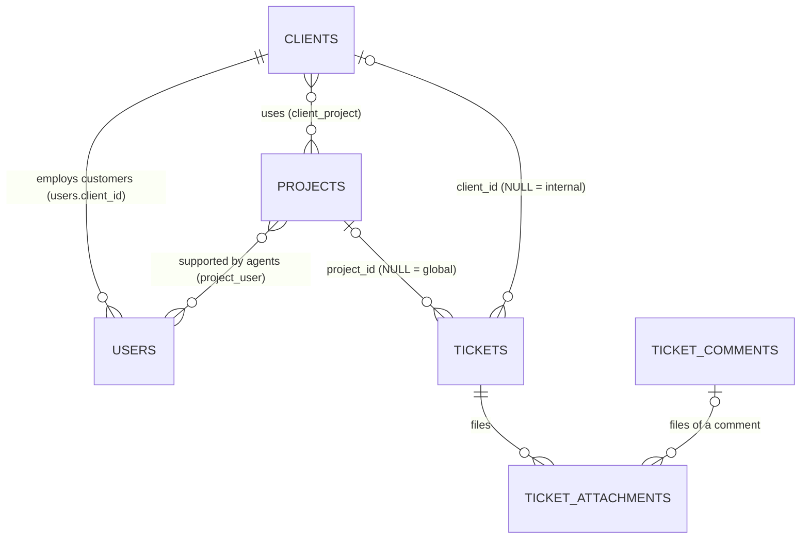
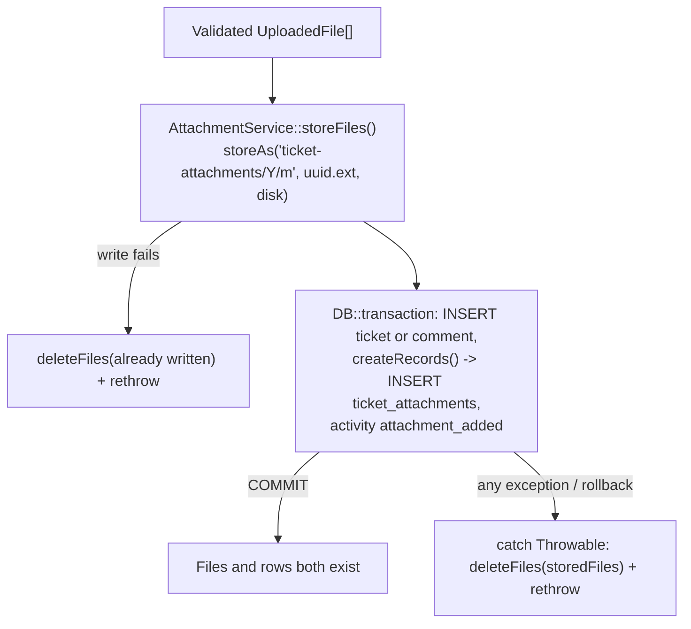
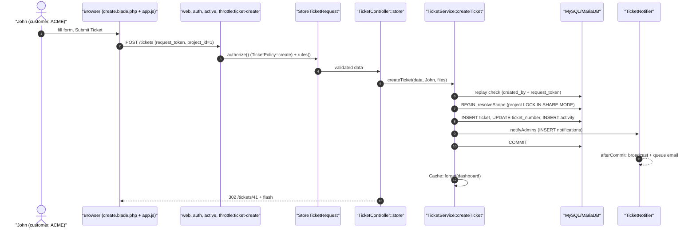
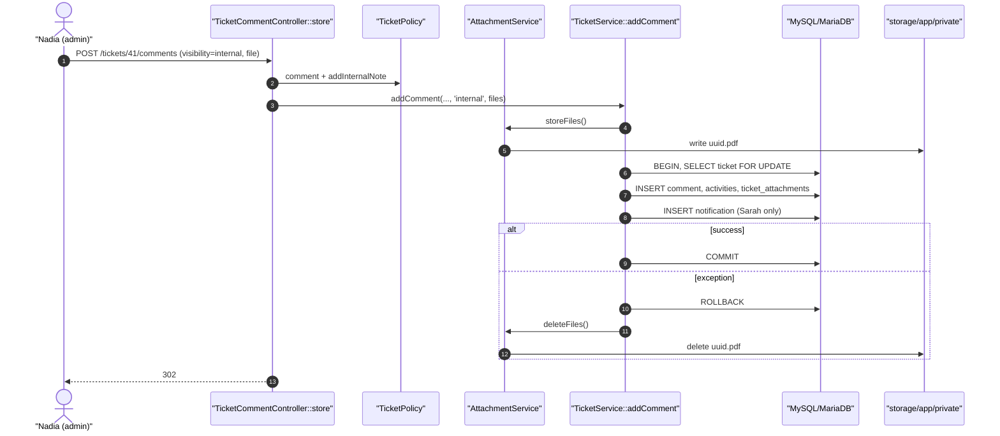
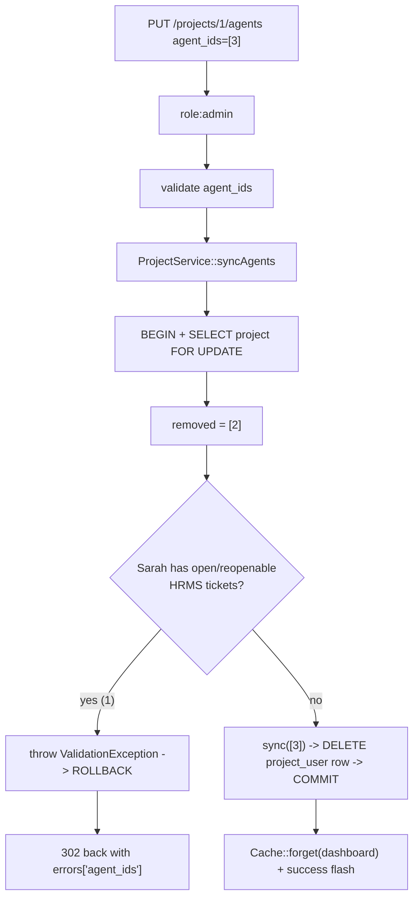
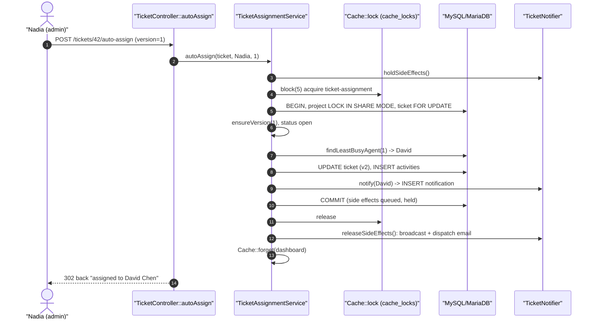
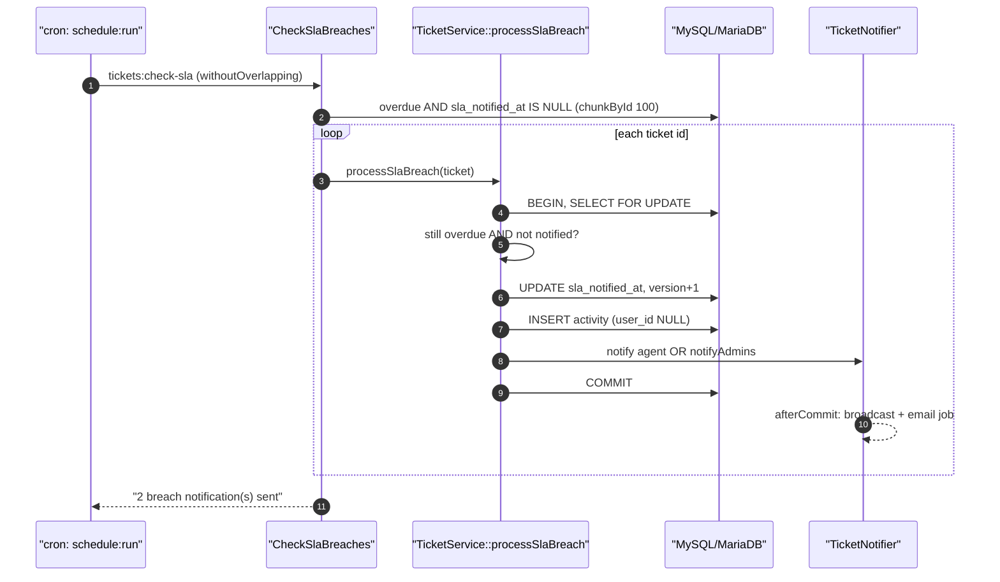
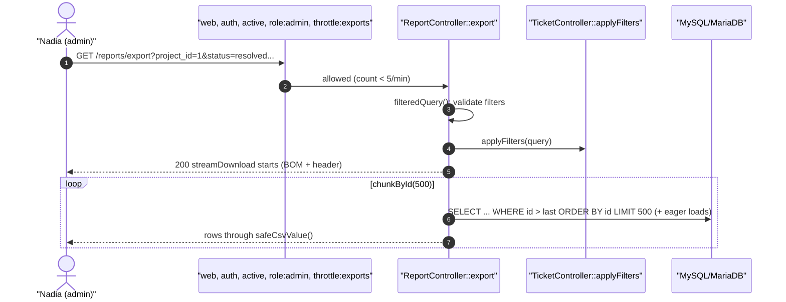

# 22 — V2 Business Features (Multi-Project Customer Support)

This guide explains the business features added by the V2 upgrade (`V2_MASTER_PROMPT.md` §5-17, §23-26):
projects, client organizations, ticket scope, project-aware assignment, internal notes, secure attachments,
SLA breach processing, the extended dashboards, and reports with CSV export.

Everything here is taken from the real code. When a line of code is quoted, it is copied from the file named
above it. The six most important operations are explained with the full **30-question format** of
`V2_MASTER_PROMPT.md` §36 in [section 15](#15-thirty-question-walkthroughs).

Related: [Database guide](03-DATABASE-GUIDE.md) · [Module-wise code](05-MODULE-WISE-CODE-EXPLANATION.md) ·
[Business logic](06-BUSINESS-LOGIC-GUIDE.md) · [UI to backend](07-UI-TO-BACKEND-MAPPING.md) ·
[Notifications](13-NOTIFICATION-SYSTEM-GUIDE.md) · [Queue and email](14-QUEUE-AND-EMAIL-GUIDE.md) ·
[Caching](15-CACHING-GUIDE.md)

Verification status: the full suite `php artisan test` passed with **164 tests / 661 assertions** (MariaDB 10.4,
database `resolvedesk_testing`). Not verified: a visual check in a real browser, Gmail SMTP, MySQL 8 (only
MariaDB 10.4 was available). See `DEVELOPMENT_PROGRESS.md`.

---

## Table of contents

0. [Sample data used in this guide](#0-sample-data-used-in-this-guide)
1. [The big picture](#1-the-big-picture)
2. [Projects and clients (CRUD, activation, no delete)](#2-projects-and-clients-crud-activation-no-delete)
3. [Customer to client mapping rules](#3-customer-to-client-mapping-rules)
4. [Project associations: clients and agents](#4-project-associations-clients-and-agents)
5. [Ticket scope: global/project x internal/client](#5-ticket-scope-globalproject-x-internalclient)
6. [Role-specific creation rules (`resolveScope`)](#6-role-specific-creation-rules-resolvescope)
7. [Dependent dropdown (project options)](#7-dependent-dropdown-project-options)
8. [Assignment eligibility and least-workload auto-assign](#8-assignment-eligibility-and-least-workload-auto-assign)
9. [Internal notes](#9-internal-notes)
10. [Secure attachments](#10-secure-attachments)
11. [SLA: remaining time, outcome, breach reminders](#11-sla-remaining-time-outcome-breach-reminders)
12. [Dashboards](#12-dashboards)
13. [Reports and CSV export](#13-reports-and-csv-export)
14. [Migration and rollback implications](#14-migration-and-rollback-implications)
15. [Thirty-question walkthroughs](#15-thirty-question-walkthroughs)
16. [Debugging and modification cheat sheet](#16-debugging-and-modification-cheat-sheet)

---

## 0. Sample data used in this guide

The examples use the demo data from `database/seeders/DatabaseSeeder.php` + `V2DemoDataSeeder.php`
(fresh install, `php artisan migrate --seed` on an EMPTY database only). Ids can differ on your machine; the
shape is what matters.

| Users | Role | Client | Projects supported (agents) |
|---|---|---|---|
| 1 Nadia Rahman | admin | — | — |
| 2 Sarah Ahmed | agent | — | HRMS, PAYROLL |
| 3 David Chen | agent | — | ERP, HRMS |
| 4 Fatima Khan | agent | — | PAYROLL, ACCT |
| 5 Michael Brown | agent | — | ERP, INV |
| 6 John Carter | customer | ACME | — |
| 7 Emily Watson | customer | ACME | — |
| 8 Rahim Uddin | customer | GLOBEX | — |
| 9 Olivia Martin | customer | none (standalone) | — |

| Projects | Active | Clients using it |
|---|---|---|
| 1 HRMS - Human Resource Management System | yes | ACME, GLOBEX, BRIGHT |
| 2 ERP - Enterprise Resource Planning | yes | GLOBEX |
| 3 PAYROLL - Payroll Management System | yes | ACME |
| 4 ACCT - Accounting System | yes | — |
| 5 INV - Inventory Management System | **no** | GLOBEX |

Clients: 1 ACME (Acme Trading Ltd.), 2 GLOBEX (Globex Pharmaceuticals), 3 BRIGHT (Bright Garments,
**inactive**).

> **Important for the existing development database:** `V2DemoDataSeeder` was run there only to ADD projects,
> clients and associations. No existing customer was linked to a client and all 34 existing tickets stayed
> global (see [section 14](#14-migration-and-rollback-implications)).

---

## 1. The big picture

Before V2 a ticket only had a creator, an optional agent and a category. V2 answers two new questions:

1. **Which product is this about?** → `tickets.project_id` (NULL = global, not about one product).
2. **Which customer organization is this for?** → `tickets.client_id` (NULL = internal, no client).



What did **not** change (important interview point):

- **Ticket visibility is the same as V1.** Admin sees all tickets; agents and customers see tickets they created
  or are assigned to (`Ticket::scopeVisibleTo()`, `TicketPolicy::view()`).
- **Project membership only decides assignment eligibility.** An HRMS agent cannot open every HRMS ticket
  (`TicketScopeTest::test_project_membership_does_not_grant_access_to_project_tickets`).

> **বাংলায়:** V2-তে টিকিটের সাথে দুটো নতুন তথ্য যুক্ত হয়েছে — কোন প্রোডাক্ট (project) আর কোন ক্লায়েন্ট কোম্পানি
> (client)। কিন্তু কে টিকিট দেখতে পারবে সেই নিয়ম বদলায়নি। কোনো agent কোনো project-এর সদস্য হলে সে শুধু ওই
> project-এর টিকিট পাওয়ার যোগ্য হয় (assign করা যায়), সব টিকিট দেখার অনুমতি পায় না।

---

## 2. Projects and clients (CRUD, activation, no delete)

| | Projects | Clients |
|---|---|---|
| Model | `app/Models/Project.php` | `app/Models/Client.php` |
| Controller | `app/Http/Controllers/ProjectController.php` | `app/Http/Controllers/ClientController.php` |
| Views | `resources/views/projects/{index,create,edit,show,_form}.blade.php` | `resources/views/clients/{index,create,edit,show,_form}.blade.php` |
| Routes | `Route::resource('projects', ProjectController::class)->except(['destroy'])` | `Route::resource('clients', ClientController::class)->except(['destroy'])` |
| Who | admin only (`role:admin` group in `routes/web.php`) | admin only |
| Unique | `projects.code` (`Rule::unique('projects', 'code')->ignore($project?->id)`) | `clients.code` |
| Search | name or code | name, code or email |
| Filter | `status=active|inactive` | `status=active|inactive` |
| Details page | SLA statistics, client checklist, agent checklist, latest tickets | SLA statistics, projects (read-only), customers, tickets |

Both controllers store the code in upper case (`$validated['code'] = strtoupper($validated['code']);`) and read
the checkbox with `$request->boolean('is_active')` (an unchecked checkbox is not sent at all).

**List page with counts** (`ProjectController::index()`):

```php
// withCount(): one sub-query per count instead of loading the related rows.
$query = Project::withCount(['clients', 'agents', 'tickets']);
```

```sql
SELECT projects.*,
  (SELECT COUNT(*) FROM clients INNER JOIN client_project ON clients.id = client_project.client_id
     WHERE projects.id = client_project.project_id) AS clients_count,
  (SELECT COUNT(*) FROM users INNER JOIN project_user ON users.id = project_user.user_id
     WHERE projects.id = project_user.project_id) AS agents_count,
  (SELECT COUNT(*) FROM tickets WHERE projects.id = tickets.project_id) AS tickets_count
FROM projects ORDER BY name ASC LIMIT 15 OFFSET 0;
```

**Activation instead of deletion.** There is no `destroy` route. Why:

- Tickets reference projects and clients with `restrictOnDelete()` foreign keys, so the database would refuse
  the DELETE anyway (error 1451).
- Historical reports must still show "HRMS" for old tickets.
- Deactivating is always allowed (`ProjectController::update()` has no extra check):

```php
// Deactivating is always allowed: existing tickets stay viewable and resolvable,
// the project only disappears from NEW ticket forms.
$project->update($validated);
$this->clearCaches();
```

| Effect of `is_active = 0` | Project | Client |
|---|---|---|
| New tickets | Not selectable (`Project::active()` in `TicketController::selectableProjects()`, re-checked in `resolveScope()`) | Customers of the client cannot create tickets (`TicketPolicy::create()`); admins cannot choose it (`resolveScope()`) |
| Existing tickets | Still viewable, assignable, resolvable, closable | Same |
| New associations | — | Cannot be newly added to a project (`ProjectService::syncClients()` rule 1) |
| Already associated | Still shown (checked) in the checklist with an "Inactive" badge so saving does not remove it by accident | Same |

`TicketPolicy::create()`:

```php
public function create(User $user): bool
{
    if ($user->isCustomer() && $user->client_id !== null) {
        return (bool) $user->client?->is_active;
    }

    return true;
}
```

Cache: both controllers call `Cache::forget(TicketService::DASHBOARD_CACHE_KEY)` after store/update, because the
admin dashboard shows "Active projects" and "Active clients".

---

## 3. Customer to client mapping rules

`users.client_id` (nullable FK → `clients.id`). Rules (`V2_MASTER_PROMPT.md` §7):

| Rule | Where |
|---|---|
| Only customers can have a client. Admins/agents always get NULL. | `UserController::store()` / `update()`: `$validated['role'] === User::ROLE_CUSTOMER ? ... : null` |
| A NEW link needs an ACTIVE client. | `store()`: `Rule::exists('clients', 'id')->where('is_active', true)`; `update()`: `ensureClientChangeIsAllowed()` |
| Keeping the current (now inactive) client is allowed. | `ensureClientChangeIsAllowed()` returns early when nothing changed |
| A customer who created client tickets cannot change organization (or stop being a customer). | `ensureClientChangeIsAllowed()` |
| `client_id` is not mass assignable. | `User::$fillable` does not contain it; the controller sets `$user->client_id` explicitly |
| Standalone customers (NULL) may create **global** tickets only. | `TicketService::resolveScope()` |

```php
// app/Http/Controllers/UserController.php
private function ensureClientChangeIsAllowed(User $user, ?int $newClientId): void
{
    if ($user->client_id === $newClientId) {
        return;
    }

    if ($newClientId !== null && ! Client::whereKey($newClientId)->where('is_active', true)->exists()) {
        throw ValidationException::withMessages([
            'client_id' => 'Please choose an active client organization.',
        ]);
    }

    $clientTicketCount = Ticket::where('created_by', $user->id)->whereNotNull('client_id')->count();

    if ($clientTicketCount > 0) {
        throw ValidationException::withMessages([
            'client_id' => "This customer already created {$clientTicketCount} ticket(s) for their organization, "
                . 'so the organization (and the customer role) cannot be changed. Create a new user account instead.',
        ]);
    }
}
```

Why block the change? A ticket's `client_id` is copied from the customer **at creation** and never changes.
If John (ACME) moved to GLOBEX, he would still see his old ACME tickets (he is their creator), so a GLOBEX
employee would see ACME data — cross-client leakage. Ticket ownership is never transferred silently.

Equivalent SQL of the guard: `SELECT COUNT(*) FROM tickets WHERE created_by = 6 AND client_id IS NOT NULL;`

> **বাংলায়:** কোনো customer তার কোম্পানির নামে টিকিট খুলে ফেললে তার কোম্পানি আর বদলানো যায় না, কারণ পুরোনো
> টিকিটগুলো আগের কোম্পানির — কোম্পানি বদলালে সে অন্য কোম্পানির ডেটা দেখতে থাকবে। তখন নতুন account বানাতে হবে।

Future extension (documented, NOT implemented): a "customer manager" who sees all tickets of the client would
need a new role/flag and a `scopeVisibleTo()` branch `orWhere('client_id', $user->client_id)`.

---

## 4. Project associations: clients and agents

Two pivot tables (many-to-many):

| Pivot | Meaning | Eloquent |
|---|---|---|
| `client_project` | which client uses which project | `Project::clients()`, `Client::projects()` (`belongsToMany(...)->withTimestamps()`) |
| `project_user` | which agent supports which project | `Project::agents()`, `User::projects()` |

Both associations are edited **only on the project details page** (`resources/views/projects/show.blade.php`),
with two checkbox forms:

| Form | Route | Controller | Service |
|---|---|---|---|
| "Save clients" | PUT `/projects/{project}/clients` · `projects.clients.update` | `ProjectController::updateClients()` | `ProjectService::syncClients()` |
| "Save agents" | PUT `/projects/{project}/agents` · `projects.agents.update` | `ProjectController::updateAgents()` | `ProjectService::syncAgents()` |

The form sends the **complete wanted list** (`agent_ids[]`). Unchecking every box sends nothing, which the
controller turns into an empty array (`$validated['agent_ids'] ?? []`) = remove all.

### 4.1 The rules (`app/Services/ProjectService.php`)

1. Newly added clients/agents must be **active** (agents must also have role `agent`).
2. A removal is **blocked** while tickets that depend on it are unresolved or reopenable
   (`Ticket::OPEN_OR_REOPENABLE_STATUSES` = open, assigned, in_progress, resolved).
   - Agent: tickets of this project **assigned to that agent**.
   - Client: tickets of this project **for that client**.
3. Closed tickets never block anything; their history stays intact.

```php
// app/Services/ProjectService.php - syncAgents()
$result = DB::transaction(function () use ($project, $agentIds) {
    $lockedProject = Project::whereKey($project->id)->lockForUpdate()->firstOrFail();

    $currentIds = $lockedProject->agents()->pluck('users.id')->all();
    $addedIds = array_values(array_diff($agentIds, $currentIds));
    $removedIds = array_values(array_diff($currentIds, $agentIds));
    ...
    foreach ($removedIds as $agentId) {
        $dependentTickets = Ticket::where('project_id', $lockedProject->id)
            ->where('assigned_to', $agentId)
            ->whereIn('status', Ticket::OPEN_OR_REOPENABLE_STATUSES)
            ->count();
        ...
    }

    // sync() inserts the missing pivot rows and deletes the removed ones.
    $lockedProject->agents()->sync($agentIds);

    return ['added' => count($addedIds), 'removed' => count($removedIds)];
}, 3);
```

- `array_diff($new, $current)` = added ids; `array_diff($current, $new)` = removed ids.
- `sync($ids)` makes the pivot table match the array exactly: `DELETE FROM project_user WHERE project_id = ? AND
  user_id IN (...)` for removed ids and `INSERT INTO project_user (project_id, user_id, created_at, updated_at)
  ...` for added ids (timestamps because of `withTimestamps()`).
- `DB::transaction(..., 3)`: the `3` retries the whole closure if MySQL reports a deadlock.

### 4.2 Locking and the concurrency limitation

The check ("no dependent tickets") and the change (`sync`) must be atomic. Otherwise:
admin A removes Sarah from HRMS while admin B assigns an HRMS ticket to Sarah at the same moment → Sarah ends up
assigned but not a member. The protection is a **lock on the project row**:

| Operation | Lock on `projects` row | Code |
|---|---|---|
| Change associations | exclusive `SELECT ... FOR UPDATE` | `ProjectService::syncAgents()` / `syncClients()` |
| Create a project ticket | shared `SELECT ... LOCK IN SHARE MODE` | `TicketService::resolveScope()` (`sharedLock()`) |
| Assign / auto-assign a project ticket | shared lock, then ticket `FOR UPDATE` | `TicketAssignmentService::lockProjectAndTicket()` |

A shared lock lets many ticket creations/assignments run together, but blocks the exclusive lock (and the
exclusive lock blocks them). So "remove agent" waits until a running assignment commits, then sees the new
assignment and refuses; or the assignment waits until the removal commits, then `canBeAssignedTo()` reads the
new pivot data and refuses.

Lock order everywhere: (assignment cache lock →) project row → ticket row. One consistent order prevents
deadlocks between these operations.

Documented limitations:

- Only operations that go through these services are protected. A manual SQL change bypasses it.
- `UserController::toggleActive()` (deactivate agent) does not lock; it relies on its own count check.
- The lock covers one project. There is no cross-project invariant that needs more.

> **বাংলায়:** একই সময়ে একজন admin Sarah-কে HRMS থেকে সরাচ্ছেন আর আরেকজন Sarah-কে HRMS-এর টিকিট দিচ্ছেন — এমন
> race condition আটকাতে project-এর row-তে lock নেওয়া হয়। সরানোর সময় exclusive lock (FOR UPDATE), টিকিট
> তৈরি/assign-এর সময় shared lock। দুটো একসাথে চলতে পারে না, তাই নিয়ম ভাঙে না।

---

## 5. Ticket scope: global/project x internal/client

| `project_id` | `client_id` | Meaning | Example | Who can create |
|---|---|---|---|---|
| 1 (HRMS) | 1 (ACME) | Project + client | "ACME: leave balance wrong in HRMS" | customer of ACME, admin |
| 1 (HRMS) | NULL | Project, internal | "HRMS: nightly backup failed" | agent supporting HRMS, admin |
| NULL | 1 (ACME) | Global, client | "ACME: please add a new user account" | customer of ACME, admin |
| NULL | NULL | Global, internal | "Office VPN is down" / standalone customer ticket | anyone (standalone customers only this) |

Note: a ticket created by a **standalone customer** (Olivia) has `project_id = NULL` and `client_id = NULL`. It is
a customer ticket, but "internal" here only means "no client organization" in the data model.

**Global does not mean public.** A global ticket is simply not tied to a product. Visibility is unchanged
(`TicketPolicy::view()`: admin, creator, assigned agent). `Ticket::isGlobal()`:

```php
/** "Global" = not tied to a project. It does NOT mean public. */
public function isGlobal(): bool
{
    return $this->project_id === null;
}
```

There is no `is_global` column on purpose (`V2_MASTER_PROMPT.md` §11): it would duplicate `project_id IS NULL`
and could become inconsistent.

**Scope is immutable.** `project_id` / `client_id` are not in `Ticket::$fillable`, the edit form has no scope
fields, and `TicketService::updateTicket()` only changes subject, description, category and priority.

Filters on the ticket list (`TicketController::applyFilters()`): `project_id=global` → `whereNull('project_id')`;
`client_id=internal` → `whereNull('client_id')` (client filter admin-only).

> **বাংলায়:** "Global" মানে টিকিটটা কোনো নির্দিষ্ট প্রোডাক্টের নয় — "public" নয়। Global টিকিটও শুধু admin, যে
> খুলেছে আর যাকে assign করা হয়েছে তারাই দেখতে পারে।

---

## 6. Role-specific creation rules (`resolveScope`)

Two layers:

1. `app/Http/Requests/StoreTicketRequest.php` — **format** only (`project_id` nullable integer
   `exists:projects,id`, `client_id` nullable integer `exists:clients,id`, `request_token` required uuid,
   attachment rules). `authorize()` = `$this->user()->can('create', Ticket::class)`.
2. `TicketService::resolveScope()` — **business** rules, inside the creation transaction, with a shared lock on
   the project row.

```php
// app/Services/TicketService.php
private function resolveScope(User $creator, $projectId, $clientId): array
{
    $projectId = $projectId ? (int) $projectId : null;
    $clientId = $clientId ? (int) $clientId : null;

    if ($creator->isCustomer()) {
        $clientId = $creator->client_id;

        if ($clientId !== null && ! Client::whereKey($clientId)->where('is_active', true)->exists()) {
            throw ValidationException::withMessages([
                'project_id' => 'Your organization is inactive, so new tickets cannot be created.',
            ]);
        }

        if ($projectId !== null && $clientId === null) {
            throw ValidationException::withMessages([
                'project_id' => 'Your account is not linked to a client organization, so you can only create global tickets.',
            ]);
        }
    } elseif ($creator->isAgent()) {
        $clientId = null;
    } elseif ($clientId !== null && ! Client::whereKey($clientId)->where('is_active', true)->exists()) {
        throw ValidationException::withMessages(['client_id' => 'Please choose an active client organization.']);
    }

    if ($projectId === null) {
        return [null, $clientId];
    }

    $project = Project::whereKey($projectId)->sharedLock()->first();
    if ($project === null || ! $project->is_active) {
        throw ValidationException::withMessages(['project_id' => 'Please choose an active project.']);
    }

    if ($creator->isAgent() && ! $project->agents()->where('users.id', $creator->id)->exists()) {
        throw ValidationException::withMessages(['project_id' => 'You can only create tickets for projects you support.']);
    }

    if ($clientId !== null && ! $project->clients()->where('clients.id', $clientId)->exists()) {
        throw ValidationException::withMessages(['project_id' => 'The selected project is not used by this client organization.']);
    }

    return [$projectId, $clientId];
}
```

| Role | `client_id` used | `project_id` allowed |
|---|---|---|
| Customer with client | **always the customer's own** `client_id` (submitted value ignored) | NULL, or an active project the client uses |
| Standalone customer | NULL | NULL only |
| Agent | always NULL (agents never create tickets for clients) | NULL, or an active project the agent supports |
| Admin | NULL or an active client | NULL, or an active project; if a client is chosen, the client must use it |

Why in the service and not only in the FormRequest? The checks must be evaluated **together with the project
lock** inside the transaction (see 4.2), and the service protects itself even if called from a test or a future
API. Frontend filtering of the dropdown is never trusted (`V2_MASTER_PROMPT.md` §12).

The admin is recorded as `created_by` (never impersonates a customer). Equivalent SQL of the association check:

```sql
SELECT EXISTS(
  SELECT * FROM clients INNER JOIN client_project ON clients.id = client_project.client_id
  WHERE client_project.project_id = 1 AND clients.id = 1
) AS `exists`;
```

**Idempotency** (`request_token`): the create form gets a fresh UUID (`'requestToken' => old('request_token',
(string) Str::uuid())`). The UNIQUE index `(created_by, request_token)` guarantees one ticket per token. A
replay with the same content returns the existing ticket ("This form was already submitted. Showing ticket
TK-..."); the same token with different content → `TicketConflictException` (409 for JSON, redirect back with
input for forms). Details: `TicketService::createTicket()`, `findByRequestToken()`, `replayOrReject()`.

---

## 7. Dependent dropdown (project options)

Only the **admin** create form has a client select, so only there does the project list depend on another field.
Customers and agents get their (fixed) project list rendered by the server in `TicketController::create()`.

| Piece | Code |
|---|---|
| Select with the endpoint URL | `resources/views/tickets/_scope-fields.blade.php`: `<select id="client_id" name="client_id" ... data-project-options-url="{{ route('tickets.project-options') }}">` |
| JavaScript | `public/js/ticket-form.js` → `reloadProjects()` on `change` (loaded by `tickets/create.blade.php` with `@push('scripts')`) |
| Request | `GET /tickets/project-options?client_id=2` with `Accept: application/json`, `X-Requested-With: XMLHttpRequest`, session cookie |
| Route | `tickets.project-options` — registered **before** `Route::resource('tickets', ...)` so `project-options` is not taken as a `{ticket}` id |
| Middleware | `web`, `auth`, `active` |
| Controller | `TicketController::projectOptions()` → `Gate::authorize('create', Ticket::class)`, validates `client_id` nullable integer, `selectableProjects($user, $clientId)` |
| Response | `{"projects":[{"id":2,"label":"ERP - Enterprise Resource Planning"},{"id":1,"label":"HRMS - Human Resource Management System"}]}` |

```php
// app/Http/Controllers/TicketController.php
private function selectableProjects(User $user, ?int $clientId)
{
    $query = Project::active()->orderBy('code');

    if ($user->isCustomer()) {
        if ($user->client_id === null) {
            return collect();
        }
        $clientId = $user->client_id; // never the requested one
    }

    if ($user->isAgent()) {
        $query->whereHas('agents', fn ($agentQuery) => $agentQuery->where('users.id', $user->id));
    } elseif ($clientId !== null) {
        $query->whereHas('clients', fn ($clientQuery) => $clientQuery->where('clients.id', $clientId));
    }

    return $query->get(['id', 'code', 'name']);
}
```

SQL for `client_id=2` (GLOBEX): note INV is excluded because it is inactive.

```sql
SELECT id, code, name FROM projects
WHERE is_active = 1
  AND EXISTS (SELECT * FROM clients INNER JOIN client_project ON clients.id = client_project.client_id
              WHERE projects.id = client_project.project_id AND clients.id = 2)
ORDER BY code ASC;
```

JavaScript details (`public/js/ticket-form.js`): the project select is disabled while loading; options are built
with `document.createElement('option')` and `textContent` (no HTML is interpreted → XSS-safe); the previously
selected project stays selected if still allowed; on error it only logs `console.warn(...)`. After a validation
error the page reloads with a client selected, so the script calls `reloadProjects()` once on load.

Security: a customer who calls `/tickets/project-options?client_id=2` still receives only ACME's projects,
because the customer branch overwrites `$clientId` (`TicketScopeTest::test_project_options_endpoint_returns_only_allowed_projects`).

---

## 8. Assignment eligibility and least-workload auto-assign

Class: `app/Services/TicketAssignmentService.php` (moved out of `TicketService` in V2).

### 8.1 Eligibility — `Ticket::canBeAssignedTo()`

```php
public function canBeAssignedTo(User $agent): bool
{
    if (! $agent->isAgent() || ! $agent->is_active) {
        return false;
    }

    if ($this->project_id === null) {
        return true;
    }

    return DB::table('project_user')
        ->where('project_id', $this->project_id)
        ->where('user_id', $agent->id)
        ->exists();
}
```

- Global ticket → every active agent. Project ticket → active agents of that project.
- Always read from the database, never cached (`V2_MASTER_PROMPT.md` §24: do not cache eligibility).
- Used by `performAssignment()` (manual + auto) and `TicketService::reopen()` (the assigned agent must still be
  eligible to reopen).
- The admin dropdown uses `eligibleAgents($ticket)` (same rule, with `workload_count`), but the dropdown is only
  a convenience: the submitted `agent_id` is re-checked on the server.

### 8.2 Least-workload auto-assign — `findLeastBusyAgent()`

```php
public function findLeastBusyAgent(?int $projectId = null): ?User
{
    return User::where('role', User::ROLE_AGENT)
        ->where('is_active', true)
        ->when($projectId !== null, function ($query) use ($projectId) {
            $query->whereHas('projects', function ($projectQuery) use ($projectId) {
                $projectQuery->where('projects.id', $projectId);
            });
        })
        ->withCount(['assignedTickets as workload_count' => function ($query) {
            $query->whereIn('status', Ticket::WORKLOAD_STATUSES);
        }])
        ->orderBy('workload_count')
        ->orderBy('id')
        ->first();
}
```

| Part | Meaning |
|---|---|
| `when($projectId !== null, ...)` | Add the condition only for project tickets (global tickets: all active agents). |
| `whereHas('projects', ...)` | "the agent has a `project_user` row for this project" → SQL `EXISTS (...)`. |
| `withCount(['assignedTickets as workload_count' => ...])` | Correlated sub-query counting Assigned + In Progress tickets. |
| no project condition inside `withCount` | Workload is counted **across all projects** — an agent busy with PAYROLL work is busy. |
| `orderBy('workload_count')->orderBy('id')` | Fewest tickets first; equal workload → lowest user id (deterministic, testable). |

```sql
SELECT users.*,
       (SELECT COUNT(*) FROM tickets
        WHERE users.id = tickets.assigned_to
          AND status IN ('assigned', 'in_progress')) AS workload_count
FROM users
WHERE role = 'agent' AND is_active = 1
  AND EXISTS (SELECT * FROM projects INNER JOIN project_user ON projects.id = project_user.project_id
              WHERE users.id = project_user.user_id AND projects.id = 1)
ORDER BY workload_count ASC, id ASC
LIMIT 1;
```

This is **workload-based task distribution**, not infrastructure load balancing (no servers are balanced).
No eligible agent → `autoAssign()` returns `null`, nothing is written, the admin sees
"No eligible active support agent for this project is available. The ticket remains Open."

### 8.3 Protection layers (summary)

1. `Cache::lock('ticket-assignment', 10)->block(5, ...)` — one assignment at a time, so two auto-assigns of
   different tickets cannot read the same workload and pick the same agent (config `resolvedesk.assignment_lock`).
2. Project row shared lock — blocks a concurrent "remove agent from project".
3. Ticket row `FOR UPDATE` + `ensureVersion()` + status re-check.
4. Side effects (broadcast, email) are held by `TicketNotifier::holdSideEffects()` until the lock is released.

Full walkthrough: [15.4](#154-auto-assign-a-project-ticket).

---

## 9. Internal notes

`ticket_comments.visibility` = `public` (reply) or `internal` (staff-only note). Constants in
`TicketComment::VISIBILITIES`. Existing V1 comments became `public` (migration default).

| Question | Answer (code) |
|---|---|
| Who can add one? | Staff who can view the ticket, not on closed tickets: `TicketPolicy::addInternalNote()` = `$user->isStaff() && $this->comment($user, $ticket)` |
| Where is it checked? | `TicketCommentController::store()` calls `Gate::authorize('addInternalNote', $ticket)` when `visibility=internal` (customer → 403 even with an edited form), and `TicketService::addComment()` checks again defensively |
| Where is the select? | `tickets/show.blade.php`, inside `@can('addInternalNote', $ticket)`: "Public reply (customer can see)" / "Internal note (staff only)" |
| Who can read it? | Staff only. `TicketComment::scopeVisibleTo()` adds `WHERE visibility = 'public'` for customers, **in SQL** (`TicketController::show()` eager-loads `comments` with `->visibleTo($user)`) |
| Activity? | `internal_note_added` with `is_internal = 1`; customers' timeline uses `TicketActivity::scopeVisibleTo()` (`WHERE is_internal = 0`) |
| Attachments? | Inherit visibility: `TicketPolicy::downloadAttachment()` allows a file of an internal note only for staff; its `attachment_added` activity is internal too |
| Who is notified? | Staff participants only: the assigned agent, plus the creator **only if the creator is staff**. Never the customer, never by email |
| Broadcast? | Only the notification id travels over the WebSocket; the toast data is fetched from the authorized feed |

```php
// app/Services/TicketService.php - notifyCommentRecipients()
if ($isInternal) {
    // Staff participants only. A customer creator is never told about internal notes.
    $recipients = [$agent];
    if ($creator->isStaff()) {
        $recipients[] = $creator;
    }
    $title = 'Internal note from ' . $author->name;
    $text = "Internal note on ticket {$ticket->ticket_number}: {$snippet}";
}
...
// Email only for a customer's public reply to the assigned agent.
$sendEmail = ! $isInternal
    && $author->isCustomer()
    && $agent !== null
    && $recipient->id === $agent->id;
```

Public reply matrix (V2): customer reply → assigned agent in-app **+ email**; agent/admin reply → creator (and
agent) in-app only. The author is never notified (`TicketNotifier::notify()` skips the actor).

Tests: `InternalNotesAndAttachmentsTest::test_agent_can_add_an_internal_note_that_customers_never_see`,
`test_internal_note_never_notifies_or_emails_the_customer`, `test_customer_cannot_post_an_internal_note_even_by_editing_the_form`.

> **বাংলায়:** Internal note শুধু staff (admin/agent) দেখতে পায়। Customer-এর জন্য note-গুলো SQL query-তেই বাদ দেওয়া
> হয় (`visibility = 'public'`), তাই ভুল করে Blade-এ দেখানোর সুযোগ নেই। Note-এর সাথে দেওয়া file-ও একই নিয়ম মানে।

---

## 10. Secure attachments

Config `config/resolvedesk.php`:

```php
'attachments' => [
    'disk' => env('ATTACHMENT_DISK', 'local'),
    'max_file_kb' => (int) env('ATTACHMENT_MAX_KB', 5120),
    'max_files' => 5,
    'allowed_extensions' => ['pdf', 'png', 'jpg', 'jpeg', 'txt', 'docx', 'xlsx'],
],
```

The `local` disk stores files in `storage/app/private` — there is **no public URL**. Changing the disk to `s3`
later needs no code change (all code uses `Storage::disk(config(...))`).

### 10.1 Validation (`AttachmentService::validationRules()`)

```php
'attachments' => ['nullable', 'array', 'max:' . config('resolvedesk.attachments.max_files')],
'attachments.*' => [
    'file',
    'max:' . config('resolvedesk.attachments.max_file_kb'),
    'extensions:' . $extensions, // the file name's extension
    'mimes:' . $extensions,      // the MIME type detected from the file content
],
```

Both the extension **and** the content-detected MIME type must match, so `evil.php` renamed to `evil.pdf` fails
`mimes`. Used by `StoreTicketRequest` and `TicketCommentController::store()`.

### 10.2 Store flow — files first, then the transaction, then cleanup on failure

A database transaction cannot undo a file write. So `TicketService::createTicket()` and `addComment()` do:



```php
// app/Services/AttachmentService.php - storeFiles()
$storagePath = $file->storeAs(
    'ticket-attachments/' . now()->format('Y/m'),
    Str::uuid() . '.' . $extension,
    $disk
);
...
$storedFiles[] = [
    'original_name' => Str::limit(basename($file->getClientOriginalName()), 200, ''),
    'storage_path' => $storagePath,
    'mime_type' => $file->getMimeType() ?? 'application/octet-stream', // detected from content
    'size' => (int) $file->getSize(),
];
```

- Generated name (`Str::uuid()`): the user's file name is never a path → no path traversal (`../../.env`), no
  collisions. The original name is kept only for display/download.
- `deleteFiles()` is best effort: a failed delete is logged with `Log::warning('Could not delete orphaned
  attachment file', ...)`. Test: `test_files_are_deleted_when_the_database_operation_fails`.
- Idempotent replay: if the same `request_token` raced and lost (`UniqueConstraintViolationException`), the
  just-written files are deleted too.

### 10.3 Download authorization

Route `GET /tickets/{ticket}/attachments/{attachment}` · `tickets.attachments.download` ·
`TicketAttachmentController::download()`:

```php
Gate::authorize('downloadAttachment', [$ticket, $attachment]);
...
return $disk->download($attachment->storage_path, $attachment->original_name, [
    'Content-Type' => $attachment->mime_type,
    'X-Content-Type-Options' => 'nosniff',
]);
```

```php
// app/Policies/TicketPolicy.php
public function downloadAttachment(User $user, Ticket $ticket, TicketAttachment $attachment): bool
{
    if ($attachment->ticket_id !== $ticket->id || ! $this->view($user, $ticket)) {
        return false;
    }

    if ($attachment->ticket_comment_id !== null && $attachment->comment->isInternal()) {
        return $user->isStaff();
    }

    return true;
}
```

| Check | Prevents |
|---|---|
| `attachment->ticket_id === ticket->id` | Downloading ticket 9's file through the URL of a ticket you can see (`/tickets/41/attachments/<id of ticket 9>`) |
| `view($user, $ticket)` | Downloading files of tickets you cannot see |
| internal note → staff only | Customers reading internal files |
| `download()` = `Content-Disposition: attachment` + `nosniff` | An uploaded HTML/SVG running as a page in the browser |
| missing file on disk | logs `Attachment file missing on disk` and returns 404 |

Not implemented (documented): antivirus scanning, attachment deletion UI. Files are never removed because tickets
are never deleted.

> **বাংলায়:** Database transaction file মুছে দিতে পারে না। তাই আগে file লেখা হয়, তারপর transaction; কোনো error
> হলে catch block-এ file গুলো মুছে ফেলা হয় — যাতে "অনাথ" (orphan) file না থাকে। Download সবসময় controller-এর
> মাধ্যমে, policy check করে, কারণ file-গুলো public folder-এ নেই।

---

## 11. SLA: remaining time, outcome, breach reminders

SLA hours are unchanged from V1 (`Ticket::SLA_HOURS`: critical 2, high 8, medium 24, low 48 — continuous
calendar hours). `due_at = created_at + hours` (`Ticket::calculateDueAt()`).

### 11.1 What the ticket page shows (`tickets/show.blade.php`, "SLA deadline")

| Situation | Display | Code |
|---|---|---|
| Active and overdue | red date + "Overdue by 3 hours" | `isOverdue()`, `due_at->diffForHumans(null, true)` |
| Active, not overdue | "Remaining: 5 hours from now" | `slaRemainingForHumans()` |
| Resolved/Closed on time | "Resolved within SLA" | `resolvedWithinSla() === true` (`resolved_at <= due_at`) |
| Resolved/Closed late | "Resolved after SLA" | `resolvedWithinSla() === false` |

### 11.2 Rules when things change

| Event | `due_at` | `sla_notified_at` |
|---|---|---|
| Priority changed (`updateTicket()`) | recalculated from the **original** `created_at` | reset to NULL (new deadline → one fresh reminder) |
| Reopened (`reopen()`) | **kept** (an overdue ticket is not silently given a new SLA) | reset to NULL (the new overdue period → one fresh reminder) |
| Resolved | kept | kept |

### 11.3 Breach reminders — `php artisan tickets:check-sla`

- Command: `app/Console/Commands/CheckSlaBreaches.php` (signature `tickets:check-sla`).
- Schedule: `routes/console.php` → `Schedule::command('tickets:check-sla')->everyMinute()->withoutOverlapping();`
  (one server cron entry `* * * * * php artisan schedule:run`; locally `php artisan schedule:work`).
  `onOneServer()` is not used (single-server deployment; it would need a shared cache).
- Query: `Ticket::overdue()->whereNull('sla_notified_at')->select('id')->chunkById(100, ...)`.
- Per ticket: `TicketService::processSlaBreach()` → transaction → `lockTicket()` → re-check
  `isOverdue()` and `sla_notified_at === null` → set `sla_notified_at = now()`, version + 1 → activity
  `sla_breached` with **`user_id = NULL`** (system) → notify the assigned agent (in-app + email), or every
  active admin if unassigned or the agent is inactive.
- One broken ticket does not stop the others (`try/catch` + `report($exception)`); the command returns
  `FAILURE` if any failed.

`TicketActivity::record($lockedTicket, null, 'sla_breached', ...)` — `null` user = system. The timeline shows
"System" with a CPU icon (`$activity->isSystem()`). This needed migration 000006 (`user_id` nullable).

Full walkthrough: [15.5](#155-sla-breach-processing).

> **বাংলায়:** প্রতি মিনিটে scheduler `tickets:check-sla` চালায়। যে টিকিট deadline পেরিয়েছে কিন্তু এখনো reminder
> যায়নি (`sla_notified_at IS NULL`), তাকে lock করে আবার যাচাই করে একবারই notification পাঠায়। দুইবার চললেও
> lock আর `sla_notified_at` থাকার কারণে duplicate হয় না।

---

## 12. Dashboards

`app/Http/Controllers/DashboardController.php`, one URL `/dashboard`, three views.

| Dashboard | New in V2 | Cached? |
|---|---|---|
| Admin (`dashboard/admin.blade.php`) | Active projects, active clients, active agents, global tickets, project tickets, SLA compliance %, tickets-by-project chart, tickets-by-client chart (+ "Internal"), recent activity (10) | Heavy aggregates **yes** (`Cache::remember('dashboard:admin:stats', 60, ...)`); overdue count, recent tickets, agent workload and recent activity **no** |
| Agent (`dashboard/agent.blade.php`) | "My workload (Assigned + In Progress)", recent activity on tickets the agent may see | no |
| Customer (`dashboard/customer.blade.php`) | Overdue count, the customer's 5 latest notifications | no |

What is in the cached array (`buildAdminStatistics()`), and why caching it is acceptable:

```php
return [
    'total' => array_sum($statusCounts),
    'global_count' => $globalCount,
    'project_ticket_count' => array_sum($statusCounts) - $globalCount,
    'project_counts' => $projectCounts,
    'client_counts' => $clientCounts,
    'sla_compliance' => $slaSummary['sla_compliance'],
    ...
    'active_projects' => Project::where('is_active', true)->count(),
    'active_clients' => Client::where('is_active', true)->count(),
    'active_agents' => User::where('role', User::ROLE_AGENT)->where('is_active', true)->count(),
    ...
];
```

- These are organization-wide numbers shown only to admins → one shared key is safe (no client data leaks to
  customers; customer/agent dashboards are never cached).
- They change only when tickets, projects, clients or users change, and every such write clears the key after
  commit (`TicketService::clearDashboardCache()`, `TicketAssignmentService`, `ProjectService::clearCaches()`,
  `ProjectController`/`ClientController::clearCaches()`, `UserController`). TTL 60 s is the safety net.
- **Overdue is time-based** (a ticket becomes overdue without any write), so `Ticket::overdue()->count()` is
  always calculated live, outside the cache.
- "Recent activity" is not cached so a just-performed action appears immediately.

Agent recent activity uses a sub-query so the agent sees activity only on tickets they may view:

```php
$recentActivity = TicketActivity::with(['user', 'ticket:id,ticket_number'])
    ->whereIn('ticket_id', Ticket::visibleTo($agent)->select('id'))
    ->latest('id')
    ->take(8)
    ->get();
```

```sql
SELECT * FROM ticket_activities
WHERE ticket_id IN (SELECT id FROM tickets WHERE (created_by = 2 OR assigned_to = 2))
ORDER BY id DESC LIMIT 8;
```

Tickets by project (SQL): `SELECT projects.code, COUNT(*) AS total FROM tickets INNER JOIN projects ON
projects.id = tickets.project_id GROUP BY projects.code ORDER BY total DESC;`

---

## 13. Reports and CSV export

| | Report page | CSV export |
|---|---|---|
| Route | GET `/reports` · `reports.index` | GET `/reports/export` · `reports.export` |
| Middleware | `web, auth, active, role:admin` | same + `throttle:exports` (5 per minute per admin) |
| Controller | `ReportController::index()` | `ReportController::export()` |
| View | `resources/views/reports/index.blade.php` (+ `partials/sla-stats.blade.php`) | streamed file `resolvedesk-tickets-YYYYmmdd-HHiiss.csv` |

**Same filters everywhere.** Both actions call the private `filteredQuery()`, which validates the filters and
then reuses the ticket list's filter code:

```php
$query = Ticket::visibleTo($request->user());
TicketController::applyFilters($query, $request, $request->user());
```

So the list, the report page and the CSV can never disagree about which tickets match (project incl. `global`,
client incl. `internal`, agent incl. `unassigned`, status, priority, category, date range on `created_at`,
both ends inclusive). The "Export CSV" link passes the current filters: `route('reports.export', request()->query())`.

**SLA summary formula** (`Ticket::slaSummary()` — one aggregate query, no rows loaded into PHP):

```sql
SELECT COUNT(*) AS total,
       COALESCE(SUM(status IN ('open','assigned','in_progress')), 0) AS active,
       COALESCE(SUM(status IN ('open','assigned','in_progress') AND due_at < NOW()), 0) AS overdue,
       COALESCE(SUM(resolved_at IS NOT NULL), 0) AS resolved,
       COALESCE(SUM(resolved_at IS NOT NULL AND resolved_at <= due_at), 0) AS resolved_within_sla
FROM tickets WHERE ...same filters...;
```

- SLA compliance % = `resolved_within_sla ÷ resolved × 100`, rounded to 1 decimal.
- `resolved = 0` → `null` → shown as "—" (no division by zero).
- `resolved_after_sla = resolved - resolved_within_sla`.
- Used by the report page, project details, client details and (cached) the admin dashboard.

**CSV streaming.** `response()->streamDownload()` writes rows while reading them; `chunkById(500)` reads 500
tickets per query (`WHERE id > last_id ORDER BY id LIMIT 500`), with eager loading per chunk, so memory stays
flat for large exports. A UTF-8 BOM is written first so Excel shows Bangla text correctly.

**Formula injection.** A cell starting with `=`, `+`, `-`, `@`, tab or CR would be executed by Excel.
`ReportController::safeCsvValue()` prefixes it with `'`:

```php
if ($value !== '' && in_array($value[0], ['=', '+', '-', '@', "\t", "\r"], true)) {
    return "'" . $value;
}
```

Full walkthrough: [15.6](#156-csv-export).

---

## 14. Migration and rollback implications

V2 migrations (all additive, applied with `php artisan migrate`, never `migrate:fresh` on existing data):

| File | Change |
|---|---|
| `2026_11_26_000001_create_projects_table.php` | `projects` |
| `2026_11_26_000002_create_clients_table.php` | `clients` |
| `2026_11_26_000003_add_client_id_to_users_table.php` | `users.client_id` nullable FK |
| `2026_11_26_000004_create_project_pivot_tables.php` | `client_project`, `project_user` |
| `2026_11_26_000005_add_v2_columns_to_tickets_table.php` | `tickets.project_id`, `client_id`, `sla_notified_at`, `version`, `request_token` + indexes |
| `2026_11_26_000006_add_visibility_to_comments_and_activities.php` | `ticket_comments.visibility`, `ticket_activities.user_id` nullable, `is_internal` |
| `2026_11_26_000007_create_ticket_attachments_table.php` | `ticket_attachments` |
| `2026_11_26_000008_add_notification_feed_index.php` | notifications 3-column index replaces the 2-column one |

**What happened to existing data:**

- All new ticket columns are nullable or have defaults → the 34 existing tickets became **global, internal**
  tickets (`project_id = NULL`, `client_id = NULL`), `version = 1`, `sla_notified_at = NULL`,
  `request_token = NULL` (allowed: MySQL permits many NULLs in a UNIQUE index).
- Existing customers kept `client_id = NULL` (standalone). **No client or project mapping was invented**
  (`V2_MASTER_PROMPT.md` §11); an admin can link customers through the UI.
- Existing comments became `visibility = 'public'` (they were visible to everyone in V1).
- Existing activities kept their `user_id` and got `is_internal = 0`.
- Note: an existing overdue ticket with `sla_notified_at = NULL` gets **one** SLA reminder the first time the
  scheduler runs after the upgrade.

**Rollback** (`php artisan migrate:rollback` runs `down()` in reverse order 000008 → 000001):

- Rolling back drops V2 data (projects, clients, associations, attachments metadata, visibility, versions).
  Attachment files on disk are **not** deleted by a rollback.
- 000005 `down()` drops the foreign keys **first**: MySQL refuses to drop the `(project_id, status)` /
  `(client_id, status)` indexes while a foreign key uses them (this bug was found and fixed while testing the
  rollback on a restored copy).
- 000006 `down()` makes `ticket_activities.user_id` NOT NULL again → it **fails while system activities exist**
  (`user_id IS NULL`, e.g. `sla_breached`). The migration says so: `// Note: this rollback fails while system
  activities (user_id NULL) exist.` You would have to delete or re-attribute those rows first — a destructive
  decision that needs approval.
- 000006 `down()` also drops `visibility`: internal notes would become indistinguishable from public replies
  (visible to customers in V1 code). Never roll back 000006 on real data without removing internal notes first.
- Verified on a restored copy of the dev database (`resolvedesk_v2check`): migrate → rollback → migrate
  succeeded, 34 tickets intact (`DEVELOPMENT_PROGRESS.md`). That copy had no system activities yet.
- Always back up first (`storage/app/backups/resolvedesk-before-v2-2026-11-26.sql` was taken before V2).

> **বাংলায়:** V2 migration শুধু নতুন কলাম/টেবিল যোগ করেছে, পুরোনো ডেটা মোছেনি। পুরোনো টিকিটগুলো global হয়ে গেছে,
> কোনো কাল্পনিক project/client বসানো হয়নি। Rollback করলে V2-এর ডেটা হারাবে, আর system activity থাকলে
> 000006-এর rollback ব্যর্থ হবে — তাই rollback-এর আগে অবশ্যই backup আর অনুমতি লাগবে।

---

## 15. Thirty-question walkthroughs

Format from `V2_MASTER_PROMPT.md` §36. Common facts (not repeated):

- Every form sends `_token` (CSRF). The `web` middleware group (session, cookies, CSRF, route model binding,
  plus `App\Http\Middleware\AddRequestContext` which adds a request id to logs) runs on every route.
- `auth` = logged in; `active` = `ActiveUserMiddleware` (inactive users are logged out on their next request).
- `public/js/app.js` handles `data-confirm` (confirm dialog) and `data-disable-on-submit` (disables the submit
  button + spinner; UI convenience only).
- After commit, `TicketNotifier` broadcasts `UserNotificationCreated` (payload: only `notification_id`) on the
  private channel `users.{id}` (Reverb). If Reverb is down, the broadcast error is logged and the browser's
  polling fallback (`public/js/notifications.js`) still shows the notification.

### 15.1 Create a project ticket as a customer

Scenario: **John Carter** (id 6, client ACME id 1) reports that leave balances are wrong in **HRMS**
(project id 1). Priority High. Time: 26 Nov 2026 10:00. The next auto-increment ticket id is 41.

| # | Question | Answer |
|---|---|---|
| 1 | Business problem | A client's employee reports a problem in a specific product, so it can later be routed to agents who support that product, and reported per project and per client. |
| 2 | Role | Customer (also admin/agent with their own rules, section 6). Customers of an inactive client are blocked. |
| 3 | UI page | Create Ticket (`/tickets/create`), reached from the sidebar "New Ticket" or the customer dashboard "Create Ticket". |
| 4 | Button / form | "Submit Ticket" in the create form (fields: Project, Subject, Description, Category, Priority, Attachments; Organization shown read-only "Acme Trading Ltd."). |
| 5 | Blade | `resources/views/tickets/create.blade.php` + `tickets/_scope-fields.blade.php` + `tickets/_form.blade.php` + `tickets/_attachment-input.blade.php`. |
| 6 | JavaScript | `public/js/app.js` (`data-disable-on-submit`: disables the button after the first click). `ticket-form.js` is loaded but does nothing for customers (no `#client_id` select). |
| 7 | HTTP request | `multipart/form-data` POST: `_token`, `request_token=6f1c2d0e-5b8a-4c1e-9f3a-2b7d8e9a1c55`, `project_id=1`, `subject=Leave balance shows negative days`, `description=...`, `category_id=2`, `priority=high`, optional `attachments[]`. A forged `client_id=2` would be ignored. |
| 8 | URL + method | `POST /tickets` |
| 9 | Route | `Route::post('/tickets', [TicketController::class, 'store'])->middleware('throttle:ticket-create')->name('tickets.store')` |
| 10 | Middleware | `web`, `auth`, `active`, `throttle:ticket-create` (10 per minute per user, `AppServiceProvider::configureRateLimiting()`; exceeded → 429). |
| 11 | Controller | `TicketController::store(StoreTicketRequest $request)` |
| 12 | Validation | `StoreTicketRequest::rules()`: subject required max 255; description required max 5000; `category_id` exists AND active; `priority` in `Ticket::PRIORITIES`; `project_id` nullable integer exists; `client_id` nullable integer exists; `request_token` required uuid; attachment rules. Business scope rules in `resolveScope()` (step 15). |
| 13 | Authorization | `StoreTicketRequest::authorize()` → `TicketPolicy::create()`: John's client ACME is active → true. Scope ownership in `resolveScope()`: `client_id` is forced to John's own. |
| 14 | Service | `TicketService::createTicket($request->safe()->except('attachments'), $request->user(), $request->file('attachments', []))` |
| 15 | Business logic | (a) look for an existing ticket with John's id + this `request_token` (replay → return it); (b) store files (none here); (c) transaction: `resolveScope()` → client = ACME (active), project HRMS locked in share mode, active, used by ACME; (d) INSERT ticket: status `open`, `assigned_to` NULL, `version` 1, `due_at` = 10:00 + 8 h = 18:00; (e) `ticket_number = TK-000041`; (f) activity `created`; (g) notify every active admin except the creator (Nadia), in-app + email after commit; (h) after commit: clear dashboard cache. |
| 16 | Eloquent | `Ticket::where('created_by', ...)->where('request_token', ...)->first()`, `Client::whereKey(1)->where('is_active', true)->exists()`, `Project::whereKey(1)->sharedLock()->first()`, `$project->clients()->where('clients.id', 1)->exists()`, `new Ticket`, `fill()`, `save()` ×2, `TicketActivity::record()`, `User::where('role', 'admin')->where('is_active', true)->get()`, `$admin->notify()`, `Cache::forget()` |
| 17 | SQL | see below |
| 18 | Tables | `tickets`, `ticket_activities`, `notifications`, `jobs` (after commit), `cache` (delete); read: `projects`, `clients`, `client_project`, `users`, `categories`. |
| 19 | Before | `tickets`: max id 40; no row with `created_by = 6 AND request_token = '6f1c...'`. Nadia has 0 unread notifications. |
| 20 | After | see the table below |
| 21 | Transaction | Yes: `DB::transaction(..., 3)` (3 attempts on deadlock). |
| 22 | Lock | Shared lock on the HRMS project row (`LOCK IN SHARE MODE`) so an admin cannot remove ACME from HRMS mid-way. Idempotency is guaranteed by the UNIQUE index `(created_by, request_token)`, not by a lock. |
| 23 | Cache | Reads `Category::activeForDropdown()` when rendering the form; after commit `Cache::forget('dashboard:admin:stats')`. |
| 24 | Notification | Yes: Nadia — "New ticket created": "John Carter created ticket TK-000041 \"Leave balance shows negative days\"." (`event_type` `created`). |
| 25 | Job | Yes: one `SendTicketEmail` per notified admin, pushed after COMMIT. |
| 26 | WebSocket | Yes, after commit: `notification.created` with `{"notification_id":"<uuid>"}` on `private-users.1`. |
| 27 | Response | `302` redirect to `/tickets/41` with flash "Ticket TK-000041 was created successfully." (replay: "This form was already submitted. Showing ticket TK-000041."). |
| 28 | UI update | Ticket details page: header "TK-000041 · HRMS · ACME", status Open, SLA "Remaining: 8 hours from now"; Nadia's bell updates within ~1 s (WebSocket) or ≤ 5 s (polling). |
| 29 | What can go wrong | HRMS not used by ACME → "The selected project is not used by this client organization."; inactive project → "Please choose an active project."; ACME deactivated → 403 (policy); standalone customer choosing a project → "Your account is not linked to a client organization, so you can only create global tickets."; double click → one ticket (replay); same token + different text → conflict message; 11th ticket in a minute → 429; Reverb down → logged, polling still works. |
| 30 | Debug / modify | `php artisan route:list --name=tickets.store`; `storage/logs/laravel.log` (request id in context); `SELECT * FROM tickets ORDER BY id DESC LIMIT 1;`; tests in `tests/Feature/TicketScopeTest.php`. Modify: allow a new role combination in `resolveScope()`; change the rate limit in `AppServiceProvider`. |

After (only the important columns):

| tickets.id | ticket_number | project_id | client_id | created_by | assigned_to | status | priority | version | request_token | due_at | sla_notified_at |
|---|---|---|---|---|---|---|---|---|---|---|---|
| 41 | TK-000041 | 1 | 1 | 6 | NULL | open | high | 1 | 6f1c2d0e-... | 2026-11-26 18:00:00 | NULL |

| ticket_activities | ticket_id | user_id | action | new_value | is_internal |
|---|---|---|---|---|---|
| new row | 41 | 6 | created | Open | 0 |

Equivalent SQL:

```sql
SELECT * FROM tickets WHERE created_by = 6 AND request_token = '6f1c2d0e-...' LIMIT 1;   -- replay check
START TRANSACTION;
SELECT EXISTS(SELECT * FROM clients WHERE id = 1 AND is_active = 1) AS `exists`;
SELECT * FROM projects WHERE id = 1 LIMIT 1 LOCK IN SHARE MODE;
SELECT EXISTS(SELECT * FROM clients INNER JOIN client_project ON clients.id = client_project.client_id
              WHERE client_project.project_id = 1 AND clients.id = 1) AS `exists`;
INSERT INTO tickets (subject, description, category_id, priority, project_id, client_id, created_by,
                     assigned_to, status, version, request_token, created_at, due_at, updated_at)
VALUES ('Leave balance shows negative days', '...', 2, 'high', 1, 1, 6, NULL, 'open', 1, '6f1c2d0e-...',
        '2026-11-26 10:00:00', '2026-11-26 18:00:00', '2026-11-26 10:00:00');
UPDATE tickets SET ticket_number = 'TK-000041' WHERE id = 41;
INSERT INTO ticket_activities (ticket_id, user_id, action, old_value, new_value, is_internal, created_at, updated_at)
VALUES (41, 6, 'created', NULL, 'Open', 0, NOW(), NOW());
SELECT * FROM users WHERE role = 'admin' AND is_active = 1;
INSERT INTO notifications (id, type, notifiable_type, notifiable_id, data, read_at, created_at, updated_at)
VALUES ('<uuid>', 'App\\Notifications\\TicketNotification', 'App\\Models\\User', 1, '{"ticket_id":41,...}', NULL, NOW(), NOW());
COMMIT;
-- after commit: broadcast to Reverb; INSERT INTO jobs (...SendTicketEmail...);
DELETE FROM cache WHERE `key` = 'resolvedesk-cache-dashboard:admin:stats';
```



> **বাংলায়:** Customer কখনো নিজের `client_id` পাঠাতে পারে না — server account থেকে নেয়। project সত্যিই তার
> কোম্পানির কিনা, active কিনা — সব transaction-এর ভেতরে project row-তে shared lock নিয়ে যাচাই হয়।
> `request_token` থাকার কারণে দুইবার ক্লিক করলেও একটাই টিকিট তৈরি হয়।

### 15.2 Add an internal note with an attachment

Scenario: TK-000041 is In Progress and assigned to **Sarah Ahmed** (id 2). Admin **Nadia** (id 1) adds an internal
note "Payroll config attached; do not share with the client." with `payroll-config.pdf` (240 KB).
Ticket creator John (customer) must see nothing. Time 26 Nov 2026 13:00.

| # | Question | Answer |
|---|---|---|
| 1 | Business problem | Staff need to discuss a ticket and share files privately without exposing internal details to the customer. |
| 2 | Role | Admin, or an agent who can view the ticket (creator or assigned). Never customers. |
| 3 | UI page | Ticket details (`/tickets/41`), Conversation card. |
| 4 | Button / form | Comment form: message, "Visibility" select = "Internal note (staff only)", file input, "Post". |
| 5 | Blade | `resources/views/tickets/show.blade.php` (`@can('comment')` form, `@can('addInternalNote')` select) + `tickets/_attachment-input.blade.php`; files listed by `tickets/_attachments.blade.php`. |
| 6 | JavaScript | `public/js/app.js` (`data-disable-on-submit`). No AJAX. |
| 7 | HTTP request | `multipart/form-data`: `_token`, `message=Payroll config attached; do not share with the client.`, `visibility=internal`, `attachments[]=payroll-config.pdf`. |
| 8 | URL + method | `POST /tickets/41/comments` |
| 9 | Route | `tickets.comments.store` (`->middleware('throttle:comments')`) |
| 10 | Middleware | `web`, `auth`, `active`, `throttle:comments` (30/min per user). |
| 11 | Controller | `TicketCommentController::store(Request $request, Ticket $ticket)` |
| 12 | Validation | `message` required string max 5000; `visibility` nullable in `public,internal`; `AttachmentService::validationRules()` (max 5 files, 5120 KB each, extension AND detected MIME in pdf/png/jpg/jpeg/txt/docx/xlsx). |
| 13 | Authorization | `Gate::authorize('comment', $ticket)` (can view + not closed) and, because `visibility=internal`, `Gate::authorize('addInternalNote', $ticket)` (`isStaff()`). Service re-checks `isStaff()`. |
| 14 | Service | `TicketService::addComment($ticket, $message, 'internal', $nadia, $files)` → `AttachmentService::storeFiles()` / `createRecords()` / `deleteFiles()` → `notifyCommentRecipients()` → `TicketNotifier::notify()` |
| 15 | Business logic | Store file as `ticket-attachments/2026/11/<uuid>.pdf` (before the transaction) → transaction: lock ticket, closed check → INSERT comment (`visibility` internal) → activity `internal_note_added` (internal) → INSERT `ticket_attachments` (with `ticket_comment_id`) → activity `attachment_added` (internal) → notify staff participants: Sarah (agent). John is a customer → not notified. Nadia is the author → skipped. No email for internal notes. On any failure: delete the stored file. |
| 16 | Eloquent | `$file->storeAs()`, `Ticket::whereKey()->lockForUpdate()->firstOrFail()`, `new TicketComment` + `save()`, `TicketActivity::record(..., true)`, `new TicketAttachment` + `save()`, `$ticket->creator`, `$ticket->assignedAgent`, `$sarah->notify()` |
| 17 | SQL | see below |
| 18 | Tables | `ticket_comments`, `ticket_activities` (2), `ticket_attachments`, `notifications`; file on disk `storage/app/private/ticket-attachments/2026/11/`. |
| 19 | Before | TK-000041 has 1 public comment; `ticket_attachments` has no row for it; Sarah has 0 unread. |
| 20 | After | see table below |
| 21 | Transaction | Yes (`DB::transaction(..., 3)`); the file write is outside it and compensated by `deleteFiles()` on failure. |
| 22 | Lock | Ticket row `FOR UPDATE` (so a concurrent Close cannot slip in between the closed check and the insert). |
| 23 | Cache | None (comments are not part of dashboard stats). |
| 24 | Notification | Sarah: "Internal note from Nadia Rahman" — "Internal note on ticket TK-000041: Payroll config attached; do not share with the client." (`event_type` `internal_note`). |
| 25 | Job | No (internal notes never email). |
| 26 | WebSocket | Yes, after commit, to `private-users.2` only (payload just the notification id). |
| 27 | Response | `302` to `/tickets/41#conversation` with "Internal note added." |
| 28 | UI update | Staff see the note with a yellow "Internal note" badge and a download button "payroll-config.pdf (240 KB)". John's page shows neither the note nor the two internal activities (filtered in SQL). |
| 29 | What can go wrong | Customer sends `visibility=internal` → 403; `.exe`/oversized file → validation error; ticket closed meanwhile → "Closed tickets are read-only. Comments are not allowed." (file deleted); disk full → exception, nothing saved; John guesses the download URL → 403 (`downloadAttachment` staff-only); 31st comment in a minute → 429. |
| 30 | Debug / modify | `SELECT id, visibility FROM ticket_comments WHERE ticket_id = 41;`, `SELECT * FROM ticket_attachments WHERE ticket_id = 41;`, check `storage/app/private/ticket-attachments`. Tests: `InternalNotesAndAttachmentsTest`. Modify: allowed types in `config/resolvedesk.php`; notify all admins on internal notes → add recipients in `notifyCommentRecipients()`. |

After:

| ticket_comments.id | ticket_id | user_id | visibility | message |
|---|---|---|---|---|
| 88 | 41 | 1 | internal | Payroll config attached; do not share with the client. |

| ticket_attachments.id | ticket_id | ticket_comment_id | uploaded_by | original_name | storage_path | mime_type | size |
|---|---|---|---|---|---|---|---|
| 12 | 41 | 88 | 1 | payroll-config.pdf | ticket-attachments/2026/11/3b0c...e1.pdf | application/pdf | 245760 |

| ticket_activities | user_id | action | new_value | is_internal |
|---|---|---|---|---|
| new | 1 | internal_note_added | NULL | 1 |
| new | 1 | attachment_added | payroll-config.pdf | 1 |

```sql
START TRANSACTION;
SELECT * FROM tickets WHERE id = 41 LIMIT 1 FOR UPDATE;
INSERT INTO ticket_comments (message, visibility, ticket_id, user_id, created_at, updated_at)
VALUES ('Payroll config attached; ...', 'internal', 41, 1, NOW(), NOW());
INSERT INTO ticket_activities (ticket_id, user_id, action, old_value, new_value, is_internal, ...)
VALUES (41, 1, 'internal_note_added', NULL, NULL, 1, ...);
INSERT INTO ticket_attachments (ticket_id, ticket_comment_id, uploaded_by, original_name, storage_path, mime_type, size, ...)
VALUES (41, 88, 1, 'payroll-config.pdf', 'ticket-attachments/2026/11/3b0c...e1.pdf', 'application/pdf', 245760, ...);
INSERT INTO ticket_activities (..., action, new_value, is_internal) VALUES (..., 'attachment_added', 'payroll-config.pdf', 1);
SELECT * FROM users WHERE id = 6 LIMIT 1;   -- creator (customer -> not a recipient)
SELECT * FROM users WHERE id = 2 LIMIT 1;   -- assigned agent
INSERT INTO notifications (... notifiable_id = 2, data = '{"event_type":"internal_note",...}');
COMMIT;
-- John's ticket page later:
SELECT * FROM ticket_comments WHERE ticket_id IN (41) AND visibility = 'public' ORDER BY created_at, id;
SELECT * FROM ticket_activities WHERE ticket_id IN (41) AND is_internal = 0 ORDER BY created_at, id;
```



### 15.3 Remove an agent from a project (blocked case)

Scenario: Admin Nadia opens HRMS (`/projects/1`), unchecks **Sarah Ahmed** in "Support agents" and clicks
"Save agents". Sarah is still assigned to TK-000041 (HRMS, In Progress).

| # | Question | Answer |
|---|---|---|
| 1 | Business problem | Keep the agent list of a product accurate, without leaving active tickets with an agent who is no longer eligible. |
| 2 | Role | Admin only. |
| 3 | UI page | Project details (`/projects/1`), "Support agents (2)" card. |
| 4 | Button / form | Checkbox list `agent_ids[]` + "Save agents" (confirm "Save the support agent list for HRMS?"). |
| 5 | Blade | `resources/views/projects/show.blade.php` (`<form method="POST" action="{{ route('projects.agents.update', $project) }}">` + `@method('PUT')`). |
| 6 | JavaScript | `public/js/app.js`: `data-confirm` dialog, `data-disable-on-submit`. |
| 7 | HTTP request | `_token`, `_method=PUT`, `agent_ids[]=3` (David only; Sarah unchecked). |
| 8 | URL + method | `PUT /projects/1/agents` (sent as POST with `_method=PUT`) |
| 9 | Route | `projects.agents.update` |
| 10 | Middleware | `web`, `auth`, `active`, `role:admin` |
| 11 | Controller | `ProjectController::updateAgents(Request $request, Project $project)` |
| 12 | Validation | `agent_ids` array; `agent_ids.*` integer `exists:users,id`. |
| 13 | Authorization | `role:admin` middleware (no policy for projects). |
| 14 | Service | `ProjectService::syncAgents($project, [3])` |
| 15 | Business logic | Lock project → current agents [2, 3] → added [] → removed [2] → count Sarah's HRMS tickets in open/assigned/in_progress/resolved = 1 → throw `ValidationException`; nothing is synced. |
| 16 | Eloquent | `Project::whereKey(1)->lockForUpdate()->firstOrFail()`, `$lockedProject->agents()->pluck('users.id')`, `Ticket::where(...)->whereIn(...)->count()`, `User::whereKey(2)->value('name')` |
| 17 | SQL | see below |
| 18 | Tables | Read only: `projects`, `project_user`, `users`, `tickets`. Nothing written. |
| 19 | Before | `project_user`: (1, 2) Sarah, (1, 3) David. TK-000041: project 1, assigned 2, in_progress. |
| 20 | After | Unchanged (transaction rolled back). |
| 21 | Transaction | Yes (`DB::transaction(..., 3)`), rolled back by the exception. |
| 22 | Lock | `SELECT ... FOR UPDATE` on the `projects` row (blocks concurrent ticket creation/assignment for HRMS until the transaction ends). |
| 23 | Cache | None (`clearCaches()` is only reached on success). |
| 24 | Notification | No. |
| 25 | Job | No. |
| 26 | WebSocket | No. |
| 27 | Response | `ValidationException` → `302` back to `/projects/1` with `$errors['agent_ids']` and old input. |
| 28 | UI update | Red alert under the agent list: "Sarah Ahmed still has 1 unresolved or reopenable ticket(s) in this project. Reassign or close them before removing the agent." The checkboxes keep what was submitted (`old('agent_ids')`), so Sarah appears unchecked although she is still a member — reload the page to see the real state. |
| 29 | What can go wrong | Adding an inactive agent → "Only active support agents can be added to a project."; Sarah's only HRMS ticket is Resolved → still blocked (reopenable) until closed; a concurrent assignment waits for the lock; deadlock → retried up to 3 times. |
| 30 | Debug / modify | `SELECT * FROM project_user WHERE project_id = 1;` and the dependent-ticket query below. Fix the situation: reassign TK-000041 to David (or close it), then save again. Test: `ProjectAndClientTest::test_agent_cannot_be_removed_while_responsible_for_project_tickets`. Modify: allow removal of agents whose only tickets are Resolved → use `Ticket::WORKLOAD_STATUSES` in the guard (but reopen would then fail eligibility). |

```sql
START TRANSACTION;
SELECT * FROM projects WHERE id = 1 LIMIT 1 FOR UPDATE;
SELECT users.id FROM users INNER JOIN project_user ON users.id = project_user.user_id
WHERE project_user.project_id = 1;                                   -- [2, 3]
SELECT COUNT(*) AS aggregate FROM tickets
WHERE project_id = 1 AND assigned_to = 2
  AND status IN ('open', 'assigned', 'in_progress', 'resolved');     -- 1
SELECT name FROM users WHERE id = 2 LIMIT 1;                          -- 'Sarah Ahmed'
ROLLBACK;
```



### 15.4 Auto-assign a project ticket

Scenario: **Emily** (ACME) created TK-000042 for HRMS, status Open, version 1. Eligible HRMS agents: Sarah (2) and
David (3). Current workload across **all** projects: Sarah 3 (2 HRMS + 1 PAYROLL), David 1 (1 ERP). Michael has 0
but does not support HRMS. Admin Nadia clicks "Auto Assign" at 14:00.

| # | Question | Answer |
|---|---|---|
| 1 | Business problem | Distribute new work fairly to agents who know the product, without the admin counting tickets by hand. |
| 2 | Role | Admin only. |
| 3 | UI page | Ticket details `/tickets/42`, Actions card (only while status is Open). |
| 4 | Button / form | "Auto Assign" (confirm "Automatically assign this ticket to the eligible agent with the lowest workload?"). |
| 5 | Blade | `resources/views/tickets/show.blade.php` inside `@can('assign', $ticket)` and `@if ($ticket->status === ...STATUS_OPEN)`. |
| 6 | JavaScript | `public/js/app.js` (`data-confirm`, `data-disable-on-submit`). |
| 7 | HTTP request | `_token`, `version=1` (hidden field: the version the admin is looking at). |
| 8 | URL + method | `POST /tickets/42/auto-assign` |
| 9 | Route | `tickets.auto-assign` (inside the `role:admin` group) |
| 10 | Middleware | `web`, `auth`, `active`, `role:admin` |
| 11 | Controller | `TicketController::autoAssign(Request $request, Ticket $ticket)` |
| 12 | Validation | `version` nullable integer; service: status must be Open, version must match. |
| 13 | Authorization | `Gate::authorize('assign', $ticket)` → `TicketPolicy::assign()` (admin and status active). |
| 14 | Service | `TicketAssignmentService::autoAssign($ticket, $nadia, 1)` → `withAssignmentLock()` → `lockProjectAndTicket()` → `findLeastBusyAgent(1)` → `performAssignment()` → `TicketNotifier::notify()` |
| 15 | Business logic | Acquire the global assignment cache lock (wait ≤ 5 s) → hold side effects → transaction: share-lock HRMS, `FOR UPDATE` ticket, `ensureVersion(1)`, status Open → least busy eligible agent = David (1 < 3) → `canBeAssignedTo(David)` re-checked → `assigned_to = 3`, status `assigned`, version 2 → activities `assigned` + `status_changed` → notification to David (+ email) → COMMIT → release lock → run held broadcast + email dispatch → forget dashboard cache. |
| 16 | Eloquent | `Cache::lock()->block()`, `Project::whereKey()->sharedLock()->first()`, `Ticket::whereKey()->lockForUpdate()->firstOrFail()`, `User::where()->when()->whereHas()->withCount()->orderBy()->first()`, `User::find()`, `DB::table('project_user')->exists()`, `$ticket->save()`, `TicketActivity::record()`, `$david->notify()` |
| 17 | SQL | see below |
| 18 | Tables | `cache_locks` (insert/delete), `tickets`, `ticket_activities`, `notifications`, `jobs`, `cache`. |
| 19 | Before | TK-000042: `assigned_to` NULL, `status` open, `version` 1. |
| 20 | After | TK-000042: `assigned_to` 3, `status` assigned, `version` 2; activities `assigned` (new_value "David Chen") and `status_changed` (Open → Assigned); 1 notification for David; 1 job. |
| 21 | Transaction | Yes, `DB::transaction(..., 3)` inside the cache lock. |
| 22 | Lock | 3 layers: `Cache::lock('ticket-assignment', 10)` (atomic row in `cache_locks`) → HRMS row `LOCK IN SHARE MODE` → ticket row `FOR UPDATE`; plus the optimistic `version` check. |
| 23 | Cache | Cache store used for the lock; after success `Cache::forget('dashboard:admin:stats')`. Workload and eligibility are **never** cached. |
| 24 | Notification | David: "New ticket assigned" — "Ticket TK-000042 \"...\" has been assigned to you." |
| 25 | Job | Yes, `SendTicketEmail` to David, dispatched after commit and after the lock is released. |
| 26 | WebSocket | Yes, `private-users.3`, after the lock is released. |
| 27 | Response | `302` back with "Ticket automatically assigned to David Chen (lowest current workload)." |
| 28 | UI update | Status badge Assigned, agent David Chen, version v2, timeline entries; Auto Assign button disappears (not Open anymore); David's bell updates. |
| 29 | What can go wrong | No HRMS agent active → "No eligible active support agent for this project is available. The ticket remains Open."; someone changed the ticket since the page loaded → version mismatch → "This ticket was changed by someone else after you opened the page..."; ticket already assigned → "Auto assign is only available for Open tickets. Use Reassign instead."; lock busy > 5 s → "Another assignment is being processed right now. Please try again in a moment."; Reverb/queue failure → logged, assignment kept. |
| 30 | Debug / modify | Run the workload SQL below; `SELECT * FROM cache_locks;` (should be empty after the request). Tests: `TicketScopeTest::test_auto_assign_considers_only_project_agents_but_counts_all_workload`, `test_auto_assign_with_no_project_agent_leaves_ticket_open`. Modify: count only project tickets as workload → add `->where('project_id', $projectId)` inside the `withCount` closure; change lock timing in `config/resolvedesk.php`. |

```sql
-- Cache::lock (database store)
INSERT INTO cache_locks (`key`, owner, expiration) VALUES ('resolvedesk-cache-ticket-assignment', '<random>', <now+10>);
START TRANSACTION;
SELECT * FROM projects WHERE id = 1 LIMIT 1 LOCK IN SHARE MODE;
SELECT * FROM tickets WHERE id = 42 LIMIT 1 FOR UPDATE;
SELECT users.*, (SELECT COUNT(*) FROM tickets WHERE users.id = tickets.assigned_to
                 AND status IN ('assigned', 'in_progress')) AS workload_count
FROM users
WHERE role = 'agent' AND is_active = 1
  AND EXISTS (SELECT * FROM projects INNER JOIN project_user ON projects.id = project_user.project_id
              WHERE users.id = project_user.user_id AND projects.id = 1)
ORDER BY workload_count ASC, id ASC LIMIT 1;                       -- David (1)
SELECT * FROM users WHERE id = 3 LIMIT 1;
SELECT EXISTS(SELECT * FROM project_user WHERE project_id = 1 AND user_id = 3) AS `exists`;
UPDATE tickets SET assigned_to = 3, status = 'assigned', version = 2, updated_at = NOW() WHERE id = 42;
INSERT INTO ticket_activities (...) VALUES (42, 1, 'assigned', NULL, 'David Chen', 0, ...);
INSERT INTO ticket_activities (...) VALUES (42, 1, 'status_changed', 'Open', 'Assigned', 0, ...);
INSERT INTO notifications (... notifiable_id = 3 ...);
COMMIT;
DELETE FROM cache_locks WHERE `key` = 'resolvedesk-cache-ticket-assignment' AND owner = '<random>';
-- released side effects: broadcast, INSERT INTO jobs (...)
DELETE FROM cache WHERE `key` = 'resolvedesk-cache-dashboard:admin:stats';
```



> **বাংলায়:** Auto assign শুধু HRMS-এর agent-দের মধ্যে থেকে বাছাই করে, কিন্তু কাজের চাপ (workload) গোনে সব
> project মিলিয়ে। Sarah-র ৩টা, David-এর ১টা → David পায়। Cache lock নিশ্চিত করে একসাথে দুইটা auto assign একই
> workload দেখে একই মানুষকে বেছে নেবে না।

### 15.5 SLA breach processing

Scenario: TK-000043 (PAYROLL, client ACME) priority **Critical**, created 26 Nov 2026 09:00 → `due_at` 11:00,
status Assigned to **Fatima Khan** (4), `sla_notified_at` NULL, version 2. TK-000044 (global, High) is Open and
unassigned, due 10:30. The scheduler runs at 11:01.

| # | Question | Answer |
|---|---|---|
| 1 | Business problem | Make sure someone acts when a ticket misses its deadline, with exactly one reminder per breach. |
| 2 | Role | The **system** (scheduler). Recipients: assigned agent, or all active admins for unassigned tickets. |
| 3 | UI page | None for triggering. Results appear in the bell, the timeline ("System sla deadline breached") and email. |
| 4 | Button / form | None. Manual run: `php artisan tickets:check-sla`. |
| 5 | Blade | Display only: `tickets/show.blade.php` timeline (`$activity->isSystem()` → "System"). |
| 6 | JavaScript | None for processing; `notifications.js` / `realtime.js` display the notification. |
| 7 | HTTP request | None (CLI). Cron: `* * * * * php artisan schedule:run`. |
| 8 | URL + method | None. |
| 9 | Route | Console schedule in `routes/console.php`: `Schedule::command('tickets:check-sla')->everyMinute()->withoutOverlapping();` |
| 10 | Middleware | None (no HTTP). `withoutOverlapping()` uses a cache lock so two runs of the command never overlap. |
| 11 | Controller | None. Command class `App\Console\Commands\CheckSlaBreaches::handle(TicketService $ticketService)`. |
| 12 | Validation | Re-check on the locked row: `isOverdue()` and `sla_notified_at === null`. |
| 13 | Authorization | Not applicable (trusted server process). Notification recipients are chosen by rules. |
| 14 | Service | `TicketService::processSlaBreach($ticket)` → `TicketNotifier::notify()` / `notifyAdmins()` |
| 15 | Business logic | Find overdue + not notified (ids only), 100 per chunk → per ticket: transaction, lock, re-check, set `sla_notified_at`, version + 1, system activity, notify (TK-000043 → Fatima; TK-000044 → every active admin), commit → clear dashboard cache. One failure is reported and the loop continues. |
| 16 | Eloquent | `Ticket::overdue()->whereNull('sla_notified_at')->select('id')->chunkById(100, ...)`, `lockForUpdate()->firstOrFail()`, `save()`, `TicketActivity::record($ticket, null, ...)`, `User::find()`, `notify()` |
| 17 | SQL | see below |
| 18 | Tables | `tickets`, `ticket_activities`, `notifications`, `jobs`, `cache`, `cache_locks` (schedule lock). |
| 19 | Before | TK-000043: `sla_notified_at` NULL, version 2. TK-000044: `sla_notified_at` NULL, version 1. |
| 20 | After | TK-000043: `sla_notified_at` 2026-11-26 11:01:00, version 3, activity (`user_id` NULL, `sla_breached`, new_value "Deadline was 26 Nov 2026, 11:00 AM"); Fatima notified + email job. TK-000044: same fields; admins notified. Second run at 11:02: query finds nothing. |
| 21 | Transaction | Yes, one per ticket (`DB::transaction(..., 3)`). |
| 22 | Lock | Ticket row `FOR UPDATE` (check-and-mark is atomic); scheduler `withoutOverlapping()` cache lock. |
| 23 | Cache | `clearDashboardCache()` when a reminder was sent. |
| 24 | Notification | Fatima: "SLA deadline breached" — "Ticket TK-000043 passed its SLA deadline (26 Nov 2026, 11:00 AM)." `$actor = null` → nobody is skipped. |
| 25 | Job | Yes, `SendTicketEmail` per recipient, after commit. A queue worker must run (`php artisan queue:work`). |
| 26 | WebSocket | Yes, after commit, to each recipient's private channel. |
| 27 | Response | Console output: "SLA check finished: 2 breach notification(s) sent, 0 failure(s)." Exit code 0 (1 if any failure). |
| 28 | UI update | Recipients' bells; timeline "System · sla deadline breached"; dashboards' overdue numbers were already live. |
| 29 | What can go wrong | Scheduler/cron not running → no reminders (overdue badges still show); queue worker stopped → emails wait in `jobs`; ticket resolved between query and lock → re-check returns false, nothing sent; Fatima deactivated → admins notified instead; side effect: version + 1, so someone with an old edit form open gets a 409-style conflict and must reload. |
| 30 | Debug / modify | `php artisan schedule:list`, `php artisan tickets:check-sla`, `SELECT id, due_at, sla_notified_at FROM tickets WHERE status IN ('open','assigned','in_progress') AND due_at < NOW();`. Tests: `SlaReportsAndHardeningTest` (`test_overdue_assigned_ticket_notifies_the_agent_once`, `test_overdue_unassigned_ticket_notifies_the_admins`, `test_reopening_resets_the_reminder_so_a_new_breach_is_reported`, `test_sla_command_is_scheduled_every_minute_without_overlapping`). Modify: run every 5 minutes → `->everyFiveMinutes()`; escalation to admins after X hours would need a second timestamp column. |

```sql
-- chunkById(100): first chunk
SELECT id FROM tickets
WHERE status IN ('open', 'assigned', 'in_progress') AND due_at < '2026-11-26 11:01:00'
  AND sla_notified_at IS NULL
ORDER BY id ASC LIMIT 100;                               -- 43, 44
-- for ticket 43:
START TRANSACTION;
SELECT * FROM tickets WHERE id = 43 LIMIT 1 FOR UPDATE;
UPDATE tickets SET sla_notified_at = '2026-11-26 11:01:00', version = 3, updated_at = NOW() WHERE id = 43;
INSERT INTO ticket_activities (ticket_id, user_id, action, old_value, new_value, is_internal, ...)
VALUES (43, NULL, 'sla_breached', NULL, 'Deadline was 26 Nov 2026, 11:00 AM', 0, ...);
SELECT * FROM users WHERE id = 4 LIMIT 1;
INSERT INTO notifications (... notifiable_id = 4, data = '{"event_type":"sla_breached",...}');
COMMIT;
-- after commit: broadcast + INSERT INTO jobs; DELETE FROM cache WHERE key = '...dashboard:admin:stats';
-- next chunk:
SELECT id FROM tickets WHERE ... AND id > 44 ORDER BY id ASC LIMIT 100;   -- empty -> stop
```

On the 34-ticket development database, `EXPLAIN` of the chunk query chose the PRIMARY key (it must order by id
and the table is tiny); the `(status, due_at)` index is listed in `possible_keys` and becomes useful when the
table is large.



### 15.6 CSV export

Scenario: Admin Nadia opens Reports, filters Project = HRMS, Status = Resolved, Created from 2026-11-01 to
2026-11-30, then clicks "Export CSV". One matching ticket has the subject `=HYPERLINK("http://evil.example","Click")`
(typed by a customer).

| # | Question | Answer |
|---|---|---|
| 1 | Business problem | Give management the filtered ticket data in Excel, with the same numbers as the screen, without leaking or executing anything. |
| 2 | Role | Admin only. |
| 3 | UI page | Reports (`/reports`). |
| 4 | Button / form | GET filter form ("Filter", "Reset") and the "Export CSV" link in the page header. |
| 5 | Blade | `resources/views/reports/index.blade.php` (`<a href="{{ route('reports.export', request()->query()) }}">`). |
| 6 | JavaScript | None (a normal link; the browser downloads the file). |
| 7 | HTTP request | Query string only: `project_id=1&status=resolved&date_from=2026-11-01&date_to=2026-11-30`. |
| 8 | URL + method | `GET /reports/export?project_id=1&status=resolved&date_from=2026-11-01&date_to=2026-11-30` |
| 9 | Route | `reports.export` |
| 10 | Middleware | `web`, `auth`, `active`, `role:admin`, `throttle:exports` (5 per minute per admin). |
| 11 | Controller | `ReportController::export(Request $request): StreamedResponse` |
| 12 | Validation | `filteredQuery()`: search max 100; status/priority in the constants; category integer; `project_id` regex `global` or digits; `client_id` regex `internal` or digits; `assigned_to` regex `unassigned` or digits; dates valid and `date_to >= date_from`. |
| 13 | Authorization | `role:admin` + `Ticket::visibleTo($request->user())` (admin: all; kept so the rule is the same as the list). |
| 14 | Service | None — `TicketController::applyFilters()` (static, shared) and `ReportController::safeCsvValue()` / `slaResult()`. |
| 15 | Business logic | Build the filtered query → stream: BOM, header row, then `chunkById(500)` with eager loading; every cell passes `safeCsvValue()`; SLA result per row (within / after / overdue / within SLA open). |
| 16 | Eloquent | `Ticket::visibleTo()`, `where`, `whereDate`, `with([...])->chunkById(500, ...)` |
| 17 | SQL | see below |
| 18 | Tables | Read only: `tickets`, `projects`, `clients`, `categories`, `users`; `cache` for the rate limiter counter. |
| 19 | Before | — (read-only). |
| 20 | After | No business data changes; the rate-limiter counter for `exports:1` increases. |
| 21 | Transaction | No (read-only). |
| 22 | Lock | No. |
| 23 | Cache | Only the rate limiter (`throttle:exports`) uses the cache store. Report data is not cached. |
| 24 | Notification | No. |
| 25 | Job | No (streamed in the request; no background export). |
| 26 | WebSocket | No. |
| 27 | Response | `200` `text/csv; charset=UTF-8`, `Content-Disposition: attachment; filename=resolvedesk-tickets-20261126-150000.csv`, body streamed. |
| 28 | UI update | The browser saves the file; the page does not change. |
| 29 | What can go wrong | 6th export in a minute → 429 page; invalid `date_to` → redirect back with errors; huge export → takes time but memory stays flat; an exception in the middle of streaming produces a truncated file (headers already sent). |
| 30 | Debug / modify | Compare with the page: same filters → same total. Test: `SlaReportsAndHardeningTest::test_csv_export_respects_filters_and_blocks_formula_injection`, `test_csv_export_is_rate_limited`, `test_only_admins_can_open_reports_or_export`. Modify: add a column → add it to the header array and to the row array (keep `safeCsvValue`). |

```sql
SELECT * FROM tickets
WHERE project_id = 1 AND status = 'resolved'
  AND DATE(created_at) >= '2026-11-01' AND DATE(created_at) <= '2026-11-30'
ORDER BY id ASC LIMIT 500;
SELECT * FROM projects WHERE id IN (1);
SELECT * FROM clients WHERE id IN (1, 2);
SELECT * FROM categories WHERE id IN (...);
SELECT * FROM users WHERE id IN (...);           -- creators
SELECT * FROM users WHERE id IN (...);           -- assigned agents
-- next chunk: ... AND id > <last id> ORDER BY id ASC LIMIT 500
```

Example output (UTF-8 with BOM):

```text
Ticket,Subject,Project,Client,Category,Priority,Status,Created by,Assigned agent,Created at,Due at,Resolved at,SLA result
TK-000045,"'=HYPERLINK(""http://evil.example"",""Click"")",HRMS,ACME,"Software Bug",High,Resolved,"John Carter","Sarah Ahmed","2026-11-20 09:00","2026-11-20 17:00","2026-11-20 15:30","Resolved within SLA"
```

Note: the CSV is ordered by id ascending (`chunkById`), while the report page lists newest first (`latest()`).
The rows are the same; only the order differs.



> **বাংলায়:** Export আর report page একই `applyFilters()` ব্যবহার করে, তাই স্ক্রিনে যা দেখা যায় CSV-তেও ঠিক তাই
> আসে। `chunkById(500)` দিয়ে ৫০০ করে row পড়ে লেখা হয়, তাই অনেক বড় export-এও memory শেষ হয় না। `=` দিয়ে শুরু
> হওয়া লেখার আগে `'` বসানো হয়, যাতে Excel সেটাকে formula হিসেবে না চালায় (formula injection)।

---

## 16. Debugging and modification cheat sheet

| Symptom | First check |
|---|---|
| Customer sees no projects in Create Ticket | `users.client_id` NULL (standalone) or client has no active projects: `SELECT p.code, p.is_active FROM client_project cp JOIN projects p ON p.id = cp.project_id WHERE cp.client_id = ?;` |
| Customer gets 403 on Create Ticket | Their client is inactive (`TicketPolicy::create()`). |
| Agent not in the assign dropdown | Not active, or no `project_user` row for the ticket's project (`eligibleAgents()`). |
| "cannot be reopened" error | The assigned agent is inactive or was removed from the project (`TicketService::reopen()` uses `canBeAssignedTo()`). |
| Cannot remove agent/client from project | Count dependent tickets (section 15.3 SQL); reassign or close them. |
| SLA reminders not sent | Is cron / `php artisan schedule:work` running? `php artisan tickets:check-sla` manually; is `sla_notified_at` already set? |
| Emails not arriving | `php artisan queue:work` running? `SELECT * FROM jobs;`, `SELECT * FROM failed_jobs;` |
| Attachment download 404 | File missing on disk; log line "Attachment file missing on disk". |
| "changed by someone else" message | Version mismatch: the page was stale (another user, or the SLA scheduler bumped the version). Reload. |
| 429 Too Many Requests | Named limiters in `AppServiceProvider::configureRateLimiting()` (`ticket-create` 10, `comments` 30, `notifications` 120, `exports` 5 per minute). |

| Change request | Where |
|---|---|
| New allowed file type | `config/resolvedesk.php` → `allowed_extensions` |
| Bigger files | `.env` `ATTACHMENT_MAX_KB` (also PHP `upload_max_filesize`/`post_max_size`) |
| Agents may create client tickets | `TicketService::resolveScope()` agent branch + `_scope-fields.blade.php` |
| Workload only per project | `TicketAssignmentService::findLeastBusyAgent()` `withCount` closure |
| Different SLA hours | `Ticket::SLA_HOURS` |
| Scheduler frequency | `routes/console.php` |
| CSV columns | `ReportController::export()` header + row arrays |
| Dashboard cache TTL | `DashboardController::ADMIN_STATS_TTL_SECONDS` |

Known limitations (from `DEVELOPMENT_PROGRESS.md` and this review):

- Timestamps are stored in `Asia/Dhaka`, not UTC (to avoid rewriting V1 data).
- Resolved tickets cannot be reassigned, so an agent with Resolved project tickets can only be removed after those
  tickets are closed.
- A customer's organization cannot change after they created client tickets.
- Associations are edited only on the project page.
- No antivirus scan, no attachment deletion.
- The ticket list's project **filter** dropdown (`TicketController::index()`: `Project::orderBy('code')->get(...)`)
  lists every project, including inactive ones and projects of other clients, to every role. It does not reveal
  any ticket (the query is still limited by `visibleTo()`), but customers can see the names of all products.
